> **Türkçe:** Bu eğitim Türkçe yürütülmektedir. **[Eğitimin Türkçe sayfasına geçin](README.tr.md)**

# Artificial Intelligence with Python: A Hands-on Training Program for Cardiologists

**Training program, Turkish Society of Cardiology (Türk Kardiyoloji Derneği), Türkiye**

*Eleven weeks of Python and artificial intelligence for cardiologists and other specialist physicians: a virtual cardiology clinic, real ECG data, interactive labs, Jupyter notebooks and safe coding with AI assistants*

**This course is updated in line with current developments in the field. First version: November 2026.**

**Prof. Dr. Utku Kose**

Full Professor, Department of Computer Engineering, Süleyman Demirel University, Isparta, Türkiye 
Founding Director, AI Application and Research Center (YAZEM), Süleyman Demirel University 
Head of the Computer Science Division, Department of Computer Engineering, Süleyman Demirel University 
Additional affiliations: University of North Dakota (USA), Universidad Panamericana (Mexico City, Mexico), Vel Tech University (Chennai, India) 
IEEE Senior Member, ACM Professional Member

[ORCID 0000-0002-9652-6415](https://orcid.org/0000-0002-9652-6415) | [utkukose.com](https://www.utkukose.com) | [github.com/utkukose](https://github.com/utkukose)

[utkukose@sdu.edu.tr](mailto:utkukose@sdu.edu.tr) | [utku.kose@und.edu](mailto:utku.kose@und.edu) | [ukose@up.edu.mx](mailto:ukose@up.edu.mx) | [utkukose@gmail.com](mailto:utkukose@gmail.com)

[Türkçe sürüm](README.tr.md)

## About the course

This repository holds the open materials of *Artificial Intelligence with Python: A Hands-on Training Program for Cardiologists*, prepared for the Turkish Society of Cardiology. The program runs for eleven weeks with one four-hour session per week, 44 hours in total, and about 80 percent of the time is hands-on work. Every week combines a clinical case, a lecture page that forms the main route of the week, an interactive lab, a Jupyter notebook with two paths of practice and a weekly project. All materials are available in English and in Turkish, and the training is held in Turkish.

The thread of the course is a virtual cardiology clinic. The course package `vclinic` creates a registry of synthetic patients whose electrocardiograms (ECGs), laboratory values and, in later weeks, images and reports agree with each other. Each week opens one unit of the clinic, from the patient registry and the ECG laboratory in Week 1 to decision support at the bedside in Week 10. Because the true values behind the synthetic data are known, every measurement and every model can be checked against the truth. Real public data sets run alongside in every week, so that each method is also tested on real recordings.

The course also teaches how to work with artificial intelligence (AI) assistants. From the first week, every practice stop can be done on the prompt path, on which an assistant writes the code from ready prompts, or on the Python path, on which the participant writes it. Prompts state units and tests, the code is checked with a code safety checklist, and every use is recorded in an AI usage log. Patient data never enter a prompt.

## Use in other courses

The materials may be used at any level, in whole or in part, with attribution (see [Citing this course](#citing-this-course)). Errors and suggestions can be reported in the [issues](https://github.com/utkukose/ai-cardiology-tkd-NB-lecture/issues) of the repository. During an active delivery of the course, questions and weekly projects can be sent to utkukose@sdu.edu.tr or utkukose@gmail.com.

## A look inside

<table>
<tr><td width="50%">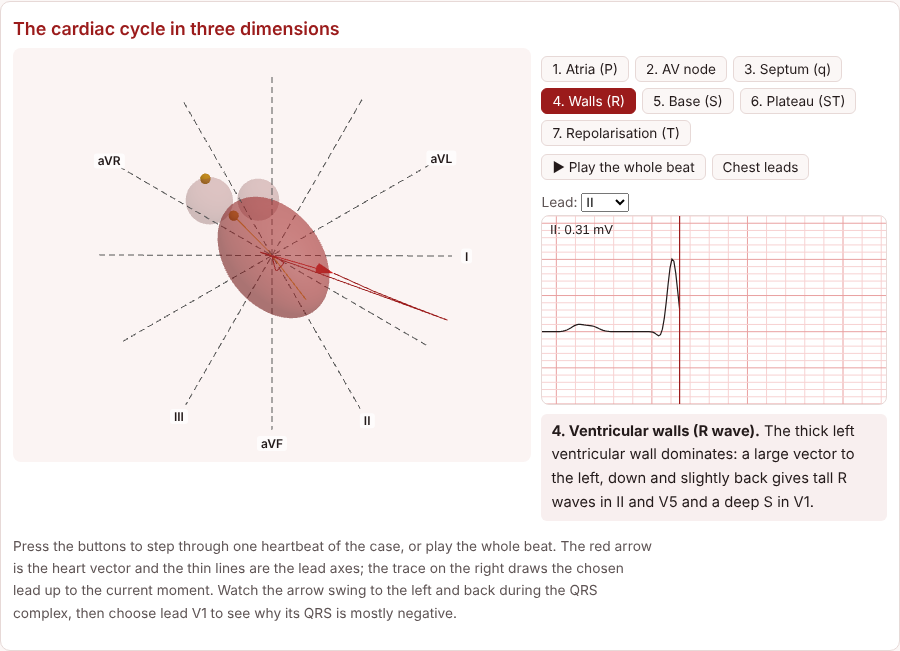</td><td width="50%">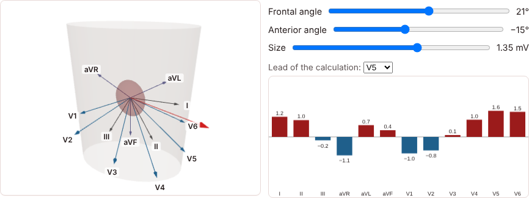</td></tr>
<tr><td>Lecture page, Week 1: the cardiac cycle in three dimensions. The heart vector sweeps through the beat while the chosen lead is drawn beside it.</td><td>Interactive lab, Week 1, Part B: twelve views of one vector, with the projection on each lead computed step by step.</td></tr>
<tr><td width="50%">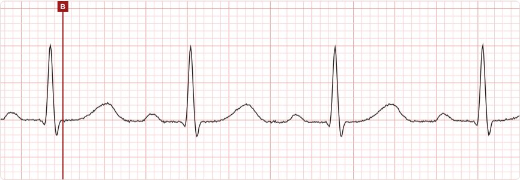</td><td width="50%">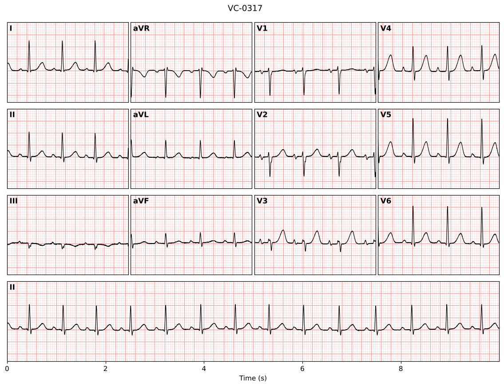</td></tr>
<tr><td>Interactive lab, Week 1, Part C: digital calipers on the ECGs of the virtual clinic. The measurements go on to a Bland-Altman analysis in the Jupyter notebook.</td><td>Jupyter notebook, Week 1, Section 4: the 12-lead ECG of the case of the week, VC-0317.</td></tr>
<tr><td width="50%">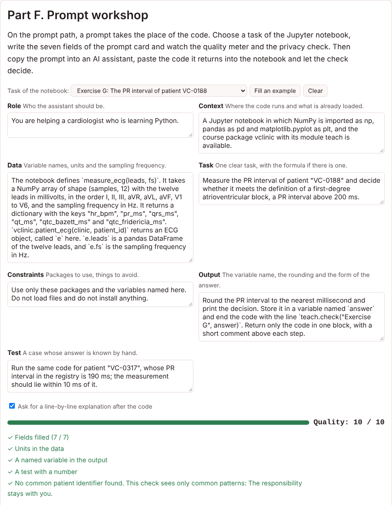</td><td width="50%">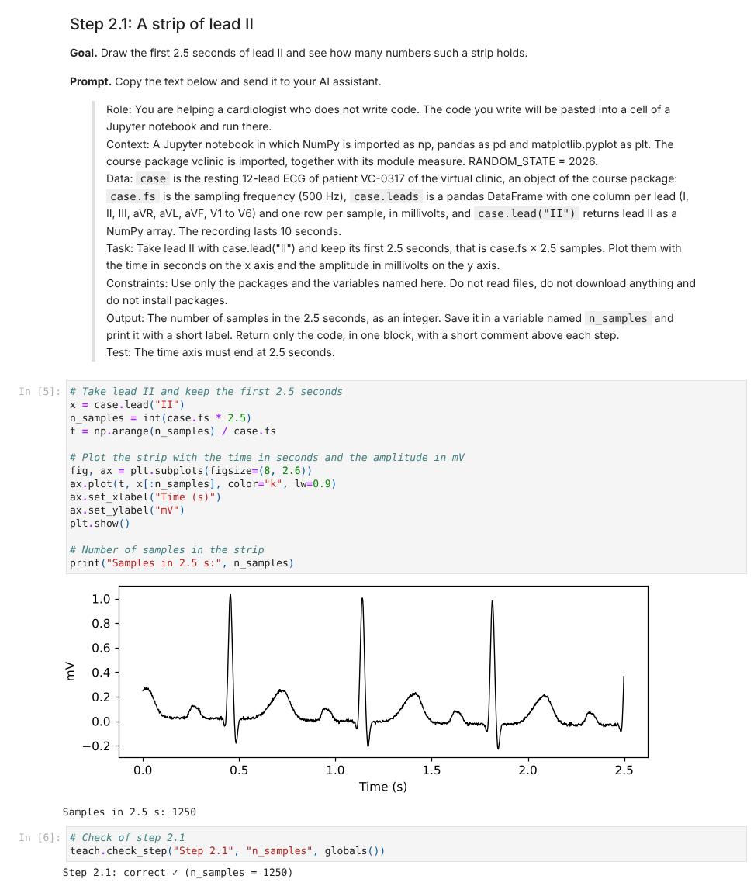</td></tr>
<tr><td>Interactive lab, Week 1, Part F: the prompt workshop. The seven fields of the prompt card, a quality meter and a privacy check.</td><td>Jupyter notebook, Week 1, prompt path, Stop 2: a ready prompt, the code of an AI assistant and the check of the course.</td></tr>
<tr><td width="50%">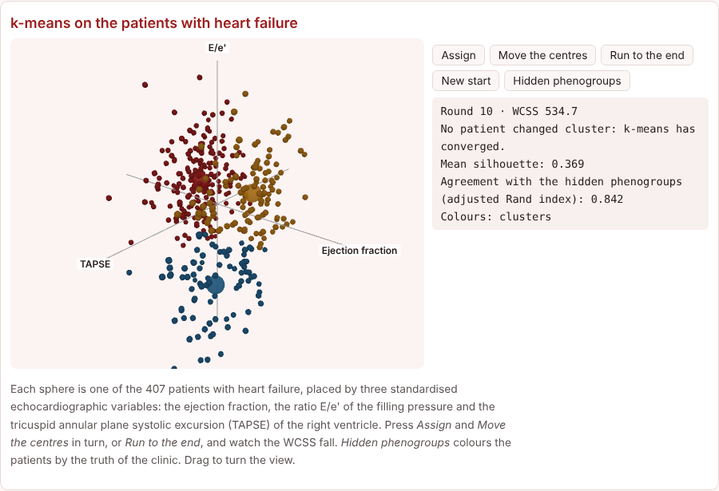</td><td width="50%">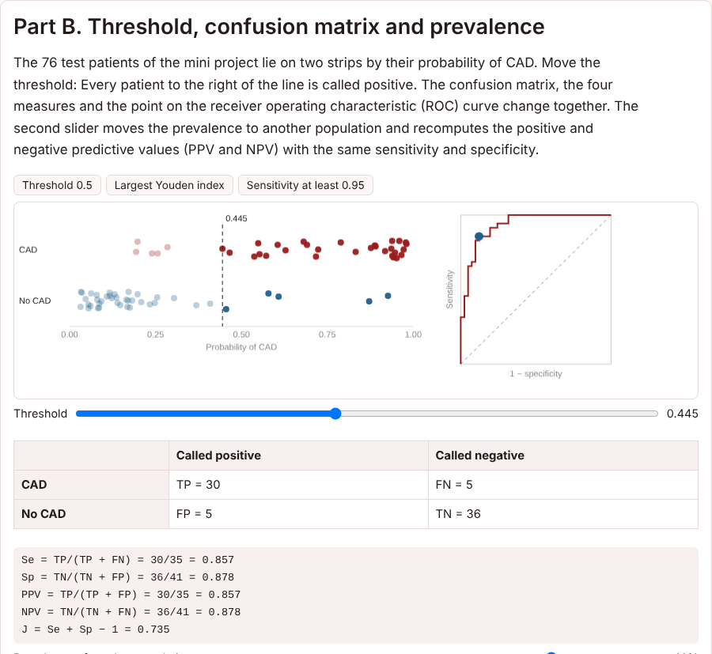</td></tr>
<tr><td>Lecture page, Week 2: k-means in three dimensions on the 407 patients with heart failure. The algorithm assigns and moves its centres step by step until the clusters stop changing.</td><td>Interactive lab, Week 2, Part B: the threshold of a model for coronary artery disease, its confusion matrix, the four measures and the point on the ROC curve.</td></tr>
<tr><td width="50%">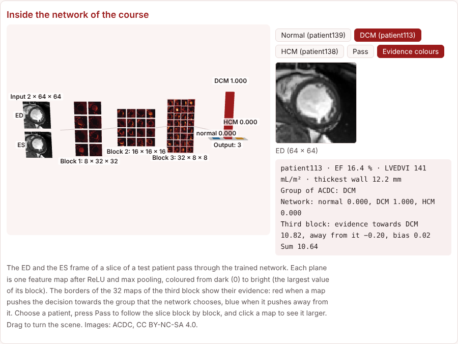</td><td width="50%">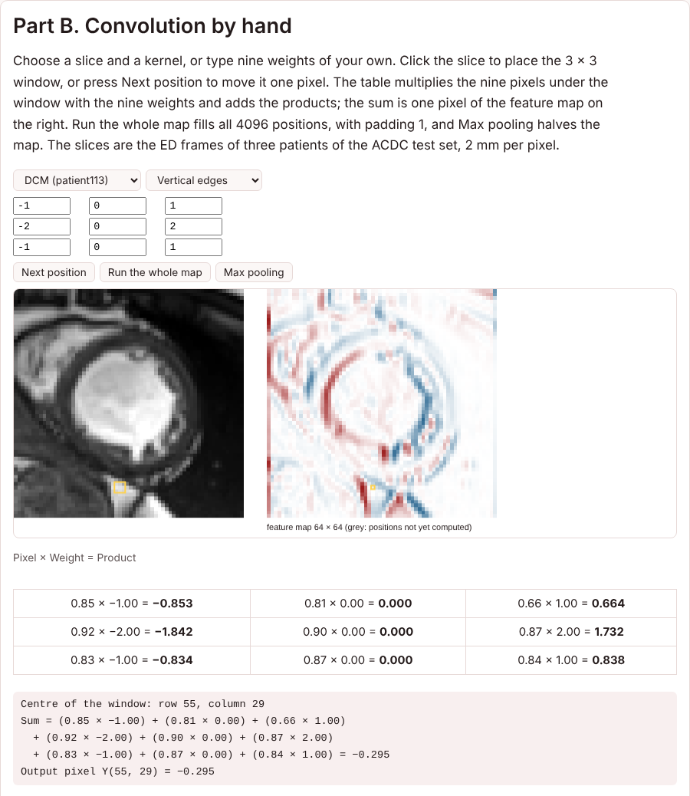</td></tr>
<tr><td>Lecture page, Week 3: inside the network of the imaging laboratory. The ED and ES frames of a cine CMR slice of ACDC pass through three blocks of feature maps to the probabilities of a normal heart, DCM and HCM. Images: ACDC, CC BY-NC-SA 4.0.</td><td>Interactive lab, Week 3, Part B: a 3 × 3 kernel slides over a cine CMR slice of ACDC, with the nine products of one position and the feature map that grows. Images: ACDC, CC BY-NC-SA 4.0.</td></tr>
</table>

## Who the course is for

The course is written for cardiologists and other specialist physicians. No programming experience and no previous knowledge of artificial intelligence are needed. The lecture page of each week is the main route: It explains the concepts without code and without prompts. At two or three practice stops of the page, every participant chooses one of two paths in the Jupyter notebook. On the **prompt path** (Part 1 of the notebook), an AI assistant writes the code from ready prompts, and the participant runs it and checks the result; ready code is at hand for every step, so no one gets stuck ([PROMPT_PATH.md](PROMPT_PATH.md)). On the **Python path** (Part 2), the participant learns to write the code with a Python step and exercises ([PYTHON_PATH.md](PYTHON_PATH.md)). Both paths reach the same results, and the path can be changed at any stop. Clinical knowledge of the ECG and of cardiac imaging is assumed, and the mathematics is introduced where it is needed, with worked examples.

## Course learning outcomes

By the end of the course, participants are expected to analyse clinical tables, signals and images with Python, and to build, validate and explain machine learning and deep learning models on cardiology data. They should be able to process the ECG as a signal, train models that detect rhythm disorders and ischaemia, and segment cardiac images to measure the ejection fraction. They should be able to extract information from clinical text, combine data of several kinds in one model and explain the decisions of a model with methods of explainable artificial intelligence (XAI). Finally, they should be able to build a prototype of a clinical decision support system (CDSS), work with AI assistants safely and appraise published AI studies in cardiology critically.

## How the course works

Every week follows the same rhythm. It opens with **the case of the week**, a patient of the virtual clinic whose question is answered by the end of the week. The **lecture page** is the main route: It explains the concepts with formulas, worked examples, a three-dimensional (3D) scene, animations and knowledge checks, and it contains no code. The **interactive lab** turns the key ideas into simulations and step-by-step calculations in the browser. At the **practice stops** of the lecture page, the **Jupyter notebook** carries out the same ideas on synthetic and real data, on the prompt path or on the Python path. A section **with your own data** shows how the methods of the week apply to the data of one's own clinic. **The paper of the week** connects the topic with a published study, and the **weekly project** applies the methods to new patients and real records. Each week ends with a new **stage of the virtual clinic**.

| Material | Role |
|---|---|
| Week page (README) | Overview of the week: materials, learning outcomes, study path, weekly project and submission |
| Lecture page (main route) | Concepts, formulas with worked examples, a 3D scene, animations, knowledge checks, practice stops, the section on your own data and review cards; no code and no prompts |
| Interactive lab | Simulations and calculations in Parts A, B, C and so on, a self-assessment and a learning log to export |
| Jupyter notebook | Part 1, the prompt path: the steps of each practice stop with a ready prompt, an automatic check and ready code. Part 2, the Python path: a Python step and numbered sections with exercises that check themselves. It runs in Google Colab or in Jupyter (Anaconda). |
| Prompt library | Every prompt of the prompt path of the week, with a copy button on GitHub |
| PDF notes | The lecture page for reading and printing, with the prompts and the Python step in two appendices |

The materials link to each other in one direction. The lecture page opens the parts of the interactive lab in the order A, B, C and the practice stops in increasing order. Each practice stop names the step of the prompt path and the sections of the Python path that reach its result, and each part of the lab ends with a link to the same places.

## The eleven weeks

The plan follows the program of the Turkish Society of Cardiology. Each week is published with all its materials, and the [syllabus](SYLLABUS.md) describes the content of every session.

| Week | Topic | Stage of the virtual clinic | Weekly project | Materials |
|---|---|---|---|---|
| 1 | Python and cardiology data basics | Patient registry and ECG laboratory | Automatic measurement of PR, QRS and QT, with the frontal axis and two QT corrections | [Week page](en/week-01/README.md) · [Lecture page](https://utkukose.github.io/ai-cardiology-tkd-NB-lecture/en/week-01/lecture.html) · [Interactive lab](https://utkukose.github.io/ai-cardiology-tkd-NB-lecture/en/week-01/lab.html) · [Jupyter notebook](en/week-01/NB01_python_and_ecg_basics.ipynb) · [Prompt library](en/week-01/PROMPTS.md) · [PDF notes](en/week-01/Week01_Lecture_Notes.pdf) |
| 2 | Machine learning fundamentals | Risk outpatient clinic | Clustering of heart failure with preserved and reduced ejection fraction, with Kaplan-Meier survival analysis | [Week page](en/week-02/README.md) · [Lecture page](https://utkukose.github.io/ai-cardiology-tkd-NB-lecture/en/week-02/lecture.html) · [Interactive lab](https://utkukose.github.io/ai-cardiology-tkd-NB-lecture/en/week-02/lab.html) · [Jupyter notebook](en/week-02/NB02_machine_learning_fundamentals.ipynb) · [Prompt library](en/week-02/PROMPTS.md) · [PDF notes](en/week-02/Week02_Lecture_Notes.pdf) |
| 3 | Deep learning and convolutional neural networks | Imaging laboratory | Classification of dilated and hypertrophic cardiomyopathy on cardiac magnetic resonance images | [Week page](en/week-03/README.md) · [Lecture page](https://utkukose.github.io/ai-cardiology-tkd-NB-lecture/en/week-03/lecture.html) · [Interactive lab](https://utkukose.github.io/ai-cardiology-tkd-NB-lecture/en/week-03/lab.html) · [Jupyter notebook](en/week-03/NB03_deep_learning_and_cnns.ipynb) · [Prompt library](en/week-03/PROMPTS.md) · [PDF notes](en/week-03/Week03_Lecture_Notes.pdf) |
| 4 | Transfer learning | Echo measurement: automatic ejection fraction | Segmentation of the left ventricle and automatic ejection fraction | In preparation |
| 5 | Time series analysis and ECG artificial intelligence | Rhythm and STEMI alarm | A STEMI alarm: automatic detection of ST deviation on 12-lead ECGs | In preparation |
| 6 | Natural language processing and clinical text mining | Report archive: clinical text | A pipeline that extracts the degree of stenosis and the vessel from angiography reports | In preparation |
| 7 | Vision transformers | Catheterisation laboratory | Detection of stenosis on coronary angiograms: convolutional network, vision transformer and hybrid compared | In preparation |
| 8 | Multimodal artificial intelligence and data fusion | Heart team: data fusion | Prediction of major adverse cardiovascular events (MACE) in a simulated triage | In preparation |
| 9 | Model reliability and explainable artificial intelligence | Quality and safety committee: XAI | Grad-CAM maps of the echo model compared with the reading of an expert | In preparation |
| 10 | Clinical decision support systems | Decision support at the bedside | A user test of the decision support prototype and its improvement | In preparation |
| 11 | Final project and certificate | Own units: final projects | Final project: an end-to-end AI pipeline for a question of the participant's own clinic, and a personal action plan | In preparation |

## The virtual clinic, the project of the course

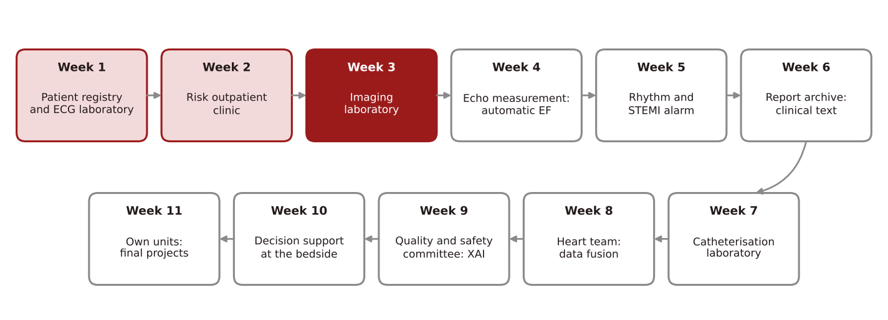

The clinic grows by one unit every week. Its registry starts with 500 synthetic patients with demographic data, risk factors, laboratory values, an ejection fraction, a main diagnosis and a 12-lead ECG. Week 2 extends it to 2000 patients with echocardiographic variables and five years of follow-up. The effect sizes behind the registry are documented in the package, so that a fitted model can be compared with the truth. From Week 3, the clinic also reads real images from public research archives: cine cardiac magnetic resonance (CMR) examinations of ACDC, which every participant downloads from their public source, and echocardiography videos of EchoNet-Dynamic for participants with a personal registration. The images never enter the repository. The table collects the results of the stages published so far.

| Week | Stage | Methods | Result |
|---|---|---|---|
| 1 | [Patient registry and ECG laboratory](https://utkukose.github.io/ai-cardiology-tkd-NB-lecture/en/week-01/lecture.html#the-virtual-clinic-stage-1-the-clinic-opens) | pandas, a 12-lead ECG model, automatic interval measurement, a simplified Pan-Tompkins detector | 500 patients; mean errors of −1.5 ms (PR), 2.3 ms (QRS) and 2.2 ms (QT) on 100 patients; 2273 of 2273 beats of MIT-BIH record 100 detected |
| 2 | [Risk outpatient clinic](https://utkukose.github.io/ai-cardiology-tkd-NB-lecture/en/week-02/lecture.html#the-virtual-clinic-stage-2-the-risk-outpatient-clinic-opens) | scikit-learn, logistic regression, cross-validation, random forests, k-means, Kaplan-Meier curves and the log-rank test | 2000 patients with five years of follow-up; cross-validated AUC of 0.871 for coronary artery disease on the Cleveland data; three phenogroups of heart failure with an adjusted Rand index of 0.71 and 64 to 89 percent free of events at 24 months |
| 3 | [Imaging laboratory](https://utkukose.github.io/ai-cardiology-tkd-NB-lecture/en/week-03/lecture.html#the-virtual-clinic-stage-3-the-imaging-laboratory-opens) | PyTorch, a convolutional neural network with three blocks, dropout, batch normalisation, augmentation and early stopping, precision, recall and F1 | Cine CMR of 90 patients of ACDC (normal, DCM, HCM); on the 30 test patients an accuracy of 0.933 and a macro F1 of 0.933 from three middle slices, against 0.967 for the rules of ACDC on the measurements of the expert contours |

## Working with AI assistants

From the first week, participants write code together with an AI assistant, and the course treats this as a clinical skill with its own safety rules. Three tools support it. The **prompt card** states the task, the data format, the units, the sampling frequency and a test with a known answer, and it never describes the patient. The **code safety checklist** adapts the three pauses of the surgical safety checklist [1]: *sign in* before running the code, *time out* while it runs and *sign out* before its result is used. The **AI usage log** records the tool, the prompt, what was checked and what was changed, and it is part of every weekly project.

The **prompt path** turns these tools into a way of learning. Part 1 of every Jupyter notebook holds the steps of the practice stops. Each step has a ready prompt on the prompt card, a cell for the code of the assistant, a check against a known answer and ready code for participants who get stuck. [PROMPT_PATH.md](PROMPT_PATH.md) describes the path, the assistants that work with it and its rules of privacy.

Real patient data stay on the participant's own computer, under the rules of the institution and of the Turkish Law on the Protection of Personal Data (KVKK) [2]. They never enter a cloud notebook or an AI chat. All data sets of the course are synthetic or come from public research databases.

## With your own data

The course works with synthetic patients and public data, but its aim is the data of the participant's own clinic. Every lecture page ends with a section on applying the methods of the week to one's own data. [OWN_DATA.md](OWN_DATA.md) brings these sections together: which question fits which method, how the data leave the hospital systems, the approval of an ethics committee, the Turkish Law on the Protection of Personal Data (KVKK) and where to compute.

## Python for non-programmers

Part 2 of every Jupyter notebook is the Python path. It opens with a Python step that teaches the constructs of the week with examples from the clinic, and *Python note* cells explain each new construct where it first appears. Every exercise checks the answer at once. The [start-here notebook](en/start-here/NB00_start_here.ipynb) prepares the computer and the first lines of Python before Week 1, and [PYTHON_PATH.md](PYTHON_PATH.md) lists the Python steps of all weeks. Participants who do not want to write code follow the [prompt path](PROMPT_PATH.md), where the language is met by running and checking the code that an assistant writes for a well-described task.

## Assessment and certificate

| Component | Weight | Requirement for the certificate |
|---|---|---|
| Weekly projects (Weeks 1 to 10) | 40 percent | At least 70 percent in each project |
| Final project (presentation and code) | 40 percent | Evaluation by a jury and by the participants |
| Participation and active learning | 20 percent | Attendance of at least 80 percent |

Each weekly project is submitted by e-mail before the session of the following week. The e-mail holds the report written in the [report template](en/templates/Report_Template.docx), the AI usage log, the completed Jupyter notebook and the learning log exported from the interactive lab. The [final project page](en/final-project/README.md) describes the options, the requirements and the rubric of the final project.

## Running the materials

Every Jupyter notebook runs in two places, with the same data and the same results: in Google Colab, with nothing to install, and in Jupyter (Anaconda) on the participant's own computer. Participants choose the one they prefer. [SETUP.md](SETUP.md) explains both step by step. In Colab, the first cell of a notebook downloads the course package and the data files. Work with the data of real patients belongs only in Jupyter on a computer of the institution. The lecture pages and the interactive labs run in any modern browser, on a computer or a phone, without installation.

## Data

[DATASETS.md](DATASETS.md) lists every data set with its source, license and citation. Week 1 uses the Cleveland data of the UCI Heart Disease data set [3], record 100 of the MIT-BIH Arrhythmia Database [4, 5] and one record of the PTB Diagnostic ECG Database [6], published on PhysioNet [7]. These files are included in the [data](data) folder, so the notebooks run without registration.

## Reference integrity

Every source of the course is a published work with a digital object identifier (DOI) or a publisher page, and its details were checked against the publisher. The [references](references) folder holds the full list in APA 7 style, in BibTeX and in JSON. The script [tools/verify_references.py](tools/verify_references.py) compares every entry with Crossref, DataCite and OpenAlex. A GitHub Actions workflow runs it every month and whenever the references change.

## Citing this course

Kose, U. (2026). *Artificial Intelligence with Python: A Hands-on Training Program for Cardiologists: Open course materials* [Course materials]. GitHub. https://github.com/utkukose/ai-cardiology-tkd-NB-lecture

The file [CITATION.cff](CITATION.cff) holds the same information for reference managers.

## License

The content of the course (texts, figures, lecture pages, interactive labs and notes) is licensed under the [Creative Commons Attribution 4.0 International License](LICENSE-CONTENT) (CC BY 4.0). The code, including the package `vclinic` and the code in the Jupyter notebooks, is licensed under the [MIT License](LICENSE). The data sets keep their own licenses, listed in [DATASETS.md](DATASETS.md). The Three.js library embedded in the lecture pages and the interactive labs is distributed under the MIT License ([assets/vendor/LICENSE-three.txt](assets/vendor/LICENSE-three.txt)).

## References cited on this page

1. Haynes, A. B., Weiser, T. G., Berry, W. R., Lipsitz, S. R., Breizat, A.-H. S., Dellinger, E. P., Herbosa, T., Joseph, S., Kibatala, P. L., Lapitan, M. C. M., Merry, A. F., Moorthy, K., Reznick, R. K., Taylor, B., & Gawande, A. A. (2009). A surgical safety checklist to reduce morbidity and mortality in a global population. *New England Journal of Medicine, 360*(5), 491–499. https://doi.org/10.1056/NEJMsa0810119
2. Kişisel Verilerin Korunması Kanunu [Law on the Protection of Personal Data], Law No. 6698. (2016). *Resmî Gazete, 29677 (7 April 2016)*. https://www.mevzuat.gov.tr/mevzuat?MevzuatNo=6698&MevzuatTur=1&MevzuatTertip=5
3. Janosi, A., Steinbrunn, W., Pfisterer, M., & Detrano, R. (1989). *Heart Disease* [Data set]. UCI Machine Learning Repository. https://doi.org/10.24432/C52P4X
4. Moody, G. B., & Mark, R. G. (2005). *MIT-BIH Arrhythmia Database (version 1.0.0)* [Data set]. PhysioNet. https://doi.org/10.13026/C2F305
5. Moody, G. B., & Mark, R. G. (2001). The impact of the MIT-BIH Arrhythmia Database. *IEEE Engineering in Medicine and Biology Magazine, 20*(3), 45–50. https://doi.org/10.1109/51.932724
6. Bousseljot, R., Kreiseler, D., & Schnabel, A. (2004). *The PTB Diagnostic ECG Database (version 1.0.0)* [Data set]. PhysioNet. https://doi.org/10.13026/C28C71
7. Goldberger, A. L., Amaral, L. A. N., Glass, L., Hausdorff, J. M., Ivanov, P. Ch., Mark, R. G., Mietus, J. E., Moody, G. B., Peng, C.-K., & Stanley, H. E. (2000). PhysioBank, PhysioToolkit, and PhysioNet: Components of a new research resource for complex physiologic signals. *Circulation, 101*(23), e215–e220. https://doi.org/10.1161/01.CIR.101.23.e215

## Human-AI collaboration

This course was developed through human-AI collaboration. Human intellectual knowledge and expertise are the fundamental starting point of the course. The course author guides and supervises every stage of its development. The final version is presented only after the course author's review and approval.

---

**Prof. Dr. Utku Kose**

Full Professor, Department of Computer Engineering, Süleyman Demirel University, Isparta, Türkiye 
Founding Director, AI Application and Research Center (YAZEM), Süleyman Demirel University 
Head of the Computer Science Division, Department of Computer Engineering, Süleyman Demirel University 
Additional affiliations: University of North Dakota (USA), Universidad Panamericana (Mexico City, Mexico), Vel Tech University (Chennai, India) 
IEEE Senior Member, ACM Professional Member

[ORCID 0000-0002-9652-6415](https://orcid.org/0000-0002-9652-6415) | [utkukose.com](https://www.utkukose.com) | [github.com/utkukose](https://github.com/utkukose)

[utkukose@sdu.edu.tr](mailto:utkukose@sdu.edu.tr) | [utku.kose@und.edu](mailto:utku.kose@und.edu) | [ukose@up.edu.mx](mailto:ukose@up.edu.mx) | [utkukose@gmail.com](mailto:utkukose@gmail.com)

*This course is updated in line with current developments in the field. First version: November 2026.*

## Acknowledgments

This training program was prepared for the Turkish Society of Cardiology (Türk Kardiyoloji Derneği). The author thanks the Society for the opportunity to offer it to cardiologists and other specialist physicians. The author also thanks the teams behind PhysioNet and the UCI Machine Learning Repository, whose open data make the hands-on work of the course possible.
