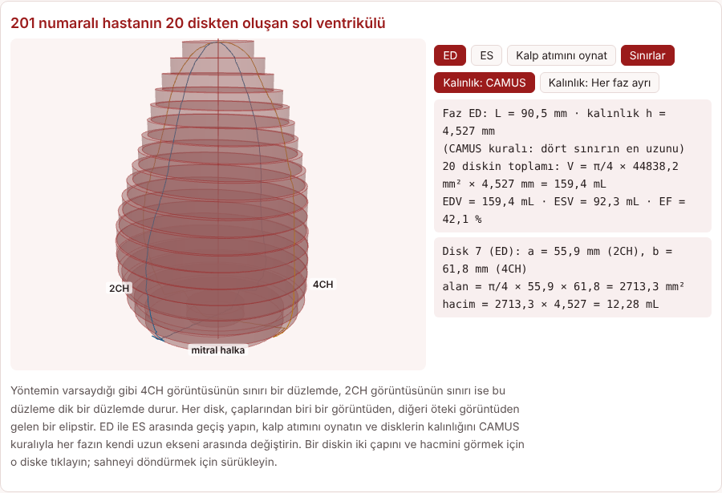
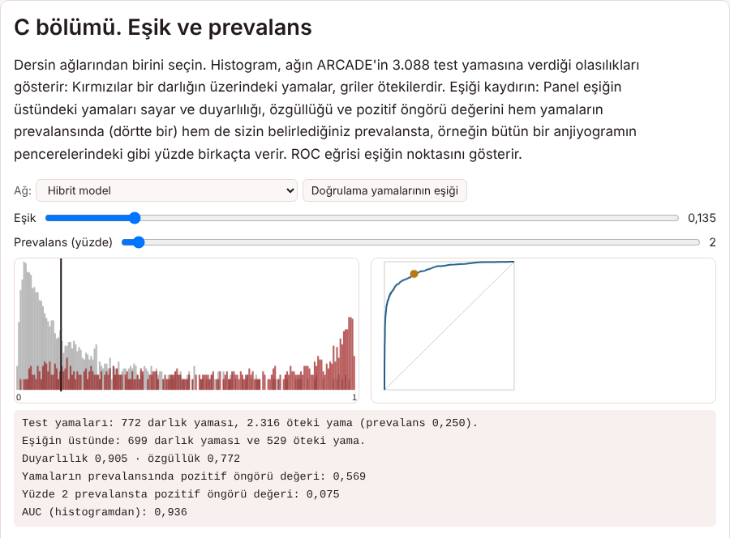
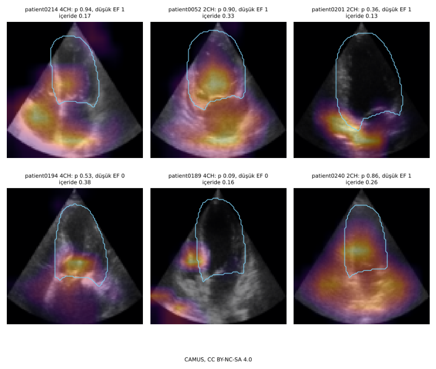

# Python ile Yapay Zekâ Eğitimi: Kardiyologlar için Uygulamalı Eğitim Programı

**Eğitim programı, Türk Kardiyoloji Derneği, Türkiye**

*Kardiyologlar ve diğer uzman hekimler için on bir haftada Python ve yapay zekâ: Sanal bir kardiyoloji kliniği, gerçek EKG verileri, etkileşimli lablar, Jupyter Notebook'lar ve yapay zekâ asistanlarıyla güvenli kod yazımı*

**Bu eğitim, alandaki güncel gelişmeler doğrultusunda güncellenmektedir. İlk sürüm: Kasım 2026.**

**Prof. Dr. Utku Köse**

Profesör, Bilgisayar Mühendisliği Bölümü, Süleyman Demirel Üniversitesi, Isparta, Türkiye 
Kurucu Müdür, Yapay Zekâ Uygulama ve Araştırma Merkezi (YAZEM), Süleyman Demirel Üniversitesi 
Bilgisayar Bilimleri Anabilim Dalı Başkanı, Bilgisayar Mühendisliği Bölümü, Süleyman Demirel Üniversitesi 
Diğer kurumlar: University of North Dakota (ABD), Universidad Panamericana (Meksiko, Meksika), Vel Tech University (Chennai, Hindistan) 
IEEE Kıdemli Üyesi, ACM Profesyonel Üyesi

[ORCID 0000-0002-9652-6415](https://orcid.org/0000-0002-9652-6415) | [utkukose.com](https://www.utkukose.com) | [github.com/utkukose](https://github.com/utkukose)

[utkukose@sdu.edu.tr](mailto:utkukose@sdu.edu.tr) | [utku.kose@und.edu](mailto:utku.kose@und.edu) | [ukose@up.edu.mx](mailto:ukose@up.edu.mx) | [utkukose@gmail.com](mailto:utkukose@gmail.com)

[English version](README.md)

## Eğitim hakkında

Bu depoda, Türk Kardiyoloji Derneği için hazırlanan *Python ile Yapay Zekâ Eğitimi: Kardiyologlar için Uygulamalı Eğitim Programı* adlı eğitimin açık erişimli malzemeleri yer almaktadır. Eğitim, haftada bir yapılan dört saatlik oturumlarla on bir hafta sürer. Toplam süre 44 saattir ve bu sürenin yaklaşık yüzde 80'i uygulamaya ayrılmıştır. Her hafta bir klinik vakadan, haftanın ana rotasını oluşturan bir ders sayfasından, bir etkileşimli labdan, uygulama duraklarının her birinde Python temelleri, hazır prompt (istem) metinleri ve hazır bir uygulama sunan bir Jupyter Notebook'tan ve bir haftalık projeden oluşur. Bütün malzemeler İngilizce ve Türkçe olarak hazırlanmıştır ve eğitim Türkçe yürütülmektedir.

Eğitimin ana ekseni sanal bir kardiyoloji kliniğidir. `vclinic` ders paketi, sentetik hastalardan oluşan bir hasta kaydı üretmektedir. Bu hastaların elektrokardiyogramları (EKG), laboratuvar değerleri ve sonraki haftalarda eklenen görüntüleri ve raporları birbiriyle tutarlıdır. Kliniğe her hafta yeni bir birim eklenir; 1. haftanın hasta kaydı ve EKG laboratuvarıyla başlayan bu gelişim, 10. haftanın yatak başı karar desteğine kadar sürer. Sentetik verilerin ardındaki gerçek değerler bilindiği için her ölçüm ve her model bu değerlerle karşılaştırılarak doğrulanabilir. Her hafta açık erişimli gerçek veri setleri de kullanılmakta ve böylece her yöntem gerçek kayıtlar üzerinde de sınanmaktadır.

Eğitimde, yapay zekâ (YZ) asistanlarıyla nasıl çalışılacağı da öğretilmektedir. İlk haftadan başlayarak Jupyter Notebook'taki her uygulama durağında kodu, kendisine verilen hazır bir prompt yardımıyla bir YZ asistanı yazabilir. Kodu kendisi yazmak isteyenler için durağın Python temelleri, yalnızca sonucu görmek isteyenler için de durağın hazır uygulaması bulunmaktadır. Promptlarda birimler ve testler belirtilir; asistanın yazdığı kod bir kod güvenlik kontrol listesiyle denetlenir ve asistanın her kullanımı YZ kullanım günlüğüne kaydedilir. Hiçbir prompta hasta verisi konmaz.

**Ders sitesi (isteğe bağlı).** Ders akışına eğitimin ders sitesinden, [utkukose.github.io/ai-cardiology-tkd-NB-lecture](https://utkukose.github.io/ai-cardiology-tkd-NB-lecture/) adresinden de devam edebilirsiniz. Site, haftaların ders sayfalarını, etkileşimli lablarını ve Jupyter Notebook'larını bir arada sunduğu için eğitimde daha pratik bir ilerleme sağlamaktadır.

## Başka derslerde kullanım

Malzemeler, kaynak gösterilerek her düzeyde, tamamen ya da kısmen kullanılabilir ([Bu eğitime atıf](#bu-eğitime-atıf) bölümüne bakınız). Hatalar ve öneriler deponun [issues](https://github.com/utkukose/ai-cardiology-tkd-NB-lecture/issues) bölümünden bildirilebilir. Eğitim sürerken sorular ve haftalık projeler utkukose@sdu.edu.tr ya da utkukose@gmail.com adresine gönderilebilir.

## Malzemelerden görüntüler

<table>
<tr><td width="50%"></td><td width="50%"></td></tr>
<tr><td>Ders sayfası, 1. hafta: Üç boyutlu kalp döngüsü. Kalp vektörü atım boyunca dönerken seçilen derivasyonun trasesi yanında çizilir.</td><td>Etkileşimli lab, 1. hafta, B bölümü: Tek bir vektöre on iki derivasyondan bakılır ve her derivasyondaki izdüşüm adım adım hesaplanır.</td></tr>
<tr><td width="50%"></td><td width="50%"></td></tr>
<tr><td>Etkileşimli lab, 1. hafta, C bölümü: Sanal kliniğin EKG'leri üzerinde dijital kaliperle ölçüm yapılır. Ölçümler Jupyter Notebook'ta Bland-Altman analiziyle değerlendirilir.</td><td>Jupyter Notebook, 1. hafta, «Durak 2 · Hazır uygulama»: Haftanın vakası olan VC-0317'nin 12 derivasyonlu EKG'si.</td></tr>
<tr><td width="50%"></td><td width="50%"></td></tr>
<tr><td>Etkileşimli lab, 1. hafta, F bölümü: Prompt atölyesi. Ekranda prompt kartının yedi alanı, kalite göstergesi ve hasta verisi uyarısı görülmektedir.</td><td>Jupyter Notebook, 1. hafta, «Durak 2 · Prompt ile uygulama»: Hazır bir prompt, bir YZ asistanının bu prompta yazdığı kod ve eğitimin kontrol satırı.</td></tr>
<tr><td width="50%"></td><td width="50%"></td></tr>
<tr><td>Ders sayfası, 2. hafta: Kalp yetersizliği olan 407 hastada üç boyutlu k-ortalamalar. Algoritma, kümeler değişmeyi bırakana kadar hastaları adım adım kümelere atar ve merkezleri taşır.</td><td>Etkileşimli lab, 2. hafta, B bölümü: Koroner arter hastalığı modelinin eşiği değiştikçe karışıklık matrisi, dört ölçüt ve ROC eğrisi üzerindeki nokta birlikte değişir.</td></tr>
<tr><td width="50%"></td><td width="50%"></td></tr>
<tr><td>Ders sayfası, 3. hafta: Görüntüleme laboratuvarındaki ağın içi. ACDC'den bir sine KMR kesitinin diyastol sonu ve sistol sonu kareleri, öznitelik haritalarından oluşan üç bloktan geçerek normal kalp, DCM ve HCM olasılıklarına ulaşır. Görüntüler: ACDC, CC BY-NC-SA 4.0.</td><td>Etkileşimli lab, 3. hafta, B bölümü: 3 × 3'lük bir çekirdeğin ACDC'den alınan bir sine KMR kesiti üzerinde kayması; bir konumun dokuz çarpımı ve giderek büyüyen öznitelik haritası. Görüntüler: ACDC, CC BY-NC-SA 4.0.</td></tr>
<tr><td width="50%"></td><td width="50%"></td></tr>
<tr><td>Ders sayfası, 4. hafta: CAMUS'un 201 numaralı hastasının sol ventrikülü 20 diskle gösterilir. Her disk, bir çapı iki boşluk görüntüsünden, diğeri dört boşluk görüntüsünden gelen bir elipstir; hacim disklerin toplamıdır. Veri: CAMUS, CC BY-NC-SA 4.0.</td><td>Etkileşimli lab, 4. hafta, D bölümü: U-Net'in CAMUS'un 50 test hastasındaki ejeksiyon fraksiyonu için Bland-Altman grafiği; panelde ortalama fark, uyum sınırları ve tıklanan bir hastanın ölçümleri yer almaktadır. Veri: CAMUS, CC BY-NC-SA 4.0.</td></tr>
<tr><td width="50%"></td><td width="50%"></td></tr>
<tr><td>Ders sayfası, 5. hafta: Akut bir enfarktüsün ST hasar vektörü ve on iki derivasyon üzerindeki izdüşümleri. Evrensel tanımın eşiklerine ulaşan derivasyonlar kırmızıya döner ve alarm, ardışık derivasyon grubunu adlandırır.</td><td>Etkileşimli lab, 5. hafta, D bölümü: PTB-XL'in 13913 numaralı kaydının on iki derivasyonundaki medyan atımlar; PR segmenti, J noktası, her derivasyonun ST sapması ve STEMI alarmının kararı. Veri: PTB-XL, CC BY 4.0.</td></tr>
<tr><td width="50%"></td><td width="50%"></td></tr>
<tr><td>Ders sayfası, 6. hafta: Sentetik rapor arşivinden kırk kelime, kelime vektörlerine göre üç boyutta yerleştirilmiştir. Bağlam bütün epikriz olduğunda kelimeler hastalıklara göre kümelenmekte, apiksaban da öteki antikoagülanların ve düzensiz ritmin yanında yer almaktadır.</td><td>Etkileşimli lab, 6. hafta, D bölümü: Arterleri, segmentleri ve darlıklarıyla sentetik bir koroner anjiyografi raporu; cümleler işlem hattının okuduğu biçimde, dört bölge de kayıt sistemiyle yan yana gösterilir.</td></tr>
<tr><td width="50%"></td><td width="50%"></td></tr>
<tr><td>Ders sayfası, 7. hafta: VC-2427'nin sol anjiyogramı ViT-B/16'nın 196 yamasına bölünmüştür. Çubuklar, sınıf token'ının ya da tıklanarak seçilen bir yamanın en büyük dikkatini tek bir katmanda ya da on iki katman boyunca izlenerek gösterir; kareler kayıt sistemindeki darlıkları işaretler.</td><td>Etkileşimli lab, 7. hafta, C bölümü: Hibrit modelin ARCADE test yamalarındaki olasılıkları üzerinde eşik; duyarlılık, özgüllük ve pozitif öngörü değeri yamaların prevalansında ve yüzde 2 prevalansta gösterilir.</td></tr>
<tr><td width="50%"></td><td width="50%"></td></tr>
<tr><td>Ders sayfası, 8. hafta: Göğüs ağrısı ünitesinin 800 test hastası, üç tek modaliteli modelin (klinik tablo, troponin ve EKG) logitlerinin oluşturduğu uzayda gösterilir. Logit ortalamasıyla ya da istiflemeyle yapılan geç füzyonun düzlemi, seçilen eşikte yüksek riskli sayılan hastaları ayırır.</td><td>Etkileşimli lab, 8. hafta, D bölümü: 800 test hastasının tahmin edilen riskleri üzerinde bir taburculuk eşiği; eve gönderilen hastalar, Wilson aralığıyla kaçırılan olaylar, duyarlılık ve net yarar HEART 0-3 ile yan yana gösterilir.</td></tr>
<tr><td width="50%"></td><td width="50%"></td></tr>
<tr><td>Ders sayfası, 9. hafta: 172 numaralı hastanın üç değişkeninin sekiz koalisyonu bir küpün köşeleri olarak gösterilir. Her kenarda bir değişken eklenir; boş koalisyondan tam koalisyona giden altı yol, ortalama katkıları Shapley değerlerini veren altı sırayı oluşturur.</td><td>Jupyter Notebook, 9. hafta, «Durak 2 · Hazır uygulama»: Eko ağının CAMUS test görüntülerindeki Grad-CAM haritaları ve sol ventrikülün uzman sınırı. Veri: CAMUS, CC BY-NC-SA 4.0.</td></tr>
</table>

## Eğitim kimler için?

Eğitim, kardiyologlar ve diğer uzman hekimler için hazırlanmıştır. Programlama deneyimi ve yapay zekâ konusunda ön bilgi gerekmemektedir. Her haftanın ders sayfası ana rotadır ve kavramlar bu sayfada kod ve prompt kullanılmadan anlatılır. Sayfadaki iki ya da üç uygulama durağında çalışma Jupyter Notebook'ta sürer ve orada her durak üç bölümden oluşur. **Python temelleri** bölümünde durağın gerektirdiği Python bilgisi, cevabı hemen kontrol edilen alıştırmalarla öğretilir ([PYTHON_PATH.tr.md](PYTHON_PATH.tr.md)). **Prompt ile uygulama** bölümünde kodu hazır promptlarla bir YZ asistanı yazar; katılımcının görevi bu kodu çalıştırmak ve sonucu denetlemektir. Her promptun hazır kodu da bulunduğu için hiçbir katılımcı takılıp kalmaz ([PROMPT_PATH.tr.md](PROMPT_PATH.tr.md)). **Hazır uygulama** bölümünde ise durağın eksiksiz çalışan programı yer almaktadır. Her bölüm bir başlangıç hücresiyle açıldığı için tek başına da çalışabilir. Katılımcıların EKG ve kardiyak görüntüleme konusunda klinik bilgi sahibi olduğu kabul edilmekte, matematik ise gerektiği yerde çözümlü örneklerle anlatılmaktadır.

## Eğitimin öğrenme çıktıları

Eğitimin sonunda katılımcıların klinik tabloları, sinyalleri ve görüntüleri Python ile analiz edebilmeleri, kardiyoloji verileri üzerinde makine öğrenmesi ve derin öğrenme modelleri kurup doğrulayabilmeleri ve açıklayabilmeleri beklenmektedir. EKG'yi bir sinyal olarak işleyebilmeli, ritim bozukluklarını ve iskemiyi tespit eden modeller eğitebilmeli ve ejeksiyon fraksiyonunu ölçmek için kardiyak görüntülerde segmentasyon yapabilmelidirler. Klinik metinden bilgi çıkarabilmeli, farklı türdeki verileri tek bir modelde birleştirebilmeli ve bir modelin kararlarını açıklanabilir yapay zekâ (XAI) yöntemleriyle açıklayabilmelidirler. Son olarak bir klinik karar destek sistemi (KKDS) prototipi kurabilmeli, YZ asistanlarıyla güvenli biçimde çalışabilmeli ve kardiyolojide yayımlanmış YZ çalışmalarını eleştirel olarak değerlendirebilmelidirler.

## Eğitim nasıl işler?

Bütün haftalar aynı düzeni izlemektedir. Hafta, sorusu haftanın sonunda cevaplanan bir sanal klinik hastasıyla, yani **haftanın vakasıyla** başlar. **Ders sayfası** haftanın ana rotasıdır; kavramlar bu sayfada formüller, çözümlü örnekler, üç boyutlu (3B) bir sahne, animasyonlar ve bilgi kontrolleriyle açıklanır ve sayfada kod bulunmaz. **Etkileşimli labda** temel fikirler, tarayıcıda çalışan simülasyonlar ve adım adım hesaplar biçiminde ele alınmaktadır. Ders sayfasının **uygulama duraklarında** ise aynı fikirler **Jupyter Notebook**'ta sentetik ve gerçek veriler üzerinde uygulanır; her durakta Python temelleri, hazır promptlar ve hazır bir uygulama yer alır. **Kendi verinizle** bölümünde, haftanın yöntemlerinin kişinin kendi kliniğinin verilerine nasıl uygulanabileceği gösterilmektedir. **Haftanın makalesi** konuyu yayımlanmış bir çalışmaya bağlar; **haftalık projede** de yöntemler yeni hastalara ve gerçek kayıtlara uygulanır. Her hafta, **sanal kliniğin yeni bir aşamasıyla** sona erer.

| Malzeme | Görevi |
|---|---|
| Hafta sayfası (README) | Haftaya genel bakış: Malzemeler, öğrenme çıktıları, çalışma yolu, haftalık proje ve teslim |
| Ders sayfası (ana rota) | Kavramlar, çözümlü örnekleriyle formüller, 3B sahne, animasyonlar, bilgi kontrolleri, uygulama durakları, "Kendi verinizle" bölümü ve tekrar kartları; kod ve prompt içermez |
| Etkileşimli lab | A, B, C ve devamı bölümlerinde simülasyonlar ve hesaplar, öz değerlendirme ve dışa aktarılan öğrenme günlüğü |
| Jupyter Notebook | Her uygulama durağında üç bölüm: Cevabı hemen kontrol edilen alıştırmalarla Python temelleri, otomatik kontrol ve hazır kodla birlikte hazır promptlar ve durağın hazır uygulaması; ardından haftalık proje. Jupyter Notebook Google Colab'da ya da Jupyter'de (Anaconda) çalışır. |
| Prompt kütüphanesi | Haftanın bütün promptları; GitHub'da her birinin yanında kopyalama düğmesi bulunur |
| PDF ders notu | Ders sayfasının okumak ve yazdırmak için hazırlanmış sürümü; uygulama duraklarının promptları ve Python temelleri iki ekte yer alır |

Malzemeler birbirine iki yönde bağlanmıştır. Ders sayfasında etkileşimli labın bölümleri A, B, C sırasıyla, uygulama durakları ise artan sırayla açılır. Her uygulama durağından, durağın Jupyter Notebook'taki üç bölümüne ulaşılabilir. Labın her bölümünün ve Jupyter Notebook'taki her durağın sonunda, ders sayfasında okumanın devam ettiği yere geri dönen bir bağlantı bulunmaktadır.

## Malzemeler hangi sırayla kullanılır?

Her hafta aynı sırayla çalışılır. Her malzemede bir sonraki adım ve geri dönülecek yer açıkça gösterildiği için aşağıdaki sıra izlendiğinde malzemeler arasında kaybolunmaz.

1. **Kurulum (bir kez).** [Kurulum rehberindeki](SETUP.tr.md) adımlarla Anaconda'yı kurunuz, ders klasörünü indiriniz ve [başlangıç Jupyter Notebook'unu](tr/baslangic/README.md) çalıştırınız. Bilgisayarına kurulum yapamayanlar aynı Jupyter Notebook'ları Google Colab'da açabilir.
2. **Hafta sayfası.** Haftanın hafta sayfasını (README) açınız. Sayfadaki «Çalışma yolu» tablosunda haftanın bütün adımları sırasıyla ve süreleriyle birlikte verilmektedir.
3. **Ders sayfası.** Ders sayfasını yukarıdan aşağıya okuyunuz. Ders sayfası haftanın ana rotasıdır.
4. **Mavi kutular: Etkileşimli lab.** Mavi bir kutuya gelince kutunun düğmesiyle labın o bölümünü açınız. Bölümü yapınız, bölümün sonundaki «Ders sayfasına dön» bağlantısına tıklayınız ve okumaya kutunun altından devam ediniz.
5. **Turuncu kutular: Uygulama durakları.** Turuncu bir kutuya gelince haftanın Jupyter Notebook'unu Colab'da ya da Jupyter'de durağın başından açınız ve durağın üç bölümünü çalışınız: Python temelleri, Prompt ile uygulama ve Hazır uygulama. Durağın sonundaki bağlantı sizi ders sayfasında okumanın devam ettiği yere geri götürecektir.
6. **Haftanın son adımları.** Ders sayfasının sonundaki «Haftanın son adımları» kutusunu izleyiniz: Labın «Kendini sına» sekmesindeki öz değerlendirmeyi yapınız, «Düşün ve dışa aktar» sekmesinde öğrenme günlüğünü dışa aktarınız ve haftalık projeyi teslim ediniz.
7. **Sonraki hafta.** Hafta sayfasının «Gelecek hafta» bölümündeki bağlantıyla bir sonraki haftaya geçiniz.

PDF ders notu, ders sayfasının yazdırılabilir biçimidir ve okuma ya da tekrar için isteğe bağlı olarak kullanılabilir. Prompt kütüphanesinde haftanın bütün promptları bir arada yer almaktadır; aynı promptlar Jupyter Notebook'ta da bulunur. Nerede kaldığınızı bulamazsanız hafta sayfasındaki «Çalışma yolu» tablosuna dönünüz.

## On bir hafta

Plan, Türk Kardiyoloji Derneği'nin programını izlemektedir. Her hafta bütün malzemeleriyle birlikte yayımlanır ve her oturumun içeriği [izlencede](SYLLABUS.tr.md) ayrıntılı olarak anlatılmaktadır.

| Hafta | Konu | Sanal kliniğin aşaması | Haftalık proje |
|---|---|---|---|
| 1 | [Python ve kardiyoloji veri temelleri](tr/hafta-01/README.md) | Hasta kaydı ve EKG laboratuvarı | EKG görselleştirme ve temel ölçümleri (PR, QRS, QT) otomatik hesaplayan kod parçası |
| 2 | [Makine öğrenmesi temelleri](tr/hafta-02/README.md) | Risk polikliniği | HFpEF vs HFrEF hasta kümeleme + Kaplan-Meier sağkalım analizi |
| 3 | [Derin öğrenme ve CNN temelleri](tr/hafta-03/README.md) | Görüntüleme laboratuvarı | Kardiyak MRI ACDC veri seti: Dilate/hipertrofik KMP otomatik sınıflandırma |
| 4 | [Transfer learning: Hazır gücü kardiyolojiye uyarla](tr/hafta-04/README.md) | Eko ölçümü: Otomatik ejeksiyon fraksiyonu | CAMUS veri seti ile sol ventrikül segmentasyonu + EF otomatik hesaplama |
| 5 | [Zaman serisi analizi ve EKG yapay zekâsı](tr/hafta-05/README.md) | Ritim ve STEMI alarmı | STEMI alarm sistemi: AMI EKG'lerinden ST deviasyonu otomatik tespiti (PTB-XL) |
| 6 | [NLP ve klinik metin madenciliği](tr/hafta-06/README.md) | Rapor arşivi: Klinik metin | Kardiyak anjiyo raporu NLP pipeline: Stenoz derecesi + etkilenen damar otomatik çıkarımı |
| 7 | [Vision Transformer (ViT): Görüntü işlemede yeni nesil](tr/hafta-07/README.md) | Kateter laboratuvarı | Koroner anjiyografi: Stenoz tespiti CNN vs ViT vs Hibrit karşılaştırması + attention haritaları |
| 8 | [Çok modlu yapay zekâ ve veri füzyonu](tr/hafta-08/README.md) | Kalp ekibi: Veri füzyonu | Gerçek zamanlı MACE tahmin modeli: Triyaj senaryosu simülasyonu (MIMIC-IV sentetik) |
| 9 | [Model güvenilirliği ve açıklanabilir yapay zekâ (XAI)](tr/hafta-09/README.md) | Kalite ve güvenlik kurulu: XAI | Grad-CAM ile ekokardiyografi modelinin 'nereye baktığını' görselleştirme ve uzman yorumuyla karşılaştırma |
| 10 | [Klinik karar destek sistemleri (CDSS)](tr/hafta-10/README.md) | Yatak başında karar desteği | Kullanıcı test oturumu: Geri bildirimlerle CDSS prototipini iyileştirme |
| 11 | [Final projesi ve mezuniyet](tr/hafta-11/README.md) | Katılımcıların birimleri: Final projeleri | Final proje sunumu + "Klinik Pratiğimde AI Nasıl Kullanacağım?" kişisel eylem planı |

### Haftaların malzemeleri

Bir haftanın her malzemesi aşağıdaki tabloda ayrı bir sütunda yer almaktadır. Hafta sayfasında haftaya genel bir bakış sunulur; Jupyter Notebook bu sayfadan Google Colab'da da açılabilir.

| Hafta | Ders sayfası | Etkileşimli lab | Jupyter Notebook | Prompt kütüphanesi | PDF ders notu |
|---|---|---|---|---|---|
| [Hafta 1](tr/hafta-01/README.md) | [Ders sayfası](https://utkukose.github.io/ai-cardiology-tkd-NB-lecture/tr/hafta-01/ders.html) | [Etkileşimli lab](https://utkukose.github.io/ai-cardiology-tkd-NB-lecture/tr/hafta-01/lab.html) | [Jupyter Notebook](tr/hafta-01/NB01_python_ve_ekg_temelleri.ipynb) | [Promptlar](tr/hafta-01/PROMPTLAR.md) | [PDF](tr/hafta-01/Hafta01_Ders_Notlari.pdf) |
| [Hafta 2](tr/hafta-02/README.md) | [Ders sayfası](https://utkukose.github.io/ai-cardiology-tkd-NB-lecture/tr/hafta-02/ders.html) | [Etkileşimli lab](https://utkukose.github.io/ai-cardiology-tkd-NB-lecture/tr/hafta-02/lab.html) | [Jupyter Notebook](tr/hafta-02/NB02_makine_ogrenmesi_temelleri.ipynb) | [Promptlar](tr/hafta-02/PROMPTLAR.md) | [PDF](tr/hafta-02/Hafta02_Ders_Notlari.pdf) |
| [Hafta 3](tr/hafta-03/README.md) | [Ders sayfası](https://utkukose.github.io/ai-cardiology-tkd-NB-lecture/tr/hafta-03/ders.html) | [Etkileşimli lab](https://utkukose.github.io/ai-cardiology-tkd-NB-lecture/tr/hafta-03/lab.html) | [Jupyter Notebook](tr/hafta-03/NB03_derin_ogrenme_ve_evrisimli_aglar.ipynb) | [Promptlar](tr/hafta-03/PROMPTLAR.md) | [PDF](tr/hafta-03/Hafta03_Ders_Notlari.pdf) |
| [Hafta 4](tr/hafta-04/README.md) | [Ders sayfası](https://utkukose.github.io/ai-cardiology-tkd-NB-lecture/tr/hafta-04/ders.html) | [Etkileşimli lab](https://utkukose.github.io/ai-cardiology-tkd-NB-lecture/tr/hafta-04/lab.html) | [Jupyter Notebook](tr/hafta-04/NB04_transfer_ogrenme.ipynb) | [Promptlar](tr/hafta-04/PROMPTLAR.md) | [PDF](tr/hafta-04/Hafta04_Ders_Notlari.pdf) |
| [Hafta 5](tr/hafta-05/README.md) | [Ders sayfası](https://utkukose.github.io/ai-cardiology-tkd-NB-lecture/tr/hafta-05/ders.html) | [Etkileşimli lab](https://utkukose.github.io/ai-cardiology-tkd-NB-lecture/tr/hafta-05/lab.html) | [Jupyter Notebook](tr/hafta-05/NB05_zaman_serisi_ve_ekg_yapay_zekasi.ipynb) | [Promptlar](tr/hafta-05/PROMPTLAR.md) | [PDF](tr/hafta-05/Hafta05_Ders_Notlari.pdf) |
| [Hafta 6](tr/hafta-06/README.md) | [Ders sayfası](https://utkukose.github.io/ai-cardiology-tkd-NB-lecture/tr/hafta-06/ders.html) | [Etkileşimli lab](https://utkukose.github.io/ai-cardiology-tkd-NB-lecture/tr/hafta-06/lab.html) | [Jupyter Notebook](tr/hafta-06/NB06_klinik_metin_madenciligi.ipynb) | [Promptlar](tr/hafta-06/PROMPTLAR.md) | [PDF](tr/hafta-06/Hafta06_Ders_Notlari.pdf) |
| [Hafta 7](tr/hafta-07/README.md) | [Ders sayfası](https://utkukose.github.io/ai-cardiology-tkd-NB-lecture/tr/hafta-07/ders.html) | [Etkileşimli lab](https://utkukose.github.io/ai-cardiology-tkd-NB-lecture/tr/hafta-07/lab.html) | [Jupyter Notebook](tr/hafta-07/NB07_vision_transformer.ipynb) | [Promptlar](tr/hafta-07/PROMPTLAR.md) | [PDF](tr/hafta-07/Hafta07_Ders_Notlari.pdf) |
| [Hafta 8](tr/hafta-08/README.md) | [Ders sayfası](https://utkukose.github.io/ai-cardiology-tkd-NB-lecture/tr/hafta-08/ders.html) | [Etkileşimli lab](https://utkukose.github.io/ai-cardiology-tkd-NB-lecture/tr/hafta-08/lab.html) | [Jupyter Notebook](tr/hafta-08/NB08_cok_modlu_yapay_zeka_ve_veri_fuzyonu.ipynb) | [Promptlar](tr/hafta-08/PROMPTLAR.md) | [PDF](tr/hafta-08/Hafta08_Ders_Notlari.pdf) |
| [Hafta 9](tr/hafta-09/README.md) | [Ders sayfası](https://utkukose.github.io/ai-cardiology-tkd-NB-lecture/tr/hafta-09/ders.html) | [Etkileşimli lab](https://utkukose.github.io/ai-cardiology-tkd-NB-lecture/tr/hafta-09/lab.html) | [Jupyter Notebook](tr/hafta-09/NB09_guvenilirlik_ve_aciklanabilir_yapay_zeka.ipynb) | [Promptlar](tr/hafta-09/PROMPTLAR.md) | [PDF](tr/hafta-09/Hafta09_Ders_Notlari.pdf) |
| [Hafta 10](tr/hafta-10/README.md) | [Ders sayfası](https://utkukose.github.io/ai-cardiology-tkd-NB-lecture/tr/hafta-10/ders.html) | [Etkileşimli lab](https://utkukose.github.io/ai-cardiology-tkd-NB-lecture/tr/hafta-10/lab.html) | [Jupyter Notebook](tr/hafta-10/NB10_klinik_karar_destegi.ipynb) | [Promptlar](tr/hafta-10/PROMPTLAR.md) | [PDF](tr/hafta-10/Hafta10_Ders_Notlari.pdf) |
| [Hafta 11](tr/hafta-11/README.md) | [Ders sayfası](https://utkukose.github.io/ai-cardiology-tkd-NB-lecture/tr/hafta-11/ders.html) | [Etkileşimli lab](https://utkukose.github.io/ai-cardiology-tkd-NB-lecture/tr/hafta-11/lab.html) | [Jupyter Notebook](tr/hafta-11/NB11_final_projesi_atolyesi.ipynb) | [Promptlar](tr/hafta-11/PROMPTLAR.md) | [PDF](tr/hafta-11/Hafta11_Ders_Notlari.pdf) |

## Sanal klinik, eğitimin projesi

Kliniğe her hafta yeni bir birim eklenmektedir. Kayıt, demografik verileri, risk faktörleri, laboratuvar değerleri, ejeksiyon fraksiyonu, ana tanısı ve 12 derivasyonlu EKG'si olan 500 sentetik hastayla başlar. 2. haftada kayıt, ekokardiyografik değişkenleri ve beş yıllık izlem verisi olan 2.000 hastaya genişletilir. Kaydın ardındaki etki büyüklükleri pakette belgelendiği için kurulan bir model gerçek değerlerle karşılaştırılabilir. 3. haftadan itibaren klinikte açık araştırma arşivlerinden alınan gerçek görüntüler de kullanılır: Her katılımcının açık kaynağından indirdiği ACDC sine kardiyak manyetik rezonans (KMR) incelemeleri ve kişisel kaydı olan katılımcılar için EchoNet-Dynamic ekokardiyografi videoları. 4. haftadan itibaren, yine her katılımcının açık kaynağından indirdiği CAMUS apikal ekokardiyogramlarında ölçüm de yapılmaktadır. 5. haftada bunlara, her katılımcının PhysioNet'ten indirdiği PTB-XL'in 12 derivasyonlu EKG'leri eklenir. 7. haftadan itibaren her katılımcının Zenodo'dan indirdiği ARCADE X ışınlı koroner anjiyogramları da kullanılır. 8. haftada iki hastanede bir göğüs ağrısı ünitesi açılır; ünitenin sentetik başvurularında klinik tablo, triyaj notu, 12 derivasyonlu EKG, iki troponin değeri ve yatak başı ekokardiyogram bir arada yer alır. 10. haftada dört sentetik hastası olan bir telemetri servisi açılır ve her katılımcının PhysioNet'ten indirdiği MIT-BIH Atriyal Fibrilasyon Veri Tabanı'nın Holter kayıtları da kullanılmaya başlanır. Görüntüler ve kayıtlar hiçbir zaman depoya konmaz. Aşağıdaki tabloda, şimdiye kadar yayımlanan aşamaların sonuçları bir araya getirilmiştir.

| Hafta | Aşama | Yöntemler | Sonuç |
|---|---|---|---|
| 1 | [Hasta kaydı ve EKG laboratuvarı](https://utkukose.github.io/ai-cardiology-tkd-NB-lecture/tr/hafta-01/ders.html#the-virtual-clinic-stage-1-the-clinic-opens) | pandas, 12 derivasyonlu bir EKG modeli, otomatik aralık ölçümü, basitleştirilmiş Pan-Tompkins algoritması | 500 hasta; 100 hastada ortalama hata PR için −1,5 ms, QRS için 2,3 ms, QT için 2,2 ms; MIT-BIH 100 numaralı kayıtta 2.273 atımın 2.273'ü bulundu |
| 2 | [Risk polikliniği](https://utkukose.github.io/ai-cardiology-tkd-NB-lecture/tr/hafta-02/ders.html#the-virtual-clinic-stage-2-the-risk-outpatient-clinic-opens) | scikit-learn, lojistik regresyon, çapraz doğrulama, rastgele ormanlar, k-ortalamalar, Kaplan-Meier eğrileri ve log-rank testi | Beş yıllık izlem verisi olan 2.000 hasta; Cleveland verisinde koroner arter hastalığı için çapraz doğrulanmış AUC 0,871; düzeltilmiş Rand indeksi 0,71 olan üç kalp yetersizliği fenogrubu ve 24. ayda olaysız hasta oranı yüzde 64 ile 89 arasında |
| 3 | [Görüntüleme laboratuvarı](https://utkukose.github.io/ai-cardiology-tkd-NB-lecture/tr/hafta-03/ders.html#the-virtual-clinic-stage-3-the-imaging-laboratory-opens) | PyTorch, üç bloklu bir evrişimli sinir ağı, dropout, batch normalizasyonu, veri çoğaltma ve erken durdurma, kesinlik, duyarlılık ve F1 | ACDC'den 90 hastanın sine KMR incelemesi (normal, DCM, HCM); 30 test hastasında ortadaki üç kesitten 0,933 doğruluk ve 0,933 makro F1; uzman konturlarından elde edilen ölçümlere uygulanan ACDC kurallarıyla 0,967 doğruluk |
| 4 | [Eko ölçümü: Otomatik ejeksiyon fraksiyonu](https://utkukose.github.io/ai-cardiology-tkd-NB-lecture/tr/hafta-04/ders.html#the-virtual-clinic-stage-4-automatic-ejection-fraction) | ImageNet üzerinde önceden eğitilmiş EfficientNet-B0, öznitelik çıkarımı ve ince ayar, U-Net, Dice katsayısı, biplan disk yöntemi ve Bland-Altman analizi | ACDC'de grup başına beş hastayla transfer öğrenme: İnce ayarlı ağ için 0,793, 3. haftanın ağı için 0,720 doğruluk; CAMUS'un 50 test hastasında 0,924 ortalama Dice katsayısı, EF'de −4,2 puanlık ortalama fark ve −20,5 ile 12,0 puan arasında uyum sınırları |
| 5 | [Ritim ve STEMI alarmı](https://utkukose.github.io/ai-cardiology-tkd-NB-lecture/tr/hafta-05/ders.html#the-virtual-clinic-stage-5-rhythm-and-stemi-alarm) | RR aralıklarına dayanan bir kural, tek boyutlu evrişimli ağ, RR aralıkları üzerinde GRU, eşikleri doğrulama katında seçilen çok etiketli sınıflandırma, medyan atım, evrensel tanımın ST ölçütleri, QTc ve 24 saatlik Holter kaydı | PTB-XL'in 10. katında altı ritim etiketi için ortalama 0,878 AUC (AF için 0,975), yalnızca RR aralıklarını okuyan GRU için 0,940; 9. ve 10. katlarda STEMI alarmının duyarlılığı 0,538, pozitif öngörü değeri 0,035; LBBB'li 108 kaydın 96'sı alarm vermiştir |
| 6 | [Rapor arşivi: Klinik metin](https://utkukose.github.io/ai-cardiology-tkd-NB-lecture/tr/hafta-06/ders.html#the-virtual-clinic-stage-6-report-archive) | Anahtar kelime kuralı, bir tetikleyicinin kapsamıyla geçişin durumu, kanıt olarak ilaçlar ve laboratuvar değerleri, TF-IDF ve lojistik regresyon, kelime vektörleri, adlandırılmış varlıklar için ince ayar yapılmış küçük bir Türkçe BERT modeli, bir özetin raporuna karşı denetimi ve anjiyografi raporları için bir işlem hattı | İki hastaneden 3.600 epikriz kullanılır. Kuralın makro F1 değeri A hastanesinde 0,980, B hastanesinde 0,985 olur; TF-IDF'de bu değerler 0,990 ve 0,708 olur. İnce ayar yapılan BERT modeli varlıkları A hastanesinde 0,981, B hastanesinde 0,556 F1 değeriyle bulur. Hastalıklı damar sayısı A hastanesinin test raporlarının yüzde 95,9 kadarında, B hastanesinin ise bütün raporlarında doğru bulunur |
| 7 | [Kateter laboratuvarı](https://utkukose.github.io/ai-cardiology-tkd-NB-lecture/tr/hafta-07/ders.html#the-virtual-clinic-stage-7-catheterisation-laboratory) | Dikkat mekanizması, ekokardiyografi için kalite kapısı olarak Vision Transformer ViT-B/16, sentetik anjiyogramlar, ARCADE'de küçük bir evrişimli ağ, küçük bir Vision Transformer ve hibrit model, anjiyograma göre aralıklar, dikkat aktarımı ve bütün anjiyogramların taranması | CAMUS'un 100 test karesinde kötü kareler için AUC değeri 0,862 olan bir kalite kapısı; ARCADE'in 300 test anjiyogramının yamalarında üç ağ için AUC 0,810, 0,930 ve 0,936, sentetik anjiyogramlarla öğrenen ağ için 0,538; yamaların eşiğinde bütün anjiyogramların pencerelerinin yüzde 82 kadarı alarm verir |
| 8 | [Kalp ekibi](https://utkukose.github.io/ai-cardiology-tkd-NB-lecture/tr/hafta-08/ders.html#the-virtual-clinic-stage-8-heart-team) | Erken, geç ve hibrit füzyon, istifleme, maskeli modalite token'ları üzerinde dikkat, HEART skoru, kalibrasyon sabiti, eğimi ve Brier skoru, bootstrap ve Wilson aralıkları, ikinci bir hastanede yeniden kalibrasyon, taburculuk eşikleri ve net yarar | A hastanesinde 4.000, B hastanesinde 1.000 başvurusu olan bir göğüs ağrısı ünitesi; 800 test hastasında erken füzyon için 0,914, troponin için 0,883, HEART için 0,903 AUC; HEART 0-3 ile aynı oranı veren eşikte eve gönderilen 388 hastada 9 majör olumsuz kardiyak olay (MACE), HEART 0-3 ile eve gönderilen 380 hastada 8 MACE; B hastanesinde kalibrasyon sabiti, 300 yerel hastayla yapılan güncellemeden önce 0,62, sonra 0,24 |
| 9 | [Kalite ve güvenlik kurulu](https://utkukose.github.io/ai-cardiology-tkd-NB-lecture/tr/hafta-09/ders.html#the-virtual-clinic-stage-9-quality-and-safety-committee) | Kesin Shapley değerleri ve lojistik regresyon için kapalı formları, genel açıklamalar, LIME ve kararlılığı, uzman sınırlarına karşı Grad-CAM ve 20 rastgele çekilişle sağlamlık testleri, veri kayması için alan sınıflandırıcısı, sabit terim güncellemeleriyle gözlenen eksi beklenen olaylar, alt gruplar, hassas değişkeni dışarıda bırakarak adalet ve KVKK, MDR ve Yapay Zekâ Tüzüğü'nün hukuki çerçevesi | Koroner arter hastalığı için kurulan rastgele ormanda göğüs ağrısı tipi 76 test hastasının 56 tanesinde başı çeker; CAMUS'taki bir eko ağının Grad-CAM haritaları ağırlıklarının yüzde 31,7 kadarını görüntünün yüzde 21,3 kadarını kaplayan uzman sınırlarının içine koyar, son bloğu rastgele olan kopyalarda bu payın medyanı yüzde 27,5 düzeyindedir; B hastanesinde gözlenen MACE 253. başvuruda bandın dışına çıkar; doğrulamada yüzde 98 duyarlılık veren eşikte test kümesindeki kadınlarda duyarlılık yüzde 95,6 olur |
| 10 | [Yatak başında karar desteği](https://utkukose.github.io/ai-cardiology-tkd-NB-lecture/tr/hafta-10/ders.html#the-virtual-clinic-stage-10-decision-support-at-the-bedside) | RR aralıklarının her dakikası için aralarında örneklem entropisinin de bulunduğu beş sayı, eşiği doğrulama kayıtlarında seçilen bir lojistik regresyon, alarm atakları ve AF yükü, bir alarmın EKG şeridinin yanında gösterilen katkıları, sürümü ve SHA-256 parmak izi olan model dosyaları, bir model kartı, bir HL7 FHIR raporu, bir tahmin servisi, Streamlit ile bir web arayüzü, insan gözetimi ve karar kaydıyla bir kullanıcı testi | MIT-BIH AFDB'nin beş test kaydında 1.0 sürümü 0,949 duyarlılık ve 0,935 özgüllükle 0,979 AUC değerine ulaşır; telemetri servisinde 24 saatte 76 tanesi yanlış olmak üzere 80 alarm atağı verir. Örneklem entropisini ekleyen 1.1 sürümü bu sayıyı 11 tanesi yanlış olmak üzere 15 atağa indirir; testteki duyarlılığı ise 0,924 düzeyine düşer |
| 11 | [Katılımcıların klinikleri](https://utkukose.github.io/ai-cardiology-tkd-NB-lecture/tr/hafta-11/ders.html#the-virtual-clinic-stage-11-the-clinics-of-the-participants) | Yapılandırılmış soru, girdilerin zamanını da sınayan veri denetimi, Riley ve arkadaşlarının örneklem büyüklükleri, bir referans model, bootstrap ve Wilson aralıkları, kalibrasyon sabiti ve eğimi, çapraz doğrulamayla seçilen bir dışlama eşiği, alt gruplar, TRIPOD+AI, DECIDE-AI ve CONSORT-AI ile klinik değerlendirmenin aşamaları, sunum ve kişisel eylem planı | Cleveland verisinde çözümlü final projesi testte 0,931 [0,872; 0,977] AUC değerine ulaşır; yaş, cinsiyet ve göğüs ağrısı tipinin değeri ise 0,900 düzeyindedir. Kazancın aralığı [−0,020; 0,094] olarak bulunur ve sıfırı içerir. 0,18 dışlama eşiğinde model, hastalığı olan hiçbir hastayı kaçırmadan 76 anjiyografinin 27 tanesini gereksiz kılardı; negatif öngörü değerinin alt sınırı 0,875 olarak bulunur |

## YZ asistanlarıyla çalışmak

Katılımcılar ilk haftadan itibaren bir YZ asistanıyla birlikte çalışmaktadır; eğitimde bu çalışma, kendi güvenlik kuralları olan bir klinik beceri olarak ele alınır. Bu beceri üç araçla desteklenir. **Prompt kartında** görev, veri biçimi, birimler, örnekleme frekansı ve cevabı bilinen bir test belirtilir; hasta ise hiçbir zaman tanımlanmaz. **Kod güvenlik kontrol listesi**, cerrahi güvenlik kontrol listesinin üç aşamasından uyarlanmıştır [1]: Kodu çalıştırmadan önce *giriş*, çalışırken *mola* ve sonucu kullanmadan önce *çıkış*. **YZ kullanım günlüğünde** ise kullanılan araç, prompt, neyin kontrol edildiği ve neyin değiştirildiği kaydedilir; bu günlük her haftalık projenin bir parçasıdır.

Jupyter Notebook'lardaki **promptlar**, bu araçları bir öğrenme yöntemine dönüştürmektedir. Her uygulama durağının promptları, durağın «Prompt ile uygulama» bölümünde yer alır. Her promptla birlikte prompt kartı, asistanın kodu için bir hücre, cevabı bilinen bir kontrol ve takılan katılımcılar için hazır kod bulunur. Promptlarla nasıl çalışılacağı, kullanılabilecek asistanlar ve hasta verisinin korunmasına ilişkin kurallar [PROMPT_PATH.tr.md](PROMPT_PATH.tr.md) belgesinde anlatılmaktadır.

Gerçek hasta verileri, kurumun kurallarına ve Kişisel Verilerin Korunması Kanunu'na (KVKK) uygun olarak yalnızca kurumun bir bilgisayarında işlenir [2]. Bu veriler bulut tabanlı bir Jupyter Notebook'a ya da bir YZ sohbetine hiçbir zaman aktarılmaz. Eğitimdeki bütün veri setleri ya sentetiktir ya da açık erişimli araştırma veri tabanlarından alınmıştır.

## Kendi verilerinizle

Eğitimde sentetik hastalar ve açık veriler kullanılmaktadır, ancak asıl hedef katılımcının kendi kliniğinin verileridir. Her ders sayfası, haftanın yöntemlerinin kişinin kendi verilerine nasıl uygulanabileceğini anlatan bir bölümle sona erer. Bu bölümler [OWN_DATA.tr.md](OWN_DATA.tr.md) belgesinde bir araya getirilmiştir. Belgede hangi sorunun hangi yönteme uyduğu, verilerin hastane sistemlerinden nasıl alındığı, etik kurul onayı, KVKK ve hesabın nerede yapılacağı ele alınmaktadır.

## Programlama bilmeyenler için Python

Jupyter Notebook'taki her uygulama durağı, durağın gerektirdiği dil yapılarının klinikten örneklerle öğretildiği Python temelleri bölümüyle açılır; *Python notu* hücrelerinde de her yeni yapı ilk geçtiği yerde açıklanmaktadır. Her alıştırmada cevap hemen kontrol edilir. [Başlangıç Jupyter Notebook'u](tr/baslangic/NB00_baslangic.ipynb), 1. haftadan önce bilgisayarın hazırlanmasına yardımcı olur ve ilk Python satırlarını tanıtır; bütün haftaların Python temelleri ise [PYTHON_PATH.tr.md](PYTHON_PATH.tr.md) belgesinde listelenmiştir. Kod yazmak istemeyen katılımcılar her durağın [promptlarıyla](PROMPT_PATH.tr.md) çalışabilir. Bu çalışmada katılımcı, iyi tarif edilmiş bir görev için asistanın yazdığı kodu çalıştırıp denetleyerek dili de tanımaya başlar.

## Değerlendirme ve sertifika

| Bileşen | Ağırlık | Sertifika koşulu |
|---|---|---|
| Haftalık projeler (1-10. haftalar) | Yüzde 40 | Her projeden en az yüzde 70 |
| Final projesi (sunum ve kod) | Yüzde 40 | Jüri ve katılımcı değerlendirmesi |
| Katılım ve etkin öğrenme | Yüzde 20 | En az yüzde 80 devam |

Her haftalık proje, bir sonraki haftanın oturumundan önce e-postayla gönderilir. E-postaya, [rapor şablonuyla](tr/sablonlar/Rapor_Sablonu.docx) yazılmış rapor, YZ kullanım günlüğü, çıktılarıyla birlikte Jupyter Notebook ve etkileşimli labdan dışa aktarılan öğrenme günlüğü eklenir. Final projesinin seçenekleri, koşulları ve değerlendirme ölçütleri [final projesi sayfasında](tr/final-projesi/README.md) anlatılmaktadır.

## Malzemeleri çalıştırmak

Her Jupyter Notebook, aynı veriler ve aynı sonuçlarla iki ortamda çalışabilmektedir: Kurulum gerektirmeyen Google Colab'da ve katılımcının kendi bilgisayarındaki Jupyter'de (Anaconda). Katılımcı bunlardan tercih ettiğini kullanabilir. İki ortamın kurulumu [SETUP.tr.md](SETUP.tr.md) belgesinde adım adım anlatılmıştır. Colab'da ders paketi ve gereken veriler, Jupyter Notebook'un başlangıç hücreleri tarafından indirilir. Gerçek hastaların verileriyle çalışma ise yalnızca kurumun bir bilgisayarındaki Jupyter'de yapılır. Ders sayfaları ve etkileşimli lablar, bilgisayarda ya da telefonda, herhangi bir güncel tarayıcıda kurulum gerektirmeden çalışır.

## Veriler

Eğitimde kullanılan bütün veri setleri, kaynakları, lisansları ve künyeleriyle birlikte [DATASETS.tr.md](DATASETS.tr.md) belgesinde listelenmiştir. 1. haftada UCI Heart Disease veri setinin Cleveland verisini [3], MIT-BIH Aritmi Veri Tabanı'nın 100 numaralı kaydını [4, 5] ve PTB Tanısal EKG Veri Tabanı'nın bir kaydını [6] kullanılmaktadır; bu veri tabanları PhysioNet'te yayımlanmaktadır [7]. Bu dosyalar [data](data) klasöründe yer aldığı için Jupyter Notebook'lar üyelik gerektirmeden çalışır.

## Kaynakların doğruluğu

Eğitimin her kaynağı, dijital nesne tanımlayıcısı (DOI) ya da yayıncı sayfası olan yayımlanmış bir çalışmadır ve künyesi yayıncının kaydıyla karşılaştırılarak doğrulanmıştır. Listenin tamamı, [references](references) klasöründe APA 7 biçiminde, BibTeX ve JSON olarak yer almaktadır. [tools/verify_references.py](tools/verify_references.py) kod parçası her kaydı Crossref, DataCite ve OpenAlex ile karşılaştırır. Bu kod parçası, bir GitHub Actions iş akışıyla her ay ve kaynaklar her değiştiğinde yeniden çalıştırılır.

## Bu eğitime atıf

Kose, U. (2026). *Artificial Intelligence with Python: A Hands-on Training Program for Cardiologists: Open course materials* [Course materials]. GitHub. https://github.com/utkukose/ai-cardiology-tkd-NB-lecture

[CITATION.cff](CITATION.cff) dosyası aynı bilgiyi kaynak yönetim programları için içermektedir.

## Lisans

Eğitimin içeriği (metinler, şekiller, ders sayfaları, etkileşimli lablar ve notlar) [Creative Commons Atıf 4.0 Uluslararası Lisansı](LICENSE-CONTENT) (CC BY 4.0) ile lisanslanmıştır. `vclinic` paketi ve Jupyter Notebook'lardaki kod dâhil bütün kod [MIT Lisansı](LICENSE) ile lisanslanmıştır. Veri setleri kendi lisanslarına tabidir; bu lisanslar [DATASETS.tr.md](DATASETS.tr.md) dosyasında listelenmiştir. Ders sayfalarına ve etkileşimli lablara gömülü Three.js kütüphanesi MIT Lisansı ile dağıtılmaktadır ([assets/vendor/LICENSE-three.txt](assets/vendor/LICENSE-three.txt)).

## Bu sayfada atıf yapılan kaynaklar

1. Haynes, A. B., Weiser, T. G., Berry, W. R., Lipsitz, S. R., Breizat, A.-H. S., Dellinger, E. P., Herbosa, T., Joseph, S., Kibatala, P. L., Lapitan, M. C. M., Merry, A. F., Moorthy, K., Reznick, R. K., Taylor, B., & Gawande, A. A. (2009). A surgical safety checklist to reduce morbidity and mortality in a global population. *New England Journal of Medicine, 360*(5), 491–499. https://doi.org/10.1056/NEJMsa0810119
2. Kişisel Verilerin Korunması Kanunu, Kanun No. 6698. (2016). *Resmî Gazete, 29677 (7 Nisan 2016)*. https://www.mevzuat.gov.tr/mevzuat?MevzuatNo=6698&MevzuatTur=1&MevzuatTertip=5
3. Janosi, A., Steinbrunn, W., Pfisterer, M., & Detrano, R. (1989). *Heart Disease* [Data set]. UCI Machine Learning Repository. https://doi.org/10.24432/C52P4X
4. Moody, G. B., & Mark, R. G. (2005). *MIT-BIH Arrhythmia Database (version 1.0.0)* [Data set]. PhysioNet. https://doi.org/10.13026/C2F305
5. Moody, G. B., & Mark, R. G. (2001). The impact of the MIT-BIH Arrhythmia Database. *IEEE Engineering in Medicine and Biology Magazine, 20*(3), 45–50. https://doi.org/10.1109/51.932724
6. Bousseljot, R., Kreiseler, D., & Schnabel, A. (2004). *The PTB Diagnostic ECG Database (version 1.0.0)* [Data set]. PhysioNet. https://doi.org/10.13026/C28C71
7. Goldberger, A. L., Amaral, L. A. N., Glass, L., Hausdorff, J. M., Ivanov, P. Ch., Mark, R. G., Mietus, J. E., Moody, G. B., Peng, C.-K., & Stanley, H. E. (2000). PhysioBank, PhysioToolkit, and PhysioNet: Components of a new research resource for complex physiologic signals. *Circulation, 101*(23), e215–e220. https://doi.org/10.1161/01.CIR.101.23.e215

## İnsan-yapay zekâ işbirliği

Bu eğitim, insan-yapay zekâ işbirliğiyle geliştirilmiştir. İnsan entelektüel birikimi ve uzmanlığı, eğitimin temel çıkış noktasıdır. Eğitimin yazarı, geliştirmenin her aşamasını yönlendirmekte ve denetlemektedir. Nihai hâl, yalnızca eğitimin yazarının incelemesi ve onayından sonra sunulmaktadır.

---

**Prof. Dr. Utku Köse**

Profesör, Bilgisayar Mühendisliği Bölümü, Süleyman Demirel Üniversitesi, Isparta, Türkiye 
Kurucu Müdür, Yapay Zekâ Uygulama ve Araştırma Merkezi (YAZEM), Süleyman Demirel Üniversitesi 
Bilgisayar Bilimleri Anabilim Dalı Başkanı, Bilgisayar Mühendisliği Bölümü, Süleyman Demirel Üniversitesi 
Diğer kurumlar: University of North Dakota (ABD), Universidad Panamericana (Meksiko, Meksika), Vel Tech University (Chennai, Hindistan) 
IEEE Kıdemli Üyesi, ACM Profesyonel Üyesi

[ORCID 0000-0002-9652-6415](https://orcid.org/0000-0002-9652-6415) | [utkukose.com](https://www.utkukose.com) | [github.com/utkukose](https://github.com/utkukose)

[utkukose@sdu.edu.tr](mailto:utkukose@sdu.edu.tr) | [utku.kose@und.edu](mailto:utku.kose@und.edu) | [ukose@up.edu.mx](mailto:ukose@up.edu.mx) | [utkukose@gmail.com](mailto:utkukose@gmail.com)

*Bu eğitim, alandaki güncel gelişmeler doğrultusunda güncellenmektedir. İlk sürüm: Kasım 2026.*

## Teşekkür

Bu eğitim programı Türk Kardiyoloji Derneği için hazırlanmıştır. Yazar, programı kardiyologlara ve diğer uzman hekimlere sunma olanağı için Derneğe teşekkür eder. Yazar ayrıca açık verileriyle eğitimin uygulamalı çalışmalarını mümkün kılan PhysioNet ve UCI Machine Learning Repository ekiplerine teşekkür eder.
