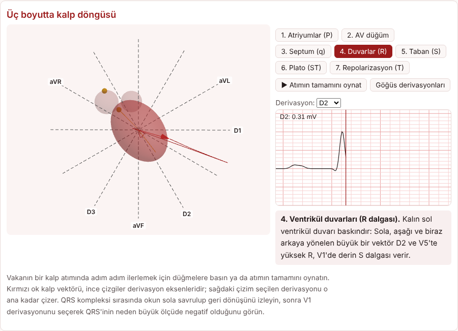
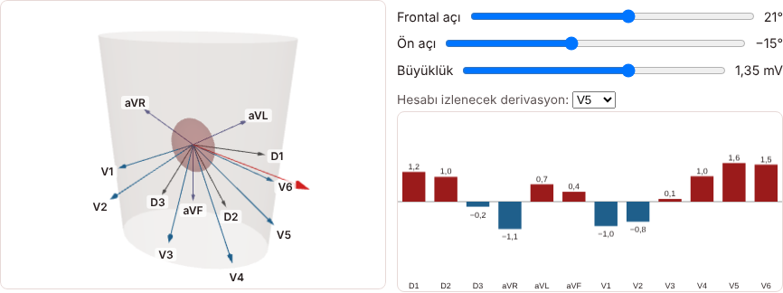
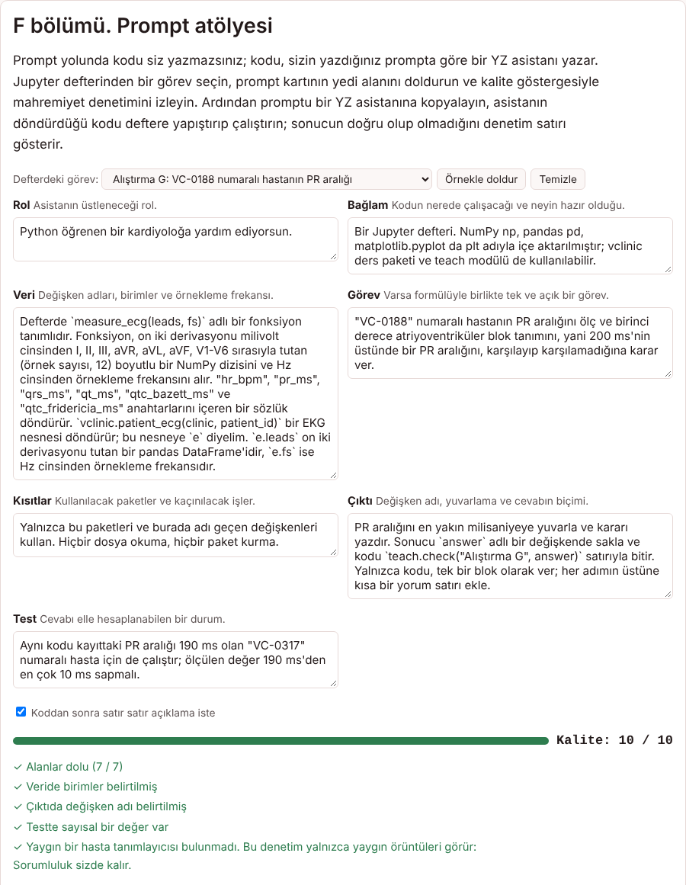

# Python ile Yapay Zekâ Eğitimi: Kardiyologlar için Uygulamalı Eğitim Programı

**Eğitim programı, Türk Kardiyoloji Derneği, Türkiye**

*Kardiyologlar ve diğer uzman hekimler için on bir haftada Python ve yapay zekâ: sanal bir kardiyoloji kliniği, gerçek EKG verileri, etkileşimli lablar, Jupyter defterleri ve yapay zekâ asistanlarıyla güvenli kod yazımı*

**Bu eğitim, alandaki güncel gelişmeler doğrultusunda güncellenmektedir. İlk sürüm: Kasım 2026.**

**Prof. Dr. Utku Köse**

Profesör, Bilgisayar Mühendisliği Bölümü, Süleyman Demirel Üniversitesi, Isparta, Türkiye 
Kurucu Müdür, Yapay Zekâ Uygulama ve Araştırma Merkezi (YAZEM), Süleyman Demirel Üniversitesi 
Bilgisayar Bilimleri Anabilim Dalı Başkanı, Bilgisayar Mühendisliği Bölümü, Süleyman Demirel Üniversitesi 
Diğer kurumlar: University of North Dakota (ABD), Universidad Panamericana (Meksiko, Meksika), Vel Tech University (Chennai, Hindistan) 
IEEE Kıdemli Üyesi, ACM Profesyonel Üyesi

[ORCID 0000-0002-9652-6415](https://orcid.org/0000-0002-9652-6415) | [utkukose.com](https://www.utkukose.com) | [github.com/utkukose](https://github.com/utkukose)

[utkukose@sdu.edu.tr](mailto:utkukose@sdu.edu.tr) | [utku.kose@und.edu](mailto:utku.kose@und.edu) | [ukose@up.edu.mx](mailto:ukose@up.edu.mx) | [utkukose@gmail.com](mailto:utkukose@gmail.com)

[English version](README.md)

## Eğitim hakkında

Bu depoda, Türk Kardiyoloji Derneği için hazırlanan *Python ile Yapay Zekâ Eğitimi: Kardiyologlar için Uygulamalı Eğitim Programı* adlı eğitimin açık erişimli malzemeleri yer almaktadır. Eğitim, haftada bir yapılan dört saatlik oturumlarla on bir hafta sürer. Toplam süre 44 saattir ve bu sürenin yaklaşık yüzde 80'i uygulamaya ayrılmıştır. Her haftada bir klinik vaka, bir Python adımı, bir ders sayfası, bir etkileşimli lab, bir Jupyter defteri ve bir haftalık proje bulunur. Bütün malzemeler İngilizce ve Türkçe olarak sunulmaktadır.

Eğitimin ana ekseni sanal bir kardiyoloji kliniğidir. `vclinic` ders paketi sentetik hastalardan oluşan bir hasta kaydı üretir. Bu hastaların elektrokardiyogramları (EKG), laboratuvar değerleri ve sonraki haftalarda eklenecek görüntüleri ve raporları birbiriyle tutarlıdır. Klinik her hafta yeni bir birimle büyür: 1. haftanın hasta kaydı ve EKG laboratuvarından 10. haftanın yatak başı karar desteğine kadar. Sentetik verilerin ardındaki gerçek değerler bilindiğinden her ölçüm ve her model bu değerlerle karşılaştırılarak doğrulanabilir. Her hafta açık erişimli gerçek veri setleri de kullanılır; böylece her yöntem gerçek kayıtlarda da sınanır.

Eğitim, yapay zekâ (YZ) asistanlarıyla nasıl çalışılacağını da öğretmektedir. Katılımcılar ilk haftadan başlayarak bir asistanla birlikte kod yazar. Her alıştırma, kod doğrudan yazılarak çözülebildiği gibi asistana bir prompt (istem) yazılarak da çözülebilir; eğitim bu ikinci yola prompt yolu adını vermektedir. Promptlarda birimler ve testler belirtilir, kod bir kod güvenlik kontrol listesiyle denetlenir ve asistanın her kullanımı YZ kullanım günlüğüne kaydedilir. Hiçbir prompta hasta verisi girmez.

## Başka derslerde kullanım

Malzemeler, kaynak gösterilerek her düzeyde, tamamen ya da kısmen kullanılabilir ([Bu eğitime atıf](#bu-eğitime-atıf) bölümüne bakın). Hatalar ve öneriler deponun [issues](https://github.com/utkukose/ai-cardiology-tkd-NB-lecture/issues) bölümünden bildirilebilir. Eğitim sürerken sorular ve haftalık projeler utkukose@sdu.edu.tr ya da utkukose@gmail.com adresine gönderilebilir.

## Malzemelerden görüntüler

<table>
<tr><td width="50%"></td><td width="50%"></td></tr>
<tr><td>Ders sayfası, 1. hafta: üç boyutlu kalp döngüsü. Kalp vektörü atım boyunca dönerken seçilen derivasyonun trasesi yanında çizilir.</td><td>Etkileşimli lab, 1. hafta, B bölümü: tek vektöre on iki bakış ve her derivasyondaki izdüşümün adım adım hesabı.</td></tr>
<tr><td width="50%"></td><td width="50%"></td></tr>
<tr><td>Etkileşimli lab, 1. hafta, C bölümü: sanal kliniğin EKG'leri üzerinde dijital kumpas. Ölçümler Jupyter defterinde Bland-Altman analiziyle değerlendirilir.</td><td>Jupyter defteri, 1. hafta, 4. bölüm: haftanın vakası VC-0317'nin 12 derivasyonlu EKG'si.</td></tr>
<tr><td width="50%"></td><td width="50%"></td></tr>
<tr><td>Etkileşimli lab, 1. hafta, F bölümü: prompt atölyesi. Prompt kartının yedi alanı, kalite göstergesi ve hasta verisi uyarısı.</td><td>Jupyter defteri, 1. hafta: Alıştırma G'nin prompt yoluyla çözümü. Hazır prompt, YZ asistanının yazdığı kod ve kontrol satırının sonucu.</td></tr>
</table>

## Eğitim kimler için?

Eğitim, kardiyologlar ve diğer uzman hekimler için hazırlanmıştır. Programlama deneyimi gerekmez. Her Jupyter defteri üç yol sunar ve yol her alıştırmada değiştirilebilir. Her hafta bir Python adımıyla başlayan temel yol, daha önce hiç kod yazmamış katılımcılar için yeterlidir. Prompt yolunda aynı alıştırmalar, bir YZ asistanına yazılan yapılandırılmış promptlarla çözülür ve asistanın verdiği kod kontrol edilir; ayrıntılar [PROMPT_PATH.tr.md](PROMPT_PATH.tr.md) dosyasındadır. Programlama bilen katılımcılar, aynı deftere isteğe bağlı eklemeler getiren ileri yolu izleyebilir. Katılımcıların EKG ve kardiyak görüntüleme konusunda klinik bilgi sahibi olduğu kabul edilir; matematik ise gerektiği yerde çözümlü örneklerle anlatılmaktadır.

## Eğitimin öğrenme çıktıları

Eğitimin sonunda katılımcıların klinik tabloları, sinyalleri ve görüntüleri Python ile analiz edebilmeleri, kardiyoloji verileri üzerinde makine öğrenmesi ve derin öğrenme modelleri kurup doğrulayabilmeleri ve açıklayabilmeleri beklenmektedir. EKG'yi bir sinyal olarak işleyebilmeli, ritim bozukluklarını ve iskemiyi tespit eden modeller eğitebilmeli ve ejeksiyon fraksiyonunu ölçmek için kardiyak görüntülerde segmentasyon yapabilmelidirler. Klinik metinden bilgi çıkarabilmeli, farklı türdeki verileri tek bir modelde birleştirebilmeli ve bir modelin kararlarını açıklanabilir yapay zekâ (XAI) yöntemleriyle açıklayabilmelidirler. Son olarak bir klinik karar destek sistemi (KKDS) prototipi kurabilmeli, YZ asistanlarıyla güvenli biçimde çalışabilmeli ve kardiyolojide yayımlanmış YZ çalışmalarını eleştirel olarak değerlendirebilmelidirler.

## Eğitim nasıl işler?

Her hafta aynı düzeni izler. Hafta, sorusu hafta sonunda cevaplanan bir sanal klinik hastasıyla, yani **haftanın vakasıyla** başlar. Bir **Python adımı**, haftanın gerektirdiği dil yapılarını klinik örneklerle öğretir. **Ders sayfası** kavramları formüller, çözümlü örnekler, üç boyutlu (3B) bir sahne, animasyonlar ve bilgi kontrolleriyle açıklar. **Etkileşimli lab**, temel fikirleri tarayıcıda çalışan simülasyonlara ve adım adım hesaplara dönüştürür; **Jupyter defteri** aynı fikirleri sentetik ve gerçek veriler üzerinde Python ile uygular. **Haftanın makalesi** konuyu yayımlanmış bir çalışmaya bağlar, **haftalık proje** ise yöntemleri yeni hastalara ve gerçek kayıtlara uygular. Her hafta **sanal kliniğin yeni bir aşamasıyla** kapanır.

| Malzeme | Görevi |
|---|---|
| Hafta sayfası (README) | Haftaya genel bakış: malzemeler, öğrenme çıktıları, çalışma yolu, haftalık proje ve teslim |
| Ders sayfası | Kavramlar, çözümlü örnekleriyle formüller, 3B sahne, animasyonlar, bilgi kontrolleri ve tekrar kartları |
| Etkileşimli lab | A, B, C ve devamı bölümlerinde simülasyonlar ve hesaplar, öz değerlendirme ve dışa aktarılan öğrenme günlüğü |
| Jupyter defteri | Python adımı, cevabı hemen kontrol edilen alıştırmalarla numaralı bölümler, her alıştırma için bir prompt yolu, her bölüm için bir prompt görevi ve uygulama görevleri |
| Prompt kütüphanesi | Prompt yolu için haftanın bütün promptları, prompt kartı biçiminde |
| PDF ders notu | Okumak ve yazdırmak için dersin ve Python adımının tamamı |

Malzemeler birbirine tek yönde bağlanır. Ders sayfası, etkileşimli labın bölümlerini A, B, C sırasıyla, Jupyter defterinin bölümlerini ise artan sırayla açar. Labın her bölümü, defterin karşılık gelen bölümüne giden bir bağlantıyla biter.

## On bir hafta

Plan, Türk Kardiyoloji Derneği'nin programını izlemektedir. Her hafta bütün malzemeleriyle birlikte yayımlanır; her oturumun içeriği [izlencede](SYLLABUS.tr.md) anlatılmaktadır.

| Hafta | Konu | Sanal kliniğin aşaması | Haftalık proje | Malzemeler |
|---|---|---|---|---|
| 1 | Python ve kardiyoloji veri temelleri | Hasta kaydı ve EKG laboratuvarı | PR, QRS ve QT'nin otomatik ölçümü, frontal eksen ve iki QT düzeltmesiyle | [Hafta sayfası](tr/hafta-01/README.md) · [Ders sayfası](https://utkukose.github.io/ai-cardiology-tkd-NB-lecture/tr/hafta-01/ders.html) · [Etkileşimli lab](https://utkukose.github.io/ai-cardiology-tkd-NB-lecture/tr/hafta-01/lab.html) · [Jupyter defteri](tr/hafta-01/NB01_python_ve_ekg_temelleri.ipynb) · [Prompt kütüphanesi](tr/hafta-01/PROMPTLAR.md) · [PDF ders notu](tr/hafta-01/Hafta01_Ders_Notlari.pdf) |
| 2 | Makine öğrenmesi temelleri | Risk polikliniği | Korunmuş ve düşük ejeksiyon fraksiyonlu kalp yetersizliğinin kümelenmesi ve Kaplan-Meier sağkalım analizi | Hazırlanıyor |
| 3 | Derin öğrenme ve evrişimli sinir ağları | Eko laboratuvarı | Kardiyak manyetik rezonans görüntülerinde dilate ve hipertrofik kardiyomiyopati sınıflandırması | Hazırlanıyor |
| 4 | Transfer öğrenme | Eko ölçümü: otomatik ejeksiyon fraksiyonu | Sol ventrikül segmentasyonu ve otomatik ejeksiyon fraksiyonu | Hazırlanıyor |
| 5 | Zaman serisi analizi ve EKG yapay zekâsı | Ritim ve STEMI alarmı | Bir STEMI alarmı: 12 derivasyonlu EKG'lerde ST sapmasının otomatik tespiti | Hazırlanıyor |
| 6 | Doğal dil işleme ve klinik metin madenciliği | Rapor arşivi: klinik metin | Anjiyografi raporlarından darlık derecesini ve damarı çıkaran bir işlem hattı | Hazırlanıyor |
| 7 | Görü dönüştürücüleri (Vision Transformer) | Kateter laboratuvarı | Koroner anjiyogramlarda darlık tespiti: evrişimli ağ, görü dönüştürücüsü ve melez modelin karşılaştırması | Hazırlanıyor |
| 8 | Çok modlu yapay zekâ ve veri füzyonu | Kalp ekibi: veri füzyonu | Simüle edilmiş bir triyajda majör olumsuz kardiyovasküler olayların (MACE) öngörüsü | Hazırlanıyor |
| 9 | Model güvenilirliği ve açıklanabilir yapay zekâ | Kalite ve güvenlik kurulu: XAI | Eko modelinin Grad-CAM haritalarının bir uzmanın değerlendirmesiyle karşılaştırılması | Hazırlanıyor |
| 10 | Klinik karar destek sistemleri | Yatak başında karar desteği | Karar destek prototipinin kullanıcı testi ve iyileştirilmesi | Hazırlanıyor |
| 11 | Final projesi ve sertifika | Katılımcıların birimleri: final projeleri | Final projesi: katılımcının kendi kliniğinden bir soru için uçtan uca bir YZ işlem hattı ve kişisel eylem planı | Hazırlanıyor |

## Sanal klinik, eğitimin projesi

Kliniğe her hafta yeni bir birim eklenir. Kaydında demografik verileri, risk faktörleri, laboratuvar değerleri, ejeksiyon fraksiyonu, ana tanısı ve 12 derivasyonlu EKG'si olan 500 sentetik hasta bulunur. Sonraki haftalar, aynı hasta için birbiriyle tutarlı ekokardiyogramlar, koroner anjiyogramlar, yazılı raporlar ve izlem verileri ekler. Kaydın ardındaki etki büyüklükleri pakette belgelenmiştir; böylece kurulan bir model gerçek değerlerle karşılaştırılabilir. Tablo, şimdiye kadar yayımlanan aşamaların sonuçlarını bir araya getirmektedir.

| Hafta | Aşama | Yöntemler | Sonuç |
|---|---|---|---|
| 1 | [Hasta kaydı ve EKG laboratuvarı](https://utkukose.github.io/ai-cardiology-tkd-NB-lecture/tr/hafta-01/ders.html#the-virtual-clinic-stage-1-the-clinic-opens) | pandas, 12 derivasyonlu bir EKG modeli, otomatik aralık ölçümü, basitleştirilmiş Pan-Tompkins dedektörü | 500 hasta; 100 hastada ortalama hata PR için −1,5 ms, QRS için 2,3 ms, QT için 2,2 ms; MIT-BIH 100 numaralı kayıtta 2273 atımın 2273'ü bulundu |

## YZ asistanlarıyla çalışmak

Katılımcılar ilk haftadan itibaren bir YZ asistanıyla birlikte kod yazar ve eğitim bunu kendi güvenlik kuralları olan bir klinik beceri olarak ele almaktadır. Üç araç bu beceriyi destekler. **Prompt kartı** görevi, veri biçimini, birimleri, örnekleme frekansını ve cevabı bilinen bir testi belirtir; hastayı ise asla tanımlamaz. **Kod güvenlik kontrol listesi**, cerrahi güvenlik kontrol listesinin üç aşamasını uyarlar [1]: kodu çalıştırmadan önce *giriş*, çalışırken *mola* ve sonucu kullanmadan önce *çıkış*. **YZ kullanım günlüğü** kullanılan aracı, promptu, neyin kontrol edildiğini ve neyin değiştirildiğini kaydeder; her haftalık projenin bir parçasıdır.

**Prompt yolu** bu araçları bir öğrenme yöntemine dönüştürür. Jupyter defterlerinde her alıştırmanın altında, o alıştırmanın prompt kartını içeren ve tıklayınca açılan bir *prompt yolu* kutusu bulunur; her numaralı bölüm de bir *prompt göreviyle* biter. Katılımcı görevi tarif eder, asistanın yazdığı kodu çalıştırır, sonucu cevabı bilinen bir örnekle kontrol eder, kodu açıklar ve kullanımı kaydeder. [PROMPT_PATH.tr.md](PROMPT_PATH.tr.md) bu yolu, kullanılabilecek asistanları ve hasta verisinin korunmasına ilişkin kuralları anlatmaktadır.

Gerçek hasta verisi, kurumun kurallarına ve Kişisel Verilerin Korunması Kanunu'na (KVKK) uygun olarak yalnızca katılımcının kendi bilgisayarında kalır [2]. Bulut tabanlı bir deftere ya da bir YZ sohbetine hiçbir zaman aktarılmaz. Eğitimdeki bütün veri setleri ya sentetiktir ya da açık erişimli araştırma veri tabanlarından alınmıştır.

## Programlama bilmeyenler için Python

Her haftanın Jupyter defterinde, kurulumun hemen ardından bir Python adımı yer alır. Bu adım haftanın dil yapılarını klinikten örneklerle öğretir; *Python notu* hücreleri de her yeni yapıyı ilk geçtiği yerde açıklar. Her alıştırmada cevap hemen kontrol edilir. [Başlangıç defteri](tr/baslangic/NB00_baslangic.ipynb) 1. haftadan önce bilgisayarı hazırlar ve ilk Python satırlarını tanıtır; [PYTHON_PATH.tr.md](PYTHON_PATH.tr.md) ise bütün haftaların Python adımlarını listeler. [Prompt yolunda](PROMPT_PATH.tr.md) dil, iyi tarif edilmiş bir görev için bir asistanın yazdığı kodu okuyarak, çalıştırarak ve açıklayarak öğrenilmektedir.

## Değerlendirme ve sertifika

| Bileşen | Ağırlık | Sertifika koşulu |
|---|---|---|
| Haftalık projeler (1-10. haftalar) | Yüzde 40 | Her projeden en az yüzde 70 |
| Final projesi (sunum ve kod) | Yüzde 40 | Jüri ve katılımcı değerlendirmesi |
| Katılım ve etkin öğrenme | Yüzde 20 | En az yüzde 80 devam |

Her haftalık proje, bir sonraki haftanın oturumundan önce e-postayla gönderilir. E-posta, [rapor şablonuyla](tr/sablonlar/Rapor_Sablonu.docx) yazılmış raporu, YZ kullanım günlüğünü, tamamlanmış Jupyter defterini ve etkileşimli labdan dışa aktarılan öğrenme günlüğünü içerir. [Final projesi sayfası](tr/final-projesi/README.md) final projesinin seçeneklerini, koşullarını ve değerlendirme ölçütlerini anlatmaktadır.

## Malzemeleri çalıştırmak

Jupyter defterleri, katılımcının kendi bilgisayarında Anaconda içindeki Jupyter için hazırlanmıştır. [SETUP.tr.md](SETUP.tr.md) kurulumu, ders klasörünün indirilmesini ve ilk çalıştırmayı adım adım anlatır. Anaconda kurulamıyorsa her defter, rozetiyle Google Colab'da da açılabilir; bu durumda ilk hücre ders paketini ve veri dosyalarını indirir. Ders sayfaları ve etkileşimli lablar, bilgisayarda ya da telefonda, herhangi bir güncel tarayıcıda kurulum gerektirmeden çalışır.

## Veriler

[DATASETS.tr.md](DATASETS.tr.md) her veri setini kaynağı, lisansı ve künyesiyle listeler. 1. hafta, UCI Heart Disease veri setinin Cleveland verisini [3], MIT-BIH Arrhythmia Database'in 100 numaralı kaydını [4, 5] ve PTB Diagnostic ECG Database'in bir kaydını [6] kullanır; bu veri tabanları PhysioNet'te yayımlanmaktadır [7]. Bu dosyalar [data](data) klasöründe bulunur; böylece defterler üyelik gerektirmeden çalışır.

## Kaynakların doğruluğu

Eğitimin her kaynağı, dijital nesne tanımlayıcısı (DOI) ya da yayıncı sayfası olan yayımlanmış bir çalışmadır ve künyesi yayıncının kaydıyla karşılaştırılarak doğrulanmıştır. [references](references) klasörü listenin tamamını APA 7 biçiminde, BibTeX ve JSON olarak içerir. [tools/verify_references.py](tools/verify_references.py) betiği her kaydı Crossref, DataCite ve OpenAlex ile karşılaştırır. Bir GitHub Actions iş akışı bu betiği her ay ve kaynaklar her değiştiğinde çalıştırır.

## Bu eğitime atıf

Kose, U. (2026). *Artificial Intelligence with Python: A Hands-on Training Program for Cardiologists: Open course materials* [Course materials]. GitHub. https://github.com/utkukose/ai-cardiology-tkd-NB-lecture

[CITATION.cff](CITATION.cff) dosyası aynı bilgiyi kaynak yönetim programları için içermektedir.

## Lisans

Eğitimin içeriği (metinler, şekiller, ders sayfaları, etkileşimli lablar ve notlar) [Creative Commons Atıf 4.0 Uluslararası Lisansı](LICENSE-CONTENT) (CC BY 4.0) ile lisanslanmıştır. `vclinic` paketi ve Jupyter defterlerindeki kod dâhil bütün kod [MIT Lisansı](LICENSE) ile lisanslanmıştır. Veri setleri kendi lisanslarını korur; bu lisanslar [DATASETS.tr.md](DATASETS.tr.md) dosyasında listelenmiştir. Ders sayfalarına ve etkileşimli lablara gömülü Three.js kütüphanesi MIT Lisansı ile dağıtılmaktadır ([assets/vendor/LICENSE-three.txt](assets/vendor/LICENSE-three.txt)).

## Bu sayfada atıf yapılan kaynaklar

1. Haynes, A. B., Weiser, T. G., Berry, W. R., Lipsitz, S. R., Breizat, A.-H. S., Dellinger, E. P., Herbosa, T., Joseph, S., Kibatala, P. L., Lapitan, M. C. M., Merry, A. F., Moorthy, K., Reznick, R. K., Taylor, B., & Gawande, A. A. (2009). A surgical safety checklist to reduce morbidity and mortality in a global population. *New England Journal of Medicine, 360*(5), 491–499. https://doi.org/10.1056/NEJMsa0810119
2. Kişisel Verilerin Korunması Kanunu, Kanun No. 6698. (2016). *Resmî Gazete, 29677 (7 Nisan 2016)*. https://www.mevzuat.gov.tr/mevzuat?MevzuatNo=6698&MevzuatTur=1&MevzuatTertip=5
3. Janosi, A., Steinbrunn, W., Pfisterer, M., & Detrano, R. (1989). *Heart Disease* [Data set]. UCI Machine Learning Repository. https://doi.org/10.24432/C52P4X
4. Moody, G. B., & Mark, R. G. (2005). *MIT-BIH Arrhythmia Database (version 1.0.0)* [Data set]. PhysioNet. https://doi.org/10.13026/C2F305
5. Moody, G. B., & Mark, R. G. (2001). The impact of the MIT-BIH Arrhythmia Database. *IEEE Engineering in Medicine and Biology Magazine, 20*(3), 45–50. https://doi.org/10.1109/51.932724
6. Bousseljot, R., Kreiseler, D., & Schnabel, A. (2004). *The PTB Diagnostic ECG Database (version 1.0.0)* [Data set]. PhysioNet. https://doi.org/10.13026/C28C71
7. Goldberger, A. L., Amaral, L. A. N., Glass, L., Hausdorff, J. M., Ivanov, P. Ch., Mark, R. G., Mietus, J. E., Moody, G. B., Peng, C.-K., & Stanley, H. E. (2000). PhysioBank, PhysioToolkit, and PhysioNet: Components of a new research resource for complex physiologic signals. *Circulation, 101*(23), e215–e220. https://doi.org/10.1161/01.CIR.101.23.e215

## İnsan-yapay zekâ işbirliği

Bu eğitim, insan-yapay zekâ işbirliğiyle geliştirilmiştir. İnsan entelektüel birikimi ve uzmanlığı, eğitimin temel çıkış noktasıdır. Eğitimin yazarı, geliştirmenin her aşamasını yönlendirmekte ve denetlemektedir. Nihai hâl, yalnızca eğitimin yazarının incelemesi ve onayından sonra sunulmaktadır.

---

**Prof. Dr. Utku Köse**

Profesör, Bilgisayar Mühendisliği Bölümü, Süleyman Demirel Üniversitesi, Isparta, Türkiye 
Kurucu Müdür, Yapay Zekâ Uygulama ve Araştırma Merkezi (YAZEM), Süleyman Demirel Üniversitesi 
Bilgisayar Bilimleri Anabilim Dalı Başkanı, Bilgisayar Mühendisliği Bölümü, Süleyman Demirel Üniversitesi 
Diğer kurumlar: University of North Dakota (ABD), Universidad Panamericana (Meksiko, Meksika), Vel Tech University (Chennai, Hindistan) 
IEEE Kıdemli Üyesi, ACM Profesyonel Üyesi

[ORCID 0000-0002-9652-6415](https://orcid.org/0000-0002-9652-6415) | [utkukose.com](https://www.utkukose.com) | [github.com/utkukose](https://github.com/utkukose)

[utkukose@sdu.edu.tr](mailto:utkukose@sdu.edu.tr) | [utku.kose@und.edu](mailto:utku.kose@und.edu) | [ukose@up.edu.mx](mailto:ukose@up.edu.mx) | [utkukose@gmail.com](mailto:utkukose@gmail.com)

*Bu eğitim, alandaki güncel gelişmeler doğrultusunda güncellenmektedir. İlk sürüm: Kasım 2026.*

## Teşekkür

Bu eğitim programı Türk Kardiyoloji Derneği için hazırlanmıştır. Yazar, programı kardiyologlara ve diğer uzman hekimlere sunma olanağı için Derneğe teşekkür eder. Yazar ayrıca açık verileriyle eğitimin uygulamalı çalışmalarını mümkün kılan PhysioNet ve UCI Machine Learning Repository ekiplerine teşekkür eder.
