

# Python ile Yapay Zekâ Eğitimi: Kardiyologlar için Uygulamalı Eğitim Programı

**Eğitim programı, Türk Kardiyoloji Derneği, Türkiye**

*Kardiyologlar ve diğer uzman hekimler için on bir haftada Python ve yapay zekâ: Sanal bir kardiyoloji kliniği, gerçek EKG verileri, etkileşimli lablar, Jupyter defterleri ve yapay zekâ asistanlarıyla güvenli kod yazımı*

**Bu eğitim, alandaki güncel gelişmeler doğrultusunda güncellenmektedir. İlk sürüm: Kasım 2026.**

**Prof. Dr. Utku Köse**

Profesör, Bilgisayar Mühendisliği Bölümü, Süleyman Demirel Üniversitesi, Isparta, Türkiye 
Kurucu Müdür, Yapay Zekâ Uygulama ve Araştırma Merkezi (YAZEM), Süleyman Demirel Üniversitesi 
Bilgisayar Bilimleri Anabilim Dalı Başkanı, Bilgisayar Mühendisliği Bölümü, Süleyman Demirel Üniversitesi 
Diğer kurumlar: University of North Dakota (ABD), Universidad Panamericana (Meksiko, Meksika), Vel Tech University (Chennai, Hindistan) 
IEEE Kıdemli Üyesi, ACM Profesyonel Üyesi

[ORCID 0000-0002-9652-6415](https://orcid.org/0000-0002-9652-6415) | [utkukose.com](https://www.utkukose.com) | [github.com/utkukose](https://github.com/utkukose)

[utkukose@sdu.edu.tr](mailto:utkukose@sdu.edu.tr) | [utku.kose@und.edu](mailto:utku.kose@und.edu) | [ukose@up.edu.mx](mailto:ukose@up.edu.mx) | [utkukose@gmail.com](mailto:utkukose@gmail.com)

[English version](README.md)

## Eğitim hakkında

Bu depoda, Türk Kardiyoloji Derneği için hazırlanan *Python ile Yapay Zekâ Eğitimi: Kardiyologlar için Uygulamalı Eğitim Programı* adlı eğitimin açık erişimli malzemeleri yer almaktadır. Eğitim, haftada bir yapılan dört saatlik oturumlarla on bir hafta sürer. Toplam süre 44 saattir ve bu sürenin yaklaşık yüzde 80'i uygulamaya ayrılmıştır. Her hafta bir klinik vakadan, haftanın ana rotasını oluşturan bir ders sayfasından, bir etkileşimli labdan, iki uygulama yolu sunan bir Jupyter defterinden ve bir haftalık projeden oluşur. Bütün malzemeler İngilizce ve Türkçe olarak sunulmaktadır; eğitim Türkçe yürütülür.

Eğitimin ana ekseni sanal bir kardiyoloji kliniğidir. `vclinic` ders paketi sentetik hastalardan oluşan bir hasta kaydı üretir. Bu hastaların elektrokardiyogramları (EKG), laboratuvar değerleri ve sonraki haftalarda eklenecek görüntüleri ve raporları birbiriyle tutarlıdır. Klinik her hafta yeni bir birimle büyür; bu büyüme 1. haftanın hasta kaydı ve EKG laboratuvarından 10. haftanın yatak başı karar desteğine kadar sürer. Sentetik verilerin ardındaki gerçek değerler bilindiğinden her ölçüm ve her model bu değerlerle karşılaştırılarak doğrulanabilir. Her hafta açık erişimli gerçek veri setleri de kullanılır; böylece her yöntem gerçek kayıtlarda da sınanır.

Eğitim, yapay zekâ (YZ) asistanlarıyla nasıl çalışılacağını da öğretmektedir. İlk haftadan başlayarak her uygulama durağı iki yoldan biriyle çalışılabilir. Birinci yolda kodu, kendisine verilen hazır bir prompt (istem) ile bir YZ asistanı yazar; bu yola prompt yolu denir. İkinci yol olan Python yolunda ise kodu katılımcı kendisi yazar. Promptlarda birimler ve testler belirtilir, kod bir kod güvenlik kontrol listesiyle denetlenir ve asistanın her kullanımı YZ kullanım günlüğüne kaydedilir. Hiçbir prompta hasta verisi girmez.

## Başka derslerde kullanım

Malzemeler, kaynak gösterilerek her düzeyde, tamamen ya da kısmen kullanılabilir ([Bu eğitime atıf](#bu-eğitime-atıf) bölümüne bakın). Hatalar ve öneriler deponun [issues](https://github.com/utkukose/ai-cardiology-tkd-NB-lecture/issues) bölümünden bildirilebilir. Eğitim sürerken sorular ve haftalık projeler utkukose@sdu.edu.tr ya da utkukose@gmail.com adresine gönderilebilir.

## Malzemelerden görüntüler

<table>
<tr><td width="50%"></td><td width="50%"></td></tr>
<tr><td>Ders sayfası, 1. hafta: Üç boyutlu kalp döngüsü. Kalp vektörü atım boyunca dönerken seçilen derivasyonun trasesi yanında çizilir.</td><td>Etkileşimli lab, 1. hafta, B bölümü: Tek bir vektöre on iki derivasyondan bakılır ve her derivasyondaki izdüşüm adım adım hesaplanır.</td></tr>
<tr><td width="50%">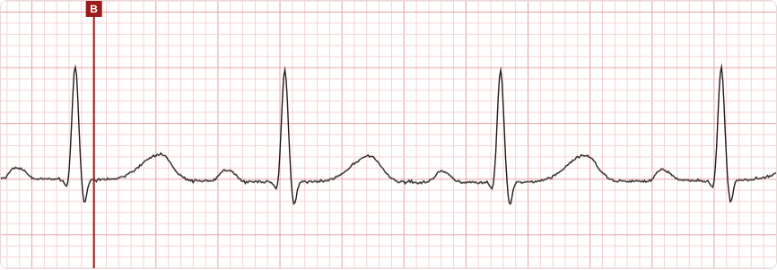</td><td width="50%">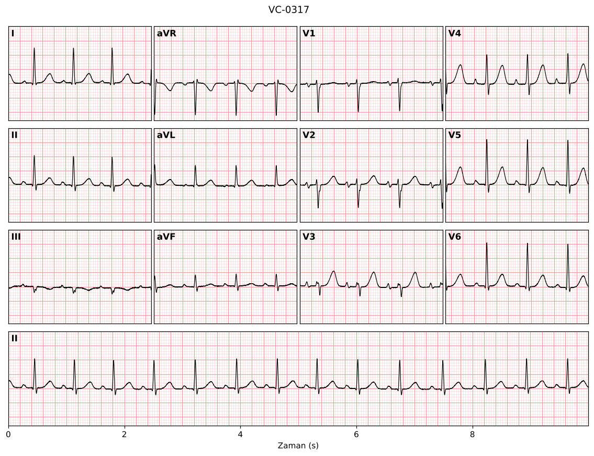</td></tr>
<tr><td>Etkileşimli lab, 1. hafta, C bölümü: Sanal kliniğin EKG'leri üzerinde dijital kaliperle ölçüm yapılır. Ölçümler Jupyter defterinde Bland-Altman analiziyle değerlendirilir.</td><td>Jupyter defteri, 1. hafta, 4. bölüm: Haftanın vakası olan VC-0317'nin 12 derivasyonlu EKG'si.</td></tr>
<tr><td width="50%"></td><td width="50%">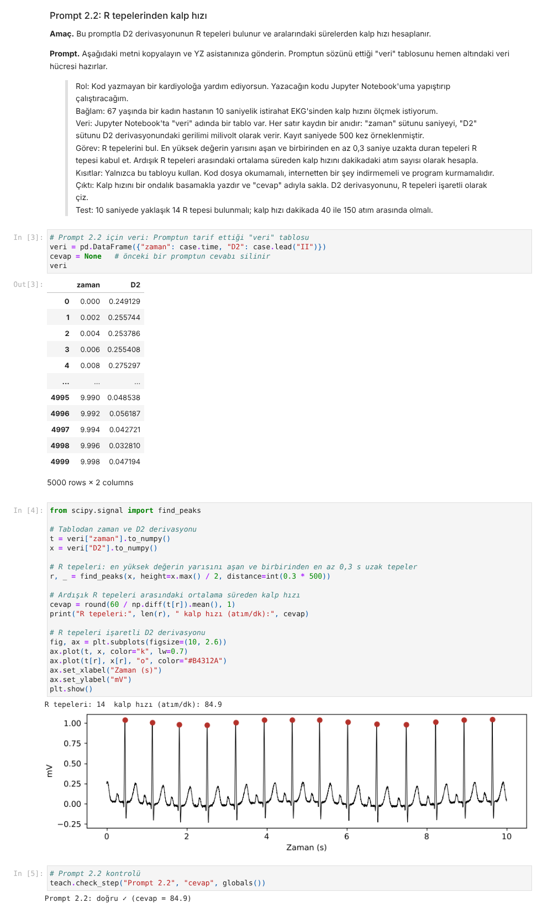</td></tr>
<tr><td>Etkileşimli lab, 1. hafta, F bölümü: Prompt atölyesi. Ekranda prompt kartının yedi alanı, kalite göstergesi ve hasta verisi uyarısı görülmektedir.</td><td>Jupyter defteri, 1. hafta, prompt yolu, 2. durak: Hazır bir prompt, bir YZ asistanının bu prompta yazdığı kod ve eğitimin kontrol satırı.</td></tr>
<tr><td width="50%">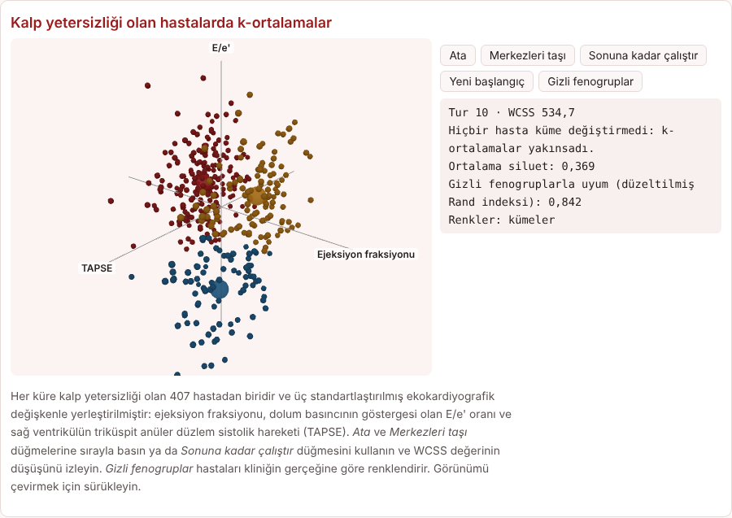</td><td width="50%"></td></tr>
<tr><td>Ders sayfası, 2. hafta: Kalp yetersizliği olan 407 hastada üç boyutlu k-ortalamalar. Algoritma, kümeler değişmeyi bırakana kadar hastaları adım adım kümelere atar ve merkezleri taşır.</td><td>Etkileşimli lab, 2. hafta, B bölümü: Koroner arter hastalığı modelinin eşiği değiştikçe karışıklık matrisi, dört ölçüt ve ROC eğrisi üzerindeki nokta birlikte değişir.</td></tr>
<tr><td width="50%">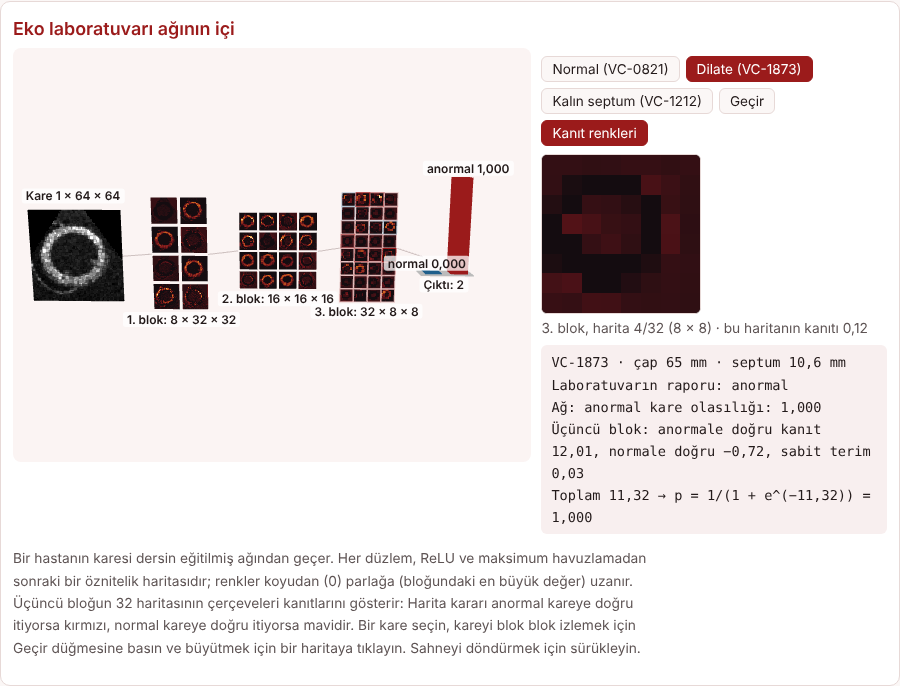</td><td width="50%"></td></tr>
<tr><td>Ders sayfası, 3. hafta: Görüntüleme laboratuvarındaki ağın içi. ACDC'den bir sine KMR kesitinin diyastol sonu ve sistol sonu kareleri, öznitelik haritalarından oluşan üç bloktan geçerek normal kalp, DCM ve HCM olasılıklarına ulaşır. Görüntüler: ACDC, CC BY-NC-SA 4.0.</td><td>Etkileşimli lab, 3. hafta, B bölümü: 3 × 3'lük bir çekirdek, ACDC'den alınan bir sine KMR kesiti üzerinde kayar; bir konumun dokuz çarpımı ve büyüyen öznitelik haritası görünür. Görüntüler: ACDC, CC BY-NC-SA 4.0.</td></tr>
<tr><td width="50%"></td><td width="50%"></td></tr>
<tr><td>Ders sayfası, 4. hafta: CAMUS'un 201 numaralı hastasının sol ventrikülü 20 diskle gösterilir. Her disk, bir çapı iki boşluk görüntüsünden, diğeri dört boşluk görüntüsünden gelen bir elipstir; hacim disklerin toplamıdır. Veri: CAMUS, CC BY-NC-SA 4.0.</td><td>Etkileşimli lab, 4. hafta, D bölümü: U-Net'in CAMUS'un 50 test hastasındaki ejeksiyon fraksiyonu için Bland-Altman grafiği çizilir; panel ortalama farkı, uyum sınırlarını ve tıklanan bir hastanın ölçümlerini verir. Veri: CAMUS, CC BY-NC-SA 4.0.</td></tr>
<tr><td width="50%">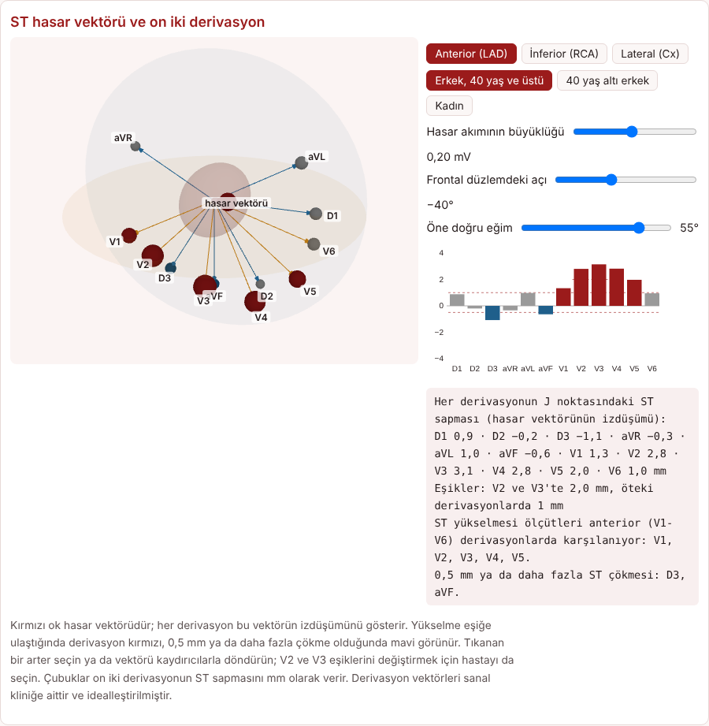</td><td width="50%"></td></tr>
<tr><td>Ders sayfası, 5. hafta: Akut bir enfarktüsün ST hasar vektörü ve on iki derivasyon üzerindeki izdüşümleri. Evrensel tanımın eşiklerine ulaşan derivasyonlar kırmızıya döner ve alarm, ardışık derivasyon grubunu adlandırır.</td><td>Etkileşimli lab, 5. hafta, D bölümü: PTB-XL'in 13913 numaralı kaydının on iki derivasyonundaki medyan atımlar; PR segmenti, J noktası, her derivasyonun ST sapması ve STEMI alarmının kararı. Veri: PTB-XL, CC BY 4.0.</td></tr>
<tr><td width="50%">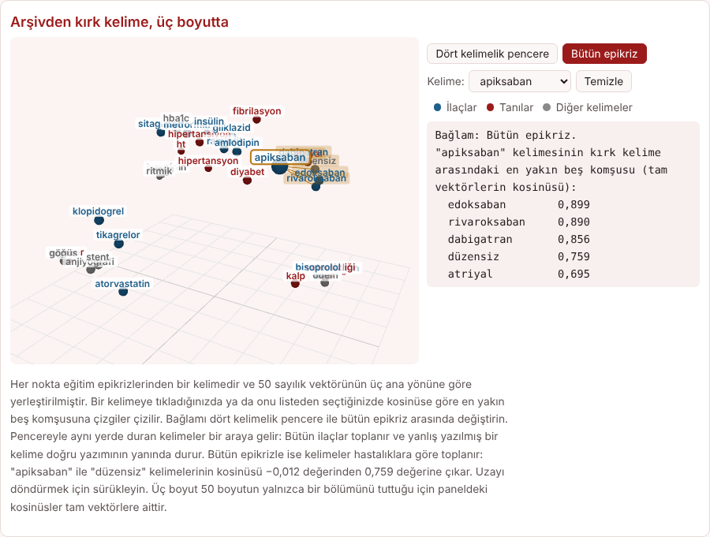</td><td width="50%">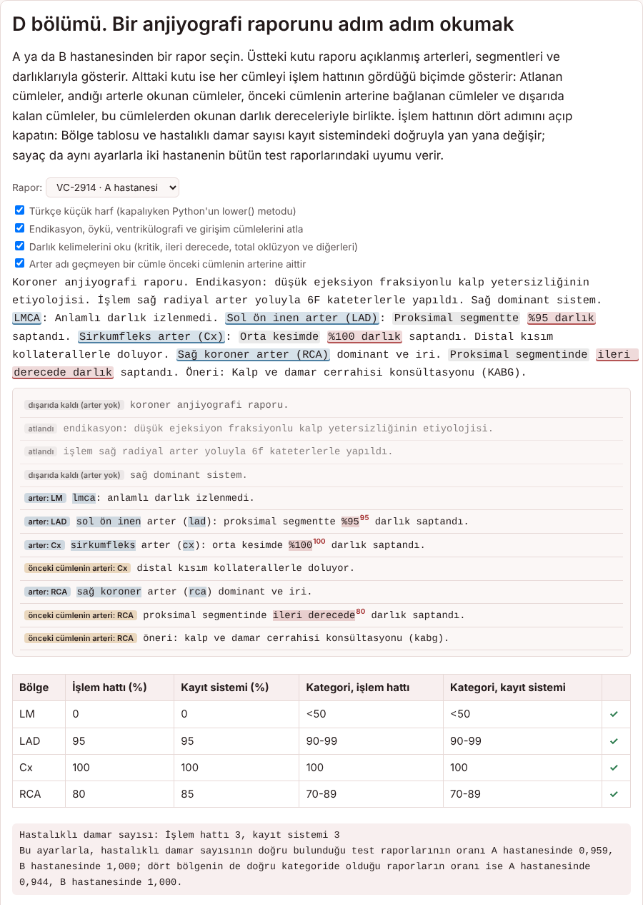</td></tr>
<tr><td>Ders sayfası, 6. hafta: Sentetik rapor arşivinden kırk kelime, kelime vektörlerine göre üç boyutta yerleştirilmiştir. Bağlam bütün epikriz olduğunda kelimeler hastalıklara göre toplanır; apiksaban öteki antikoagülanların ve düzensiz ritmin yanında durur.</td><td>Etkileşimli lab, 6. hafta, D bölümü: Arterleri, segmentleri ve darlıklarıyla sentetik bir koroner anjiyografi raporu; cümleler işlem hattının okuduğu biçimde, dört bölge de kayıt sistemiyle yan yana gösterilir.</td></tr>
<tr><td width="50%">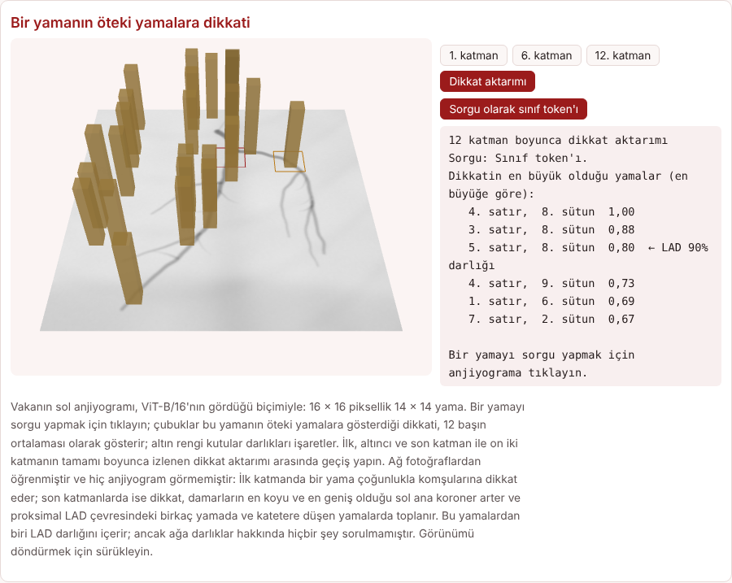</td><td width="50%"></td></tr>
<tr><td>Ders sayfası, 7. hafta: VC-2427'nin sol anjiyogramı ViT-B/16'nın 196 yamasına bölünmüştür. Çubuklar, sınıf token'ının ya da tıklanarak seçilen bir yamanın en büyük dikkatini tek bir katmanda ya da on iki katman boyunca izlenerek gösterir; kareler kayıt sistemindeki darlıkları işaretler.</td><td>Etkileşimli lab, 7. hafta, C bölümü: Hibrit modelin ARCADE test yamalarındaki olasılıkları üzerinde eşik; duyarlılık, özgüllük ve pozitif öngörü değeri yamaların prevalansında ve yüzde 2 prevalansta gösterilir.</td></tr>
<tr><td width="50%">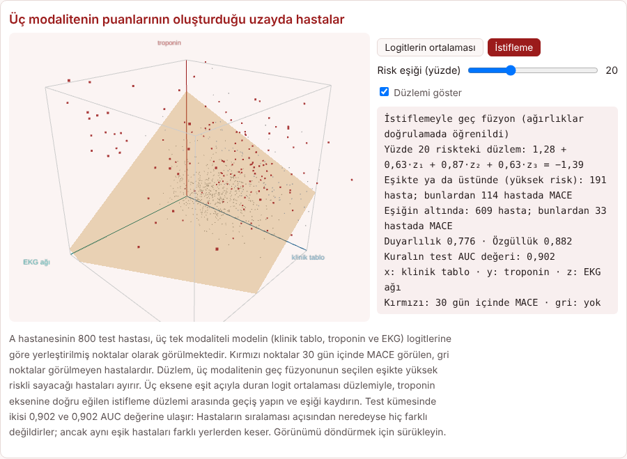</td><td width="50%">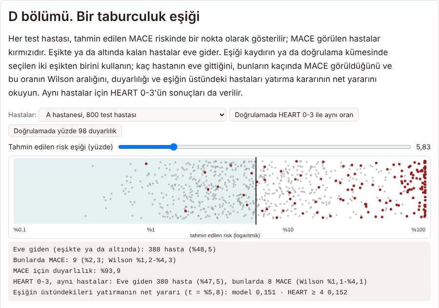</td></tr>
<tr><td>Ders sayfası, 8. hafta: Göğüs ağrısı ünitesinin 800 test hastası, üç tek modaliteli modelin (klinik tablo, troponin ve EKG) logitlerinin oluşturduğu uzayda gösterilir. Logit ortalamasıyla ya da istiflemeyle yapılan geç füzyonun düzlemi, seçilen eşikte yüksek riskli sayılan hastaları ayırır.</td><td>Etkileşimli lab, 8. hafta, D bölümü: 800 test hastasının tahmin edilen riskleri üzerinde bir taburculuk eşiği; eve gönderilen hastalar, Wilson aralığıyla kaçırılan olaylar, duyarlılık ve net yarar HEART 0-3 ile yan yana gösterilir.</td></tr>
<tr><td width="50%">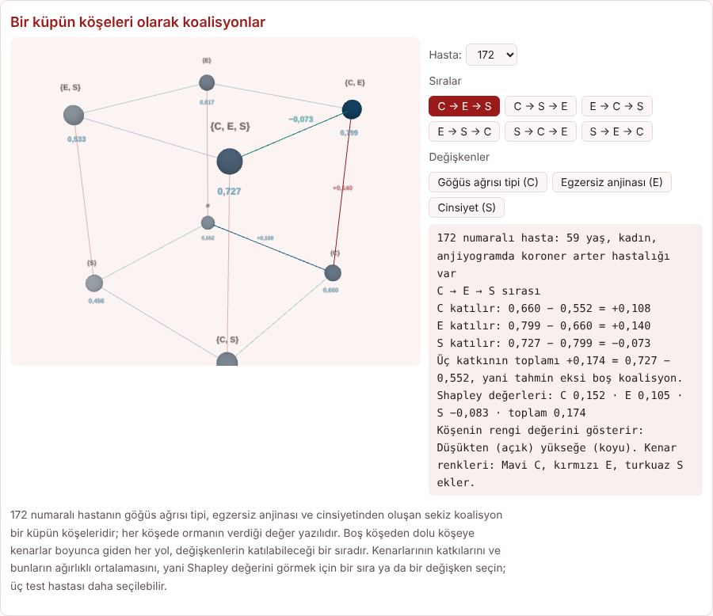</td><td width="50%"></td></tr>
<tr><td>Ders sayfası, 9. hafta: 172 numaralı hastanın üç değişkeninin sekiz koalisyonu bir küpün köşeleri olarak gösterilir. Her kenar bir değişken ekler; boş koalisyondan tam koalisyona giden altı yol, ortalama katkıları Shapley değerlerini veren altı sıradır.</td><td>Jupyter defteri, 9. hafta, 6. bölüm: Eko ağının CAMUS test görüntülerindeki Grad-CAM haritaları ve sol ventrikülün uzman sınırı. Veri: CAMUS, CC BY-NC-SA 4.0.</td></tr>
</table>

## Eğitim kimler için?

Eğitim, kardiyologlar ve diğer uzman hekimler için hazırlanmıştır. Programlama deneyimi ve yapay zekâ konusunda ön bilgi gerekmez. Her haftanın ders sayfası ana rotadır: Kavramları kod ve prompt kullanmadan anlatır. Sayfadaki iki ya da üç uygulama durağında her katılımcı Jupyter defterindeki iki yoldan birini seçer. **Prompt yolunda** (defterin 1. kısmı) kodu hazır promptlarla bir YZ asistanı yazar, katılımcı ise kodu çalıştırır ve sonucu denetler; her adımın hazır kodu da bulunduğu için hiçbir katılımcı bir adımda takılıp kalmaz ([PROMPT_PATH.tr.md](PROMPT_PATH.tr.md)). **Python yolunda** (2. kısım) katılımcı, kodu bir Python adımı ve alıştırmalarla yazmayı öğrenir ([PYTHON_PATH.tr.md](PYTHON_PATH.tr.md)). İki yol da aynı sonuçlara varır ve yol her durakta değiştirilebilir. Katılımcıların EKG ve kardiyak görüntüleme konusunda klinik bilgi sahibi olduğu kabul edilir; matematik ise gerektiği yerde çözümlü örneklerle anlatılmaktadır.

## Eğitimin öğrenme çıktıları

Eğitimin sonunda katılımcıların klinik tabloları, sinyalleri ve görüntüleri Python ile analiz edebilmeleri, kardiyoloji verileri üzerinde makine öğrenmesi ve derin öğrenme modelleri kurup doğrulayabilmeleri ve açıklayabilmeleri beklenmektedir. EKG'yi bir sinyal olarak işleyebilmeli, ritim bozukluklarını ve iskemiyi tespit eden modeller eğitebilmeli ve ejeksiyon fraksiyonunu ölçmek için kardiyak görüntülerde segmentasyon yapabilmelidirler. Klinik metinden bilgi çıkarabilmeli, farklı türdeki verileri tek bir modelde birleştirebilmeli ve bir modelin kararlarını açıklanabilir yapay zekâ (XAI) yöntemleriyle açıklayabilmelidirler. Son olarak bir klinik karar destek sistemi (KKDS) prototipi kurabilmeli, YZ asistanlarıyla güvenli biçimde çalışabilmeli ve kardiyolojide yayımlanmış YZ çalışmalarını eleştirel olarak değerlendirebilmelidirler.

## Eğitim nasıl işler?

Her hafta aynı düzeni izler. Hafta, sorusu haftanın sonunda cevaplanan bir sanal klinik hastasıyla, yani **haftanın vakasıyla** başlar. **Ders sayfası** ana rotadır: Kavramları formüller, çözümlü örnekler, üç boyutlu (3B) bir sahne, animasyonlar ve bilgi kontrolleriyle açıklar ve kod içermez. **Etkileşimli lab**, temel fikirleri tarayıcıda çalışan simülasyonlara ve adım adım hesaplara dönüştürür. Ders sayfasının **uygulama duraklarında** **Jupyter defteri** aynı fikirleri sentetik ve gerçek veriler üzerinde prompt yolu ya da Python yolu ile uygular. **Kendi verinizle** bölümü, haftanın yöntemlerinin kişinin kendi kliniğinin verilerine nasıl uygulanacağını gösterir. **Haftanın makalesi** konuyu yayımlanmış bir çalışmaya bağlar, **haftalık proje** ise yöntemleri yeni hastalara ve gerçek kayıtlara uygular. Her hafta **sanal kliniğin yeni bir aşamasıyla** kapanır.

| Malzeme | Görevi |
|---|---|
| Hafta sayfası (README) | Haftaya genel bakış: Malzemeler, öğrenme çıktıları, çalışma yolu, haftalık proje ve teslim |
| Ders sayfası (ana rota) | Kavramlar, çözümlü örnekleriyle formüller, 3B sahne, animasyonlar, bilgi kontrolleri, uygulama durakları, "Kendi verinizle" bölümü ve tekrar kartları; kod ve prompt içermez |
| Etkileşimli lab | A, B, C ve devamı bölümlerinde simülasyonlar ve hesaplar, öz değerlendirme ve dışa aktarılan öğrenme günlüğü |
| Jupyter defteri | 1. kısım (prompt yolu): Her uygulama durağı için hazır prompt, otomatik kontrol ve hazır kod içeren adımlar. 2. kısım (Python yolu): Bir Python adımı ve cevabı hemen kontrol edilen alıştırmalardan oluşan numaralı bölümler. Defter Google Colab'da ya da Jupyter'de (Anaconda) çalışır. |
| Prompt kütüphanesi | Haftanın prompt yolundaki bütün promptlar; GitHub'da her birinin yanında kopyalama düğmesi bulunur |
| PDF ders notu | Ders sayfasının okumak ve yazdırmak için hazırlanmış sürümü; promptlar ve Python adımı iki ekte yer alır |

Malzemeler birbirine tek yönde bağlanır. Ders sayfası, etkileşimli labın bölümlerini A, B, C sırasıyla, uygulama duraklarını ise artan sırayla açar. Her uygulama durağı, sonucuna ulaşan prompt yolu adımını ve Python yolu bölümlerini adlandırır; labın her bölümü de aynı yerlere giden bir bağlantıyla biter.

## On bir hafta

Plan, Türk Kardiyoloji Derneği'nin programını izlemektedir. Her hafta bütün malzemeleriyle birlikte yayımlanır; her oturumun içeriği [izlencede](SYLLABUS.tr.md) anlatılmaktadır.

| Hafta | Konu | Sanal kliniğin aşaması | Haftalık proje |
|---|---|---|---|
| 1 | [Python ve kardiyoloji veri temelleri](tr/hafta-01/README.md) | Hasta kaydı ve EKG laboratuvarı | EKG görselleştirme ve temel ölçümleri (PR, QRS, QT) otomatik hesaplayan script |
| 2 | [Makine öğrenmesi temelleri](tr/hafta-02/README.md) | Risk polikliniği | HFpEF vs HFrEF hasta kümeleme + Kaplan-Meier sağkalım analizi |
| 3 | [Derin öğrenme ve evrişimli sinir ağları](tr/hafta-03/README.md) | Görüntüleme laboratuvarı | Kardiyak manyetik rezonans görüntülerinde dilate ve hipertrofik kardiyomiyopati sınıflandırması |
| 4 | [Transfer öğrenme](tr/hafta-04/README.md) | Eko ölçümü: Otomatik ejeksiyon fraksiyonu | Sol ventrikül segmentasyonu ve otomatik ejeksiyon fraksiyonu |
| 5 | [Zaman serisi analizi ve EKG yapay zekâsı](tr/hafta-05/README.md) | Ritim ve STEMI alarmı | Bir STEMI alarmı: 12 derivasyonlu EKG'lerde ST sapmasının otomatik tespiti |
| 6 | [Doğal dil işleme ve klinik metin madenciliği](tr/hafta-06/README.md) | Rapor arşivi: Klinik metin | Anjiyografi raporlarından darlık derecesini ve damarı çıkaran bir işlem hattı |
| 7 | [Vision Transformer modelleri](tr/hafta-07/README.md) | Kateter laboratuvarı | Koroner anjiyogramlarda darlık tespiti: Evrişimli ağ, Vision Transformer ve hibrit modelin karşılaştırması |
| 8 | [Çok modlu yapay zekâ ve veri füzyonu](tr/hafta-08/README.md) | Kalp ekibi: Veri füzyonu | Simüle edilmiş bir triyajda majör olumsuz kardiyovasküler olayların (MACE) öngörüsü |
| 9 | [Model güvenilirliği ve açıklanabilir yapay zekâ](tr/hafta-09/README.md) | Kalite ve güvenlik kurulu: XAI | Eko modelinin Grad-CAM haritalarının bir uzmanın değerlendirmesiyle karşılaştırılması |
| 10 | [Klinik karar destek sistemleri](tr/hafta-10/README.md) | Yatak başında karar desteği | Karar destek prototipinin kullanıcı testi ve iyileştirilmesi |
| 11 | [Final projesi ve sertifika](tr/hafta-11/README.md) | Katılımcıların birimleri: Final projeleri | Final projesi: Katılımcının kendi kliniğinden bir soru için uçtan uca bir YZ işlem hattı ve kişisel eylem planı |

### Haftaların malzemeleri

Bir haftanın her malzemesi ayrı bir sütunda yer alır. Hafta sayfası haftaya genel bir bakış sunar; Jupyter defteri hafta sayfasından Google Colab'da da açılabilir.

| Hafta | Ders sayfası | Etkileşimli lab | Jupyter defteri | Prompt kütüphanesi | PDF ders notu |
|---|---|---|---|---|---|
| [Hafta 1](tr/hafta-01/README.md) | [Ders sayfası](https://utkukose.github.io/ai-cardiology-tkd-NB-lecture/tr/hafta-01/ders.html) | [Etkileşimli lab](https://utkukose.github.io/ai-cardiology-tkd-NB-lecture/tr/hafta-01/lab.html) | [Defter](tr/hafta-01/NB01_python_ve_ekg_temelleri.ipynb) | [Promptlar](tr/hafta-01/PROMPTLAR.md) | [PDF](tr/hafta-01/Hafta01_Ders_Notlari.pdf) |
| [Hafta 2](tr/hafta-02/README.md) | [Ders sayfası](https://utkukose.github.io/ai-cardiology-tkd-NB-lecture/tr/hafta-02/ders.html) | [Etkileşimli lab](https://utkukose.github.io/ai-cardiology-tkd-NB-lecture/tr/hafta-02/lab.html) | [Defter](tr/hafta-02/NB02_makine_ogrenmesi_temelleri.ipynb) | [Promptlar](tr/hafta-02/PROMPTLAR.md) | [PDF](tr/hafta-02/Hafta02_Ders_Notlari.pdf) |
| [Hafta 3](tr/hafta-03/README.md) | [Ders sayfası](https://utkukose.github.io/ai-cardiology-tkd-NB-lecture/tr/hafta-03/ders.html) | [Etkileşimli lab](https://utkukose.github.io/ai-cardiology-tkd-NB-lecture/tr/hafta-03/lab.html) | [Defter](tr/hafta-03/NB03_derin_ogrenme_ve_evrisimli_aglar.ipynb) | [Promptlar](tr/hafta-03/PROMPTLAR.md) | [PDF](tr/hafta-03/Hafta03_Ders_Notlari.pdf) |
| [Hafta 4](tr/hafta-04/README.md) | [Ders sayfası](https://utkukose.github.io/ai-cardiology-tkd-NB-lecture/tr/hafta-04/ders.html) | [Etkileşimli lab](https://utkukose.github.io/ai-cardiology-tkd-NB-lecture/tr/hafta-04/lab.html) | [Defter](tr/hafta-04/NB04_transfer_ogrenme.ipynb) | [Promptlar](tr/hafta-04/PROMPTLAR.md) | [PDF](tr/hafta-04/Hafta04_Ders_Notlari.pdf) |
| [Hafta 5](tr/hafta-05/README.md) | [Ders sayfası](https://utkukose.github.io/ai-cardiology-tkd-NB-lecture/tr/hafta-05/ders.html) | [Etkileşimli lab](https://utkukose.github.io/ai-cardiology-tkd-NB-lecture/tr/hafta-05/lab.html) | [Defter](tr/hafta-05/NB05_zaman_serisi_ve_ekg_yapay_zekasi.ipynb) | [Promptlar](tr/hafta-05/PROMPTLAR.md) | [PDF](tr/hafta-05/Hafta05_Ders_Notlari.pdf) |
| [Hafta 6](tr/hafta-06/README.md) | [Ders sayfası](https://utkukose.github.io/ai-cardiology-tkd-NB-lecture/tr/hafta-06/ders.html) | [Etkileşimli lab](https://utkukose.github.io/ai-cardiology-tkd-NB-lecture/tr/hafta-06/lab.html) | [Defter](tr/hafta-06/NB06_klinik_metin_madenciligi.ipynb) | [Promptlar](tr/hafta-06/PROMPTLAR.md) | [PDF](tr/hafta-06/Hafta06_Ders_Notlari.pdf) |
| [Hafta 7](tr/hafta-07/README.md) | [Ders sayfası](https://utkukose.github.io/ai-cardiology-tkd-NB-lecture/tr/hafta-07/ders.html) | [Etkileşimli lab](https://utkukose.github.io/ai-cardiology-tkd-NB-lecture/tr/hafta-07/lab.html) | [Defter](tr/hafta-07/NB07_goru_donusturuculeri.ipynb) | [Promptlar](tr/hafta-07/PROMPTLAR.md) | [PDF](tr/hafta-07/Hafta07_Ders_Notlari.pdf) |
| [Hafta 8](tr/hafta-08/README.md) | [Ders sayfası](https://utkukose.github.io/ai-cardiology-tkd-NB-lecture/tr/hafta-08/ders.html) | [Etkileşimli lab](https://utkukose.github.io/ai-cardiology-tkd-NB-lecture/tr/hafta-08/lab.html) | [Defter](tr/hafta-08/NB08_cok_modlu_yapay_zeka_ve_veri_fuzyonu.ipynb) | [Promptlar](tr/hafta-08/PROMPTLAR.md) | [PDF](tr/hafta-08/Hafta08_Ders_Notlari.pdf) |
| [Hafta 9](tr/hafta-09/README.md) | [Ders sayfası](https://utkukose.github.io/ai-cardiology-tkd-NB-lecture/tr/hafta-09/ders.html) | [Etkileşimli lab](https://utkukose.github.io/ai-cardiology-tkd-NB-lecture/tr/hafta-09/lab.html) | [Defter](tr/hafta-09/NB09_guvenilirlik_ve_aciklanabilir_yapay_zeka.ipynb) | [Promptlar](tr/hafta-09/PROMPTLAR.md) | [PDF](tr/hafta-09/Hafta09_Ders_Notlari.pdf) |
| [Hafta 10](tr/hafta-10/README.md) | [Ders sayfası](https://utkukose.github.io/ai-cardiology-tkd-NB-lecture/tr/hafta-10/ders.html) | [Etkileşimli lab](https://utkukose.github.io/ai-cardiology-tkd-NB-lecture/tr/hafta-10/lab.html) | [Defter](tr/hafta-10/NB10_klinik_karar_destegi.ipynb) | [Promptlar](tr/hafta-10/PROMPTLAR.md) | [PDF](tr/hafta-10/Hafta10_Ders_Notlari.pdf) |
| [Hafta 11](tr/hafta-11/README.md) | [Ders sayfası](https://utkukose.github.io/ai-cardiology-tkd-NB-lecture/tr/hafta-11/ders.html) | [Etkileşimli lab](https://utkukose.github.io/ai-cardiology-tkd-NB-lecture/tr/hafta-11/lab.html) | [Defter](tr/hafta-11/NB11_final_projesi_atolyesi.ipynb) | [Promptlar](tr/hafta-11/PROMPTLAR.md) | [PDF](tr/hafta-11/Hafta11_Ders_Notlari.pdf) |

## Sanal klinik, eğitimin projesi

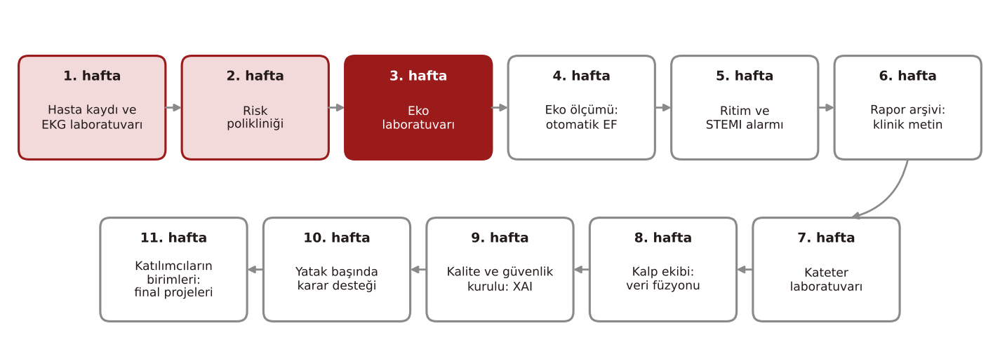

Kliniğe her hafta yeni bir birim eklenir. Kayıt, demografik verileri, risk faktörleri, laboratuvar değerleri, ejeksiyon fraksiyonu, ana tanısı ve 12 derivasyonlu EKG'si olan 500 sentetik hastayla başlar. 2. hafta kaydı, ekokardiyografik değişkenleri ve beş yıllık izlem verisi olan 2.000 hastaya genişletir. Kaydın ardındaki etki büyüklükleri pakette belgelenmiştir; böylece kurulan bir model gerçek değerlerle karşılaştırılabilir. 3. haftadan itibaren klinik, açık araştırma arşivlerinden gerçek görüntüler de okur: Her katılımcının açık kaynağından indirdiği ACDC sine kardiyak manyetik rezonans (KMR) incelemeleri ve kişisel kaydı olan katılımcılar için EchoNet-Dynamic ekokardiyografi videoları. 4. haftadan itibaren klinik, yine her katılımcının açık kaynağından indirdiği CAMUS apikal ekokardiyogramlarında ölçüm de yapar. 5. haftadan itibaren klinik, her katılımcının PhysioNet'ten indirdiği PTB-XL'in 12 derivasyonlu EKG'lerini de okur. 7. haftadan itibaren klinik, her katılımcının Zenodo'dan indirdiği ARCADE X ışınlı koroner anjiyogramlarını da okur. 8. hafta iki hastanede bir göğüs ağrısı ünitesi açar; ünitenin sentetik başvuruları klinik tabloyu, triyaj notunu, 12 derivasyonlu EKG'yi, iki troponin değerini ve yatak başı ekokardiyogramı bir araya getirir. 10. hafta dört sentetik hastası olan bir telemetri servisi açar ve her katılımcının PhysioNet'ten indirdiği MIT-BIH Atriyal Fibrilasyon Veri Tabanı'nın Holter kayıtlarını okur. Görüntüler ve kayıtlar hiçbir zaman depoya girmez. Tablo, şimdiye kadar yayımlanan aşamaların sonuçlarını bir araya getirmektedir.

| Hafta | Aşama | Yöntemler | Sonuç |
|---|---|---|---|
| 1 | [Hasta kaydı ve EKG laboratuvarı](https://utkukose.github.io/ai-cardiology-tkd-NB-lecture/tr/hafta-01/ders.html#the-virtual-clinic-stage-1-the-clinic-opens) | pandas, 12 derivasyonlu bir EKG modeli, otomatik aralık ölçümü, basitleştirilmiş Pan-Tompkins algoritması | 500 hasta; 100 hastada ortalama hata PR için −1,5 ms, QRS için 2,3 ms, QT için 2,2 ms; MIT-BIH 100 numaralı kayıtta 2.273 atımın 2.273'ü bulundu |
| 2 | [Risk polikliniği](https://utkukose.github.io/ai-cardiology-tkd-NB-lecture/tr/hafta-02/ders.html#the-virtual-clinic-stage-2-the-risk-outpatient-clinic-opens) | scikit-learn, lojistik regresyon, çapraz doğrulama, rastgele ormanlar, k-ortalamalar, Kaplan-Meier eğrileri ve log-rank testi | Beş yıllık izlem verisi olan 2.000 hasta; Cleveland verisinde koroner arter hastalığı için çapraz doğrulanmış AUC 0,871; düzeltilmiş Rand indeksi 0,71 olan üç kalp yetersizliği fenogrubu ve 24. ayda olaysız hasta oranı yüzde 64 ile 89 arasında |
| 3 | [Görüntüleme laboratuvarı](https://utkukose.github.io/ai-cardiology-tkd-NB-lecture/tr/hafta-03/ders.html#the-virtual-clinic-stage-3-the-imaging-laboratory-opens) | PyTorch, üç bloklu bir evrişimli sinir ağı, dropout, batch normalizasyonu, veri çoğaltma ve erken durdurma, kesinlik, duyarlılık ve F1 | ACDC'den 90 hastanın sine KMR incelemesi (normal, DCM, HCM); 30 test hastasında ortadaki üç kesitten 0,933 doğruluk ve 0,933 makro F1; uzman konturlarından elde edilen ölçümlere uygulanan ACDC kurallarıyla 0,967 doğruluk |
| 4 | [Eko ölçümü: Otomatik ejeksiyon fraksiyonu](https://utkukose.github.io/ai-cardiology-tkd-NB-lecture/tr/hafta-04/ders.html#the-virtual-clinic-stage-4-automatic-ejection-fraction) | ImageNet üzerinde önceden eğitilmiş EfficientNet-B0, öznitelik çıkarımı ve ince ayar, U-Net, Dice katsayısı, biplan disk yöntemi ve Bland-Altman analizi | ACDC'de grup başına beş hastayla transfer öğrenme: İnce ayarlı ağ için 0,793, 3. haftanın ağı için 0,720 doğruluk; CAMUS'un 50 test hastasında 0,924 ortalama Dice katsayısı, EF'de −4,2 puanlık ortalama fark ve −20,5 ile 12,0 puan arasında uyum sınırları |
| 5 | [Ritim ve STEMI alarmı](https://utkukose.github.io/ai-cardiology-tkd-NB-lecture/tr/hafta-05/ders.html#the-virtual-clinic-stage-5-rhythm-and-stemi-alarm) | RR aralıklarına dayanan bir kural, tek boyutlu evrişimli ağ, RR aralıkları üzerinde GRU, eşikleri doğrulama katında seçilen çok etiketli sınıflandırma, medyan atım, evrensel tanımın ST ölçütleri, QTc ve 24 saatlik Holter kaydı | PTB-XL'in 10. katında altı ritim etiketi için ortalama 0,878 AUC (AF için 0,975), yalnızca RR aralıklarını okuyan GRU için 0,940; 9. ve 10. katlarda STEMI alarmının duyarlılığı 0,538, pozitif öngörü değeri 0,035; LBBB'li 108 kaydın 96'sı alarm vermiştir |
| 6 | [Rapor arşivi: Klinik metin](https://utkukose.github.io/ai-cardiology-tkd-NB-lecture/tr/hafta-06/ders.html#the-virtual-clinic-stage-6-report-archive) | Anahtar kelime kuralı, bir tetikleyicinin kapsamıyla geçişin durumu, kanıt olarak ilaçlar ve laboratuvar değerleri, TF-IDF ve lojistik regresyon, kelime vektörleri, adlandırılmış varlıklar için ince ayar yapılmış küçük bir Türkçe BERT modeli, bir özetin raporuna karşı denetimi ve anjiyografi raporları için bir işlem hattı | İki hastaneden 3.600 epikriz kullanılır. Kuralın makro F1 değeri A hastanesinde 0,980, B hastanesinde 0,985 olur; TF-IDF'de bu değerler 0,990 ve 0,708 olur. İnce ayar yapılan BERT modeli varlıkları A hastanesinde 0,981, B hastanesinde 0,556 F1 değeriyle bulur. Hastalıklı damar sayısı A hastanesinin test raporlarının yüzde 95,9 kadarında, B hastanesinin ise bütün raporlarında doğru bulunur |
| 7 | [Kateter laboratuvarı](https://utkukose.github.io/ai-cardiology-tkd-NB-lecture/tr/hafta-07/ders.html#the-virtual-clinic-stage-7-catheterisation-laboratory) | Dikkat mekanizması, ekokardiyografi için kalite kapısı olarak Vision Transformer ViT-B/16, sentetik anjiyogramlar, ARCADE'de küçük bir evrişimli ağ, küçük bir Vision Transformer ve hibrit model, anjiyograma göre aralıklar, dikkat aktarımı ve bütün anjiyogramların taranması | CAMUS'un 100 test karesinde kötü kareler için AUC değeri 0,862 olan bir kalite kapısı; ARCADE'in 300 test anjiyogramının yamalarında üç ağ için AUC 0,810, 0,930 ve 0,936, sentetik anjiyogramlarla öğrenen ağ için 0,538; yamaların eşiğinde bütün anjiyogramların pencerelerinin yüzde 82 kadarı alarm verir |
| 8 | [Kalp ekibi](https://utkukose.github.io/ai-cardiology-tkd-NB-lecture/tr/hafta-08/ders.html#the-virtual-clinic-stage-8-heart-team) | Erken, geç ve hibrit füzyon, istifleme, maskeli modalite token'ları üzerinde dikkat, HEART skoru, kalibrasyon sabiti, eğimi ve Brier skoru, bootstrap ve Wilson aralıkları, ikinci bir hastanede yeniden kalibrasyon, taburculuk eşikleri ve net yarar | A hastanesinde 4.000, B hastanesinde 1.000 başvurusu olan bir göğüs ağrısı ünitesi; 800 test hastasında erken füzyon için 0,914, troponin için 0,883, HEART için 0,903 AUC; HEART 0-3 ile aynı oranı veren eşikte eve gönderilen 388 hastada 9 majör olumsuz kardiyak olay (MACE), HEART 0-3 ile eve gönderilen 380 hastada 8 MACE; B hastanesinde kalibrasyon sabiti, 300 yerel hastayla yapılan güncellemeden önce 0,62, sonra 0,24 |
| 9 | [Kalite ve güvenlik kurulu](https://utkukose.github.io/ai-cardiology-tkd-NB-lecture/tr/hafta-09/ders.html#the-virtual-clinic-stage-9-quality-and-safety-committee) | Kesin Shapley değerleri ve lojistik regresyon için kapalı formları, genel açıklamalar, LIME ve kararlılığı, uzman sınırlarına karşı Grad-CAM ve 20 rastgele çekilişle sağlamlık testleri, veri kayması için alan sınıflandırıcısı, sabit terim güncellemeleriyle gözlenen eksi beklenen olaylar, alt gruplar, hassas değişkeni dışarıda bırakarak adalet ve KVKK, MDR ve Yapay Zekâ Tüzüğü'nün hukuki çerçevesi | Koroner arter hastalığı için kurulan rastgele ormanda göğüs ağrısı tipi 76 test hastasının 56 tanesinde başı çeker; CAMUS'taki bir eko ağının Grad-CAM haritaları ağırlıklarının yüzde 31,7 kadarını görüntünün yüzde 21,3 kadarını kaplayan uzman sınırlarının içine koyar, son bloğu rastgele olan kopyalarda bu payın medyanı yüzde 27,5 düzeyindedir; B hastanesinde gözlenen MACE 253. başvuruda bandın dışına çıkar; doğrulamada yüzde 98 duyarlılık veren eşikte test kümesindeki kadınlarda duyarlılık yüzde 95,6 olur |
| 10 | [Yatak başında karar desteği](https://utkukose.github.io/ai-cardiology-tkd-NB-lecture/tr/hafta-10/ders.html#the-virtual-clinic-stage-10-decision-support-at-the-bedside) | RR aralıklarının her dakikası için aralarında örneklem entropisinin de bulunduğu beş sayı, eşiği doğrulama kayıtlarında seçilen bir lojistik regresyon, alarm atakları ve AF yükü, bir alarmın EKG şeridinin yanında gösterilen katkıları, sürümü ve SHA-256 parmak izi olan model dosyaları, bir model kartı, bir HL7 FHIR raporu, bir tahmin servisi, Streamlit ile bir web arayüzü, insan gözetimi ve karar kaydıyla bir kullanıcı testi | MIT-BIH AFDB'nin beş test kaydında 1.0 sürümü 0,949 duyarlılık ve 0,935 özgüllükle 0,979 AUC değerine ulaşır; telemetri servisinde 24 saatte 76 tanesi yanlış olmak üzere 80 alarm atağı verir. Örneklem entropisini ekleyen 1.1 sürümü bu sayıyı 11 tanesi yanlış olmak üzere 15 atağa indirir; testteki duyarlılığı ise 0,924 düzeyine düşer |
| 11 | [Katılımcıların klinikleri](https://utkukose.github.io/ai-cardiology-tkd-NB-lecture/tr/hafta-11/ders.html#the-virtual-clinic-stage-11-the-clinics-of-the-participants) | Yapılandırılmış soru, girdilerin zamanını da sınayan veri denetimi, Riley ve arkadaşlarının örneklem büyüklükleri, bir referans model, bootstrap ve Wilson aralıkları, kalibrasyon sabiti ve eğimi, çapraz doğrulamayla seçilen bir dışlama eşiği, alt gruplar, TRIPOD+AI, DECIDE-AI ve CONSORT-AI ile klinik değerlendirmenin aşamaları, sunum ve kişisel eylem planı | Cleveland verisinde çözümlü final projesi testte 0,931 [0,872; 0,977] AUC değerine ulaşır; yaş, cinsiyet ve göğüs ağrısı tipinin değeri ise 0,900 düzeyindedir. Kazancın aralığı [−0,020; 0,094] olarak bulunur ve sıfırı içerir. 0,18 dışlama eşiğinde model, hastalığı olan hiçbir hastayı kaçırmadan 76 anjiyografinin 27 tanesini gereksiz kılardı; negatif öngörü değerinin alt sınırı 0,875 olarak bulunur |

## YZ asistanlarıyla çalışmak

Katılımcılar ilk haftadan itibaren bir YZ asistanıyla birlikte çalışır; eğitim bu çalışmayı, kendi güvenlik kuralları olan bir klinik beceri olarak ele almaktadır. Üç araç bu beceriyi destekler. **Prompt kartı** görevi, veri biçimini, birimleri, örnekleme frekansını ve cevabı bilinen bir testi belirtir; hastayı ise asla tanımlamaz. **Kod güvenlik kontrol listesi**, cerrahi güvenlik kontrol listesinin üç aşamasını uyarlar [1]: Kodu çalıştırmadan önce *giriş*, çalışırken *mola* ve sonucu kullanmadan önce *çıkış*. **YZ kullanım günlüğü** kullanılan aracı, promptu, neyin kontrol edildiğini ve neyin değiştirildiğini kaydeder; her haftalık projenin bir parçasıdır.

**Prompt yolu** bu araçları bir öğrenme yöntemine dönüştürür. Her Jupyter defterinin 1. kısmı uygulama duraklarının adımlarını içerir. Her adımda prompt kartıyla yazılmış hazır bir prompt, asistanın kodu için bir hücre, cevabı bilinen bir kontrol ve yolda kalanlar için hazır kod bulunur. [PROMPT_PATH.tr.md](PROMPT_PATH.tr.md) bu yolu, kullanılabilecek asistanları ve hasta verisinin korunmasına ilişkin kuralları anlatmaktadır.

Gerçek hasta verisi, kurumun kurallarına ve Kişisel Verilerin Korunması Kanunu'na (KVKK) uygun olarak yalnızca katılımcının kendi bilgisayarında kalır [2]. Bulut tabanlı bir deftere ya da bir YZ sohbetine hiçbir zaman aktarılmaz. Eğitimdeki bütün veri setleri ya sentetiktir ya da açık erişimli araştırma veri tabanlarından alınmıştır.

## Kendi verilerinizle

Eğitim sentetik hastalarla ve açık verilerle çalışır, ancak amacı katılımcının kendi kliniğinin verileridir. Her ders sayfası, haftanın yöntemlerinin kişinin kendi verilerine nasıl uygulanacağını anlatan bir bölümle biter. [OWN_DATA.tr.md](OWN_DATA.tr.md) bu bölümleri bir araya getirmektedir. Dosya, hangi sorunun hangi yönteme uyduğunu, verilerin hastane sistemlerinden nasıl alındığını, etik kurul onayını, KVKK'yı ve hesabın nerede yapılacağını ele alır.

## Programlama bilmeyenler için Python

Her Jupyter defterinin 2. kısmı Python yoludur. Bu kısım, haftanın dil yapılarını klinikten örneklerle öğreten bir Python adımıyla açılır; *Python notu* hücreleri de her yeni yapıyı ilk geçtiği yerde açıklar. Her alıştırmada cevap hemen kontrol edilir. [Başlangıç defteri](tr/baslangic/NB00_baslangic.ipynb) 1. haftadan önce bilgisayarı hazırlar ve ilk Python satırlarını tanıtır; [PYTHON_PATH.tr.md](PYTHON_PATH.tr.md) ise bütün haftaların Python adımlarını listeler. Kod yazmak istemeyen katılımcılar [prompt yolunu](PROMPT_PATH.tr.md) izler; bu yolda katılımcı, iyi tarif edilmiş bir görev için asistanın yazdığı kodu çalıştırıp denetleyerek dili tanımaya başlar.

## Değerlendirme ve sertifika

| Bileşen | Ağırlık | Sertifika koşulu |
|---|---|---|
| Haftalık projeler (1-10. haftalar) | Yüzde 40 | Her projeden en az yüzde 70 |
| Final projesi (sunum ve kod) | Yüzde 40 | Jüri ve katılımcı değerlendirmesi |
| Katılım ve etkin öğrenme | Yüzde 20 | En az yüzde 80 devam |

Her haftalık proje, bir sonraki haftanın oturumundan önce e-postayla gönderilir. E-posta, [rapor şablonuyla](tr/sablonlar/Rapor_Sablonu.docx) yazılmış raporu, YZ kullanım günlüğünü, tamamlanmış Jupyter defterini ve etkileşimli labdan dışa aktarılan öğrenme günlüğünü içerir. [Final projesi sayfası](tr/final-projesi/README.md) final projesinin seçeneklerini, koşullarını ve değerlendirme ölçütlerini anlatmaktadır.

## Malzemeleri çalıştırmak

Her Jupyter defteri, aynı veriler ve aynı sonuçlarla iki ortamda çalışır: Kurulum gerektirmeyen Google Colab'da ve katılımcının kendi bilgisayarındaki Jupyter'de (Anaconda). Katılımcı hangisini tercih ederse onu kullanır. [SETUP.tr.md](SETUP.tr.md) ikisini de adım adım anlatır. Colab'da defterin ilk hücresi ders paketini ve veri dosyalarını indirir. Gerçek hastaların verisiyle çalışma ise yalnızca kurumun bir bilgisayarındaki Jupyter'de yapılır. Ders sayfaları ve etkileşimli lablar, bilgisayarda ya da telefonda, herhangi bir güncel tarayıcıda kurulum gerektirmeden çalışır.

## Veriler

[DATASETS.tr.md](DATASETS.tr.md) her veri setini kaynağı, lisansı ve künyesiyle listeler. 1. hafta, UCI Heart Disease veri setinin Cleveland verisini [3], MIT-BIH Aritmi Veri Tabanı'nın 100 numaralı kaydını [4, 5] ve PTB Tanısal EKG Veri Tabanı'nın bir kaydını [6] kullanır; bu veri tabanları PhysioNet'te yayımlanmaktadır [7]. Bu dosyalar [data](data) klasöründe bulunur; böylece defterler üyelik gerektirmeden çalışır.

## Kaynakların doğruluğu

Eğitimin her kaynağı, dijital nesne tanımlayıcısı (DOI) ya da yayıncı sayfası olan yayımlanmış bir çalışmadır ve künyesi yayıncının kaydıyla karşılaştırılarak doğrulanmıştır. [references](references) klasörü listenin tamamını APA 7 biçiminde, BibTeX ve JSON olarak içerir. [tools/verify_references.py](tools/verify_references.py) betiği her kaydı Crossref, DataCite ve OpenAlex ile karşılaştırır. Bir GitHub Actions iş akışı bu betiği her ay ve kaynaklar her değiştiğinde çalıştırır.

## Bu eğitime atıf

Kose, U. (2026). *Artificial Intelligence with Python: A Hands-on Training Program for Cardiologists: Open course materials* [Course materials]. GitHub. https://github.com/utkukose/ai-cardiology-tkd-NB-lecture

[CITATION.cff](CITATION.cff) dosyası aynı bilgiyi kaynak yönetim programları için içermektedir.

## Lisans

Eğitimin içeriği (metinler, şekiller, ders sayfaları, etkileşimli lablar ve notlar) [Creative Commons Atıf 4.0 Uluslararası Lisansı](LICENSE-CONTENT) (CC BY 4.0) ile lisanslanmıştır. `vclinic` paketi ve Jupyter defterlerindeki kod dâhil bütün kod [MIT Lisansı](LICENSE) ile lisanslanmıştır. Veri setleri kendi lisanslarını korur; bu lisanslar [DATASETS.tr.md](DATASETS.tr.md) dosyasında listelenmiştir. Ders sayfalarına ve etkileşimli lablara gömülü Three.js kütüphanesi MIT Lisansı ile dağıtılmaktadır ([assets/vendor/LICENSE-three.txt](assets/vendor/LICENSE-three.txt)).

## Bu sayfada atıf yapılan kaynaklar

1. Haynes, A. B., Weiser, T. G., Berry, W. R., Lipsitz, S. R., Breizat, A.-H. S., Dellinger, E. P., Herbosa, T., Joseph, S., Kibatala, P. L., Lapitan, M. C. M., Merry, A. F., Moorthy, K., Reznick, R. K., Taylor, B., & Gawande, A. A. (2009). A surgical safety checklist to reduce morbidity and mortality in a global population. *New England Journal of Medicine, 360*(5), 491–499. https://doi.org/10.1056/NEJMsa0810119
2. Kişisel Verilerin Korunması Kanunu, Kanun No. 6698. (2016). *Resmî Gazete, 29677 (7 Nisan 2016)*. https://www.mevzuat.gov.tr/mevzuat?MevzuatNo=6698&MevzuatTur=1&MevzuatTertip=5
3. Janosi, A., Steinbrunn, W., Pfisterer, M., & Detrano, R. (1989). *Heart Disease* [Data set]. UCI Machine Learning Repository. https://doi.org/10.24432/C52P4X
4. Moody, G. B., & Mark, R. G. (2005). *MIT-BIH Arrhythmia Database (version 1.0.0)* [Data set]. PhysioNet. https://doi.org/10.13026/C2F305
5. Moody, G. B., & Mark, R. G. (2001). The impact of the MIT-BIH Arrhythmia Database. *IEEE Engineering in Medicine and Biology Magazine, 20*(3), 45–50. https://doi.org/10.1109/51.932724
6. Bousseljot, R., Kreiseler, D., & Schnabel, A. (2004). *The PTB Diagnostic ECG Database (version 1.0.0)* [Data set]. PhysioNet. https://doi.org/10.13026/C28C71
7. Goldberger, A. L., Amaral, L. A. N., Glass, L., Hausdorff, J. M., Ivanov, P. Ch., Mark, R. G., Mietus, J. E., Moody, G. B., Peng, C.-K., & Stanley, H. E. (2000). PhysioBank, PhysioToolkit, and PhysioNet: Components of a new research resource for complex physiologic signals. *Circulation, 101*(23), e215–e220. https://doi.org/10.1161/01.CIR.101.23.e215

## İnsan-yapay zekâ işbirliği

Bu eğitim, insan-yapay zekâ işbirliğiyle geliştirilmiştir. İnsan entelektüel birikimi ve uzmanlığı, eğitimin temel çıkış noktasıdır. Eğitimin yazarı, geliştirmenin her aşamasını yönlendirmekte ve denetlemektedir. Nihai hâl, yalnızca eğitimin yazarının incelemesi ve onayından sonra sunulmaktadır.

---

**Prof. Dr. Utku Köse**

Profesör, Bilgisayar Mühendisliği Bölümü, Süleyman Demirel Üniversitesi, Isparta, Türkiye 
Kurucu Müdür, Yapay Zekâ Uygulama ve Araştırma Merkezi (YAZEM), Süleyman Demirel Üniversitesi 
Bilgisayar Bilimleri Anabilim Dalı Başkanı, Bilgisayar Mühendisliği Bölümü, Süleyman Demirel Üniversitesi 
Diğer kurumlar: University of North Dakota (ABD), Universidad Panamericana (Meksiko, Meksika), Vel Tech University (Chennai, Hindistan) 
IEEE Kıdemli Üyesi, ACM Profesyonel Üyesi

[ORCID 0000-0002-9652-6415](https://orcid.org/0000-0002-9652-6415) | [utkukose.com](https://www.utkukose.com) | [github.com/utkukose](https://github.com/utkukose)

[utkukose@sdu.edu.tr](mailto:utkukose@sdu.edu.tr) | [utku.kose@und.edu](mailto:utku.kose@und.edu) | [ukose@up.edu.mx](mailto:ukose@up.edu.mx) | [utkukose@gmail.com](mailto:utkukose@gmail.com)

*Bu eğitim, alandaki güncel gelişmeler doğrultusunda güncellenmektedir. İlk sürüm: Kasım 2026.*

## Teşekkür

Bu eğitim programı Türk Kardiyoloji Derneği için hazırlanmıştır. Yazar, programı kardiyologlara ve diğer uzman hekimlere sunma olanağı için Derneğe teşekkür eder. Yazar ayrıca açık verileriyle eğitimin uygulamalı çalışmalarını mümkün kılan PhysioNet ve UCI Machine Learning Repository ekiplerine teşekkür eder.
