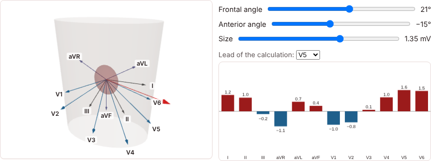
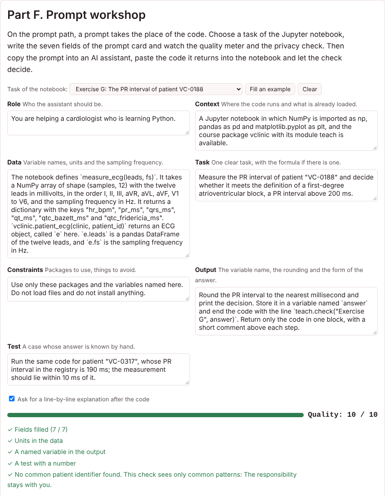
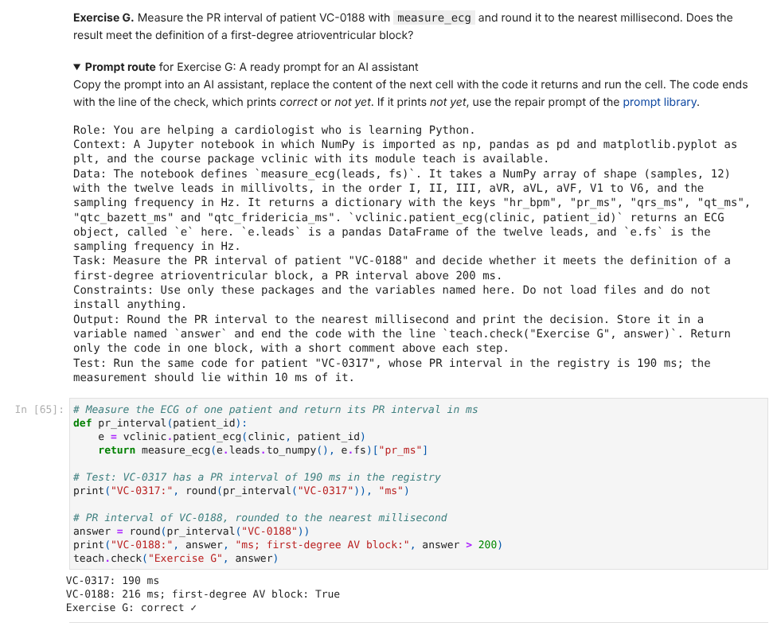

# Week 1: Python and cardiology data basics

**Artificial Intelligence with Python: A Hands-on Training Program for Cardiologists** 
Turkish Society of Cardiology

*From zero programming to clinical data analysis*

[Course home](../../README.md) · [Syllabus](../../SYLLABUS.md) · [Setup](../../SETUP.md) · [Türkçe](../../tr/hafta-01/README.md)

## About the week

Python from the first line, patient tables with pandas, the electrocardiogram (ECG) as data, twelve leads as projections of one heart vector, automatic PR, QRS and QT measurement with QT correction, beat detection and heart rate variability on real PhysioNet records, and the first rules of coding with an artificial intelligence (AI) assistant.

4 hours in the session and about 3 hours for the weekly project.

## Materials

| Material | Open | What it holds |
|---|---|---|
| **Lecture page** | [Open the lecture page](https://utkukose.github.io/ai-cardiology-tkd-NB-lecture/en/week-01/lecture.html) | Concepts, formulas with worked examples, a three-dimensional (3D) scene of the cardiac cycle, two animations, knowledge checks, review cards and references |
| **Interactive lab** | [Open the interactive lab](https://utkukose.github.io/ai-cardiology-tkd-NB-lecture/en/week-01/lab.html) | Parts A to F, including the prompt workshop of Part F, a self-assessment, a reflection and the learning log to export |
| **Jupyter notebook** | [NB01_python_and_ecg_basics.ipynb](NB01_python_and_ecg_basics.ipynb)  (fallback) | Python step 1, Sections 0 to 10 with Exercises A to J, a prompt route below each exercise, a prompt challenge at the end of each section, an application key and the challenges of four fields |
| **Prompt library** | [PROMPTS.md](PROMPTS.md) | All prompts of the week on the prompt card: 13 exercises, 9 prompt challenges, 4 patterns for explaining and repairing code and the prompt route of the weekly project |
| **PDF notes** | [Week01_Lecture_Notes.pdf](Week01_Lecture_Notes.pdf) | Python step 1 and the whole lecture, ready to print |

<table>
<tr><td width="50%"></td><td width="50%"></td></tr>
<tr><td>Interactive lab, Part B: the heart vector of VC-0317 inside a 3D torso and its projections on the twelve leads.</td><td>Jupyter notebook, Section 4: the 12-lead ECG of VC-0317 drawn with teach.plot_12lead.</td></tr>
<tr><td width="50%"></td><td width="50%"></td></tr>
<tr><td>Interactive lab, Part F: the prompt workshop with the seven fields of the prompt card, a quality meter and a privacy check.</td><td>Jupyter notebook, Exercise G on the prompt path: the prompt route, the code of an AI assistant and the check of the course.</td></tr>
</table>

## The case of the week

**VC-0317, 67 years, woman**, comes to the outpatient clinic with palpitations after a change in her medication. The automatic report of her ECG reads a corrected QT (QTc) of 465 ms and marks it as prolonged. The [lecture page](https://utkukose.github.io/ai-cardiology-tkd-NB-lecture/en/week-01/lecture.html) opens with her case, and the clinic answers the question in its last section with its own measurements.

## Learning outcomes

By the end of the week, participants are expected to load a clinical table with pandas and describe it with the mean, the standard deviation, the median and the interquartile range. They should be able to treat an ECG as a table of samples, convert between samples and time, and explain the effect of the sampling frequency and of the resolution. They should explain the twelve leads as projections of one heart vector, apply Einthoven's law and compute the frontal QRS axis. They should measure the PR, QRS and QT intervals by hand and by computer, correct the QT with the formulas of Bazett and Fridericia and compare two methods of measurement with a Bland-Altman analysis. They should also detect R peaks, report sensitivity and positive predictive value, and compute the standard deviation of the normal-to-normal intervals (SDNN) and the root mean square of their successive differences (RMSSD). Finally, they should write a prompt with units and a test, and check code written by an AI assistant with the code safety checklist. In Python, participants are expected to use variables, lists, dictionaries, decisions, loops, functions, NumPy arrays and pandas DataFrames.

## Study path

Participants who attend the session complete steps 1 to 5 there. Participants who follow the week on their own, for example after a missed session, can plan with the times below. Steps 1 to 7 take about 6 hours 35 minutes, and the weekly project takes about 3 hours. On the [prompt path](../../PROMPT_PATH.md), steps 2 and 4 use the prompt routes below the exercises and the prompt challenges of the sections. The [prompt library](PROMPTS.md) holds every prompt of the week, and the times stay about the same.

| Step | Activity | Time |
|---|---|---|
| 1 | Read the case of the week and the lecture page, and answer its knowledge checks | 1 hour 15 minutes |
| 2 | Run Python step 1 in the Jupyter notebook, right after Section 0 | 45 minutes |
| 3 | Work through Parts A to F of the interactive lab | 1 hour 15 minutes |
| 4 | Work through Sections 1 to 9 of the Jupyter notebook and solve the exercises | 2 hours |
| 5 | Use the application key of Section 10 and solve the challenge of your field | 30 minutes |
| 6 | Read the paper of the week with its three questions | 30 minutes |
| 7 | Take the self-assessment in the interactive lab (tab: Check yourself), write the reflection and export the learning log | 20 minutes |
| 8 | Complete the weekly project | 3 hours |

## Training flow of the session

The four-hour session of the week follows the plan below. It is shared to show how the materials fit together in a live session.

| Time | Activity |
|---|---|
| 0:00 to 0:15 | The case of the week. Participants open the Jupyter notebook and run Section 0. |
| 0:15 to 1:00 | Python step 1 in pairs: one participant who writes code and one who does not. The second participant may solve the exercises on the prompt path. |
| 1:00 to 1:45 | Mini project: patient tables with pandas (Section 1) and the opening of the virtual clinic (Section 2). |
| 1:45 to 2:00 | Break. |
| 2:00 to 2:45 | The ECG as data and the heart vector: lecture, 3D scene, Parts A and B of the interactive lab, Sections 3 and 4. |
| 2:45 to 3:30 | Intervals and QT correction with the digital calipers (Part C) and Section 5; beat detection and heart rate variability (Sections 6 and 7). |
| 3:30 to 4:00 | A real 12-lead ECG (Section 8), AI pair programming and the prompt workshop (Section 9, Parts E and F), the paper of the week and the weekly project. |

## Weekly project

**What to do.** First, take the function `measure_ecg` of Section 5 of the Jupyter notebook and extend it, with an AI assistant if you wish. The extended function also returns the frontal QRS axis from the net QRS voltages of leads I and aVF. Second, run it on ten patients of the virtual clinic of your choice, at least two of them with atrial fibrillation or a bundle branch block. Compare each value with the truth in a table. Third, run it on the PTB record of Section 8 and report the heart rate of MIT-BIH record 100 from its detected beats. Finally, decide for each of your ten patients whether the QTc is prolonged with Bazett's and with Fridericia's formula, and discuss the patients for whom the two formulas disagree.

**Where to look.** Lecture: sections "The heart as a vector: Twelve leads, one source", "Intervals: PR, QRS and QT", "Correcting the QT for heart rate" and "AI pair programming, part 1: The code safety checklist". Interactive lab: Parts B, C, E and F. Jupyter notebook: Sections 4, 5, 8 and 9, and Exercises E, F and J.

**Prompt route.** The project can also be built with four prompts, one for each step, from the [prompt library](https://github.com/utkukose/ai-cardiology-tkd-NB-lecture/blob/main/en/week-01/PROMPTS.md#prompt-route-of-the-weekly-project). The test of each prompt must hold before the next prompt is sent, and all four prompts go into the AI usage log.

**Example.** A patient with net QRS voltages of 0.9 mV in lead I and −0.3 mV in lead aVF has $H_y = -0.3/0.866 = -0.346$ and a frontal axis of $\operatorname{atan2}(-0.346, 0.9) = -21.0°$, within the normal range. An axis of −45° in another patient would show left axis deviation.

**What to submit.** A report of one to two pages in the [report template](../templates/Report_Template.docx), with the table of your ten patients, the results of the two real records and the discussion of the two QT corrections. Add the AI usage log (tool, prompt, what was checked, what was changed) and the Jupyter notebook with the exercises of Week 1 completed.

**Submission.** The weekly project is submitted before the session of Week 2 by e-mail to utkukose@sdu.edu.tr or utkukose@gmail.com. The e-mail holds the items listed under What to submit and the learning log exported from the interactive lab. Weekly projects count for 40 percent of the assessment, and the certificate requires at least 70 percent in each of them (see the syllabus).

## Optional research assignment

Search PubMed for one study, published in 2023 or later, that tested an AI model for the 12-lead ECG on external data. External data come from a hospital other than the one where the model was developed. Summarise it in half a page: the population, the reference standard, the measure of performance and one limitation. The three questions of [the paper of the week](https://utkukose.github.io/ai-cardiology-tkd-NB-lecture/en/week-01/lecture.html#the-paper-of-the-week) can guide the summary. The assignment is not graded, and it prepares the discussion of validation in Week 2.

## The virtual clinic after this week

In Week 1 the virtual clinic opens with a registry of 500 synthetic patients and an ECG laboratory that measures every recording automatically. The results of this stage, with the errors of the automatic measurement, are in the section [The virtual clinic, stage 1](https://utkukose.github.io/ai-cardiology-tkd-NB-lecture/en/week-01/lecture.html#the-virtual-clinic-stage-1-the-clinic-opens) of the lecture page.

## Next week

**Week 2: Machine learning fundamentals.** The virtual clinic opens its risk outpatient clinic: models that predict coronary artery disease on the UCI Heart Disease data and on the registry, with cross-validation and receiver operating characteristic (ROC) analysis. See the [plan of the course](../../README.md#the-eleven-weeks).

---

**Prof. Dr. Utku Kose**

Full Professor, Department of Computer Engineering, Süleyman Demirel University, Isparta, Türkiye 
Founding Director, AI Application and Research Center (YAZEM), Süleyman Demirel University 
Head of the Computer Science Division, Department of Computer Engineering, Süleyman Demirel University 
Additional affiliations: University of North Dakota (USA), Universidad Panamericana (Mexico City, Mexico), Vel Tech University (Chennai, India) 
IEEE Senior Member, ACM Professional Member

[ORCID 0000-0002-9652-6415](https://orcid.org/0000-0002-9652-6415) | [utkukose.com](https://www.utkukose.com) | [github.com/utkukose](https://github.com/utkukose)

[utkukose@sdu.edu.tr](mailto:utkukose@sdu.edu.tr) | [utku.kose@und.edu](mailto:utku.kose@und.edu) | [ukose@up.edu.mx](mailto:ukose@up.edu.mx) | [utkukose@gmail.com](mailto:utkukose@gmail.com)

*First version: November 2026. Content CC BY 4.0, code MIT.*

