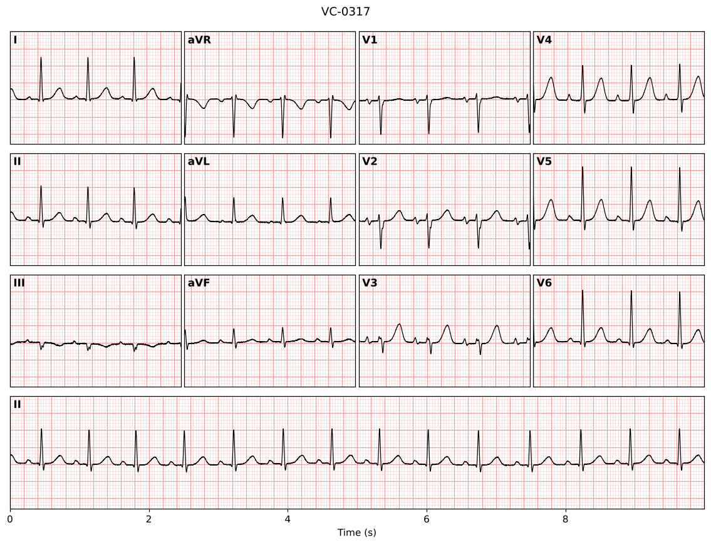

> **Türkçe:** Bu eğitim Türkçe yürütülmektedir. **[Bu haftanın Türkçe sayfasına geçin](../../tr/hafta-01/README.md)**

# Week 1: Python and cardiology data basics

**Artificial Intelligence with Python: A Hands-on Training Program for Cardiologists** 
Turkish Society of Cardiology

*From zero programming knowledge to clinical data analysis*

[Course home](../../README.md) · [Syllabus](../../SYLLABUS.md) · [Setup](../../SETUP.md) · [Türkçe](../../tr/hafta-01/README.md)

## About the week

The first two hours introduce the Anaconda and Jupyter Notebook environment, variables, lists and loops with medical examples, reading and processing a patient table with pandas and a first cardiological plot with Matplotlib, and close with the mini project on the Kaggle Heart Disease data set. The last two hours work with electrocardiogram (ECG) data: the ECG as samples, twelve leads as projections of one heart vector, automatic PR, QRS and QT measurement with QT correction, access to the PhysioNet and MIT-BIH data sets, reading and processing with the wfdb library, R-peak detection with NeuroKit2, heart rate variability (HRV) and the visualisation of the 12 leads. The weekly project is a script that visualises the ECG and calculates its basic measurements, PR, QRS and QT, automatically. The week also sets the first rules of coding with an artificial intelligence (AI) assistant.

4 hours in the session and about 3 hours for the weekly project.

## The case of the week

**VC-0317, 67 years, woman**, comes to the outpatient clinic with palpitations after a change in her medication. The automatic report of her ECG reads a corrected QT (QTc) of 465 ms and marks it as prolonged. The [lecture page](https://utkukose.github.io/ai-cardiology-tkd-NB-lecture/en/week-01/lecture.html) opens with her case, and the clinic answers the question in its last section with its own measurements.

## Materials

| Material | Open | What it is for |
|---|---|---|
| **Lecture page** | [Open the lecture page](https://utkukose.github.io/ai-cardiology-tkd-NB-lecture/en/week-01/lecture.html) | The teaching of the week. It is read from top to bottom, leads to the practice stops and holds no code and no prompts. |
| **Interactive lab** | [Open the interactive lab](https://utkukose.github.io/ai-cardiology-tkd-NB-lecture/en/week-01/lab.html) | Parts A to F, without code, open where the lecture page reaches them. Part F is the prompt workshop. The self-assessment and the learning log are in the lab too. |
| **Jupyter notebook** |  [Download for Jupyter](NB01_python_and_ecg_basics.ipynb) | The practice stops are worked here: Part 1 is the prompt path and Part 2 the Python path. The notebook runs in Google Colab with nothing to install, or in Jupyter on your own computer. |
| **Prompt library** | [PROMPTS.md](PROMPTS.md) | Every prompt of the prompt path and of the weekly project, with prompts for repairing, explaining and reviewing code. On GitHub, each prompt has a copy button. |
| **PDF notes** | [Week01_Lecture_Notes.pdf](Week01_Lecture_Notes.pdf) | The printable version of the lecture page. |

## Study path

The lecture page is read from top to bottom, and it opens the parts of the interactive lab where they belong. At each practice stop, the work continues in the Jupyter notebook on one of two paths. On the **prompt path** (Part 1 of the notebook), an AI assistant writes the code from ready prompts, and the participant runs it and checks the result. On the **Python path** (Part 2), participants write the code themselves. Both paths reach the same results. At the end of every lab part and of every stop in the Jupyter notebook, a link takes you back to the lecture page, to the place where reading continues. If you lose your place, come back to this table. Participants who attend the session complete the steps there. The times help those who follow the week on their own, for example after a missed session.

| Step | What to do | Prompt path (Part 1) | Python path (Part 2) |
|---|---|---|---|
| 1 | [Read](https://utkukose.github.io/ai-cardiology-tkd-NB-lecture/en/week-01/lecture.html) the case of the week and the lecture page up to Practice stop 1: the two paths of practice, the virtual clinic and the first two hours, from Anaconda and Jupyter Notebook to the mini project | 50 minutes | 50 minutes |
| 2 | **[Practice stop 1: Mini project: The Kaggle Heart Disease data set](https://utkukose.github.io/ai-cardiology-tkd-NB-lecture/en/week-01/lecture.html#stop-1)** | Part 1, Stop 1 ([prompts](PROMPTS.md#stop-1-mini-project-the-kaggle-heart-disease-data-set)) 30 minutes | Python step 1, Sections 1 and 2 1 hour 15 minutes |
| 3 | [Read on](https://utkukose.github.io/ai-cardiology-tkd-NB-lecture/en/week-01/lecture.html#last-two-hours-working-with-ecg-data) up to Practice stop 2: the ECG as data, the heart vector, the intervals and the QT correction, with Parts A to C of the interactive lab and the knowledge checks | 1 hour | 1 hour |
| 4 | **[Practice stop 2: The ECG as data](https://utkukose.github.io/ai-cardiology-tkd-NB-lecture/en/week-01/lecture.html#stop-2)** | Part 1, Stop 2 ([prompts](PROMPTS.md#stop-2-the-ecg-as-data)) 30 minutes | Sections 3 to 5 1 hour |
| 5 | [Read on](https://utkukose.github.io/ai-cardiology-tkd-NB-lecture/en/week-01/lecture.html#real-data-physionet-records) up to Practice stop 3: PhysioNet and MIT-BIH, the wfdb library, R-peak detection with NeuroKit2, HRV and the 12 leads, with Parts D to F of the interactive lab | 55 minutes | 55 minutes |
| 6 | **[Practice stop 3: Real recordings and a careless prompt](https://utkukose.github.io/ai-cardiology-tkd-NB-lecture/en/week-01/lecture.html#stop-3)** | Part 1, Stop 3 ([prompts](PROMPTS.md#stop-3-real-recordings-and-a-careless-prompt)) 35 minutes | Sections 6 to 9 1 hour 10 minutes |
| 7 | [Read](https://utkukose.github.io/ai-cardiology-tkd-NB-lecture/en/week-01/lecture.html#the-paper-of-the-week) the paper of the week, the stage of the virtual clinic and the section on your own data | 30 minutes | 30 minutes |
| 8 | Take the self-assessment of [the interactive lab](https://utkukose.github.io/ai-cardiology-tkd-NB-lecture/en/week-01/lab.html) (tab: Check yourself), write the reflection and export the learning log | 20 minutes | 20 minutes |
| | **Total without the weekly project** | **5 hours 10 minutes** | **7 hours** |
| 9 | Complete [the weekly project](#weekly-project), on either path | [Prompts](PROMPTS.md#prompt-path-of-the-weekly-project) 3 hours | 3 hours |

<table>
<tr><td width="50%"></td><td width="50%"></td></tr>
<tr><td>Interactive lab, Part B: the heart vector of VC-0317 inside a 3D torso and its projections on the twelve leads.</td><td>Jupyter notebook, Python path, Section 4: the 12-lead ECG of VC-0317.</td></tr>
<tr><td width="50%"></td><td width="50%"></td></tr>
<tr><td>Interactive lab, Part F: the prompt workshop with the seven fields of the prompt card, a quality meter and a privacy check.</td><td>Jupyter notebook, prompt path, Stop 2: a ready prompt, the code of an AI assistant and the check of the course.</td></tr>
</table>

## Weekly project

**Project.** A script that visualises the ECG and calculates its basic measurements, PR, QRS and QT, automatically.

**What to do.** First, take the function `measure_ecg` of Section 5 of the Jupyter notebook and extend it, with an AI assistant if you wish. The extended function also returns the frontal QRS axis from the net QRS voltages of leads I and aVF. Second, save your functions as a script, a file named `ecg_measure.py` in the folder of the week. The script reads an ECG, a patient of the virtual clinic or a PhysioNet record, draws its 12 leads in the standard layout of Section 8 and prints the heart rate, PR, QRS, QT and QTc. Run it in the notebook with `%run ecg_measure.py` or in the Anaconda Prompt with `python ecg_measure.py`. Third, run it on ten patients of the virtual clinic of your choice, at least two of them with atrial fibrillation or a bundle branch block, and compare each value with the truth in a table. Fourth, run it on the PTB record of Section 8, and report the heart rate and the heart rate variability (SDNN and RMSSD of the first five minutes) of MIT-BIH record 100 from its detected beats. Finally, decide for each of your ten patients whether the QTc is prolonged with Bazett's and with Fridericia's formula, and discuss the patients for whom the two formulas disagree.

**Where to look.** Lecture: sections "The heart as a vector: Twelve leads, one source", "Intervals: PR, QRS and QT", "Correcting the QT for heart rate", "Reading and processing ECGs with the wfdb library", "R-peak detection (NeuroKit2)", "Heart rate variability (HRV) calculation", "Visualising the 12 leads" and "Working with an AI assistant, part 1: The code safety checklist". Interactive lab: Parts B to F. Jupyter notebook: Sections 4 to 9, and Exercises E, F, H, I and J.

**Prompt path.** The project can also be built with four prompts, one for each step, from the [prompt library](https://github.com/utkukose/ai-cardiology-tkd-NB-lecture/blob/main/en/week-01/PROMPTS.md#prompt-path-of-the-weekly-project). The section "Weekly project on the prompt path" at the end of Part 1 of the Jupyter notebook prepares the table of each prompt. The test of each prompt must hold before the next prompt is sent, and all four prompts go into the AI usage log. The code that passes the tests is saved as the script `ecg_measure.py`.

**Example.** A patient with net QRS voltages of 0.9 mV in lead I and −0.3 mV in lead aVF has $H_y = -0.3/0.866 = -0.346$ and a frontal axis of $\operatorname{atan2}(-0.346, 0.9) = -21.0°$, within the normal range. An axis of −45° in another patient would show left axis deviation.

**What to submit.** The script `ecg_measure.py` and a report of one to two pages in the [report template](../templates/Report_Template.docx), with the table of your ten patients, the results of the two real records and the discussion of the two QT corrections. Add the AI usage log (tool, prompt, what was checked, what was changed) and the Jupyter notebook with the exercises of Week 1 completed.

**Submission.** The weekly project is submitted before the session of Week 2 by e-mail to utkukose@sdu.edu.tr or utkukose@gmail.com. The e-mail holds the items listed under What to submit and the learning log exported from the interactive lab. Weekly projects count for 40 percent of the assessment, and the certificate requires at least 70 percent in each of them (see the syllabus).

## Learning outcomes

By the end of the week, participants are expected to start Jupyter Notebook in Anaconda, open a notebook, run its cells in order and save it. They should be able to use variables, lists, loops, dictionaries, decisions and functions with clinical values, read and process a patient table with pandas and describe it with the mean, the standard deviation, the median and the interquartile range. They should draw a first cardiological plot with Matplotlib and complete the mini project on the Kaggle Heart Disease data set. They should be able to treat an ECG as a table of samples and explain the effect of the sampling frequency and of the resolution. They should explain the twelve leads as projections of one heart vector, apply Einthoven's law and compute the frontal QRS axis. They should measure the PR, QRS and QT intervals by hand and by computer, correct the QT with the formulas of Bazett and Fridericia and compare two methods of measurement with a Bland-Altman analysis. They should also access the PhysioNet and MIT-BIH data sets, read and process a record with the wfdb library, detect R peaks with NeuroKit2 and report sensitivity and positive predictive value. They should compute the standard deviation of the normal-to-normal intervals (SDNN) and the root mean square of their successive differences (RMSSD), and visualise the 12 leads in the standard layout. Finally, they should write a prompt with units and a test, and check code written by an AI assistant with the code safety checklist.

## Training flow of the session

The four-hour session of the week follows the plan below. It is shared to show how the materials fit together in a live session.

| Time | Activity |
|---|---|
| 0:00 to 0:15 | The case of the week, VC-0317, and the route of the course: the lecture page as the main route, the two paths of practice and the virtual clinic. |
| 0:15 to 0:40 | First two hours, introduction to Python and the Jupyter Notebook environment: the Anaconda and Jupyter Notebook environment and its first use. Every participant starts Jupyter Notebook in Anaconda, or opens the notebook in Google Colab, and runs Section 0. |
| 0:40 to 1:05 | Variables, lists and loops with medical examples, with the first cells of Python step 1 on the shared screen. |
| 1:05 to 1:30 | Reading and processing a patient table with pandas, and a first cardiological plot with Matplotlib. |
| 1:30 to 2:00 | Mini project of the session, Practice stop 1, in two groups, the prompt path and the Python path: The Kaggle Heart Disease data set is loaded, summarised with statistics and visualised. |
| 2:00 to 2:10 | Break. |
| 2:10 to 2:50 | Last two hours, working with ECG data: the ECG as data, twelve leads from one heart vector with Parts A and B of the interactive lab, the intervals and the QT correction with Part C. Practice stop 2. |
| 2:50 to 3:35 | Access to the PhysioNet and MIT-BIH data sets, reading and processing ECGs with the wfdb library, R-peak detection with NeuroKit2, HRV calculation with Part D and the visualisation of the 12 leads; the code safety checklist with Parts E and F. Practice stop 3. |
| 3:35 to 3:50 | The weekly project, a script that visualises the ECG and calculates PR, QRS and QT automatically; the paper of the week and the first stage of the virtual clinic. |
| 3:50 to 4:00 | Questions. |

## With your own data

The lecture page closes with a section on applying the methods of the week to your own data: which question fits which method, what to check first, the approval of the ethics committee, the Turkish Law on the Protection of Personal Data (KVKK) and where to compute. [Read it on the lecture page](https://utkukose.github.io/ai-cardiology-tkd-NB-lecture/en/week-01/lecture.html#with-your-own-data).

## Optional research assignment

Search PubMed for one study, published in 2023 or later, that tested an AI model for the 12-lead ECG on external data. External data come from a hospital other than the one where the model was developed. Summarise it in half a page: the population, the reference standard, the measure of performance and one limitation. The three questions of [the paper of the week](https://utkukose.github.io/ai-cardiology-tkd-NB-lecture/en/week-01/lecture.html#the-paper-of-the-week) can guide the summary. The assignment is not graded, and it prepares the discussion of validation in Week 2.

## The virtual clinic after this week

In Week 1 the virtual clinic opens with a registry of 500 synthetic patients and an ECG laboratory that measures every recording automatically. The results of this stage, with the errors of the automatic measurement, are in the section [The virtual clinic, stage 1](https://utkukose.github.io/ai-cardiology-tkd-NB-lecture/en/week-01/lecture.html#the-virtual-clinic-stage-1-the-clinic-opens) of the lecture page.

## Next week

**Week 2: Machine learning fundamentals.** The virtual clinic opens its risk outpatient clinic: models that predict coronary artery disease on the UCI Heart Disease data and on the registry, with cross-validation and receiver operating characteristic (ROC) analysis. See the [plan of the course](../../README.md#the-eleven-weeks).

---

**Prof. Dr. Utku Kose**

Full Professor, Department of Computer Engineering, Süleyman Demirel University, Isparta, Türkiye 
Founding Director, AI Application and Research Center (YAZEM), Süleyman Demirel University 
Head of the Computer Science Division, Department of Computer Engineering, Süleyman Demirel University 
Additional affiliations: University of North Dakota (USA), Universidad Panamericana (Mexico City, Mexico), Vel Tech University (Chennai, India) 
IEEE Senior Member, ACM Professional Member

[ORCID 0000-0002-9652-6415](https://orcid.org/0000-0002-9652-6415) | [utkukose.com](https://www.utkukose.com) | [github.com/utkukose](https://github.com/utkukose)

[utkukose@sdu.edu.tr](mailto:utkukose@sdu.edu.tr) | [utku.kose@und.edu](mailto:utku.kose@und.edu) | [ukose@up.edu.mx](mailto:ukose@up.edu.mx) | [utkukose@gmail.com](mailto:utkukose@gmail.com)

*First version: November 2026. Content CC BY 4.0, code MIT.*

