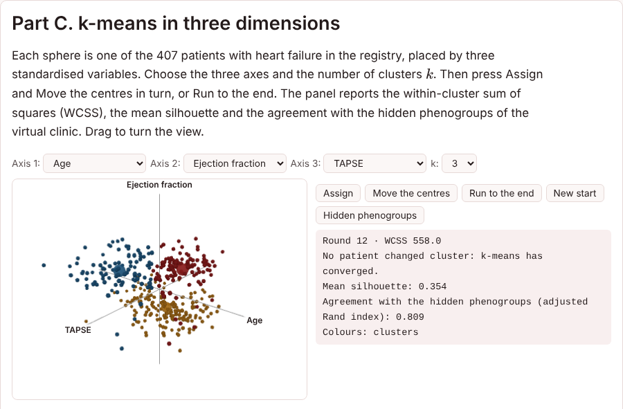
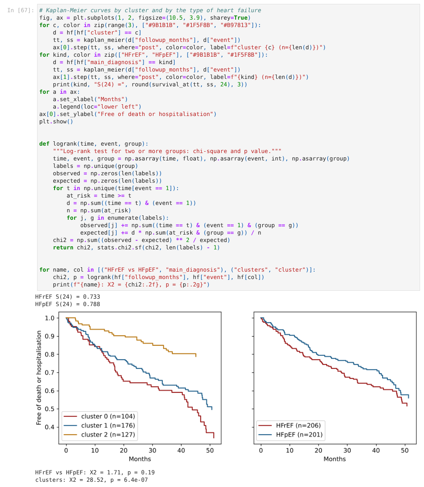
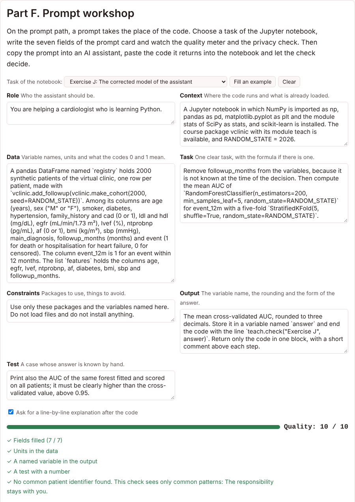

> **Türkçe:** Bu eğitim Türkçe yürütülmektedir. **[Bu haftanın Türkçe sayfasına geçin](../../tr/hafta-02/README.md)**

# Week 2: Machine learning fundamentals

**Artificial Intelligence with Python: A Hands-on Training Program for Cardiologists** 
Turkish Society of Cardiology

*From risk factors to a probability, from patients to phenogroups*

[Course home](../../README.md) · [Syllabus](../../SYLLABUS.md) · [Setup](../../SETUP.md) · [Türkçe](../../tr/hafta-02/README.md)

## About the week

Supervised learning with scikit-learn: a logistic regression for coronary artery disease on the Cleveland data, the confusion matrix and the receiver operating characteristic (ROC) curve, cross-validation and data leakage, decision trees and random forests, and the pitfalls of rare outcomes. Unsupervised learning then finds phenogroups of heart failure with k-means, and Kaplan-Meier curves with the log-rank test compare their prognosis. The virtual clinic grows to 2000 patients and opens its risk outpatient clinic.

4 hours in the session and about 3 hours for the weekly project.

## The route of the week

The lecture page is the main route of the week. It holds no code and no prompts, and it is read from top to bottom together with the interactive lab. At each practice stop, every participant chooses one of two paths in the Jupyter notebook: the **prompt path** (Part 1), on which an artificial intelligence (AI) assistant writes the code from ready prompts and the participant runs and checks it, or the **Python path** (Part 2), on which the participant writes the code. Both paths reach the same results. The notebook runs in Google Colab, with nothing to install, or in Jupyter on your own computer ([setup](../../SETUP.md)).

|  | Main route: lecture page and interactive lab | Practice stop: choose a path |
|---|---|---|
| 1 | [Machine learning in one page](https://utkukose.github.io/ai-cardiology-tkd-NB-lecture/en/week-02/lecture.html#machine-learning-in-one-page), [Logistic regression: From risk factors to a probability](https://utkukose.github.io/ai-cardiology-tkd-NB-lecture/en/week-02/lecture.html#logistic-regression-from-risk-factors-to-a-probability), [Measuring a model: Confusion matrix and ROC curve](https://utkukose.github.io/ai-cardiology-tkd-NB-lecture/en/week-02/lecture.html#measuring-a-model-confusion-matrix-and-roc-curve) | **[Stop 1: A first risk model](https://utkukose.github.io/ai-cardiology-tkd-NB-lecture/en/week-02/lecture.html#stop-1)** Prompt path: Part 1, Stop 1 Python path: Part 2, Python step 2, Sections 1 and 2 |
| 2 | [Training and testing: Cross-validation and data leakage](https://utkukose.github.io/ai-cardiology-tkd-NB-lecture/en/week-02/lecture.html#training-and-testing-cross-validation-and-data-leakage), [Decision trees and random forests](https://utkukose.github.io/ai-cardiology-tkd-NB-lecture/en/week-02/lecture.html#decision-trees-and-random-forests), [Rare outcomes: Imbalanced data](https://utkukose.github.io/ai-cardiology-tkd-NB-lecture/en/week-02/lecture.html#rare-outcomes-imbalanced-data) | **[Stop 2: Testing a model honestly](https://utkukose.github.io/ai-cardiology-tkd-NB-lecture/en/week-02/lecture.html#stop-2)** Prompt path: Part 1, Stop 2 Python path: Part 2, Sections 3 to 6 |
| 3 | [Unsupervised learning: k-means and phenogroups](https://utkukose.github.io/ai-cardiology-tkd-NB-lecture/en/week-02/lecture.html#unsupervised-learning-k-means-and-phenogroups), [Survival analysis: Kaplan-Meier and the log-rank test](https://utkukose.github.io/ai-cardiology-tkd-NB-lecture/en/week-02/lecture.html#survival-analysis-kaplan-meier-and-the-log-rank-test), [Working with an AI assistant, part 2: Reviewing a model](https://utkukose.github.io/ai-cardiology-tkd-NB-lecture/en/week-02/lecture.html#ai-pair-programming-part-2-reviewing-a-model-built-by-an-assistant) | **[Stop 3: Subgroups, survival and a model to review](https://utkukose.github.io/ai-cardiology-tkd-NB-lecture/en/week-02/lecture.html#stop-3)** Prompt path: Part 1, Stop 3 Python path: Part 2, Sections 7 to 9 |
|  | [The paper of the week](https://utkukose.github.io/ai-cardiology-tkd-NB-lecture/en/week-02/lecture.html#the-paper-of-the-week), [The virtual clinic, stage 2: The risk outpatient clinic opens](https://utkukose.github.io/ai-cardiology-tkd-NB-lecture/en/week-02/lecture.html#the-virtual-clinic-stage-2-the-risk-outpatient-clinic-opens) | The section on your own data, the paper of the week and the virtual clinic |

## Materials

| Material | Open | What it holds |
|---|---|---|
| **Lecture page (main route)** | [Open the lecture page](https://utkukose.github.io/ai-cardiology-tkd-NB-lecture/en/week-02/lecture.html) | The case, the concepts with worked examples, a three-dimensional (3D) scene of k-means, two animations, knowledge checks, three practice stops, the section on your own data, review cards and references. No code and no prompts. |
| **Interactive lab** | [Open the interactive lab](https://utkukose.github.io/ai-cardiology-tkd-NB-lecture/en/week-02/lab.html) | Parts A to F without code, including the prompt workshop of Part F, a self-assessment, a reflection and the learning log to export |
| **Jupyter notebook** |  [Download for Jupyter](NB02_machine_learning_fundamentals.ipynb) | Part 1, the prompt path: three stops with nine steps, each with a ready prompt, a cell for the code of the AI assistant, an automatic check and ready code. Part 2, the Python path: Python step 2, Sections 1 to 10 with Exercises A to J, an application key and the challenges of seven fields. |
| **Prompt library** | [PROMPTS.md](PROMPTS.md) | All prompts of the prompt path with a copy button on GitHub, the prompts for repairing code and the prompt path of the weekly project |
| **PDF notes** | [Week02_Lecture_Notes.pdf](Week02_Lecture_Notes.pdf) | The lecture page in print form, with its practice stops and the section on your own data |

<table>
<tr><td width="50%"></td><td width="50%"></td></tr>
<tr><td>Interactive lab, Part C: k-means in three dimensions on the patients with heart failure, step by step.</td><td>Jupyter notebook, Section 8: Kaplan-Meier curves of the three clusters and of HFrEF against HFpEF.</td></tr>
<tr><td width="50%"></td><td width="50%"></td></tr>
<tr><td>Interactive lab, Part B: the threshold, the confusion matrix and the ROC curve of the model for coronary artery disease.</td><td>Interactive lab, Part F: the prompt workshop with the seven fields of the prompt card, a quality meter and a privacy check.</td></tr>
</table>

## The case of the week

**VC-0246, 57 years, man**, comes to the new risk outpatient clinic. He smokes, has treated hypertension, an LDL cholesterol of 170 mg/dL and an HDL cholesterol of 36 mg/dL. On the treadmill he had angina and an ST depression of 1.6 mm. The clinic needs a number, his probability of coronary artery disease, and needs to know how far that number can be trusted. The [lecture page](https://utkukose.github.io/ai-cardiology-tkd-NB-lecture/en/week-02/lecture.html) opens with his case, and the clinic answers it in its last section.

## Learning outcomes

By the end of the week, participants are expected to prepare a clinical table for a model and to fit, read and use a logistic regression with scikit-learn. They should be able to measure a model with the confusion matrix, sensitivity, specificity, predictive values, the ROC curve and the area under it, and to estimate its performance with cross-validation without leaking information from the test patients. They should be able to compare a decision tree and a random forest, and to explain why accuracy misleads with rare outcomes and how the positive predictive value depends on the prevalence. Finally, they should be able to find subgroups of patients with k-means, to compare their prognosis with Kaplan-Meier curves and the log-rank test, and to review a model built by an AI assistant with four questions.

## Study path

Participants who attend the session complete the main route and the practice stops there. Participants who follow the week on their own, for example after a missed session, can plan with the times below.

| Step | Activity | Prompt path | Python path |
|---|---|---|---|
| 1 | Read the case of the week and the lecture page up to Practice stop 1, with Parts A and B of the interactive lab and the knowledge checks | 55 minutes | 55 minutes |
| 2 | Practice stop 1: Part 1, Stop 1 on the prompt path, or Python step 2 and Sections 1 and 2 on the Python path | 30 minutes | 1 hour 10 minutes |
| 3 | Read on up to Practice stop 2: cross-validation, trees and forests, rare outcomes | 35 minutes | 35 minutes |
| 4 | Practice stop 2: Part 1, Stop 2, or Sections 3 to 6 | 30 minutes | 1 hour |
| 5 | Read on up to Practice stop 3, with Parts C to F of the interactive lab | 50 minutes | 50 minutes |
| 6 | Practice stop 3: Part 1, Stop 3, or Sections 7 to 9 | 30 minutes | 50 minutes |
| 7 | Read the paper of the week, the stage of the virtual clinic and the section on your own data | 30 minutes | 30 minutes |
| 8 | Take the self-assessment of the interactive lab (tab: Check yourself), write the reflection and export the learning log | 20 minutes | 20 minutes |
| | **Total without the weekly project** | **4 hours 40 minutes** | **6 hours 10 minutes** |
| 9 | Complete the weekly project, on either path | 3 hours | 3 hours |

## Training flow of the session

The four-hour session of the week follows the plan below. It is shared to show how the materials fit together in a live session.

| Time | Activity |
|---|---|
| 0:00 to 0:15 | The case of the week, VC-0246, and the route of the week. Every participant opens the notebook in Google Colab or in Jupyter and runs Section 0. |
| 0:15 to 0:55 | Main route: machine learning in one page, logistic regression with Part A of the interactive lab, the confusion matrix and the ROC curve with Part B. |
| 0:55 to 1:35 | Practice stop 1 in two groups, the prompt path and the Python path. Both groups compare their test AUC at the end. |
| 1:35 to 1:50 | Break. |
| 1:50 to 2:30 | Main route: cross-validation and data leakage, trees and forests, rare outcomes. Practice stop 2. |
| 2:30 to 3:20 | Main route: k-means in three dimensions with Part C, Kaplan-Meier by hand with Part D, reviewing a model with Parts E and F. Practice stop 3. |
| 3:20 to 3:45 | The paper of the week, the risk outpatient clinic of the virtual clinic and the section on your own data. |
| 3:45 to 4:00 | The weekly project and questions. |

## Weekly project

**What to do.** Find the phenogroups of heart failure in the registry of the virtual clinic and compare their prognosis. First, cluster the patients with HFrEF or HFpEF on nine standardised variables with k-means for k from 2 to 6, and choose k with the silhouette and with clinical sense. Second, describe each cluster in a table and give it a short clinical name. Third, draw the Kaplan-Meier curves of the clusters and of HFrEF against HFpEF, and compare them with the log-rank test. Fourth, compare the clusters with the phenogroups that the course hid in the registry, with a cross-table and the adjusted Rand index. Then write what the clustering found that the ejection fraction alone misses.

**Where to look.** Lecture: sections "Unsupervised learning: k-means and phenogroups", "Survival analysis: Kaplan-Meier and the log-rank test" and "The paper of the week". Interactive lab: Parts C, D and F. Jupyter notebook: Sections 7 and 8.

**Prompt path.** The project can also be built with four prompts, one for each step, from the [prompt library](https://github.com/utkukose/ai-cardiology-tkd-NB-lecture/blob/main/en/week-02/PROMPTS.md#prompt-path-of-the-weekly-project). The test of each prompt must hold before the next prompt is used.

**Example.** Three patients at risk at month 5 with one event give the factor $1 - 1/3 = 0.667$. If the survival before month 5 was 0.800, the curve steps down to $0.800 \times 0.667 = 0.533$. Each step of the Kaplan-Meier curve of a cluster is computed in the same way.

**What to submit.** A report of one to two pages in the [report template](../templates/Report_Template.docx), with the table of the clusters, the Kaplan-Meier figure, the two log-rank tests and the comparison with the hidden phenogroups. Add the AI usage log (tool, prompt, what was checked, what was changed) and the Jupyter notebook with its outputs.

**Submission.** The weekly project is submitted before the session of Week 3 by e-mail to utkukose@sdu.edu.tr or utkukose@gmail.com. The e-mail holds the items listed under What to submit and the learning log exported from the interactive lab. Weekly projects count for 40 percent of the assessment, and the rubric is in the syllabus.

## With your own data

The lecture page closes with a section on applying the methods of the week to your own data: which question fits which method, what to check first, the approval of the ethics committee, the Turkish Law on the Protection of Personal Data (KVKK) and where to compute. [Read it on the lecture page](https://utkukose.github.io/ai-cardiology-tkd-NB-lecture/en/week-02/lecture.html#with-your-own-data).

## Optional research assignment

Search PubMed for one study, published in 2020 or later, that developed or validated a machine learning model for the prognosis of patients with heart failure. Summarise it in half a page: the population, the outcome and its follow-up, the model, how it was validated and one limitation. The three questions of [the paper of the week](https://utkukose.github.io/ai-cardiology-tkd-NB-lecture/en/week-02/lecture.html#the-paper-of-the-week) can guide the summary. The assignment is not graded, and it prepares the discussion of external validation in Week 3.

## The virtual clinic after this week

In Week 2 the virtual clinic grows to 2000 patients with five years of follow-up and opens its risk outpatient clinic. Its model of coronary artery disease is compared with the true effects that generated the registry, and its patients with heart failure are grouped into phenogroups with different prognosis. The results are in the section [The virtual clinic, stage 2](https://utkukose.github.io/ai-cardiology-tkd-NB-lecture/en/week-02/lecture.html#the-virtual-clinic-stage-2-the-risk-outpatient-clinic-opens) of the lecture page.

## Next week

**Week 3: Deep learning and convolutional neural networks.** The virtual clinic opens its imaging laboratory: Neural networks learn from images, a convolutional network classifies cine cardiac magnetic resonance examinations of ACDC into normal hearts, dilated and hypertrophic cardiomyopathy, and the confusion matrix and the F1 score are read with attention to overfitting. The notebook downloads ACDC by itself. The mini project of the session uses EchoNet-Dynamic, which needs a personal registration at Stanford AIMI; participants who want to run it themselves can register before the session ([DATASETS.md](../../DATASETS.md#data-sets-of-week-3)). See the [plan of the course](../../README.md#the-eleven-weeks).

---

**Prof. Dr. Utku Kose**

Full Professor, Department of Computer Engineering, Süleyman Demirel University, Isparta, Türkiye 
Founding Director, AI Application and Research Center (YAZEM), Süleyman Demirel University 
Head of the Computer Science Division, Department of Computer Engineering, Süleyman Demirel University 
Additional affiliations: University of North Dakota (USA), Universidad Panamericana (Mexico City, Mexico), Vel Tech University (Chennai, India) 
IEEE Senior Member, ACM Professional Member

[ORCID 0000-0002-9652-6415](https://orcid.org/0000-0002-9652-6415) | [utkukose.com](https://www.utkukose.com) | [github.com/utkukose](https://github.com/utkukose)

[utkukose@sdu.edu.tr](mailto:utkukose@sdu.edu.tr) | [utku.kose@und.edu](mailto:utku.kose@und.edu) | [ukose@up.edu.mx](mailto:ukose@up.edu.mx) | [utkukose@gmail.com](mailto:utkukose@gmail.com)

*First version: November 2026. Content CC BY 4.0, code MIT.*

