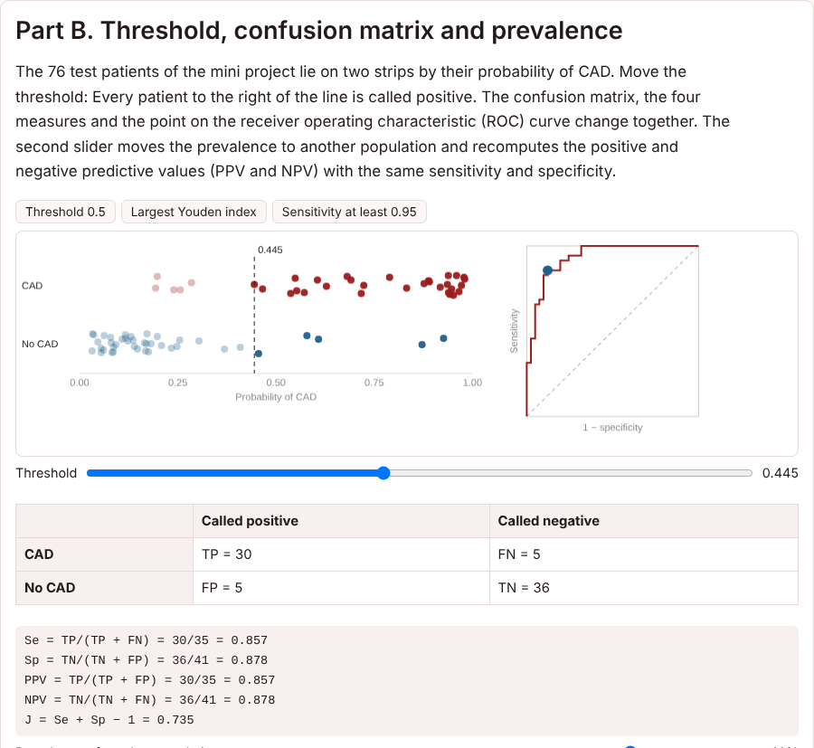

> **Türkçe:** Bu eğitim Türkçe yürütülmektedir. **[Bu haftanın Türkçe sayfasına geçin](../../tr/hafta-02/README.md)**

# Week 2: Machine learning fundamentals

**Artificial Intelligence with Python: A Hands-on Training Program for Cardiologists** 
Turkish Society of Cardiology

*From statistics to intelligent models, with a focus on cardiology*

[Course home](../../README.md) · [Syllabus](../../SYLLABUS.md) · [Setup](../../SETUP.md) · [Türkçe](../../tr/hafta-02/README.md)

## About the week

The first two hours build supervised models with scikit-learn. They introduce the modelling pipeline with a first regression line, fit a logistic regression for coronary artery disease (CAD) on the Cleveland data, measure it with cross-validation, the receiver operating characteristic (ROC) curve and the area under it, interpret its sensitivity and specificity, and compare a decision tree with a random forest. The mini project builds a CAD prediction model and analyses its ROC curve and AUC. The last two hours deal with imbalanced data with SMOTE, find phenogroups of heart failure with k-means, show them on UMAP and t-SNE maps and compare their prognosis with Kaplan-Meier curves and the log-rank test. The virtual clinic grows to 2000 patients and opens its risk outpatient clinic.

4 hours in the session and about 3 hours for the weekly project.

## The case of the week

**VC-0246, 57 years, man**, comes to the new risk outpatient clinic. He smokes, has treated hypertension, an LDL cholesterol of 170 mg/dL and an HDL cholesterol of 36 mg/dL. On the treadmill he had angina and an ST depression of 1.6 mm. The clinic needs a number, his probability of coronary artery disease, and needs to know how far that number can be trusted. The [lecture page](https://utkukose.github.io/ai-cardiology-tkd-NB-lecture/en/week-02/lecture.html) opens with his case, and the clinic answers it in its last section.

## Materials

| Material | Open | What it is for |
|---|---|---|
| **Lecture page** | [Open the lecture page](https://utkukose.github.io/ai-cardiology-tkd-NB-lecture/en/week-02/lecture.html) | The teaching of the week. It is read from top to bottom, leads to the practice stops and holds no code and no prompts. |
| **Interactive lab** | [Open the interactive lab](https://utkukose.github.io/ai-cardiology-tkd-NB-lecture/en/week-02/lab.html) | Parts A to F, without code, open where the lecture page reaches them. Part F is the prompt workshop. The self-assessment and the learning log are in the lab too. |
| **Jupyter notebook** |  [Download for Jupyter](NB02_machine_learning_fundamentals.ipynb) | The practice stops are worked here: Part 1 is the prompt path and Part 2 the Python path. The notebook runs in Google Colab with nothing to install, or in Jupyter on your own computer. |
| **Prompt library** | [PROMPTS.md](PROMPTS.md) | Every prompt of the prompt path and of the weekly project, with prompts for repairing, explaining and reviewing code. On GitHub, each prompt has a copy button. |
| **PDF notes** | [Week02_Lecture_Notes.pdf](Week02_Lecture_Notes.pdf) | The printable version of the lecture page. |

## Study path

The lecture page is read from top to bottom, and it opens the parts of the interactive lab where they belong. At each practice stop, the work continues in the Jupyter notebook on one of two paths. On the **prompt path** (Part 1 of the notebook), an artificial intelligence (AI) assistant writes the code from ready prompts, and the participant runs it and checks the result. On the **Python path** (Part 2), participants write the code themselves. Both paths reach the same results. At the end of every lab part and of every stop in the Jupyter notebook, a link takes you back to the lecture page, to the place where reading continues. If you lose your place, come back to this table. Participants who attend the session complete the steps there. The times help those who follow the week on their own, for example after a missed session.

| Step | What to do | Prompt path (Part 1) | Python path (Part 2) |
|---|---|---|---|
| 1 | [Read](https://utkukose.github.io/ai-cardiology-tkd-NB-lecture/en/week-02/lecture.html) the case of the week and the first two hours of the lecture page up to Practice stop 1, the mini project, with Parts A and B of the interactive lab and the knowledge checks | 1 hour 10 minutes | 1 hour 10 minutes |
| 2 | **[Practice stop 1: Mini project: A CAD prediction model, ROC curve and AUC](https://utkukose.github.io/ai-cardiology-tkd-NB-lecture/en/week-02/lecture.html#stop-1)** | Part 1, Stop 1 ([prompts](PROMPTS.md#stop-1-mini-project-a-cad-prediction-model-roc-curve-and-auc)) 30 minutes | Python step 2, Sections 1 and 2 1 hour 15 minutes |
| 3 | [Read on](https://utkukose.github.io/ai-cardiology-tkd-NB-lecture/en/week-02/lecture.html#decision-trees-and-random-forests) up to Practice stop 2: the comparison of a tree with a forest and imbalanced data with SMOTE | 35 minutes | 35 minutes |
| 4 | **[Practice stop 2: Testing a model honestly](https://utkukose.github.io/ai-cardiology-tkd-NB-lecture/en/week-02/lecture.html#stop-2)** | Part 1, Stop 2 ([prompts](PROMPTS.md#stop-2-testing-a-model-honestly)) 30 minutes | Sections 3 to 6 1 hour 5 minutes |
| 5 | [Read on](https://utkukose.github.io/ai-cardiology-tkd-NB-lecture/en/week-02/lecture.html#unsupervised-learning-k-means-and-phenogroups) up to Practice stop 3: k-means, UMAP and t-SNE maps and the Kaplan-Meier curve, with Parts C to F of the interactive lab | 55 minutes | 55 minutes |
| 6 | **[Practice stop 3: Subgroups, survival and a model to review](https://utkukose.github.io/ai-cardiology-tkd-NB-lecture/en/week-02/lecture.html#stop-3)** | Part 1, Stop 3 ([prompts](PROMPTS.md#stop-3-subgroups-survival-and-a-model-to-review)) 30 minutes | Sections 7 to 9 55 minutes |
| 7 | [Read](https://utkukose.github.io/ai-cardiology-tkd-NB-lecture/en/week-02/lecture.html#the-paper-of-the-week) the paper of the week, the stage of the virtual clinic and the section on your own data | 30 minutes | 30 minutes |
| 8 | Take the self-assessment of [the interactive lab](https://utkukose.github.io/ai-cardiology-tkd-NB-lecture/en/week-02/lab.html) (tab: Check yourself), write the reflection and export the learning log | 20 minutes | 20 minutes |
| | **Total without the weekly project** | **5 hours** | **6 hours 45 minutes** |
| 9 | Complete [the weekly project](#weekly-project), on either path | [Prompts](PROMPTS.md#prompt-path-of-the-weekly-project) 3 hours | 3 hours |

<table>
<tr><td width="50%"></td><td width="50%"></td></tr>
<tr><td>Interactive lab, Part C: k-means in three dimensions on the patients with heart failure, step by step.</td><td>Jupyter notebook, Section 8: Kaplan-Meier curves of the three clusters and of HFrEF against HFpEF.</td></tr>
<tr><td width="50%"></td><td width="50%"></td></tr>
<tr><td>Interactive lab, Part B: the threshold, the confusion matrix and the ROC curve of the model for coronary artery disease.</td><td>Interactive lab, Part F: the prompt workshop with the seven fields of the prompt card, a quality meter and a privacy check.</td></tr>
</table>

## Weekly project

**Project.** HFpEF vs HFrEF patient clustering with Kaplan-Meier survival analysis.

**What to do.** Find the phenogroups of heart failure in the registry of the virtual clinic and compare their prognosis. First, cluster the patients with HFrEF or HFpEF on nine standardised variables with k-means for k from 2 to 6, and choose k with the silhouette and with clinical sense. Second, describe each cluster in a table and give it a short clinical name. Third, draw the Kaplan-Meier curves of the clusters and of HFrEF against HFpEF, and compare them with the log-rank test. Fourth, compare the clusters with the phenogroups that the course hid in the registry, with a cross-table and the adjusted Rand index. Then write what the clustering found that the ejection fraction alone misses.

**Where to look.** Lecture: sections "Finding subgroups of patients with k-means", "UMAP / t-SNE visualisation", "Survival analysis: The Kaplan-Meier curve" and "The paper of the week". Interactive lab: Parts C, D and F. Jupyter notebook: Sections 7 and 8.

**Prompt path.** The project can also be built with four prompts, one for each step, from the [prompt library](https://github.com/utkukose/ai-cardiology-tkd-NB-lecture/blob/main/en/week-02/PROMPTS.md#prompt-path-of-the-weekly-project). The section "Weekly project on the prompt path" at the end of Part 1 of the Jupyter notebook prepares the table of each prompt. The test of each prompt must hold before the next prompt is used.

**Example.** Three patients at risk at month 5 with one event give the factor $1 - 1/3 = 0.667$. If the survival before month 5 was 0.800, the curve steps down to $0.800 \times 0.667 = 0.533$. Each step of the Kaplan-Meier curve of a cluster is computed in the same way.

**What to submit.** A report of one to two pages in the [report template](../templates/Report_Template.docx), with the table of the clusters, the Kaplan-Meier figure, the two log-rank tests and the comparison with the hidden phenogroups. Add the AI usage log (tool, prompt, what was checked, what was changed) and the Jupyter notebook with its outputs.

**Submission.** The weekly project is submitted before the session of Week 3 by e-mail to utkukose@sdu.edu.tr or utkukose@gmail.com. The e-mail holds the items listed under What to submit and the learning log exported from the interactive lab. Weekly projects count for 40 percent of the assessment, and the rubric is in the syllabus.

## Learning outcomes

By the end of the week, participants are expected to prepare a clinical table for a model, to build a modelling pipeline with scikit-learn and to fit and read a linear regression and a logistic regression. They should be able to measure a model with the confusion matrix, sensitivity, specificity, predictive values, the ROC curve and the area under it, to interpret sensitivity and specificity for ruling a disease out or in, and to estimate the performance with cross-validation without leaking information from the test patients. They should be able to compare a decision tree and a random forest, and to explain why accuracy misleads with rare outcomes and what SMOTE and class weights do to the probabilities. Finally, they should be able to find subgroups of patients with k-means, to show them on a t-SNE or UMAP map, to compare their prognosis with Kaplan-Meier curves and the log-rank test, and to review a model built by an AI assistant with four questions.

## Training flow of the session

The four-hour session of the week follows the plan below. It is shared to show how the materials fit together in a live session.

| Time | Activity |
|---|---|
| 0:00 to 0:15 | The case of the week, VC-0246, and the route of the week. Every participant opens the notebook in Google Colab or in Jupyter and runs Section 0. |
| 0:15 to 0:45 | First two hours, classification and regression: machine learning in one page, the modelling pipeline with scikit-learn and a first regression line, logistic regression for the risk of CAD with Part A of the interactive lab. |
| 0:45 to 1:15 | Cross-validation, ROC-AUC and the interpretation of sensitivity and specificity, with Part B of the interactive lab. |
| 1:15 to 1:45 | Mini project, Practice stop 1, in two groups, the prompt path and the Python path: a CAD prediction model on the Cleveland data with its ROC curve and AUC. Both groups compare their test AUC at the end. |
| 1:45 to 2:00 | Comparing a decision tree and a random forest. |
| 2:00 to 2:10 | Break. |
| 2:10 to 2:40 | Last two hours, clustering and patient segmentation: dealing with imbalanced data with SMOTE. Practice stop 2. |
| 2:40 to 3:20 | Finding subgroups of patients with k-means with Part C, UMAP and t-SNE maps, the Kaplan-Meier curve with Part D, reviewing a model with Parts E and F. Practice stop 3. |
| 3:20 to 3:45 | The paper of the week, the risk outpatient clinic of the virtual clinic and the section on your own data. |
| 3:45 to 4:00 | The weekly project and questions. |

## With your own data

The lecture page closes with a section on applying the methods of the week to your own data: which question fits which method, what to check first, the approval of the ethics committee, the Turkish Law on the Protection of Personal Data (KVKK) and where to compute. [Read it on the lecture page](https://utkukose.github.io/ai-cardiology-tkd-NB-lecture/en/week-02/lecture.html#with-your-own-data).

## Optional research assignment

Search PubMed for one study, published in 2020 or later, that developed or validated a machine learning model for the prognosis of patients with heart failure. Summarise it in half a page: the population, the outcome and its follow-up, the model, how it was validated and one limitation. The three questions of [the paper of the week](https://utkukose.github.io/ai-cardiology-tkd-NB-lecture/en/week-02/lecture.html#the-paper-of-the-week) can guide the summary. The assignment is not graded, and it prepares the discussion of external validation in Week 3.

## The virtual clinic after this week

In Week 2 the virtual clinic grows to 2000 patients with five years of follow-up and opens its risk outpatient clinic. Its model of coronary artery disease is compared with the true effects that generated the registry, and its patients with heart failure are grouped into phenogroups with different prognosis. The results are in the section [The virtual clinic, stage 2](https://utkukose.github.io/ai-cardiology-tkd-NB-lecture/en/week-02/lecture.html#the-virtual-clinic-stage-2-the-risk-outpatient-clinic-opens) of the lecture page.

## Next week

**Week 3: Deep learning and convolutional neural networks.** The virtual clinic opens its imaging laboratory: Neural networks learn from images, a convolutional network classifies cine cardiac magnetic resonance examinations of ACDC into normal hearts, dilated and hypertrophic cardiomyopathy, and the confusion matrix and the F1 score are read with attention to overfitting. The notebook downloads ACDC by itself. The mini project of the session uses EchoNet-Dynamic, which needs a personal registration at Stanford AIMI; participants who want to run it themselves can register before the session ([DATASETS.md](../../DATASETS.md#data-sets-of-week-3)). See the [plan of the course](../../README.md#the-eleven-weeks).

---

**Prof. Dr. Utku Kose**

Full Professor, Department of Computer Engineering, Süleyman Demirel University, Isparta, Türkiye 
Founding Director, AI Application and Research Center (YAZEM), Süleyman Demirel University 
Head of the Computer Science Division, Department of Computer Engineering, Süleyman Demirel University 
Additional affiliations: University of North Dakota (USA), Universidad Panamericana (Mexico City, Mexico), Vel Tech University (Chennai, India) 
IEEE Senior Member, ACM Professional Member

[ORCID 0000-0002-9652-6415](https://orcid.org/0000-0002-9652-6415) | [utkukose.com](https://www.utkukose.com) | [github.com/utkukose](https://github.com/utkukose)

[utkukose@sdu.edu.tr](mailto:utkukose@sdu.edu.tr) | [utku.kose@und.edu](mailto:utku.kose@und.edu) | [ukose@up.edu.mx](mailto:ukose@up.edu.mx) | [utkukose@gmail.com](mailto:utkukose@gmail.com)

*First version: November 2026. Content CC BY 4.0, code MIT.*

