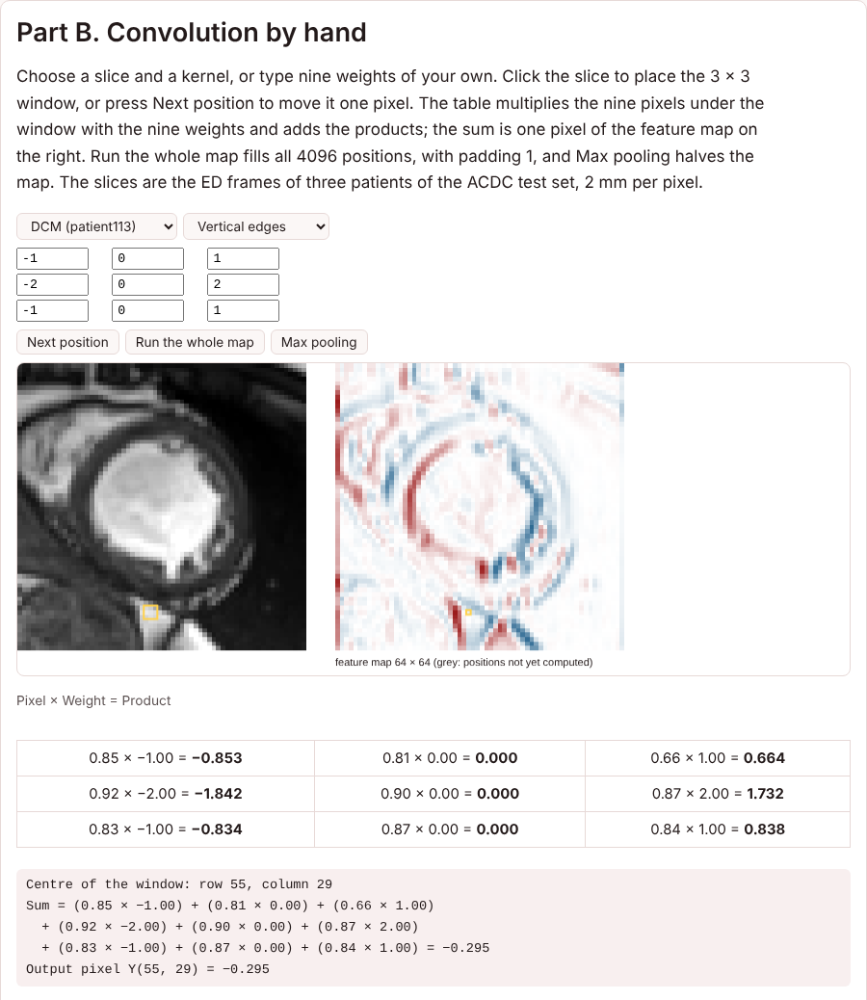
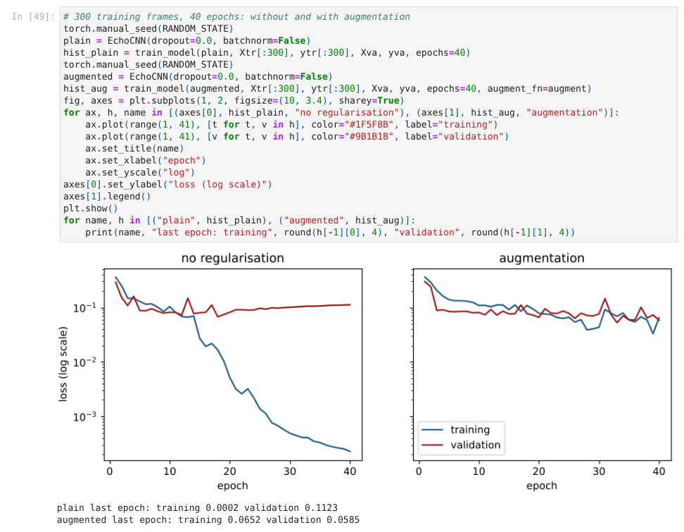
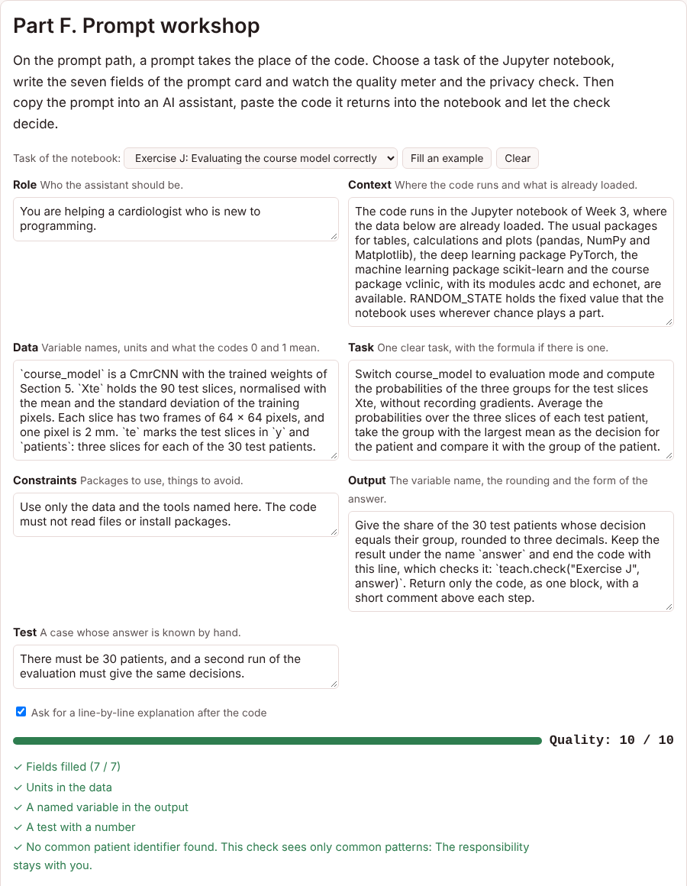

> **Türkçe:** Bu eğitim Türkçe yürütülmektedir. **[Bu haftanın Türkçe sayfasına geçin](../../tr/hafta-03/README.md)**

# Week 3: Deep learning and CNN fundamentals

**Artificial Intelligence with Python: A Hands-on Training Program for Cardiologists** 
Turkish Society of Cardiology

*Making sense of images: Cardiac imaging*

[Course home](../../README.md) · [Syllabus](../../SYLLABUS.md) · [Setup](../../SETUP.md) · [Türkçe](../../tr/hafta-03/README.md)

For more about the week, read on. To go on with the week directly from the lecture page, use this link: **[Open the lecture page of the week](https://utkukose.github.io/ai-cardiology-tkd-NB-lecture/en/week-03/lecture.html)**. The lecture page is the main route of the week, and its boxes open the interactive lab and the Jupyter notebook at the right place.

## About the week

The first two hours build a network from its smallest part: the neuron, the layer and the activation function with a medical analogy, the loss, the gradients and the training loop, a first model with the Keras Sequential API, images as arrays, the convolution operation that finds edges and patterns, and pooling, dropout and batch normalisation. A convolutional neural network (CNN) then tells normal hearts, dilated cardiomyopathy and hypertrophic cardiomyopathy apart on the cine cardiac magnetic resonance examinations of the public ACDC data set. The last two hours place the network among the VGG16 and ResNet50 architectures, augment cardiac images, read the result with the confusion matrix and the F1 score, and detect and prevent overfitting. A training loop written by an artificial intelligence (AI) assistant is reviewed, and the mini project classifies the echocardiography videos of EchoNet-Dynamic, which each participant obtains through a personal registration, as normal or abnormal.

4 hours in the session and about 3 hours for the weekly project.

## The case of the week

**Patient 134 of the ACDC test set**, 185 cm and 104 kg, belongs to the group of hypertrophic cardiomyopathy. The expert contours of the cine cardiac magnetic resonance examination give an ejection fraction of 62.2 percent and a thickest wall segment of 16.4 mm. A network trained on 45 other patients has to recognise the disease from the pixels. The [lecture page](https://utkukose.github.io/ai-cardiology-tkd-NB-lecture/en/week-03/lecture.html) opens with the case, and the imaging laboratory of the virtual clinic answers it in its last section.

## Materials

| Material | Open | What it is for |
|---|---|---|
| **Lecture page** | [Open the lecture page](https://utkukose.github.io/ai-cardiology-tkd-NB-lecture/en/week-03/lecture.html) | The teaching of the week. It is read from top to bottom, leads to the practice stops and holds no code and no prompts. |
| **Interactive lab** | [Open the interactive lab](https://utkukose.github.io/ai-cardiology-tkd-NB-lecture/en/week-03/lab.html) | Parts A to F, without code, open where the lecture page reaches them. Part F is the prompt workshop. The self-assessment and the learning log are in the lab too. |
| **Python notebook** |  [Download for Jupyter Notebook (zip)](https://github.com/utkukose/ai-cardiology-tkd-NB-lecture/raw/main/en/week-03/NB03_deep_learning_and_cnns.zip) | The practice stops are worked here, each with Python basics, prompts and a ready application. The Python notebook runs in Google Colab with nothing to install, or in Jupyter Notebook on your own computer: Download the zip file, extract the .ipynb file into a folder and open it in Jupyter. Every part opens with a start cell that repeats the setup and the data calls that the part uses. |
| **Prompt library** | [PROMPTS.md](PROMPTS.md) | Every prompt of the practice stops and of the weekly project, with prompts for repairing, explaining and reviewing code. On GitHub, each prompt has a copy button. |
| **PDF notes** | [Week03_Lecture_Notes.pdf](Week03_Lecture_Notes.pdf) | The printable version of the lecture page. |

## Study path

The lecture page is read from top to bottom, and it opens the parts of the interactive lab where they belong. At each practice stop, the work continues in the Jupyter notebook, where every stop has three parts. **Python basics** teaches the Python that the stop needs. In **Prompt and application**, an AI assistant writes the code from ready prompts, and the participant runs it and checks the result. The **Ready application** is the complete working program of the stop. Work through them in this order; if you know Python, you may start with the prompts, and to see only the result, open the ready application. Each part opens with a start cell that repeats the setup and the data calls that the part uses, so the part also runs when it is opened directly. At the end of every lab part and of every stop in the Jupyter notebook, a link takes you back to the lecture page, to the place where reading continues. If you lose your place, come back to this table. Participants who attend the session complete the steps there. The times help those who follow the week on their own, for example after a missed session.

| Step | What to do | Time |
|---|---|---|
| 1 | [Read](https://utkukose.github.io/ai-cardiology-tkd-NB-lecture/en/week-03/lecture.html) the case of the week and the lecture page up to Practice stop 1: the neuron, learning, the Keras Sequential API and cine MR as arrays, with Part A of the interactive lab and the knowledge checks | 1 hour 5 minutes |
| 2 | **[Practice stop 1: Cine MR as numbers](https://utkukose.github.io/ai-cardiology-tkd-NB-lecture/en/week-03/lecture.html#stop-1)** [Python basics](https://colab.research.google.com/github/utkukose/ai-cardiology-tkd-NB-lecture/blob/main/en/week-03/NB03_deep_learning_and_cnns.ipynb#scrollTo=stop-1-basics) · [Prompt and application](https://colab.research.google.com/github/utkukose/ai-cardiology-tkd-NB-lecture/blob/main/en/week-03/NB03_deep_learning_and_cnns.ipynb#scrollTo=stop-1-prompt) ([prompts](PROMPTS.md#stop-1-cine-mr-as-numbers)) · [Ready application](https://colab.research.google.com/github/utkukose/ai-cardiology-tkd-NB-lecture/blob/main/en/week-03/NB03_deep_learning_and_cnns.ipynb#scrollTo=stop-1-app) | 1 hour 20 minutes |
| 3 | [Read on](https://utkukose.github.io/ai-cardiology-tkd-NB-lecture/en/week-03/lecture.html#convolution-filters-that-slide-over-an-image) up to Practice stop 2: convolution, pooling, dropout and batch normalisation, the network, VGG16 and ResNet50, augmentation, overfitting and the F1 score, with Parts B to D of the interactive lab | 1 hour 15 minutes |
| 4 | **[Practice stop 2: A first convolutional network](https://utkukose.github.io/ai-cardiology-tkd-NB-lecture/en/week-03/lecture.html#stop-2)** [Python basics](https://colab.research.google.com/github/utkukose/ai-cardiology-tkd-NB-lecture/blob/main/en/week-03/NB03_deep_learning_and_cnns.ipynb#scrollTo=stop-2-basics) · [Prompt and application](https://colab.research.google.com/github/utkukose/ai-cardiology-tkd-NB-lecture/blob/main/en/week-03/NB03_deep_learning_and_cnns.ipynb#scrollTo=stop-2-prompt) ([prompts](PROMPTS.md#stop-2-a-first-convolutional-network)) · [Ready application](https://colab.research.google.com/github/utkukose/ai-cardiology-tkd-NB-lecture/blob/main/en/week-03/NB03_deep_learning_and_cnns.ipynb#scrollTo=stop-2-app) | 1 hour 20 minutes |
| 5 | [Read on](https://utkukose.github.io/ai-cardiology-tkd-NB-lecture/en/week-03/lecture.html#ai-pair-programming-part-3-reviewing-a-training-loop) up to Practice stop 3: the review of a training loop and the mini project with EchoNet-Dynamic, with Parts E and F of the interactive lab | 30 minutes |
| 6 | **[Practice stop 3: Mini project: EchoNet-Dynamic, normal or abnormal (with your registration)](https://utkukose.github.io/ai-cardiology-tkd-NB-lecture/en/week-03/lecture.html#stop-3)** [Python basics](https://colab.research.google.com/github/utkukose/ai-cardiology-tkd-NB-lecture/blob/main/en/week-03/NB03_deep_learning_and_cnns.ipynb#scrollTo=stop-3-basics) · [Prompt and application](https://colab.research.google.com/github/utkukose/ai-cardiology-tkd-NB-lecture/blob/main/en/week-03/NB03_deep_learning_and_cnns.ipynb#scrollTo=stop-3-prompt) ([prompts](PROMPTS.md#stop-3-mini-project-echonet-dynamic-normal-or-abnormal-with-your-registration)) · [Ready application](https://colab.research.google.com/github/utkukose/ai-cardiology-tkd-NB-lecture/blob/main/en/week-03/NB03_deep_learning_and_cnns.ipynb#scrollTo=stop-3-app) | 55 minutes |
| 7 | [Read](https://utkukose.github.io/ai-cardiology-tkd-NB-lecture/en/week-03/lecture.html#the-paper-of-the-week) the paper of the week, the stage of the virtual clinic and the section on your own data | 30 minutes |
| 8 | Take the self-assessment of [the interactive lab](https://utkukose.github.io/ai-cardiology-tkd-NB-lecture/en/week-03/lab.html) (tab: Check yourself), write the reflection and export the learning log | 20 minutes |
| | **Total without the weekly project** | **7 hours 15 minutes** |
| 9 | Complete [the weekly project](#weekly-project) [Prompts](PROMPTS.md#prompts-of-the-weekly-project) · [Weekly project in the Jupyter notebook](https://colab.research.google.com/github/utkukose/ai-cardiology-tkd-NB-lecture/blob/main/en/week-03/NB03_deep_learning_and_cnns.ipynb#scrollTo=project) | 3 hours |

<table>
<tr><td width="50%"></td><td width="50%"></td></tr>
<tr><td>Interactive lab, Part B: a 3 × 3 kernel slides over a short-axis slice of ACDC, with the products of one position and the feature map that grows.</td><td>Jupyter notebook, «Stop 2 · Ready application»: the training and validation loss of the network on the 45 training patients, without and with dropout and batch normalisation.</td></tr>
<tr><td width="50%"></td><td width="50%"></td></tr>
<tr><td>Interactive lab, Part C: the learning curves of four settings against overfitting and the rotated copies of one slice.</td><td>Interactive lab, Part F: the prompt workshop with the seven fields of the prompt card, a quality meter and a privacy check.</td></tr>
</table>

## Weekly project

**Project.** Cardiac MRI, ACDC data set: Automatic classification of dilated and hypertrophic cardiomyopathy.

**What to do.** Classify dilated cardiomyopathy (DCM), hypertrophic cardiomyopathy (HCM) and normal hearts on the cine cardiac magnetic resonance examinations of ACDC, and compare the network with the measurements of the cardiologist. First, train the network of the course on the 45 training patients, with the 15 validation patients for early stopping. Second, report the confusion matrix of the 30 test patients, the precision, the recall and the F1 of each class, and the macro F1. Third, apply the rules of ACDC to the measurements of the expert contours of the same 30 patients and compare both confusion matrices. Fourth, show for every misclassified patient the slices that the network saw and the slice with the thickest wall, and write which errors would matter most in the clinic and why.

**Where to look.** Lecture: sections "Images as arrays: Cine cardiac MR of ACDC", "A convolutional network for cine MR", "Detecting and preventing overfitting" and "Interpreting the confusion matrix and the F1 score". Interactive lab: Parts C, D and F. Jupyter notebook: the ready applications of Practice stops 1 and 2.

**With prompts.** The project can also be built with four prompts, one for each step, from the [prompt library](https://github.com/utkukose/ai-cardiology-tkd-NB-lecture/blob/main/en/week-03/PROMPTS.md#prompts-of-the-weekly-project). The section "Weekly project" at the end of the Jupyter notebook prepares the table of each prompt and opens on its own. The test of each prompt must hold before the next prompt is sent, and every prompt goes into the AI usage log.

**Example.** Suppose the network calls 12 test patients normal, 10 of them rightly, and misses 2 of the 10 patients with HCM: For the class normal, $TP = 10$, $FP = 2$, $FN = 0$. Its precision is $10/12 = 0.833$ and its recall $10/10 = 1.000$. Its F1 is $2TP/(2TP + FP + FN)$, here $20/22 = 0.909$. The macro F1 is the plain mean of the F1 of the three classes.

**What to submit.** A report of one to two pages in the [report template](../templates/Report_Template.docx), with the figure of the two losses, both confusion matrices, the table of the measures by class and the figure of the errors. Add the AI usage log (tool, prompt, what was checked, what was changed) and the Jupyter notebook with its outputs. Figures with images of ACDC carry the credit "ACDC, CC BY-NC-SA 4.0" and serve non-commercial purposes only, as its terms require.

**Submission.** The weekly project is submitted before the session of Week 4 by e-mail to utkukose@sdu.edu.tr or utkukose@gmail.com. The e-mail holds the items listed under What to submit and the learning log exported from the interactive lab. Weekly projects count for 40 percent of the assessment, and the rubric is in the syllabus.

## Learning outcomes

By the end of the week, participants are expected to explain how a neuron, a layer and a network compute their outputs, with a medical analogy, and how a loss, its gradients and the update of the weights make a network learn. They should be able to build a first model with the Keras Sequential API and to read the same model in PyTorch, to describe a cine cardiac magnetic resonance examination as an array and to split the patients of a study before any learning. They should be able to follow a convolution, a pooling step, dropout and batch normalisation, to train a small convolutional network, and to place it among the VGG16 and ResNet50 architectures. They should be able to choose augmentations that respect the anatomy, to recognise and prevent overfitting in the learning curves and to read the result with the confusion matrix, precision, recall and the F1 score for each class. Finally, they should be able to review a training loop written by an AI assistant and to obtain a registered data set such as EchoNet-Dynamic under its terms of use.

## Training flow of the session

The four-hour session of the week follows the plan below. It is shared to show how the materials fit together in a live session.

| Time | Activity |
|---|---|
| 0:00 to 0:15 | The case of the week, patient 134 of ACDC, and the route of the week. Every participant opens the notebook in Google Colab or in Jupyter and runs Section 0, which downloads the ACDC files of the three groups, about 105 MB, from their public source. |
| 0:15 to 0:50 | First two hours, artificial neural networks and CNNs: the neuron, the layer and the activation function with a medical analogy, learning with Part A of the interactive lab, a first model with the Keras Sequential API and cine cardiac magnetic resonance as arrays. |
| 0:50 to 1:20 | Practice stop 1 in the Jupyter notebook, with the prompts or in Python. At the end, the participants compare the ejection fraction of patient 134 and the accuracy of the rules of ACDC. |
| 1:20 to 2:00 | The convolution operation with Part B, pooling, dropout and batch normalisation, and the network of the course in three dimensions. |
| 2:00 to 2:10 | Break. |
| 2:10 to 2:45 | Last two hours, advanced CNNs and model evaluation: the VGG16 and ResNet50 architectures, image augmentation for cardiac images, overfitting with Part C and the confusion matrix and the F1 score with Part D. |
| 2:45 to 3:15 | Practice stop 2: the network is trained in about a minute and compared, patient by patient, with the measurements of the contours. |
| 3:15 to 3:45 | Reviewing a training loop with Parts E and F. Mini project of the session, Practice stop 3, EchoNet-Dynamic normal or abnormal: Participants with a registration run it on their own copy; the instructor runs it on the shared screen for the others. |
| 3:45 to 4:00 | The paper of the week, the imaging laboratory of the virtual clinic, the section on your own data and the weekly project. |

## With your own data

The lecture page closes with a section on applying the methods of the week to your own data: which question fits which method, what to check first, the approval of the ethics committee, the Turkish Law on the Protection of Personal Data (KVKK) and where to compute. [Read it on the lecture page](https://utkukose.github.io/ai-cardiology-tkd-NB-lecture/en/week-03/lecture.html#with-your-own-data).

## Optional research assignment

Search PubMed for one study, published in 2020 or later, that trained a deep learning model on echocardiograms or on cardiac magnetic resonance images to detect a disease. Summarise it in half a page: the images and how many patients they came from, the labels and who gave them, the network, the measures reported for each class and how the model was tested on patients from another hospital, if at all. The three questions of [the paper of the week](https://utkukose.github.io/ai-cardiology-tkd-NB-lecture/en/week-03/lecture.html#the-paper-of-the-week) can guide the summary. The assignment is not graded, and it prepares the discussion of transfer learning in Week 4.

## The virtual clinic after this week

In Week 3 the virtual clinic opens its imaging laboratory, which reads public images: the cine cardiac magnetic resonance examinations of ACDC, downloaded by every participant from their source, and the echocardiography videos of EchoNet-Dynamic, for those with a personal registration. A convolutional network learns the three groups of ACDC from the pixels and is compared with the measurements of the expert contours. The results are in the section [The virtual clinic, stage 3](https://utkukose.github.io/ai-cardiology-tkd-NB-lecture/en/week-03/lecture.html#the-virtual-clinic-stage-3-the-imaging-laboratory-opens) of the lecture page.

## Next week

**Week 4: Transfer learning.** The imaging laboratory starts to measure: A network pretrained on ImageNet, EfficientNet-B0, is adapted to cardiac images from few labelled examples, a U-Net outlines the left ventricle on the echocardiograms of CAMUS, and the ejection fraction is computed from the outlines with the method of discs. The notebook downloads CAMUS, about 227 MB, and the ImageNet weights by itself ([DATASETS.md](../../DATASETS.md#data-sets-of-week-4)). See the [plan of the course](../../README.md#the-eleven-weeks).

---

**Prof. Dr. Utku Kose**

Full Professor, Department of Computer Engineering, Süleyman Demirel University, Isparta, Türkiye 
Founding Director, AI Application and Research Center (YAZEM), Süleyman Demirel University 
Head of the Computer Science Division, Department of Computer Engineering, Süleyman Demirel University 
Additional affiliations: University of North Dakota (USA), Universidad Panamericana (Mexico City, Mexico), Vel Tech University (Chennai, India) 
IEEE Senior Member, ACM Professional Member

[ORCID 0000-0002-9652-6415](https://orcid.org/0000-0002-9652-6415) | [utkukose.com](https://www.utkukose.com) | [github.com/utkukose](https://github.com/utkukose)

[utkukose@sdu.edu.tr](mailto:utkukose@sdu.edu.tr) | [utku.kose@und.edu](mailto:utku.kose@und.edu) | [ukose@up.edu.mx](mailto:ukose@up.edu.mx) | [utkukose@gmail.com](mailto:utkukose@gmail.com)

*First version: November 2026. Content CC BY 4.0, code MIT.*

