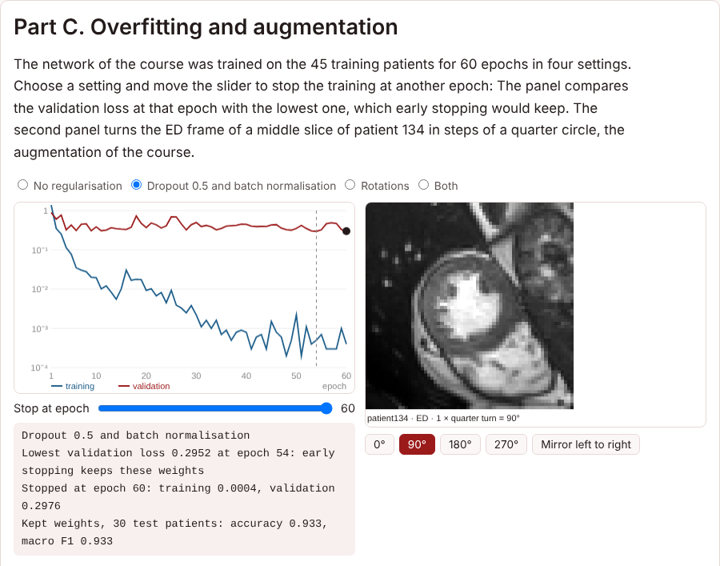

> **Türkçe:** Bu eğitim Türkçe yürütülmektedir. **[Bu haftanın Türkçe sayfasına geçin](../../tr/hafta-03/README.md)**

# Week 3: Deep learning and convolutional neural networks

**Artificial Intelligence with Python: A Hands-on Training Program for Cardiologists** 
Turkish Society of Cardiology

*From one neuron to a network that reads cardiac images*

[Course home](../../README.md) · [Syllabus](../../SYLLABUS.md) · [Setup](../../SETUP.md) · [Türkçe](../../tr/hafta-03/README.md)

## About the week

Neural networks from one neuron to a deep network: the loss, the gradients and the training loop, images as arrays, convolution and pooling, and a convolutional neural network (CNN) that tells normal hearts, dilated cardiomyopathy and hypertrophic cardiomyopathy apart on the cine cardiac magnetic resonance examinations of the public ACDC data set. Overfitting is met with dropout, batch normalisation, augmentation and early stopping, and the results are read with precision, recall and the F1 score, class by class, next to the measurements of the expert contours. The known architectures from LeNet to ResNet follow, then the review of a training loop written by an AI assistant and the echocardiography videos of EchoNet-Dynamic, which each participant obtains through a personal registration.

4 hours in the session and about 3 hours for the weekly project.

## The route of the week

The lecture page is the main route of the week. It holds no code and no prompts, and it is read from top to bottom together with the interactive lab. At each practice stop, every participant chooses one of two paths in the Jupyter notebook: the **prompt path** (Part 1), on which an artificial intelligence (AI) assistant writes the code from ready prompts and the participant runs and checks it, or the **Python path** (Part 2), on which the participant writes the code. Both paths reach the same results. The notebook runs in Google Colab, with nothing to install, or in Jupyter on your own computer ([setup](../../SETUP.md)).

| Main route: lecture page and interactive lab | Practice stop | Prompt path (Part 1) | Python path (Part 2) |
|---|---|---|---|
| [Neural networks in one page](https://utkukose.github.io/ai-cardiology-tkd-NB-lecture/en/week-03/lecture.html#neural-networks-in-one-page) [Learning: Loss, gradients and the training loop](https://utkukose.github.io/ai-cardiology-tkd-NB-lecture/en/week-03/lecture.html#learning-loss-gradients-and-the-training-loop) [Images as arrays: Cine cardiac MR of ACDC](https://utkukose.github.io/ai-cardiology-tkd-NB-lecture/en/week-03/lecture.html#images-as-arrays-cine-cardiac-mr-of-acdc) | **[Stop 1: Cine MR as numbers](https://utkukose.github.io/ai-cardiology-tkd-NB-lecture/en/week-03/lecture.html#stop-1)** | Stop 1 | Python step 3 and Sections 1 to 3 |
| [Convolution: Filters that slide over an image](https://utkukose.github.io/ai-cardiology-tkd-NB-lecture/en/week-03/lecture.html#convolution-filters-that-slide-over-an-image) [A convolutional network for cine MR](https://utkukose.github.io/ai-cardiology-tkd-NB-lecture/en/week-03/lecture.html#a-convolutional-network-for-cine-mr) [Overfitting: Dropout, batch normalisation and augmentation](https://utkukose.github.io/ai-cardiology-tkd-NB-lecture/en/week-03/lecture.html#overfitting-dropout-batch-normalisation-and-augmentation) [Reading the result: Precision, recall and F1](https://utkukose.github.io/ai-cardiology-tkd-NB-lecture/en/week-03/lecture.html#reading-the-result-precision-recall-and-f1) | **[Stop 2: A first convolutional network](https://utkukose.github.io/ai-cardiology-tkd-NB-lecture/en/week-03/lecture.html#stop-2)** | Stop 2 | Sections 4 to 7 |
| [Known architectures: From LeNet to ResNet](https://utkukose.github.io/ai-cardiology-tkd-NB-lecture/en/week-03/lecture.html#known-architectures-from-lenet-to-resnet) [Working with an AI assistant, part 3: Reviewing a training loop](https://utkukose.github.io/ai-cardiology-tkd-NB-lecture/en/week-03/lecture.html#ai-pair-programming-part-3-reviewing-a-training-loop) [EchoNet-Dynamic: Echocardiography with personal registration](https://utkukose.github.io/ai-cardiology-tkd-NB-lecture/en/week-03/lecture.html#echonet-dynamic-echocardiography-with-personal-registration) | **[Stop 3: EchoNet-Dynamic: normal or abnormal (with your registration)](https://utkukose.github.io/ai-cardiology-tkd-NB-lecture/en/week-03/lecture.html#stop-3)** | Stop 3 | Sections 8 to 10 |
| [The paper of the week](https://utkukose.github.io/ai-cardiology-tkd-NB-lecture/en/week-03/lecture.html#the-paper-of-the-week) [The virtual clinic, stage 3: The imaging laboratory opens](https://utkukose.github.io/ai-cardiology-tkd-NB-lecture/en/week-03/lecture.html#the-virtual-clinic-stage-3-the-imaging-laboratory-opens) | The section on your own data, the paper of the week and the virtual clinic | – | – |

## Materials

| Material | Open | What it holds |
|---|---|---|
| **Lecture page (main route)** | [Open the lecture page](https://utkukose.github.io/ai-cardiology-tkd-NB-lecture/en/week-03/lecture.html) | The case, the concepts with worked examples, a three-dimensional (3D) scene inside the network, two animations, knowledge checks, three practice stops, the section on your own data, review cards and references. No code and no prompts. |
| **Interactive lab** | [Open the interactive lab](https://utkukose.github.io/ai-cardiology-tkd-NB-lecture/en/week-03/lab.html) | Parts A to F without code, including the prompt workshop of Part F, a self-assessment, a reflection and the learning log to export |
| **Jupyter notebook** |  [Download for Jupyter](NB03_deep_learning_and_cnns.ipynb) | Part 1, the prompt path: three stops with ten steps, each with a ready prompt, a data cell for its table, a cell for the code of the AI assistant, an automatic check and ready code, and the weekly project in four prompts. Part 2, the Python path: Python step 3, Sections 1 to 10 with Exercises A to J and the challenges of seven fields. |
| **Prompt library** | [PROMPTS.md](PROMPTS.md) | All prompts of the prompt path with a copy button on GitHub, the prompts for repairing code and the prompt path of the weekly project |
| **PDF notes** | [Week03_Lecture_Notes.pdf](Week03_Lecture_Notes.pdf) | The lecture page in print form, with its practice stops and the section on your own data |

<table>
<tr><td width="50%"></td><td width="50%"></td></tr>
<tr><td>Interactive lab, Part B: a 3 × 3 kernel slides over a short-axis slice of ACDC, with the products of one position and the feature map that grows.</td><td>Jupyter notebook, Section 6: the training and validation loss of the network on the 45 training patients, without and with dropout and batch normalisation.</td></tr>
<tr><td width="50%"></td><td width="50%"></td></tr>
<tr><td>Interactive lab, Part C: the learning curves of four settings against overfitting and the rotated copies of one slice.</td><td>Interactive lab, Part F: the prompt workshop with the seven fields of the prompt card, a quality meter and a privacy check.</td></tr>
</table>

## The case of the week

**Patient 134 of the ACDC test set**, 185 cm and 104 kg, belongs to the group of hypertrophic cardiomyopathy. The expert contours of the cine cardiac magnetic resonance examination give an ejection fraction of 62.2 percent and a thickest wall segment of 16.4 mm. A network trained on 45 other patients has to recognise the disease from the pixels. The [lecture page](https://utkukose.github.io/ai-cardiology-tkd-NB-lecture/en/week-03/lecture.html) opens with the case, and the imaging laboratory of the virtual clinic answers it in its last section.

## Learning outcomes

By the end of the week, participants are expected to explain how a neuron, a layer and a network compute their outputs, and how a loss, its gradients and the update of the weights make a network learn. They should be able to describe a cine cardiac magnetic resonance examination as an array, to compute volumes and the ejection fraction from expert contours and to split the patients of a study before any learning. They should be able to follow a convolution and a pooling step, to train a small convolutional network, to recognise overfitting in its learning curves and to read its result with precision, recall and the F1 score for each class. Finally, they should be able to place the network among the known architectures, to review a training loop written by an AI assistant and to obtain a registered data set such as EchoNet-Dynamic under its terms of use.

## Study path

Participants who attend the session complete the main route and the practice stops there. Participants who follow the week on their own, for example after a missed session, can plan with the times below.

| Step | Activity | Prompt path | Python path |
|---|---|---|---|
| 1 | Read the case of the week and the lecture page up to Practice stop 1, with Part A of the interactive lab and the knowledge checks | 55 minutes | 55 minutes |
| 2 | Practice stop 1: Part 1, Stop 1 on the prompt path, or Python step 3 and Sections 1 to 3 on the Python path | 25 minutes | 1 hour 15 minutes |
| 3 | Read on up to Practice stop 2: convolution, the network in three dimensions, overfitting and reading the result, with Parts B to D of the interactive lab | 1 hour | 1 hour |
| 4 | Practice stop 2: Part 1, Stop 2, or Sections 4 to 7 | 35 minutes | 1 hour 15 minutes |
| 5 | Read on up to Practice stop 3: known architectures, the review of a training loop and EchoNet-Dynamic, with Parts E and F of the interactive lab | 40 minutes | 40 minutes |
| 6 | Practice stop 3, with a personal registration for EchoNet-Dynamic: Part 1, Stop 3, or Sections 8 to 10 | 30 minutes | 50 minutes |
| 7 | Read the paper of the week, the stage of the virtual clinic and the section on your own data | 30 minutes | 30 minutes |
| 8 | Take the self-assessment of the interactive lab (tab: Check yourself), write the reflection and export the learning log | 20 minutes | 20 minutes |
| | **Total without the weekly project** | **4 hours 55 minutes** | **6 hours 45 minutes** |
| 9 | Complete the weekly project, on either path | 3 hours | 3 hours |

## Training flow of the session

The four-hour session of the week follows the plan below. It is shared to show how the materials fit together in a live session.

| Time | Activity |
|---|---|
| 0:00 to 0:15 | The case of the week, patient 134 of ACDC, and the route of the week. Every participant opens the notebook in Google Colab or in Jupyter and runs Section 0, which downloads the ACDC files of the three groups, about 105 MB, from their public source. |
| 0:15 to 0:55 | Main route: neural networks in one page, learning with Part A of the interactive lab, cine cardiac magnetic resonance as arrays. |
| 0:55 to 1:30 | Practice stop 1 in two groups, the prompt path and the Python path. Both groups compare the ejection fraction of patient 134 and the accuracy of the rules of ACDC. |
| 1:30 to 1:45 | Break. |
| 1:45 to 2:30 | Main route: convolution with Part B, the network in three dimensions, overfitting with Part C and reading the result with Part D. |
| 2:30 to 3:05 | Practice stop 2: the network is trained in about a minute and compared, patient by patient, with the measurements of the contours. |
| 3:05 to 3:40 | Main route: known architectures, reviewing a training loop with Parts E and F, EchoNet-Dynamic. Mini project of the session, Practice stop 3: Participants with a registration run it on their own copy; the instructor runs it on the shared screen for the others. |
| 3:40 to 4:00 | The paper of the week, the imaging laboratory of the virtual clinic, the section on your own data and the weekly project. |

## Weekly project

**What to do.** Classify dilated cardiomyopathy (DCM), hypertrophic cardiomyopathy (HCM) and normal hearts on the cine cardiac magnetic resonance examinations of ACDC, and compare the network with the measurements of the cardiologist. First, train the network of the course on the 45 training patients, with the 15 validation patients for early stopping. Second, report the confusion matrix of the 30 test patients, the precision, the recall and the F1 of each class, and the macro F1. Third, apply the rules of ACDC to the measurements of the expert contours of the same 30 patients and compare both confusion matrices. Fourth, show for every misclassified patient the slices that the network saw and the slice with the thickest wall, and write which errors would matter most in the clinic and why.

**Where to look.** Lecture: sections "Images as arrays: Cine cardiac MR of ACDC", "A convolutional network for cine MR", "Overfitting: Dropout, batch normalisation and augmentation" and "Reading the result: Precision, recall and F1". Interactive lab: Parts C, D and F. Jupyter notebook: Part 1, Stops 1 and 2, or Part 2, Sections 3, 5, 6 and 7.

**Prompt path.** The project can also be built with four prompts, one for each step, from the [prompt library](https://github.com/utkukose/ai-cardiology-tkd-NB-lecture/blob/main/en/week-03/PROMPTS.md#prompt-path-of-the-weekly-project). The section "Weekly project on the prompt path" at the end of Part 1 of the Jupyter notebook prepares the table of each prompt. The test of each prompt must hold before the next prompt is used.

**Example.** Suppose the network calls 12 test patients normal, 10 of them rightly, and misses 2 of the 10 patients with HCM: For the class normal, $TP = 10$, $FP = 2$, $FN = 0$. Its precision is $10/12 = 0.833$ and its recall $10/10 = 1.000$. Its F1 is $2TP/(2TP + FP + FN)$, here $20/22 = 0.909$. The macro F1 is the plain mean of the F1 of the three classes.

**What to submit.** A report of one to two pages in the [report template](../templates/Report_Template.docx), with the figure of the two losses, both confusion matrices, the table of the measures by class and the figure of the errors. Add the AI usage log (tool, prompt, what was checked, what was changed) and the Jupyter notebook with its outputs. Figures with images of ACDC carry the credit "ACDC, CC BY-NC-SA 4.0" and serve non-commercial purposes only, as its terms require.

**Submission.** The weekly project is submitted before the session of Week 4 by e-mail to utkukose@sdu.edu.tr or utkukose@gmail.com. The e-mail holds the items listed under What to submit and the learning log exported from the interactive lab. Weekly projects count for 40 percent of the assessment, and the rubric is in the syllabus.

## With your own data

The lecture page closes with a section on applying the methods of the week to your own data: which question fits which method, what to check first, the approval of the ethics committee, the Turkish Law on the Protection of Personal Data (KVKK) and where to compute. [Read it on the lecture page](https://utkukose.github.io/ai-cardiology-tkd-NB-lecture/en/week-03/lecture.html#with-your-own-data).

## Optional research assignment

Search PubMed for one study, published in 2020 or later, that trained a deep learning model on echocardiograms or on cardiac magnetic resonance images to detect a disease. Summarise it in half a page: the images and how many patients they came from, the labels and who gave them, the network, the measures reported for each class and how the model was tested on patients from another hospital, if at all. The three questions of [the paper of the week](https://utkukose.github.io/ai-cardiology-tkd-NB-lecture/en/week-03/lecture.html#the-paper-of-the-week) can guide the summary. The assignment is not graded, and it prepares the discussion of transfer learning in Week 4.

## The virtual clinic after this week

In Week 3 the virtual clinic opens its imaging laboratory, which reads public images: the cine cardiac magnetic resonance examinations of ACDC, downloaded by every participant from their source, and the echocardiography videos of EchoNet-Dynamic, for those with a personal registration. A convolutional network learns the three groups of ACDC from the pixels and is compared with the measurements of the expert contours. The results are in the section [The virtual clinic, stage 3](https://utkukose.github.io/ai-cardiology-tkd-NB-lecture/en/week-03/lecture.html#the-virtual-clinic-stage-3-the-imaging-laboratory-opens) of the lecture page.

## Next week

**Week 4: Transfer learning.** The imaging laboratory starts to measure: A network pretrained on ImageNet, EfficientNet-B0, is adapted to cardiac images from few labelled examples, a U-Net outlines the left ventricle on the echocardiograms of CAMUS, and the ejection fraction is computed from the outlines with the method of discs. The notebook downloads CAMUS, about 227 MB, and the ImageNet weights by itself ([DATASETS.md](../../DATASETS.md#data-sets-of-week-4)). See the [plan of the course](../../README.md#the-eleven-weeks).

---

**Prof. Dr. Utku Kose**

Full Professor, Department of Computer Engineering, Süleyman Demirel University, Isparta, Türkiye 
Founding Director, AI Application and Research Center (YAZEM), Süleyman Demirel University 
Head of the Computer Science Division, Department of Computer Engineering, Süleyman Demirel University 
Additional affiliations: University of North Dakota (USA), Universidad Panamericana (Mexico City, Mexico), Vel Tech University (Chennai, India) 
IEEE Senior Member, ACM Professional Member

[ORCID 0000-0002-9652-6415](https://orcid.org/0000-0002-9652-6415) | [utkukose.com](https://www.utkukose.com) | [github.com/utkukose](https://github.com/utkukose)

[utkukose@sdu.edu.tr](mailto:utkukose@sdu.edu.tr) | [utku.kose@und.edu](mailto:utku.kose@und.edu) | [ukose@up.edu.mx](mailto:ukose@up.edu.mx) | [utkukose@gmail.com](mailto:utkukose@gmail.com)

*First version: November 2026. Content CC BY 4.0, code MIT.*

