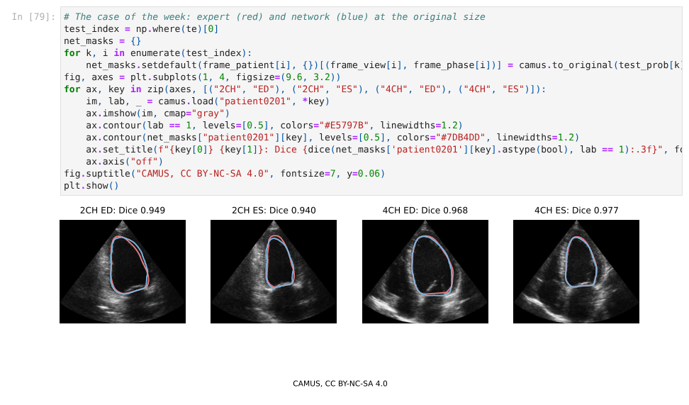
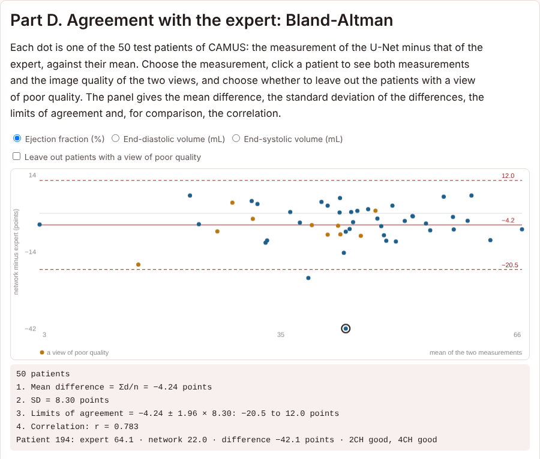

> **Türkçe:** Bu eğitim Türkçe yürütülmektedir. **[Bu haftanın Türkçe sayfasına geçiniz](../../tr/hafta-04/README.md)**

# Week 4: Transfer learning: Adapting ready-made power to cardiology

**Artificial Intelligence with Python: A Hands-on Training Program for Cardiologists** 
Turkish Society of Cardiology

*Bringing what was learned from millions of images to your clinic*

[Course home](../../README.md) · [Syllabus](../../SYLLABUS.md) · [Setup](../../SETUP.md) · [Türkçe](../../tr/hafta-04/README.md)

For more about the week, read on. To go on with the week directly from the lecture page, use this link: **[Open the lecture page of the week](https://utkukose.github.io/ai-cardiology-tkd-NB-lecture/en/week-04/lecture.html)**. The lecture page is the main route of the week, and its boxes open the interactive lab and the Jupyter notebook at the right place.

## About the week

The first two hours adapt networks trained on millions of photographs to cardiac images: the models pretrained on ImageNet, EfficientNet and DenseNet, the choice between feature extraction and fine-tuning, the replacement of the last layers for cardiac targets and the ways to reach a high performance with little data. The mini project classifies cardiomyopathy from few labelled images with EfficientNet-B0, on the cine cardiac magnetic resonance of ACDC and on the echocardiograms of CAMUS. The last two hours turn images into measurements: the U-Net architecture for cardiac segmentation, pixel-wise segmentation training with the Dice coefficient, the automatic measurement of the left ventricular ejection fraction with Simpson's method of discs and the methodology of clinical validation with Bland-Altman analysis. The virtual clinic gains an automatic ejection fraction.

4 hours in the session and about 3 hours for the weekly project.

## The case of the week

**Patient 201 of the CAMUS test set**, a 56-year-old woman, had an echocardiogram at the University Hospital of Saint-Étienne. Both apical views have good image quality. The outlines of the expert give an end-diastolic volume of 159 mL, an end-systolic volume of 92 mL and an ejection fraction of 42 percent by the biplane method of discs. A network that has never seen this patient has to outline the left ventricle on the four frames and to measure the same numbers. The [lecture page](https://utkukose.github.io/ai-cardiology-tkd-NB-lecture/en/week-04/lecture.html) opens with the case, and the echo measurement of the virtual clinic answers it in its last section.

## Materials

| Material | Open | What it is for |
|---|---|---|
| **Lecture page** | [Open the lecture page](https://utkukose.github.io/ai-cardiology-tkd-NB-lecture/en/week-04/lecture.html) | The teaching of the week. It is read from top to bottom, leads to the practice stops and holds no code and no prompts. |
| **Interactive lab** | [Open the interactive lab](https://utkukose.github.io/ai-cardiology-tkd-NB-lecture/en/week-04/lab.html) | Parts A to F, without code, open where the lecture page reaches them. Part F is the prompt workshop. The self-assessment and the learning log are in the lab too. |
| **Python notebook** |  [Download for Jupyter Notebook (zip)](https://github.com/utkukose/ai-cardiology-tkd-NB-lecture/raw/main/en/week-04/NB04_transfer_learning.zip) | The practice stops are worked here, each with Python basics, prompts and a ready application. The Python notebook runs in Google Colab with nothing to install, or in Jupyter Notebook on your own computer: Download the zip file, extract the .ipynb file into a folder and open it in Jupyter. Every part opens with a start cell that repeats the setup and the data calls that the part uses. |
| **Prompt library** | [PROMPTS.md](PROMPTS.md) | Every prompt of the practice stops and of the weekly project, with prompts for repairing, explaining and reviewing code. On GitHub, each prompt has a copy button. |
| **PDF notes** | [Week04_Lecture_Notes.pdf](Week04_Lecture_Notes.pdf) | The printable version of the lecture page. |

## Study path

The lecture page is read from top to bottom, and it opens the parts of the interactive lab where they belong. At each practice stop, the work continues in the Jupyter notebook, where every stop has three parts. **Python basics** teaches the Python that the stop needs. In **Prompt and application**, an artificial intelligence (AI) assistant writes the code from ready prompts, and the participant runs it and checks the result. The **Ready application** is the complete working program of the stop. Work through them in this order; if you know Python, you may start with the prompts, and to see only the result, open the ready application. Each part opens with a start cell that repeats the setup and the data calls that the part uses, so the part also runs when it is opened directly. At the end of every lab part and of every stop in the Jupyter notebook, a link takes you back to the lecture page, to the place where reading continues. If you lose your place, come back to this table. Participants who attend the session complete the steps there. The times help those who follow the week on their own, for example after a missed session.

| Step | What to do | Time |
|---|---|---|
| 1 | [Read](https://utkukose.github.io/ai-cardiology-tkd-NB-lecture/en/week-04/lecture.html) the case of the week and the first two hours of the lecture page up to Practice stop 1: models pretrained on ImageNet, feature extraction or fine-tuning, new last layers, little data and the mini project, with Part A of the interactive lab and the knowledge checks | 1 hour |
| 2 | **[Practice stop 1: Mini project: Cardiomyopathy from few labelled images with EfficientNet-B0](https://utkukose.github.io/ai-cardiology-tkd-NB-lecture/en/week-04/lecture.html#stop-1)** [Python basics](https://colab.research.google.com/github/utkukose/ai-cardiology-tkd-NB-lecture/blob/main/en/week-04/NB04_transfer_learning.ipynb#scrollTo=stop-1-basics) · [Prompt and application](https://colab.research.google.com/github/utkukose/ai-cardiology-tkd-NB-lecture/blob/main/en/week-04/NB04_transfer_learning.ipynb#scrollTo=stop-1-prompt) ([prompts](PROMPTS.md#stop-1-mini-project-cardiomyopathy-from-few-labelled-images-with-efficientnet-b0)) · [Ready application](https://colab.research.google.com/github/utkukose/ai-cardiology-tkd-NB-lecture/blob/main/en/week-04/NB04_transfer_learning.ipynb#scrollTo=stop-1-app) | 1 hour 30 minutes |
| 3 | [Read on](https://utkukose.github.io/ai-cardiology-tkd-NB-lecture/en/week-04/lecture.html#last-two-hours-segmentation-and-measurement-automation) up to Practice stop 2: the U-Net architecture and pixel-wise segmentation training on CAMUS, with Part B of the interactive lab | 40 minutes |
| 4 | **[Practice stop 2: Pixel-wise segmentation training: a U-Net on CAMUS](https://utkukose.github.io/ai-cardiology-tkd-NB-lecture/en/week-04/lecture.html#stop-2)** [Python basics](https://colab.research.google.com/github/utkukose/ai-cardiology-tkd-NB-lecture/blob/main/en/week-04/NB04_transfer_learning.ipynb#scrollTo=stop-2-basics) · [Prompt and application](https://colab.research.google.com/github/utkukose/ai-cardiology-tkd-NB-lecture/blob/main/en/week-04/NB04_transfer_learning.ipynb#scrollTo=stop-2-prompt) ([prompts](PROMPTS.md#stop-2-pixel-wise-segmentation-training-a-u-net-on-camus)) · [Ready application](https://colab.research.google.com/github/utkukose/ai-cardiology-tkd-NB-lecture/blob/main/en/week-04/NB04_transfer_learning.ipynb#scrollTo=stop-2-app) | 1 hour |
| 5 | [Read on](https://utkukose.github.io/ai-cardiology-tkd-NB-lecture/en/week-04/lecture.html#the-ejection-fraction-by-the-method-of-discs) up to Practice stop 3: the automatic EF by Simpson's method with the 3D scene, and the agreement with the expert, with Parts C and D of the interactive lab | 45 minutes |
| 6 | **[Practice stop 3: Automatic EF with Simpson's method and the agreement with the expert](https://utkukose.github.io/ai-cardiology-tkd-NB-lecture/en/week-04/lecture.html#stop-3)** [Python basics](https://colab.research.google.com/github/utkukose/ai-cardiology-tkd-NB-lecture/blob/main/en/week-04/NB04_transfer_learning.ipynb#scrollTo=stop-3-basics) · [Prompt and application](https://colab.research.google.com/github/utkukose/ai-cardiology-tkd-NB-lecture/blob/main/en/week-04/NB04_transfer_learning.ipynb#scrollTo=stop-3-prompt) ([prompts](PROMPTS.md#stop-3-automatic-ef-with-simpsons-method-and-the-agreement-with-the-expert)) · [Ready application](https://colab.research.google.com/github/utkukose/ai-cardiology-tkd-NB-lecture/blob/main/en/week-04/NB04_transfer_learning.ipynb#scrollTo=stop-3-app) | 50 minutes |
| 7 | [Read](https://utkukose.github.io/ai-cardiology-tkd-NB-lecture/en/week-04/lecture.html#planning-the-clinical-validation-of-an-automatic-measurement) the plan of a clinical validation, the review of a measurement pipeline with Parts E and F of the interactive lab, the paper of the week, the stage of the virtual clinic and the section on your own data, and work through the part of the Jupyter notebook that follows the practice stops | 1 hour |
| 8 | Take the self-assessment of [the interactive lab](https://utkukose.github.io/ai-cardiology-tkd-NB-lecture/en/week-04/lab.html) (tab: Check yourself), write the reflection and export the learning log | 20 minutes |
| | **Total without the weekly project** | **7 hours 5 minutes** |
| 9 | Complete [the weekly project](#weekly-project) [Prompts](PROMPTS.md#prompts-of-the-weekly-project) · [Weekly project in the Jupyter notebook](https://colab.research.google.com/github/utkukose/ai-cardiology-tkd-NB-lecture/blob/main/en/week-04/NB04_transfer_learning.ipynb#scrollTo=project) | 3 hours |

<table>
<tr><td width="50%"></td><td width="50%"></td></tr>
<tr><td>Interactive lab, Part B: the outline of the U-Net shifted over the four-chamber end-diastolic frame of patient 201, with the Dice coefficient and the change of the area step by step.</td><td>Jupyter notebook, «Stop 2 · Ready application»: the outlines of the expert and of the U-Net on the four frames of patient 201.</td></tr>
<tr><td width="50%"></td><td width="50%"></td></tr>
<tr><td>Interactive lab, Part C: the method of discs step by step, with the diameters, the area and the volume of every disc.</td><td>Interactive lab, Part D: the Bland-Altman plot of the ejection fraction of the 50 test patients, with the bias and the limits of agreement.</td></tr>
</table>

## Weekly project

**Project.** Left ventricular segmentation with the CAMUS data set and automatic calculation of the EF.

**What to do.** Outline the left ventricle on the echocardiograms of CAMUS, measure the ejection fraction automatically and judge the measurement as an echocardiography laboratory would. First, train the U-Net of the course on the 200 training patients, with the 50 validation patients for the choice of the epoch, and report the Dice coefficient of the 200 test frames by view, by phase and by image quality. Second, compute the end-diastolic volume (EDV), the end-systolic volume (ESV) and the ejection fraction (EF) of the 50 test patients from the outlines of the network with the biplane method of discs, and compare each of the three with the expert in a Bland-Altman analysis. Third, cross-tabulate the EF of the network and of the expert in three ranges: 40 percent or less, 41 to 49 percent and 50 percent or more. Fourth, show the three patients with the largest errors of the EF, with the four outlines of the expert and of the network, and write in half a page how the external validation of this measurement should be planned before its use in a laboratory.

**Where to look.** Lecture: sections "The U-Net architecture: Cardiac segmentation", "Pixel-wise segmentation training", "Automatic measurement of the left ventricular EF (Simpson)" and "Clinical validation methodology". Interactive lab: Parts B, C and D. Jupyter notebook: the ready applications of Practice stops 2 and 3.

**With prompts.** The project can also be built with four prompts, one for each step, from the [prompt library](https://github.com/utkukose/ai-cardiology-tkd-NB-lecture/blob/main/en/week-04/PROMPTS.md#prompts-of-the-weekly-project). The section "Weekly project" at the end of the Jupyter notebook prepares the table of each prompt and opens on its own. The test of each prompt must hold before the next prompt is sent, and every prompt goes into the AI usage log.

**Example.** Suppose the differences of the EF, network minus expert, are −3, 5, −7, 1 and −1 points in five patients. The bias is their mean, $-5/5 = -1.0$ point. The standard deviation (SD) of the differences is $\sqrt{80/4} = 4.47$ points, since the squared deviations from the mean, 4, 36, 36, 4 and 0, add up to 80. The limits of agreement are $-1.0 \pm 1.96 \times 4.47$, from −9.8 to 7.8 points.

**What to submit.** A report of one to two pages in the [report template](../templates/Report_Template.docx), with the table of the Dice coefficients, the three Bland-Altman plots, the cross-table of the EF ranges, the figure of the three patients and the plan of the validation. Add the AI usage log (tool, prompt, what was checked, what was changed) and the Jupyter notebook with its outputs. Figures with images of CAMUS carry the credit "CAMUS, CC BY-NC-SA 4.0" and serve non-commercial purposes only, as its terms require.

**Submission.** The weekly project is submitted before the session of Week 5 by e-mail to utkukose@sdu.edu.tr or utkukose@gmail.com. The e-mail holds the items listed under What to submit and the learning log exported from the interactive lab. Weekly projects count for 40 percent of the assessment, and the rubric is in the syllabus.

## Learning outcomes

By the end of the week, participants are expected to explain what a network learns from a large collection of photographs, to compare the models pretrained on ImageNet, EfficientNet, DenseNet and ResNet, and to decide between feature extraction and fine-tuning for a given number of patients. They should be able to replace the last layers of a pretrained network for a cardiac target, to adapt its input to grey-scale images, and to compare methods fairly with several draws of few labelled patients. They should be able to explain the U-Net architecture, to train a segmentation network pixel by pixel with the cross-entropy and the Dice loss, and to measure its outlines with the Dice coefficient. Finally, they should be able to compute the volumes and the ejection fraction with Simpson's method of discs, to judge an automatic measurement with a Bland-Altman analysis and to plan its clinical validation.

## Training flow of the session

The four-hour session of the week follows the plan below. It is shared to show how the materials fit together in a live session.

| Time | Activity |
|---|---|
| 0:00 to 0:15 | The case of the week, patient 201 of CAMUS, and the route of the week. Every participant opens the notebook in Google Colab or in Jupyter and runs Section 0. It downloads the ACDC files of Week 3 if they are missing, 300 patients of CAMUS, about 227 MB, from the public database of the Human Heart Project, and the ImageNet weights of EfficientNet-B0, about 21 MB. |
| 0:15 to 0:55 | First two hours, principles of transfer learning: models pretrained on ImageNet, EfficientNet and DenseNet, feature extraction or fine-tuning, replacing the last layers for cardiac targets, and how to reach a high performance with little data with Part A of the interactive lab. |
| 0:55 to 1:50 | Mini project of the session, Practice stop 1, in the Jupyter notebook, with the prompts or in Python: cardiomyopathy from few labelled images with EfficientNet-B0. The groups of ACDC are learned from 15 labelled patients per group, by feature extraction and by fine-tuning, and from only five; the ready application of the stop then repeats the method on the echocardiograms of CAMUS. |
| 1:50 to 2:00 | Break. |
| 2:00 to 2:35 | Last two hours, segmentation and measurement automation: the U-Net architecture for cardiac segmentation, and pixel-wise segmentation training with the Dice coefficient in Part B. |
| 2:35 to 3:05 | Practice stop 2: The U-Net is trained in about three minutes and its outlines are measured on the 50 test patients, by view and by phase. |
| 3:05 to 3:40 | The automatic measurement of the left ventricular EF with Simpson's method in the 3D scene and Part C, and the clinical validation methodology with the agreement with the expert in Part D. Practice stop 3: the EF of patient 201 and of the 50 test patients. |
| 3:40 to 4:00 | The plan of a clinical validation, the review of a measurement pipeline with Parts E and F, the paper of the week, the echo measurement of the virtual clinic, the section on your own data and the weekly project. |

## With your own data

The lecture page closes with a section on applying the methods of the week to your own data: which question fits which method, what to check first, the approval of the ethics committee, the Turkish Law on the Protection of Personal Data (KVKK) and where to compute. [Read it on the lecture page](https://utkukose.github.io/ai-cardiology-tkd-NB-lecture/en/week-04/lecture.html#with-your-own-data).

## Optional research assignment

Search PubMed for one study, published in 2020 or later, that measured the left ventricular ejection fraction automatically on echocardiograms and compared it with the measurements of experts. Summarise it in half a page: the patients, the hospitals and the machines, the reference and how many readers gave it, the agreement in bias and limits of agreement, the images excluded for poor quality and whether the test came from another hospital. The three questions of [the paper of the week](https://utkukose.github.io/ai-cardiology-tkd-NB-lecture/en/week-04/lecture.html#the-paper-of-the-week) can guide the summary. The assignment is not graded, and it prepares the plan of validation of the weekly project.

## The virtual clinic after this week

In Week 4 the imaging laboratory of the virtual clinic starts to measure. A U-Net outlines the left ventricle on the apical echocardiograms of CAMUS, downloaded by every participant from its public source, and the ejection fraction follows from the outlines by the biplane method of discs. A network pretrained on ImageNet learns the cardiomyopathy groups of ACDC from a few labelled patients. The results are in the section [The virtual clinic, stage 4](https://utkukose.github.io/ai-cardiology-tkd-NB-lecture/en/week-04/lecture.html#the-virtual-clinic-stage-4-automatic-ejection-fraction) of the lecture page.

## Next week

**Week 5: Time series analysis and ECG artificial intelligence.** The electrocardiogram returns as a time series: One-dimensional convolutional and recurrent networks classify rhythms on 12-lead recordings, and the rhythm and STEMI alarm of the virtual clinic detects ST elevation and depression. See the [plan of the course](../../README.md#the-eleven-weeks).

---

**Prof. Dr. Utku Kose**

Full Professor, Department of Computer Engineering, Süleyman Demirel University, Isparta, Türkiye 
Founding Director, AI Application and Research Center (YAZEM), Süleyman Demirel University 
Head of the Computer Science Division, Department of Computer Engineering, Süleyman Demirel University 
Additional affiliations: University of North Dakota (USA), Universidad Panamericana (Mexico City, Mexico), Vel Tech University (Chennai, India) 
IEEE Senior Member, ACM Professional Member

[ORCID 0000-0002-9652-6415](https://orcid.org/0000-0002-9652-6415) | [utkukose.com](https://www.utkukose.com) | [github.com/utkukose](https://github.com/utkukose)

[utkukose@sdu.edu.tr](mailto:utkukose@sdu.edu.tr) | [utku.kose@und.edu](mailto:utku.kose@und.edu) | [ukose@up.edu.mx](mailto:ukose@up.edu.mx) | [utkukose@gmail.com](mailto:utkukose@gmail.com)

*First version: November 2026. Content CC BY 4.0, code MIT.*

