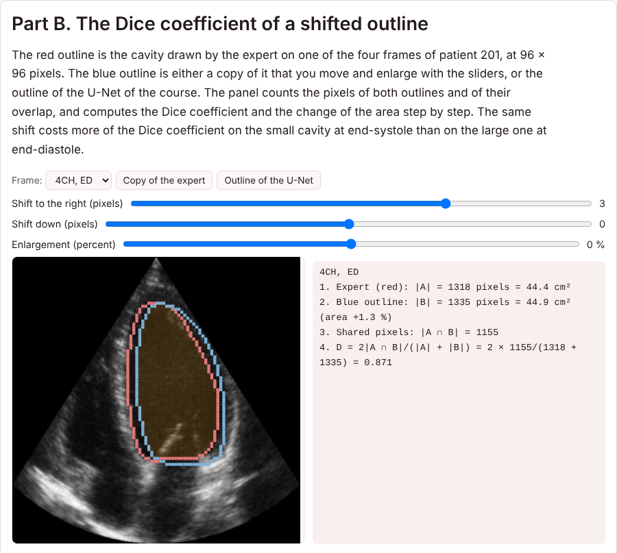
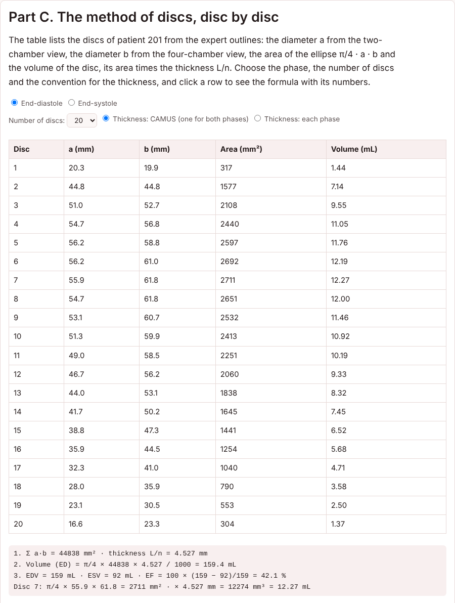

> **Türkçe:** Bu eğitim Türkçe yürütülmektedir. **[Bu haftanın Türkçe sayfasına geçin](../../tr/hafta-04/README.md)**

# Week 4: Transfer learning

**Artificial Intelligence with Python: A Hands-on Training Program for Cardiologists** 
Turkish Society of Cardiology

*From networks trained on photographs to an automatic ejection fraction*

[Course home](../../README.md) · [Syllabus](../../SYLLABUS.md) · [Setup](../../SETUP.md) · [Türkçe](../../tr/hafta-04/README.md)

## About the week

Networks trained on millions of everyday photographs are adapted to cardiac images: feature extraction, fine-tuning and learning from few labelled patients, with EfficientNet-B0 pretrained on ImageNet and the cine cardiac magnetic resonance examinations of ACDC from Week 3. The second half outlines the left ventricle on the apical two-chamber and four-chamber echocardiograms of the public CAMUS data set with a U-Net, measures the outlines with the Dice coefficient and computes the volumes and the ejection fraction with the biplane method of discs. The automatic measurement is compared with the expert's in a Bland-Altman analysis, its clinical validation is planned, and a measurement pipeline written by an AI assistant is reviewed.

4 hours in the session and about 3 hours for the weekly project.

## The route of the week

The lecture page is the main route of the week. It holds no code and no prompts, and it is read from top to bottom together with the interactive lab. At each practice stop, every participant chooses one of two paths in the Jupyter notebook: the **prompt path** (Part 1), on which an artificial intelligence (AI) assistant writes the code from ready prompts and the participant runs and checks it, or the **Python path** (Part 2), on which the participant writes the code. Both paths reach the same results. The notebook runs in Google Colab, with nothing to install, or in Jupyter on your own computer ([setup](../../SETUP.md)).

| Main route: lecture page and interactive lab | Practice stop | Prompt path (Part 1) | Python path (Part 2) |
|---|---|---|---|
| [Transfer learning: What a network learned from photographs](https://utkukose.github.io/ai-cardiology-tkd-NB-lecture/en/week-04/lecture.html#transfer-learning-what-a-network-learned-from-photographs) [Learning from few labelled patients](https://utkukose.github.io/ai-cardiology-tkd-NB-lecture/en/week-04/lecture.html#learning-from-few-labelled-patients) | **[Stop 1: Learning from few patients with a network trained on photographs](https://utkukose.github.io/ai-cardiology-tkd-NB-lecture/en/week-04/lecture.html#stop-1)** | Stop 1 | Python step 4 and Sections 1 to 4 |
| [Segmentation: A label for every pixel](https://utkukose.github.io/ai-cardiology-tkd-NB-lecture/en/week-04/lecture.html#segmentation-a-label-for-every-pixel) [A U-Net on the echocardiograms of CAMUS](https://utkukose.github.io/ai-cardiology-tkd-NB-lecture/en/week-04/lecture.html#a-u-net-on-the-echocardiograms-of-camus) | **[Stop 2: A U-Net on the echocardiograms of CAMUS](https://utkukose.github.io/ai-cardiology-tkd-NB-lecture/en/week-04/lecture.html#stop-2)** | Stop 2 | Sections 5 to 7 |
| [The ejection fraction by the method of discs](https://utkukose.github.io/ai-cardiology-tkd-NB-lecture/en/week-04/lecture.html#the-ejection-fraction-by-the-method-of-discs) [Agreement with the expert: Bland-Altman](https://utkukose.github.io/ai-cardiology-tkd-NB-lecture/en/week-04/lecture.html#agreement-with-the-expert-bland-altman) | **[Stop 3: The ejection fraction by the method of discs](https://utkukose.github.io/ai-cardiology-tkd-NB-lecture/en/week-04/lecture.html#stop-3)** | Stop 3 | Sections 8 and 9 |
| [Planning the clinical validation of an automatic measurement](https://utkukose.github.io/ai-cardiology-tkd-NB-lecture/en/week-04/lecture.html#planning-the-clinical-validation-of-an-automatic-measurement) [Working with an AI assistant, part 4: Reviewing a measurement pipeline](https://utkukose.github.io/ai-cardiology-tkd-NB-lecture/en/week-04/lecture.html#ai-pair-programming-part-4-reviewing-a-measurement-pipeline) [The paper of the week](https://utkukose.github.io/ai-cardiology-tkd-NB-lecture/en/week-04/lecture.html#the-paper-of-the-week) [The virtual clinic, stage 4: Automatic ejection fraction](https://utkukose.github.io/ai-cardiology-tkd-NB-lecture/en/week-04/lecture.html#the-virtual-clinic-stage-4-automatic-ejection-fraction) | The section on your own data, the paper of the week and the virtual clinic | – | – |

## Materials

| Material | Open | What it holds |
|---|---|---|
| **Lecture page (main route)** | [Open the lecture page](https://utkukose.github.io/ai-cardiology-tkd-NB-lecture/en/week-04/lecture.html) | The case, the concepts with worked examples, a three-dimensional (3D) scene of the method of discs, two animations, knowledge checks, three practice stops, the section on your own data, review cards and references. No code and no prompts. |
| **Interactive lab** | [Open the interactive lab](https://utkukose.github.io/ai-cardiology-tkd-NB-lecture/en/week-04/lab.html) | Parts A to F without code, including the prompt workshop of Part F, a self-assessment, a reflection and the learning log to export |
| **Jupyter notebook** |  [Download for Jupyter](NB04_transfer_learning.ipynb) | Part 1, the prompt path: three stops with nine steps, each with a ready prompt, a data cell for its table, a cell for the code of the AI assistant, an automatic check and ready code, and the weekly project in four prompts. Part 2, the Python path: Python step 4, Sections 1 to 10 with Exercises A to J and the challenges of seven fields. |
| **Prompt library** | [PROMPTS.md](PROMPTS.md) | All prompts of the prompt path with a copy button on GitHub, the prompts for repairing code and the prompt path of the weekly project |
| **PDF notes** | [Week04_Lecture_Notes.pdf](Week04_Lecture_Notes.pdf) | The lecture page in print form, with its practice stops and the section on your own data |

<table>
<tr><td width="50%"></td><td width="50%"></td></tr>
<tr><td>Interactive lab, Part B: the outline of the U-Net shifted over the four-chamber end-diastolic frame of patient 201, with the Dice coefficient and the change of the area step by step.</td><td>Jupyter notebook, Section 7: the outlines of the expert and of the U-Net on the four frames of patient 201.</td></tr>
<tr><td width="50%"></td><td width="50%"></td></tr>
<tr><td>Interactive lab, Part C: the method of discs step by step, with the diameters, the area and the volume of every disc.</td><td>Interactive lab, Part D: the Bland-Altman plot of the ejection fraction of the 50 test patients, with the bias and the limits of agreement.</td></tr>
</table>

## The case of the week

**Patient 201 of the CAMUS test set**, a 56-year-old woman, had an echocardiogram at the University Hospital of Saint-Étienne. Both apical views have good image quality. The outlines of the expert give an end-diastolic volume of 159 mL, an end-systolic volume of 92 mL and an ejection fraction of 42 percent by the biplane method of discs. A network that has never seen this patient has to outline the left ventricle on the four frames and to measure the same numbers. The [lecture page](https://utkukose.github.io/ai-cardiology-tkd-NB-lecture/en/week-04/lecture.html) opens with the case, and the echo measurement of the virtual clinic answers it in its last section.

## Learning outcomes

By the end of the week, participants are expected to explain what a network learns from a large collection of photographs and how its features are reused for cardiac images, by feature extraction or by fine-tuning. They should be able to adapt a pretrained network to a few labelled patients and to compare it fairly with networks trained from random weights. They should be able to describe segmentation as a label for every pixel, to train a small U-Net on echocardiograms and to measure its outlines with the Dice coefficient by view and phase. Finally, they should be able to compute volumes and the ejection fraction with the biplane method of discs, to judge the agreement of an automatic measurement with the expert in a Bland-Altman analysis and to plan its clinical validation.

## Study path

Participants who attend the session complete the main route and the practice stops there. Participants who follow the week on their own, for example after a missed session, can plan with the times below.

| Step | Activity | Prompt path | Python path |
|---|---|---|---|
| 1 | Read the case of the week and the lecture page up to Practice stop 1, with Part A of the interactive lab and the knowledge checks | 45 minutes | 45 minutes |
| 2 | Practice stop 1, the mini project of the session: Part 1, Stop 1 on the prompt path, or Python step 4 and Sections 1 to 4 on the Python path | 30 minutes | 1 hour 20 minutes |
| 3 | Read on up to Practice stop 2: segmentation, the Dice coefficient and the U-Net on CAMUS, with Part B of the interactive lab | 40 minutes | 40 minutes |
| 4 | Practice stop 2: Part 1, Stop 2, or Sections 5 to 7 | 30 minutes | 1 hour |
| 5 | Read on up to Practice stop 3: the method of discs with the 3D scene, and the agreement with the expert, with Parts C and D of the interactive lab | 45 minutes | 45 minutes |
| 6 | Practice stop 3: Part 1, Stop 3, or Sections 8 and 9 | 25 minutes | 50 minutes |
| 7 | Read the plan of a clinical validation, the review of a measurement pipeline with Parts E and F of the interactive lab, the paper of the week, the stage of the virtual clinic and the section on your own data; on the Python path, Section 10 as well | 45 minutes | 1 hour |
| 8 | Take the self-assessment of the interactive lab (tab: Check yourself), write the reflection and export the learning log | 20 minutes | 20 minutes |
| | **Total without the weekly project** | **4 hours 40 minutes** | **6 hours 40 minutes** |
| 9 | Complete the weekly project, on either path | 3 hours | 3 hours |

## Training flow of the session

The four-hour session of the week follows the plan below. It is shared to show how the materials fit together in a live session.

| Time | Activity |
|---|---|
| 0:00 to 0:15 | The case of the week, patient 201 of CAMUS, and the route of the week. Every participant opens the notebook in Google Colab or in Jupyter and runs Section 0. It downloads the ACDC files of Week 3 if they are missing, 300 patients of CAMUS, about 227 MB, from the public database of the Human Heart Project, and the ImageNet weights of EfficientNet-B0, about 21 MB. |
| 0:15 to 0:50 | Main route: transfer learning, what a network learns from photographs, feature extraction and fine-tuning, and learning from few labelled patients with Part A of the interactive lab. |
| 0:50 to 1:30 | Mini project of the session, Practice stop 1, in two groups, the prompt path and the Python path: The cardiomyopathy groups of ACDC are learned from 15 labelled patients per group, by feature extraction and by fine-tuning, and finally from only five patients per group. |
| 1:30 to 1:45 | Break. |
| 1:45 to 2:20 | Main route: segmentation as a label for every pixel, the Dice coefficient with Part B, and the U-Net on the echocardiograms of CAMUS. |
| 2:20 to 2:50 | Practice stop 2: The U-Net is trained in about three minutes and its outlines are measured on the 50 test patients, by view and by phase. |
| 2:50 to 3:35 | Main route: the method of discs in the 3D scene and Part C, the agreement with the expert in Part D. Practice stop 3: the ejection fraction of patient 201 and of the 50 test patients. |
| 3:35 to 4:00 | The plan of a clinical validation, the review of a measurement pipeline with Parts E and F, the paper of the week, the echo measurement of the virtual clinic, the section on your own data and the weekly project. |

## Weekly project

**What to do.** Outline the left ventricle on the echocardiograms of CAMUS, measure the ejection fraction automatically and judge the measurement as an echocardiography laboratory would. First, train the U-Net of the course on the 200 training patients, with the 50 validation patients for the choice of the epoch, and report the Dice coefficient of the 200 test frames by view, by phase and by image quality. Second, compute the end-diastolic volume (EDV), the end-systolic volume (ESV) and the ejection fraction (EF) of the 50 test patients from the outlines of the network with the biplane method of discs, and compare each of the three with the expert in a Bland-Altman analysis. Third, cross-tabulate the EF of the network and of the expert in three ranges: 40 percent or less, 41 to 49 percent and 50 percent or more. Fourth, show the three patients with the largest errors of the EF, with the four outlines of the expert and of the network, and write in half a page how the external validation of this measurement should be planned before its use in a laboratory.

**Where to look.** Lecture: sections "Segmentation: A label for every pixel", "A U-Net on the echocardiograms of CAMUS", "The ejection fraction by the method of discs", "Agreement with the expert: Bland-Altman" and "Planning the clinical validation of an automatic measurement". Interactive lab: Parts B, C and D. Jupyter notebook: Part 1, Stops 2 and 3, or Part 2, Sections 5 to 9.

**Prompt path.** The project can also be built with four prompts, one for each step, from the [prompt library](https://github.com/utkukose/ai-cardiology-tkd-NB-lecture/blob/main/en/week-04/PROMPTS.md#prompt-path-of-the-weekly-project). The section "Weekly project on the prompt path" at the end of Part 1 of the Jupyter notebook prepares the table of each prompt. The test of each prompt must hold before the next prompt is used.

**Example.** Suppose the differences of the EF, network minus expert, are −3, 5, −7, 1 and −1 points in five patients. The bias is their mean, $-5/5 = -1.0$ point. The standard deviation (SD) of the differences is $\sqrt{80/4} = 4.47$ points, since the squared deviations from the mean, 4, 36, 36, 4 and 0, add up to 80. The limits of agreement are $-1.0 \pm 1.96 \times 4.47$, from −9.8 to 7.8 points.

**What to submit.** A report of one to two pages in the [report template](../templates/Report_Template.docx), with the table of the Dice coefficients, the three Bland-Altman plots, the cross-table of the EF ranges, the figure of the three patients and the plan of the validation. Add the AI usage log (tool, prompt, what was checked, what was changed) and the Jupyter notebook with its outputs. Figures with images of CAMUS carry the credit "CAMUS, CC BY-NC-SA 4.0" and serve non-commercial purposes only, as its terms require.

**Submission.** The weekly project is submitted before the session of Week 5 by e-mail to utkukose@sdu.edu.tr or utkukose@gmail.com. The e-mail holds the items listed under What to submit and the learning log exported from the interactive lab. Weekly projects count for 40 percent of the assessment, and the rubric is in the syllabus.

## With your own data

The lecture page closes with a section on applying the methods of the week to your own data: which question fits which method, what to check first, the approval of the ethics committee, the Turkish Law on the Protection of Personal Data (KVKK) and where to compute. [Read it on the lecture page](https://utkukose.github.io/ai-cardiology-tkd-NB-lecture/en/week-04/lecture.html#with-your-own-data).

## Optional research assignment

Search PubMed for one study, published in 2020 or later, that measured the left ventricular ejection fraction automatically on echocardiograms and compared it with the measurements of experts. Summarise it in half a page: the patients, the hospitals and the machines, the reference and how many readers gave it, the agreement in bias and limits of agreement, the images excluded for poor quality and whether the test came from another hospital. The three questions of [the paper of the week](https://utkukose.github.io/ai-cardiology-tkd-NB-lecture/en/week-04/lecture.html#the-paper-of-the-week) can guide the summary. The assignment is not graded, and it prepares the plan of validation of the weekly project.

## The virtual clinic after this week

In Week 4 the imaging laboratory of the virtual clinic starts to measure. A U-Net outlines the left ventricle on the apical echocardiograms of CAMUS, downloaded by every participant from its public source, and the ejection fraction follows from the outlines by the biplane method of discs. A network pretrained on ImageNet learns the cardiomyopathy groups of ACDC from a few labelled patients. The results are in the section [The virtual clinic, stage 4](https://utkukose.github.io/ai-cardiology-tkd-NB-lecture/en/week-04/lecture.html#the-virtual-clinic-stage-4-automatic-ejection-fraction) of the lecture page.

## Next week

**Week 5: Time series analysis and ECG artificial intelligence.** The electrocardiogram returns as a time series: One-dimensional convolutional and recurrent networks classify rhythms on 12-lead recordings, and the rhythm and STEMI alarm of the virtual clinic detects ST elevation and depression. See the [plan of the course](../../README.md#the-eleven-weeks).

---

**Prof. Dr. Utku Kose**

Full Professor, Department of Computer Engineering, Süleyman Demirel University, Isparta, Türkiye 
Founding Director, AI Application and Research Center (YAZEM), Süleyman Demirel University 
Head of the Computer Science Division, Department of Computer Engineering, Süleyman Demirel University 
Additional affiliations: University of North Dakota (USA), Universidad Panamericana (Mexico City, Mexico), Vel Tech University (Chennai, India) 
IEEE Senior Member, ACM Professional Member

[ORCID 0000-0002-9652-6415](https://orcid.org/0000-0002-9652-6415) | [utkukose.com](https://www.utkukose.com) | [github.com/utkukose](https://github.com/utkukose)

[utkukose@sdu.edu.tr](mailto:utkukose@sdu.edu.tr) | [utku.kose@und.edu](mailto:utku.kose@und.edu) | [ukose@up.edu.mx](mailto:ukose@up.edu.mx) | [utkukose@gmail.com](mailto:utkukose@gmail.com)

*First version: November 2026. Content CC BY 4.0, code MIT.*

