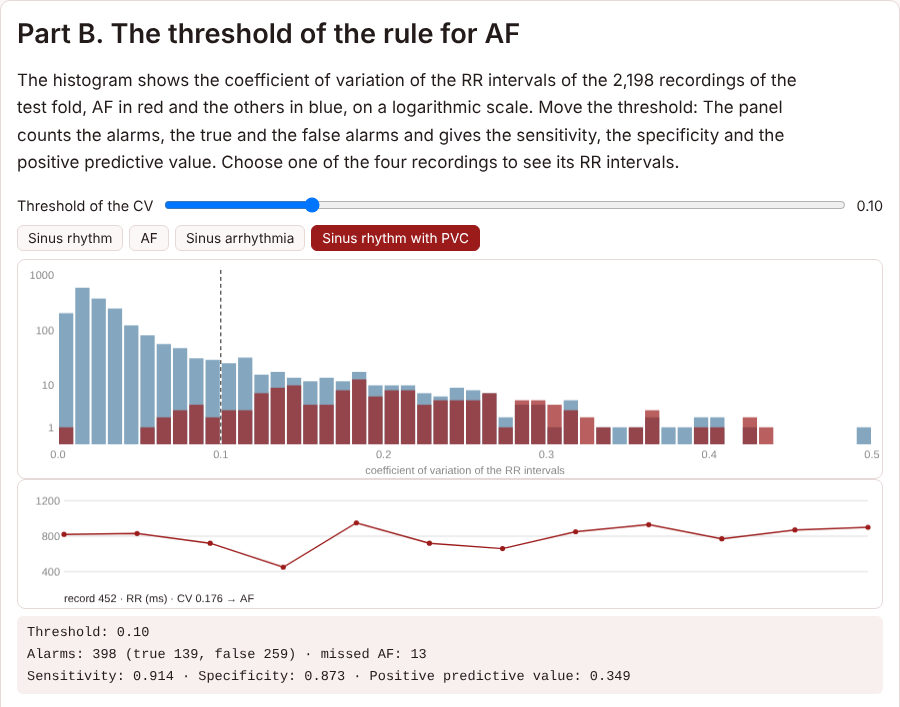
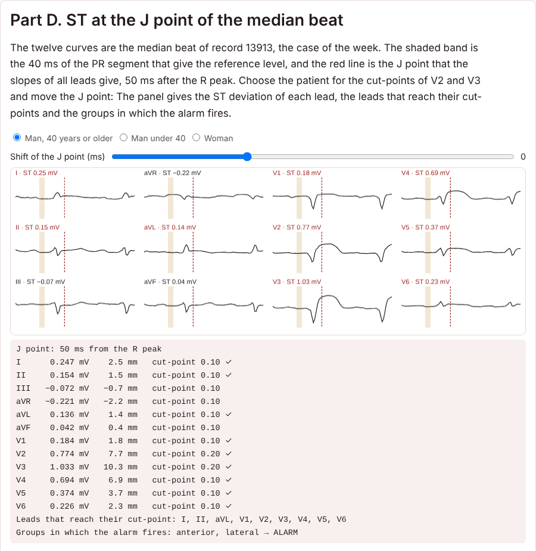

> **Türkçe:** Bu eğitim Türkçe yürütülmektedir. **[Bu haftanın Türkçe sayfasına geçin](../../tr/hafta-05/README.md)**

# Week 5: Time series analysis and ECG artificial intelligence

**Artificial Intelligence with Python: A Hands-on Training Program for Cardiologists** 
Turkish Society of Cardiology

*From the rhythm of ten seconds to a STEMI alarm and a day of monitoring*

[Course home](../../README.md) · [Syllabus](../../SYLLABUS.md) · [Setup](../../SETUP.md) · [Türkçe](../../tr/hafta-05/README.md)

## About the week

The electrocardiogram (ECG) returns as a time series: twelve leads of numbers in their order, from the 12-lead ECGs of PTB-XL, a public collection of 21,799 clinical recordings. A rule from RR intervals detects atrial fibrillation as a cardiologist would, and a one-dimensional convolutional network learns several rhythm labels at once. A recurrent network reads the RR intervals as a sequence. The second half measures the ST segment automatically on median beats, applies the criteria of the universal definition of myocardial infarction as a STEMI alarm and estimates the QTc. A synthetic 24-hour Holter recording of the virtual clinic then shows how windows, thresholds and noise decide the false alarms of long-term monitoring. The week closes with ECG algorithms that have regulatory approval and with the review of a time-series pipeline written by an AI assistant.

4 hours in the session and about 3 hours for the weekly project.

## The route of the week

The lecture page is the main route of the week. It holds no code and no prompts, and it is read from top to bottom together with the interactive lab. At each practice stop, every participant chooses one of two paths in the Jupyter notebook: the **prompt path** (Part 1), on which an artificial intelligence (AI) assistant writes the code from ready prompts and the participant runs and checks it, or the **Python path** (Part 2), on which the participant writes the code. Both paths reach the same results. The notebook runs in Google Colab, with nothing to install, or in Jupyter on your own computer ([setup](../../SETUP.md)).

|  | Main route: lecture page and interactive lab | Practice stop: choose a path |
|---|---|---|
| 1 | [The ECG as a time series](https://utkukose.github.io/ai-cardiology-tkd-NB-lecture/en/week-05/lecture.html#the-ecg-as-a-time-series), [A rule first: RR intervals and atrial fibrillation](https://utkukose.github.io/ai-cardiology-tkd-NB-lecture/en/week-05/lecture.html#a-rule-first-rr-intervals-and-atrial-fibrillation), [One-dimensional convolution: A kernel that slides along time](https://utkukose.github.io/ai-cardiology-tkd-NB-lecture/en/week-05/lecture.html#one-dimensional-convolution-a-kernel-that-slides-along-time), [Recurrent networks: A state that moves along the signal](https://utkukose.github.io/ai-cardiology-tkd-NB-lecture/en/week-05/lecture.html#recurrent-networks-a-state-that-moves-along-the-signal), [Many labels at once: Multi-label classification](https://utkukose.github.io/ai-cardiology-tkd-NB-lecture/en/week-05/lecture.html#many-labels-at-once-multi-label-classification) | **[Stop 1: Rhythm: a rule and a network for six labels](https://utkukose.github.io/ai-cardiology-tkd-NB-lecture/en/week-05/lecture.html#stop-1)** Prompt path: Part 1, Stop 1 Python path: Part 2, Python step 5, Sections 1 to 5 |
| 2 | [ST elevation and depression: The criteria of the universal definition](https://utkukose.github.io/ai-cardiology-tkd-NB-lecture/en/week-05/lecture.html#st-elevation-and-depression-the-criteria-of-the-universal-definition), [Measuring the ST segment automatically: The median beat and the J point](https://utkukose.github.io/ai-cardiology-tkd-NB-lecture/en/week-05/lecture.html#measuring-the-st-segment-automatically-the-median-beat-and-the-j-point) | **[Stop 2: ST elevation: the median beat, the J point and the alarm](https://utkukose.github.io/ai-cardiology-tkd-NB-lecture/en/week-05/lecture.html#stop-2)** Prompt path: Part 1, Stop 2 Python path: Part 2, Sections 6 and 7 |
| 3 | [QT prolongation and its risk](https://utkukose.github.io/ai-cardiology-tkd-NB-lecture/en/week-05/lecture.html#qt-prolongation-and-its-risk), [Long-term monitoring: From ten seconds to twenty-four hours](https://utkukose.github.io/ai-cardiology-tkd-NB-lecture/en/week-05/lecture.html#long-term-monitoring-from-ten-seconds-to-twenty-four-hours) | **[Stop 3: Long-term monitoring: windows, AF burden and false alarms](https://utkukose.github.io/ai-cardiology-tkd-NB-lecture/en/week-05/lecture.html#stop-3)** Prompt path: Part 1, Stop 3 Python path: Part 2, Sections 8 and 9 |
|  | [ECG algorithms with regulatory approval](https://utkukose.github.io/ai-cardiology-tkd-NB-lecture/en/week-05/lecture.html#ecg-algorithms-with-regulatory-approval), [Working with an AI assistant, part 5: Reviewing a time-series pipeline](https://utkukose.github.io/ai-cardiology-tkd-NB-lecture/en/week-05/lecture.html#ai-pair-programming-part-5-reviewing-a-time-series-pipeline), [The paper of the week](https://utkukose.github.io/ai-cardiology-tkd-NB-lecture/en/week-05/lecture.html#the-paper-of-the-week), [The virtual clinic, stage 5: Rhythm and STEMI alarm](https://utkukose.github.io/ai-cardiology-tkd-NB-lecture/en/week-05/lecture.html#the-virtual-clinic-stage-5-rhythm-and-stemi-alarm) | The section on your own data, the paper of the week and the virtual clinic |

## Materials

| Material | Open | What it holds |
|---|---|---|
| **Lecture page (main route)** | [Open the lecture page](https://utkukose.github.io/ai-cardiology-tkd-NB-lecture/en/week-05/lecture.html) | The case, the concepts with worked examples, a three-dimensional (3D) scene of the ST injury vector, two animations, knowledge checks, three practice stops, the section on your own data, review cards and references. No code and no prompts. |
| **Interactive lab** | [Open the interactive lab](https://utkukose.github.io/ai-cardiology-tkd-NB-lecture/en/week-05/lab.html) | Parts A to F without code, including the prompt workshop of Part F, a self-assessment, a reflection and the learning log to export |
| **Jupyter notebook** |  [Download for Jupyter](NB05_time_series_and_ecg_ai.ipynb) | Part 1, the prompt path: three stops with ten steps, each with a ready prompt, a data cell for its table, a cell for the code of the AI assistant, an automatic check and ready code, and the weekly project in four prompts. Part 2, the Python path: Python step 5, Sections 1 to 10 with Exercises A to J and the challenges of seven fields. |
| **Prompt library** | [PROMPTS.md](PROMPTS.md) | All prompts of the prompt path with a copy button on GitHub, the prompts for repairing code and the prompt path of the weekly project |
| **PDF notes** | [Week05_Lecture_Notes.pdf](Week05_Lecture_Notes.pdf) | The lecture page in print form, with its practice stops and the section on your own data |

<table>
<tr><td width="50%"></td><td width="50%"></td></tr>
<tr><td>Interactive lab, Part B: the coefficients of variation of the test fold with the threshold of the rule for AF, the alarms, the sensitivity, the specificity and the positive predictive value, and the RR intervals of a recording with ventricular premature complexes.</td><td>Jupyter notebook, Section 1: the 12-lead ECG of the case of the week from PTB-XL.</td></tr>
<tr><td width="50%"></td><td width="50%"></td></tr>
<tr><td>Interactive lab, Part D: the median beats of the twelve leads of the case with the PR level and the J point, and the decision of the STEMI alarm.</td><td>Lecture page: the windows of the 24-hour Holter recording of the virtual clinic, with the threshold of the alarm and its false alarms.</td></tr>
</table>

## The case of the week

Record 13913 of PTB-XL, a man of 68 years with sinus tachycardia and an acute anterior and lateral infarction. Which rhythm does a program report from the 12,000 numbers of the recording, does it raise a STEMI alarm, and how often is such an alarm right?

## Learning outcomes

By the end of the week, participants are expected to describe an ECG as a time series, to explain its sampling frequency and its labels, and to keep the recordings of one patient in one set. They should be able to detect atrial fibrillation with a rule from RR intervals and to judge a multi-label network for rhythms label by label, with thresholds chosen on a validation set. They should be able to explain one-dimensional convolution, the receptive field and the state of a recurrent network. Finally, they should be able to measure the ST segment on a median beat, to apply the criteria of ST elevation of the universal definition as an alarm and to judge its sensitivity, its specificity and its false alarms, in a 10-second ECG and in a recording of 24 hours.

## Study path

Participants who attend the session complete the main route and the practice stops there. Participants who follow the week on their own, for example after a missed session, can plan with the times below.

| Step | Activity | Prompt path | Python path |
|---|---|---|---|
| 1 | Read the case of the week and the lecture page up to Practice stop 1, with Parts A, B and C of the interactive lab and the knowledge checks | 1 hour | 1 hour |
| 2 | Practice stop 1, the mini project of the session: Part 1, Stop 1 on the prompt path, or Python step 5 and Sections 1 to 6 on the Python path | 35 minutes | 1 hour 40 minutes |
| 3 | Read on up to Practice stop 2: ST elevation and depression with the 3D scene, and the automatic ST measurement, with Part D of the interactive lab | 40 minutes | 40 minutes |
| 4 | Practice stop 2: Part 1, Stop 2, or Sections 7 and 8 | 25 minutes | 50 minutes |
| 5 | Read on up to Practice stop 3: QT prolongation and long-term monitoring, with the animation of the Holter recording | 30 minutes | 30 minutes |
| 6 | Practice stop 3: Part 1, Stop 3, or Section 9 | 20 minutes | 35 minutes |
| 7 | Read the section on regulatory approval, the review of a time-series pipeline with Parts E and F of the interactive lab, the paper of the week, the stage of the virtual clinic and the section on your own data; on the Python path, Section 10 as well | 40 minutes | 55 minutes |
| 8 | Take the self-assessment of the interactive lab (tab: Check yourself), write the reflection and export the learning log | 20 minutes | 20 minutes |
| | **Total without the weekly project** | **4 hours 30 minutes** | **6 hours 30 minutes** |
| 9 | Complete the weekly project, on either path | 3 hours | 3 hours |

## Training flow of the session

The four-hour session of the week follows the plan below. It is shared to show how the materials fit together in a live session.

| Time | Activity |
|---|---|
| 0:00 to 0:15 | The case of the week and the route of the week. Every participant opens the notebook in Google Colab or in Jupyter and runs Section 0. It downloads the 12-lead ECGs of four folds of PTB-XL at 100 Hz, about 216 MB, from PhysioNet. |
| 0:15 to 0:55 | Main route: the ECG as a time series, a rule for atrial fibrillation from RR intervals with Part B, one-dimensional convolution with Part A, recurrent networks, and multi-label classification with Part C of the interactive lab. |
| 0:55 to 1:35 | Mini project of the session, Practice stop 1, in two groups, the prompt path and the Python path: A one-dimensional network learns the rhythm labels of PTB-XL in about two minutes, its thresholds are chosen on fold 9, and it is compared with the rule on fold 10. |
| 1:35 to 1:50 | Break. |
| 1:50 to 2:30 | Main route: ST elevation and depression in the 3D scene, the criteria of the universal definition, the median beat and the J point with Part D. Practice stop 2: the ST deviation of the case and the alarm on the test fold. |
| 2:30 to 3:20 | Main route: QT prolongation and its risk, and long-term monitoring with the 24-hour recording of the virtual clinic. Practice stop 3: windows, the AF burden and the false alarms of one day. |
| 3:20 to 4:00 | ECG algorithms with regulatory approval, the review of a time-series pipeline with Parts E and F, the paper of the week, the rhythm and STEMI alarm of the virtual clinic, the section on your own data and the weekly project. |

## Weekly project

**What to do.** Build an automatic STEMI alarm on the 12-lead ECGs of PTB-XL and judge it as a chest pain unit would. First, measure the ST deviation at the J point of the twelve leads on the median beat of every recording of folds 9 and 10. Second, apply the criteria of the universal definition: the cut-points of V2 and V3 by sex and age, 1 mm in the other leads and the three lead groups; the alarm fires when two leads of one group reach their cut-points. Third, compare the alarm with the acute myocardial infarctions of the two folds, the recordings whose infarction stage is Stadium I or Stadium I-II. Report the sensitivity, the specificity and the positive predictive value, and count the false alarms by the statements of the recording, for example left bundle branch block, left ventricular hypertrophy and a normal ECG. Fourth, show the three missed infarctions and the three false alarms with the largest ST elevation as median beats, and write in half a page what the alarm would need before it could run in an emergency department.

**Where to look.** Lecture: sections "ST elevation and depression: The criteria of the universal definition" and "Measuring the ST segment automatically: The median beat and the J point". Interactive lab: Part D. Jupyter notebook: Part 1, Stop 2, or Part 2, Sections 7 and 8.

**Prompt path.** The project can also be built with four prompts, one for each step, from the [prompt library](https://github.com/utkukose/ai-cardiology-tkd-NB-lecture/blob/main/en/week-05/PROMPTS.md#prompt-path-of-the-weekly-project). The section "Weekly project on the prompt path" at the end of Part 1 of the Jupyter notebook prepares the table of each prompt. The test of each prompt must hold before the next prompt is used.

**Example.** Suppose the alarm fires in 30 of 40 acute infarctions and in 60 of 4,000 other recordings. The sensitivity is $30/40 = 0.75$, the specificity $(4000 - 60)/4000 = 3940/4000 = 0.985$ and the positive predictive value $30/(30 + 60) = 0.333$: Two of three alarms would be false, although the alarm is right in 98.5 percent of the recordings without an infarction.

**What to submit.** A report of one to two pages in the [report template](../templates/Report_Template.docx), with the table of the sensitivity, the specificity and the positive predictive value, the count of the false alarms by statement, the figure of the six median beats and the half page on what the alarm would need. Add the AI usage log (tool, prompt, what was checked, what was changed) and the Jupyter notebook with its outputs. Figures with ECGs of PTB-XL carry the credit "PTB-XL, CC BY 4.0".

**Submission.** The weekly project is submitted before the session of Week 6 by e-mail to utkukose@sdu.edu.tr or utkukose@gmail.com. The e-mail holds the items listed under What to submit and the learning log exported from the interactive lab. Weekly projects count for 40 percent of the assessment, and the rubric is in the syllabus.

## With your own data

The lecture page closes with a section on applying the methods of the week to your own data: which question fits which method, what to check first, the approval of the ethics committee, the Turkish Law on the Protection of Personal Data (KVKK) and where to compute. [Read it on the lecture page](https://utkukose.github.io/ai-cardiology-tkd-NB-lecture/en/week-05/lecture.html#with-your-own-data).

## Optional research assignment

Search PubMed for one study, published in 2020 or later, that detected atrial fibrillation or an acute myocardial infarction automatically on ECGs and compared the algorithm with cardiologists. Summarise it in half a page: the patients, the hospitals and the devices, the reference and how many readers gave it, the sensitivity, the specificity and the positive predictive value, the prevalence in the test set, and whether the test came from another hospital. The three questions of [the paper of the week](https://utkukose.github.io/ai-cardiology-tkd-NB-lecture/en/week-05/lecture.html#the-paper-of-the-week) can guide the summary. The assignment is not graded, and it prepares the half page of the weekly project.

## The virtual clinic after this week

In Week 5 the virtual clinic gets a rhythm and STEMI alarm. A one-dimensional network trained on PTB-XL and the criteria of ST elevation read the resting ECGs of the 500 patients of the clinic, and a synthetic 24-hour Holter recording of one patient shows the windows and the false alarms of long-term monitoring. The results are in the section [The virtual clinic, stage 5](https://utkukose.github.io/ai-cardiology-tkd-NB-lecture/en/week-05/lecture.html#the-virtual-clinic-stage-5-rhythm-and-stemi-alarm) of the lecture page.

## Next week

**Week 6: Natural language processing and clinical text mining.** The reports of the clinic become data: tokens, word representations and pretrained language models extract diagnoses, drugs and the degree of stenosis from text in Turkish and English. See the [plan of the course](../../README.md#the-eleven-weeks).

---

**Prof. Dr. Utku Kose**

Full Professor, Department of Computer Engineering, Süleyman Demirel University, Isparta, Türkiye 
Founding Director, AI Application and Research Center (YAZEM), Süleyman Demirel University 
Head of the Computer Science Division, Department of Computer Engineering, Süleyman Demirel University 
Additional affiliations: University of North Dakota (USA), Universidad Panamericana (Mexico City, Mexico), Vel Tech University (Chennai, India) 
IEEE Senior Member, ACM Professional Member

[ORCID 0000-0002-9652-6415](https://orcid.org/0000-0002-9652-6415) | [utkukose.com](https://www.utkukose.com) | [github.com/utkukose](https://github.com/utkukose)

[utkukose@sdu.edu.tr](mailto:utkukose@sdu.edu.tr) | [utku.kose@und.edu](mailto:utku.kose@und.edu) | [ukose@up.edu.mx](mailto:ukose@up.edu.mx) | [utkukose@gmail.com](mailto:utkukose@gmail.com)

*First version: November 2026. Content CC BY 4.0, code MIT.*

