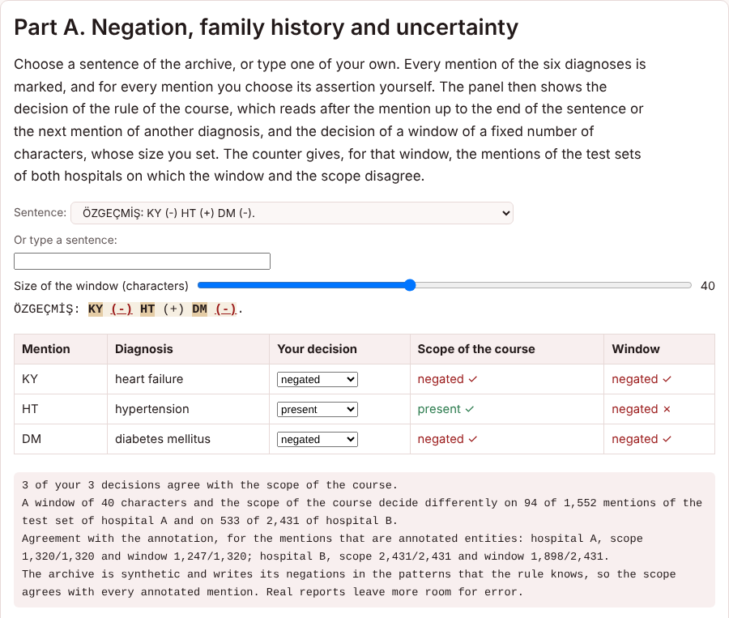
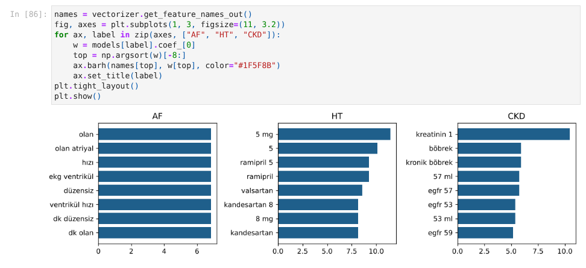
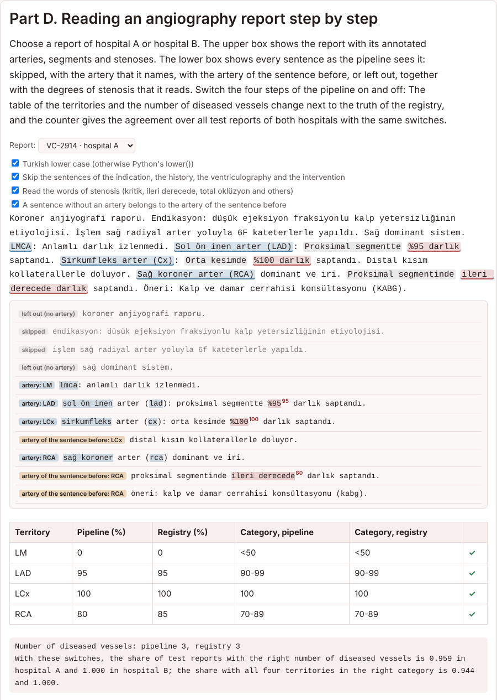
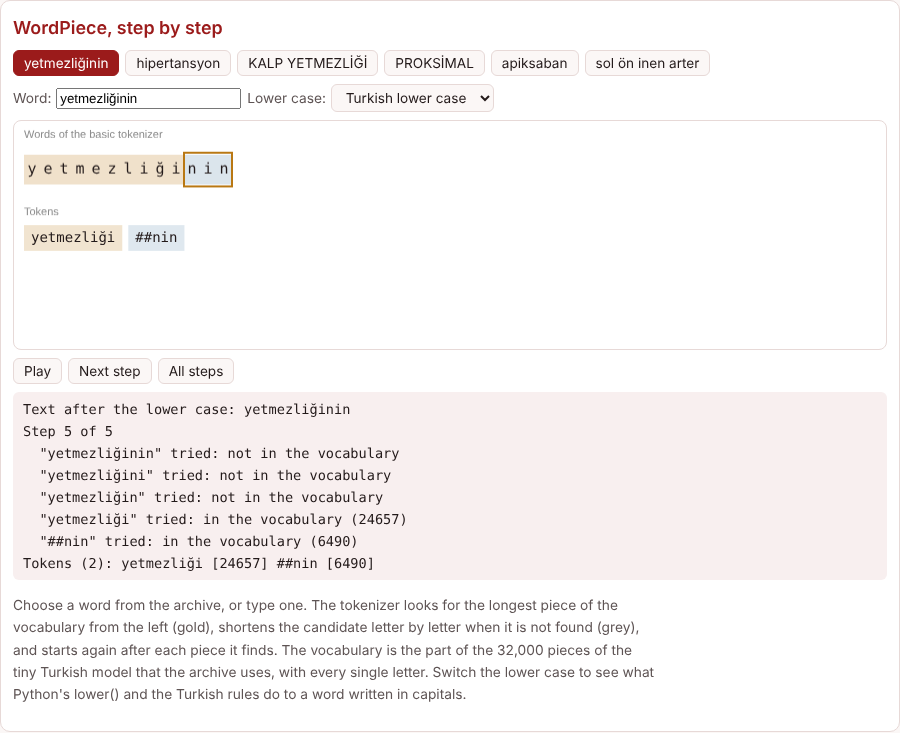

> **Türkçe:** Bu eğitim Türkçe yürütülmektedir. **[Bu haftanın Türkçe sayfasına geçin](../../tr/hafta-06/README.md)**

# Week 6: NLP and clinical text mining

**Artificial Intelligence with Python: A Hands-on Training Program for Cardiologists** 
Turkish Society of Cardiology

*Automatic information extraction from reports, discharge summaries and notes*

[Course home](../../README.md) · [Syllabus](../../SYLLABUS.md) · [Setup](../../SETUP.md) · [Türkçe](../../tr/hafta-06/README.md)

## About the week

The reports of the virtual clinic become data. A report archive holds a discharge summary for each of 3,600 patients, written in full sentences by hospital A and in a short style with (+) and (-) by hospital B, and a coronary angiography report for every patient with an angiography. A keyword rule comes first and shows its traps: negation, family history, uncertainty and diagnoses that the text never names. A rule with the scope of a trigger, the drugs and two laboratory values then reads the six diagnoses on both hospitals, while TF-IDF with logistic regression excels on the hospital that it learned from and falls on the other (macro F1 0.990 and 0.708, against 0.980 and 0.985 for the rule). Tokenization and lemmatization, TF-IDF and word embeddings, BERT and BioBERT from the Hugging Face Hub and a tiny pretrained Turkish BERT model follow. Fine-tuned for named entities, the model finds the entities of hospital A almost without error. On hospital B it finds most drugs, few diagnoses and none of the procedures (entity F1 0.981 and 0.556 on the two hospitals). The rules then turn its entities into diagnoses, and the mini project reads STEMI, AF and heart failure with this pipeline of named entities. The second half also summarises radiology reports and checks summaries written by language models against their report, screens the archive for a clinical trial, discusses clinical assistants built on large language models and builds a pipeline that reads the degree of stenosis and the vessel from angiography reports. The week closes with the review of a text pipeline written by an AI assistant.

4 hours in the session and about 3 hours for the weekly project.

## The route of the week

The lecture page is the main route of the week. It holds no code and no prompts, and it is read from top to bottom together with the interactive lab. At each practice stop, every participant chooses one of two paths in the Jupyter notebook: the **prompt path** (Part 1), on which an artificial intelligence (AI) assistant writes the code from ready prompts and the participant runs and checks it, or the **Python path** (Part 2), on which the participant writes the code. Both paths reach the same results. The notebook runs in Google Colab, with nothing to install, or in Jupyter on your own computer ([setup](../../SETUP.md)).

| Main route: lecture page and interactive lab | Practice stop | Prompt path (Part 1) | Python path (Part 2) |
|---|---|---|---|
| [First two hours: NLP fundamentals and clinical text processing](https://utkukose.github.io/ai-cardiology-tkd-NB-lecture/en/week-06/lecture.html#first-two-hours-nlp-fundamentals-and-clinical-text-processing) [Text as data: The report archive of the virtual clinic](https://utkukose.github.io/ai-cardiology-tkd-NB-lecture/en/week-06/lecture.html#text-as-data-the-report-archive-of-the-virtual-clinic) [A rule first: Searching for words and its traps](https://utkukose.github.io/ai-cardiology-tkd-NB-lecture/en/week-06/lecture.html#a-rule-first-searching-for-words-and-its-traps) [Negation, family history and uncertainty: The assertion of a mention](https://utkukose.github.io/ai-cardiology-tkd-NB-lecture/en/week-06/lecture.html#negation-family-history-and-uncertainty-the-assertion-of-a-mention) [Evidence without a name: Drugs and laboratory values](https://utkukose.github.io/ai-cardiology-tkd-NB-lecture/en/week-06/lecture.html#evidence-without-a-name-drugs-and-laboratory-values) [Tokenization, lemmatization](https://utkukose.github.io/ai-cardiology-tkd-NB-lecture/en/week-06/lecture.html#tokens-cutting-text-into-pieces) [TF-IDF and word embedding concepts](https://utkukose.github.io/ai-cardiology-tkd-NB-lecture/en/week-06/lecture.html#tf-idf-and-word-embedding-concepts) – [Bag of words and TF-IDF: A summary as a vector](https://utkukose.github.io/ai-cardiology-tkd-NB-lecture/en/week-06/lecture.html#bag-of-words-and-tf-idf) – [Word vectors: Meaning from the company of words](https://utkukose.github.io/ai-cardiology-tkd-NB-lecture/en/week-06/lecture.html#word-vectors-meaning-from-the-company-of-words) [BERT / BioBERT: Loading from the Hugging Face Hub](https://utkukose.github.io/ai-cardiology-tkd-NB-lecture/en/week-06/lecture.html#pretrained-language-models-learning-a-language-before-a-task) [Turkish medical language models (BERTurk)](https://utkukose.github.io/ai-cardiology-tkd-NB-lecture/en/week-06/lecture.html#turkish-medical-language-models-berturk) | **[Stop 1: Six diagnoses from discharge summaries: rules and a model](https://utkukose.github.io/ai-cardiology-tkd-NB-lecture/en/week-06/lecture.html#stop-1)** | Stop 1 | Python step 6 and Sections 1 to 5 |
| [Last two hours: Advanced clinical NLP applications](https://utkukose.github.io/ai-cardiology-tkd-NB-lecture/en/week-06/lecture.html#last-two-hours-advanced-clinical-nlp-applications) [Named Entity Recognition (NER): Drugs, diagnoses, procedures](https://utkukose.github.io/ai-cardiology-tkd-NB-lecture/en/week-06/lecture.html#named-entities-diagnoses-drugs-and-procedures) – [Fine-tuning a pretrained model for entities](https://utkukose.github.io/ai-cardiology-tkd-NB-lecture/en/week-06/lecture.html#fine-tuning-a-pretrained-model-for-entities) [Mini project: Automatic extraction of diagnoses (STEMI, AF, HF) from synthetic Turkish discharge summaries: An NER pipeline](https://utkukose.github.io/ai-cardiology-tkd-NB-lecture/en/week-06/lecture.html#mini-project-automatic-extraction-of-diagnoses-stemi-af-hf-from-synthetic-turkish-discharge-summaries-an-ner-pipeline) | **[Stop 2: Mini project: STEMI, AF and heart failure with an NER pipeline](https://utkukose.github.io/ai-cardiology-tkd-NB-lecture/en/week-06/lecture.html#stop-2)** | Stop 2 | Sections 6 to 8 |
| [Automatic summarisation of radiology reports](https://utkukose.github.io/ai-cardiology-tkd-NB-lecture/en/week-06/lecture.html#summaries-and-large-language-models-as-clinical-assistants) [Clinical trial eligibility detection](https://utkukose.github.io/ai-cardiology-tkd-NB-lecture/en/week-06/lecture.html#clinical-trial-eligibility-detection) [Clinical assistant with large language models (LLM) (conceptual)](https://utkukose.github.io/ai-cardiology-tkd-NB-lecture/en/week-06/lecture.html#clinical-assistant-with-large-language-models-llm-conceptual) [Angiography reports: The degree of stenosis and the vessel](https://utkukose.github.io/ai-cardiology-tkd-NB-lecture/en/week-06/lecture.html#angiography-reports-the-degree-of-stenosis-and-the-vessel) | **[Stop 3: Angiography reports: the degree of stenosis and the vessel](https://utkukose.github.io/ai-cardiology-tkd-NB-lecture/en/week-06/lecture.html#stop-3)** | Stop 3 | Section 9 |
| [Working with an AI assistant, part 6: Reviewing a text pipeline](https://utkukose.github.io/ai-cardiology-tkd-NB-lecture/en/week-06/lecture.html#ai-pair-programming-part-6-reviewing-a-text-pipeline) [The paper of the week](https://utkukose.github.io/ai-cardiology-tkd-NB-lecture/en/week-06/lecture.html#the-paper-of-the-week) [The virtual clinic, stage 6: Report archive](https://utkukose.github.io/ai-cardiology-tkd-NB-lecture/en/week-06/lecture.html#the-virtual-clinic-stage-6-report-archive) | The section on your own data, the paper of the week and the virtual clinic | – | – |

## Materials

| Material | Open | What it holds |
|---|---|---|
| **Lecture page (main route)** | [Open the lecture page](https://utkukose.github.io/ai-cardiology-tkd-NB-lecture/en/week-06/lecture.html) | The case, the concepts with worked examples, a three-dimensional (3D) scene of word vectors, two animations, knowledge checks, three practice stops, the section on your own data, review cards and references. No code and no prompts. |
| **Interactive lab** | [Open the interactive lab](https://utkukose.github.io/ai-cardiology-tkd-NB-lecture/en/week-06/lab.html) | Parts A to F without code, including the prompt workshop of Part F, a self-assessment, a reflection and the learning log to export |
| **Jupyter notebook** |  [Download for Jupyter](NB06_clinical_text_mining.ipynb) | Part 1, the prompt path: three stops with ten steps, each with a ready prompt, a data cell for its table, a cell for the code of the AI assistant, an automatic check and ready code, and the weekly project in four prompts. Part 2, the Python path: Python step 6, Sections 1 to 10 with Exercises A to J and the challenges of seven fields. |
| **Prompt library** | [PROMPTS.md](PROMPTS.md) | All prompts of the prompt path with a copy button on GitHub, the prompts for repairing and reviewing code and the prompt path of the weekly project |
| **PDF notes** | [Week06_Lecture_Notes.pdf](Week06_Lecture_Notes.pdf) | The lecture page in print form, with its practice stops and the section on your own data |

<table>
<tr><td width="50%"></td><td width="50%"></td></tr>
<tr><td>Interactive lab, Part A: the mentions of a sentence of hospital B with the scope of the course, the decision of a window of 40 characters and the disagreements over the test sets of both hospitals.</td><td>Jupyter notebook, Section 4: the heaviest terms of the TF-IDF models of atrial fibrillation, hypertension and chronic kidney disease, learned from the summaries of hospital A.</td></tr>
<tr><td width="50%"></td><td width="50%"></td></tr>
<tr><td>Interactive lab, Part D: an angiography report with its arteries, segments and stenoses, the sentences as the pipeline reads them and the territories next to the registry.</td><td>Lecture page: the WordPiece tokenizer cutting a word step by step into the pieces of the vocabulary of the tiny Turkish model.</td></tr>
</table>

## The case of the week

Patient VC-2444, an 83-year-old woman with heart failure, whose discharge summary names one diagnosis, denies two and hides two more in her drugs and her eGFR. Which of six chronic diagnoses does she have, and can a program find them in 3,600 summaries?

## Learning outcomes

By the end of the week, participants are expected to describe clinical text as data, with its reference, its sets and an external test from another hospital, and to bring Turkish text to small letters without losing the positions of its characters. They should be able to build a rule for diagnoses that decides the assertion of every mention and uses drugs and laboratory values, and to judge it diagnosis by diagnosis with sensitivity, positive predictive value and F1. They should be able to explain tokenization and lemmatization, TF-IDF, word embeddings, BERT and BioBERT, Turkish medical language models and a pretrained model fine-tuned for named entities, and to say why a model learned from one hospital may fail on another. Finally, they should be able to extract diagnoses such as STEMI, AF and heart failure with a pipeline of named entities, to read the degree of stenosis and the vessel from angiography reports, to screen reports for the criteria of a clinical trial and to check a summary written by a language model against its report.

## Study path

Participants who attend the session complete the main route and the practice stops there. Participants who follow the week on their own, for example after a missed session, can plan with the times below.

| Step | Activity | Prompt path | Python path |
|---|---|---|---|
| 1 | Read the case of the week and the first two hours of the lecture page up to Practice stop 1: text as data, rules, tokenization and lemmatization, TF-IDF and word embeddings, BERT and BioBERT and the Turkish medical language models, with Parts A, B and C of the interactive lab, the 3D scene of the word vectors and the knowledge checks | 1 hour 15 minutes | 1 hour 15 minutes |
| 2 | Practice stop 1: Part 1, Stop 1 on the prompt path, or Python step 6 and Sections 1 to 5 on the Python path | 35 minutes | 1 hour 40 minutes |
| 3 | Read on up to Practice stop 2: named entity recognition, the fine-tuning of a pretrained model and the mini project with an NER pipeline | 30 minutes | 30 minutes |
| 4 | Practice stop 2, the mini project of the session: Part 1, Stop 2, or Sections 6 to 8 | 40 minutes | 1 hour 5 minutes |
| 5 | Read on up to Practice stop 3: the summaries of radiology reports, clinical trial eligibility, the clinical assistant with large language models and angiography reports, with Part D of the interactive lab | 40 minutes | 40 minutes |
| 6 | Practice stop 3: Part 1, Stop 3, or Section 9 | 20 minutes | 35 minutes |
| 7 | Read the review of a text pipeline with Parts E and F of the interactive lab, the paper of the week, the stage of the virtual clinic and the section on your own data; on the Python path, Section 10 as well, with the conclusions of the angiography reports and the screen for a clinical trial | 40 minutes | 1 hour |
| 8 | Take the self-assessment of the interactive lab (tab: Check yourself), write the reflection and export the learning log | 20 minutes | 20 minutes |
| | **Total without the weekly project** | **5 hours** | **7 hours 5 minutes** |
| 9 | Complete the weekly project, on either path | 3 hours | 3 hours |

## Training flow of the session

The four-hour session of the week follows the plan below. It is shared to show how the materials fit together in a live session.

| Time | Activity |
|---|---|
| 0:00 to 0:15 | The case of the week and the route of the week. Every participant opens the notebook in Google Colab or in Jupyter and runs Section 0. The report archive is made on the computer of the participant; only the tokenizer and the weights of the tiny Turkish model, about 19 MB, come from the Hugging Face Hub. |
| 0:15 to 1:05 | First two hours, NLP fundamentals and clinical text processing: text as data, the keyword rule and its traps, negation, family history and uncertainty with Part A, drugs and laboratory values, tokenization, the Turkish lower case and lemmatization with Part B, TF-IDF with Part C, word vectors in the 3D scene, BERT and BioBERT from the Hugging Face Hub and the Turkish medical language models. |
| 1:05 to 1:40 | Practice stop 1, in two groups, the prompt path and the Python path: the keyword rule, the assertion, the drugs and laboratory values and TF-IDF on the summaries of both hospitals. |
| 1:40 to 1:50 | Break. |
| 1:50 to 2:40 | Last two hours, advanced clinical NLP applications: named entity recognition of drugs, diagnoses and procedures and the fine-tuning of the tiny Turkish model. Mini project of the session, Practice stop 2: the tokens of hospital B, the fine-tuning for entities, a few minutes on an ordinary computer, the six diagnoses from the entities of the model, and STEMI, AF and heart failure with the NER pipeline. |
| 2:40 to 3:20 | The automatic summarisation of radiology reports with the check of a summary, clinical trial eligibility, the clinical assistant with large language models as a concept, and angiography reports with Part D. Practice stop 3: the pipeline for angiography reports on the test reports of both hospitals. |
| 3:20 to 4:00 | The review of a text pipeline with Parts E and F, the paper of the week, the report archive of the virtual clinic, the section on your own data and the weekly project. |

## Weekly project

**Project.** Cardiac angiography report NLP pipeline: Automatic extraction of the degree of stenosis and the affected vessel.

**What to do.** Build a pipeline that reads the degree of stenosis and the vessel from the coronary angiography reports of both hospitals, as a registry would need it. First, read the largest stenosis of the four territories, LM, LAD, LCX and RCA, from every test report of hospital A and every report of hospital B, put it into the five categories of the course and compare it with the registry, territory by territory. Second, give the sensitivity and the positive predictive value of the pipeline for left main disease, and a table of the number of diseased vessels of the registry against that of the pipeline. Third, list the test reports that the pipeline reads wrongly, with the sentence that misled it in each. Fourth, join every angiography to the discharge summary of the same patient and count the patients with a significant stenosis whose summary has no coronary artery disease, then write in half a page what a registry of coronary artery disease would need before it uses the pipeline.

**Where to look.** Lecture: section "Angiography reports: The degree of stenosis and the vessel". Interactive lab: Part D. Jupyter notebook: Part 1, Stop 3, or Part 2, Section 9.

**Prompt path.** The project can also be built with four prompts, one for each step, from the [prompt library](https://github.com/utkukose/ai-cardiology-tkd-NB-lecture/blob/main/en/week-06/PROMPTS.md#prompt-path-of-the-weekly-project). The section "Weekly project on the prompt path" at the end of Part 1 of the Jupyter notebook prepares the table of each prompt. The test of each prompt must hold before the next prompt is used.

**Example.** Suppose the pipeline calls left main disease in 22 reports, the registry confirms 20 of them, and the registry has one more patient with left main disease. The positive predictive value is $20/22 = 0.909$ and the sensitivity $20/21 = 0.952$. Two of the 22 calls are false and one patient is missed; in a registry that separates surgery from stents, each of these reports needs a cardiologist to read it.

**What to submit.** A report of one to two pages in the [report template](../templates/Report_Template.docx), with the table of the agreement by territory and hospital, the sensitivity and the positive predictive value for left main disease, the table of the number of diseased vessels, the wrong reports with their causes, the count of the fourth step and the half page on what the registry would need. Add the AI usage log (tool, prompt, what was checked, what was changed) and the Jupyter notebook with its outputs.

**Submission.** The weekly project is submitted before the session of Week 7 by e-mail to utkukose@sdu.edu.tr or utkukose@gmail.com. The e-mail holds the items listed under What to submit and the learning log exported from the interactive lab. Weekly projects count for 40 percent of the assessment, and the rubric is in the syllabus.

## With your own data

The lecture page closes with a section on applying the methods of the week to your own data: which question fits which method, what to check first, the approval of the ethics committee, the Turkish Law on the Protection of Personal Data (KVKK) and where to compute. [Read it on the lecture page](https://utkukose.github.io/ai-cardiology-tkd-NB-lecture/en/week-06/lecture.html#with-your-own-data).

## Optional research assignment

Search PubMed for one study, published in 2020 or later, that extracted information from cardiological reports, such as echocardiography, angiography or discharge summaries, with rules, a language model or a large language model. Summarise it in half a page: the reports, their language and their hospitals, the reference and how many readers gave it, the results per entity or diagnosis, whether the test came from another hospital, and where the method failed. The three questions of [the paper of the week](https://utkukose.github.io/ai-cardiology-tkd-NB-lecture/en/week-06/lecture.html#the-paper-of-the-week) can guide the summary. The assignment is not graded, and it prepares the half page of the weekly project.

## The virtual clinic after this week

In Week 6 the virtual clinic opens its report archive. Every one of its 3,600 patients has a discharge summary from hospital A or hospital B, and every patient with an angiography has a coronary angiography report. The rule of the course reads the six diagnoses from all summaries, and the pipeline for the angiography reports adds the number of diseased vessels. The results are in the section [The virtual clinic, stage 6](https://utkukose.github.io/ai-cardiology-tkd-NB-lecture/en/week-06/lecture.html#the-virtual-clinic-stage-6-report-archive) of the lecture page.

## Next week

**Week 7: Vision Transformer (ViT): The new generation in image processing.** The catheterisation laboratory: A convolutional network, a vision transformer and a hybrid of both look for stenoses on coronary angiograms. See the [plan of the course](../../README.md#the-eleven-weeks).

---

**Prof. Dr. Utku Kose**

Full Professor, Department of Computer Engineering, Süleyman Demirel University, Isparta, Türkiye 
Founding Director, AI Application and Research Center (YAZEM), Süleyman Demirel University 
Head of the Computer Science Division, Department of Computer Engineering, Süleyman Demirel University 
Additional affiliations: University of North Dakota (USA), Universidad Panamericana (Mexico City, Mexico), Vel Tech University (Chennai, India) 
IEEE Senior Member, ACM Professional Member

[ORCID 0000-0002-9652-6415](https://orcid.org/0000-0002-9652-6415) | [utkukose.com](https://www.utkukose.com) | [github.com/utkukose](https://github.com/utkukose)

[utkukose@sdu.edu.tr](mailto:utkukose@sdu.edu.tr) | [utku.kose@und.edu](mailto:utku.kose@und.edu) | [ukose@up.edu.mx](mailto:ukose@up.edu.mx) | [utkukose@gmail.com](mailto:utkukose@gmail.com)

*First version: November 2026. Content CC BY 4.0, code MIT.*

