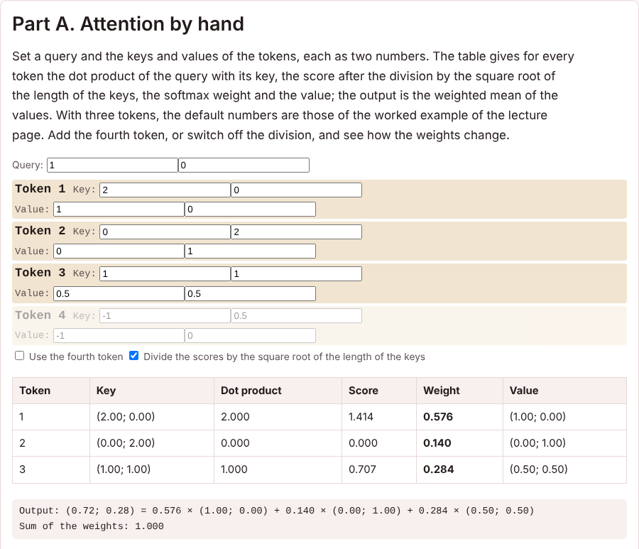
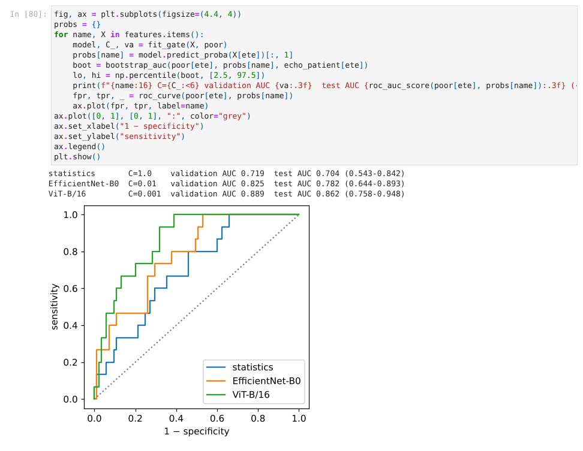
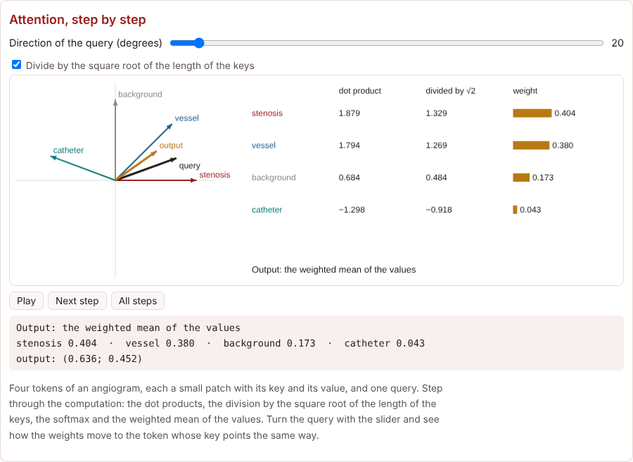

> **Türkçe:** Bu eğitim Türkçe yürütülmektedir. **[Bu haftanın Türkçe sayfasına geçin](../../tr/hafta-07/README.md)**

# Week 7: Vision Transformer (ViT): The new generation in image processing

**Artificial Intelligence with Python: A Hands-on Training Program for Cardiologists** 
Turkish Society of Cardiology

*Global analysis of cardiac images with the attention mechanism*

[Course home](../../README.md) · [Syllabus](../../SYLLABUS.md) · [Setup](../../SETUP.md) · [Türkçe](../../tr/hafta-07/README.md)

## About the week

The catheterisation laboratory of the virtual clinic opens. The limits of convolutional networks, whose receptive field grows slowly, lead to attention, which lets every part of an image look at every other part, and the vision transformer cuts an image into patches of 16 × 16 pixels and treats them as the tokens of Week 6. A vision transformer is built with PyTorch and a ready one is loaded from Hugging Face, and the mini project trains a mini vision transformer on CIFAR-10 and transfers it to echocardiograms of EchoNet-Dynamic or CAMUS. A vision transformer pretrained on photographs, ViT-B/16, becomes a quality gate for the echocardiograms of CAMUS without ever having seen one (AUC 0.862 for poor frames, against 0.782 for EfficientNet-B0 and 0.704 for four image statistics). The second half explains the shifted window attention of the Swin Transformer and the hybrid of a CNN backbone and a transformer head, and looks for stenoses on coronary angiograms. A small convolutional network that learned on the synthetic angiograms of the virtual clinic reaches an AUC of 0.965 there and falls to 0.538 on the real angiograms of ARCADE. Trained on ARCADE, a convolutional network, a vision transformer and a hybrid of both reach 0.810, 0.930 and 0.936. Attention maps are read with their limits, a scan of whole angiograms shows why a patch classifier is not yet a detector, and the week closes with the review of an image pipeline written by an AI assistant.

4 hours in the session and about 3 hours for the weekly project.

## The case of the week

Patient VC-2427, an 80-year-old man with heart failure and two diseased coronary vessels in the report of Week 6. Where are his stenoses on the angiograms, and can a convolutional network, a vision transformer or a hybrid find them on real angiograms?

## Materials

| Material | Open | What it is for |
|---|---|---|
| **Lecture page** | [Open the lecture page](https://utkukose.github.io/ai-cardiology-tkd-NB-lecture/en/week-07/lecture.html) | The teaching of the week. It is read from top to bottom, leads to the practice stops and holds no code and no prompts. |
| **Interactive lab** | [Open the interactive lab](https://utkukose.github.io/ai-cardiology-tkd-NB-lecture/en/week-07/lab.html) | Parts A to F, without code, open where the lecture page reaches them. Part F is the prompt workshop. The self-assessment and the learning log are in the lab too. |
| **Jupyter notebook** |  [Download for Jupyter](NB07_vision_transformers.ipynb) | The practice stops are worked here: Part 1 is the prompt path and Part 2 the Python path. The notebook runs in Google Colab with nothing to install, or in Jupyter on your own computer. |
| **Prompt library** | [PROMPTS.md](PROMPTS.md) | Every prompt of the prompt path and of the weekly project, with prompts for repairing, explaining and reviewing code. On GitHub, each prompt has a copy button. |
| **PDF notes** | [Week07_Lecture_Notes.pdf](Week07_Lecture_Notes.pdf) | The printable version of the lecture page. |

## Study path

The lecture page is read from top to bottom, and it opens the parts of the interactive lab where they belong. At each practice stop, the work continues in the Jupyter notebook on one of two paths. On the **prompt path** (Part 1 of the notebook), an artificial intelligence (AI) assistant writes the code from ready prompts, and the participant runs it and checks the result. On the **Python path** (Part 2), participants write the code themselves. Both paths reach the same results. Participants who attend the session complete the steps there. The times help those who follow the week on their own, for example after a missed session.

| Step | What to do | Prompt path (Part 1) | Python path (Part 2) |
|---|---|---|---|
| 1 | [Read](https://utkukose.github.io/ai-cardiology-tkd-NB-lecture/en/week-07/lecture.html) the case of the week and the first two hours of the lecture page up to Practice stop 1: the limits of CNNs, self-attention, the patch embedding, a vision transformer built with PyTorch and a ready one from Hugging Face, and the mini project, with Parts A and B of the interactive lab, the 3D scene of the attention of a patch, the two animations and the knowledge checks | 1 hour 20 minutes | 1 hour 20 minutes |
| 2 | **[Practice stop 1: Transfer to echocardiography: A quality gate and the mini project](https://utkukose.github.io/ai-cardiology-tkd-NB-lecture/en/week-07/lecture.html#stop-1)** | Part 1, Stop 1 ([prompts](PROMPTS.md#stop-1-transfer-to-echocardiography-a-quality-gate-and-the-mini-project)) 45 minutes | Python step 7, Sections 1 to 4 1 hour 45 minutes |
| 3 | [Read on](https://utkukose.github.io/ai-cardiology-tkd-NB-lecture/en/week-07/lecture.html#last-two-hours-hybrid-cnn-vit-and-medical-imaging) up to Practice stop 2: the Swin Transformer, the hybrid of a CNN backbone and a transformer head, the analysis of coronary angiograms for stenoses, and synthetic and real angiograms, with Part C of the interactive lab | 40 minutes | 40 minutes |
| 4 | **[Practice stop 2: Stenoses on synthetic and on real angiograms](https://utkukose.github.io/ai-cardiology-tkd-NB-lecture/en/week-07/lecture.html#stop-2)** | Part 1, Stop 2 ([prompts](PROMPTS.md#stop-2-stenoses-on-synthetic-and-on-real-angiograms)) 35 minutes | Sections 5 and 6 50 minutes |
| 5 | [Read on](https://utkukose.github.io/ai-cardiology-tkd-NB-lecture/en/week-07/lecture.html#a-convolutional-network-a-vision-transformer-and-a-hybrid-compared) up to Practice stop 3: the three networks compared, the visualisation of attention maps with their clinical interpretation and whole angiograms, with Part D of the interactive lab | 30 minutes | 30 minutes |
| 6 | **[Practice stop 3: A convolutional network, a vision transformer and a hybrid](https://utkukose.github.io/ai-cardiology-tkd-NB-lecture/en/week-07/lecture.html#stop-3)** | Part 1, Stop 3 ([prompts](PROMPTS.md#stop-3-a-convolutional-network-a-vision-transformer-and-a-hybrid)) 35 minutes | Sections 7 to 9 55 minutes |
| 7 | [Read](https://utkukose.github.io/ai-cardiology-tkd-NB-lecture/en/week-07/lecture.html#ai-pair-programming-part-7-reviewing-an-image-pipeline) the review of an image pipeline with Parts E and F of the interactive lab, the paper of the week, the stage of the virtual clinic and the section on your own data; on the Python path, Section 10 as well | 40 minutes | 55 minutes |
| 8 | Take the self-assessment of [the interactive lab](https://utkukose.github.io/ai-cardiology-tkd-NB-lecture/en/week-07/lab.html) (tab: Check yourself), write the reflection and export the learning log | 20 minutes | 20 minutes |
| | **Total without the weekly project** | **5 hours 25 minutes** | **7 hours 15 minutes** |
| 9 | Complete [the weekly project](#weekly-project), on either path | [Prompts](PROMPTS.md#prompt-path-of-the-weekly-project) 3 hours | 3 hours |

<table>
<tr><td width="50%"></td><td width="50%"></td></tr>
<tr><td>Interactive lab, Part A: the attention of one query over four tokens, with the scores, the softmax weights and the output, and the effect of the scaling by the square root of the length of the keys.</td><td>Jupyter notebook, Section 4: the ROC curves of the quality gate for poor echocardiography frames from four image statistics, EfficientNet-B0 and ViT-B/16.</td></tr>
<tr><td width="50%"></td><td width="50%"></td></tr>
<tr><td>Interactive lab, Part C: the threshold of a network of the course over its probabilities on the test patches of ARCADE, with the sensitivity, the specificity and the positive predictive value at two prevalences.</td><td>Lecture page: the attention of one query over four tokens of an angiogram, step by step.</td></tr>
</table>

## Weekly project

**Project.** Coronary angiography: Stenosis detection, CNN vs ViT vs hybrid comparison + attention maps.

**What to do.** Compare a convolutional network, a vision transformer and a hybrid for finding stenoses on the real coronary angiograms of ARCADE, and take the best of them from patches to whole angiograms. First, train the three small networks of the course on the patches of the training angiograms in the same way and give their test AUCs with 95 percent intervals from a bootstrap of the test angiograms, together with the difference of each to the convolutional network. Second, choose for each network the threshold that gives a sensitivity of 0.90 on the validation patches and report the sensitivity, the specificity and the positive predictive value on the test patches, at the prevalence of the patches and at a prevalence of 2 percent. Third, train the best network again with positive patches shifted by up to 16 pixels and with negatives cut from the vessels and from the background, scan the validation and test angiograms with windows every 16 pixels, keep the windows whose probability is the largest in their neighbourhood, choose the threshold on the validation angiograms for at most one false detection per angiogram, and give the share of the stenoses found and the false detections per angiogram on the test angiograms, at this threshold and at the thresholds 0.5, 0.7 and 0.9. Fourth, show five missed stenoses and five false detections with the heat map, and write half a page for a heart team on what such a tool could and could not do in the catheterisation laboratory.

**Where to look.** Lecture: sections "Coronary angiography analysis: Stenosis detection", "A convolutional network, a vision transformer and a hybrid compared", "Attention map visualisation (clinical interpretation)" and "From patches to the whole angiogram". Interactive lab: Parts C and D. Jupyter notebook: Part 1, Stops 2 and 3, or Part 2, Sections 6 to 9.

**Prompt path.** The project can also be built with four prompts, one for each step, from the [prompt library](https://github.com/utkukose/ai-cardiology-tkd-NB-lecture/blob/main/en/week-07/PROMPTS.md#prompt-path-of-the-weekly-project). The section "Weekly project on the prompt path" at the end of Part 1 of the Jupyter notebook prepares the table of each prompt. The test of each prompt must hold before the next prompt is used.

**Example.** The detector of the course found 30 of the 386 stenoses of the test angiograms with 124 false detections over the 300 angiograms, and 30 of its detections lay on a stenosis. Its lesion sensitivity is $30/386 = 0.078$ with 0.41 false detections per angiogram, and the positive predictive value of a detection is $30/(30 + 124) = 0.195$. The same kind of network separates curated patches with an AUC of 0.936; on whole angiograms, at the threshold chosen for at most one false detection per validation angiogram, it misses most stenoses.

**What to submit.** A report of one to two pages in the [report template](../templates/Report_Template.docx), with the table of the three networks and their intervals, the table of the thresholds at both prevalences, the lesion sensitivity and the false detections per angiogram of the detector, the ten cases of the fourth step and the half page for the heart team. Add the AI usage log (tool, prompt, what was checked, what was changed) and the Jupyter notebook with its outputs.

**Submission.** The weekly project is submitted before the session of Week 8 by e-mail to utkukose@sdu.edu.tr or utkukose@gmail.com. The e-mail holds the items listed under What to submit and the learning log exported from the interactive lab. Weekly projects count for 40 percent of the assessment, and the rubric is in the syllabus.

## Learning outcomes

By the end of the week, participants are expected to explain attention with its queries, keys and values, to compute it by hand for a few tokens, and to describe how a vision transformer turns an image into a sequence of patches with a class token and positions. They should be able to explain the limits of a convolutional network, its receptive field and its inductive bias, why a vision transformer needs much data or pretraining, how the Swin Transformer computes attention in shifted windows and how a hybrid of a CNN backbone and a transformer head combines the two. They should be able to build a small vision transformer with PyTorch, to load a ready one from Hugging Face and to transfer a mini vision transformer trained on CIFAR-10 to echocardiograms. They should be able to use a pretrained vision transformer as a source of features for a clinical task, such as a quality gate for echocardiography, and to report its result with an interval from a bootstrap by patient. Finally, they should be able to compare a convolutional network, a vision transformer and a hybrid for stenoses on coronary angiograms, to recognise a domain shift between synthetic and real images, to read attention maps with their limits and to review an image pipeline.

## Training flow of the session

The four-hour session of the week follows the plan below. It is shared to show how the materials fit together in a live session.

| Time | Activity |
|---|---|
| 0:00 to 0:15 | The case of the week and the route of the week. Every participant opens the notebook in Google Colab or in Jupyter and runs Section 0. The first run downloads the frames of CAMUS (about 227 MB, if Week 4 did not), the ImageNet weights of ViT-B/16 (about 330 MB) and of EfficientNet-B0 (about 21 MB) and ARCADE (451.6 MB); the synthetic angiograms are drawn on the computer of the participant. |
| 0:15 to 1:00 | First two hours, the attention mechanism and the ViT architecture: the angiograms of the virtual clinic, the limits of CNNs and their receptive field, self-attention with Part A, the transformer block, the patch embedding with the 3D scene and Part B, a vision transformer built with PyTorch and a ready one from Hugging Face, inductive bias and pretraining, and the quality gate for echocardiography. |
| 1:00 to 1:40 | Practice stop 1, in two groups, the prompt path and the Python path: the quality gate from four image statistics, from ViT-B/16 and from EfficientNet-B0, the bootstrap of the difference, and the mini project of the session, a mini vision transformer trained on CIFAR-10 and transferred to echocardiograms of EchoNet-Dynamic or CAMUS. Its training runs for about five minutes while the group discusses the quality gate. |
| 1:40 to 1:50 | Break. |
| 1:50 to 2:35 | Last two hours, hybrid CNN-ViT and medical imaging: the Swin Transformer with its shifted windows, the hybrid of a CNN backbone and a transformer head, the analysis of coronary angiograms for stenoses, and synthetic and real angiograms with Part C. Practice stop 2: a small convolutional network on synthetic angiograms, on ARCADE without change and trained on ARCADE. |
| 2:35 to 3:20 | Main route: the three networks compared, the visualisation of attention maps and their clinical interpretation with Part D, and whole angiograms. Practice stop 3: the small vision transformer and the hybrid on ARCADE and the attention of the class token. |
| 3:20 to 4:00 | The review of an image pipeline with Parts E and F, the paper of the week, the catheterisation laboratory of the virtual clinic, the section on your own data and the weekly project. |

## With your own data

The lecture page closes with a section on applying the methods of the week to your own data: which question fits which method, what to check first, the approval of the ethics committee, the Turkish Law on the Protection of Personal Data (KVKK) and where to compute. [Read it on the lecture page](https://utkukose.github.io/ai-cardiology-tkd-NB-lecture/en/week-07/lecture.html#with-your-own-data).

## Optional research assignment

Search PubMed for one study, published in 2020 or later, that used a vision transformer or a hybrid of convolutions and attention on cardiac images: angiograms, echocardiograms, cardiac magnetic resonance or computed tomography. Summarise it in half a page: the images, their number and their centres, the task and the reference, whether the network was pretrained and on what, the comparison with a convolutional network, whether the test came from another centre, and how attention maps were used. The three questions of [the paper of the week](https://utkukose.github.io/ai-cardiology-tkd-NB-lecture/en/week-07/lecture.html#the-paper-of-the-week) can guide the summary. The assignment is not graded, and it prepares the half page of the weekly project.

## The virtual clinic after this week

In Week 7 the virtual clinic opens its catheterisation laboratory. Every one of its 2,311 patients with an angiography has two synthetic angiograms with the stenoses of the registry, which the reports of Week 6 describe. Networks of the course look for stenoses on these images and on the real angiograms of ARCADE, and a pretrained vision transformer acts as a quality gate for the echocardiograms of CAMUS. The results are in the section [The virtual clinic, stage 7](https://utkukose.github.io/ai-cardiology-tkd-NB-lecture/en/week-07/lecture.html#the-virtual-clinic-stage-7-catheterisation-laboratory) of the lecture page.

## Next week

**Week 8: Multimodal artificial intelligence and data fusion.** The heart team: The ECG, the images, the reports and the laboratory values of the virtual clinic come together in a model for major adverse cardiovascular events. See the [plan of the course](../../README.md#the-eleven-weeks).

---

**Prof. Dr. Utku Kose**

Full Professor, Department of Computer Engineering, Süleyman Demirel University, Isparta, Türkiye 
Founding Director, AI Application and Research Center (YAZEM), Süleyman Demirel University 
Head of the Computer Science Division, Department of Computer Engineering, Süleyman Demirel University 
Additional affiliations: University of North Dakota (USA), Universidad Panamericana (Mexico City, Mexico), Vel Tech University (Chennai, India) 
IEEE Senior Member, ACM Professional Member

[ORCID 0000-0002-9652-6415](https://orcid.org/0000-0002-9652-6415) | [utkukose.com](https://www.utkukose.com) | [github.com/utkukose](https://github.com/utkukose)

[utkukose@sdu.edu.tr](mailto:utkukose@sdu.edu.tr) | [utku.kose@und.edu](mailto:utku.kose@und.edu) | [ukose@up.edu.mx](mailto:ukose@up.edu.mx) | [utkukose@gmail.com](mailto:utkukose@gmail.com)

*First version: November 2026. Content CC BY 4.0, code MIT.*

