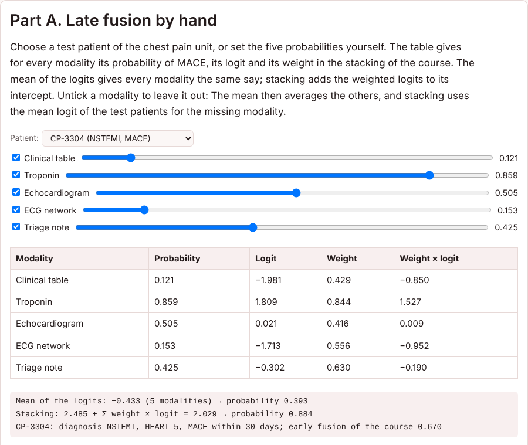

> **Türkçe:** Bu eğitim Türkçe yürütülmektedir. **[Bu haftanın Türkçe sayfasına geçin](../../tr/hafta-08/README.md)**

# Week 8: Multimodal artificial intelligence and data fusion

**Artificial Intelligence with Python: A Hands-on Training Program for Cardiologists** 
Turkish Society of Cardiology

*Integrated models that combine the ECG, imaging and clinical data*

[Course home](../../README.md) · [Syllabus](../../SYLLABUS.md) · [Setup](../../SETUP.md) · [Türkçe](../../tr/hafta-08/README.md)

## About the week

The virtual clinic opens a chest pain unit, and its heart team brings five kinds of data together: the clinical table, the triage note, the 12-lead ECG, two troponins and a bedside echocardiogram. Early fusion puts all features side by side, late fusion combines the probabilities of single models, and hybrid and attention-based fusion learn a joint representation in one model, with masks for missing data. In the mini project, fusing the ECG, the echocardiogram and the laboratory values adds nothing measurable over the laboratory alone for heart failure events (AUC 0.830 against 0.849). In the chest pain unit, fusion reaches an AUC of 0.914 for major adverse cardiac events within 30 days, above the troponin alone (0.883) and close to the HEART score (0.903). The second half builds a cardiovascular risk scoring system: the design of an AI model as an alternative to SCORE2 and Framingham, an early warning model for suspected acute coronary syndrome that fuses biomarkers, clinical variables and imaging, and the question whether its probabilities can be trusted: calibration on the test set and at a second hospital, where the model ranks the patients as well but underestimates their risk until it is updated with local patients, intervals for every difference, and thresholds for discharge compared with HEART 0 to 3. The week closes with the review of a fusion pipeline written by an AI assistant.

4 hours in the session and about 3 hours for the weekly project.

## The case of the week

Patient CP-3304 is a 58-year-old woman with pressing chest pain, a normal ECG, a rising troponin and a HEART score of 5. How should a program combine what the team knows about her, and can its probabilities be trusted at the bedside and at another hospital?

## Materials

| Material | Open | What it is for |
|---|---|---|
| **Lecture page** | [Open the lecture page](https://utkukose.github.io/ai-cardiology-tkd-NB-lecture/en/week-08/lecture.html) | The teaching of the week. It is read from top to bottom, leads to the practice stops and holds no code and no prompts. |
| **Interactive lab** | [Open the interactive lab](https://utkukose.github.io/ai-cardiology-tkd-NB-lecture/en/week-08/lab.html) | Parts A to F, without code, open where the lecture page reaches them. Part F is the prompt workshop. The self-assessment and the learning log are in the lab too. |
| **Jupyter notebook** |  [Download for Jupyter](NB08_multimodal_ai_and_data_fusion.ipynb) | The practice stops are worked here: Part 1 is the prompt path and Part 2 the Python path. The notebook runs in Google Colab with nothing to install, or in Jupyter on your own computer. |
| **Prompt library** | [PROMPTS.md](PROMPTS.md) | Every prompt of the prompt path and of the weekly project, with prompts for repairing, explaining and reviewing code. On GitHub, each prompt has a copy button. |
| **PDF notes** | [Week08_Lecture_Notes.pdf](Week08_Lecture_Notes.pdf) | The printable version of the lecture page. |

## Study path

The lecture page is read from top to bottom, and it opens the parts of the interactive lab where they belong. At each practice stop, the work continues in the Jupyter notebook on one of two paths. On the **prompt path** (Part 1 of the notebook), an artificial intelligence (AI) assistant writes the code from ready prompts, and the participant runs it and checks the result. On the **Python path** (Part 2), participants write the code themselves. Both paths reach the same results. Participants who attend the session complete the steps there. The times help those who follow the week on their own, for example after a missed session.

| Step | What to do | Prompt path (Part 1) | Python path (Part 2) |
|---|---|---|---|
| 1 | [Read](https://utkukose.github.io/ai-cardiology-tkd-NB-lecture/en/week-08/lecture.html) the case of the week and the first two hours of the lecture page up to Practice stop 1: early, late and hybrid fusion, the combination of data types in one model, attention-based fusion, missing data and the mini project, with Parts A and B of the interactive lab, the 3D scene of the patients in the space of three modality scores, the animation of the four kinds of fusion and the knowledge checks | 1 hour 20 minutes | 1 hour 20 minutes |
| 2 | **[Practice stop 1: Heart failure events from the ECG, the echocardiogram and the laboratory](https://utkukose.github.io/ai-cardiology-tkd-NB-lecture/en/week-08/lecture.html#stop-1)** The mini project of the session. | Part 1, Stop 1 ([prompts](PROMPTS.md#stop-1-heart-failure-events-from-the-ecg-the-echocardiogram-and-the-laboratory)) 35 minutes | Python step 8, Sections 1 to 3 1 hour 30 minutes |
| 3 | [Read on](https://utkukose.github.io/ai-cardiology-tkd-NB-lecture/en/week-08/lecture.html#last-two-hours-cardiovascular-risk-scoring-system) up to Practice stop 2: the design of an AI alternative to SCORE2 and Framingham, the early warning model for suspected ACS with the HEART score, the fusion of biomarkers, clinical variables and imaging, and calibration and intervals with Part C of the interactive lab | 45 minutes | 45 minutes |
| 4 | **[Practice stop 2: Major adverse cardiac events in the chest pain unit: HEART, single modalities and fusion](https://utkukose.github.io/ai-cardiology-tkd-NB-lecture/en/week-08/lecture.html#stop-2)** | Part 1, Stop 2 ([prompts](PROMPTS.md#stop-2-major-adverse-cardiac-events-in-the-chest-pain-unit-heart-single-modalities-and-fusion)) 40 minutes | Sections 4 to 8 1 hour 30 minutes |
| 5 | [Read on](https://utkukose.github.io/ai-cardiology-tkd-NB-lecture/en/week-08/lecture.html#another-hospital-drift-and-recalibration) up to Practice stop 3: another hospital and recalibration, and thresholds and net benefit with Part D of the interactive lab | 30 minutes | 30 minutes |
| 6 | **[Practice stop 3: Triage: another hospital, a threshold for discharge and net benefit](https://utkukose.github.io/ai-cardiology-tkd-NB-lecture/en/week-08/lecture.html#stop-3)** | Part 1, Stop 3 ([prompts](PROMPTS.md#stop-3-triage-another-hospital-a-threshold-for-discharge-and-net-benefit)) 35 minutes | Sections 9 and 10 45 minutes |
| 7 | [Read](https://utkukose.github.io/ai-cardiology-tkd-NB-lecture/en/week-08/lecture.html#ai-pair-programming-part-8-reviewing-a-fusion-pipeline) the review of a fusion pipeline with Parts E and F of the interactive lab, the paper of the week, the stage of the virtual clinic and the section on your own data | 40 minutes | 40 minutes |
| 8 | Take the self-assessment of [the interactive lab](https://utkukose.github.io/ai-cardiology-tkd-NB-lecture/en/week-08/lab.html) (tab: Check yourself), write the reflection and export the learning log | 20 minutes | 20 minutes |
| | **Total without the weekly project** | **5 hours 25 minutes** | **7 hours 20 minutes** |
| 9 | Complete [the weekly project](#weekly-project), on either path | [Prompts](PROMPTS.md#prompt-path-of-the-weekly-project) 3 hours | 3 hours |

<table>
<tr><td width="50%"></td><td width="50%"></td></tr>
<tr><td>Interactive lab, Part A: the five modality probabilities of a patient combined by the mean of the logits and by stacking, step by step.</td><td>Jupyter notebook, Section 9: the calibration measures and the reliability curves of early fusion, stacking and the mean of the logits on the test set of hospital A.</td></tr>
<tr><td width="50%"></td><td width="50%"></td></tr>
<tr><td>Interactive lab, Part D: a threshold for discharge over the predicted risks of the test patients, with the share discharged and the missed events next to HEART 0 to 3.</td><td>Lecture page: four ways to fuse the data of one patient, step by step.</td></tr>
</table>

## Weekly project

**Project.** Real-time MACE prediction model: Simulation of a triage scenario (synthetic MIMIC-IV).

**Data.** MIMIC-IV, the record of the admissions of the Beth Israel Deaconess Medical Center from 2008 to 2019, is open only to credentialed researchers through PhysioNet. The project therefore simulates the triage on the synthetic chest pain unit of the virtual clinic, which every participant draws on their own computer; a participant with credentialed access can repeat the steps on MIMIC-IV.

**What to do.** Build a model for major adverse cardiac events (MACE) within 30 days from the five modalities of the chest pain unit and judge it as a heart team would before using it. First, fit a logistic regression on each modality alone and one on all of them together (early fusion), with the regularisation chosen on the validation set, and give their test AUCs with 95 percent intervals from 2,000 bootstrap samples of the test patients, together with the difference of each to the HEART score in the same samples. Second, judge the calibration of early fusion on the test set by its intercept, its slope, its Brier score and a reliability curve of ten groups; then do the same at hospital B for the 700 patients after its first 300, before and after an update of the intercept learned on the first 300. Third, choose two thresholds for discharge on the validation set, one that sends home as many patients as HEART 0 to 3 and one that keeps the sensitivity at 98 percent, and report for each, on the test set and at hospital B, the share discharged and the MACE among the discharged with Wilson intervals, next to HEART 0 to 3. Fourth, draw the decision curve of the model and of the rule "admit every patient with HEART 4 or more" for threshold probabilities from 1 to 30 percent, and write half a page for a heart team on whether the model should be used, for which decision and with what local check.

**Where to look.** Lecture: sections "Early warning model for suspected ACS", "Fusion of biomarkers, clinical variables and imaging", "The importance of calibration and confidence intervals", "Calibration: Do the probabilities mean what they say?", "Another hospital: Drift and recalibration" and "Thresholds for discharge and net benefit". Interactive lab: Parts C and D. Jupyter notebook: Part 1, Stops 2 and 3, or Part 2, Sections 4 to 10.

**Prompt path.** The project can also be built with four prompts, one for each step, from the [prompt library](https://github.com/utkukose/ai-cardiology-tkd-NB-lecture/blob/main/en/week-08/PROMPTS.md#prompt-path-of-the-weekly-project). The section "Weekly project on the prompt path" at the end of Part 1 of the Jupyter notebook prepares the table of each prompt. The test of each prompt must hold before the next prompt is used.

**Example.** With the threshold that sends home as many validation patients as HEART 0 to 3, early fusion of the course sent home 388 of the 800 test patients, and 9 of them had a MACE: $9/388 = 0.023$. HEART 0 to 3 sent home 380 with 8 events, $8/380 = 0.021$. With 800 test patients, the two rules cannot be told apart for the decision to discharge.

**What to submit.** A report of one to two pages in the [report template](../templates/Report_Template.docx), with the table of the models and their intervals, the calibration measures and the reliability curves at both hospitals, the table of the two thresholds with HEART 0 to 3, the decision curve and the half page for the heart team. Add the AI usage log (tool, prompt, what was checked, what was changed) and the Jupyter notebook with its outputs.

**Submission.** The weekly project is submitted before the session of Week 9 by e-mail to utkukose@sdu.edu.tr or utkukose@gmail.com. The e-mail holds the items listed under What to submit and the learning log exported from the interactive lab. Weekly projects count for 40 percent of the assessment, and the rubric is in the syllabus.

## Learning outcomes

By the end of the week, participants are expected to explain early, late, hybrid and attention-based fusion with their formulas, to combine the scores of several modalities by hand and to choose a way of handling missing modalities. They should be able to combine different data types in one model, to build a multimodal risk model and to compare it with each single modality and with a clinical score such as HEART, with intervals from a bootstrap of patients, and to set out the design of an AI model that is to replace a score such as SCORE2 or Framingham. They should be able to judge the calibration of a model by its intercept, its slope, its Brier score and a reliability curve, and to update a model for another hospital. Finally, they should be able to choose a threshold for a clinical decision on the validation set, to report its result with intervals and net benefit, and to review a fusion pipeline written by an AI assistant.

## Training flow of the session

The four-hour session of the week follows the plan below. It is shared to show how the materials fit together in a live session.

| Time | Activity |
|---|---|
| 0:00 to 0:15 | The case of the week and the route of the week. Every participant opens the notebook in Google Colab or in Jupyter and runs Section 0. Nothing has to be downloaded: The chest pain unit, its ECGs and the registry are drawn on the computer of the participant in less than a minute. |
| 0:15 to 1:00 | First two hours, principles of multimodal AI: the data of a heart team, early fusion against late and hybrid fusion with the 3D scene, the animation and Part A, the combination of data types in one model, attention-based fusion with Part B, and the management of missing data. |
| 1:00 to 1:35 | Mini project of the session, Practice stop 1, in two groups, the prompt path and the Python path: the risk of heart failure from the ECG signal, the echocardiogram and the laboratory values, each alone and fused, and the bootstrap of the difference. |
| 1:35 to 1:50 | Break. |
| 1:50 to 2:35 | Last two hours, cardiovascular risk scoring system: the design of an AI alternative to SCORE2 and Framingham, the early warning model for suspected ACS with the HEART score, the fusion of biomarkers, clinical variables and imaging, and the importance of calibration, with its animation and Part C, and of intervals. Practice stop 2: HEART, single modalities and fusion for MACE in the chest pain unit, and the calibration of two kinds of late fusion. |
| 2:35 to 3:20 | Main route: another hospital and recalibration, and thresholds and net benefit with Part D. Practice stop 3: the update at hospital B, a threshold for discharge against HEART 0 to 3 and net benefit. |
| 3:20 to 4:00 | The review of a fusion pipeline with Parts E and F, the paper of the week, the chest pain unit of the virtual clinic, the section on your own data and the weekly project. |

## With your own data

The lecture page closes with a section on applying the methods of the week to your own data: which question fits which method, what to check first, the approval of the ethics committee, the Turkish Law on the Protection of Personal Data (KVKK) and where to compute. [Read it on the lecture page](https://utkukose.github.io/ai-cardiology-tkd-NB-lecture/en/week-08/lecture.html#with-your-own-data).

## Optional research assignment

Search PubMed for one study, published in 2020 or later, that combined two or more kinds of cardiac data in one model, such as the ECG, images, laboratory values or clinical notes. Summarise it in half a page: the modalities, how they were fused (early, late, hybrid or attention), how missing modalities were handled, the outcome and the reference, the comparison with each modality alone and with a clinical score, whether calibration was reported, and whether the test came from another hospital. The three questions of [the paper of the week](https://utkukose.github.io/ai-cardiology-tkd-NB-lecture/en/week-08/lecture.html#the-paper-of-the-week) can guide the summary. The assignment is not graded, and it prepares the half page of the weekly project.

## The virtual clinic after this week

In Week 8 the virtual clinic opens a chest pain unit and a heart team: 4,000 presentations at hospital A and 1,000 at hospital B, each with a clinical table, a triage note in Turkish, a 12-lead ECG, two troponins and, for about half of the patients, a bedside echocardiogram. The results are in the section [The virtual clinic, stage 8](https://utkukose.github.io/ai-cardiology-tkd-NB-lecture/en/week-08/lecture.html#the-virtual-clinic-stage-8-heart-team) of the lecture page.

## Next week

**Week 9: Model reliability and explainable artificial intelligence (XAI).** The quality and safety committee asks why a model says what it says: Grad-CAM maps of the echo model compared with the reading of an expert. See the [plan of the course](../../README.md#the-eleven-weeks).

---

**Prof. Dr. Utku Kose**

Full Professor, Department of Computer Engineering, Süleyman Demirel University, Isparta, Türkiye 
Founding Director, AI Application and Research Center (YAZEM), Süleyman Demirel University 
Head of the Computer Science Division, Department of Computer Engineering, Süleyman Demirel University 
Additional affiliations: University of North Dakota (USA), Universidad Panamericana (Mexico City, Mexico), Vel Tech University (Chennai, India) 
IEEE Senior Member, ACM Professional Member

[ORCID 0000-0002-9652-6415](https://orcid.org/0000-0002-9652-6415) | [utkukose.com](https://www.utkukose.com) | [github.com/utkukose](https://github.com/utkukose)

[utkukose@sdu.edu.tr](mailto:utkukose@sdu.edu.tr) | [utku.kose@und.edu](mailto:utku.kose@und.edu) | [ukose@up.edu.mx](mailto:ukose@up.edu.mx) | [utkukose@gmail.com](mailto:utkukose@gmail.com)

*First version: November 2026. Content CC BY 4.0, code MIT.*

