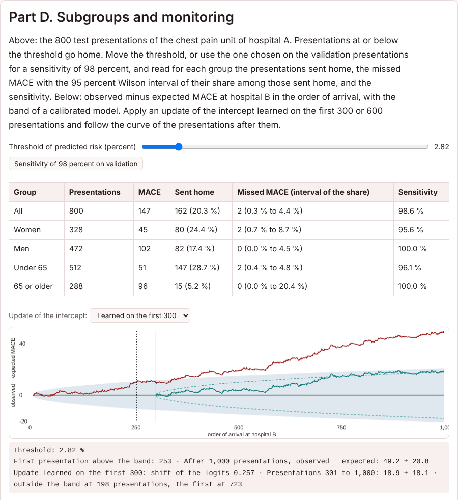
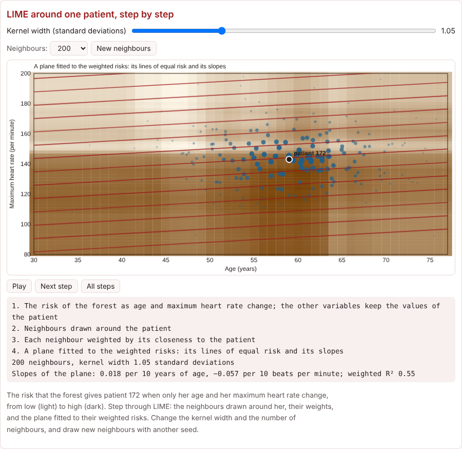

> **Türkçe:** Bu eğitim Türkçe yürütülmektedir. **[Bu haftanın Türkçe sayfasına geçiniz](../../tr/hafta-09/README.md)**

# Week 9: Model reliability and explainable artificial intelligence (XAI)

**Artificial Intelligence with Python: A Hands-on Training Program for Cardiologists** 
Turkish Society of Cardiology

*Transparency and explainability for the trust of clinicians*

[Course home](../../README.md) · [Syllabus](../../SYLLABUS.md) · [Setup](../../SETUP.md) · [Türkçe](../../tr/hafta-09/README.md)

For more about the week, read on. To go on with the week directly from the lecture page, use this link: **[Open the lecture page of the week](https://utkukose.github.io/ai-cardiology-tkd-NB-lecture/en/week-09/lecture.html)**. The lecture page is the main route of the week, and its boxes open the interactive lab and the Jupyter notebook at the right place.

## About the week

The virtual clinic sets up a quality and safety committee, which asks of every model why it says what it says and whether it can be trusted. The first half starts from the black box problem, why clinicians do not trust a model whose reasons they cannot see, and explains predictions: SHAP values share a prediction fairly among the variables of a patient, LIME fits a simple model around one patient, and Grad-CAM shows where a convolutional network looks in an image. For patient 172 of the Cleveland data, the random forest of Week 2 gives 0.73 and the logistic regression 0.55, for different reasons that the Shapley values make visible. In the mini project, the ejection fraction moves a forest for coronary artery disease on the registry of the virtual clinic more than LDL or age, although the clinic never used it to draw the disease. On CAMUS, the maps of an echo network put 32 percent of their weight on the outlined heart, which covers 21 percent of the frame, but in 9 of 20 random draws a copy of the network with a random last block does as well. The second half asks whether a model stays reliable: dataset shift found without outcomes by a classifier that tells two hospitals apart, monitoring of observed against expected events after deployment, calibration and a confidence score that sends uncertain patients to the cardiologist, bias by sex, age and ethnicity, the limits of leaving a variable out, and the legal and ethical frame of GDPR, the KVKK, the medical device regulations and the Artificial Intelligence (AI) Act of the European Union. The week closes with the review of an explanation written by an AI assistant.

4 hours in the session and about 3 hours for the weekly project.

## The case of the week

Patient 172 of the Cleveland data is a 59-year-old woman without chest pain at rest and with angina on the exercise test. The random forest of Week 2 gives her 0.73 for coronary artery disease and the logistic regression 0.55. Why do they say so, and can they be trusted for every patient, at another hospital and next year?

## Materials

| Material | Open | What it is for |
|---|---|---|
| **Lecture page** | [Open the lecture page](https://utkukose.github.io/ai-cardiology-tkd-NB-lecture/en/week-09/lecture.html) | The teaching of the week. It is read from top to bottom, leads to the practice stops and holds no code and no prompts. |
| **Interactive lab** | [Open the interactive lab](https://utkukose.github.io/ai-cardiology-tkd-NB-lecture/en/week-09/lab.html) | Parts A to F, without code, open where the lecture page reaches them. Part F is the prompt workshop. The self-assessment and the learning log are in the lab too. |
| **Python notebook** |  [Download for Jupyter Notebook (zip)](https://github.com/utkukose/ai-cardiology-tkd-NB-lecture/raw/main/en/week-09/NB09_reliability_and_explainable_ai.zip) | The practice stops are worked here, each with Python basics, prompts and a ready application. The Python notebook runs in Google Colab with nothing to install, or in Jupyter Notebook on your own computer: Download the zip file, extract the .ipynb file into a folder and open it in Jupyter. Every part opens with a start cell that repeats the setup and the data calls that the part uses. |
| **Prompt library** | [PROMPTS.md](PROMPTS.md) | Every prompt of the practice stops and of the weekly project, with prompts for repairing, explaining and reviewing code. On GitHub, each prompt has a copy button. |
| **PDF notes** | [Week09_Lecture_Notes.pdf](Week09_Lecture_Notes.pdf) | The printable version of the lecture page. |

## Study path

The lecture page is read from top to bottom, and it opens the parts of the interactive lab where they belong. At each practice stop, the work continues in the Jupyter notebook, where every stop has three parts. **Python basics** teaches the Python that the stop needs. In **Prompt and application**, an AI assistant writes the code from ready prompts, and the participant runs it and checks the result. The **Ready application** is the complete working program of the stop. Work through them in this order; if you know Python, you may start with the prompts, and to see only the result, open the ready application. Each part opens with a start cell that repeats the setup and the data calls that the part uses, so the part also runs when it is opened directly. At the end of every lab part and of every stop in the Jupyter notebook, a link takes you back to the lecture page, to the place where reading continues. If you lose your place, come back to this table. Participants who attend the session complete the steps there. The times help those who follow the week on their own, for example after a missed session.

| Step | What to do | Time |
|---|---|---|
| 1 | [Read](https://utkukose.github.io/ai-cardiology-tkd-NB-lecture/en/week-09/lecture.html) the case of the week and the lecture page up to Practice stop 1: the black box problem, SHAP values with the 3D scene of the coalitions and Part A of the interactive lab, from one patient to all patients and the mini project, with the knowledge checks | 1 hour 5 minutes |
| 2 | **[Practice stop 1: The clinical factors behind the model for coronary artery disease](https://utkukose.github.io/ai-cardiology-tkd-NB-lecture/en/week-09/lecture.html#stop-1)** The mini project of the session. [Python basics](https://colab.research.google.com/github/utkukose/ai-cardiology-tkd-NB-lecture/blob/main/en/week-09/NB09_reliability_and_explainable_ai.ipynb#scrollTo=stop-1-basics) · [Prompt and application](https://colab.research.google.com/github/utkukose/ai-cardiology-tkd-NB-lecture/blob/main/en/week-09/NB09_reliability_and_explainable_ai.ipynb#scrollTo=stop-1-prompt) ([prompts](PROMPTS.md#stop-1-the-clinical-factors-behind-the-model-for-coronary-artery-disease)) · [Ready application](https://colab.research.google.com/github/utkukose/ai-cardiology-tkd-NB-lecture/blob/main/en/week-09/NB09_reliability_and_explainable_ai.ipynb#scrollTo=stop-1-app) | 1 hour 35 minutes |
| 3 | [Read on](https://utkukose.github.io/ai-cardiology-tkd-NB-lecture/en/week-09/lecture.html#lime-a-simple-model-around-one-patient) up to Practice stop 2: LIME and its local explanations with its animation and Part B, Grad-CAM with its animation and Part C, and sanity checks | 50 minutes |
| 4 | **[Practice stop 2: LIME for one patient, and where the echo network looks](https://utkukose.github.io/ai-cardiology-tkd-NB-lecture/en/week-09/lecture.html#stop-2)** [Python basics](https://colab.research.google.com/github/utkukose/ai-cardiology-tkd-NB-lecture/blob/main/en/week-09/NB09_reliability_and_explainable_ai.ipynb#scrollTo=stop-2-basics) · [Prompt and application](https://colab.research.google.com/github/utkukose/ai-cardiology-tkd-NB-lecture/blob/main/en/week-09/NB09_reliability_and_explainable_ai.ipynb#scrollTo=stop-2-prompt) ([prompts](PROMPTS.md#stop-2-lime-for-one-patient-and-where-the-echo-network-looks)) · [Ready application](https://colab.research.google.com/github/utkukose/ai-cardiology-tkd-NB-lecture/blob/main/en/week-09/NB09_reliability_and_explainable_ai.ipynb#scrollTo=stop-2-app) | 1 hour 30 minutes |
| 5 | [Read on](https://utkukose.github.io/ai-cardiology-tkd-NB-lecture/en/week-09/lecture.html#last-two-hours-ai-reliability-and-clinical-validation) up to Practice stop 3: data drift and monitoring, calibration and the confidence score, bias by sex, age and ethnicity with Part D of the interactive lab, and the legal and ethical framework of GDPR and KVKK | 45 minutes |
| 6 | **[Practice stop 3: Shift, monitoring and subgroups](https://utkukose.github.io/ai-cardiology-tkd-NB-lecture/en/week-09/lecture.html#stop-3)** [Python basics](https://colab.research.google.com/github/utkukose/ai-cardiology-tkd-NB-lecture/blob/main/en/week-09/NB09_reliability_and_explainable_ai.ipynb#scrollTo=stop-3-basics) · [Prompt and application](https://colab.research.google.com/github/utkukose/ai-cardiology-tkd-NB-lecture/blob/main/en/week-09/NB09_reliability_and_explainable_ai.ipynb#scrollTo=stop-3-prompt) ([prompts](PROMPTS.md#stop-3-shift-monitoring-and-subgroups)) · [Ready application](https://colab.research.google.com/github/utkukose/ai-cardiology-tkd-NB-lecture/blob/main/en/week-09/NB09_reliability_and_explainable_ai.ipynb#scrollTo=stop-3-app) | 50 minutes |
| 7 | [Read](https://utkukose.github.io/ai-cardiology-tkd-NB-lecture/en/week-09/lecture.html#ai-pair-programming-part-9-reviewing-an-explanation) the review of an explanation with Parts E and F of the interactive lab, the paper of the week, the stage of the virtual clinic and the section on your own data | 35 minutes |
| 8 | Take the self-assessment of [the interactive lab](https://utkukose.github.io/ai-cardiology-tkd-NB-lecture/en/week-09/lab.html) (tab: Check yourself), write the reflection and export the learning log | 20 minutes |
| | **Total without the weekly project** | **7 hours 30 minutes** |
| 9 | Complete [the weekly project](#weekly-project) [Prompts](PROMPTS.md#prompts-of-the-weekly-project) · [Weekly project in the Jupyter notebook](https://colab.research.google.com/github/utkukose/ai-cardiology-tkd-NB-lecture/blob/main/en/week-09/NB09_reliability_and_explainable_ai.ipynb#scrollTo=project) | 3 hours |

<table>
<tr><td width="50%"></td><td width="50%"></td></tr>
<tr><td>Interactive lab, Part A: the Shapley values of three variables of patient 172 from the six orders in which they can join, with the check that they add up to the prediction.</td><td>Jupyter notebook, «Stop 2 · Ready application»: Grad-CAM maps of the echo network on test views of CAMUS, with the expert outline of the left ventricle. Data: CAMUS, CC BY-NC-SA 4.0.</td></tr>
<tr><td width="50%"></td><td width="50%"></td></tr>
<tr><td>Interactive lab, Part D: observed minus expected events at hospital B in the order of arrival, with the band of a calibrated model and the updates of the intercept.</td><td>Lecture page: LIME around patient 172, step by step, on the risk of the forest over age and maximum heart rate.</td></tr>
</table>

## Weekly project

**Project.** Visualising with Grad-CAM where an echocardiography model looks, compared with the reading of an expert.

**What to do.** Judge the Grad-CAM maps of an echo network against the outlines of the experts, as a quality and safety committee would before it accepts them. First, train the small network of the course to flag an ejection fraction below 45 percent from the end-diastolic and end-systolic frames of one view, on the 300 patients of CAMUS of the course, and give its test AUC for single views and for patients with a 95 percent interval from 2,000 bootstrap samples. Second, compute the Grad-CAM map of the last block for each of the 100 test views and measure the share of its weight inside the expert outline of the left ventricular cavity and the myocardium, the place of its strongest pixel, and the area of the outline; compare these measures for views with a low and a normal ejection fraction, for right and wrong predictions and for the three grades of image quality. Third, repeat the maps after giving the last block and the head new random weights, and then all weights, with 20 random seeds, and report the median and the range of the rank correlation with the maps of the trained network and of the share inside the outline. Fourth, show six views with their maps and outlines, chosen to include right and wrong predictions, and write half a page for the committee on what the maps can and cannot support.

**Where to look.** Lecture: sections "Grad-CAM: Seeing where the CNN looks" and "Sanity checks: Is the map about the model?". Interactive lab: Part C. Jupyter notebook: the ready application of Practice stop 2.

**With prompts.** The project can also be built with four prompts, one for each step, from the [prompt library](https://github.com/utkukose/ai-cardiology-tkd-NB-lecture/blob/main/en/week-09/PROMPTS.md#prompts-of-the-weekly-project). The section "Weekly project" at the end of the Jupyter notebook prepares the table of each prompt and opens on its own. The test of each prompt must hold before the next prompt is sent, and every prompt goes into the AI usage log.

**Example.** In the course run, 31.7 percent of the weight of the maps fell inside outlines that cover 21.3 percent of the frame: $0.317/0.213 = 1.49$. Over 20 random draws, copies with all weights random reached a median of 23.4 percent, and in 9 draws a copy with a random last block put as much of its maps inside the outline as the trained network. The rank correlation between the trained maps and those of copies with a random last block had a median of 0.14, from −0.34 to 0.68. The share inside the outline alone does not tell a trained network from a random one; the randomisation, repeated over seeds, does.

**What to submit.** A report of one to two pages in the [report template](../templates/Report_Template.docx), with the table of the measures, the figure of the six views and the half page for the committee. Add the AI usage log (tool, prompt, what was checked, what was changed) and the Jupyter notebook with its outputs. Echocardiograms of CAMUS may appear in the report with the credit "CAMUS, CC BY-NC-SA 4.0"; they are not shared further.

**Submission.** The weekly project is submitted before the session of Week 10 by e-mail to utkukose@sdu.edu.tr or utkukose@gmail.com. The e-mail holds the items listed under What to submit and the learning log exported from the interactive lab. Weekly projects count for 40 percent of the assessment, and the rubric is in the syllabus.

## Learning outcomes

By the end of the week, participants are expected to tell an interpretable model from an explanation after the fact, and a local explanation from a global one. They should be able to explain why clinicians distrust a black box, to compute Shapley values by hand for three variables, to read the SHAP values of a patient and of a group of patients, to explain the choice of the background patients and to tell which clinical factor moves a model from which factor causes the disease. They should be able to fit LIME around one patient, judge its stability, and compute and read a Grad-CAM map together with a sanity check by randomisation. Finally, they should be able to detect dataset shift with and without outcomes, to judge the calibration of a model and use a confidence score for selective prediction, to compare the calibration and the errors of a model across groups of sex, age and ethnicity, to place a clinical model in the frame of GDPR, the KVKK, the medical device regulations and the EU AI Act, and to review an explanation written by an AI assistant.

## Training flow of the session

The four-hour session of the week follows the plan below. It is shared to show how the materials fit together in a live session.

| Time | Activity |
|---|---|
| 0:00 to 0:15 | The case of the week and the route of the week. Every participant opens the notebook in Google Colab or in Jupyter and runs Section 0, which downloads the 300 patients of CAMUS of Week 4 again in one to three minutes; the Cleveland data and the chest pain unit need no download. |
| 0:15 to 1:00 | First two hours, explainable AI methods: the black box problem and why clinicians do not trust it, SHAP values with the 3D scene of the coalitions and Part A, and from one patient to all patients. |
| 1:00 to 1:35 | Mini project of the session, Practice stop 1, in the Jupyter notebook, with the prompts or in Python: SHAP in a model for coronary artery disease, on the Cleveland data and on the registry with LDL, age and the ejection fraction. |
| 1:35 to 1:50 | Break. |
| 1:50 to 2:35 | First two hours, continued: LIME and its local explanations with the animation and Part B, Grad-CAM, which shows where a CNN looks, with the animation and Part C, and sanity checks. Practice stop 2: LIME for patient 172 and its stability, the echo network and its Grad-CAM maps against the expert outlines. |
| 2:35 to 3:20 | Last two hours, AI reliability and clinical validation: data drift and its pitfalls, monitoring after deployment, calibration and a confidence score, bias by sex, age and ethnicity with Part D, and the legal and ethical framework of GDPR and KVKK. Practice stop 3: the classifier that tells the hospitals apart, observed against expected events at hospital B, subgroups of the chest pain unit and a model without sex. |
| 3:20 to 4:00 | The review of an explanation with Parts E and F, the paper of the week, the quality and safety committee of the virtual clinic, the section on your own data and the weekly project. |

## With your own data

The lecture page closes with a section on applying the methods of the week to your own data: which question fits which method, what to check first, the approval of the ethics committee, the Turkish Law on the Protection of Personal Data (KVKK) and where to compute. [Read it on the lecture page](https://utkukose.github.io/ai-cardiology-tkd-NB-lecture/en/week-09/lecture.html#with-your-own-data).

## Optional research assignment

Search PubMed for one study, published in 2020 or later, that explained a cardiovascular model with SHAP, LIME, Grad-CAM or attention maps. Summarise it in half a page: the model and the data, the method of explanation and its settings (background patients, kernel width, layer), whether the explanation was checked by a randomisation or by experts, what the authors concluded from it, and whether they reported the performance by sex and age. The three questions of [the paper of the week](https://utkukose.github.io/ai-cardiology-tkd-NB-lecture/en/week-09/lecture.html#the-paper-of-the-week) can guide the summary. The assignment is not graded, and it prepares the half page of the weekly project.

## The virtual clinic after this week

In Week 9 the virtual clinic sets up a quality and safety committee. It reviews the model for coronary artery disease of Week 2, an echo network on CAMUS and the risk model of the chest pain unit of Week 8 at two hospitals. The results are in the section [The virtual clinic, stage 9](https://utkukose.github.io/ai-cardiology-tkd-NB-lecture/en/week-09/lecture.html#the-virtual-clinic-stage-9-quality-and-safety-committee) of the lecture page.

## Next week

**Week 10: Clinical decision support systems (CDSS).** The model goes to the bedside: a decision support prototype with a web interface, its user test and its improvement. See the [plan of the course](../../README.md#the-eleven-weeks).

---

**Prof. Dr. Utku Kose**

Full Professor, Department of Computer Engineering, Süleyman Demirel University, Isparta, Türkiye 
Founding Director, AI Application and Research Center (YAZEM), Süleyman Demirel University 
Head of the Computer Science Division, Department of Computer Engineering, Süleyman Demirel University 
Additional affiliations: University of North Dakota (USA), Universidad Panamericana (Mexico City, Mexico), Vel Tech University (Chennai, India) 
IEEE Senior Member, ACM Professional Member

[ORCID 0000-0002-9652-6415](https://orcid.org/0000-0002-9652-6415) | [utkukose.com](https://www.utkukose.com) | [github.com/utkukose](https://github.com/utkukose)

[utkukose@sdu.edu.tr](mailto:utkukose@sdu.edu.tr) | [utku.kose@und.edu](mailto:utku.kose@und.edu) | [ukose@up.edu.mx](mailto:ukose@up.edu.mx) | [utkukose@gmail.com](mailto:utkukose@gmail.com)

*First version: November 2026. Content CC BY 4.0, code MIT.*

