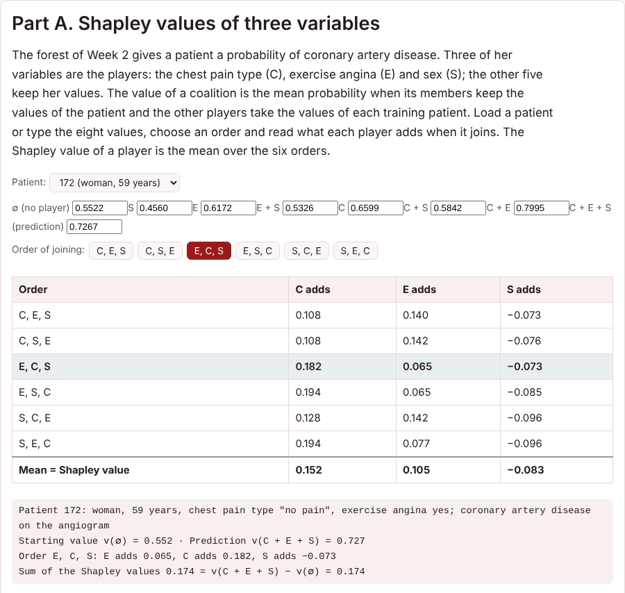
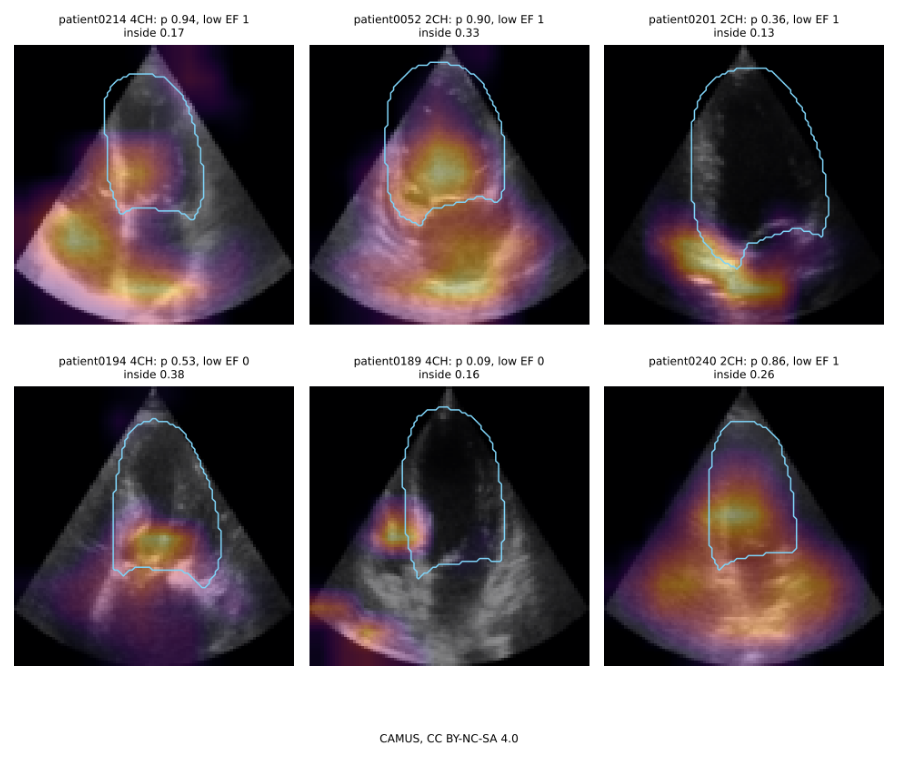

> **Türkçe:** Bu eğitim Türkçe yürütülmektedir. **[Bu haftanın Türkçe sayfasına geçin](../../tr/hafta-09/README.md)**

# Week 9: Model reliability and explainable artificial intelligence

**Artificial Intelligence with Python: A Hands-on Training Program for Cardiologists** 
Turkish Society of Cardiology

*Why a model says what it says, and whether it can be trusted for every patient, at another hospital and over time*

[Course home](../../README.md) · [Syllabus](../../SYLLABUS.md) · [Setup](../../SETUP.md) · [Türkçe](../../tr/hafta-09/README.md)

## About the week

The virtual clinic sets up a quality and safety committee, which asks of every model why it says what it says and whether it can be trusted. The first half explains predictions: Shapley values share a prediction fairly among the variables of a patient, LIME fits a simple model around one patient, and Grad-CAM shows where a convolutional network looks in an image. For patient 172 of the Cleveland data, the random forest of Week 2 gives 0.73 and the logistic regression 0.55, for different reasons that the Shapley values make visible. On CAMUS, the maps of an echo network put 32 percent of their weight on the outlined heart, which covers 21 percent of the frame, but in 9 of 20 random draws a copy of the network with a random last block does as well. The second half asks whether a model stays reliable: dataset shift found without outcomes by a classifier that tells two hospitals apart, monitoring of observed against expected events after deployment, subgroups by sex and age, the limits of leaving a variable out, and the legal and ethical frame of the KVKK, the medical device regulations and the EU AI Act. The week closes with the review of an explanation written by an AI assistant.

4 hours in the session and about 3 hours for the weekly project.

## The route of the week

The lecture page is the main route of the week. It holds no code and no prompts, and it is read from top to bottom together with the interactive lab. At each practice stop, every participant chooses one of two paths in the Jupyter notebook: the **prompt path** (Part 1), on which an artificial intelligence (AI) assistant writes the code from ready prompts and the participant runs and checks it, or the **Python path** (Part 2), on which the participant writes the code. Both paths reach the same results. The notebook runs in Google Colab, with nothing to install, or in Jupyter on your own computer ([setup](../../SETUP.md)).

|  | Main route: lecture page and interactive lab | Practice stop: choose a path |
|---|---|---|
| 1 | [Why explain? Interpretable models and explanations after the fact](https://utkukose.github.io/ai-cardiology-tkd-NB-lecture/en/week-09/lecture.html#why-explain-interpretable-models-and-explanations-after-the-fact), [Shapley values: Sharing a prediction among the variables](https://utkukose.github.io/ai-cardiology-tkd-NB-lecture/en/week-09/lecture.html#shapley-values-sharing-a-prediction-among-the-variables), [From one patient to all patients](https://utkukose.github.io/ai-cardiology-tkd-NB-lecture/en/week-09/lecture.html#from-one-patient-to-all-patients) | **[Stop 1: The clinical factors behind the model for coronary artery disease](https://utkukose.github.io/ai-cardiology-tkd-NB-lecture/en/week-09/lecture.html#stop-1)** Prompt path: Part 1, Stop 1 Python path: Part 2, Python step 9, Sections 1 to 3 |
| 2 | [LIME: A simple model around one patient](https://utkukose.github.io/ai-cardiology-tkd-NB-lecture/en/week-09/lecture.html#lime-a-simple-model-around-one-patient), [Grad-CAM: Where does a network look?](https://utkukose.github.io/ai-cardiology-tkd-NB-lecture/en/week-09/lecture.html#grad-cam-where-does-a-network-look), [Sanity checks: Is the map about the model?](https://utkukose.github.io/ai-cardiology-tkd-NB-lecture/en/week-09/lecture.html#sanity-checks-is-the-map-about-the-model) | **[Stop 2: LIME for one patient, and where the echo network looks](https://utkukose.github.io/ai-cardiology-tkd-NB-lecture/en/week-09/lecture.html#stop-2)** Prompt path: Part 1, Stop 2 Python path: Part 2, Sections 4 to 7 |
| 3 | [Dataset shift: What changed, and does it matter?](https://utkukose.github.io/ai-cardiology-tkd-NB-lecture/en/week-09/lecture.html#dataset-shift-what-changed-and-does-it-matter), [Monitoring after deployment: Observed against expected events](https://utkukose.github.io/ai-cardiology-tkd-NB-lecture/en/week-09/lecture.html#monitoring-after-deployment-observed-against-expected-events), [Fairness: Does the model work for every patient?](https://utkukose.github.io/ai-cardiology-tkd-NB-lecture/en/week-09/lecture.html#fairness-does-the-model-work-for-every-patient), [Law and ethics: Who answers for a model?](https://utkukose.github.io/ai-cardiology-tkd-NB-lecture/en/week-09/lecture.html#law-and-ethics-who-answers-for-a-model) | **[Stop 3: Shift, monitoring and subgroups](https://utkukose.github.io/ai-cardiology-tkd-NB-lecture/en/week-09/lecture.html#stop-3)** Prompt path: Part 1, Stop 3 Python path: Part 2, Sections 8 to 10 |
|  | [Working with an AI assistant, part 9: Reviewing an explanation](https://utkukose.github.io/ai-cardiology-tkd-NB-lecture/en/week-09/lecture.html#ai-pair-programming-part-9-reviewing-an-explanation), [The paper of the week](https://utkukose.github.io/ai-cardiology-tkd-NB-lecture/en/week-09/lecture.html#the-paper-of-the-week), [The virtual clinic, stage 9: Quality and safety committee](https://utkukose.github.io/ai-cardiology-tkd-NB-lecture/en/week-09/lecture.html#the-virtual-clinic-stage-9-quality-and-safety-committee) | The section on your own data, the paper of the week and the virtual clinic |

## Materials

| Material | Open | What it holds |
|---|---|---|
| **Lecture page (main route)** | [Open the lecture page](https://utkukose.github.io/ai-cardiology-tkd-NB-lecture/en/week-09/lecture.html) | The case, the concepts with worked examples, a three-dimensional (3D) scene of the coalitions of three variables, two animations, knowledge checks, three practice stops, the section on your own data, review cards and references. No code and no prompts. |
| **Interactive lab** | [Open the interactive lab](https://utkukose.github.io/ai-cardiology-tkd-NB-lecture/en/week-09/lab.html) | Parts A to F without code, including the prompt workshop of Part F, a self-assessment, a reflection and the learning log to export |
| **Jupyter notebook** |  [Download for Jupyter](NB09_reliability_and_explainable_ai.ipynb) | Part 1, the prompt path: three stops with twelve steps, each with a ready prompt, a data cell for its table, a cell for the code of the AI assistant, an automatic check and ready code, and the weekly project in four prompts. Part 2, the Python path: Python step 9, Sections 1 to 10 with Exercises A to J and the challenges of seven fields. |
| **Prompt library** | [PROMPTS.md](PROMPTS.md) | All prompts of the prompt path with a copy button on GitHub, the prompts for repairing and reviewing code and the prompt path of the weekly project |
| **PDF notes** | [Week09_Lecture_Notes.pdf](Week09_Lecture_Notes.pdf) | The lecture page in print form, with its practice stops and the section on your own data |

<table>
<tr><td width="50%"></td><td width="50%"></td></tr>
<tr><td>Interactive lab, Part A: the Shapley values of three variables of patient 172 from the six orders in which they can join, with the check that they add up to the prediction.</td><td>Jupyter notebook, Section 6: Grad-CAM maps of the echo network on test views of CAMUS, with the expert outline of the left ventricle. Data: CAMUS, CC BY-NC-SA 4.0.</td></tr>
<tr><td width="50%"></td><td width="50%"></td></tr>
<tr><td>Interactive lab, Part D: observed minus expected events at hospital B in the order of arrival, with the band of a calibrated model and the updates of the intercept.</td><td>Lecture page: LIME around patient 172, step by step, on the risk of the forest over age and maximum heart rate.</td></tr>
</table>

## The case of the week

Patient 172 of the Cleveland data is a 59-year-old woman without chest pain at rest and with angina on the exercise test. The random forest of Week 2 gives her 0.73 for coronary artery disease and the logistic regression 0.55. Why do they say so, and can they be trusted for every patient, at another hospital and next year?

## Learning outcomes

By the end of the week, participants are expected to tell an interpretable model from an explanation after the fact, and a local explanation from a global one. They should be able to compute Shapley values by hand for three variables, read the Shapley values of a patient and of a group of patients, and explain the choice of the background patients. They should be able to fit LIME around one patient, judge its stability, and compute and read a Grad-CAM map together with a sanity check by randomisation. Finally, they should be able to detect dataset shift with and without outcomes, compare the calibration and the errors of a model across groups of sex and age, place a clinical model in the frame of the KVKK, the medical device regulations and the EU AI Act, and review an explanation written by an AI assistant.

## Study path

Participants who attend the session complete the main route and the practice stops there. Participants who follow the week on their own, for example after a missed session, can plan with the times below.

| Step | Activity | Prompt path | Python path |
|---|---|---|---|
| 1 | Read the case of the week and the lecture page up to Practice stop 1, with the 3D scene of the coalitions, Part A of the interactive lab and the knowledge checks | 1 hour | 1 hour |
| 2 | Practice stop 1, the mini project of the session: Part 1, Stop 1 on the prompt path, or Python step 9 and Sections 1 to 3 on the Python path | 35 minutes | 1 hour 30 minutes |
| 3 | Read on up to Practice stop 2: LIME with its animation and Part B, Grad-CAM with its animation and Part C, and sanity checks | 50 minutes | 50 minutes |
| 4 | Practice stop 2: Part 1, Stop 2, or Sections 4 to 7 | 40 minutes | 1 hour 30 minutes |
| 5 | Read on up to Practice stop 3: dataset shift, monitoring, fairness with Part D of the interactive lab, and the legal and ethical frame | 40 minutes | 40 minutes |
| 6 | Practice stop 3: Part 1, Stop 3, or Sections 8 to 10 | 30 minutes | 45 minutes |
| 7 | Read the review of an explanation with Parts E and F of the interactive lab, the paper of the week, the stage of the virtual clinic and the section on your own data | 35 minutes | 35 minutes |
| 8 | Take the self-assessment of the interactive lab (tab: Check yourself), write the reflection and export the learning log | 20 minutes | 20 minutes |
| | **Total without the weekly project** | **5 hours 10 minutes** | **7 hours 10 minutes** |
| 9 | Complete the weekly project, on either path | 3 hours | 3 hours |

## Training flow of the session

The four-hour session of the week follows the plan below. It is shared to show how the materials fit together in a live session.

| Time | Activity |
|---|---|
| 0:00 to 0:15 | The case of the week and the route of the week. Every participant opens the notebook in Google Colab or in Jupyter and runs Section 0, which downloads the 300 patients of CAMUS of Week 4 again in one to three minutes; the Cleveland data and the chest pain unit need no download. |
| 0:15 to 1:00 | Main route: why explain, Shapley values with the 3D scene of the coalitions and Part A, and from one patient to all patients. |
| 1:00 to 1:35 | Mini project of the session, Practice stop 1, in two groups, the prompt path and the Python path: the clinical factors that weigh most in the model for coronary artery disease, explained with Shapley values. |
| 1:35 to 1:50 | Break. |
| 1:50 to 2:35 | Main route: LIME with its animation and Part B, Grad-CAM with its animation and Part C, and sanity checks. Practice stop 2: LIME for patient 172 and its stability, the echo network and its Grad-CAM maps against the expert outlines. |
| 2:35 to 3:20 | Main route: dataset shift, monitoring after deployment, fairness with Part D, and the legal and ethical frame. Practice stop 3: the classifier that tells the hospitals apart, observed against expected events at hospital B, subgroups of the chest pain unit and a model without sex. |
| 3:20 to 4:00 | The review of an explanation with Parts E and F, the paper of the week, the quality and safety committee of the virtual clinic, the section on your own data and the weekly project. |

## Weekly project

**What to do.** Judge the Grad-CAM maps of an echo network against the outlines of the experts, as a quality and safety committee would before it accepts them. First, train the small network of the course to flag an ejection fraction below 45 percent from the end-diastolic and end-systolic frames of one view, on the 300 patients of CAMUS of the course, and give its test AUC for single views and for patients with a 95 percent interval from 2,000 bootstrap samples. Second, compute the Grad-CAM map of the last block for each of the 100 test views and measure the share of its weight inside the expert outline of the left ventricular cavity and the myocardium, the place of its strongest pixel, and the area of the outline; compare these measures for views with a low and a normal ejection fraction, for right and wrong predictions and for the three grades of image quality. Third, repeat the maps after giving the last block and the head new random weights, and then all weights, with 20 random seeds, and report the median and the range of the rank correlation with the maps of the trained network and of the share inside the outline. Fourth, show six views with their maps and outlines, chosen to include right and wrong predictions, and write half a page for the committee on what the maps can and cannot support.

**Where to look.** Lecture: sections "Grad-CAM: Where does a network look?" and "Sanity checks: Is the map about the model?". Interactive lab: Part C. Jupyter notebook: Part 1, Stop 2, or Part 2, Sections 5 to 7.

**Prompt path.** The project can also be built with four prompts, one for each step, from the [prompt library](https://github.com/utkukose/ai-cardiology-tkd-NB-lecture/blob/main/en/week-09/PROMPTS.md#prompt-path-of-the-weekly-project). The section "Weekly project on the prompt path" at the end of Part 1 of the Jupyter notebook prepares the table of each prompt. The test of each prompt must hold before the next prompt is used.

**Example.** In the course run, 31.7 percent of the weight of the maps fell inside outlines that cover 21.3 percent of the frame: $0.317/0.213 = 1.49$. Over 20 random draws, copies with all weights random reached a median of 23.4 percent, and in 9 draws a copy with a random last block put as much of its maps inside the outline as the trained network. The rank correlation between the trained maps and those of copies with a random last block had a median of 0.14, from −0.34 to 0.68. The share inside the outline alone does not tell a trained network from a random one; the randomisation, repeated over seeds, does.

**What to submit.** A report of one to two pages in the [report template](../templates/Report_Template.docx), with the table of the measures, the figure of the six views and the half page for the committee. Add the AI usage log (tool, prompt, what was checked, what was changed) and the Jupyter notebook with its outputs. Echocardiograms of CAMUS may appear in the report with the credit "CAMUS, CC BY-NC-SA 4.0"; they are not shared further.

**Submission.** The weekly project is submitted before the session of Week 10 by e-mail to utkukose@sdu.edu.tr or utkukose@gmail.com. The e-mail holds the items listed under What to submit and the learning log exported from the interactive lab. Weekly projects count for 40 percent of the assessment, and the rubric is in the syllabus.

## With your own data

The lecture page closes with a section on applying the methods of the week to your own data: which question fits which method, what to check first, the approval of the ethics committee, the Turkish Law on the Protection of Personal Data (KVKK) and where to compute. [Read it on the lecture page](https://utkukose.github.io/ai-cardiology-tkd-NB-lecture/en/week-09/lecture.html#with-your-own-data).

## Optional research assignment

Search PubMed for one study, published in 2020 or later, that explained a cardiovascular model with SHAP, LIME, Grad-CAM or attention maps. Summarise it in half a page: the model and the data, the method of explanation and its settings (background patients, kernel width, layer), whether the explanation was checked by a randomisation or by experts, what the authors concluded from it, and whether they reported the performance by sex and age. The three questions of [the paper of the week](https://utkukose.github.io/ai-cardiology-tkd-NB-lecture/en/week-09/lecture.html#the-paper-of-the-week) can guide the summary. The assignment is not graded, and it prepares the half page of the weekly project.

## The virtual clinic after this week

In Week 9 the virtual clinic sets up a quality and safety committee. It reviews the model for coronary artery disease of Week 2, an echo network on CAMUS and the risk model of the chest pain unit of Week 8 at two hospitals. The results are in the section [The virtual clinic, stage 9](https://utkukose.github.io/ai-cardiology-tkd-NB-lecture/en/week-09/lecture.html#the-virtual-clinic-stage-9-quality-and-safety-committee) of the lecture page.

## Next week

**Week 10: Clinical decision support systems.** The model goes to the bedside: a decision support prototype with a web interface, its user test and its improvement. See the [plan of the course](../../README.md#the-eleven-weeks).

---

**Prof. Dr. Utku Kose**

Full Professor, Department of Computer Engineering, Süleyman Demirel University, Isparta, Türkiye 
Founding Director, AI Application and Research Center (YAZEM), Süleyman Demirel University 
Head of the Computer Science Division, Department of Computer Engineering, Süleyman Demirel University 
Additional affiliations: University of North Dakota (USA), Universidad Panamericana (Mexico City, Mexico), Vel Tech University (Chennai, India) 
IEEE Senior Member, ACM Professional Member

[ORCID 0000-0002-9652-6415](https://orcid.org/0000-0002-9652-6415) | [utkukose.com](https://www.utkukose.com) | [github.com/utkukose](https://github.com/utkukose)

[utkukose@sdu.edu.tr](mailto:utkukose@sdu.edu.tr) | [utku.kose@und.edu](mailto:utku.kose@und.edu) | [ukose@up.edu.mx](mailto:ukose@up.edu.mx) | [utkukose@gmail.com](mailto:utkukose@gmail.com)

*First version: November 2026. Content CC BY 4.0, code MIT.*

