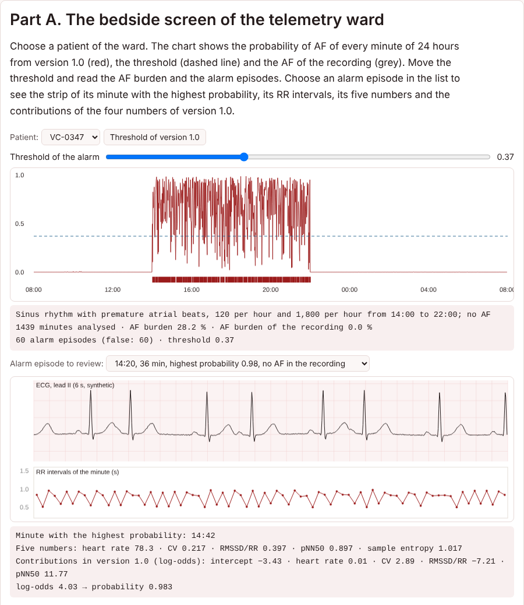
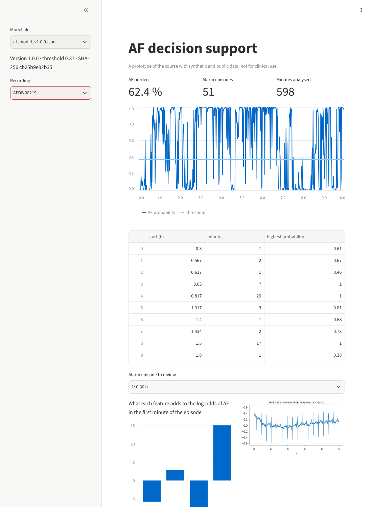
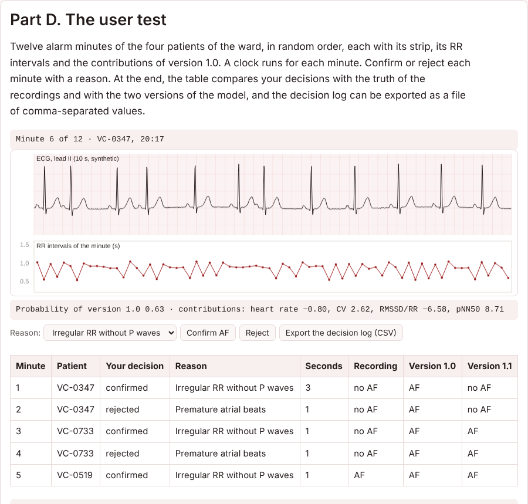
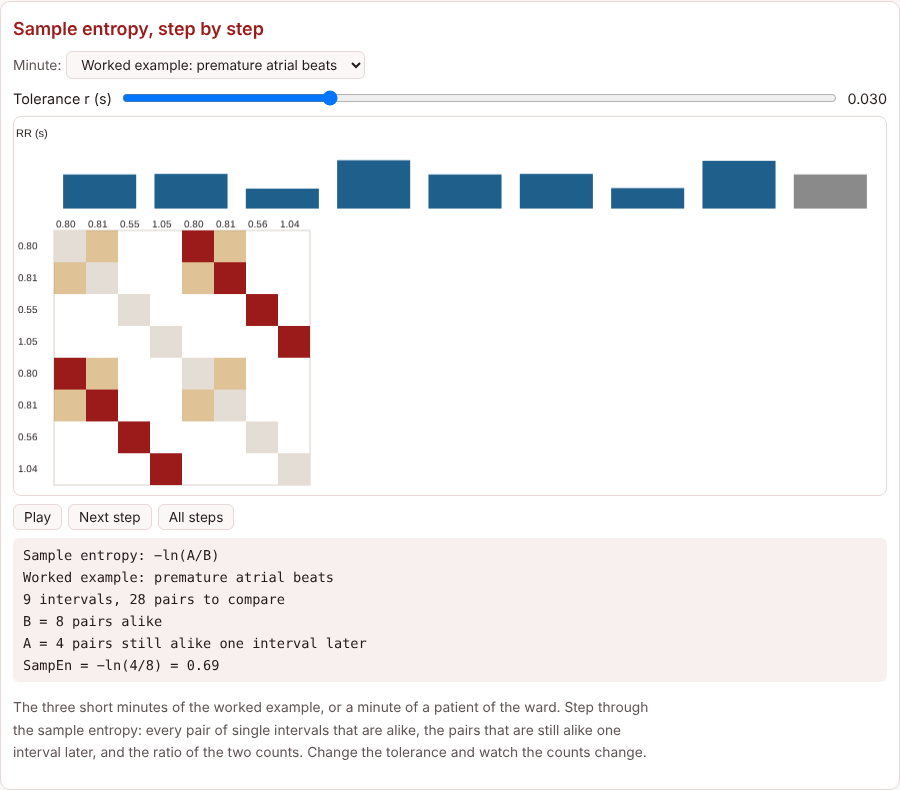

> **Türkçe:** Bu eğitim Türkçe yürütülmektedir. **[Bu haftanın Türkçe sayfasına geçin](../../tr/hafta-10/README.md)**

# Week 10: Clinical decision support systems (CDSS)

**Artificial Intelligence with Python: A Hands-on Training Program for Cardiologists** 
Turkish Society of Cardiology

*Integrating the AI model into the tools of clinicians*

[Course home](../../README.md) · [Syllabus](../../SYLLABUS.md) · [Setup](../../SETUP.md) · [Türkçe](../../tr/hafta-10/README.md)

## About the week

The AF model of the course goes to the bedside. A clinical decision support system (CDSS) is more than a model: It has users, a place in the workflow, an interface, a report that other systems can read, versions and a physician who decides. The first two hours cover the design principles of a CDSS: what it is and how it is integrated into the clinical workflow, a web interface developed with Streamlit, the HL7 FHIR standard and a real-time prediction API (application programming interface) with Flask and FastAPI. The mini project builds an AF detection CDSS for the telemetry ward of the virtual clinic: An ECG is uploaded, the model predicts, SHAP shows the explanation and a report is produced. Five numbers describe each minute of RR intervals. A logistic regression on four of them, trained on the Holter recordings of the MIT-BIH Atrial Fibrillation Database split by record, reaches a test AUC of 0.979. The minute-by-minute probabilities become alarm episodes and an AF burden, every alarm comes with its SHAP values and its ECG strip, and the report is written as HL7 FHIR resources. The last two hours turn to deployment and publishing: model versioning and an update strategy, human oversight with the physician in the loop and automation bias, the FDA De Novo and CE MDR processes, and the consent of the patients and the privacy of their data under the KVKK. The weekly project is a user test session. The user test finds 99 false alarm episodes in 50 hours of the validation records, most of them from premature beats; version 1.1 adds the sample entropy and cuts them to 69, at the price of a lower sensitivity on the test. The week closes with the review of a prototype written by an artificial intelligence (AI) assistant.

4 hours in the session and about 3 hours for the weekly project.

## The case of the week

**VC-0128** is a 71-year-old woman of the virtual clinic who came to the cardiology ward with palpitations and is on telemetry for 24 hours. The ECG on admission showed sinus rhythm. At 13:20 the monitor of the ward records an irregular, fast rhythm, which lasts 165 minutes; a short episode follows at 21:40 and a third at 02:10. A decision support prototype reads the RR intervals of the telemetry minute by minute and reports an AF burden of 15.5 percent in 3 episodes, the longest of 165 minutes. The cardiologist on duty must decide what to do with this message: Is it AF? Who sees it, and when? What goes into the record, and with which version of the software? And who answers for the decision? The same prototype raises alarms for three other patients of the ward, and not all of them are AF.

## Materials

| Material | Open | What it is for |
|---|---|---|
| **Lecture page** | [Open the lecture page](https://utkukose.github.io/ai-cardiology-tkd-NB-lecture/en/week-10/lecture.html) | The teaching of the week. It is read from top to bottom, leads to the practice stops and holds no code and no prompts. |
| **Interactive lab** | [Open the interactive lab](https://utkukose.github.io/ai-cardiology-tkd-NB-lecture/en/week-10/lab.html) | Parts A to F, without code, open where the lecture page reaches them. Part F is the prompt workshop. The self-assessment and the learning log are in the lab too. |
| **Jupyter notebook** |  [Download for Jupyter](NB10_clinical_decision_support.ipynb) | The practice stops are worked here: Part 1 is the prompt path and Part 2 the Python path. The notebook runs in Google Colab with nothing to install, or in Jupyter on your own computer. |
| **Prompt library** | [PROMPTS.md](PROMPTS.md) | Every prompt of the prompt path and of the weekly project, with prompts for repairing, explaining and reviewing code. On GitHub, each prompt has a copy button. |
| **PDF notes** | [Week10_Lecture_Notes.pdf](Week10_Lecture_Notes.pdf) | The printable version of the lecture page. |

## Study path

The lecture page is read from top to bottom, and it opens the parts of the interactive lab where they belong. At each practice stop, the work continues in the Jupyter notebook on one of two paths. On the **prompt path** (Part 1 of the notebook), an AI assistant writes the code from ready prompts, and the participant runs it and checks the result. On the **Python path** (Part 2), participants write the code themselves. Both paths reach the same results. Participants who attend the session complete the steps there. The times help those who follow the week on their own, for example after a missed session.

| Step | What to do | Prompt path (Part 1) | Python path (Part 2) |
|---|---|---|---|
| 1 | [Read](https://utkukose.github.io/ai-cardiology-tkd-NB-lecture/en/week-10/lecture.html) the case of the week and the lecture page up to Practice stop 1: what a CDSS is and its integration into the clinical workflow, then the mini project with the five numbers of a minute, the 3D scene of the return maps, Part A of the interactive lab and from probabilities to alarms, with the knowledge checks | 1 hour | 1 hour |
| 2 | **[Practice stop 1: The AF model of the prototype](https://utkukose.github.io/ai-cardiology-tkd-NB-lecture/en/week-10/lecture.html#stop-1)** The first part of the mini project of the session. | Part 1, Stop 1 ([prompts](PROMPTS.md#stop-1-the-af-model-of-the-prototype)) 35 minutes | Python step 10, Sections 1 to 4 1 hour 30 minutes |
| 3 | [Read on](https://utkukose.github.io/ai-cardiology-tkd-NB-lecture/en/week-10/lecture.html#why-did-it-alarm-the-explanation-and-the-strip) up to Practice stop 2: the SHAP explanation of an alarm and the strip, the model file and its card, the web interface with Streamlit, the HL7 FHIR standard with Part B of the interactive lab, and the real-time prediction API with Flask and FastAPI | 50 minutes | 50 minutes |
| 4 | **[Practice stop 2: The explanation, the report and the service](https://utkukose.github.io/ai-cardiology-tkd-NB-lecture/en/week-10/lecture.html#stop-2)** The mini project from end to end: The web interface is started from the Anaconda Prompt, and an ECG is uploaded in it. | Part 1, Stop 2 ([prompts](PROMPTS.md#stop-2-the-explanation-the-report-and-the-service)) 45 minutes | Sections 5 to 8 1 hour 35 minutes |
| 5 | [Read on](https://utkukose.github.io/ai-cardiology-tkd-NB-lecture/en/week-10/lecture.html#last-two-hours-deployment-and-publishing) up to Practice stop 3: model versioning and the update strategy, human oversight with Part C, the FDA De Novo and CE MDR processes, patient consent and data privacy under the KVKK, and the user test session with Part D and version 1.1 | 55 minutes | 55 minutes |
| 6 | **[Practice stop 3: The user test and version 1.1](https://utkukose.github.io/ai-cardiology-tkd-NB-lecture/en/week-10/lecture.html#stop-3)** | Part 1, Stop 3 ([prompts](PROMPTS.md#stop-3-the-user-test-and-version-11)) 30 minutes | Sections 9 and 10 50 minutes |
| 7 | [Read](https://utkukose.github.io/ai-cardiology-tkd-NB-lecture/en/week-10/lecture.html#ai-pair-programming-part-10-reviewing-a-prototype) the review of a prototype with Parts E and F of the interactive lab, the paper of the week, the stage of the virtual clinic and the section on your own data | 35 minutes | 35 minutes |
| 8 | Take the self-assessment of [the interactive lab](https://utkukose.github.io/ai-cardiology-tkd-NB-lecture/en/week-10/lab.html) (tab: Check yourself), write the reflection and export the learning log | 20 minutes | 20 minutes |
| | **Total without the weekly project** | **5 hours 30 minutes** | **7 hours 35 minutes** |
| 9 | Complete [the weekly project](#weekly-project), on either path | [Prompts](PROMPTS.md#prompt-path-of-the-weekly-project) 3 hours | 3 hours |

<table>
<tr><td width="50%"></td><td width="50%"></td></tr>
<tr><td>Interactive lab, Part A: the bedside screen of the telemetry ward, with the probability of AF minute by minute, the alarm episodes and the strip, the RR intervals and the contributions of one alarm minute. Synthetic data of the virtual clinic.</td><td>The web interface of the prototype, written by the Jupyter notebook and started with streamlit run app_af.py: record 08219 of the AFDB with version 1.0. Data: MIT-BIH AFDB, PhysioNet, ODC-By 1.0.</td></tr>
<tr><td width="50%"></td><td width="50%"></td></tr>
<tr><td>Interactive lab, Part D: the user test, with alarm minutes of the ward to confirm or reject from their strip, and the log of the decisions.</td><td>Lecture page: sample entropy step by step, with the stretches of intervals that are alike in a minute of sinus rhythm, of premature beats and of AF.</td></tr>
</table>

## Weekly project

**Project.** User test session: Improving the CDSS prototype with feedback.

**What to do.** Test the prototype of the course as its users would, and improve it. First, write down three tasks for a cardiologist on the telemetry ward, for example: find the AF burden of a patient, review the first five alarm episodes with their strips, and confirm or reject them in the decision log. Second, do the tasks with version 1.0 on record 08219 of the validation records and on the four patients of the ward, in the web interface or in the interactive lab, and record for every alarm episode the decision, its reason and the seconds it took. Third, count what the physician must review in 24 hours, the share of false alarm episodes and their causes. Fourth, improve the prototype: version 1.1 of the course with the sample entropy, or an improvement of your own, with its threshold chosen on the validation records only. Fifth, open the test records once for each version and give the AUC, the sensitivity, the specificity, the false alarm episodes and the error of the AF burden. Write a change log and the model card of the new version, and half a page on which version you would use on the ward, and what the physician must still check.

**Where to look.** Lecture: sections "Model versioning and update strategy", "Human oversight in clinical AI (human-in-the-loop)" and "User test session: Improving the CDSS prototype with feedback", with its subsections on the user test and version 1.1. Interactive lab: Parts C and D. Jupyter notebook: Part 1, Stops 2 and 3, or Part 2, Sections 8 to 10.

**Prompt path.** The project can also be built with four prompts, one for each step, from the [prompt library](https://github.com/utkukose/ai-cardiology-tkd-NB-lecture/blob/main/en/week-10/PROMPTS.md#prompt-path-of-the-weekly-project). The section "Weekly project on the prompt path" at the end of Part 1 of the Jupyter notebook prepares the table of each prompt. The test of each prompt must hold before the next prompt is used.

**Example.** In the course run, version 1.0 raised 99 false alarm episodes in 50 hours of the validation records, 240 false alarm minutes in record 08219 alone, and the physician of the ward would have reviewed 80 alarm episodes in 24 hours, 76 of them false. Version 1.1 cut the false alarm episodes of the validation records to 69 and those of the ward to 11 of 15. On the test records, the sensitivity fell from 0.949 to 0.924 and the error of the AF burden rose from 2.0 to 2.7 percentage points: The change log has to report both.

**What to submit.** A report of one to two pages in the [report template](../templates/Report_Template.docx), with the three tasks, the table of the decisions, the comparison of the two versions on validation and test, the change log, the model card and the half page on the choice of version. Add the decision log (CSV), the AI usage log (tool, prompt, what was checked, what was changed) and the Jupyter notebook with its outputs. Strips of the AFDB may appear in the report with the credit "MIT-BIH AFDB, PhysioNet, ODC-By 1.0".

**Submission.** The weekly project is submitted before the session of Week 11 by e-mail to utkukose@sdu.edu.tr or utkukose@gmail.com. The e-mail holds the items listed under What to submit and the learning log exported from the interactive lab. Weekly projects count for 40 percent of the assessment, and the rubric is in the syllabus.

## Learning outcomes

By the end of the week, participants are expected to describe a clinical decision support system (CDSS) by its users, its place in the clinical workflow, its alarms and the decision that follows them. They should be able to compute the heart rate, the coefficient of variation, the RMSSD, the pNN50 and the sample entropy of a minute of RR intervals, train and validate an AF model split by record, choose its threshold on validation data and turn its probabilities into alarm episodes and an AF burden. They should be able to build the chain of an AF detection CDSS from an uploaded ECG to the prediction, the SHAP explanation of an alarm and a report, develop a web interface with Streamlit, write a report as HL7 FHIR resources, serve a model through a real-time prediction API with Flask and explain what FastAPI adds. Finally, they should be able to number and update versions with a model card and a fingerprint, keep the physician in the loop and recognise automation bias, plan and analyse a user test, describe the FDA De Novo and CE MDR processes, and protect the consent of the patients and the privacy of their data under the KVKK.

## Training flow of the session

The four-hour session of the week follows the plan below. It is shared to show how the materials fit together in a live session.

| Time | Activity |
|---|---|
| 0:00 to 0:15 | The case of the week and the route of the week. Every participant opens the notebook in Jupyter (Anaconda) and runs Section 0, which downloads the annotations of the 25 records of the AFDB and three signal files from PhysioNet, about 86 MB, in one to three minutes, and checks every file. |
| 0:15 to 1:00 | First two hours, CDSS design principles: what a CDSS is and its integration into the clinical workflow, then the mini project of the session, an AF detection CDSS, with AF from RR intervals, the five numbers of a minute and Part A, and from probabilities to alarms and the AF burden. |
| 1:00 to 1:35 | Mini project of the session, Practice stop 1, in two groups, the prompt path and the Python path: the AF model of the prototype, its threshold on the validation records and the AF burden of the test records. |
| 1:35 to 1:50 | Break. |
| 1:50 to 2:35 | First two hours, continued: the SHAP explanation of an alarm and its strip, the model file, the web interface developed with Streamlit, the HL7 FHIR standard with Part B, and the real-time prediction API with Flask and FastAPI. Practice stop 2 completes the mini project: the SHAP values of a false alarm of record 08219, the model file and its fingerprint, the FHIR report of VC-0128, the prediction service and the whole chain from an uploaded ECG to the report, also in the web interface started in the Anaconda Prompt. |
| 2:35 to 3:20 | Last two hours, deployment and publishing: model versioning and the update strategy, human oversight in clinical AI with the physician in the loop and Part C, the FDA De Novo and CE MDR processes, patient consent and data privacy under the KVKK, and the user test session with Part D and version 1.1. Practice stop 3: the decision log of the user test, version 1.1 on the validation records and the test of both versions. |
| 3:20 to 4:00 | The review of a prototype with Parts E and F, the paper of the week, the bedside of the virtual clinic, the section on your own data and the weekly project. |

## With your own data

The lecture page closes with a section on applying the methods of the week to your own data: which question fits which method, what to check first, the approval of the ethics committee, the Turkish Law on the Protection of Personal Data (KVKK) and where to compute. [Read it on the lecture page](https://utkukose.github.io/ai-cardiology-tkd-NB-lecture/en/week-10/lecture.html#with-your-own-data).

## Optional research assignment

Search PubMed for one study, published in 2018 or later, that put an AI model for a cardiovascular question into clinical use and reported how clinicians used it: an alert, a report, a dashboard or an app. Summarise it in half a page: the model and its performance before the study, the place of its output in the workflow, the users and their training, how often the advice was followed or overridden, and the outcomes, both for the patients and for the work of the clinicians. The three questions of [the paper of the week](https://utkukose.github.io/ai-cardiology-tkd-NB-lecture/en/week-10/lecture.html#the-paper-of-the-week) can guide the summary. The assignment is not graded, and it prepares the final project of Week 11.

## The virtual clinic after this week

In Week 10 the AF model of the course goes to the bedside: a prototype for the telemetry ward of the virtual clinic, with an explanation and a strip for every alarm, an HL7 FHIR report, versions, a decision log and a user test. The results are in the section [The virtual clinic, stage 10](https://utkukose.github.io/ai-cardiology-tkd-NB-lecture/en/week-10/lecture.html#the-virtual-clinic-stage-10-decision-support-at-the-bedside) of the lecture page.

## Next week

**Week 11: Final project and graduation.** A question of your own clinic, from the data to a model, its explanation and the design of its clinical evaluation. See the [plan of the course](../../README.md#the-eleven-weeks).

---

**Prof. Dr. Utku Kose**

Full Professor, Department of Computer Engineering, Süleyman Demirel University, Isparta, Türkiye 
Founding Director, AI Application and Research Center (YAZEM), Süleyman Demirel University 
Head of the Computer Science Division, Department of Computer Engineering, Süleyman Demirel University 
Additional affiliations: University of North Dakota (USA), Universidad Panamericana (Mexico City, Mexico), Vel Tech University (Chennai, India) 
IEEE Senior Member, ACM Professional Member

[ORCID 0000-0002-9652-6415](https://orcid.org/0000-0002-9652-6415) | [utkukose.com](https://www.utkukose.com) | [github.com/utkukose](https://github.com/utkukose)

[utkukose@sdu.edu.tr](mailto:utkukose@sdu.edu.tr) | [utku.kose@und.edu](mailto:utku.kose@und.edu) | [ukose@up.edu.mx](mailto:ukose@up.edu.mx) | [utkukose@gmail.com](mailto:utkukose@gmail.com)

*First version: November 2026. Content CC BY 4.0, code MIT.*

