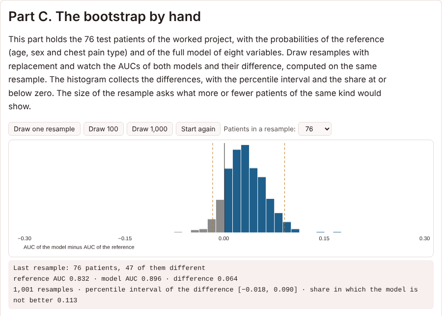
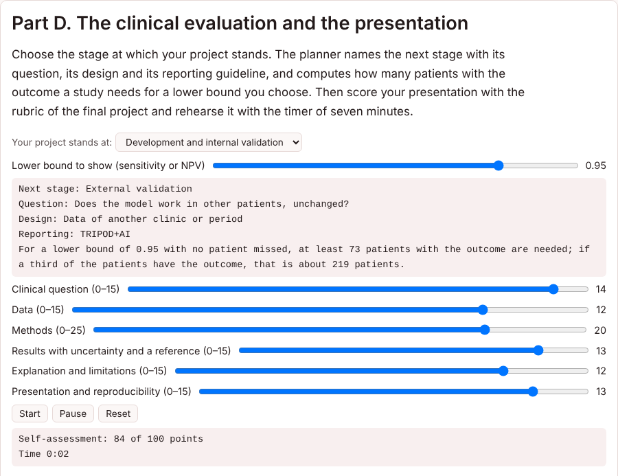

> **Türkçe:** Bu eğitim Türkçe yürütülmektedir. **[Bu haftanın Türkçe sayfasına geçin](../../tr/hafta-11/README.md)**

# Week 11: Final project and certificate

**Artificial Intelligence with Python: A Hands-on Training Program for Cardiologists** 
Turkish Society of Cardiology

*From a question of one's own clinic to a project that others can check: data, model, uncertainty, evaluation and presentation*

[Course home](../../README.md) · [Syllabus](../../SYLLABUS.md) · [Setup](../../SETUP.md) · [Türkçe](../../tr/hafta-11/README.md)

## About the week

The last week turns the methods of the course into the final projects of the participants. A project starts with a question of one's own clinic, stated so that data can answer it, and goes on to the data and their audit, the size that a model needs, a reference to beat, the model, its uncertainty, its calibration, a decision threshold, what the model uses and where it may fail, and a plan for its clinical evaluation. One worked project runs through the week on the Cleveland data that the course has used since Week 1: After an exercise test, can routine variables rule out coronary artery disease and spare a referral to coronary angiography? Its model of eight variables reaches a test AUC of 0.931, yet the interval of its gain over a reference of age, sex and chest pain type, [−0.020, 0.094], includes zero, and the data are smaller than two of the three criteria of Riley and colleagues ask for. At its rule-out threshold it would spare the angiography of 27 of 76 test patients without missing a patient with disease. The second half of the session holds the presentations of the final projects, their evaluation by a jury and by the participants, the personal action plans and the certificates. The week closes with the reporting guideline TRIPOD+AI, the stages of a clinical evaluation from DECIDE-AI to a randomised trial, and the review of a final project written with an AI assistant.

4 hours in the session, half of them for the presentations, and the time of the final project.

## The route of the week

The lecture page is the main route of the week. It holds no code and no prompts, and it is read from top to bottom together with the interactive lab. At each practice stop, every participant chooses one of two paths in the Jupyter notebook: the **prompt path** (Part 1), on which an artificial intelligence (AI) assistant writes the code from ready prompts and the participant runs and checks it, or the **Python path** (Part 2), on which the participant writes the code. Both paths reach the same results. The notebook runs in Google Colab, with nothing to install, or in Jupyter on your own computer ([setup](../../SETUP.md)).

| Main route: lecture page and interactive lab | Practice stop | Prompt path (Part 1) | Python path (Part 2) |
|---|---|---|---|
| [From a question to a project](https://utkukose.github.io/ai-cardiology-tkd-NB-lecture/en/week-11/lecture.html#from-a-question-to-a-project) [The data: Source, permission and audit](https://utkukose.github.io/ai-cardiology-tkd-NB-lecture/en/week-11/lecture.html#the-data-source-permission-and-audit) [How much data: The criteria of Riley and colleagues](https://utkukose.github.io/ai-cardiology-tkd-NB-lecture/en/week-11/lecture.html#how-much-data-the-criteria-of-riley-and-colleagues) [A reference first](https://utkukose.github.io/ai-cardiology-tkd-NB-lecture/en/week-11/lecture.html#a-reference-first) | **[Stop 1: The question, the data and a reference](https://utkukose.github.io/ai-cardiology-tkd-NB-lecture/en/week-11/lecture.html#stop-1)** | Stop 1 | Python step 11 and Sections 1 to 4 |
| [Uncertainty: The bootstrap](https://utkukose.github.io/ai-cardiology-tkd-NB-lecture/en/week-11/lecture.html#uncertainty-the-bootstrap) [Calibration: Do the probabilities hold?](https://utkukose.github.io/ai-cardiology-tkd-NB-lecture/en/week-11/lecture.html#calibration-do-the-probabilities-hold) | **[Stop 2: Uncertainty and calibration](https://utkukose.github.io/ai-cardiology-tkd-NB-lecture/en/week-11/lecture.html#stop-2)** | Stop 2 | Sections 5 and 6 |
| [A decision threshold: Ruling out](https://utkukose.github.io/ai-cardiology-tkd-NB-lecture/en/week-11/lecture.html#a-decision-threshold-ruling-out) [What the model uses and where it may fail](https://utkukose.github.io/ai-cardiology-tkd-NB-lecture/en/week-11/lecture.html#what-the-model-uses-and-where-it-may-fail) | **[Stop 3: The rule-out and its limits](https://utkukose.github.io/ai-cardiology-tkd-NB-lecture/en/week-11/lecture.html#stop-3)** | Stop 3 | Sections 7 to 10 |
| [Reporting with TRIPOD+AI](https://utkukose.github.io/ai-cardiology-tkd-NB-lecture/en/week-11/lecture.html#reporting-with-tripod-ai) [Designing the clinical evaluation](https://utkukose.github.io/ai-cardiology-tkd-NB-lecture/en/week-11/lecture.html#designing-the-clinical-evaluation) [The presentation and the personal action plan](https://utkukose.github.io/ai-cardiology-tkd-NB-lecture/en/week-11/lecture.html#the-presentation-and-the-personal-action-plan) [The certificate](https://utkukose.github.io/ai-cardiology-tkd-NB-lecture/en/week-11/lecture.html#the-certificate) [Working with an AI assistant, part 11: Reviewing a final project](https://utkukose.github.io/ai-cardiology-tkd-NB-lecture/en/week-11/lecture.html#ai-pair-programming-part-11-reviewing-a-final-project) [The paper of the week](https://utkukose.github.io/ai-cardiology-tkd-NB-lecture/en/week-11/lecture.html#the-paper-of-the-week) [The virtual clinic, stage 11: The clinics of the participants](https://utkukose.github.io/ai-cardiology-tkd-NB-lecture/en/week-11/lecture.html#the-virtual-clinic-stage-11-the-clinics-of-the-participants) | The section on your own data, the paper of the week and the virtual clinic | – | – |

## Materials

| Material | Open | What it holds |
|---|---|---|
| **Lecture page (main route)** | [Open the lecture page](https://utkukose.github.io/ai-cardiology-tkd-NB-lecture/en/week-11/lecture.html) | The case, the steps of a final project with worked examples, a three-dimensional (3D) scene of the test patients and the rule-out threshold, an animation of the bootstrap, knowledge checks, three practice stops, the section on your own data, review cards and references. No code and no prompts. |
| **Interactive lab** | [Open the interactive lab](https://utkukose.github.io/ai-cardiology-tkd-NB-lecture/en/week-11/lab.html) | Parts A to F without code, including the prompt workshop of Part F, a self-assessment, a reflection and the learning log to export |
| **Jupyter notebook** |  [Download for Jupyter](NB11_final_project_workshop.ipynb) | Part 1, the prompt path: three stops with nine steps, each with a ready prompt, a data cell for its table, a cell for the code of the AI assistant, an automatic check and ready code, and the final project in four prompts. Part 2, the Python path: Python step 11, Sections 1 to 10 with Exercises A to J, application tasks for seven fields and the starting points of the seven options of the final project. |
| **Prompt library** | [PROMPTS.md](PROMPTS.md) | All prompts of the prompt path with a copy button on GitHub, the prompts for repairing and reviewing code and the prompt path of the final project |
| **PDF notes** | [Week11_Lecture_Notes.pdf](Week11_Lecture_Notes.pdf) | The lecture page in print form, with its practice stops and the section on your own data |

<table>
<tr><td width="50%"></td><td width="50%"></td></tr>
<tr><td>Interactive lab, Part A: the project canvas, with the structured question of a final project and its checks.</td><td>Interactive lab, Part C: the bootstrap by hand on the 76 test patients, with the resamples, the histogram of the difference between the model and the reference and its interval. Data: UCI Heart Disease, Cleveland, CC BY 4.0.</td></tr>
<tr><td width="50%"></td><td width="50%"></td></tr>
<tr><td>Interactive lab, Part D: the planner of the clinical evaluation and the rubric of the presentation with its timer.</td><td>Lecture page: the bootstrap step by step on ten patients, from one resample to the percentile interval.</td></tr>
</table>

## The case of the week

**Patient 260 of the Cleveland data** is a 44-year-old woman whose chest pain her physician classed as non-anginal. Her resting blood pressure is 118 mmHg and her cholesterol 242 mg/dL. In the exercise test her heart rate reaches 149 per minute, no angina appears and there is hardly any ST depression (0.3 mm). Like every patient of the data, she was then referred for coronary angiography, which showed no major coronary artery narrowed by more than 50 percent of its diameter. The final project of this week asks whether such a referral could be spared. After the exercise test, can a model of routine variables rule out coronary artery disease safely? Does it do better than what the cardiologist knew before the test, the age, the sex and the type of chest pain? For this patient, the model of the worked project gives a probability of 0.03, and the reference of the three variables 0.05. The question runs through the week as a worked final project, from its first sentence to its presentation, and every participant takes the same steps with a question of their own.

## Learning outcomes

By the end of the week, participants are expected to state a clinical question in a form that data can answer, with its population, its input, its output, the decision it informs and its time. They should be able to audit a data set for missing values, the definition of the outcome and leakage, judge whether it is large enough for a prediction model with the criteria of Riley and colleagues, and compare a model with a simple reference. They should be able to give the uncertainty of their results with bootstrap and Wilson intervals, check the calibration of a model, choose a decision threshold on training data and report what the model uses and where it may fail. Finally, they should be able to report a prediction model with TRIPOD+AI, plan the next stage of its clinical evaluation, present a project in seven minutes and write a personal plan for the use of AI in their practice.

## Study path

Participants who attend the session complete the main route and the practice stops there. Participants who follow the week on their own, for example after a missed session, can plan with the times below.

| Step | Activity | Prompt path | Python path |
|---|---|---|---|
| 1 | Read the case of the week and the lecture page up to Practice stop 1, with Parts A and B of the interactive lab and the knowledge checks | 45 minutes | 45 minutes |
| 2 | Practice stop 1: Part 1, Stop 1 on the prompt path, or Python step 11 and Sections 1 to 4 on the Python path, first on the worked project and then on your own | 40 minutes | 1 hour 20 minutes |
| 3 | Read on up to Practice stop 2: the bootstrap with the animation and Part C, and calibration | 30 minutes | 30 minutes |
| 4 | Practice stop 2: Part 1, Stop 2, or Sections 5 and 6 | 30 minutes | 50 minutes |
| 5 | Read on up to Practice stop 3: the rule-out threshold with the 3D scene, what the model uses and where it may fail | 25 minutes | 25 minutes |
| 6 | Practice stop 3: Part 1, Stop 3, or Sections 7 to 10 | 30 minutes | 50 minutes |
| 7 | Read the reporting with TRIPOD+AI, the design of the clinical evaluation with Part D, the presentation, the certificate, the review of a final project with Parts E and F and the paper of the week | 45 minutes | 45 minutes |
| 8 | Take the self-assessment of the interactive lab (tab: Check yourself), write the reflection and export the learning log | 20 minutes | 20 minutes |
| | **Total without the weekly project** | **4 hours 25 minutes** | **5 hours 45 minutes** |
| 9 | Finish the slides of the final project and rehearse the presentation with the rubric and the timer of Part D; the report and the code follow within one week after the session | 1 hour | 1 hour |

## Training flow of the session

The four-hour session of the week follows the plan below. It is shared to show how the materials fit together in a live session.

| Time | Activity |
|---|---|
| 0:00 to 0:15 | The case of the week and the plan of the session. Every participant opens the notebook in Jupyter (Anaconda) and runs Section 0; the Cleveland data come with the course, so nothing is downloaded. |
| 0:15 to 0:55 | Main route: from a question to a project with Part A, the data and their audit, how much data with Part B, a reference first and the bootstrap with Part C. |
| 0:55 to 1:35 | Workshop on the final projects, Practice stops 1 and 2: the participants check their own projects with the steps of the worked project, alone or in their groups, and the instructor visits each group. |
| 1:35 to 1:55 | Main route: calibration, the rule-out threshold, the limits, TRIPOD+AI and the design of the clinical evaluation with Part D, and the presentation with its rubric. |
| 1:55 to 2:05 | Break. |
| 2:05 to 3:35 | Presentations of the final projects: seven minutes for each project and three minutes for questions. The jury and the participants score every presentation with the rubric of the final project page. |
| 3:35 to 3:50 | The personal action plans: Each participant names one use of AI that they will start in their clinic, and its first step. |
| 3:50 to 4:00 | The program closes and the certificates are presented. |

## Weekly project

**What to do.** Finish the final project described on the [final project page](../final-project/README.md), with the steps of the worked project of this week. State the question with its population, input, output, decision and time; audit the data; check their size with the criteria of Riley and colleagues; compare the model with a simple reference; give every result with an interval; check the calibration; if the model informs a decision, choose its threshold on the training data only; report what the model uses and where it may fail; and write a plan for the next stage of its clinical evaluation. Present the project in the session in five to seven minutes.

**Where to look.** Lecture: the whole page, in particular "A reference first", "Uncertainty: The bootstrap", "Reporting with TRIPOD+AI" and "Designing the clinical evaluation". Interactive lab: Parts A to D. Jupyter notebook: Part 1, Stops 1 to 3, or Part 2, Sections 1 to 10, and the starting points of the options at the end of Part 2.

**Prompt path.** The final project can also be built with the prompts of the [prompt library](https://github.com/utkukose/ai-cardiology-tkd-NB-lecture/blob/main/en/week-11/PROMPTS.md#prompt-path-of-the-weekly-project): four prompts, one for each step, whose data fields are rewritten for the data of your own project. The test of each prompt must hold before the next prompt is used, and no prompt ever holds data of real patients.

**Example.** On the 76 test patients, the reference of age, sex and chest pain type reaches an AUC of 0.900 [0.824, 0.959], and the model of eight variables 0.931 [0.872, 0.977]. The difference, 0.031 [−0.020, 0.094], includes zero: On these data the model is not clearly better than the reference. At the rule-out threshold of 0.18, chosen on the training patients, the model rules out 27 of the 76 test patients without missing any of the 35 with disease. The sensitivity of 1 has the interval [0.901, 1.000], and the negative predictive value of 1 the interval [0.875, 1.000].

**What to submit.** The slides of the presentation, before the session. Within one week after the session: the report of four to six pages in the [report template](../templates/Report_Template.docx), the Jupyter notebook or the scripts that reproduce every result, and the AI usage log (tool, prompt, what was checked, what was changed). The report ends with the personal action plan of half a page. Data of real patients never leave the participant's computer; the report shows aggregated results only.

**Submission.** The slides are sent before the session, and the report, the code and the AI usage log within one week after it, by e-mail to utkukose@sdu.edu.tr or utkukose@gmail.com. The final project counts for 40 percent of the assessment; its rubric is on the final project page.

## With your own data

The lecture page closes with a section on applying the methods of the week to your own data: which question fits which method, what to check first, the approval of the ethics committee, the Turkish Law on the Protection of Personal Data (KVKK) and where to compute. [Read it on the lecture page](https://utkukose.github.io/ai-cardiology-tkd-NB-lecture/en/week-11/lecture.html#with-your-own-data).

## Optional research assignment

Search PubMed for one study, published in 2020 or later, that reported a cardiovascular prediction model and cites TRIPOD or TRIPOD+AI. Check it against five items of TRIPOD+AI: the source of the data, the size of the study, the handling of missing values, the measures of performance with their intervals and the calibration. Summarise in half a page what the study reports well and what is missing. The assignment is not graded and helps to write the report of the final project.

## The virtual clinic after this week

In Week 11 the virtual clinic hands over to the clinics of the participants. Each final project is a new unit of its own, with the question of a real clinic, its data, a model with a reference, the uncertainty of its results, an explanation, its limits and a plan for its clinical evaluation. The worked project of this week shows the shape of such a unit on public data. Its rule-out model has a test sensitivity of 1 with a lower bound of 0.901, its gain over the reference is uncertain, and its next step is not a deployment but an external validation and a silent run in a single clinic.

## After the course

The materials stay open after the course. Every week can be followed again with its study path, and the course is updated in line with current developments in the field. See the [plan of the course](../../README.md#the-eleven-weeks).

---

**Prof. Dr. Utku Kose**

Full Professor, Department of Computer Engineering, Süleyman Demirel University, Isparta, Türkiye 
Founding Director, AI Application and Research Center (YAZEM), Süleyman Demirel University 
Head of the Computer Science Division, Department of Computer Engineering, Süleyman Demirel University 
Additional affiliations: University of North Dakota (USA), Universidad Panamericana (Mexico City, Mexico), Vel Tech University (Chennai, India) 
IEEE Senior Member, ACM Professional Member

[ORCID 0000-0002-9652-6415](https://orcid.org/0000-0002-9652-6415) | [utkukose.com](https://www.utkukose.com) | [github.com/utkukose](https://github.com/utkukose)

[utkukose@sdu.edu.tr](mailto:utkukose@sdu.edu.tr) | [utku.kose@und.edu](mailto:utku.kose@und.edu) | [ukose@up.edu.mx](mailto:ukose@up.edu.mx) | [utkukose@gmail.com](mailto:utkukose@gmail.com)

*First version: November 2026. Content CC BY 4.0, code MIT.*

