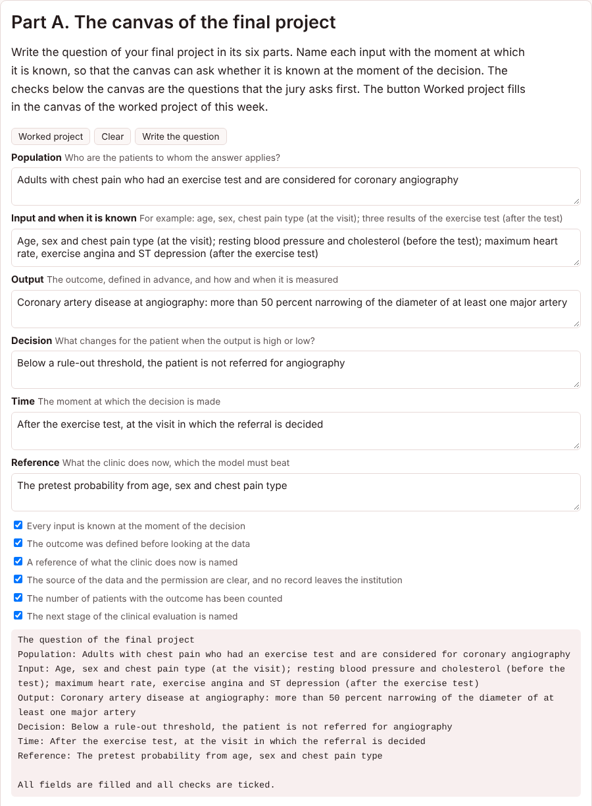
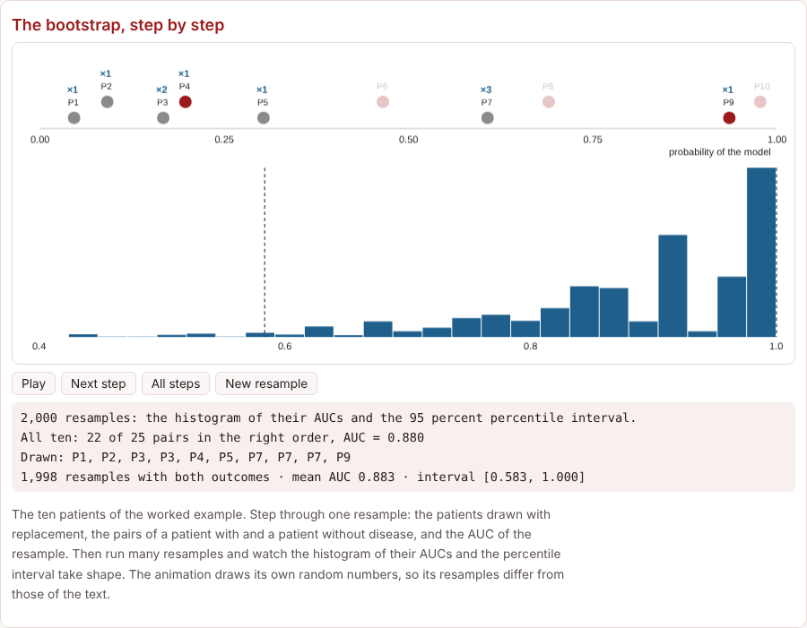

> **Türkçe:** Bu eğitim Türkçe yürütülmektedir. **[Bu haftanın Türkçe sayfasına geçiniz](../../tr/hafta-11/README.md)**

# Week 11: Final project and graduation

**Artificial Intelligence with Python: A Hands-on Training Program for Cardiologists** 
Turkish Society of Cardiology

*Combine what you have learned on a real clinical problem*

[Course home](../../README.md) · [Syllabus](../../SYLLABUS.md) · [Setup](../../SETUP.md) · [Türkçe](../../tr/hafta-11/README.md)

For more about the week, read on. To go on with the week directly from the lecture page, use this link: **[Open the lecture page of the week](https://utkukose.github.io/ai-cardiology-tkd-NB-lecture/en/week-11/lecture.html)**. The lecture page is the main route of the week, and its boxes open the interactive lab and the Jupyter notebook at the right place.

## About the week

The last week turns the methods of the course into the final projects of the participants. The first two hours develop the final project: the selection of a problem, a real question of one's own clinic; the preparation of the data and the selection of the model; the training and the optimisation of the model with the integration of its explanation (XAI); and the design of the evaluation of its clinical validity. The mini project is the final project itself, alone or in a group: an end-to-end artificial intelligence (AI) pipeline on a real problem of cardiology. One worked project runs through the week on the Cleveland data that the course has used since Week 1: After an exercise test, can routine variables rule out coronary artery disease and spare a referral to coronary angiography? Its model of eight variables reaches a test AUC of 0.931, yet the interval of its gain over a reference of age, sex and chest pain type, [−0.020, 0.094], includes zero, and the data are smaller than two of the three criteria of Riley and colleagues ask for. At its rule-out threshold it would spare the angiography of 27 of 76 test patients without missing a patient with disease. The last two hours hold the presentations of the final projects, five to seven minutes each, their evaluation by a jury and by the participants, the certificate ceremony, and a discussion of the future with the career paths and the resources of cardiology AI. The weekly project joins the presentation with the personal action plan "How will I use AI in my clinical practice?". The week also covers the reporting guideline TRIPOD+AI, the stages of a clinical evaluation from DECIDE-AI to a randomised trial, and the review of a final project written with an AI assistant.

4 hours in the session, half of them for the presentations, and the time of the final project.

## The case of the week

**Patient 260 of the Cleveland data** is a 44-year-old woman whose chest pain her physician classed as non-anginal. Her resting blood pressure is 118 mmHg and her cholesterol 242 mg/dL. In the exercise test her heart rate reaches 149 per minute, no angina appears and there is hardly any ST depression (0.3 mm). Like every patient of the data, she was then referred for coronary angiography, which showed no major coronary artery narrowed by more than 50 percent of its diameter. The final project of this week asks whether such a referral could be spared. After the exercise test, can a model of routine variables rule out coronary artery disease safely? Does it do better than what the cardiologist knew before the test, the age, the sex and the type of chest pain? For this patient, the model of the worked project gives a probability of 0.03, and the reference of the three variables 0.05. The question runs through the week as a worked final project, from its first sentence to its presentation, and every participant takes the same steps with a question of their own.

## Materials

| Material | Open | What it is for |
|---|---|---|
| **Lecture page** | [Open the lecture page](https://utkukose.github.io/ai-cardiology-tkd-NB-lecture/en/week-11/lecture.html) | The teaching of the week. It is read from top to bottom, leads to the practice stops and holds no code and no prompts. |
| **Interactive lab** | [Open the interactive lab](https://utkukose.github.io/ai-cardiology-tkd-NB-lecture/en/week-11/lab.html) | Parts A to F, without code, open where the lecture page reaches them. Part F is the prompt workshop. The self-assessment and the learning log are in the lab too. |
| **Python notebook** |  [Download for Jupyter Notebook (zip)](https://github.com/utkukose/ai-cardiology-tkd-NB-lecture/raw/main/en/week-11/NB11_final_project_workshop.zip) | The practice stops are worked here, each with Python basics, prompts and a ready application. The Python notebook runs in Google Colab with nothing to install, or in Jupyter Notebook on your own computer: Download the zip file, extract the .ipynb file into a folder and open it in Jupyter. Every part opens with a start cell that repeats the setup and the data calls that the part uses. |
| **Prompt library** | [PROMPTS.md](PROMPTS.md) | Every prompt of the practice stops and of the final project, with prompts for repairing, explaining and reviewing code. On GitHub, each prompt has a copy button. |
| **PDF notes** | [Week11_Lecture_Notes.pdf](Week11_Lecture_Notes.pdf) | The printable version of the lecture page. |

## Study path

The lecture page is read from top to bottom, and it opens the parts of the interactive lab where they belong. At each practice stop, the work continues in the Jupyter notebook, where every stop has three parts. **Python basics** teaches the Python that the stop needs. In **Prompt and application**, an AI assistant writes the code from ready prompts, and the participant runs it and checks the result. The **Ready application** is the complete working program of the stop. Work through them in this order; if you know Python, you may start with the prompts, and to see only the result, open the ready application. Each part opens with a start cell that repeats the setup and the data calls that the part uses, so the part also runs when it is opened directly. At the end of every lab part and of every stop in the Jupyter notebook, a link takes you back to the lecture page, to the place where reading continues. If you lose your place, come back to this table. Participants who attend the session complete the steps there. The times help those who follow the week on their own, for example after a missed session.

| Step | What to do | Time |
|---|---|---|
| 1 | [Read](https://utkukose.github.io/ai-cardiology-tkd-NB-lecture/en/week-11/lecture.html) the case of the week and the lecture page up to Practice stop 1: the problem selection with Part A of the interactive lab, then the data preparation and the model selection, with how much data and Part B and a reference first, and the knowledge checks | 45 minutes |
| 2 | **[Practice stop 1: The question, the data and a reference](https://utkukose.github.io/ai-cardiology-tkd-NB-lecture/en/week-11/lecture.html#stop-1)** The model is chosen by cross-validation, first on the worked project and then on your own. [Python basics](https://colab.research.google.com/github/utkukose/ai-cardiology-tkd-NB-lecture/blob/main/en/week-11/NB11_final_project_workshop.ipynb#scrollTo=stop-1-basics) · [Prompt and application](https://colab.research.google.com/github/utkukose/ai-cardiology-tkd-NB-lecture/blob/main/en/week-11/NB11_final_project_workshop.ipynb#scrollTo=stop-1-prompt) ([prompts](PROMPTS.md#stop-1-the-question-the-data-and-a-reference)) · [Ready application](https://colab.research.google.com/github/utkukose/ai-cardiology-tkd-NB-lecture/blob/main/en/week-11/NB11_final_project_workshop.ipynb#scrollTo=stop-1-app) | 1 hour 25 minutes |
| 3 | [Read on](https://utkukose.github.io/ai-cardiology-tkd-NB-lecture/en/week-11/lecture.html#model-training-optimisation-and-xai-integration) up to Practice stop 2: model training, optimisation and XAI integration, the bootstrap with the animation and Part C, and calibration | 30 minutes |
| 4 | **[Practice stop 2: Uncertainty and calibration](https://utkukose.github.io/ai-cardiology-tkd-NB-lecture/en/week-11/lecture.html#stop-2)** [Python basics](https://colab.research.google.com/github/utkukose/ai-cardiology-tkd-NB-lecture/blob/main/en/week-11/NB11_final_project_workshop.ipynb#scrollTo=stop-2-basics) · [Prompt and application](https://colab.research.google.com/github/utkukose/ai-cardiology-tkd-NB-lecture/blob/main/en/week-11/NB11_final_project_workshop.ipynb#scrollTo=stop-2-prompt) ([prompts](PROMPTS.md#stop-2-uncertainty-and-calibration)) · [Ready application](https://colab.research.google.com/github/utkukose/ai-cardiology-tkd-NB-lecture/blob/main/en/week-11/NB11_final_project_workshop.ipynb#scrollTo=stop-2-app) | 50 minutes |
| 5 | [Read on](https://utkukose.github.io/ai-cardiology-tkd-NB-lecture/en/week-11/lecture.html#a-decision-threshold-ruling-out) up to Practice stop 3: the rule-out threshold with the 3D scene, what the model uses and where it may fail | 25 minutes |
| 6 | **[Practice stop 3: The rule-out and its limits](https://utkukose.github.io/ai-cardiology-tkd-NB-lecture/en/week-11/lecture.html#stop-3)** [Python basics](https://colab.research.google.com/github/utkukose/ai-cardiology-tkd-NB-lecture/blob/main/en/week-11/NB11_final_project_workshop.ipynb#scrollTo=stop-3-basics) · [Prompt and application](https://colab.research.google.com/github/utkukose/ai-cardiology-tkd-NB-lecture/blob/main/en/week-11/NB11_final_project_workshop.ipynb#scrollTo=stop-3-prompt) ([prompts](PROMPTS.md#stop-3-the-rule-out-and-its-limits)) · [Ready application](https://colab.research.google.com/github/utkukose/ai-cardiology-tkd-NB-lecture/blob/main/en/week-11/NB11_final_project_workshop.ipynb#scrollTo=stop-3-app) | 50 minutes |
| 7 | [Read](https://utkukose.github.io/ai-cardiology-tkd-NB-lecture/en/week-11/lecture.html#designing-the-clinical-evaluation) the design of the evaluation of clinical validity with Part D, the mini project with the reporting with TRIPOD+AI, the presentations, the evaluation by the jury and the participants, the certificate ceremony, the career paths and resources, the personal action plan, the review of a final project with Parts E and F and the paper of the week | 50 minutes |
| 8 | Take the self-assessment of [the interactive lab](https://utkukose.github.io/ai-cardiology-tkd-NB-lecture/en/week-11/lab.html) (tab: Check yourself), write the reflection and export the learning log | 20 minutes |
| | **Total without the weekly project** | **5 hours 55 minutes** |
| 9 | Finish the slides of [the final project](#weekly-project) and rehearse the presentation with the rubric and the timer of Part D; the report and the code follow within one week after the session [Prompts](PROMPTS.md#prompts-of-the-weekly-project) · [Weekly project in the Jupyter notebook](https://colab.research.google.com/github/utkukose/ai-cardiology-tkd-NB-lecture/blob/main/en/week-11/NB11_final_project_workshop.ipynb#scrollTo=project) | 1 hour |

<table>
<tr><td width="50%"></td><td width="50%"></td></tr>
<tr><td>Interactive lab, Part A: the project canvas, with the structured question of a final project and its checks.</td><td>Interactive lab, Part C: the bootstrap by hand on the 76 test patients, with the resamples, the histogram of the difference between the model and the reference and its interval. Data: UCI Heart Disease, Cleveland, CC BY 4.0.</td></tr>
<tr><td width="50%"></td><td width="50%"></td></tr>
<tr><td>Interactive lab, Part D: the planner of the clinical evaluation and the rubric of the presentation with its timer.</td><td>Lecture page: the bootstrap step by step on ten patients, from one resample to the percentile interval.</td></tr>
</table>

## Weekly project

**Project.** Final project presentation and the personal action plan "How will I use AI in my clinical practice?"

**What to do.** Finish the final project described on the [final project page](../final-project/README.md), with the steps of the worked project of this week. State the question with its population, input, output, decision and time; audit the data; check their size with the criteria of Riley and colleagues; compare the model with a simple reference; give every result with an interval; check the calibration; if the model informs a decision, choose its threshold on the training data only; report what the model uses and where it may fail; and write a plan for the next stage of its clinical evaluation. Present the project in the session in five to seven minutes.

**Where to look.** Lecture: the whole page, in particular "Data preparation and model selection", "Model training, optimisation and XAI integration", "Designing the evaluation of clinical validity", the mini project with "Reporting with TRIPOD+AI", "Final project presentations (5–7 minutes per person)" and "Final project presentation and the personal action plan". Interactive lab: Parts A to D. Jupyter notebook: the three practice stops, and the toolbox of the final project with the starting points of the options at the end of the ready application of Practice stop 3.

**With prompts.** The final project can also be built with the prompts of the [prompt library](https://github.com/utkukose/ai-cardiology-tkd-NB-lecture/blob/main/en/week-11/PROMPTS.md#prompts-of-the-weekly-project): four prompts, one for each step, whose data fields are rewritten for the data of your own project. The section "Weekly project" at the end of the Jupyter notebook prepares the table of each prompt for the worked project and opens on its own. The test of each prompt must hold before the next prompt is sent, every prompt goes into the AI usage log, and no prompt ever holds data of real patients.

**Example.** On the 76 test patients, the reference of age, sex and chest pain type reaches an AUC of 0.900 [0.824, 0.959], and the model of eight variables 0.931 [0.872, 0.977]. The difference, 0.031 [−0.020, 0.094], includes zero: On these data the model is not clearly better than the reference. At the rule-out threshold of 0.18, chosen on the training patients, the model rules out 27 of the 76 test patients without missing any of the 35 with disease. The sensitivity of 1 has the interval [0.901, 1.000], and the negative predictive value of 1 the interval [0.875, 1.000].

**What to submit.** The slides of the presentation, before the session. Within one week after the session: the report of four to six pages in the [report template](../templates/Report_Template.docx), the Jupyter notebook or the scripts that reproduce every result, and the AI usage log (tool, prompt, what was checked, what was changed). The report ends with the personal action plan of half a page. Data of real patients never leave the participant's computer; the report shows aggregated results only.

**Submission.** The slides are sent before the session, and the report, the code and the AI usage log within one week after it, by e-mail to utkukose@sdu.edu.tr or utkukose@gmail.com. The final project counts for 40 percent of the assessment; its rubric is on the final project page.

## Learning outcomes

By the end of the week, participants are expected to state a clinical question in a form that data can answer, with its population, its input, its output, the decision it informs and its time. They should be able to audit a data set for missing values, the definition of the outcome and leakage, judge whether it is large enough for a prediction model with the criteria of Riley and colleagues, select and optimise a model by cross-validation on the training data, and compare it with a simple reference. They should be able to give the uncertainty of their results with bootstrap and Wilson intervals, check the calibration of a model, choose a decision threshold on training data, integrate the explanation of every prediction and report what the model uses and where it may fail. Finally, they should be able to report a prediction model with TRIPOD+AI, design the evaluation of its clinical validity, present a project in five to seven minutes, evaluate the projects of others, name career paths and resources in cardiology AI, and write a personal action plan for the use of AI in their practice.

## Training flow of the session

The four-hour session of the week follows the plan below. It is shared to show how the materials fit together in a live session.

| Time | Activity |
|---|---|
| 0:00 to 0:15 | The case of the week and the plan of the session. Every participant opens the notebook in Jupyter (Anaconda) and runs Section 0; the Cleveland data come with the course, so nothing is downloaded. |
| 0:15 to 0:55 | First two hours, final project development: the problem selection, a real question from one's own clinic, with Part A; the data preparation and the model selection, with the audit, how much data and Part B, a reference first and the choice of the model by cross-validation; then the training, the optimisation and the bootstrap with Part C. |
| 0:55 to 1:35 | Mini project, the final project as an end-to-end AI pipeline, Practice stops 1 and 2: the participants check their own projects with the steps of the worked project, alone or in their groups, and the instructor visits each group. |
| 1:35 to 1:55 | First two hours, continued: calibration, the rule-out threshold, the integration of XAI with what the model uses and where it may fail, the design of the evaluation of clinical validity with Part D, and the report with TRIPOD+AI. |
| 1:55 to 2:05 | Break. |
| 2:05 to 3:30 | Last two hours, presentation, closing and discussions of the future: the final project presentations, five to seven minutes for each person and three minutes for questions, with the evaluation by the jury and the participants with the rubric of the final project page. |
| 3:30 to 3:45 | Career paths and resources in cardiology AI, and the personal action plans "How will I use AI in my clinical practice?": Each participant names one use of AI that they will start in their clinic, and its first step. |
| 3:45 to 4:00 | Certificate ceremony: The program closes and the certificates are presented. |

## With your own data

The lecture page closes with a section on applying the methods of the week to your own data: which question fits which method, what to check first, the approval of the ethics committee, the Turkish Law on the Protection of Personal Data (KVKK) and where to compute. [Read it on the lecture page](https://utkukose.github.io/ai-cardiology-tkd-NB-lecture/en/week-11/lecture.html#with-your-own-data).

## Optional research assignment

Search PubMed for one study, published in 2020 or later, that reported a cardiovascular prediction model and cites TRIPOD or TRIPOD+AI. Check it against five items of TRIPOD+AI: the source of the data, the size of the study, the handling of missing values, the measures of performance with their intervals and the calibration. Summarise in half a page what the study reports well and what is missing. The assignment is not graded and helps to write the report of the final project.

## The virtual clinic after this week

In Week 11 the virtual clinic hands over to the clinics of the participants. Each final project is a new unit of its own, with the question of a real clinic, its data, a model with a reference, the uncertainty of its results, an explanation, its limits and a plan for its clinical evaluation. The worked project of this week shows the shape of such a unit on public data. Its rule-out model has a test sensitivity of 1 with a lower bound of 0.901, its gain over the reference is uncertain, and its next step is not a deployment but an external validation and a silent run in a single clinic.

## After the course

The materials stay open after the course. Every week can be followed again with its study path, and the course is updated in line with current developments in the field. See the [plan of the course](../../README.md#the-eleven-weeks).

---

**Prof. Dr. Utku Kose**

Full Professor, Department of Computer Engineering, Süleyman Demirel University, Isparta, Türkiye 
Founding Director, AI Application and Research Center (YAZEM), Süleyman Demirel University 
Head of the Computer Science Division, Department of Computer Engineering, Süleyman Demirel University 
Additional affiliations: University of North Dakota (USA), Universidad Panamericana (Mexico City, Mexico), Vel Tech University (Chennai, India) 
IEEE Senior Member, ACM Professional Member

[ORCID 0000-0002-9652-6415](https://orcid.org/0000-0002-9652-6415) | [utkukose.com](https://www.utkukose.com) | [github.com/utkukose](https://github.com/utkukose)

[utkukose@sdu.edu.tr](mailto:utkukose@sdu.edu.tr) | [utku.kose@und.edu](mailto:utku.kose@und.edu) | [ukose@up.edu.mx](mailto:ukose@up.edu.mx) | [utkukose@gmail.com](mailto:utkukose@gmail.com)

*First version: November 2026. Content CC BY 4.0, code MIT.*

