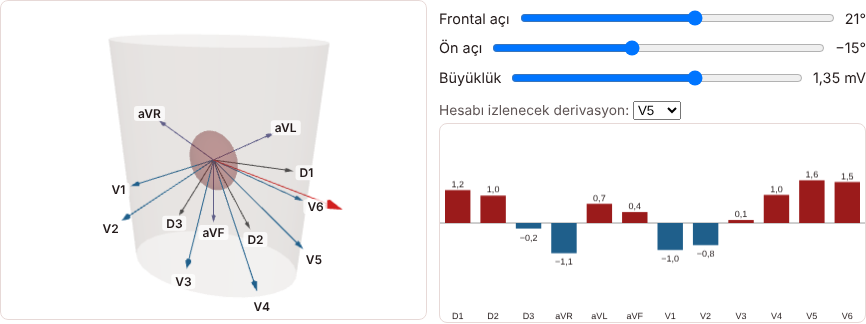

# Hafta 1: Python ve kardiyoloji veri temelleri

**Python ile Yapay Zekâ Eğitimi: Kardiyologlar için Uygulamalı Eğitim Programı** 
Türk Kardiyoloji Derneği

*Programlama bilgisi sıfırdan klinik veri analizine*

[Eğitimin ana sayfası](../../README.tr.md) · [İzlence](../../SYLLABUS.tr.md) · [Kurulum](../../SETUP.tr.md) · [English](../../en/week-01/README.md)

## Hafta hakkında

İlk iki saatte Anaconda ve Jupyter Notebook ortamı tanıtılır, değişkenler, listeler ve döngüler tıbbi örneklerle öğrenilir, pandas ile hasta tablosu okunup işlenir ve Matplotlib ile ilk kardiyolojik grafik çizilir. Bu kısım Kaggle Heart Disease veri setiyle yapılan mini projeyle kapanır. Son iki saatte elektrokardiyogram (EKG) verisiyle çalışılır: EKG örneklerden oluşan bir veri olarak ele alınır, on iki derivasyon tek bir kalp vektörünün izdüşümleri olarak açıklanır, PR, QRS ve QT aralıkları otomatik olarak ölçülür ve QT kalp hızına göre düzeltilir. Ardından PhysioNet ve MIT-BIH veri setlerine erişilir, kayıtlar wfdb kütüphanesiyle okunup işlenir, R tepeleri NeuroKit2 ile bulunur, kalp hızı değişkenliği (HRV) hesaplanır ve 12 derivasyon görselleştirilir. Haftalık proje, EKG'yi görselleştiren ve temel ölçümleri (PR, QRS, QT) otomatik olarak hesaplayan bir script'tir. Hafta, bir yapay zekâ (YZ) asistanıyla kod yazmanın ilk kurallarını da içermektedir.

Oturum 4 saat sürer. Haftalık proje için yaklaşık 3 saat ayrılmalıdır.

## Haftanın rotası

Ders sayfası haftanın ana rotasıdır. Sayfada kod ya da prompt (istem) bulunmaz; sayfa etkileşimli labla birlikte yukarıdan aşağıya okunur. Her uygulama durağında katılımcılar Jupyter defterindeki iki yoldan birini seçer. **Prompt yolunda** (Kısım 1) kodu, hazır promptlara göre bir yapay zekâ (YZ) asistanı yazar; katılımcı bu kodu çalıştırır ve sonucu denetler. **Python yolunda** (Kısım 2) ise kodu katılımcı kendisi yazar. İki yol da aynı sonuçlara varır. Defter hem kurulum gerektirmeyen Google Colab'da hem de kendi bilgisayarınızdaki Jupyter'de çalışır ([kurulum](../../SETUP.tr.md)).

| Ana rota: Ders sayfası ve etkileşimli lab | Uygulama durağı | Prompt yolu (Kısım 1) | Python yolu (Kısım 2) |
|---|---|---|---|
| [Uygulamanın iki yolu: Prompt ve Python](https://utkukose.github.io/ai-cardiology-tkd-NB-lecture/tr/hafta-01/ders.html#two-paths-of-practice) [Sanal kardiyoloji kliniği: Eğitimin projesi](https://utkukose.github.io/ai-cardiology-tkd-NB-lecture/tr/hafta-01/ders.html#the-virtual-cardiology-clinic-the-project-of-the-course) [İlk 2 saat: Python'a giriş ve Jupyter Notebook ortamı](https://utkukose.github.io/ai-cardiology-tkd-NB-lecture/tr/hafta-01/ders.html#first-two-hours-introduction-to-python-and-the-jupyter-notebook-environment) [Anaconda ve Jupyter Notebook ortamının tanıtımı ve ilk kullanım](https://utkukose.github.io/ai-cardiology-tkd-NB-lecture/tr/hafta-01/ders.html#introducing-the-anaconda-and-jupyter-notebook-environment-and-its-first-use) [Değişkenler, listeler, döngüler: Tıbbi örneklerle](https://utkukose.github.io/ai-cardiology-tkd-NB-lecture/tr/hafta-01/ders.html#variables-lists-and-loops-with-medical-examples) [Pandas ile hasta tablosu okuma ve işleme](https://utkukose.github.io/ai-cardiology-tkd-NB-lecture/tr/hafta-01/ders.html#patient-tables-with-pandas) [Matplotlib ile ilk kardiyolojik grafik](https://utkukose.github.io/ai-cardiology-tkd-NB-lecture/tr/hafta-01/ders.html#a-first-cardiological-plot-with-matplotlib) [Mini proje: Kaggle Heart Disease veri setini yükleme, istatistiksel özet ve görselleştirme](https://utkukose.github.io/ai-cardiology-tkd-NB-lecture/tr/hafta-01/ders.html#mini-project-loading-the-kaggle-heart-disease-data-set-statistical-summary-and-visualisation) | **[Durak 1: Mini proje: Kaggle Heart Disease veri seti](https://utkukose.github.io/ai-cardiology-tkd-NB-lecture/tr/hafta-01/ders.html#stop-1)** | Durak 1 | Python adımı 1 ve 1. ve 2. bölümler |
| [Son 2 saat: EKG verisi ile çalışma](https://utkukose.github.io/ai-cardiology-tkd-NB-lecture/tr/hafta-01/ders.html#last-two-hours-working-with-ecg-data) [Veri olarak EKG](https://utkukose.github.io/ai-cardiology-tkd-NB-lecture/tr/hafta-01/ders.html#the-ecg-as-data) [Vektör olarak kalp: On iki derivasyon, tek kaynak](https://utkukose.github.io/ai-cardiology-tkd-NB-lecture/tr/hafta-01/ders.html#the-heart-as-a-vector-twelve-leads-one-source) [Aralıklar: PR, QRS ve QT](https://utkukose.github.io/ai-cardiology-tkd-NB-lecture/tr/hafta-01/ders.html#intervals-pr-qrs-and-qt) [QT'nin kalp hızına göre düzeltilmesi](https://utkukose.github.io/ai-cardiology-tkd-NB-lecture/tr/hafta-01/ders.html#correcting-the-qt-for-heart-rate) | **[Durak 2: Veri olarak EKG](https://utkukose.github.io/ai-cardiology-tkd-NB-lecture/tr/hafta-01/ders.html#stop-2)** | Durak 2 | 3-5. bölümler |
| [PhysioNet ve MIT-BIH veri setlerine erişim](https://utkukose.github.io/ai-cardiology-tkd-NB-lecture/tr/hafta-01/ders.html#real-data-physionet-records) [Wfdb kütüphanesi ile EKG okuma ve işleme](https://utkukose.github.io/ai-cardiology-tkd-NB-lecture/tr/hafta-01/ders.html#reading-and-processing-ecgs-with-the-wfdb-library) [R-peak tespiti (NeuroKit2)](https://utkukose.github.io/ai-cardiology-tkd-NB-lecture/tr/hafta-01/ders.html#finding-every-beat-r-peak-detection) [HRV (kalp hızı değişkenliği) hesaplama](https://utkukose.github.io/ai-cardiology-tkd-NB-lecture/tr/hafta-01/ders.html#heart-rate-variability) [12 derivasyon görselleştirme](https://utkukose.github.io/ai-cardiology-tkd-NB-lecture/tr/hafta-01/ders.html#visualising-the-12-leads) [YZ asistanıyla çalışmak, 1. bölüm: Kod güvenlik kontrol listesi](https://utkukose.github.io/ai-cardiology-tkd-NB-lecture/tr/hafta-01/ders.html#ai-pair-programming-part-1-the-code-safety-checklist) | **[Durak 3: Gerçek kayıtlar ve özensiz bir prompt](https://utkukose.github.io/ai-cardiology-tkd-NB-lecture/tr/hafta-01/ders.html#stop-3)** | Durak 3 | 6-9. bölümler |
| [Haftanın makalesi](https://utkukose.github.io/ai-cardiology-tkd-NB-lecture/tr/hafta-01/ders.html#the-paper-of-the-week) [Sanal klinik, 1. aşama: Klinik açılıyor](https://utkukose.github.io/ai-cardiology-tkd-NB-lecture/tr/hafta-01/ders.html#the-virtual-clinic-stage-1-the-clinic-opens) | "Kendi verinizle" bölümü, haftanın makalesi ve sanal klinik | – | – |

## Malzemeler

| Malzeme | Aç | İçeriği |
|---|---|---|
| **Ders sayfası (ana rota)** | [Ders sayfasını aç](https://utkukose.github.io/ai-cardiology-tkd-NB-lecture/tr/hafta-01/ders.html) | Vakayı ve uygulamanın iki yolunu içerir. İlk iki saat Anaconda ve Jupyter Notebook ortamından değişkenlere, listelere ve döngülere, pandas ve Matplotlib ile Kaggle Heart Disease veri setindeki mini projeye kadar uzanır. Son iki saat veri olarak EKG ve aralıklardan PhysioNet ve MIT-BIH veri setlerine, wfdb kütüphanesine, NeuroKit2 ile R-peak tespitine, HRV hesaplamaya ve 12 derivasyona kadar ilerler. Sayfada çözümlü örnekler, kalp döngüsünün üç boyutlu (3B) sahnesi, iki animasyon, bilgi kontrolü soruları, üç uygulama durağı, "Kendi verinizle" bölümü, tekrar kartları ve kaynaklar bulunur; kod ve prompt yer almaz. |
| **Etkileşimli lab** | [Etkileşimli labı aç](https://utkukose.github.io/ai-cardiology-tkd-NB-lecture/tr/hafta-01/lab.html) | Kod gerektirmeyen A'dan F'ye kadar altı bölümü (F bölümü prompt atölyesidir), öz değerlendirmeyi, yansıtma yazısını ve dışa aktarılabilen öğrenme günlüğünü içerir |
| **Jupyter defteri** |  [Jupyter için indir](NB01_python_ve_ekg_temelleri.ipynb) | Kısım 1 prompt yoludur: Üç durakta toplam on adım vardır ve her adımda hazır bir prompt, adımın tablosunu hazırlayan bir veri hücresi, YZ asistanının kodu için bir hücre, otomatik bir kontrol ve hazır kod bulunur. Kısmın sonunda haftalık proje dört promptla yer alır. Kısım 2 Python yoludur: Python adımı 1'i, A-J alıştırmalarıyla birlikte 1-10. bölümleri, bir uygulama anahtarını ve dört alan için uygulama görevlerini içerir. |
| **Prompt kütüphanesi** | [PROMPTLAR.md](PROMPTLAR.md) | Prompt yolunun bütün promptlarını, kodu onarmaya yarayan promptları ve haftalık projenin prompt yolunu içerir. GitHub'da her promptun yanında bir kopyalama düğmesi bulunur. |
| **PDF ders notu** | [Hafta01_Ders_Notlari.pdf](Hafta01_Ders_Notlari.pdf) | Ders sayfasının yazdırılabilir biçimidir; uygulama duraklarını ve "Kendi verinizle" bölümünü de içerir. |

<table>
<tr><td width="50%"></td><td width="50%"></td></tr>
<tr><td>Etkileşimli lab, B bölümü: VC-0317'nin kalp vektörü üç boyutlu bir gövdenin içinde gösterilir ve on iki derivasyondaki izdüşümleri izlenir.</td><td>Jupyter defteri, Python yolu, 4. bölüm: VC-0317'nin 12 derivasyonlu EKG'si çizilir.</td></tr>
<tr><td width="50%"></td><td width="50%"></td></tr>
<tr><td>Etkileşimli lab, F bölümü: Prompt atölyesinde prompt kartının yedi alanı doldurulur; bir kalite göstergesi ve bir mahremiyet denetimi yazılanı değerlendirir.</td><td>Jupyter defteri, prompt yolu, 2. durak: Hazır prompt bir YZ asistanına gönderilir, asistanın kodu çalıştırılır ve sonucu eğitimin kontrolü sınar.</td></tr>
</table>

## Haftanın vakası

**VC-0317, 67 yaşında bir kadın hastadır.** İlaç tedavisindeki bir değişiklikten sonra başlayan çarpıntı yakınmasıyla polikliniğe başvurmuştur. EKG'sinin otomatik raporu düzeltilmiş QT'yi (QTc) 465 ms olarak vermekte ve uzamış olarak işaretlemektedir. [Ders sayfası](https://utkukose.github.io/ai-cardiology-tkd-NB-lecture/tr/hafta-01/ders.html) bu vakayla açılır; sanal klinik de son bölümde soruyu kendi ölçümleriyle cevaplar.

## Öğrenme çıktıları

Haftanın sonunda katılımcıların Anaconda içinde Jupyter Notebook'u başlatabilmeleri, bir defteri açıp hücrelerini sırayla çalıştırabilmeleri ve kaydedebilmeleri beklenmektedir. Klinik değerlerle değişkenleri, listeleri, döngüleri, sözlükleri, koşulları ve fonksiyonları kullanabilmeli, pandas ile bir hasta tablosunu okuyup işleyebilmeli ve onu ortalama, standart sapma, medyan ve çeyrekler arası açıklıkla özetleyebilmelidirler. Matplotlib ile ilk kardiyolojik grafiği çizebilmeli ve Kaggle Heart Disease veri setiyle yapılan mini projeyi tamamlayabilmelidirler. Bir EKG'yi örneklerden oluşan bir tablo olarak ele alabilmeli, örnekleme frekansının ve çözünürlüğün etkisini açıklayabilmelidirler. On iki derivasyonu tek bir kalp vektörünün izdüşümleri olarak açıklayabilmeli, Einthoven yasasını uygulayabilmeli ve frontal QRS eksenini hesaplayabilmelidirler. PR, QRS ve QT aralıklarını elle ve bilgisayarla ölçebilmeli, QT'yi Bazett ve Fridericia formülleriyle düzeltebilmeli ve iki ölçüm yöntemini Bland-Altman analiziyle karşılaştırabilmelidirler. Ayrıca PhysioNet ve MIT-BIH veri setlerine erişebilmeli, bir kaydı wfdb kütüphanesiyle okuyup işleyebilmeli, R tepelerini NeuroKit2 ile bulabilmeli ve duyarlılığı ve pozitif öngörü değerini raporlayabilmelidirler. Normalden normale aralıkların standart sapmasını (SDNN) ve ardışık farklarının karelerinin ortalamasının karekökünü (RMSSD) hesaplayabilmeli ve 12 derivasyonu standart düzende görselleştirebilmelidirler. Son olarak birimleri ve bir testi içeren bir prompt yazabilmeli ve bir YZ asistanının yazdığı kodu kod güvenlik kontrol listesiyle denetleyebilmelidirler.

## Çalışma yolu

Oturuma katılanlar ana rotayı ve uygulama duraklarını oturumda tamamlar. Haftayı kendi başına izleyenler, örneğin bir oturumu kaçıranlar, aşağıdaki sürelerle plan yapabilir.

| Adım | Etkinlik | Prompt yolu | Python yolu |
|---|---|---|---|
| 1 | Haftanın vakasını ve ders sayfasını 1. uygulama durağına kadar okuyun: Uygulamanın iki yolu, sanal klinik ve Anaconda ile Jupyter Notebook'tan mini projeye kadar ilk iki saatin konuları bu kısımdadır | 50 dakika | 50 dakika |
| 2 | 1. uygulama durağı, yani mini proje: Prompt yolunda Kısım 1'deki Durak 1'i, Python yolunda Python adımı 1'i ve 1. ile 2. bölümleri çalışın | 30 dakika | 1 saat 15 dakika |
| 3 | 2. uygulama durağına kadar okumayı sürdürün: Veri olarak EKG, kalp vektörü, aralıklar ve QT düzeltmesi bu kısımdadır; etkileşimli labın A, B ve C bölümlerini yapın ve bilgi kontrolü sorularını cevaplayın | 1 saat | 1 saat |
| 4 | 2. uygulama durağı: Prompt yolunda Kısım 1'deki Durak 2'yi, Python yolunda 3, 4 ve 5. bölümleri çalışın | 30 dakika | 1 saat |
| 5 | 3. uygulama durağına kadar okumayı sürdürün: PhysioNet ve MIT-BIH, wfdb kütüphanesi, NeuroKit2 ile R-peak tespiti, HRV ve 12 derivasyon bu kısımdadır; etkileşimli labın D, E ve F bölümlerini yapın | 55 dakika | 55 dakika |
| 6 | 3. uygulama durağı: Prompt yolunda Kısım 1'deki Durak 3'ü, Python yolunda 6, 7, 8 ve 9. bölümleri çalışın | 35 dakika | 1 saat 10 dakika |
| 7 | Haftanın makalesini, sanal kliniğin bu haftaki aşamasını ve "Kendi verinizle" bölümünü okuyun | 30 dakika | 30 dakika |
| 8 | Etkileşimli labın "Kendini sına" sekmesindeki öz değerlendirmeyi yapın, yansıtma yazınızı yazın ve öğrenme günlüğünü dışa aktarın | 20 dakika | 20 dakika |
| | **Haftalık proje dışında toplam** | **5 saat 10 dakika** | **7 saat** |
| 9 | Haftalık projeyi iki yoldan biriyle tamamlayın | 3 saat | 3 saat |

## Oturumun eğitim akışı

Haftanın dört saatlik oturumu aşağıdaki plana göre işlenir. Plan, malzemelerin canlı bir oturumda nasıl bir araya geldiğini göstermek için paylaşılmaktadır.

| Süre | Etkinlik |
|---|---|
| 0:00-0:15 | Haftanın vakası VC-0317 tanıtılır ve eğitimin rotası anlatılır: Ana rotayı ders sayfası oluşturur, uygulama iki yoldan yapılır ve sanal klinik eğitim boyunca kullanılır. |
| 0:15-0:40 | İlk iki saat, Python'a giriş ve Jupyter Notebook ortamı: Anaconda ve Jupyter Notebook ortamı tanıtılır ve ilk kez kullanılır. Her katılımcı Anaconda içinde Jupyter Notebook'u başlatır ya da defteri Google Colab'da açar ve 0. bölümü çalıştırır. |
| 0:40-1:05 | Değişkenler, listeler ve döngüler tıbbi örneklerle anlatılır; Python adımı 1'in ilk hücreleri ortak ekranda çalıştırılır. |
| 1:05-1:30 | Pandas ile hasta tablosu okunur ve işlenir; Matplotlib ile ilk kardiyolojik grafik çizilir. |
| 1:30-2:00 | Oturumun mini projesi, 1. uygulama durağı: Katılımcılar prompt yolu ve Python yolu olmak üzere iki gruba ayrılır. Kaggle Heart Disease veri seti yüklenir, istatistiksel olarak özetlenir ve görselleştirilir. |
| 2:00-2:10 | Ara. |
| 2:10-2:50 | Son iki saat, EKG verisi ile çalışma: EKG bir veri olarak ele alınır. Etkileşimli labın A ve B bölümleriyle on iki derivasyonun tek bir kalp vektöründen nasıl oluştuğu, C bölümüyle aralıklar ve QT düzeltmesi çalışılır. Ardından 2. uygulama durağına geçilir. |
| 2:50-3:35 | PhysioNet ve MIT-BIH veri setlerine erişim, wfdb kütüphanesi ile EKG okuma ve işleme, NeuroKit2 ile R-peak tespiti, D bölümüyle HRV hesaplama ve 12 derivasyon görselleştirme çalışılır; E ve F bölümleriyle kod güvenlik kontrol listesi ele alınır. Ardından 3. uygulama durağına geçilir. |
| 3:35-3:50 | Haftalık proje tanıtılır: EKG'yi görselleştiren ve PR, QRS ve QT aralıklarını otomatik olarak hesaplayan bir script yazılacaktır. Haftanın makalesi ve sanal kliniğin ilk aşaması da kısaca ele alınır. |
| 3:50-4:00 | Sorular cevaplanır. |

## Haftalık proje

**Proje.** EKG görselleştirme ve temel ölçümleri (PR, QRS, QT) otomatik hesaplayan script.

**Ne yapılacak?** Önce Jupyter defterinin 5. bölümündeki `measure_ecg` fonksiyonunu alın ve onu, D1 ve aVF derivasyonlarının net QRS gerilimlerinden frontal QRS eksenini de hesaplayacak biçimde genişletin; bu iş için bir YZ asistanından yardım alabilirsiniz. İkinci olarak fonksiyonlarınızı haftanın klasöründe `ecg_measure.py` adlı bir script dosyası olarak kaydedin. Script bir EKG'yi (sanal klinikten bir hastayı ya da bir PhysioNet kaydını) okur, 12 derivasyonunu 8. bölümdeki standart düzende çizer ve kalp hızını, PR, QRS, QT ve QTc değerlerini yazdırır. Scripti defterde `%run ecg_measure.py` komutuyla ya da Anaconda Prompt penceresinde `python ecg_measure.py` komutuyla çalıştırın. Üçüncü olarak scripti kendi seçeceğiniz on sanal klinik hastasında çalıştırın; bu hastaların en az ikisinde atriyal fibrilasyon ya da dal bloğu bulunmalıdır. Her ölçümü bir tabloda gerçek değerle karşılaştırın. Dördüncü olarak scripti 8. bölümdeki PTB kaydında çalıştırın ve MIT-BIH'in 100 numaralı kaydında kalp hızını ve kalp hızı değişkenliğini (ilk beş dakikanın SDNN ve RMSSD değerleri) bulunan atımlardan hesaplayarak raporlayın. Son olarak on hastanızın her biri için QTc'nin Bazett ve Fridericia formüllerine göre uzun olup olmadığına karar verin ve iki formülün farklı sonuç verdiği hastaları tartışın.

**Nereye bakılacak?** Ders sayfasında "Vektör olarak kalp: On iki derivasyon, tek kaynak", "Aralıklar: PR, QRS ve QT", "QT'nin kalp hızına göre düzeltilmesi", "Wfdb kütüphanesi ile EKG okuma ve işleme", "R-peak tespiti (NeuroKit2)", "HRV (kalp hızı değişkenliği) hesaplama", "12 derivasyon görselleştirme" ve "YZ asistanıyla çalışmak, 1. bölüm: Kod güvenlik kontrol listesi" bölümlerine bakın. Etkileşimli labda B, C, D, E ve F bölümleri, Jupyter defterinde ise 4-9. bölümler ile E, F, H, I ve J alıştırmaları yardımcı olur.

**Prompt yolu.** Proje, [prompt kütüphanesindeki](https://github.com/utkukose/ai-cardiology-tkd-NB-lecture/blob/main/tr/hafta-01/PROMPTLAR.md#haftal%C4%B1k-projenin-prompt-yolu) dört promptla da tamamlanabilir; her adım için bir prompt vardır. Jupyter defterinin 1. kısmının sonundaki "Prompt yolunda haftalık proje" bölümü her promptun tablosunu hazırlar. Bir promptun testi sağlanmadan sonraki prompta geçilmez ve dört promptun tamamı YZ kullanım günlüğüne kaydedilir. Testleri geçen kod `ecg_measure.py` scripti olarak kaydedilir.

**Örnek.** D1'de 0,9 mV, aVF'de −0,3 mV net QRS gerilimi olan bir hastada $H_y = -0{,}3/0{,}866 = -0{,}346$ ve frontal eksen $\operatorname{atan2}(-0{,}346;\ 0{,}9) = -21{,}0°$ bulunur. Bu değer normal sınırlar içindedir. Başka bir hastada −45°'lik bir eksen, sol eksen sapmasını gösterirdi.

**Ne teslim edilecek?** `ecg_measure.py` scripti ve [rapor şablonuyla](../sablonlar/Rapor_Sablonu.docx) yazılmış, bir ya da iki sayfalık bir rapor teslim edilir. Raporda on hastanızın tablosu, iki gerçek kaydın sonuçları ve iki QT düzeltmesinin tartışması yer almalıdır. Rapora YZ kullanım günlüğünü (kullanılan araç, prompt, neyin denetlendiği ve neyin değiştirildiği) ve 1. haftanın alıştırmalarını tamamladığınız Jupyter defterini ekleyin.

**Teslim.** Haftalık proje, 2. haftanın oturumundan önce utkukose@sdu.edu.tr ya da utkukose@gmail.com adresine e-postayla gönderilir. E-postaya "Ne teslim edilecek?" başlığında sayılan öğeler ve etkileşimli labdan dışa aktarılan öğrenme günlüğü eklenir. Haftalık projeler değerlendirmenin yüzde 40'ını oluşturur ve sertifika için her birinden en az yüzde 70 almak gerekir (izlenceye bakın).

## Kendi verinizle

Ders sayfası, haftanın yöntemlerini kendi verinize nasıl uygulayacağınızı anlatan bir bölümle biter. Bu bölümde hangi sorunun hangi yönteme uyduğu, önce neyin denetleneceği, etik kurul onayı, Kişisel Verilerin Korunması Kanunu (KVKK) ve analizin nerede yapılacağı ele alınır. [Bölümü ders sayfasında okuyun](https://utkukose.github.io/ai-cardiology-tkd-NB-lecture/tr/hafta-01/ders.html#with-your-own-data).

## İsteğe bağlı araştırma ödevi

PubMed'de, 2023 ya da sonrasında yayımlanmış ve 12 derivasyonlu EKG için geliştirilmiş bir yapay zekâ modelini, modelin geliştirildiği hastanenin dışındaki bir hastanenin verileriyle sınayan bir çalışma bulun. Çalışmayı yarım sayfada özetleyin; özette hasta grubu, referans standart, başarım ölçütü ve çalışmanın bir sınırlılığı yer almalıdır. [Haftanın makalesindeki](https://utkukose.github.io/ai-cardiology-tkd-NB-lecture/tr/hafta-01/ders.html#the-paper-of-the-week) üç soru özetinize yön verebilir. Bu ödev notlandırılmaz; 2. haftadaki doğrulama tartışmasına hazırlık amacı taşır.

## Bu haftadan sonra sanal klinik

Sanal klinik 1. haftada açılır: 500 sentetik hastadan oluşan bir hasta kaydı ve her EKG'yi otomatik olarak ölçen bir EKG laboratuvarı kurulur. Bu aşamanın sonuçları ve otomatik ölçümün hataları, ders sayfasının [Sanal klinik, 1. aşama](https://utkukose.github.io/ai-cardiology-tkd-NB-lecture/tr/hafta-01/ders.html#the-virtual-clinic-stage-1-the-clinic-opens) bölümünde yer almaktadır.

## Gelecek hafta

**Hafta 2: Makine öğrenmesi temelleri.** Sanal klinik risk polikliniğini açar. UCI Heart Disease verisinde ve hasta kaydında koroner arter hastalığını öngören modeller kurulur ve bu modeller çapraz doğrulama ile alıcı işletim karakteristiği (ROC) analiziyle değerlendirilir. Ayrıntılar için [eğitimin planına](../../README.tr.md#on-bir-hafta) bakın.

---

**Prof. Dr. Utku Köse**

Profesör, Bilgisayar Mühendisliği Bölümü, Süleyman Demirel Üniversitesi, Isparta, Türkiye 
Kurucu Müdür, Yapay Zekâ Uygulama ve Araştırma Merkezi (YAZEM), Süleyman Demirel Üniversitesi 
Bilgisayar Bilimleri Anabilim Dalı Başkanı, Bilgisayar Mühendisliği Bölümü, Süleyman Demirel Üniversitesi 
Diğer kurumlar: University of North Dakota (ABD), Universidad Panamericana (Meksiko, Meksika), Vel Tech University (Chennai, Hindistan) 
IEEE Kıdemli Üyesi, ACM Profesyonel Üyesi

[ORCID 0000-0002-9652-6415](https://orcid.org/0000-0002-9652-6415) | [utkukose.com](https://www.utkukose.com) | [github.com/utkukose](https://github.com/utkukose)

[utkukose@sdu.edu.tr](mailto:utkukose@sdu.edu.tr) | [utku.kose@und.edu](mailto:utku.kose@und.edu) | [ukose@up.edu.mx](mailto:ukose@up.edu.mx) | [utkukose@gmail.com](mailto:utkukose@gmail.com)

*İlk sürüm: Kasım 2026. İçerik CC BY 4.0, kod MIT.*

