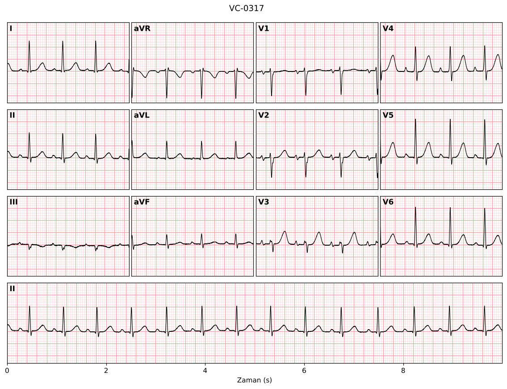
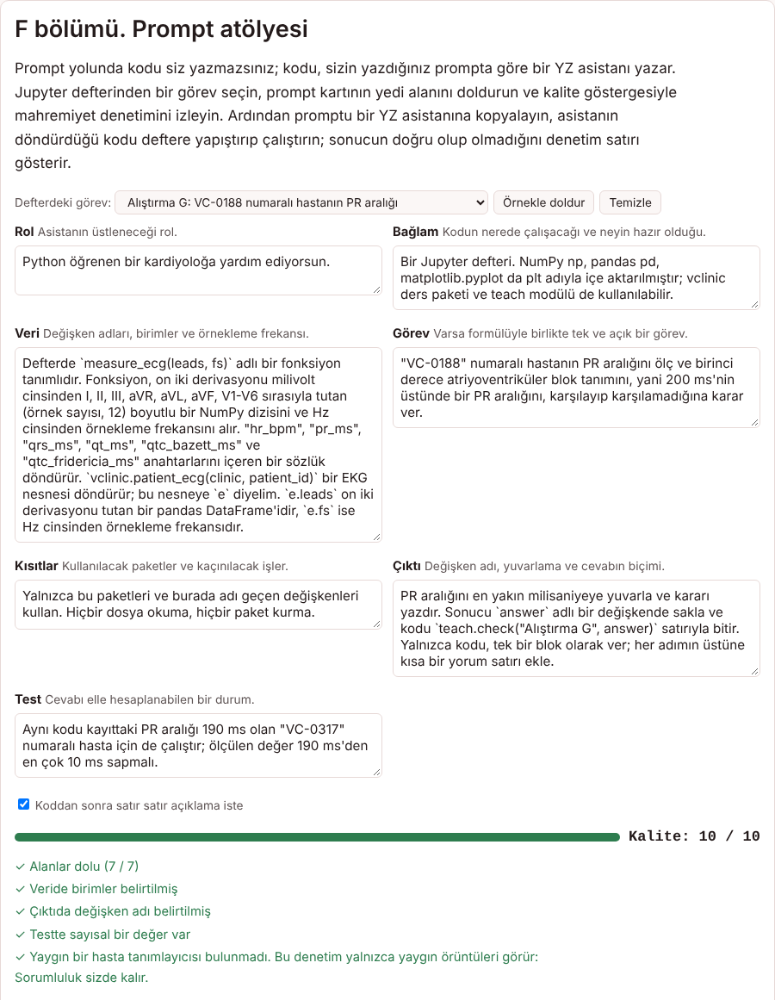
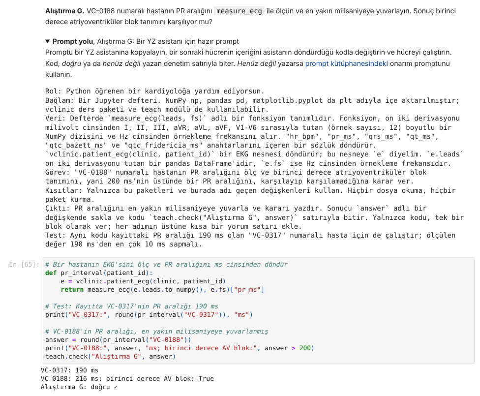

# Hafta 1: Python ve kardiyoloji veri temelleri

**Python ile Yapay Zekâ Eğitimi: Kardiyologlar için Uygulamalı Eğitim Programı** 
Türk Kardiyoloji Derneği

*Programlamaya sıfırdan başlayıp klinik veri analizine*

[Eğitimin ana sayfası](../../README.tr.md) · [İzlence](../../SYLLABUS.tr.md) · [Kurulum](../../SETUP.tr.md) · [English](../../en/week-01/README.md)

## Hafta hakkında

Sıfırdan Python, pandas ile hasta tabloları, veri olarak elektrokardiyogram (EKG), tek bir kalp vektörünün izdüşümleri olarak on iki derivasyon, QT düzeltmesiyle birlikte otomatik PR, QRS ve QT ölçümü, gerçek PhysioNet kayıtlarında atım tespiti ve kalp hızı değişkenliği ile bir yapay zekâ (YZ) asistanıyla kod yazmanın ilk kuralları.

Oturumda 4 saat, haftalık proje için yaklaşık 3 saat.

## Malzemeler

| Malzeme | Aç | İçeriği |
|---|---|---|
| **Ders sayfası** | [Ders sayfasını aç](https://utkukose.github.io/ai-cardiology-tkd-NB-lecture/tr/hafta-01/ders.html) | Kavramlar, çözümlü örnekleriyle formüller, kalp döngüsünün üç boyutlu (3B) sahnesi, iki animasyon, bilgi kontrolleri, tekrar kartları ve kaynaklar |
| **Etkileşimli lab** | [Etkileşimli labı aç](https://utkukose.github.io/ai-cardiology-tkd-NB-lecture/tr/hafta-01/lab.html) | A-F bölümleri, öz değerlendirme, yansıtma ve dışa aktarılan öğrenme günlüğü. F bölümü, YZ asistanına prompt (istem) yazma atölyesidir. |
| **Jupyter defteri** | [NB01_python_ve_ekg_temelleri.ipynb](NB01_python_ve_ekg_temelleri.ipynb)  (yedek yol) | Python adımı 1, A-J alıştırmalarıyla 0-10. bölümler, her alıştırmanın altında bir prompt yolu, her bölümün sonunda bir prompt görevi, uygulama anahtarı ve dört alanın görevleri |
| **Prompt kütüphanesi** | [PROMPTLAR.md](PROMPTLAR.md) | Haftanın prompt kartıyla yazılmış bütün promptları: 13 alıştırma, 9 prompt görevi, kodu açıklatmak ve onarmak için 4 kalıp ve haftalık projenin prompt yolu |
| **PDF ders notu** | [Hafta01_Ders_Notlari.pdf](Hafta01_Ders_Notlari.pdf) | Python adımı 1 ve dersin tamamı, yazdırmaya hazır |

<table>
<tr><td width="50%"></td><td width="50%"></td></tr>
<tr><td>Etkileşimli lab, B bölümü: VC-0317'nin kalp vektörü 3B bir gövdenin içinde ve on iki derivasyondaki izdüşümleri.</td><td>Jupyter defteri, 4. bölüm: VC-0317'nin teach.plot_12lead ile çizilen 12 derivasyonlu EKG'si.</td></tr>
<tr><td width="50%"></td><td width="50%"></td></tr>
<tr><td>Etkileşimli lab, F bölümü: prompt kartının yedi alanı, bir nitelik göstergesi ve bir mahremiyet denetimiyle prompt atölyesi.</td><td>Jupyter defteri, prompt yolunda Alıştırma G: prompt yolu, bir YZ asistanının kodu ve eğitimin denetimi.</td></tr>
</table>

## Haftanın vakası

**VC-0317, 67 yaşında, kadın**, ilaç tedavisindeki bir değişiklikten sonra başlayan çarpıntıyla polikliniğe başvuruyor. EKG'sinin otomatik raporu düzeltilmiş QT'yi (QTc) 465 ms olarak veriyor ve uzamış diye işaretliyor. [Ders sayfası](https://utkukose.github.io/ai-cardiology-tkd-NB-lecture/tr/hafta-01/ders.html) bu vakayla açılmakta, klinik de soruyu son bölümde kendi ölçümleriyle cevaplamaktadır.

## Öğrenme çıktıları

Hafta sonunda katılımcıların bir klinik tabloyu pandas ile yükleyip ortalama, standart sapma, ortanca ve çeyrekler arası açıklıkla özetleyebilmeleri beklenmektedir. Bir EKG'yi örneklerden oluşan bir tablo olarak ele alabilmeli, örnek sayısı ile zaman arasında dönüşüm yapabilmeli, örnekleme frekansının ve çözünürlüğün etkisini açıklayabilmelidirler. On iki derivasyonu tek bir kalp vektörünün izdüşümleri olarak açıklayabilmeli, Einthoven yasasını uygulayabilmeli ve frontal QRS eksenini hesaplayabilmelidirler. PR, QRS ve QT aralıklarını elle ve bilgisayarla ölçebilmeli, QT'yi Bazett ve Fridericia formülleriyle düzeltebilmeli ve iki ölçüm yöntemini Bland-Altman analiziyle karşılaştırabilmelidirler. Ayrıca R tepelerini bulabilmeli, duyarlılığı ve pozitif öngörü değerini raporlayabilmeli, normalden normale aralıkların standart sapmasını (SDNN) ve ardışık farklarının karelerinin ortalamasının karekökünü (RMSSD) hesaplayabilmelidirler. Son olarak birimleri ve bir testi içeren bir prompt yazabilmeli ve bir YZ asistanının yazdığı kodu kod güvenlik kontrol listesiyle denetleyebilmelidirler. Python'da katılımcıların değişkenleri, listeleri, sözlükleri, kararları, döngüleri, fonksiyonları, NumPy dizilerini ve pandas DataFrame'lerini kullanabilmeleri beklenmektedir.

## Çalışma yolu

Oturuma katılanlar 1-5. adımları oturumda tamamlar. Haftayı kendi başına izleyenler, örneğin bir oturumu kaçıranlar, aşağıdaki sürelerle plan yapabilir: 1-7. adımlar için yaklaşık 6 saat 35 dakika, haftalık proje için yaklaşık 3 saat. [Prompt yolunu](../../PROMPT_PATH.tr.md) izleyenler 2. ve 4. adımlarda alıştırmaların altındaki prompt yollarını ve bölümlerin prompt görevlerini kullanır; haftanın bütün promptları [prompt kütüphanesindedir](PROMPTLAR.md). Süreler bu yolda da yaklaşık olarak aynıdır.

| Adım | Etkinlik | Süre |
|---|---|---|
| 1 | Haftanın vakasını ve ders sayfasını okuyun, bilgi kontrollerini cevaplayın | 1 saat 15 dakika |
| 2 | Jupyter defterinde Bölüm 0'ın hemen ardından gelen Python adımı 1'i çalıştırın | 45 dakika |
| 3 | Etkileşimli labın A-F bölümlerini tamamlayın | 1 saat 15 dakika |
| 4 | Jupyter defterinin 1-9. bölümlerini tamamlayın ve alıştırmaları çözün | 2 saat |
| 5 | 10. bölümdeki uygulama anahtarını kullanın ve kendi alanınızın görevini çözün | 30 dakika |
| 6 | Haftanın makalesini üç soruyla birlikte okuyun | 30 dakika |
| 7 | Etkileşimli labda öz değerlendirmeyi yapın (sekme: Kendini sına), yansıtmayı yazın ve öğrenme günlüğünü dışa aktarın | 20 dakika |
| 8 | Haftalık projeyi tamamlayın | 3 saat |

## Oturumun eğitim akışı

Haftanın dört saatlik oturumu aşağıdaki plana göre işlenir. Plan, malzemelerin canlı bir oturumda nasıl bir araya geldiğini göstermek için paylaşılmaktadır.

| Süre | Etkinlik |
|---|---|
| 0:00-0:15 | Haftanın vakası. Katılımcılar Jupyter defterini açar ve Bölüm 0'ı çalıştırır. |
| 0:15-1:00 | Eşli çalışmayla Python adımı 1: kod yazan ve yazmayan birer katılımcı. İkinci katılımcı alıştırmaları prompt yolundan çözebilir. |
| 1:00-1:45 | Mini proje: pandas ile hasta tabloları (Bölüm 1) ve sanal kliniğin açılışı (Bölüm 2). |
| 1:45-2:00 | Ara. |
| 2:00-2:45 | Veri olarak EKG ve kalp vektörü: ders, 3B sahne, etkileşimli labın A ve B bölümleri, Bölüm 3 ve 4. |
| 2:45-3:30 | Dijital kumpasla aralıklar ve QT düzeltmesi (C bölümü) ve Bölüm 5; atım tespiti ve kalp hızı değişkenliği (Bölüm 6 ve 7). |
| 3:30-4:00 | Gerçek bir 12 derivasyonlu EKG (Bölüm 8), YZ ile eşli kodlama ve prompt atölyesi (Bölüm 9, E ve F bölümleri), haftanın makalesi ve haftalık proje. |

## Haftalık proje

**Ne yapılacak?** Önce Jupyter defterinin 5. bölümündeki `measure_ecg` fonksiyonunu alın ve dilerseniz bir YZ asistanının yardımıyla, D1 ve aVF derivasyonlarının net QRS gerilimlerinden frontal QRS eksenini de döndürecek biçimde genişletin. İkinci olarak fonksiyonu, en az ikisinde atriyal fibrilasyon ya da dal bloğu bulunan, seçtiğiniz on sanal klinik hastasında çalıştırın ve her değeri bir tabloda gerçek değerle karşılaştırın. Üçüncü olarak fonksiyonu 8. bölümdeki PTB kaydında çalıştırın ve MIT-BIH 100 numaralı kaydın kalp hızını bulunan atımlardan hesaplayıp raporlayın. Son olarak on hastanızın her biri için QTc'nin Bazett ve Fridericia formüllerine göre uzamış olup olmadığına karar verin ve iki formülün farklı sonuç verdiği hastaları tartışın.

**Nereye bakılacak?** Ders: "Bir vektör olarak kalp: On iki derivasyon, tek kaynak", "Aralıklar: PR, QRS ve QT", "QT'nin kalp hızına göre düzeltilmesi" ve "YZ ile eşli kodlama, bölüm 1: Kod güvenlik kontrol listesi" bölümleri. Etkileşimli lab: B, C, E ve F bölümleri. Jupyter defteri: 4, 5, 8 ve 9. bölümler ile E, F ve J alıştırmaları.

**Prompt yolu.** Proje, her adım için bir prompt olmak üzere [prompt kütüphanesindeki](https://github.com/utkukose/ai-cardiology-tkd-NB-lecture/blob/main/tr/hafta-01/PROMPTLAR.md#haftal%C4%B1k-projenin-prompt-yolu) dört promptla da kurulabilir. Bir promptun testi sağlanmadan sonraki prompt gönderilmez; dört promptun tamamı YZ kullanım günlüğüne yazılır.

**Örnek.** D1'de 0,9 mV, aVF'de −0,3 mV net QRS gerilimi olan bir hastada $H_y = -0{,}3/0{,}866 = -0{,}346$ ve frontal eksen $\operatorname{atan2}(-0{,}346;\ 0{,}9) = -21{,}0°$ olur; bu normal sınırlar içindedir. Başka bir hastada −45°'lik bir eksen sol eksen sapmasını gösterirdi.

**Ne teslim edilecek?** [Rapor şablonuyla](../sablonlar/Rapor_Sablonu.docx) yazılmış, bir-iki sayfalık bir rapor: on hastanızın tablosu, iki gerçek kaydın sonuçları ve iki QT düzeltmesinin tartışması. Rapora YZ kullanım günlüğünü (araç, prompt, neyin denetlendiği, neyin değiştirildiği) ve 1. hafta alıştırmaları tamamlanmış Jupyter defterini ekleyin.

**Teslim.** Haftalık proje, 2. haftanın oturumundan önce utkukose@sdu.edu.tr ya da utkukose@gmail.com adresine e-postayla gönderilir. E-postaya "Ne teslim edilecek?" başlığında sayılan öğeler ve etkileşimli labdan dışa aktarılan öğrenme günlüğü eklenir. Haftalık projeler değerlendirmenin yüzde 40'ını oluşturur ve sertifika için her birinden en az yüzde 70 almak gerekir (izlenceye bakın).

## İsteğe bağlı araştırma ödevi

PubMed'de, 12 derivasyonlu EKG için geliştirilmiş bir yapay zekâ modelini, modelin geliştirildiği hastane dışındaki bir hastanenin verileriyle sınayan ve 2023 ya da sonrasında yayımlanmış bir çalışma bulun. Çalışmayı yarım sayfada özetleyin: hasta grubu, referans standart, başarım ölçütü ve bir sınırlılık. [Haftanın makalesindeki](https://utkukose.github.io/ai-cardiology-tkd-NB-lecture/tr/hafta-01/ders.html#the-paper-of-the-week) üç soru özete yön verebilir. Ödeve not verilmez; ödev, 2. haftadaki doğrulama tartışmasına hazırlıktır.

## Bu haftadan sonra sanal klinik

Sanal klinik 1. haftada, 500 sentetik hastadan oluşan bir kayıt ve her kaydı otomatik olarak ölçen bir EKG laboratuvarıyla açılır. Bu aşamanın sonuçları, otomatik ölçümün hatalarıyla birlikte, ders sayfasının [Sanal klinik, 1. aşama](https://utkukose.github.io/ai-cardiology-tkd-NB-lecture/tr/hafta-01/ders.html#the-virtual-clinic-stage-1-the-clinic-opens) bölümündedir.

## Gelecek hafta

**Hafta 2: Makine öğrenmesi temelleri.** Sanal klinik risk polikliniğini açar: UCI Heart Disease verisinde ve hasta kaydında koroner arter hastalığını öngören modeller, çapraz doğrulama ve alıcı işletim karakteristiği (ROC) analiziyle. [Eğitimin planına](../../README.tr.md#on-bir-hafta) bakın.

---

**Prof. Dr. Utku Köse**

Profesör, Bilgisayar Mühendisliği Bölümü, Süleyman Demirel Üniversitesi, Isparta, Türkiye 
Kurucu Müdür, Yapay Zekâ Uygulama ve Araştırma Merkezi (YAZEM), Süleyman Demirel Üniversitesi 
Bilgisayar Bilimleri Anabilim Dalı Başkanı, Bilgisayar Mühendisliği Bölümü, Süleyman Demirel Üniversitesi 
Diğer kurumlar: University of North Dakota (ABD), Universidad Panamericana (Meksiko, Meksika), Vel Tech University (Chennai, Hindistan) 
IEEE Kıdemli Üyesi, ACM Profesyonel Üyesi

[ORCID 0000-0002-9652-6415](https://orcid.org/0000-0002-9652-6415) | [utkukose.com](https://www.utkukose.com) | [github.com/utkukose](https://github.com/utkukose)

[utkukose@sdu.edu.tr](mailto:utkukose@sdu.edu.tr) | [utku.kose@und.edu](mailto:utku.kose@und.edu) | [ukose@up.edu.mx](mailto:ukose@up.edu.mx) | [utkukose@gmail.com](mailto:utkukose@gmail.com)

*İlk sürüm: Kasım 2026. İçerik CC BY 4.0, kod MIT.*

