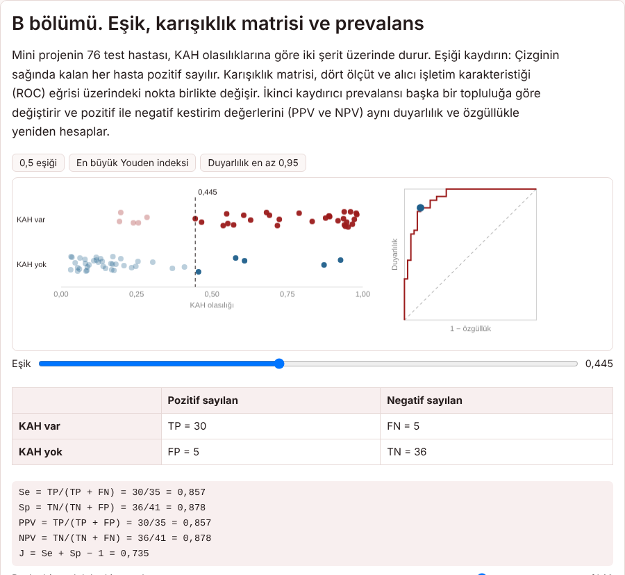
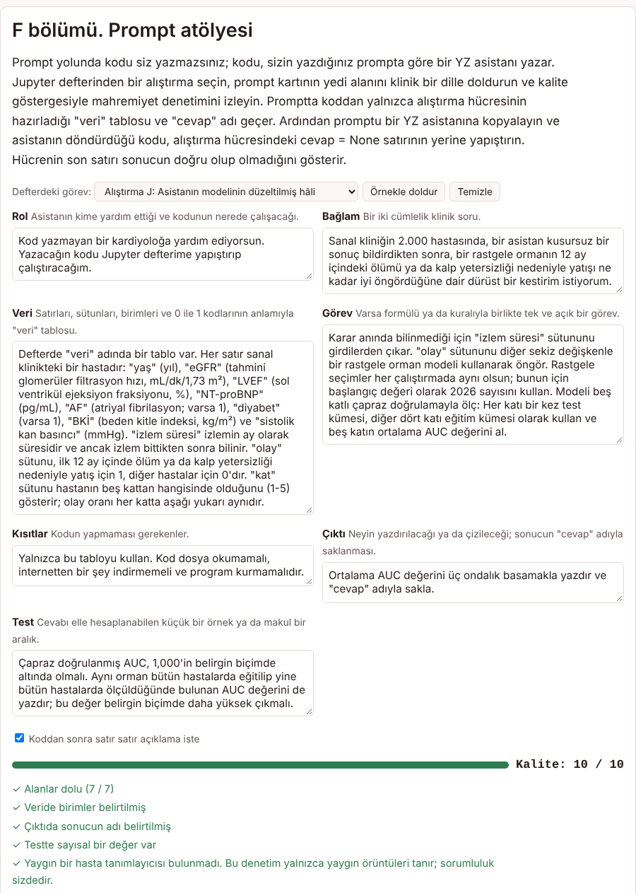

# Hafta 2: Makine öğrenmesi temelleri

**Python ile Yapay Zekâ Eğitimi: Kardiyologlar için Uygulamalı Eğitim Programı** 
Türk Kardiyoloji Derneği

*İstatistikten akıllı modellere: Kardiyoloji odaklı*

[Eğitimin ana sayfası](../../README.tr.md) · [İzlence](../../SYLLABUS.tr.md) · [Kurulum](../../SETUP.tr.md) · [English](../../en/week-02/README.md)

## Hafta hakkında

İlk iki saatte scikit-learn ile denetimli modeller kurulur. Modelleme pipeline'ı ilk bir regresyon çizgisiyle tanıtılır ve Cleveland verisinde koroner arter hastalığı (KAH) için lojistik regresyon kurulur. Model çapraz doğrulama, alıcı işletim karakteristiği (ROC) eğrisi ve eğri altındaki alanla değerlendirilir; duyarlılığı ve özgüllüğü yorumlanır, ardından bir karar ağacı bir rastgele ormanla karşılaştırılır. Mini projede bir KAH tahmin modeli kurulur ve modelin ROC eğrisi ile AUC değeri incelenir. Son iki saatte dengesiz veri SMOTE ile ele alınır, kalp yetersizliği fenogrupları k-ortalamalar yöntemiyle bulunur, UMAP ve t-SNE haritalarında gösterilir ve prognozları Kaplan-Meier eğrileri ile log-rank testiyle karşılaştırılır. Sanal klinik 2.000 hastaya ulaşır ve risk polikliniğini açar.

Oturum 4 saat sürer. Haftalık proje için yaklaşık 3 saat ayrılmalıdır.

## Haftanın vakası

**VC-0246, 57 yaşında bir erkek hastadır.** Yeni açılan risk polikliniğine başvurmuştur. Sigara içmektedir ve tedavi altında hipertansiyonu vardır; LDL kolesterolü 170 mg/dL, HDL kolesterolü 36 mg/dL'dir. Efor testinde anjina ve 1,6 mm ST çökmesi gelişmiştir. Kliniğin bir sayıya, yani hastanın koroner arter hastalığı olasılığına ihtiyacı vardır; bu sayıya ne kadar güvenilebileceğini de bilmesi gerekir. [Ders sayfası](https://utkukose.github.io/ai-cardiology-tkd-NB-lecture/tr/hafta-02/ders.html) bu vakayla açılır; sanal klinik soruyu son bölümde cevaplar.

## Malzemeler

| Malzeme | Aç | Ne işe yarar? |
|---|---|---|
| **Ders sayfası** | [Ders sayfasını aç](https://utkukose.github.io/ai-cardiology-tkd-NB-lecture/tr/hafta-02/ders.html) | Haftanın anlatımıdır. Yukarıdan aşağıya okunur, uygulama duraklarına götürür ve kod ya da prompt (istem) içermez. |
| **Etkileşimli lab** | [Etkileşimli labı aç](https://utkukose.github.io/ai-cardiology-tkd-NB-lecture/tr/hafta-02/lab.html) | Kod gerektirmeyen A-F bölümleri, ders sayfasında yeri geldiğinde açılır. F bölümü prompt atölyesidir. Öz değerlendirme ve öğrenme günlüğü de labdadır. |
| **Jupyter defteri** |  [Jupyter için indir](NB02_makine_ogrenmesi_temelleri.ipynb) | Uygulama durakları burada çalışılır: Kısım 1 prompt yolu, Kısım 2 Python yoludur. Defter Google Colab'da kurulum gerektirmeden ya da kendi bilgisayarınızdaki Jupyter'de çalışır. |
| **Prompt kütüphanesi** | [PROMPTLAR.md](PROMPTLAR.md) | Prompt yolunun ve haftalık projenin bütün promptlarını, kodu onarmak, açıklatmak ve denetlemek için promptlarla birlikte içerir. GitHub'da her promptun yanında bir kopyalama düğmesi bulunur. |
| **PDF ders notu** | [Hafta02_Ders_Notlari.pdf](Hafta02_Ders_Notlari.pdf) | Ders sayfasının yazdırılabilir biçimidir. |

## Çalışma yolu

Ders sayfası yukarıdan aşağıya okunur ve etkileşimli labın bölümlerini yeri geldikçe açar. Her uygulama durağında çalışma Jupyter defterinde, iki yoldan biriyle sürer. **Prompt yolunda** (defterin 1. kısmı) kodu hazır promptlarla bir yapay zekâ (YZ) asistanı yazar; katılımcı kodu çalıştırır ve sonucu denetler. **Python yolunda** (2. kısım) kodu katılımcı kendisi yazar. İki yol da aynı sonuçlara varır. Oturuma katılanlar adımları oturumda tamamlar. Süreler, haftayı kendi başına izleyenler, örneğin bir oturumu kaçıranlar içindir.

| Adım | Ne yapılır? | Prompt yolu (Kısım 1) | Python yolu (Kısım 2) |
|---|---|---|---|
| 1 | Haftanın vakasını ve ders sayfasının ilk iki saatini 1. uygulama durağına, yani mini projeye kadar [okuyun](https://utkukose.github.io/ai-cardiology-tkd-NB-lecture/tr/hafta-02/ders.html); etkileşimli labın A ve B bölümlerini yapın ve bilgi kontrolü sorularını cevaplayın | 1 saat 10 dakika | 1 saat 10 dakika |
| 2 | **[1. uygulama durağı: Mini proje: KAH tahmin modeli, ROC eğrisi ve AUC](https://utkukose.github.io/ai-cardiology-tkd-NB-lecture/tr/hafta-02/ders.html#stop-1)** | Kısım 1, Durak 1 ([promptlar](PROMPTLAR.md#durak-1-mini-proje-kah-tahmin-modeli-roc-e%C4%9Frisi-ve-auc)) 30 dakika | Python adımı 2, 1. ve 2. bölümler 1 saat 15 dakika |
| 3 | 2. uygulama durağına kadar [okumayı sürdürün](https://utkukose.github.io/ai-cardiology-tkd-NB-lecture/tr/hafta-02/ders.html#decision-trees-and-random-forests) (karar ağacı ve rastgele orman karşılaştırması, SMOTE ile dengesiz veri) | 35 dakika | 35 dakika |
| 4 | **[2. uygulama durağı: Bir modeli dürüstçe sınamak](https://utkukose.github.io/ai-cardiology-tkd-NB-lecture/tr/hafta-02/ders.html#stop-2)** | Kısım 1, Durak 2 ([promptlar](PROMPTLAR.md#durak-2-bir-modeli-d%C3%BCr%C3%BCst%C3%A7e-s%C4%B1namak)) 30 dakika | 3-6. bölümler 1 saat 5 dakika |
| 5 | 3. uygulama durağına kadar [okumayı sürdürün](https://utkukose.github.io/ai-cardiology-tkd-NB-lecture/tr/hafta-02/ders.html#unsupervised-learning-k-means-and-phenogroups) (k-ortalamalar, UMAP ve t-SNE haritaları, Kaplan-Meier eğrisi) ve etkileşimli labın C, D, E ve F bölümlerini yapın | 55 dakika | 55 dakika |
| 6 | **[3. uygulama durağı: Alt gruplar, sağkalım ve denetlenecek bir model](https://utkukose.github.io/ai-cardiology-tkd-NB-lecture/tr/hafta-02/ders.html#stop-3)** | Kısım 1, Durak 3 ([promptlar](PROMPTLAR.md#durak-3-alt-gruplar-sa%C4%9Fkal%C4%B1m-ve-denetlenecek-bir-model)) 30 dakika | 7-9. bölümler 55 dakika |
| 7 | Haftanın makalesini, sanal kliniğin bu haftaki aşamasını ve "Kendi verinizle" bölümünü [okuyun](https://utkukose.github.io/ai-cardiology-tkd-NB-lecture/tr/hafta-02/ders.html#the-paper-of-the-week) | 30 dakika | 30 dakika |
| 8 | [Etkileşimli labın](https://utkukose.github.io/ai-cardiology-tkd-NB-lecture/tr/hafta-02/lab.html) "Kendini sına" sekmesindeki öz değerlendirmeyi yapın, yansıtma yazınızı yazın ve öğrenme günlüğünü dışa aktarın | 20 dakika | 20 dakika |
| | **Haftalık proje dışında toplam** | **5 saat** | **6 saat 45 dakika** |
| 9 | [Haftalık projeyi](#haftal%C4%B1k-proje) iki yoldan biriyle tamamlayın | [Promptlar](PROMPTLAR.md#haftal%C4%B1k-projenin-prompt-yolu) 3 saat | 3 saat |

<table>
<tr><td width="50%"></td><td width="50%"></td></tr>
<tr><td>Etkileşimli lab, C bölümü: Kalp yetersizliği olan hastalar üç boyutta, adım adım k-ortalamalar yöntemiyle kümelenir.</td><td>Jupyter defteri, 8. bölüm: Üç kümenin ve HFrEF ile HFpEF gruplarının Kaplan-Meier eğrileri çizilir.</td></tr>
<tr><td width="50%"></td><td width="50%"></td></tr>
<tr><td>Etkileşimli lab, B bölümü: Koroner arter hastalığı modelinin eşiği değiştirilir; karışıklık matrisi ve ROC eğrisi buna göre güncellenir.</td><td>Etkileşimli lab, F bölümü: Prompt atölyesinde prompt kartının yedi alanı doldurulur; bir kalite göstergesi ve hasta verisi uyarısı yazılanı değerlendirir.</td></tr>
</table>

## Haftalık proje

**Proje.** HFpEF vs HFrEF hasta kümeleme + Kaplan-Meier sağkalım analizi.

**Ne yapılacak?** Sanal kliniğin kaydındaki kalp yetersizliği fenogruplarını bulun ve prognozlarını karşılaştırın. Önce HFrEF ya da HFpEF tanısı olan hastaları dokuz standartlaştırılmış değişkenle ve k = 2-6 için k-ortalamalar yöntemiyle kümeleyin; k değerini siluet değerine ve klinik anlama bakarak seçin. Ardından her kümeyi bir tabloda tanımlayın ve kümeye kısa bir klinik ad verin. Sonra kümelerin ve HFrEF ile HFpEF gruplarının Kaplan-Meier eğrilerini çizin ve eğrileri log-rank testiyle karşılaştırın. Daha sonra kümeleri, dersin kayda gizlediği fenogruplarla bir çapraz tablo ve düzeltilmiş Rand indeksi yardımıyla karşılaştırın. Son olarak kümelemenin, tek başına ejeksiyon fraksiyonunun kaçırdığı hangi bilgiyi ortaya çıkardığını yazın.

**Nereye bakılacak?** Ders sayfasında "K-Means ile hasta alt gruplarını bulma", "UMAP / t-SNE görselleştirmesi", "Survival analysis (sağkalım analizi): Kaplan-Meier eğrisi" ve "Haftanın makalesi" bölümlerine bakın. Etkileşimli labda C, D ve F bölümleri, Jupyter defterinde ise 7. ve 8. bölümler yardımcı olur.

**Prompt yolu.** Proje, [prompt kütüphanesindeki](https://github.com/utkukose/ai-cardiology-tkd-NB-lecture/blob/main/tr/hafta-02/PROMPTLAR.md#haftal%C4%B1k-projenin-prompt-yolu) dört promptla da tamamlanabilir; her adım için bir prompt vardır. Jupyter defterinin 1. kısmının sonundaki "Prompt yolunda haftalık proje" bölümü her promptun tablosunu hazırlar. Bir promptun testi sağlanmadan sonraki prompta geçilmez.

**Örnek.** 5. ayda risk altındaki üç hastadan birinde olay görülürse çarpan $1 - 1/3 = 0{,}667$ olur. 5. aydan önceki sağkalım 0,800 ise eğri $0{,}800 \times 0{,}667 = 0{,}533$ değerine iner. Bir kümenin Kaplan-Meier eğrisindeki her basamak aynı yolla hesaplanır.

**Ne teslim edilecek?** [Rapor şablonuyla](../sablonlar/Rapor_Sablonu.docx) yazılmış, bir ya da iki sayfalık bir rapor teslim edilir. Raporda kümelerin tablosu, Kaplan-Meier şekli, iki log-rank testi ve gizli fenogruplarla karşılaştırma yer almalıdır. Rapora YZ kullanım günlüğünü (kullanılan araç, prompt, neyin denetlendiği ve neyin değiştirildiği) ve çıktılarıyla birlikte Jupyter defterini ekleyin.

**Teslim.** Haftalık proje, 3. haftanın oturumundan önce utkukose@sdu.edu.tr ya da utkukose@gmail.com adresine e-postayla gönderilir. E-postaya "Ne teslim edilecek?" başlığında sayılan öğeler ve etkileşimli labdan dışa aktarılan öğrenme günlüğü eklenir. Haftalık projeler değerlendirmenin yüzde 40'ını oluşturur; değerlendirme ölçütleri izlencede yer almaktadır.

## Öğrenme çıktıları

Haftanın sonunda katılımcıların bir klinik tabloyu modele hazırlayabilmeleri, scikit-learn ile bir modelleme pipeline'ı kurabilmeleri, doğrusal ve lojistik regresyon modellerini eğitip sonuçlarını okuyabilmeleri beklenmektedir. Bir modelin başarımını karışıklık matrisi, duyarlılık, özgüllük, öngörü değerleri, ROC eğrisi ve eğri altındaki alanla ölçebilmeli, duyarlılık ile özgüllüğü bir hastalığı dışlama ya da doğrulama açısından yorumlayabilmeli ve başarımı test hastalarından bilgi sızdırmadan çapraz doğrulamayla kestirebilmelidirler. Bir karar ağacını rastgele bir ormanla karşılaştırabilmeli, nadir sonuçlarda doğruluğun neden yanılttığını ve SMOTE ile sınıf ağırlıklarının olasılıkları nasıl değiştirdiğini açıklayabilmelidirler. Son olarak k-ortalamalar yöntemiyle hasta alt gruplarını bulabilmeli, bu grupları bir t-SNE ya da UMAP haritasında gösterebilmeli, prognozlarını Kaplan-Meier eğrileri ve log-rank testiyle karşılaştırabilmeli ve bir YZ asistanının kurduğu modeli dört soruyla denetleyebilmelidirler.

## Oturumun eğitim akışı

Haftanın dört saatlik oturumu aşağıdaki plana göre işlenir. Plan, malzemelerin canlı bir oturumda nasıl bir araya geldiğini göstermek için paylaşılmaktadır.

| Süre | Etkinlik |
|---|---|
| 0:00-0:15 | Haftanın vakası VC-0246 tanıtılır ve haftanın rotası anlatılır. Her katılımcı defteri Google Colab'da ya da Jupyter'de açar ve 0. bölümü çalıştırır. |
| 0:15-0:45 | İlk iki saat, sınıflandırma ve regresyon: Makine öğrenmesinin temel fikirleri, scikit-learn ile modelleme pipeline'ı ve ilk regresyon çizgisi anlatılır; etkileşimli labın A bölümüyle KAH riski için lojistik regresyon çalışılır. |
| 0:45-1:15 | Çapraz doğrulama, ROC-AUC ve duyarlılık ile özgüllüğün yorumu etkileşimli labın B bölümüyle çalışılır. |
| 1:15-1:45 | Mini proje, 1. uygulama durağı: Katılımcılar prompt yolu ve Python yolu olmak üzere iki gruba ayrılır ve Cleveland verisinde bir KAH tahmin modeli kurarak modelin ROC eğrisini ve AUC değerini inceler. Durağın sonunda iki grup, test kümesindeki AUC değerlerini karşılaştırır. |
| 1:45-2:00 | Karar ağacı ve rastgele orman karşılaştırılır. |
| 2:00-2:10 | Ara. |
| 2:10-2:40 | Son iki saat, kümeleme ve hasta segmentasyonu: SMOTE ile dengesiz veriyle başa çıkma anlatılır. Ardından 2. uygulama durağına geçilir. |
| 2:40-3:20 | C bölümüyle k-ortalamalar yöntemiyle hasta alt grupları bulunur, UMAP ve t-SNE haritaları incelenir, D bölümüyle Kaplan-Meier eğrisi, E ve F bölümleriyle bir modelin denetlenmesi çalışılır. Ardından 3. uygulama durağına geçilir. |
| 3:20-3:45 | Haftanın makalesi, sanal kliniğin risk polikliniği ve "Kendi verinizle" bölümü ele alınır. |
| 3:45-4:00 | Haftalık proje tanıtılır ve sorular cevaplanır. |

## Kendi verinizle

Ders sayfası, haftanın yöntemlerini kendi verinize nasıl uygulayacağınızı anlatan bir bölümle biter. Bu bölümde hangi sorunun hangi yönteme uyduğu, önce neyin denetleneceği, etik kurul onayı, Kişisel Verilerin Korunması Kanunu (KVKK) ve analizin nerede yapılacağı ele alınır. [Bölümü ders sayfasında okuyun](https://utkukose.github.io/ai-cardiology-tkd-NB-lecture/tr/hafta-02/ders.html#with-your-own-data).

## İsteğe bağlı araştırma ödevi

PubMed'de, 2020 ya da sonrasında yayımlanmış ve kalp yetersizliği hastalarının prognozu için bir makine öğrenmesi modeli geliştiren ya da doğrulayan bir çalışma bulun. Çalışmayı yarım sayfada özetleyin; özette hasta grubu, sonuç ve izlem süresi, model, modelin nasıl doğrulandığı ve çalışmanın bir sınırlılığı yer almalıdır. [Haftanın makalesindeki](https://utkukose.github.io/ai-cardiology-tkd-NB-lecture/tr/hafta-02/ders.html#the-paper-of-the-week) üç soru özetinize yol gösterebilir. Bu ödev notlandırılmaz; 3. haftadaki dış doğrulama tartışmasına hazırlık amacı taşır.

## Bu haftadan sonra sanal klinik

Sanal klinik 2. haftada, beş yıllık izlem verisi bulunan 2.000 hastaya ulaşır ve risk polikliniğini açar. Kliniğin koroner arter hastalığı modeli, kaydı üreten gerçek etkilerle karşılaştırılır; kalp yetersizliği olan hastalar da prognozu birbirinden farklı fenogruplara ayrılır. Sonuçlar, ders sayfasının [Sanal klinik, 2. aşama](https://utkukose.github.io/ai-cardiology-tkd-NB-lecture/tr/hafta-02/ders.html#the-virtual-clinic-stage-2-the-risk-outpatient-clinic-opens) bölümünde yer almaktadır.

## Gelecek hafta

**Hafta 3: Derin öğrenme ve evrişimli sinir ağları.** Sanal klinik görüntüleme laboratuvarını açar. Sinir ağlarının görüntülerden nasıl öğrendiği anlatılır ve evrişimli bir ağ, ACDC'nin sine kardiyak manyetik rezonans incelemelerini normal kalp, dilate kardiyomiyopati ve hipertrofik kardiyomiyopati olarak sınıflandırır. Karışıklık matrisi ve F1 skoru, aşırı öğrenmeye dikkat edilerek okunur. Defter ACDC verisini kendisi indirir. Oturumun mini projesi, Stanford AIMI'de kişisel kayıt gerektiren EchoNet-Dynamic'i kullanmaktadır; projeyi kendisi çalıştırmak isteyen katılımcılar oturumdan önce kaydolabilir ([DATASETS.tr.md](../../DATASETS.tr.md#3-haftanın-veri-setleri)). Ayrıntılar için [eğitimin planına](../../README.tr.md#on-bir-hafta) bakın.

---

**Prof. Dr. Utku Köse**

Profesör, Bilgisayar Mühendisliği Bölümü, Süleyman Demirel Üniversitesi, Isparta, Türkiye 
Kurucu Müdür, Yapay Zekâ Uygulama ve Araştırma Merkezi (YAZEM), Süleyman Demirel Üniversitesi 
Bilgisayar Bilimleri Anabilim Dalı Başkanı, Bilgisayar Mühendisliği Bölümü, Süleyman Demirel Üniversitesi 
Diğer kurumlar: University of North Dakota (ABD), Universidad Panamericana (Meksiko, Meksika), Vel Tech University (Chennai, Hindistan) 
IEEE Kıdemli Üyesi, ACM Profesyonel Üyesi

[ORCID 0000-0002-9652-6415](https://orcid.org/0000-0002-9652-6415) | [utkukose.com](https://www.utkukose.com) | [github.com/utkukose](https://github.com/utkukose)

[utkukose@sdu.edu.tr](mailto:utkukose@sdu.edu.tr) | [utku.kose@und.edu](mailto:utku.kose@und.edu) | [ukose@up.edu.mx](mailto:ukose@up.edu.mx) | [utkukose@gmail.com](mailto:utkukose@gmail.com)

*İlk sürüm: Kasım 2026. İçerik CC BY 4.0, kod MIT.*

