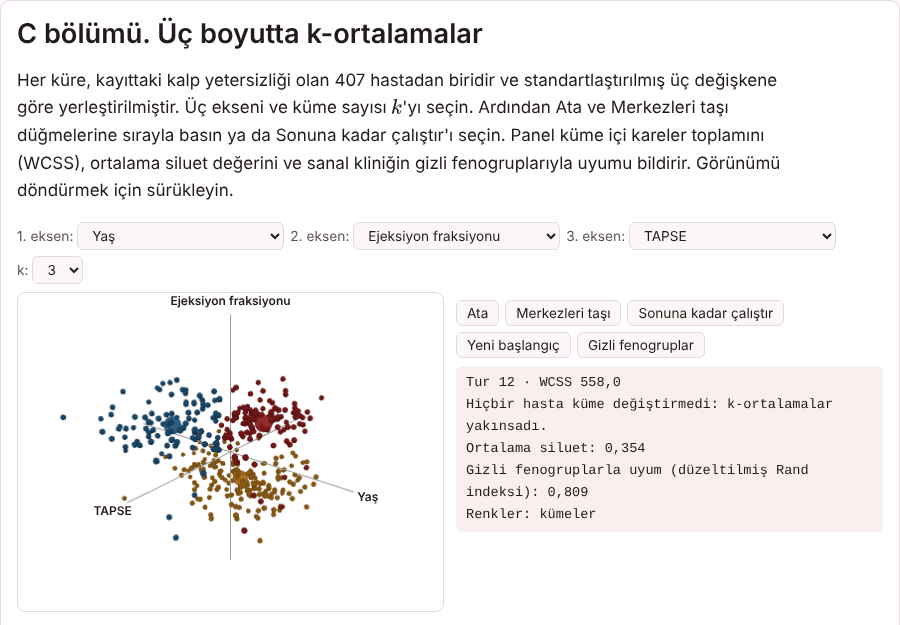

# Hafta 2: Makine öğrenmesi temelleri

**Python ile Yapay Zekâ Eğitimi: Kardiyologlar için Uygulamalı Eğitim Programı** 
Türk Kardiyoloji Derneği

*Risk faktörlerinden olasılığa, tek tek hastalardan fenogruplara geçilir.*

[Eğitimin ana sayfası](../../README.tr.md) · [İzlence](../../SYLLABUS.tr.md) · [Kurulum](../../SETUP.tr.md) · [English](../../en/week-02/README.md)

## Hafta hakkında

Hafta, scikit-learn ile denetimli öğrenmeyle başlar. Cleveland verisinde koroner arter hastalığı için lojistik regresyon kurulur ve model, karışıklık matrisi ile alıcı işletim karakteristiği (ROC) eğrisiyle değerlendirilir. Ardından çapraz doğrulama, veri sızıntısı, karar ağaçları, rastgele ormanlar ve nadir sonuçların tuzakları ele alınır. Denetimsiz öğrenmede k-ortalamalar yöntemiyle kalp yetersizliği fenogrupları bulunur; Kaplan-Meier eğrileri ve log-rank testi bu grupların prognozunu karşılaştırır. Sanal klinik 2.000 hastaya ulaşır ve risk polikliniğini açar.

Oturum 4 saat sürer. Haftalık proje için yaklaşık 3 saat ayrılmalıdır.

## Haftanın rotası

Ders sayfası haftanın ana rotasıdır. Sayfada kod ya da prompt (istem) bulunmaz; sayfa etkileşimli labla birlikte yukarıdan aşağıya okunur. Her uygulama durağında katılımcılar Jupyter defterindeki iki yoldan birini seçer. **Prompt yolunda** (Kısım 1) kodu, hazır promptlara göre bir yapay zekâ (YZ) asistanı yazar; katılımcı bu kodu çalıştırır ve sonucu denetler. **Python yolunda** (Kısım 2) ise kodu katılımcı kendisi yazar. İki yol da aynı sonuçlara varır. Defter hem kurulum gerektirmeyen Google Colab'da hem de kendi bilgisayarınızdaki Jupyter'de çalışır ([kurulum](../../SETUP.tr.md)).

|  | Ana rota: Ders sayfası ve etkileşimli lab | Uygulama durağı: Yolunuzu seçin |
|---|---|---|
| 1 | [Tek sayfada makine öğrenmesi](https://utkukose.github.io/ai-cardiology-tkd-NB-lecture/tr/hafta-02/ders.html#machine-learning-in-one-page), [Lojistik regresyon: Risk faktörlerinden olasılığa](https://utkukose.github.io/ai-cardiology-tkd-NB-lecture/tr/hafta-02/ders.html#logistic-regression-from-risk-factors-to-a-probability), [Bir modeli değerlendirmek: Karışıklık matrisi ve ROC eğrisi](https://utkukose.github.io/ai-cardiology-tkd-NB-lecture/tr/hafta-02/ders.html#measuring-a-model-confusion-matrix-and-roc-curve) | **[Durak 1: İlk risk modeli](https://utkukose.github.io/ai-cardiology-tkd-NB-lecture/tr/hafta-02/ders.html#stop-1)** Prompt yolu: Kısım 1, Durak 1 Python yolu: Kısım 2, Python adımı 2, 1. ve 2. bölümler |
| 2 | [Eğitim ve test: Çapraz doğrulama ve veri sızıntısı](https://utkukose.github.io/ai-cardiology-tkd-NB-lecture/tr/hafta-02/ders.html#training-and-testing-cross-validation-and-data-leakage), [Karar ağaçları ve rastgele ormanlar](https://utkukose.github.io/ai-cardiology-tkd-NB-lecture/tr/hafta-02/ders.html#decision-trees-and-random-forests), [Nadir sonuçlar: Dengesiz veri](https://utkukose.github.io/ai-cardiology-tkd-NB-lecture/tr/hafta-02/ders.html#rare-outcomes-imbalanced-data) | **[Durak 2: Bir modeli dürüstçe sınamak](https://utkukose.github.io/ai-cardiology-tkd-NB-lecture/tr/hafta-02/ders.html#stop-2)** Prompt yolu: Kısım 1, Durak 2 Python yolu: Kısım 2, 3-6. bölümler |
| 3 | [Denetimsiz öğrenme: k-ortalamalar ve fenogruplar](https://utkukose.github.io/ai-cardiology-tkd-NB-lecture/tr/hafta-02/ders.html#unsupervised-learning-k-means-and-phenogroups), [Sağkalım analizi: Kaplan-Meier ve log-rank testi](https://utkukose.github.io/ai-cardiology-tkd-NB-lecture/tr/hafta-02/ders.html#survival-analysis-kaplan-meier-and-the-log-rank-test), [YZ asistanıyla çalışmak, 2. bölüm: Bir modeli denetlemek](https://utkukose.github.io/ai-cardiology-tkd-NB-lecture/tr/hafta-02/ders.html#ai-pair-programming-part-2-reviewing-a-model-built-by-an-assistant) | **[Durak 3: Alt gruplar, sağkalım ve denetlenecek bir model](https://utkukose.github.io/ai-cardiology-tkd-NB-lecture/tr/hafta-02/ders.html#stop-3)** Prompt yolu: Kısım 1, Durak 3 Python yolu: Kısım 2, 7-9. bölümler |
|  | [Haftanın makalesi](https://utkukose.github.io/ai-cardiology-tkd-NB-lecture/tr/hafta-02/ders.html#the-paper-of-the-week), [Sanal klinik, 2. aşama: Risk polikliniği açılıyor](https://utkukose.github.io/ai-cardiology-tkd-NB-lecture/tr/hafta-02/ders.html#the-virtual-clinic-stage-2-the-risk-outpatient-clinic-opens) | "Kendi verinizle" bölümü, haftanın makalesi ve sanal klinik |

## Malzemeler

| Malzeme | Aç | İçeriği |
|---|---|---|
| **Ders sayfası (ana rota)** | [Ders sayfasını aç](https://utkukose.github.io/ai-cardiology-tkd-NB-lecture/tr/hafta-02/ders.html) | Vakayı, kavramları çözümlü örnekleriyle, k-ortalamaların üç boyutlu (3B) sahnesini, iki animasyonu, bilgi kontrolü sorularını, üç uygulama durağını, "Kendi verinizle" bölümünü, tekrar kartlarını ve kaynakları içerir. Sayfada kod ve prompt yer almaz. |
| **Etkileşimli lab** | [Etkileşimli labı aç](https://utkukose.github.io/ai-cardiology-tkd-NB-lecture/tr/hafta-02/lab.html) | Kod gerektirmeyen A'dan F'ye kadar altı bölümü (F bölümü prompt atölyesidir), öz değerlendirmeyi, yansıtma yazısını ve dışa aktarılabilen öğrenme günlüğünü içerir |
| **Jupyter defteri** |  [Jupyter için indir](NB02_makine_ogrenmesi_temelleri.ipynb) | Kısım 1 prompt yoludur: Üç durakta toplam dokuz adım vardır ve her adımda hazır bir prompt, adımın tablosunu hazırlayan bir veri hücresi, YZ asistanının kodu için bir hücre, otomatik bir kontrol ve hazır kod bulunur. Kısmın sonunda haftalık proje dört promptla yer alır. Kısım 2 Python yoludur: Python adımı 2'yi, A-J alıştırmalarıyla birlikte 1-10. bölümleri, bir uygulama anahtarını ve yedi alan için uygulama görevlerini içerir. |
| **Prompt kütüphanesi** | [PROMPTLAR.md](PROMPTLAR.md) | Prompt yolunun bütün promptlarını, kodu onarmaya yarayan promptları ve haftalık projenin prompt yolunu içerir. GitHub'da her promptun yanında bir kopyalama düğmesi bulunur. |
| **PDF ders notu** | [Hafta02_Ders_Notlari.pdf](Hafta02_Ders_Notlari.pdf) | Ders sayfasının yazdırılabilir biçimidir; uygulama duraklarını ve "Kendi verinizle" bölümünü de içerir. |

<table>
<tr><td width="50%"></td><td width="50%"></td></tr>
<tr><td>Etkileşimli lab, C bölümü: Kalp yetersizliği olan hastalar üç boyutta, adım adım k-ortalamalar yöntemiyle kümelenir.</td><td>Jupyter defteri, 8. bölüm: Üç kümenin ve HFrEF ile HFpEF gruplarının Kaplan-Meier eğrileri çizilir.</td></tr>
<tr><td width="50%"></td><td width="50%"></td></tr>
<tr><td>Etkileşimli lab, B bölümü: Koroner arter hastalığı modelinin eşiği değiştirilir; karışıklık matrisi ve ROC eğrisi buna göre güncellenir.</td><td>Etkileşimli lab, F bölümü: Prompt atölyesinde prompt kartının yedi alanı doldurulur; bir kalite göstergesi ve hasta verisi uyarısı yazılanı değerlendirir.</td></tr>
</table>

## Haftanın vakası

**VC-0246, 57 yaşında bir erkek hastadır.** Yeni açılan risk polikliniğine başvurmuştur. Sigara içmektedir ve tedavi altında hipertansiyonu vardır; LDL kolesterolü 170 mg/dL, HDL kolesterolü 36 mg/dL'dir. Efor testinde anjina ve 1,6 mm ST çökmesi gelişmiştir. Kliniğin bir sayıya, yani hastanın koroner arter hastalığı olasılığına ihtiyacı vardır; bu sayıya ne kadar güvenilebileceğini de bilmesi gerekir. [Ders sayfası](https://utkukose.github.io/ai-cardiology-tkd-NB-lecture/tr/hafta-02/ders.html) bu vakayla açılır; sanal klinik soruyu son bölümde cevaplar.

## Öğrenme çıktıları

Haftanın sonunda katılımcıların bir klinik tabloyu modele hazırlayabilmeleri, scikit-learn ile bir lojistik regresyon modeli kurabilmeleri ve bu modelin sonuçlarını okuyabilmeleri beklenmektedir. Bir modelin başarımını karışıklık matrisi, duyarlılık, özgüllük, öngörü değerleri, ROC eğrisi ve eğri altındaki alanla ölçebilmeli; bu başarımı test hastalarından bilgi sızdırmadan çapraz doğrulamayla kestirebilmelidirler. Bir karar ağacını rastgele bir ormanla karşılaştırabilmeli, nadir sonuçlarda doğruluğun neden yanılttığını ve pozitif öngörü değerinin prevalansa nasıl bağlı olduğunu açıklayabilmelidirler. Son olarak k-ortalamalar yöntemiyle hasta alt gruplarını bulabilmeli, bu grupların prognozunu Kaplan-Meier eğrileri ve log-rank testiyle karşılaştırabilmeli ve bir YZ asistanının kurduğu modeli dört soruyla denetleyebilmelidirler.

## Çalışma yolu

Oturuma katılanlar ana rotayı ve uygulama duraklarını oturumda tamamlar. Haftayı kendi başına izleyenler, örneğin bir oturumu kaçıranlar, aşağıdaki sürelerle plan yapabilir.

| Adım | Etkinlik | Prompt yolu | Python yolu |
|---|---|---|---|
| 1 | Haftanın vakasını ve ders sayfasını 1. uygulama durağına kadar okuyun; etkileşimli labın A ve B bölümlerini yapın ve bilgi kontrolü sorularını cevaplayın | 55 dakika | 55 dakika |
| 2 | 1. uygulama durağı: Prompt yolunda Kısım 1'deki Durak 1'i, Python yolunda Python adımı 2'yi ve 1. ile 2. bölümleri çalışın | 30 dakika | 1 saat 10 dakika |
| 3 | 2. uygulama durağına kadar okumayı sürdürün (çapraz doğrulama, karar ağaçları ve rastgele ormanlar, nadir sonuçlar) | 35 dakika | 35 dakika |
| 4 | 2. uygulama durağı: Prompt yolunda Kısım 1'deki Durak 2'yi, Python yolunda 3, 4, 5 ve 6. bölümleri çalışın | 30 dakika | 1 saat |
| 5 | 3. uygulama durağına kadar okumayı sürdürün ve etkileşimli labın C, D, E ve F bölümlerini yapın | 50 dakika | 50 dakika |
| 6 | 3. uygulama durağı: Prompt yolunda Kısım 1'deki Durak 3'ü, Python yolunda 7, 8 ve 9. bölümleri çalışın | 30 dakika | 50 dakika |
| 7 | Haftanın makalesini, sanal kliniğin bu haftaki aşamasını ve "Kendi verinizle" bölümünü okuyun | 30 dakika | 30 dakika |
| 8 | Etkileşimli labın "Kendini sına" sekmesindeki öz değerlendirmeyi yapın, yansıtma yazınızı yazın ve öğrenme günlüğünü dışa aktarın | 20 dakika | 20 dakika |
| | **Haftalık proje dışında toplam** | **4 saat 40 dakika** | **6 saat 10 dakika** |
| 9 | Haftalık projeyi iki yoldan biriyle tamamlayın | 3 saat | 3 saat |

## Oturumun eğitim akışı

Haftanın dört saatlik oturumu aşağıdaki plana göre işlenir. Plan, malzemelerin canlı bir oturumda nasıl bir araya geldiğini göstermek için paylaşılmaktadır.

| Süre | Etkinlik |
|---|---|
| 0:00-0:15 | Haftanın vakası VC-0246 tanıtılır ve haftanın rotası anlatılır. Her katılımcı defteri Google Colab'da ya da Jupyter'de açar ve 0. bölümü çalıştırır. |
| 0:15-0:55 | Ana rotada makine öğrenmesinin temel fikirleri anlatılır. Etkileşimli labın A bölümüyle lojistik regresyon, B bölümüyle de karışıklık matrisi ve ROC eğrisi çalışılır. |
| 0:55-1:35 | 1. uygulama durağında katılımcılar iki gruba ayrılır: Prompt yolunu izleyenler ve Python yolunu izleyenler. Durağın sonunda iki grup, test kümesindeki AUC değerlerini karşılaştırır. |
| 1:35-1:50 | Ara. |
| 1:50-2:30 | Ana rotada çapraz doğrulama ve veri sızıntısı, karar ağaçları ve rastgele ormanlar ile nadir sonuçlar anlatılır. Ardından 2. uygulama durağına geçilir. |
| 2:30-3:20 | Ana rotada C bölümüyle üç boyutta k-ortalamalar, D bölümüyle elle Kaplan-Meier hesabı, E ve F bölümleriyle de bir modelin denetlenmesi çalışılır. Ardından 3. uygulama durağına geçilir. |
| 3:20-3:45 | Haftanın makalesi, sanal kliniğin risk polikliniği ve "Kendi verinizle" bölümü ele alınır. |
| 3:45-4:00 | Haftalık proje tanıtılır ve sorular cevaplanır. |

## Haftalık proje

**Ne yapılacak?** Sanal kliniğin kaydındaki kalp yetersizliği fenogruplarını bulun ve prognozlarını karşılaştırın. Önce HFrEF ya da HFpEF tanısı olan hastaları dokuz standartlaştırılmış değişkenle ve k = 2-6 için k-ortalamalar yöntemiyle kümeleyin; k değerini siluet değerine ve klinik anlama bakarak seçin. Ardından her kümeyi bir tabloda tanımlayın ve kümeye kısa bir klinik ad verin. Sonra kümelerin ve HFrEF ile HFpEF gruplarının Kaplan-Meier eğrilerini çizin ve eğrileri log-rank testiyle karşılaştırın. Daha sonra kümeleri, dersin kayda gizlediği fenogruplarla bir çapraz tablo ve düzeltilmiş Rand indeksi yardımıyla karşılaştırın. Son olarak kümelemenin, tek başına ejeksiyon fraksiyonunun kaçırdığı hangi bilgiyi ortaya çıkardığını yazın.

**Nereye bakılacak?** Ders sayfasında "Denetimsiz öğrenme: k-ortalamalar ve fenogruplar", "Sağkalım analizi: Kaplan-Meier ve log-rank testi" ve "Haftanın makalesi" bölümlerine bakın. Etkileşimli labda C, D ve F bölümleri, Jupyter defterinde ise 7. ve 8. bölümler yardımcı olur.

**Prompt yolu.** Proje, [prompt kütüphanesindeki](https://github.com/utkukose/ai-cardiology-tkd-NB-lecture/blob/main/tr/hafta-02/PROMPTLAR.md#haftal%C4%B1k-projenin-prompt-yolu) dört promptla da tamamlanabilir; her adım için bir prompt vardır. Jupyter defterinin 1. kısmının sonundaki "Prompt yolunda haftalık proje" bölümü her promptun tablosunu hazırlar. Bir promptun testi sağlanmadan sonraki prompta geçilmez.

**Örnek.** 5. ayda risk altındaki üç hastadan birinde olay görülürse çarpan $1 - 1/3 = 0{,}667$ olur. 5. aydan önceki sağkalım 0,800 ise eğri $0{,}800 \times 0{,}667 = 0{,}533$ değerine iner. Bir kümenin Kaplan-Meier eğrisindeki her basamak aynı yolla hesaplanır.

**Ne teslim edilecek?** [Rapor şablonuyla](../sablonlar/Rapor_Sablonu.docx) yazılmış, bir ya da iki sayfalık bir rapor teslim edilir. Raporda kümelerin tablosu, Kaplan-Meier şekli, iki log-rank testi ve gizli fenogruplarla karşılaştırma yer almalıdır. Rapora YZ kullanım günlüğünü (kullanılan araç, prompt, neyin denetlendiği ve neyin değiştirildiği) ve çıktılarıyla birlikte Jupyter defterini ekleyin.

**Teslim.** Haftalık proje, 3. haftanın oturumundan önce utkukose@sdu.edu.tr ya da utkukose@gmail.com adresine e-postayla gönderilir. E-postaya "Ne teslim edilecek?" başlığında sayılan öğeler ve etkileşimli labdan dışa aktarılan öğrenme günlüğü eklenir. Haftalık projeler değerlendirmenin yüzde 40'ını oluşturur; değerlendirme ölçütleri izlencede yer almaktadır.

## Kendi verinizle

Ders sayfası, haftanın yöntemlerini kendi verinize nasıl uygulayacağınızı anlatan bir bölümle biter. Bu bölümde hangi sorunun hangi yönteme uyduğu, önce neyin denetleneceği, etik kurul onayı, Kişisel Verilerin Korunması Kanunu (KVKK) ve analizin nerede yapılacağı ele alınır. [Bölümü ders sayfasında okuyun](https://utkukose.github.io/ai-cardiology-tkd-NB-lecture/tr/hafta-02/ders.html#with-your-own-data).

## İsteğe bağlı araştırma ödevi

PubMed'de, 2020 ya da sonrasında yayımlanmış ve kalp yetersizliği hastalarının prognozu için bir makine öğrenmesi modeli geliştiren ya da doğrulayan bir çalışma bulun. Çalışmayı yarım sayfada özetleyin; özette hasta grubu, sonuç ve izlem süresi, model, modelin nasıl doğrulandığı ve çalışmanın bir sınırlılığı yer almalıdır. [Haftanın makalesindeki](https://utkukose.github.io/ai-cardiology-tkd-NB-lecture/tr/hafta-02/ders.html#the-paper-of-the-week) üç soru özetinize yol gösterebilir. Bu ödev notlandırılmaz; 3. haftadaki dış doğrulama tartışmasına hazırlık amacı taşır.

## Bu haftadan sonra sanal klinik

Sanal klinik 2. haftada, beş yıllık izlem verisi bulunan 2.000 hastaya ulaşır ve risk polikliniğini açar. Kliniğin koroner arter hastalığı modeli, kaydı üreten gerçek etkilerle karşılaştırılır; kalp yetersizliği olan hastalar da prognozu birbirinden farklı fenogruplara ayrılır. Sonuçlar, ders sayfasının [Sanal klinik, 2. aşama](https://utkukose.github.io/ai-cardiology-tkd-NB-lecture/tr/hafta-02/ders.html#the-virtual-clinic-stage-2-the-risk-outpatient-clinic-opens) bölümünde yer almaktadır.

## Gelecek hafta

**Hafta 3: Derin öğrenme ve evrişimli sinir ağları.** Sanal klinik görüntüleme laboratuvarını açar. Sinir ağlarının görüntülerden nasıl öğrendiği anlatılır ve evrişimli bir ağ, ACDC'nin sine kardiyak manyetik rezonans incelemelerini normal kalp, dilate kardiyomiyopati ve hipertrofik kardiyomiyopati olarak sınıflandırır. Karışıklık matrisi ve F1 skoru, aşırı öğrenmeye dikkat edilerek okunur. Defter ACDC verisini kendisi indirir. Oturumun mini projesi, Stanford AIMI'de kişisel kayıt gerektiren EchoNet-Dynamic'i kullanmaktadır; projeyi kendisi çalıştırmak isteyen katılımcılar oturumdan önce kaydolabilir ([DATASETS.tr.md](../../DATASETS.tr.md#3-haftanın-veri-setleri)). Ayrıntılar için [eğitimin planına](../../README.tr.md#on-bir-hafta) bakın.

---

**Prof. Dr. Utku Köse**

Profesör, Bilgisayar Mühendisliği Bölümü, Süleyman Demirel Üniversitesi, Isparta, Türkiye 
Kurucu Müdür, Yapay Zekâ Uygulama ve Araştırma Merkezi (YAZEM), Süleyman Demirel Üniversitesi 
Bilgisayar Bilimleri Anabilim Dalı Başkanı, Bilgisayar Mühendisliği Bölümü, Süleyman Demirel Üniversitesi 
Diğer kurumlar: University of North Dakota (ABD), Universidad Panamericana (Meksiko, Meksika), Vel Tech University (Chennai, Hindistan) 
IEEE Kıdemli Üyesi, ACM Profesyonel Üyesi

[ORCID 0000-0002-9652-6415](https://orcid.org/0000-0002-9652-6415) | [utkukose.com](https://www.utkukose.com) | [github.com/utkukose](https://github.com/utkukose)

[utkukose@sdu.edu.tr](mailto:utkukose@sdu.edu.tr) | [utku.kose@und.edu](mailto:utku.kose@und.edu) | [ukose@up.edu.mx](mailto:ukose@up.edu.mx) | [utkukose@gmail.com](mailto:utkukose@gmail.com)

*İlk sürüm: Kasım 2026. İçerik CC BY 4.0, kod MIT.*

