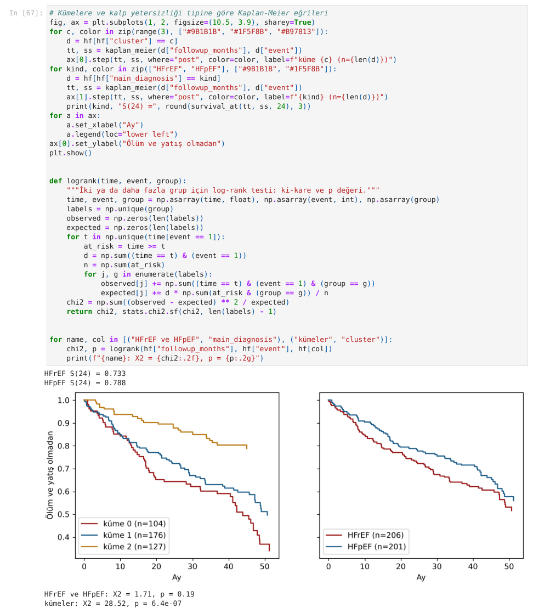

# Hafta 2: Makine öğrenmesi temelleri

**Python ile Yapay Zekâ Eğitimi: Kardiyologlar için Uygulamalı Eğitim Programı** 
Türk Kardiyoloji Derneği

*Risk faktörlerinden olasılığa, hastalardan fenogruplara*

[Eğitimin ana sayfası](../../README.tr.md) · [İzlence](../../SYLLABUS.tr.md) · [Kurulum](../../SETUP.tr.md) · [English](../../en/week-02/README.md)

## Hafta hakkında

scikit-learn ile denetimli öğrenme: Cleveland verisinde koroner arter hastalığı için lojistik regresyon, karışıklık matrisi ve alıcı işletim karakteristiği (ROC) eğrisi, çapraz doğrulama ve veri sızıntısı, karar ağaçları ve rastgele ormanlar, nadir sonuçların tuzakları. Ardından denetimsiz öğrenme k-ortalamalarla kalp yetersizliği fenogruplarını bulur; Kaplan-Meier eğrileri ve log-rank testi bu grupların prognozunu karşılaştırır. Sanal klinik 2000 hastaya ulaşır ve risk polikliniğini açar.

Oturumda 4 saat, haftalık proje için yaklaşık 3 saat.

## Malzemeler

| Malzeme | Aç | İçeriği |
|---|---|---|
| **Ders sayfası** | [Ders sayfasını aç](https://utkukose.github.io/ai-cardiology-tkd-NB-lecture/tr/hafta-02/ders.html) | Kavramlar, çözümlü örnekleriyle formüller, k-ortalamaların üç boyutlu (3B) sahnesi, iki animasyon, bilgi kontrolleri, tekrar kartları ve kaynaklar |
| **Etkileşimli lab** | [Etkileşimli labı aç](https://utkukose.github.io/ai-cardiology-tkd-NB-lecture/tr/hafta-02/lab.html) | F bölümündeki prompt (istem) atölyesi dâhil A-F bölümleri, öz değerlendirme, yansıtma ve dışa aktarılabilen öğrenme günlüğü |
| **Jupyter defteri** | [NB02_makine_ogrenmesi_temelleri.ipynb](NB02_makine_ogrenmesi_temelleri.ipynb)  (yedek yol) | Python adımı 2, A-J alıştırmalarıyla 0-10. bölümler, her alıştırmanın altında bir prompt yolu, her bölümün sonunda bir prompt görevi, bir uygulama anahtarı ve yedi alanın görevleri |
| **Prompt kütüphanesi** | [PROMPTLAR.md](PROMPTLAR.md) | Haftanın bütün promptları prompt kartı biçiminde: 13 alıştırma, 9 prompt görevi, kodu açıklatmak, onarmak ve denetlemek için 4 kalıp ve haftalık projenin prompt yolu |
| **PDF ders notu** | [Hafta02_Ders_Notlari.pdf](Hafta02_Ders_Notlari.pdf) | Python adımı 2 ve dersin tamamı, yazdırmaya hazır |

<table>
<tr><td width="50%"></td><td width="50%"></td></tr>
<tr><td>Etkileşimli lab, C bölümü: kalp yetersizliği olan hastalarda adım adım üç boyutlu k-ortalamalar.</td><td>Jupyter defteri, 8. bölüm: üç kümenin ve HFrEF ile HFpEF'nin Kaplan-Meier eğrileri.</td></tr>
<tr><td width="50%"></td><td width="50%"></td></tr>
<tr><td>Etkileşimli lab, B bölümü: koroner arter hastalığı modelinin eşiği, karışıklık matrisi ve ROC eğrisi.</td><td>Etkileşimli lab, F bölümü: prompt atölyesi. Prompt kartının yedi alanı, kalite göstergesi ve hasta verisi uyarısı.</td></tr>
</table>

## Haftanın vakası

**VC-0246, 57 yaşında, erkek**, yeni açılan risk polikliniğine başvurur. Sigara içmektedir, tedavi altında hipertansiyonu vardır; LDL kolesterolü 170 mg/dL, HDL kolesterolü 36 mg/dL'dir. Efor testinde angina ve 1,6 mm ST çökmesi gelişmiştir. Kliniğin bir sayıya, yani hastanın koroner arter hastalığı olasılığına ihtiyacı vardır; bu sayıya ne kadar güvenilebileceğini de bilmesi gerekir. [Ders sayfası](https://utkukose.github.io/ai-cardiology-tkd-NB-lecture/tr/hafta-02/ders.html) onun vakasıyla açılır; klinik soruyu son bölümde cevaplar.

## Öğrenme çıktıları

Hafta sonunda katılımcıların bir klinik tabloyu modele hazırlayabilmeleri ve scikit-learn ile bir lojistik regresyonu uydurup okuyabilmeleri ve kullanabilmeleri beklenmektedir. Bir modeli karışıklık matrisi, duyarlılık, özgüllük, öngörü değerleri, ROC eğrisi ve eğri altındaki alanla ölçebilmeli; test hastalarından bilgi sızdırmadan performansını çapraz doğrulamayla kestirebilmelidirler. Bir karar ağacını rastgele bir ormanla karşılaştırabilmeli, nadir sonuçlarda doğruluğun neden yanılttığını ve pozitif öngörü değerinin prevalansa nasıl bağlı olduğunu açıklayabilmelidirler. Son olarak k-ortalamalarla hasta alt gruplarını bulabilmeli, bu grupların prognozunu Kaplan-Meier eğrileri ve log-rank testiyle karşılaştırabilmeli ve bir YZ asistanının kurduğu modeli dört soruyla denetleyebilmelidirler.

## Çalışma yolu

Oturuma katılanlar 1-5. adımları oturumda tamamlar. Haftayı kendi başına izleyenler, örneğin bir oturumu kaçıranlar, aşağıdaki sürelerle plan yapabilir: 1-7. adımlar için yaklaşık 6 saat 40 dakika, haftalık proje için yaklaşık 3 saat. [Prompt yolunu](../../PROMPT_PATH.tr.md) izleyenler 2. ve 4. adımlarda alıştırmaların altındaki prompt yollarını ve bölümlerin prompt görevlerini kullanır; haftanın bütün promptları [prompt kütüphanesindedir](PROMPTLAR.md). Süreler bu yolda da yaklaşık olarak aynıdır.

| Adım | Etkinlik | Süre |
|---|---|---|
| 1 | Haftanın vakasını ve ders sayfasını okuyun, bilgi kontrollerini cevaplayın | 1 saat 15 dakika |
| 2 | Jupyter defterinde Bölüm 0'ın hemen ardından gelen Python adımı 2'yi çalıştırın | 40 dakika |
| 3 | Etkileşimli labın A-F bölümlerini tamamlayın | 1 saat 10 dakika |
| 4 | Jupyter defterinin 1-9. bölümlerini tamamlayın ve alıştırmaları çözün | 2 saat 15 dakika |
| 5 | 10. bölümdeki uygulama anahtarını kullanın ve kendi alanınızın görevini çözün | 30 dakika |
| 6 | Haftanın makalesini üç soruyla birlikte okuyun | 30 dakika |
| 7 | Etkileşimli labda öz değerlendirmeyi yapın (sekme: Kendini sına), yansıtmayı yazın ve öğrenme günlüğünü dışa aktarın | 20 dakika |
| 8 | Haftalık projeyi tamamlayın | 3 saat |

## Oturumun eğitim akışı

Haftanın dört saatlik oturumu aşağıdaki plana göre işlenir. Plan, malzemelerin canlı bir oturumda nasıl bir araya geldiğini göstermek için paylaşılmaktadır.

| Süre | Etkinlik |
|---|---|
| 0:00-0:15 | Haftanın vakası VC-0246. Katılımcılar Jupyter defterini açar ve Bölüm 0'ı çalıştırır. |
| 0:15-0:50 | Eşli çalışmayla Python adımı 2: kod yazan ve yazmayan birer katılımcı. İkinci katılımcı alıştırmaları prompt yolundan çözebilir. |
| 0:50-1:45 | Mini proje: koroner arter hastalığı için bir lojistik regresyon (Bölüm 1, etkileşimli labın A bölümü), karışıklık matrisi ve ROC eğrisi (Bölüm 2, B bölümü) ve çapraz doğrulaması (Bölüm 3). |
| 1:45-2:00 | Ara. |
| 2:00-2:40 | Ağaçlar ve ormanlar (Bölüm 4), kaydın risk polikliniği (Bölüm 5) ve nadir sonuçlar (Bölüm 6). |
| 2:40-3:30 | Kalp yetersizliği fenogrupları: üç boyutlu k-ortalamalar (C bölümü, Bölüm 7), elle Kaplan-Meier ve log-rank testi (D bölümü, Bölüm 8). |
| 3:30-4:00 | YZ ile eşli kodlama, bölüm 2: model denetimi ve prompt atölyesi (Bölüm 9, E ve F bölümleri), haftanın makalesi ve haftalık proje. |

## Haftalık proje

**Ne yapılacak?** Sanal kliniğin kaydındaki kalp yetersizliği fenogruplarını bulun ve prognozlarını karşılaştırın. Önce HFrEF ya da HFpEF olan hastaları dokuz standartlaştırılmış değişkenle, k = 2-6 için k-ortalamalarla kümeleyin; k değerini siluet değeri ve klinik anlamla seçin. İkinci olarak her kümeyi bir tabloda tanımlayın ve kısa bir klinik adla adlandırın. Üçüncü olarak kümelerin ve HFrEF ile HFpEF'nin Kaplan-Meier eğrilerini çizin ve log-rank testiyle karşılaştırın. Dördüncü olarak kümeleri dersin kayda gizlediği fenogruplarla bir çapraz tablo ve düzeltilmiş Rand indeksiyle karşılaştırın. Ardından kümelemenin, tek başına ejeksiyon fraksiyonunun kaçırdığı neyi bulduğunu yazın.

**Nereye bakılacak?** Ders: "Denetimsiz öğrenme: k-ortalamalar ve fenogruplar", "Sağkalım analizi: Kaplan-Meier ve log-rank testi" ve "Haftanın makalesi" bölümleri. Etkileşimli lab: C, D ve F bölümleri. Jupyter defteri: 7. ve 8. bölümler.

**Prompt yolu.** Proje, her adım için bir prompt olmak üzere [prompt kütüphanesindeki](https://github.com/utkukose/ai-cardiology-tkd-NB-lecture/blob/main/tr/hafta-02/PROMPTLAR.md#haftal%C4%B1k-projenin-prompt-yolu) dört promptla da kurulabilir. Bir promptun testi sağlanmadan sonraki prompta geçilmez.

**Örnek.** 5. ayda risk altındaki üç hastadan birinde olay görülürse çarpan $1 - 1/3 = 0{,}667$ olur. 5. aydan önceki sağkalım 0,800 ise eğri $0{,}800 \times 0{,}667 = 0{,}533$ değerine iner. Bir kümenin Kaplan-Meier eğrisindeki her basamak aynı yolla hesaplanır.

**Ne teslim edilecek?** [Rapor şablonuyla](../sablonlar/Rapor_Sablonu.docx) yazılmış, bir-iki sayfalık bir rapor: kümelerin tablosu, Kaplan-Meier şekli, iki log-rank testi ve gizli fenogruplarla karşılaştırma. Rapora YZ kullanım günlüğünü (araç, prompt, neyin denetlendiği, neyin değiştirildiği) ve çıktılarıyla birlikte Jupyter defterini ekleyin.

**Teslim.** Haftalık proje, 3. haftanın oturumundan önce utkukose@sdu.edu.tr ya da utkukose@gmail.com adresine e-postayla gönderilir. E-postaya "Ne teslim edilecek?" başlığında sayılan öğeler ve etkileşimli labdan dışa aktarılan öğrenme günlüğü eklenir. Haftalık projeler değerlendirmenin yüzde 40'ını oluşturur; değerlendirme ölçütleri izlencede yer almaktadır.

## İsteğe bağlı araştırma ödevi

PubMed'de, 2020 ya da sonrasında yayımlanmış ve kalp yetersizliği hastalarının prognozu için bir makine öğrenmesi modeli geliştiren ya da doğrulayan bir çalışma bulun. Çalışmayı yarım sayfada özetleyin: hasta grubu, sonuç ve izlem süresi, model, modelin nasıl doğrulandığı ve bir kısıtlılık. [Haftanın makalesindeki](https://utkukose.github.io/ai-cardiology-tkd-NB-lecture/tr/hafta-02/ders.html#the-paper-of-the-week) üç soru özete yol gösterebilir. Ödev notlandırılmaz; 3. haftadaki dış doğrulama tartışmasına hazırlık niteliğindedir.

## Bu haftadan sonra sanal klinik

Sanal klinik 2. haftada beş yıllık izlem verisi olan 2000 hastaya ulaşır ve risk polikliniğini açar. Kliniğin koroner arter hastalığı modeli, kaydı üreten gerçek etkilerle karşılaştırılır; kalp yetersizliği olan hastaları da prognozu farklı fenogruplara ayrılır. Sonuçlar ders sayfasının [Sanal klinik, 2. aşama](https://utkukose.github.io/ai-cardiology-tkd-NB-lecture/tr/hafta-02/ders.html#the-virtual-clinic-stage-2-the-risk-outpatient-clinic-opens) bölümündedir.

## Gelecek hafta

**Hafta 3: Derin öğrenme ve evrişimli sinir ağları.** Sanal klinik eko laboratuvarını açar: Sinir ağları görüntülerden öğrenir, evrişimli bir ağ kliniğin ekokardiyogramlarını sınıflandırır; karışıklık matrisi ve F1 skoru aşırı öğrenmeye dikkat edilerek okunur. [Eğitimin planına](../../README.tr.md#on-bir-hafta) bakın.

---

**Prof. Dr. Utku Köse**

Profesör, Bilgisayar Mühendisliği Bölümü, Süleyman Demirel Üniversitesi, Isparta, Türkiye 
Kurucu Müdür, Yapay Zekâ Uygulama ve Araştırma Merkezi (YAZEM), Süleyman Demirel Üniversitesi 
Bilgisayar Bilimleri Anabilim Dalı Başkanı, Bilgisayar Mühendisliği Bölümü, Süleyman Demirel Üniversitesi 
Diğer kurumlar: University of North Dakota (ABD), Universidad Panamericana (Meksiko, Meksika), Vel Tech University (Chennai, Hindistan) 
IEEE Kıdemli Üyesi, ACM Profesyonel Üyesi

[ORCID 0000-0002-9652-6415](https://orcid.org/0000-0002-9652-6415) | [utkukose.com](https://www.utkukose.com) | [github.com/utkukose](https://github.com/utkukose)

[utkukose@sdu.edu.tr](mailto:utkukose@sdu.edu.tr) | [utku.kose@und.edu](mailto:utku.kose@und.edu) | [ukose@up.edu.mx](mailto:ukose@up.edu.mx) | [utkukose@gmail.com](mailto:utkukose@gmail.com)

*İlk sürüm: Kasım 2026. İçerik CC BY 4.0, kod MIT.*

