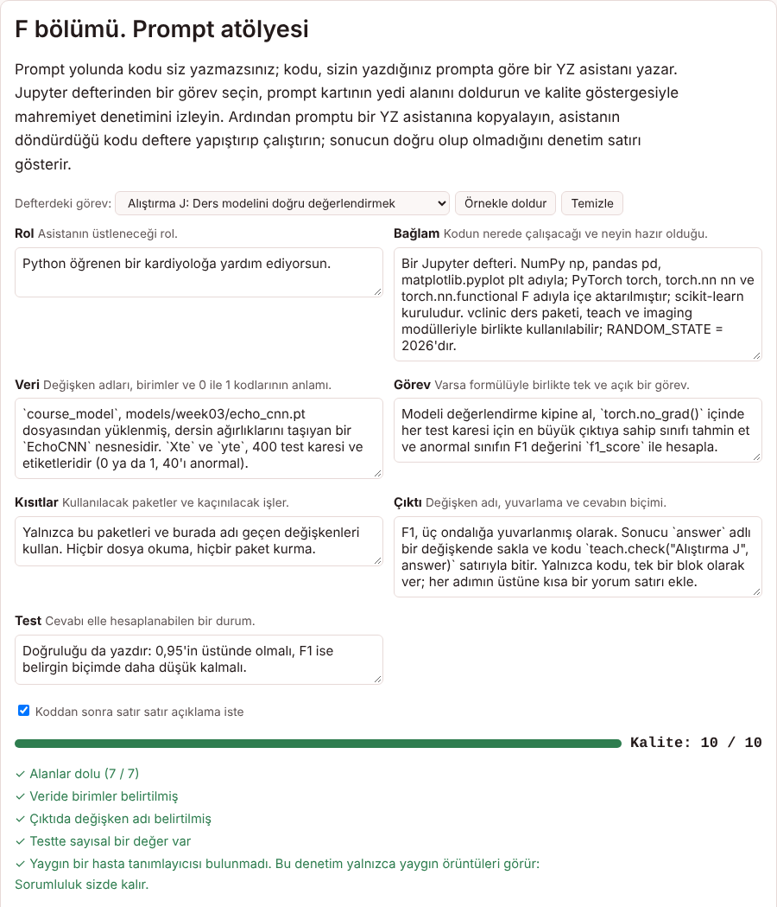

# Hafta 3: Derin öğrenme ve evrişimli sinir ağları

**Python ile Yapay Zekâ Eğitimi: Kardiyologlar için Uygulamalı Eğitim Programı** 
Türk Kardiyoloji Derneği

*Tek bir nörondan ekokardiyogram okuyan bir ağa*

[Eğitimin ana sayfası](../../README.tr.md) · [İzlence](../../SYLLABUS.tr.md) · [Kurulum](../../SETUP.tr.md) · [English](../../en/week-03/README.md)

## Hafta hakkında

Tek bir nörondan derin bir ağa yapay sinir ağları: kayıp, gradyanlar ve PyTorch ile eğitim döngüsü, dizi olarak görüntüler, evrişim ve havuzlama ve sanal kliniğin yeni eko laboratuvarındaki parasternal kısa eksen karelerini okuyan bir evrişimli sinir ağı (CNN). Aşırı öğrenmeye seyreltme, yığın normalizasyonu, veri çoğaltma ve erken durdurmayla karşı konur; sonuçlar sınıf sınıf kesinlik, duyarlılık ve F1 skoruyla okunur. Ardından LeNet'ten ResNet'e bilinen mimariler gelir; hafta, bir YZ asistanının yazdığı eğitim döngüsünün denetimiyle kapanır.

Oturumda 4 saat, haftalık proje için yaklaşık 3 saat.

## Malzemeler

| Malzeme | Aç | İçeriği |
|---|---|---|
| **Ders sayfası** | [Ders sayfasını aç](https://utkukose.github.io/ai-cardiology-tkd-NB-lecture/tr/hafta-03/ders.html) | Kavramlar, çözümlü örnekleriyle formüller, ağın üç boyutlu (3B) sahnesi, iki animasyon, bilgi kontrolleri, tekrar kartları ve kaynaklar |
| **Etkileşimli lab** | [Etkileşimli labı aç](https://utkukose.github.io/ai-cardiology-tkd-NB-lecture/tr/hafta-03/lab.html) | F bölümündeki prompt (istem) atölyesi dâhil A-F bölümleri, öz değerlendirme, yansıtma ve dışa aktarılabilen öğrenme günlüğü |
| **Jupyter defteri** | [NB03_derin_ogrenme_ve_evrisimli_aglar.ipynb](NB03_derin_ogrenme_ve_evrisimli_aglar.ipynb)  (yedek yol) | Python adımı 3, A-J alıştırmalarıyla 0-10. bölümler, her alıştırmanın altında bir prompt yolu, her bölümün sonunda bir prompt görevi, bir uygulama anahtarı ve yedi alanın görevleri |
| **Prompt kütüphanesi** | [PROMPTLAR.md](PROMPTLAR.md) | Haftanın bütün promptları prompt kartı biçiminde: 13 alıştırma, 9 prompt görevi, kodu açıklatmak, onarmak ve denetlemek için 4 kalıp ve haftalık projenin prompt yolu |
| **PDF ders notu** | [Hafta03_Ders_Notlari.pdf](Hafta03_Ders_Notlari.pdf) | Python adımı 3 ve dersin tamamı, yazdırmaya hazır |

<table>
<tr><td width="50%"></td><td width="50%"></td></tr>
<tr><td>Etkileşimli lab, B bölümü: 3 × 3'lük bir çekirdek eko laboratuvarının bir karesi üzerinde kayar; bir konumun çarpımları ve büyüyen öznitelik haritası görünür.</td><td>Jupyter defteri, 6. bölüm: 300 karede eğitilen ağın veri çoğaltmasız ve veri çoğaltmalı eğitim ve doğrulama kaybı.</td></tr>
<tr><td width="50%"></td><td width="50%"></td></tr>
<tr><td>Etkileşimli lab, C bölümü: aşırı öğrenmeye karşı dört ayarın öğrenme eğrileri ve bir karenin çoğaltılmış kopyaları.</td><td>Etkileşimli lab, F bölümü: prompt atölyesi. Prompt kartının yedi alanı, kalite göstergesi ve hasta verisi uyarısı.</td></tr>
</table>

## Haftanın vakası

**VC-1212, 70 yaşında, kadın**, diyabeti ve hipertansiyonu olan ve eforla nefes darlığı yakınmasıyla başvuran bir hastadır. Sanal kliniğin yeni eko laboratuvarı onun parasternal kısa eksen görüntüsünü kaydeder; laboratuvarın evrişimli ağı kareyi normal okur ve anormal kare olasılığını 0,012 olarak verir. Ekokardiyografiyi yapan kardiyolog septumu 13,8 mm ölçer. [Ders sayfası](https://utkukose.github.io/ai-cardiology-tkd-NB-lecture/tr/hafta-03/ders.html) onun vakasıyla açılır; laboratuvar soruyu son bölümde cevaplar.

## Öğrenme çıktıları

Hafta sonunda katılımcıların bir nöronun, bir katmanın ve bir ağın çıktılarını nasıl hesapladığını, bir kaybın, gradyanlarının ve ağırlık güncellemesinin bir ağı nasıl öğrettiğini açıklayabilmeleri beklenmektedir. Bir ekokardiyografi kareleri yığınını dizi olarak işleyebilmeli, onu yalnızca eğitim karelerinin istatistikleriyle normalleştirebilmeli ve bir evrişim ile bir havuzlama adımını elle izleyebilmelidirler. PyTorch ile küçük bir evrişimli ağ eğitebilmeli, öğrenme eğrilerinde aşırı öğrenmeyi tanıyabilmeli ve ona karşı seyreltme, yığın normalizasyonu, veri çoğaltma ve erken durdurmayı kullanabilmelidirler. Son olarak sonucu her sınıf için kesinlik, duyarlılık ve F1 skoruyla okuyabilmeli, ağı bilinen mimariler arasına yerleştirebilmeli ve bir YZ asistanının yazdığı eğitim döngüsünü beş soruyla denetleyebilmelidirler.

## Çalışma yolu

Oturuma katılanlar 1-5. adımları oturumda tamamlar. Haftayı kendi başına izleyenler, örneğin bir oturumu kaçıranlar, aşağıdaki sürelerle plan yapabilir: 1-7. adımlar için yaklaşık 6 saat 40 dakika, haftalık proje için yaklaşık 3 saat. [Prompt yolunu](../../PROMPT_PATH.tr.md) izleyenler 2. ve 4. adımlarda alıştırmaların altındaki prompt yollarını ve bölümlerin prompt görevlerini kullanır; haftanın bütün promptları [prompt kütüphanesindedir](PROMPTLAR.md). Süreler bu yolda da yaklaşık olarak aynıdır.

| Adım | Etkinlik | Süre |
|---|---|---|
| 1 | Haftanın vakasını ve ders sayfasını okuyun, bilgi kontrollerini cevaplayın | 1 saat 15 dakika |
| 2 | Jupyter defterinde Bölüm 0'ın hemen ardından gelen Python adımı 3'ü çalıştırın | 40 dakika |
| 3 | Etkileşimli labın A-F bölümlerini tamamlayın | 1 saat 10 dakika |
| 4 | Jupyter defterinin 1-9. bölümlerini tamamlayın ve alıştırmaları çözün | 2 saat 15 dakika |
| 5 | 10. bölümdeki uygulama anahtarını kullanın ve kendi alanınızın görevini çözün | 30 dakika |
| 6 | Haftanın makalesini üç soruyla birlikte okuyun | 30 dakika |
| 7 | Etkileşimli labda öz değerlendirmeyi yapın (sekme: Kendini sına), yansıtmayı yazın ve öğrenme günlüğünü dışa aktarın | 20 dakika |
| 8 | Haftalık projeyi tamamlayın | 3 saat |

## Oturumun eğitim akışı

Haftanın dört saatlik oturumu aşağıdaki plana göre işlenir. Plan, malzemelerin canlı bir oturumda nasıl bir araya geldiğini göstermek için paylaşılmaktadır.

| Süre | Etkinlik |
|---|---|
| 0:00-0:15 | Haftanın vakası VC-1212. Katılımcılar Jupyter defterini açar ve PyTorch kurulumunu da denetleyen Bölüm 0'ı çalıştırır. |
| 0:15-0:50 | Eşli çalışmayla Python adımı 3: kod yazan ve yazmayan birer katılımcı. İkinci katılımcı alıştırmaları prompt yolundan çözebilir. |
| 0:50-1:45 | Mini projenin ilk yarısı: bir nöron ve bir ağ (Bölüm 1), elle ve PyTorch ile eğitim döngüsü (etkileşimli labın A bölümü, Bölüm 2), eko laboratuvarının kareleri (Bölüm 3) ve elle evrişim (B bölümü, Bölüm 4). |
| 1:45-2:00 | Ara. |
| 2:00-2:40 | Mini projenin ikinci yarısı: eko laboratuvarının ağı üç boyutta ve kodda (Bölüm 5), ardından aşırı öğrenme ve ona karşı araçlar (C bölümü, Bölüm 6). |
| 2:40-3:30 | Sonucu sınıf sınıf okumak: iki ve üç sınıf için kesinlik, duyarlılık ve F1 skoru (D bölümü, Bölüm 7), ardından LeNet'ten ResNet'e bilinen mimariler (Bölüm 8). |
| 3:30-4:00 | YZ ile eşli kodlama, bölüm 3: bir eğitim döngüsünün denetimi ve prompt atölyesi (Bölüm 9, E ve F bölümleri), haftanın makalesi ve haftalık proje. |

## Haftalık proje

**Ne yapılacak?** Eko laboratuvarının ağını kardiyomiyopati kliniğinin kısa eksen kesitleri üzerinde üç sınıfla eğitin: normal, dilate kardiyomiyopati (DCM) ve hipertrofik kardiyomiyopati (HCM). Önce `make_cmr_set(300)` ile elde edilen 900 kesiti yüzde 60, 20 ve 20'lik eğitim, doğrulama ve test kümelerine ayırın ve eğitim kesitleriyle normalleştirin. İkinci olarak `EchoCNN(n_classes=3)` modelini veri çoğaltmayla en çok 30 dönem eğitin ve doğrulama kaybının en düşük olduğu dönemin ağırlıklarını saklayın. Üçüncü olarak karışıklık matrisini, her sınıfın kesinlik, duyarlılık ve F1 değerini ve makro F1'i bildirin. Dördüncü olarak yanlış sınıflanan her test kesitini ölçümleriyle birlikte gösterin; klinikte hangi hataların en çok önem taşıyacağını ve nedenini yazın.

**Nereye bakılacak?** Ders: "Eko laboratuvarı için bir evrişimli ağ", "Aşırı öğrenme: Seyreltme, yığın normalizasyonu ve veri çoğaltma" ve "Sonucu okumak: Kesinlik, duyarlılık ve F1" bölümleri. Etkileşimli lab: C, D ve F bölümleri. Jupyter defteri: 5, 6, 7 ve 10. bölümler.

**Prompt yolu.** Proje, her adım için bir prompt olmak üzere [prompt kütüphanesindeki](https://github.com/utkukose/ai-cardiology-tkd-NB-lecture/blob/main/tr/hafta-03/PROMPTLAR.md#haftal%C4%B1k-projenin-prompt-yolu) dört promptla da kurulabilir. Bir promptun testi sağlanmadan sonraki prompta geçilmez.

**Örnek.** Ağın 68 test kesitini DCM olarak sınıfladığını, bunların 60'ında haklı olduğunu ve DCM olan 60 kesitin hiçbirini kaçırmadığını varsayın: $TP = 60$, $FP = 8$, $FN = 0$. DCM sınıfının kesinliği $60/68 = 0{,}882$, duyarlılığı $60/60 = 1{,}000$ olur. F1 değeri $2TP/(2TP + FP + FN)$ ile hesaplanır; burada $120/128 = 0{,}938$'dir. Makro F1, üç sınıfın F1 değerlerinin düz ortalamasıdır.

**Ne teslim edilecek?** [Rapor şablonuyla](../sablonlar/Rapor_Sablonu.docx) yazılmış, bir-iki sayfalık bir rapor: iki kaybın şekli, karışıklık matrisi, sınıflara göre ölçütlerin tablosu ve hataların şekli. Rapora YZ kullanım günlüğünü (araç, prompt, neyin denetlendiği, neyin değiştirildiği) ve çıktılarıyla birlikte Jupyter defterini ekleyin.

**Teslim.** Haftalık proje, 4. haftanın oturumundan önce utkukose@sdu.edu.tr ya da utkukose@gmail.com adresine e-postayla gönderilir. E-postaya "Ne teslim edilecek?" başlığında sayılan öğeler ve etkileşimli labdan dışa aktarılan öğrenme günlüğü eklenir. Haftalık projeler değerlendirmenin yüzde 40'ını oluşturur; değerlendirme ölçütleri izlencede yer almaktadır.

## İsteğe bağlı araştırma ödevi

PubMed'de, 2020 ya da sonrasında yayımlanmış ve ekokardiyogramlar ya da kardiyak manyetik rezonans görüntüleri üzerinde bir hastalığı saptamak için derin öğrenme modeli eğiten bir çalışma bulun. Çalışmayı yarım sayfada özetleyin: görüntüler ve kaç hastadan geldikleri, etiketler ve etiketleri kimin verdiği, ağ, her sınıf için bildirilen ölçütler ve model başka bir hastanenin hastalarında sınandıysa bunun nasıl yapıldığı. [Haftanın makalesindeki](https://utkukose.github.io/ai-cardiology-tkd-NB-lecture/tr/hafta-03/ders.html#the-paper-of-the-week) üç soru özete yol gösterebilir. Ödev notlandırılmaz; 4. haftadaki transfer öğrenme tartışmasına hazırlık niteliğindedir.

## Bu haftadan sonra sanal klinik

Sanal klinik 3. haftada eko laboratuvarını açar. Kayıttaki her hastanın kendi ölçümlerinden çizilen bir diyastol sonu parasternal kısa eksen karesi olur ve bir evrişimli ağ laboratuvarın raporunu piksellerden öğrenir. Kardiyomiyopati kliniği de üç sınıflı kardiyak manyetik rezonans kısa eksen kesitlerini ekler. Sonuçlar ders sayfasının [Sanal klinik, 3. aşama](https://utkukose.github.io/ai-cardiology-tkd-NB-lecture/tr/hafta-03/ders.html#the-virtual-clinic-stage-3-the-echo-laboratory-opens) bölümündedir.

## Gelecek hafta

**Hafta 4: Transfer öğrenme.** Eko laboratuvarı ölçüm yapmaya başlar: Transfer öğrenme, milyonlarca başka görüntüyle eğitilmiş bir ağı uyarlar; bir U-Net sol ventrikülün sınırlarını çizer ve ejeksiyon fraksiyonu bu sınırlardan disk yöntemiyle hesaplanır. [Eğitimin planına](../../README.tr.md#on-bir-hafta) bakın.

---

**Prof. Dr. Utku Köse**

Profesör, Bilgisayar Mühendisliği Bölümü, Süleyman Demirel Üniversitesi, Isparta, Türkiye 
Kurucu Müdür, Yapay Zekâ Uygulama ve Araştırma Merkezi (YAZEM), Süleyman Demirel Üniversitesi 
Bilgisayar Bilimleri Anabilim Dalı Başkanı, Bilgisayar Mühendisliği Bölümü, Süleyman Demirel Üniversitesi 
Diğer kurumlar: University of North Dakota (ABD), Universidad Panamericana (Meksiko, Meksika), Vel Tech University (Chennai, Hindistan) 
IEEE Kıdemli Üyesi, ACM Profesyonel Üyesi

[ORCID 0000-0002-9652-6415](https://orcid.org/0000-0002-9652-6415) | [utkukose.com](https://www.utkukose.com) | [github.com/utkukose](https://github.com/utkukose)

[utkukose@sdu.edu.tr](mailto:utkukose@sdu.edu.tr) | [utku.kose@und.edu](mailto:utku.kose@und.edu) | [ukose@up.edu.mx](mailto:ukose@up.edu.mx) | [utkukose@gmail.com](mailto:utkukose@gmail.com)

*İlk sürüm: Kasım 2026. İçerik CC BY 4.0, kod MIT.*

