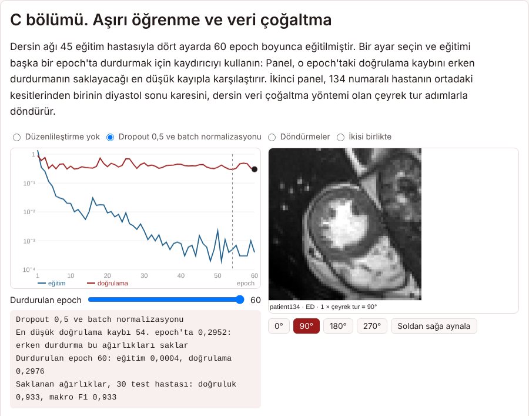

# Hafta 3: Derin öğrenme ve evrişimli sinir ağları

**Python ile Yapay Zekâ Eğitimi: Kardiyologlar için Uygulamalı Eğitim Programı** 
Türk Kardiyoloji Derneği

*Tek bir nörondan kalp görüntülerini okuyan bir ağa geçilir.*

[Eğitimin ana sayfası](../../README.tr.md) · [İzlence](../../SYLLABUS.tr.md) · [Kurulum](../../SETUP.tr.md) · [English](../../en/week-03/README.md)

## Hafta hakkında

Hafta, tek bir nörondan derin bir ağa uzanan yapay sinir ağlarıyla başlar: Kayıp, gradyanlar ve eğitim döngüsü anlatılır, görüntüler birer dizi olarak ele alınır ve evrişimle havuzlama tanıtılır. Ardından herkese açık ACDC veri setinin sine kardiyak manyetik rezonans incelemelerinde normal kalbi, dilate kardiyomiyopatiyi ve hipertrofik kardiyomiyopatiyi birbirinden ayıran bir evrişimli sinir ağı (CNN) eğitilir. Aşırı öğrenmeye dropout, batch normalizasyonu, veri çoğaltma ve erken durdurmayla karşı konur; sonuçlar sınıf sınıf kesinlik, duyarlılık ve F1 skoruyla, uzman konturlarından elde edilen ölçümlerin yanında okunur. Haftanın son bölümünde LeNet'ten ResNet'e bilinen mimariler tanıtılır, bir YZ asistanının yazdığı eğitim döngüsü denetlenir ve her katılımcının kişisel kayıtla edindiği EchoNet-Dynamic ekokardiyografi videoları kullanılır.

Oturum 4 saat sürer. Haftalık proje için yaklaşık 3 saat ayrılmalıdır.

## Haftanın rotası

Ders sayfası haftanın ana rotasıdır. Sayfada kod ya da prompt (istem) bulunmaz; sayfa etkileşimli labla birlikte yukarıdan aşağıya okunur. Her uygulama durağında katılımcılar Jupyter defterindeki iki yoldan birini seçer. **Prompt yolunda** (Kısım 1) kodu, hazır promptlara göre bir yapay zekâ (YZ) asistanı yazar; katılımcı bu kodu çalıştırır ve sonucu denetler. **Python yolunda** (Kısım 2) ise kodu katılımcı kendisi yazar. İki yol da aynı sonuçlara varır. Defter hem kurulum gerektirmeyen Google Colab'da hem de kendi bilgisayarınızdaki Jupyter'de çalışır ([kurulum](../../SETUP.tr.md)).

| Ana rota: Ders sayfası ve etkileşimli lab | Uygulama durağı | Prompt yolu (Kısım 1) | Python yolu (Kısım 2) |
|---|---|---|---|
| [Tek sayfada yapay sinir ağları](https://utkukose.github.io/ai-cardiology-tkd-NB-lecture/tr/hafta-03/ders.html#neural-networks-in-one-page) [Öğrenme: Kayıp, gradyanlar ve eğitim döngüsü](https://utkukose.github.io/ai-cardiology-tkd-NB-lecture/tr/hafta-03/ders.html#learning-loss-gradients-and-the-training-loop) [Dizi olarak görüntüler: ACDC'nin sine kardiyak MR görüntüleri](https://utkukose.github.io/ai-cardiology-tkd-NB-lecture/tr/hafta-03/ders.html#images-as-arrays-cine-cardiac-mr-of-acdc) | **[Durak 1: Sayılarla sine MR](https://utkukose.github.io/ai-cardiology-tkd-NB-lecture/tr/hafta-03/ders.html#stop-1)** | Durak 1 | Python adımı 3 ve 1-3. bölümler |
| [Evrişim: Görüntü üzerinde kayan filtreler](https://utkukose.github.io/ai-cardiology-tkd-NB-lecture/tr/hafta-03/ders.html#convolution-filters-that-slide-over-an-image) [Sine MR için bir evrişimli ağ](https://utkukose.github.io/ai-cardiology-tkd-NB-lecture/tr/hafta-03/ders.html#a-convolutional-network-for-cine-mr) [Aşırı öğrenme: Dropout, batch normalizasyonu ve veri çoğaltma](https://utkukose.github.io/ai-cardiology-tkd-NB-lecture/tr/hafta-03/ders.html#overfitting-dropout-batch-normalisation-and-augmentation) [Sonucu okumak: Kesinlik, duyarlılık ve F1](https://utkukose.github.io/ai-cardiology-tkd-NB-lecture/tr/hafta-03/ders.html#reading-the-result-precision-recall-and-f1) | **[Durak 2: İlk evrişimli ağ](https://utkukose.github.io/ai-cardiology-tkd-NB-lecture/tr/hafta-03/ders.html#stop-2)** | Durak 2 | 4-7. bölümler |
| [Bilinen mimariler: LeNet'ten ResNet'e](https://utkukose.github.io/ai-cardiology-tkd-NB-lecture/tr/hafta-03/ders.html#known-architectures-from-lenet-to-resnet) [YZ asistanıyla çalışmak, 3. bölüm: Bir eğitim döngüsünü denetlemek](https://utkukose.github.io/ai-cardiology-tkd-NB-lecture/tr/hafta-03/ders.html#ai-pair-programming-part-3-reviewing-a-training-loop) [EchoNet-Dynamic: Kişisel kayıtla ekokardiyografi](https://utkukose.github.io/ai-cardiology-tkd-NB-lecture/tr/hafta-03/ders.html#echonet-dynamic-echocardiography-with-personal-registration) | **[Durak 3: EchoNet-Dynamic: Normal mi, anormal mi? (kişisel kayıtla)](https://utkukose.github.io/ai-cardiology-tkd-NB-lecture/tr/hafta-03/ders.html#stop-3)** | Durak 3 | 8-10. bölümler |
| [Haftanın makalesi](https://utkukose.github.io/ai-cardiology-tkd-NB-lecture/tr/hafta-03/ders.html#the-paper-of-the-week) [Sanal klinik, 3. aşama: Görüntüleme laboratuvarı açılıyor](https://utkukose.github.io/ai-cardiology-tkd-NB-lecture/tr/hafta-03/ders.html#the-virtual-clinic-stage-3-the-imaging-laboratory-opens) | "Kendi verinizle" bölümü, haftanın makalesi ve sanal klinik | – | – |

## Malzemeler

| Malzeme | Aç | İçeriği |
|---|---|---|
| **Ders sayfası (ana rota)** | [Ders sayfasını aç](https://utkukose.github.io/ai-cardiology-tkd-NB-lecture/tr/hafta-03/ders.html) | Vakayı, kavramları çözümlü örnekleriyle, ağın içini gösteren üç boyutlu (3B) bir sahneyi, iki animasyonu, bilgi kontrolü sorularını, üç uygulama durağını, "Kendi verinizle" bölümünü, tekrar kartlarını ve kaynakları içerir. Sayfada kod ve prompt yer almaz. |
| **Etkileşimli lab** | [Etkileşimli labı aç](https://utkukose.github.io/ai-cardiology-tkd-NB-lecture/tr/hafta-03/lab.html) | Kod gerektirmeyen A'dan F'ye kadar altı bölümü (F bölümü prompt atölyesidir), öz değerlendirmeyi, yansıtma yazısını ve dışa aktarılabilen öğrenme günlüğünü içerir |
| **Jupyter defteri** |  [Jupyter için indir](NB03_derin_ogrenme_ve_evrisimli_aglar.ipynb) | Kısım 1 prompt yoludur: Üç durakta toplam on adım vardır ve her adımda hazır bir prompt, adımın tablosunu hazırlayan bir veri hücresi, YZ asistanının kodu için bir hücre, otomatik bir kontrol ve hazır kod bulunur. Kısmın sonunda haftalık proje dört promptla yer alır. Kısım 2 Python yoludur: Python adımı 3'ü, A-J alıştırmalarıyla birlikte 1-10. bölümleri ve yedi alan için uygulama görevlerini içerir. |
| **Prompt kütüphanesi** | [PROMPTLAR.md](PROMPTLAR.md) | Prompt yolunun bütün promptlarını, kodu onarmaya yarayan promptları ve haftalık projenin prompt yolunu içerir. GitHub'da her promptun yanında bir kopyalama düğmesi bulunur. |
| **PDF ders notu** | [Hafta03_Ders_Notlari.pdf](Hafta03_Ders_Notlari.pdf) | Ders sayfasının yazdırılabilir biçimidir; uygulama duraklarını ve "Kendi verinizle" bölümünü de içerir. |

<table>
<tr><td width="50%"></td><td width="50%"></td></tr>
<tr><td>Etkileşimli lab, B bölümü: 3 × 3'lük bir çekirdek ACDC'nin bir kısa eksen kesiti üzerinde kayar; bir konumdaki çarpımlar ve büyüyen öznitelik haritası görülür.</td><td>Jupyter defteri, 6. bölüm: 45 eğitim hastasıyla eğitilen ağın dropout'lu ve dropout'suz eğitim ve doğrulama kayıpları karşılaştırılır.</td></tr>
<tr><td width="50%"></td><td width="50%"></td></tr>
<tr><td>Etkileşimli lab, C bölümü: Aşırı öğrenmeye karşı dört ayarın öğrenme eğrileri ve bir kesitin döndürülmüş kopyaları gösterilir.</td><td>Etkileşimli lab, F bölümü: Prompt atölyesinde prompt kartının yedi alanı doldurulur; bir kalite göstergesi ve hasta verisi uyarısı yazılanı değerlendirir.</td></tr>
</table>

## Haftanın vakası

**ACDC test kümesindeki 134 numaralı hasta**, 185 cm boyunda ve 104 kg ağırlığındadır ve hipertrofik kardiyomiyopati grubunda yer alır. Sine kardiyak manyetik rezonans incelemesinin uzman konturlarına göre ejeksiyon fraksiyonu yüzde 62,2, en kalın duvar segmenti ise 16,4 mm'dir. 45 başka hastayla eğitilen bir ağın hastalığı piksellerden tanıması gerekmektedir. [Ders sayfası](https://utkukose.github.io/ai-cardiology-tkd-NB-lecture/tr/hafta-03/ders.html) bu vakayla açılır; sanal kliniğin görüntüleme laboratuvarı soruyu son bölümde cevaplar.

## Öğrenme çıktıları

Haftanın sonunda katılımcıların bir nöronun, bir katmanın ve bir ağın çıktılarını nasıl hesapladığını ve kaybın, gradyanların ve ağırlık güncellemelerinin bir ağı nasıl eğittiğini açıklayabilmeleri beklenmektedir. Bir sine kardiyak manyetik rezonans incelemesini bir dizi olarak tarif edebilmeli, uzman konturlarından hacimleri ve ejeksiyon fraksiyonunu hesaplayabilmeli ve bir çalışmanın hastalarını herhangi bir öğrenme adımından önce kümelere ayırabilmelidirler. Bir evrişim ve bir havuzlama adımını izleyebilmeli, küçük bir evrişimli ağ eğitebilmeli, öğrenme eğrilerinde aşırı öğrenmeyi tanıyabilmeli ve sonucu her sınıf için kesinlik, duyarlılık ve F1 skoruyla okuyabilmelidirler. Son olarak dersin ağını bilinen mimarilerle karşılaştırabilmeli, bir YZ asistanının yazdığı eğitim döngüsünü denetleyebilmeli ve EchoNet-Dynamic gibi kayıt gerektiren bir veri setini kullanım koşullarına uygun biçimde edinebilmelidirler.

## Çalışma yolu

Oturuma katılanlar ana rotayı ve uygulama duraklarını oturumda tamamlar. Haftayı kendi başına izleyenler, örneğin bir oturumu kaçıranlar, aşağıdaki sürelerle plan yapabilir.

| Adım | Etkinlik | Prompt yolu | Python yolu |
|---|---|---|---|
| 1 | Haftanın vakasını ve ders sayfasını 1. uygulama durağına kadar okuyun; etkileşimli labın A bölümünü yapın ve bilgi kontrolü sorularını cevaplayın | 55 dakika | 55 dakika |
| 2 | 1. uygulama durağı: Prompt yolunda Kısım 1'deki Durak 1'i, Python yolunda Python adımı 3'ü ve 1-3. bölümleri çalışın | 25 dakika | 1 saat 15 dakika |
| 3 | 2. uygulama durağına kadar okumayı sürdürün (evrişim, ağın üç boyutlu görünümü, aşırı öğrenme ve sonucun okunması); etkileşimli labın B, C ve D bölümlerini yapın | 1 saat | 1 saat |
| 4 | 2. uygulama durağı: Prompt yolunda Kısım 1'deki Durak 2'yi, Python yolunda 4, 5, 6 ve 7. bölümleri çalışın | 35 dakika | 1 saat 15 dakika |
| 5 | 3. uygulama durağına kadar okumayı sürdürün (bilinen mimariler, bir eğitim döngüsünün denetimi ve EchoNet-Dynamic); etkileşimli labın E ve F bölümlerini yapın | 40 dakika | 40 dakika |
| 6 | 3. uygulama durağı (EchoNet-Dynamic için kişisel kayıt gerekir): Prompt yolunda Kısım 1'deki Durak 3'ü, Python yolunda 8, 9 ve 10. bölümleri çalışın | 30 dakika | 50 dakika |
| 7 | Haftanın makalesini, sanal kliniğin bu haftaki aşamasını ve "Kendi verinizle" bölümünü okuyun | 30 dakika | 30 dakika |
| 8 | Etkileşimli labın "Kendini sına" sekmesindeki öz değerlendirmeyi yapın, yansıtma yazınızı yazın ve öğrenme günlüğünü dışa aktarın | 20 dakika | 20 dakika |
| | **Haftalık proje dışında toplam** | **4 saat 55 dakika** | **6 saat 45 dakika** |
| 9 | Haftalık projeyi iki yoldan biriyle tamamlayın | 3 saat | 3 saat |

## Oturumun eğitim akışı

Haftanın dört saatlik oturumu aşağıdaki plana göre işlenir. Plan, malzemelerin canlı bir oturumda nasıl bir araya geldiğini göstermek için paylaşılmaktadır.

| Süre | Etkinlik |
|---|---|
| 0:00-0:15 | Haftanın vakası olan ACDC'nin 134 numaralı hastası tanıtılır ve haftanın rotası anlatılır. Her katılımcı defteri Google Colab'da ya da Jupyter'de açar ve 0. bölümü çalıştırır; bu bölüm üç grubun ACDC dosyalarını (yaklaşık 105 MB) açık kaynağından indirir. |
| 0:15-0:55 | Ana rotada yapay sinir ağlarının temel fikirleri anlatılır; etkileşimli labın A bölümüyle bir ağın nasıl öğrendiği çalışılır. Ardından sine kardiyak manyetik rezonans görüntüleri birer dizi olarak ele alınır. |
| 0:55-1:30 | 1. uygulama durağında katılımcılar iki gruba ayrılır: Prompt yolunu izleyenler ve Python yolunu izleyenler. Durağın sonunda iki grup, 134 numaralı hastanın ejeksiyon fraksiyonunu ve ACDC kurallarının doğruluğunu karşılaştırır. |
| 1:30-1:45 | Ara. |
| 1:45-2:30 | Ana rotada B bölümüyle evrişim, ardından ağın üç boyutlu görünümü, C bölümüyle aşırı öğrenme ve D bölümüyle sonucun okunması çalışılır. |
| 2:30-3:05 | 2. uygulama durağı: Ağ yaklaşık bir dakikada eğitilir ve hasta hasta konturlardan elde edilen ölçümlerle karşılaştırılır. |
| 3:05-3:40 | Ana rotada bilinen mimariler anlatılır; E ve F bölümleriyle bir eğitim döngüsünün denetlenmesi çalışılır ve EchoNet-Dynamic tanıtılır. Ardından oturumun mini projesi olan 3. uygulama durağına geçilir: Kaydı olan katılımcılar durağı kendi kopyalarında çalıştırır; diğer katılımcılar eğitmenin ortak ekrandaki çalıştırmasını izler. |
| 3:40-4:00 | Haftanın makalesi, sanal kliniğin görüntüleme laboratuvarı, "Kendi verinizle" bölümü ve haftalık proje ele alınır. |

## Haftalık proje

**Ne yapılacak?** ACDC'nin sine kardiyak manyetik rezonans incelemelerinde dilate kardiyomiyopatiyi (DCM), hipertrofik kardiyomiyopatiyi (HCM) ve normal kalbi sınıflandırın ve ağı kardiyoloğun ölçümleriyle karşılaştırın. Önce dersin ağını 45 eğitim hastasıyla eğitin; erken durdurma için 15 doğrulama hastasını kullanın. Ardından 30 test hastasının karışıklık matrisini, her sınıfın kesinlik, duyarlılık ve F1 değerini ve makro F1'i bildirin. Sonra ACDC kurallarını aynı 30 hastanın uzman konturlarından elde edilen ölçümlere uygulayın ve iki karışıklık matrisini karşılaştırın. Son olarak yanlış sınıflanan her hasta için ağın gördüğü kesitleri ve en kalın duvarın bulunduğu kesiti gösterin; klinikte hangi hataların en çok önem taşıyacağını ve nedenini yazın.

**Nereye bakılacak?** Ders: "Dizi olarak görüntüler: ACDC'nin sine kardiyak MR görüntüleri", "Sine MR için bir evrişimli ağ", "Aşırı öğrenme: Dropout, batch normalizasyonu ve veri çoğaltma" ve "Sonucu okumak: Kesinlik, duyarlılık ve F1" bölümleri. Etkileşimli lab: C, D ve F bölümleri. Jupyter defteri: Kısım 1, 1. ve 2. duraklar ya da Kısım 2, 3, 5, 6 ve 7. bölümler.

**Prompt yolu.** Proje, [prompt kütüphanesindeki](https://github.com/utkukose/ai-cardiology-tkd-NB-lecture/blob/main/tr/hafta-03/PROMPTLAR.md#haftal%C4%B1k-projenin-prompt-yolu) dört promptla da tamamlanabilir; her adım için bir prompt vardır. Jupyter defterinin 1. kısmının sonundaki "Prompt yolunda haftalık proje" bölümü her promptun tablosunu hazırlar. Bir promptun testi sağlanmadan sonraki prompta geçilmez.

**Örnek.** Ağın 12 test hastasına normal dediğini, bunların 10'unda haklı olduğunu ve HCM'li 10 hastanın 2'sini kaçırdığını varsayın: Normal sınıf için $TP = 10$, $FP = 2$, $FN = 0$'dır. Kesinlik $10/12 = 0{,}833$, duyarlılık $10/10 = 1{,}000$ olur. F1 değeri $2TP/(2TP + FP + FN)$ ile hesaplanır ve burada $20/22 = 0{,}909$'dur. Makro F1, üç sınıfın F1 değerlerinin düz ortalamasıdır.

**Ne teslim edilecek?** [Rapor şablonuyla](../sablonlar/Rapor_Sablonu.docx) yazılmış, bir ya da iki sayfalık bir rapor teslim edilir. Raporda iki kaybın şekli, iki karışıklık matrisi, sınıflara göre ölçütlerin tablosu ve hataların şekli yer almalıdır. Rapora YZ kullanım günlüğünü (kullanılan araç, prompt, neyin denetlendiği ve neyin değiştirildiği) ve çıktılarıyla birlikte Jupyter defterini ekleyin. ACDC görüntüleri içeren şekiller, kullanım koşullarının gerektirdiği gibi "ACDC, CC BY-NC-SA 4.0" kaynak bilgisini taşımalı ve yalnızca ticari olmayan amaçlarla kullanılmalıdır.

**Teslim.** Haftalık proje, 4. haftanın oturumundan önce utkukose@sdu.edu.tr ya da utkukose@gmail.com adresine e-postayla gönderilir. E-postaya "Ne teslim edilecek?" başlığında sayılan öğeler ve etkileşimli labdan dışa aktarılan öğrenme günlüğü eklenir. Haftalık projeler değerlendirmenin yüzde 40'ını oluşturur; değerlendirme ölçütleri izlencede yer almaktadır.

## Kendi verinizle

Ders sayfası, haftanın yöntemlerini kendi verinize nasıl uygulayacağınızı anlatan bir bölümle biter. Bu bölümde hangi sorunun hangi yönteme uyduğu, önce neyin denetleneceği, etik kurul onayı, Kişisel Verilerin Korunması Kanunu (KVKK) ve analizin nerede yapılacağı ele alınır. [Bölümü ders sayfasında okuyun](https://utkukose.github.io/ai-cardiology-tkd-NB-lecture/tr/hafta-03/ders.html#with-your-own-data).

## İsteğe bağlı araştırma ödevi

PubMed'de, 2020 ya da sonrasında yayımlanmış ve ekokardiyogramlar ya da kardiyak manyetik rezonans görüntüleri üzerinde bir hastalığı saptamak için derin öğrenme modeli eğiten bir çalışma bulun. Çalışmayı yarım sayfada özetleyin; özette görüntülerin türü ve kaç hastadan geldiği, etiketler ve etiketleri kimin verdiği, ağ, her sınıf için bildirilen ölçütler ve model başka bir hastanenin hastalarında sınandıysa bunun nasıl yapıldığı yer almalıdır. [Haftanın makalesindeki](https://utkukose.github.io/ai-cardiology-tkd-NB-lecture/tr/hafta-03/ders.html#the-paper-of-the-week) üç soru özetinize yol gösterebilir. Bu ödev notlandırılmaz; 4. haftadaki transfer öğrenme tartışmasına hazırlık amacı taşır.

## Bu haftadan sonra sanal klinik

Sanal klinik 3. haftada, açık görüntüleri okuyan görüntüleme laboratuvarını açar. Laboratuvarda her katılımcının kaynağından indirdiği ACDC sine kardiyak manyetik rezonans incelemeleri ve kişisel kaydı olanlar için EchoNet-Dynamic ekokardiyografi videoları kullanılır. Bir evrişimli ağ ACDC'nin üç grubunu piksellerden öğrenir ve sonuçları uzman konturlarından elde edilen ölçümlerle karşılaştırılır. Sonuçlar, ders sayfasının [Sanal klinik, 3. aşama](https://utkukose.github.io/ai-cardiology-tkd-NB-lecture/tr/hafta-03/ders.html#the-virtual-clinic-stage-3-the-imaging-laboratory-opens) bölümünde yer almaktadır.

## Gelecek hafta

**Hafta 4: Transfer öğrenme.** Görüntüleme laboratuvarı ölçüm yapmaya başlar. ImageNet üzerinde önceden eğitilmiş bir ağ olan EfficientNet-B0, az sayıda etiketli örnekle kalp görüntülerine uyarlanır. Bir U-Net, CAMUS ekokardiyogramlarında sol ventrikülün sınırlarını çizer ve ejeksiyon fraksiyonu bu sınırlardan disk yöntemiyle hesaplanır. Defter, yaklaşık 227 MB'lık CAMUS verisini ve ImageNet ağırlıklarını kendisi indirir ([DATASETS.tr.md](../../DATASETS.tr.md#4-haftanın-veri-setleri)). Ayrıntılar için [eğitimin planına](../../README.tr.md#on-bir-hafta) bakın.

---

**Prof. Dr. Utku Köse**

Profesör, Bilgisayar Mühendisliği Bölümü, Süleyman Demirel Üniversitesi, Isparta, Türkiye 
Kurucu Müdür, Yapay Zekâ Uygulama ve Araştırma Merkezi (YAZEM), Süleyman Demirel Üniversitesi 
Bilgisayar Bilimleri Anabilim Dalı Başkanı, Bilgisayar Mühendisliği Bölümü, Süleyman Demirel Üniversitesi 
Diğer kurumlar: University of North Dakota (ABD), Universidad Panamericana (Meksiko, Meksika), Vel Tech University (Chennai, Hindistan) 
IEEE Kıdemli Üyesi, ACM Profesyonel Üyesi

[ORCID 0000-0002-9652-6415](https://orcid.org/0000-0002-9652-6415) | [utkukose.com](https://www.utkukose.com) | [github.com/utkukose](https://github.com/utkukose)

[utkukose@sdu.edu.tr](mailto:utkukose@sdu.edu.tr) | [utku.kose@und.edu](mailto:utku.kose@und.edu) | [ukose@up.edu.mx](mailto:ukose@up.edu.mx) | [utkukose@gmail.com](mailto:utkukose@gmail.com)

*İlk sürüm: Kasım 2026. İçerik CC BY 4.0, kod MIT.*

