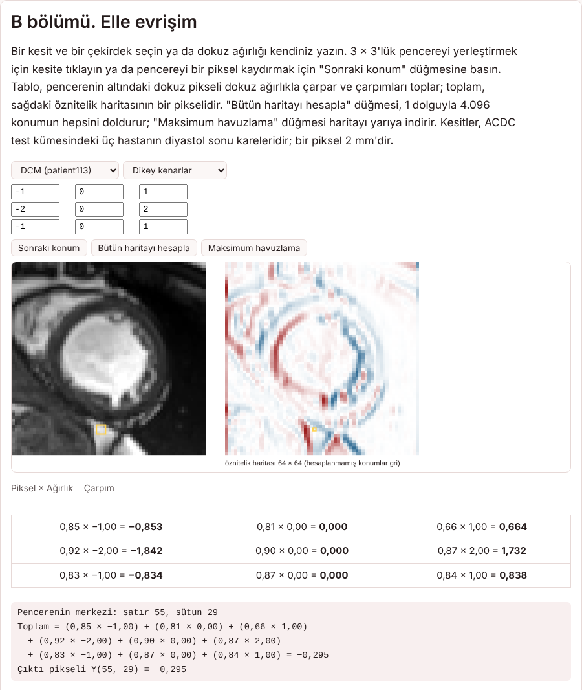
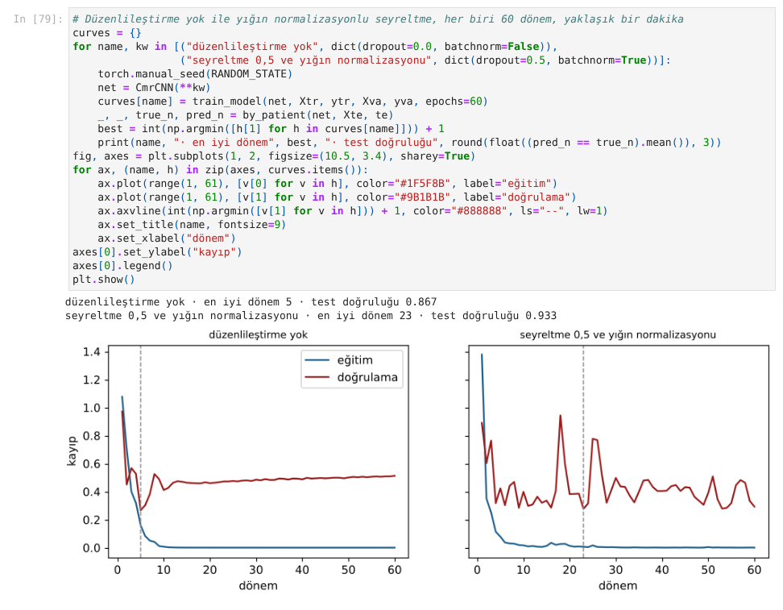

# Hafta 3: Derin öğrenme ve CNN temelleri

**Python ile Yapay Zekâ Eğitimi: Kardiyologlar için Uygulamalı Eğitim Programı** 
Türk Kardiyoloji Derneği

*Görüntüden anlam çıkarma: Kardiyak görüntüleme*

[Eğitimin ana sayfası](../../README.tr.md) · [İzlence](../../SYLLABUS.tr.md) · [Kurulum](../../SETUP.tr.md) · [English](../../en/week-03/README.md)

Hafta hakkında daha ayrıntılı bilgi için bu sayfayı okumaya devam edin. Haftaya doğrudan ders sayfasından devam etmek isterseniz bu bağlantıyı kullanın: **[Haftanın ders sayfasını açın](https://utkukose.github.io/ai-cardiology-tkd-NB-lecture/tr/hafta-03/ders.html)**. Ders sayfası haftanın ana rotasıdır; kutuları etkileşimli labı ve Jupyter Notebook'u doğru yerde açar.

## Hafta hakkında

İlk iki saat bir ağı en küçük parçasından başlayarak kurar: Nöron, katman ve aktivasyon fonksiyonu tıbbi bir analojiyle anlatılır; ardından kayıp, gradyanlar ve eğitim döngüsü, Keras Sequential API ile ilk model, dizi olarak görüntüler, kenarları ve desenleri bulan konvolüsyon işlemi ve pooling, dropout ve batch normalizasyonu ele alınır. Sonra herkese açık ACDC veri setinin sine kardiyak manyetik rezonans incelemelerinde normal kalbi, dilate kardiyomiyopatiyi ve hipertrofik kardiyomiyopatiyi birbirinden ayıran bir evrişimli sinir ağı (CNN) eğitilir. Son iki saatte ağ VGG16 ve ResNet50 mimarileri arasına yerleştirilir, kardiyak görüntülerde veri çoğaltma yapılır, sonuç karışıklık matrisi ve F1 skoruyla okunur ve aşırı öğrenme tespit edilip önlenir. Bir yapay zekâ (YZ) asistanının yazdığı eğitim döngüsü denetlenir; mini proje ise her katılımcının kişisel kayıtla edindiği EchoNet-Dynamic ekokardiyografi videolarını normal ya da anormal olarak sınıflar.

Oturum 4 saat sürer. Haftalık proje için yaklaşık 3 saat ayrılmalıdır.

## Haftanın vakası

**ACDC test kümesindeki 134 numaralı hasta**, 185 cm boyunda ve 104 kg ağırlığındadır ve hipertrofik kardiyomiyopati grubunda yer alır. Sine kardiyak manyetik rezonans incelemesinin uzman konturlarına göre ejeksiyon fraksiyonu yüzde 62,2, en kalın duvar segmenti ise 16,4 mm'dir. 45 başka hastayla eğitilen bir ağın hastalığı piksellerden tanıması gerekmektedir. [Ders sayfası](https://utkukose.github.io/ai-cardiology-tkd-NB-lecture/tr/hafta-03/ders.html) bu vakayla açılır; sanal kliniğin görüntüleme laboratuvarı soruyu son bölümde cevaplar.

## Malzemeler

| Malzeme | Aç | Ne işe yarar? |
|---|---|---|
| **Ders sayfası** | [Ders sayfasını aç](https://utkukose.github.io/ai-cardiology-tkd-NB-lecture/tr/hafta-03/ders.html) | Haftanın anlatımıdır. Yukarıdan aşağıya okunur, uygulama duraklarına götürür ve kod ya da prompt (istem) içermez. |
| **Etkileşimli lab** | [Etkileşimli labı aç](https://utkukose.github.io/ai-cardiology-tkd-NB-lecture/tr/hafta-03/lab.html) | Kod gerektirmeyen A-F bölümleri, ders sayfasında yeri geldiğinde açılır. F bölümü prompt atölyesidir. Öz değerlendirme ve öğrenme günlüğü de labdadır. |
| **Python Notebook** |  [Jupyter Notebook için indir (zip)](https://github.com/utkukose/ai-cardiology-tkd-NB-lecture/raw/main/tr/hafta-03/NB03_derin_ogrenme_ve_evrisimli_aglar.zip) | Uygulama durakları burada çalışılır; her durakta Python temelleri, promptlar ve hazır uygulama bulunur. Python Notebook, Google Colab'da kurulum gerektirmeden ya da kendi bilgisayarınızdaki Jupyter Notebook'ta çalışır: Zip dosyasını indirin, içindeki .ipynb dosyasını bir klasöre çıkarın ve Jupyter'de açın. Her bölüm, bölümün kullandığı kurulumu ve veri çağrılarını yineleyen bir başlangıç hücresiyle açılır. |
| **Prompt kütüphanesi** | [PROMPTLAR.md](PROMPTLAR.md) | Uygulama duraklarının ve haftalık projenin bütün promptlarını, kodu onarmak, açıklatmak ve denetlemek için promptlarla birlikte içerir. GitHub'da her promptun yanında bir kopyalama düğmesi bulunur. |
| **PDF ders notu** | [Hafta03_Ders_Notlari.pdf](Hafta03_Ders_Notlari.pdf) | Ders sayfasının yazdırılabilir biçimidir. |

## Çalışma yolu

Ders sayfası yukarıdan aşağıya okunur ve etkileşimli labın bölümlerini yeri geldikçe açar. Her uygulama durağında çalışma Jupyter Notebook'ta sürer ve oradaki her durak üç bölümden oluşur. **Python temelleri** durağın gerektirdiği Python bilgisini öğretir. **Prompt ile uygulama** bölümünde kodu hazır promptlarla bir YZ asistanı yazar; katılımcı kodu çalıştırır ve sonucu denetler. **Hazır uygulama** ise durağın baştan sona çalışan programıdır. Bölümleri bu sırayla izleyin; Python biliyorsanız promptlarla, yalnızca sonucu görmek istiyorsanız hazır uygulamayla başlayabilirsiniz. Her bölüm, bölümün kullandığı kurulumu ve veri çağrılarını yineleyen bir başlangıç hücresiyle açılır; böylece bölüm doğrudan açıldığında da çalışır. Lab bölümlerinin ve Jupyter Notebook'taki durakların sonunda sizi ders sayfasına, okumanın devam ettiği yere geri götüren bir bağlantı vardır. Nerede kaldığınızı bulamazsanız bu tabloya dönün. Oturuma katılanlar adımları oturumda tamamlar. Süreler, haftayı kendi başına izleyenler, örneğin bir oturumu kaçıranlar içindir.

| Adım | Ne yapılır? | Süre |
|---|---|---|
| 1 | Haftanın vakasını ve ders sayfasını 1. uygulama durağına kadar [okuyun](https://utkukose.github.io/ai-cardiology-tkd-NB-lecture/tr/hafta-03/ders.html) (nöron, öğrenme, Keras Sequential API ve dizi olarak sine MR); etkileşimli labın A bölümünü yapın ve bilgi kontrolü sorularını cevaplayın | 1 saat 5 dakika |
| 2 | **[1. uygulama durağı: Sayılarla sine MR](https://utkukose.github.io/ai-cardiology-tkd-NB-lecture/tr/hafta-03/ders.html#stop-1)** [Python temelleri](https://colab.research.google.com/github/utkukose/ai-cardiology-tkd-NB-lecture/blob/main/tr/hafta-03/NB03_derin_ogrenme_ve_evrisimli_aglar.ipynb#scrollTo=stop-1-basics) · [Prompt ile uygulama](https://colab.research.google.com/github/utkukose/ai-cardiology-tkd-NB-lecture/blob/main/tr/hafta-03/NB03_derin_ogrenme_ve_evrisimli_aglar.ipynb#scrollTo=stop-1-prompt) ([promptlar](PROMPTLAR.md#durak-1-say%C4%B1larla-sine-mr)) · [Hazır uygulama](https://colab.research.google.com/github/utkukose/ai-cardiology-tkd-NB-lecture/blob/main/tr/hafta-03/NB03_derin_ogrenme_ve_evrisimli_aglar.ipynb#scrollTo=stop-1-app) | 1 saat 20 dakika |
| 3 | 2. uygulama durağına kadar [okumayı sürdürün](https://utkukose.github.io/ai-cardiology-tkd-NB-lecture/tr/hafta-03/ders.html#convolution-filters-that-slide-over-an-image) (konvolüsyon, pooling, dropout ve batch normalizasyonu, ağ, VGG16 ve ResNet50, veri çoğaltma, aşırı öğrenme ve F1 skoru); etkileşimli labın B, C ve D bölümlerini yapın | 1 saat 15 dakika |
| 4 | **[2. uygulama durağı: İlk evrişimli ağ](https://utkukose.github.io/ai-cardiology-tkd-NB-lecture/tr/hafta-03/ders.html#stop-2)** [Python temelleri](https://colab.research.google.com/github/utkukose/ai-cardiology-tkd-NB-lecture/blob/main/tr/hafta-03/NB03_derin_ogrenme_ve_evrisimli_aglar.ipynb#scrollTo=stop-2-basics) · [Prompt ile uygulama](https://colab.research.google.com/github/utkukose/ai-cardiology-tkd-NB-lecture/blob/main/tr/hafta-03/NB03_derin_ogrenme_ve_evrisimli_aglar.ipynb#scrollTo=stop-2-prompt) ([promptlar](PROMPTLAR.md#durak-2-i%CC%87lk-evri%C5%9Fimli-a%C4%9F)) · [Hazır uygulama](https://colab.research.google.com/github/utkukose/ai-cardiology-tkd-NB-lecture/blob/main/tr/hafta-03/NB03_derin_ogrenme_ve_evrisimli_aglar.ipynb#scrollTo=stop-2-app) | 1 saat 20 dakika |
| 5 | 3. uygulama durağına kadar [okumayı sürdürün](https://utkukose.github.io/ai-cardiology-tkd-NB-lecture/tr/hafta-03/ders.html#ai-pair-programming-part-3-reviewing-a-training-loop) (bir eğitim döngüsünün denetimi ve EchoNet-Dynamic ile mini proje); etkileşimli labın E ve F bölümlerini yapın | 30 dakika |
| 6 | **[3. uygulama durağı: Mini proje: EchoNet-Dynamic, normal mi anormal mi? (kişisel kayıtla)](https://utkukose.github.io/ai-cardiology-tkd-NB-lecture/tr/hafta-03/ders.html#stop-3)** [Python temelleri](https://colab.research.google.com/github/utkukose/ai-cardiology-tkd-NB-lecture/blob/main/tr/hafta-03/NB03_derin_ogrenme_ve_evrisimli_aglar.ipynb#scrollTo=stop-3-basics) · [Prompt ile uygulama](https://colab.research.google.com/github/utkukose/ai-cardiology-tkd-NB-lecture/blob/main/tr/hafta-03/NB03_derin_ogrenme_ve_evrisimli_aglar.ipynb#scrollTo=stop-3-prompt) ([promptlar](PROMPTLAR.md#durak-3-mini-proje-echonet-dynamic-normal-mi-anormal-mi-ki%C5%9Fisel-kay%C4%B1tla)) · [Hazır uygulama](https://colab.research.google.com/github/utkukose/ai-cardiology-tkd-NB-lecture/blob/main/tr/hafta-03/NB03_derin_ogrenme_ve_evrisimli_aglar.ipynb#scrollTo=stop-3-app) | 55 dakika |
| 7 | Haftanın makalesini, sanal kliniğin bu haftaki aşamasını ve "Kendi verinizle" bölümünü [okuyun](https://utkukose.github.io/ai-cardiology-tkd-NB-lecture/tr/hafta-03/ders.html#the-paper-of-the-week) | 30 dakika |
| 8 | [Etkileşimli labın](https://utkukose.github.io/ai-cardiology-tkd-NB-lecture/tr/hafta-03/lab.html) "Kendini sına" sekmesindeki öz değerlendirmeyi yapın, yansıtma yazınızı yazın ve öğrenme günlüğünü dışa aktarın | 20 dakika |
| | **Haftalık proje dışında toplam** | **7 saat 15 dakika** |
| 9 | [Haftalık projeyi](#haftal%C4%B1k-proje) tamamlayın [Promptlar](PROMPTLAR.md#haftal%C4%B1k-projenin-promptlar%C4%B1) · [Jupyter Notebook'ta haftalık proje](https://colab.research.google.com/github/utkukose/ai-cardiology-tkd-NB-lecture/blob/main/tr/hafta-03/NB03_derin_ogrenme_ve_evrisimli_aglar.ipynb#scrollTo=project) | 3 saat |

<table>
<tr><td width="50%"></td><td width="50%"></td></tr>
<tr><td>Etkileşimli lab, B bölümü: 3 × 3'lük bir çekirdek ACDC'nin bir kısa eksen kesiti üzerinde kayar; bir konumdaki çarpımlar ve büyüyen öznitelik haritası görülür.</td><td>Jupyter Notebook, «Durak 2 · Hazır uygulama»: 45 eğitim hastasıyla eğitilen ağın dropout'lu ve dropout'suz eğitim ve doğrulama kayıpları karşılaştırılır.</td></tr>
<tr><td width="50%"></td><td width="50%"></td></tr>
<tr><td>Etkileşimli lab, C bölümü: Aşırı öğrenmeye karşı dört ayarın öğrenme eğrileri ve bir kesitin döndürülmüş kopyaları gösterilir.</td><td>Etkileşimli lab, F bölümü: Prompt atölyesinde prompt kartının yedi alanı doldurulur; bir kalite göstergesi ve hasta verisi uyarısı yazılanı değerlendirir.</td></tr>
</table>

## Haftalık proje

**Proje.** Kardiyak MRI ACDC veri seti: Dilate/hipertrofik KMP otomatik sınıflandırma.

**Ne yapılacak?** ACDC'nin sine kardiyak manyetik rezonans incelemelerinde dilate kardiyomiyopatiyi (DCM), hipertrofik kardiyomiyopatiyi (HCM) ve normal kalbi sınıflandırın ve ağı kardiyoloğun ölçümleriyle karşılaştırın. Önce dersin ağını 45 eğitim hastasıyla eğitin; erken durdurma için 15 doğrulama hastasını kullanın. Ardından 30 test hastasının karışıklık matrisini, her sınıfın kesinlik, duyarlılık ve F1 değerini ve makro F1'i bildirin. Sonra ACDC kurallarını aynı 30 hastanın uzman konturlarından elde edilen ölçümlere uygulayın ve iki karışıklık matrisini karşılaştırın. Son olarak yanlış sınıflanan her hasta için ağın gördüğü kesitleri ve en kalın duvarın bulunduğu kesiti gösterin; klinikte hangi hataların en çok önem taşıyacağını ve nedenini yazın.

**Nereye bakılacak?** Ders: "Dizi olarak görüntüler: ACDC'nin sine kardiyak MR görüntüleri", "Sine MR için bir evrişimli ağ", "Overfitting tespiti ve önleme" ve "Confusion matrix, F1-score yorumlama" bölümleri. Etkileşimli lab: C, D ve F bölümleri. Jupyter Notebook: 1. ve 2. uygulama duraklarının hazır uygulamaları.

**Promptlarla.** Proje, [prompt kütüphanesindeki](https://github.com/utkukose/ai-cardiology-tkd-NB-lecture/blob/main/tr/hafta-03/PROMPTLAR.md#haftal%C4%B1k-projenin-promptlar%C4%B1) dört promptla da tamamlanabilir; her adım için bir prompt vardır. Jupyter Notebook'un sonundaki "Haftalık proje" bölümü her promptun tablosunu hazırlar ve tek başına açılır. Bir promptun testi sağlanmadan sonraki prompta geçilmez ve her prompt YZ kullanım günlüğüne kaydedilir.

**Örnek.** Ağın 12 test hastasına normal dediğini, bunların 10'unda haklı olduğunu ve HCM'li 10 hastanın 2'sini kaçırdığını varsayın: Normal sınıf için $TP = 10$, $FP = 2$, $FN = 0$'dır. Kesinlik $10/12 = 0{,}833$, duyarlılık $10/10 = 1{,}000$ olur. F1 değeri $2TP/(2TP + FP + FN)$ ile hesaplanır ve burada $20/22 = 0{,}909$'dur. Makro F1, üç sınıfın F1 değerlerinin düz ortalamasıdır.

**Ne teslim edilecek?** [Rapor şablonuyla](../sablonlar/Rapor_Sablonu.docx) yazılmış, bir ya da iki sayfalık bir rapor teslim edilir. Raporda iki kaybın şekli, iki karışıklık matrisi, sınıflara göre ölçütlerin tablosu ve hataların şekli yer almalıdır. Rapora YZ kullanım günlüğünü (kullanılan araç, prompt, neyin denetlendiği ve neyin değiştirildiği) ve çıktılarıyla birlikte Jupyter Notebook'u ekleyin. ACDC görüntüleri içeren şekiller, kullanım koşullarının gerektirdiği gibi "ACDC, CC BY-NC-SA 4.0" kaynak bilgisini taşımalı ve yalnızca ticari olmayan amaçlarla kullanılmalıdır.

**Teslim.** Haftalık proje, 4. haftanın oturumundan önce utkukose@sdu.edu.tr ya da utkukose@gmail.com adresine e-postayla gönderilir. E-postaya "Ne teslim edilecek?" başlığında sayılan öğeler ve etkileşimli labdan dışa aktarılan öğrenme günlüğü eklenir. Haftalık projeler değerlendirmenin yüzde 40'ını oluşturur; değerlendirme ölçütleri izlencede yer almaktadır.

## Öğrenme çıktıları

Haftanın sonunda katılımcıların bir nöronun, bir katmanın ve bir ağın çıktılarını nasıl hesapladığını tıbbi bir analojiyle ve kaybın, gradyanların ve ağırlık güncellemelerinin bir ağı nasıl eğittiğini açıklayabilmeleri beklenmektedir. Keras Sequential API ile ilk modeli kurabilmeli ve aynı modeli PyTorch'ta okuyabilmeli, bir sine kardiyak manyetik rezonans incelemesini bir dizi olarak tarif edebilmeli ve bir çalışmanın hastalarını herhangi bir öğrenme adımından önce kümelere ayırabilmelidirler. Bir evrişimi, bir havuzlama adımını, dropout'u ve batch normalizasyonunu izleyebilmeli, küçük bir evrişimli ağ eğitebilmeli ve bu ağı VGG16 ve ResNet50 mimarileri arasında konumlandırabilmelidirler. Anatomiyi koruyan veri çoğaltma yöntemlerini seçebilmeli, öğrenme eğrilerinde aşırı öğrenmeyi tanıyıp önleyebilmeli ve sonucu karışıklık matrisi, kesinlik, duyarlılık ve her sınıfın F1 skoruyla okuyabilmelidirler. Son olarak bir YZ asistanının yazdığı eğitim döngüsünü denetleyebilmeli ve EchoNet-Dynamic gibi kayıt gerektiren bir veri setini kullanım koşullarına uygun biçimde edinebilmelidirler.

## Oturumun eğitim akışı

Haftanın dört saatlik oturumu aşağıdaki plana göre işlenir. Plan, malzemelerin canlı bir oturumda nasıl bir araya geldiğini göstermek için paylaşılmaktadır.

| Süre | Etkinlik |
|---|---|
| 0:00-0:15 | Haftanın vakası olan ACDC'nin 134 numaralı hastası tanıtılır ve haftanın rotası anlatılır. Her katılımcı Jupyter Notebook'u Google Colab'da ya da Jupyter'de açar ve 0. bölümü çalıştırır; bu bölüm üç grubun ACDC dosyalarını (yaklaşık 105 MB) açık kaynağından indirir. |
| 0:15-0:50 | İlk iki saat, yapay sinir ağları ve CNN: Nöron, katman ve aktivasyon fonksiyonu tıbbi bir analojiyle anlatılır; etkileşimli labın A bölümüyle öğrenme çalışılır, Keras Sequential API ile ilk model kurulur ve sine kardiyak manyetik rezonans görüntüleri birer dizi olarak ele alınır. |
| 0:50-1:20 | 1. uygulama durağı Jupyter Notebook'ta, promptlarla ya da Python ile çalışılır. Durağın sonunda katılımcılar 134 numaralı hastanın ejeksiyon fraksiyonunu ve ACDC kurallarının doğruluğunu karşılaştırır. |
| 1:20-2:00 | B bölümüyle konvolüsyon işlemi, ardından pooling, dropout ve batch normalizasyonu ve dersin ağının üç boyutlu görünümü çalışılır. |
| 2:00-2:10 | Ara. |
| 2:10-2:45 | Son iki saat, gelişmiş CNN ve model değerlendirme: VGG16 ve ResNet50 mimarileri, kardiyak görüntüler için veri çoğaltma, C bölümüyle aşırı öğrenme ve D bölümüyle karışıklık matrisi ile F1 skoru çalışılır. |
| 2:45-3:15 | 2. uygulama durağı: Ağ yaklaşık bir dakikada eğitilir ve hasta hasta konturlardan elde edilen ölçümlerle karşılaştırılır. |
| 3:15-3:45 | E ve F bölümleriyle bir eğitim döngüsünün denetlenmesi çalışılır. Ardından oturumun mini projesi olan 3. uygulama durağına geçilir ve EchoNet-Dynamic videoları normal ya da anormal olarak sınıflanır: Kaydı olan katılımcılar durağı kendi kopyalarında çalıştırır; diğer katılımcılar eğitmenin ortak ekrandaki çalıştırmasını izler. |
| 3:45-4:00 | Haftanın makalesi, sanal kliniğin görüntüleme laboratuvarı, "Kendi verinizle" bölümü ve haftalık proje ele alınır. |

## Kendi verinizle

Ders sayfası, haftanın yöntemlerini kendi verinize nasıl uygulayacağınızı anlatan bir bölümle biter. Bu bölümde hangi sorunun hangi yönteme uyduğu, önce neyin denetleneceği, etik kurul onayı, Kişisel Verilerin Korunması Kanunu (KVKK) ve analizin nerede yapılacağı ele alınır. [Bölümü ders sayfasında okuyun](https://utkukose.github.io/ai-cardiology-tkd-NB-lecture/tr/hafta-03/ders.html#with-your-own-data).

## İsteğe bağlı araştırma ödevi

PubMed'de, 2020 ya da sonrasında yayımlanmış ve ekokardiyogramlar ya da kardiyak manyetik rezonans görüntüleri üzerinde bir hastalığı saptamak için derin öğrenme modeli eğiten bir çalışma bulun. Çalışmayı yarım sayfada özetleyin; özette görüntülerin türü ve kaç hastadan geldiği, etiketler ve etiketleri kimin verdiği, ağ, her sınıf için bildirilen ölçütler ve model başka bir hastanenin hastalarında sınandıysa bunun nasıl yapıldığı yer almalıdır. [Haftanın makalesindeki](https://utkukose.github.io/ai-cardiology-tkd-NB-lecture/tr/hafta-03/ders.html#the-paper-of-the-week) üç soru özetinize yol gösterebilir. Bu ödev notlandırılmaz; 4. haftadaki transfer öğrenme tartışmasına hazırlık amacı taşır.

## Bu haftadan sonra sanal klinik

Sanal klinik 3. haftada, açık görüntüleri okuyan görüntüleme laboratuvarını açar. Laboratuvarda her katılımcının kaynağından indirdiği ACDC sine kardiyak manyetik rezonans incelemeleri ve kişisel kaydı olanlar için EchoNet-Dynamic ekokardiyografi videoları kullanılır. Bir evrişimli ağ ACDC'nin üç grubunu piksellerden öğrenir ve sonuçları uzman konturlarından elde edilen ölçümlerle karşılaştırılır. Sonuçlar, ders sayfasının [Sanal klinik, 3. aşama](https://utkukose.github.io/ai-cardiology-tkd-NB-lecture/tr/hafta-03/ders.html#the-virtual-clinic-stage-3-the-imaging-laboratory-opens) bölümünde yer almaktadır.

## Gelecek hafta

**Hafta 4: Transfer öğrenme.** Görüntüleme laboratuvarı ölçüm yapmaya başlar. ImageNet üzerinde önceden eğitilmiş bir ağ olan EfficientNet-B0, az sayıda etiketli örnekle kalp görüntülerine uyarlanır. Bir U-Net, CAMUS ekokardiyogramlarında sol ventrikülün sınırlarını çizer ve ejeksiyon fraksiyonu bu sınırlardan disk yöntemiyle hesaplanır. Jupyter Notebook, yaklaşık 227 MB'lık CAMUS verisini ve ImageNet ağırlıklarını kendisi indirir ([DATASETS.tr.md](../../DATASETS.tr.md#4-haftanın-veri-setleri)). Ayrıntılar için [eğitimin planına](../../README.tr.md#on-bir-hafta) bakın.

---

**Prof. Dr. Utku Köse**

Profesör, Bilgisayar Mühendisliği Bölümü, Süleyman Demirel Üniversitesi, Isparta, Türkiye 
Kurucu Müdür, Yapay Zekâ Uygulama ve Araştırma Merkezi (YAZEM), Süleyman Demirel Üniversitesi 
Bilgisayar Bilimleri Anabilim Dalı Başkanı, Bilgisayar Mühendisliği Bölümü, Süleyman Demirel Üniversitesi 
Diğer kurumlar: University of North Dakota (ABD), Universidad Panamericana (Meksiko, Meksika), Vel Tech University (Chennai, Hindistan) 
IEEE Kıdemli Üyesi, ACM Profesyonel Üyesi

[ORCID 0000-0002-9652-6415](https://orcid.org/0000-0002-9652-6415) | [utkukose.com](https://www.utkukose.com) | [github.com/utkukose](https://github.com/utkukose)

[utkukose@sdu.edu.tr](mailto:utkukose@sdu.edu.tr) | [utku.kose@und.edu](mailto:utku.kose@und.edu) | [ukose@up.edu.mx](mailto:ukose@up.edu.mx) | [utkukose@gmail.com](mailto:utkukose@gmail.com)

*İlk sürüm: Kasım 2026. İçerik CC BY 4.0, kod MIT.*

