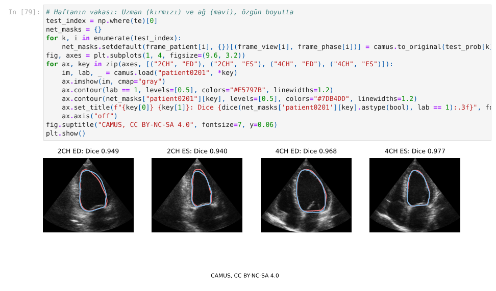
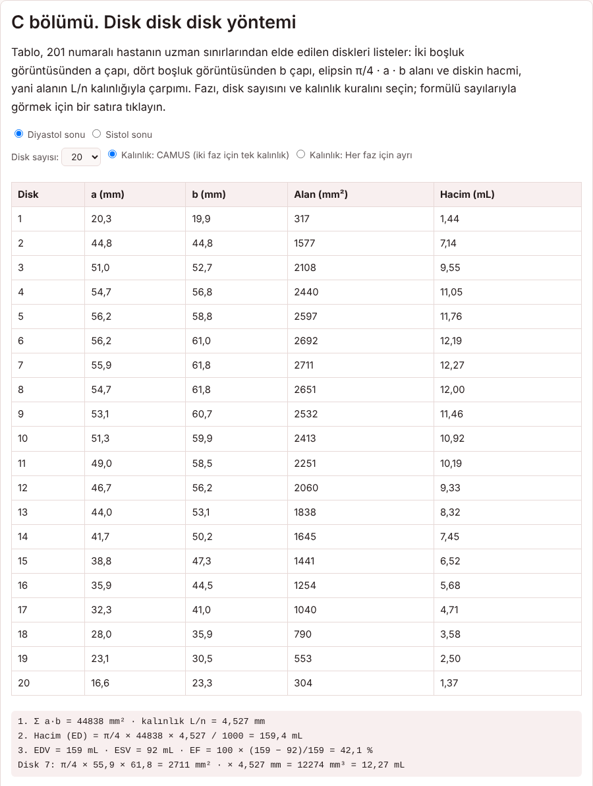

# Hafta 4: Transfer öğrenme

**Python ile Yapay Zekâ Eğitimi: Kardiyologlar için Uygulamalı Eğitim Programı** 
Türk Kardiyoloji Derneği

*Fotoğraflarla eğitilmiş ağlardan otomatik ejeksiyon fraksiyonu ölçümüne geçilir.*

[Eğitimin ana sayfası](../../README.tr.md) · [İzlence](../../SYLLABUS.tr.md) · [Kurulum](../../SETUP.tr.md) · [English](../../en/week-04/README.md)

## Hafta hakkında

Hafta, milyonlarca gündelik fotoğrafla eğitilmiş ağların kalp görüntülerine uyarlanmasıyla başlar. ImageNet üzerinde önceden eğitilmiş EfficientNet-B0 ve 3. haftadan tanıdık ACDC sine kardiyak manyetik rezonans incelemeleriyle öznitelik çıkarımı, ince ayar ve az sayıda etiketli hastayla öğrenme çalışılır. İkinci yarıda herkese açık CAMUS veri setinin apikal iki boşluk ve dört boşluk ekokardiyogramlarında sol ventrikülün sınırları bir U-Net ile çizilir. Sınırların doğruluğu Dice katsayısıyla ölçülmektedir; hacimler ve ejeksiyon fraksiyonu ise biplan disk yöntemiyle (modifiye Simpson yöntemi) hesaplanır. Haftanın son bölümünde otomatik ölçüm Bland-Altman analiziyle uzmanın ölçümüyle karşılaştırılır, ölçümün klinik doğrulaması planlanır ve bir YZ asistanının yazdığı bir ölçüm hattı denetlenir.

Oturum 4 saat sürer. Haftalık proje için yaklaşık 3 saat ayrılmalıdır.

## Haftanın rotası

Ders sayfası haftanın ana rotasıdır. Sayfada kod ya da prompt (istem) bulunmaz; sayfa etkileşimli labla birlikte yukarıdan aşağıya okunur. Her uygulama durağında katılımcılar Jupyter defterindeki iki yoldan birini seçer. **Prompt yolunda** (Kısım 1) kodu, hazır promptlara göre bir yapay zekâ (YZ) asistanı yazar; katılımcı bu kodu çalıştırır ve sonucu denetler. **Python yolunda** (Kısım 2) ise kodu katılımcı kendisi yazar. İki yol da aynı sonuçlara varır. Defter hem kurulum gerektirmeyen Google Colab'da hem de kendi bilgisayarınızdaki Jupyter'de çalışır ([kurulum](../../SETUP.tr.md)).

|  | Ana rota: Ders sayfası ve etkileşimli lab | Uygulama durağı: Yolunuzu seçin |
|---|---|---|
| 1 | [Transfer öğrenme: Bir ağın fotoğraflardan öğrendikleri](https://utkukose.github.io/ai-cardiology-tkd-NB-lecture/tr/hafta-04/ders.html#transfer-learning-what-a-network-learned-from-photographs), [Az sayıda etiketli hastayla öğrenmek](https://utkukose.github.io/ai-cardiology-tkd-NB-lecture/tr/hafta-04/ders.html#learning-from-few-labelled-patients) | **[Durak 1: Fotoğraflarla eğitilmiş bir ağla az hastadan öğrenmek](https://utkukose.github.io/ai-cardiology-tkd-NB-lecture/tr/hafta-04/ders.html#stop-1)** Prompt yolu: Kısım 1, Durak 1 Python yolu: Kısım 2, Python adımı 4, 1-4. bölümler |
| 2 | [Segmentasyon: Her piksel için bir etiket](https://utkukose.github.io/ai-cardiology-tkd-NB-lecture/tr/hafta-04/ders.html#segmentation-a-label-for-every-pixel), [CAMUS ekokardiyogramlarında bir U-Net](https://utkukose.github.io/ai-cardiology-tkd-NB-lecture/tr/hafta-04/ders.html#a-u-net-on-the-echocardiograms-of-camus) | **[Durak 2: CAMUS ekokardiyogramlarında bir U-Net](https://utkukose.github.io/ai-cardiology-tkd-NB-lecture/tr/hafta-04/ders.html#stop-2)** Prompt yolu: Kısım 1, Durak 2 Python yolu: Kısım 2, 5-7. bölümler |
| 3 | [Disk yöntemiyle ejeksiyon fraksiyonu](https://utkukose.github.io/ai-cardiology-tkd-NB-lecture/tr/hafta-04/ders.html#the-ejection-fraction-by-the-method-of-discs), [Uzmanla uyum: Bland-Altman](https://utkukose.github.io/ai-cardiology-tkd-NB-lecture/tr/hafta-04/ders.html#agreement-with-the-expert-bland-altman) | **[Durak 3: Disk yöntemiyle ejeksiyon fraksiyonu](https://utkukose.github.io/ai-cardiology-tkd-NB-lecture/tr/hafta-04/ders.html#stop-3)** Prompt yolu: Kısım 1, Durak 3 Python yolu: Kısım 2, 8. ve 9. bölümler |
|  | [Otomatik bir ölçümün klinik doğrulamasını planlamak](https://utkukose.github.io/ai-cardiology-tkd-NB-lecture/tr/hafta-04/ders.html#planning-the-clinical-validation-of-an-automatic-measurement), [YZ asistanıyla çalışmak, 4. bölüm: Bir ölçüm hattını denetlemek](https://utkukose.github.io/ai-cardiology-tkd-NB-lecture/tr/hafta-04/ders.html#ai-pair-programming-part-4-reviewing-a-measurement-pipeline), [Haftanın makalesi](https://utkukose.github.io/ai-cardiology-tkd-NB-lecture/tr/hafta-04/ders.html#the-paper-of-the-week), [Sanal klinik, 4. aşama: Otomatik ejeksiyon fraksiyonu](https://utkukose.github.io/ai-cardiology-tkd-NB-lecture/tr/hafta-04/ders.html#the-virtual-clinic-stage-4-automatic-ejection-fraction) | "Kendi verinizle" bölümü, haftanın makalesi ve sanal klinik |

## Malzemeler

| Malzeme | Aç | İçeriği |
|---|---|---|
| **Ders sayfası (ana rota)** | [Ders sayfasını aç](https://utkukose.github.io/ai-cardiology-tkd-NB-lecture/tr/hafta-04/ders.html) | Vakayı, kavramları çözümlü örnekleriyle, disk yönteminin üç boyutlu (3B) bir sahnesini, iki animasyonu, bilgi kontrolü sorularını, üç uygulama durağını, "Kendi verinizle" bölümünü, tekrar kartlarını ve kaynakları içerir. Sayfada kod ve prompt yer almaz. |
| **Etkileşimli lab** | [Etkileşimli labı aç](https://utkukose.github.io/ai-cardiology-tkd-NB-lecture/tr/hafta-04/lab.html) | Kod gerektirmeyen A'dan F'ye kadar altı bölümü (F bölümü prompt atölyesidir), öz değerlendirmeyi, yansıtma yazısını ve dışa aktarılabilen öğrenme günlüğünü içerir |
| **Jupyter defteri** |  [Jupyter için indir](NB04_transfer_ogrenme.ipynb) | Kısım 1 prompt yoludur: Üç durakta toplam dokuz adım vardır ve her adımda hazır bir prompt, adımın tablosunu hazırlayan bir veri hücresi, YZ asistanının kodu için bir hücre, otomatik bir kontrol ve hazır kod bulunur. Kısmın sonunda haftalık proje dört promptla yer alır. Kısım 2 Python yoludur: Python adımı 4'ü, A-J alıştırmalarıyla birlikte 1-10. bölümleri ve yedi alan için uygulama görevlerini içerir. |
| **Prompt kütüphanesi** | [PROMPTLAR.md](PROMPTLAR.md) | Prompt yolunun bütün promptlarını, kodu onarmaya yarayan promptları ve haftalık projenin prompt yolunu içerir. GitHub'da her promptun yanında bir kopyalama düğmesi bulunur. |
| **PDF ders notu** | [Hafta04_Ders_Notlari.pdf](Hafta04_Ders_Notlari.pdf) | Ders sayfasının yazdırılabilir biçimidir; uygulama duraklarını ve "Kendi verinizle" bölümünü de içerir. |

<table>
<tr><td width="50%"></td><td width="50%"></td></tr>
<tr><td>Etkileşimli lab, B bölümü: 201 numaralı hastanın dört boşluk diyastol sonu karesinde U-Net'in sınırı kaydırılır; panel Dice katsayısını ve alandaki değişimi adım adım hesaplar.</td><td>Jupyter defteri, 7. bölüm: 201 numaralı hastanın dört karesinde uzmanın ve U-Net'in çizdiği sınırlar karşılaştırılır.</td></tr>
<tr><td width="50%"></td><td width="50%"></td></tr>
<tr><td>Etkileşimli lab, C bölümü: Disk yöntemi adım adım uygulanır; tabloda her diskin çapları, alanı ve hacmi görülür.</td><td>Etkileşimli lab, D bölümü: 50 test hastasının ejeksiyon fraksiyonu için Bland-Altman grafiği çizilir; panel ortalama farkı ve uyum sınırlarını verir.</td></tr>
</table>

## Haftanın vakası

**CAMUS test kümesindeki 201 numaralı hasta** 56 yaşında bir kadındır ve ekokardiyografisi Saint-Étienne Üniversite Hastanesinde yapılmıştır. İki apikal görüntünün kalitesi de iyidir. Uzmanın çizdiği sınırlardan biplan disk yöntemiyle hesaplanan diyastol sonu hacmi 159 mL, sistol sonu hacmi 92 mL ve ejeksiyon fraksiyonu yüzde 42'dir. Bu hastayı hiç görmemiş bir ağın dört karede sol ventrikülün sınırlarını çizmesi ve aynı değerleri ölçmesi gerekmektedir. [Ders sayfası](https://utkukose.github.io/ai-cardiology-tkd-NB-lecture/tr/hafta-04/ders.html) bu vakayla açılır; sanal kliniğin eko ölçümü ise soruyu son bölümde cevaplar.

## Öğrenme çıktıları

Haftanın sonunda katılımcıların, bir ağın büyük bir fotoğraf koleksiyonundan neler öğrendiğini ve bu özniteliklerin kalp görüntülerinde öznitelik çıkarımıyla ya da ince ayarla nasıl yeniden kullanıldığını açıklayabilmeleri beklenmektedir. Önceden eğitilmiş bir ağı az sayıda etiketli hastaya uyarlayabilmeli ve bu ağı rastgele ağırlıklarla eğitilen ağlarla adil biçimde karşılaştırabilmelidirler. Segmentasyonu her piksele bir etiket verilmesi olarak tanımlayabilmeli, ekokardiyogramlarda küçük bir U-Net eğitebilmeli ve ağın çizdiği sınırları görüntüye ve faza göre Dice katsayısıyla değerlendirebilmelidirler. Son olarak hacimleri ve ejeksiyon fraksiyonunu biplan disk yöntemiyle hesaplayabilmeli, otomatik bir ölçümün uzmanla uyumunu Bland-Altman analiziyle değerlendirebilmeli ve bu ölçümün klinik doğrulamasını planlayabilmelidirler.

## Çalışma yolu

Oturuma katılanlar ana rotayı ve uygulama duraklarını oturumda tamamlar. Haftayı kendi başına izleyenler, örneğin bir oturumu kaçıranlar, aşağıdaki sürelerle plan yapabilir.

| Adım | Etkinlik | Prompt yolu | Python yolu |
|---|---|---|---|
| 1 | Haftanın vakasını ve ders sayfasını 1. uygulama durağına kadar okuyun; etkileşimli labın A bölümünü yapın ve bilgi kontrolü sorularını cevaplayın | 45 dakika | 45 dakika |
| 2 | 1. uygulama durağı (oturumun mini projesi): Prompt yolunda Kısım 1'deki Durak 1'i, Python yolunda Python adımı 4'ü ve 1-4. bölümleri çalışın | 30 dakika | 1 saat 20 dakika |
| 3 | 2. uygulama durağına kadar okumayı sürdürün (segmentasyon, Dice katsayısı ve CAMUS ekokardiyogramlarında U-Net); etkileşimli labın B bölümünü yapın | 40 dakika | 40 dakika |
| 4 | 2. uygulama durağı: Prompt yolunda Kısım 1'deki Durak 2'yi, Python yolunda 5, 6 ve 7. bölümleri çalışın | 30 dakika | 1 saat |
| 5 | 3. uygulama durağına kadar okumayı sürdürün (3B sahneyle disk yöntemi ve uzmanla uyum); etkileşimli labın C ve D bölümlerini yapın | 45 dakika | 45 dakika |
| 6 | 3. uygulama durağı: Prompt yolunda Kısım 1'deki Durak 3'ü, Python yolunda 8. ve 9. bölümleri çalışın | 25 dakika | 50 dakika |
| 7 | Klinik doğrulama planını, ölçüm hattı denetimini, haftanın makalesini, sanal kliniğin bu haftaki aşamasını ve "Kendi verinizle" bölümünü okuyun; etkileşimli labın E ve F bölümlerini yapın. Python yolunu izliyorsanız 10. bölümü de çalışın | 45 dakika | 1 saat |
| 8 | Etkileşimli labın "Kendini sına" sekmesindeki öz değerlendirmeyi yapın, yansıtma yazınızı yazın ve öğrenme günlüğünü dışa aktarın | 20 dakika | 20 dakika |
| | **Haftalık proje dışında toplam** | **4 saat 40 dakika** | **6 saat 40 dakika** |
| 9 | Haftalık projeyi iki yoldan biriyle tamamlayın | 3 saat | 3 saat |

## Oturumun eğitim akışı

Haftanın dört saatlik oturumu aşağıdaki plana göre işlenir. Plan, malzemelerin canlı bir oturumda nasıl bir araya geldiğini göstermek için paylaşılmaktadır.

| Süre | Etkinlik |
|---|---|
| 0:00-0:15 | Haftanın vakası olan CAMUS'un 201 numaralı hastası tanıtılır ve haftanın rotası anlatılır. Her katılımcı defteri Google Colab'da ya da Jupyter'de açar ve 0. bölümü çalıştırır. Bu bölüm, eksikse 3. haftanın ACDC dosyalarını, Human Heart Project'in açık veri tabanından CAMUS'un 300 hastasını (yaklaşık 227 MB) ve EfficientNet-B0'ın ImageNet ağırlıklarını (yaklaşık 21 MB) indirir. |
| 0:15-0:50 | Ana rotada transfer öğrenme anlatılır: Bir ağın fotoğraflardan neler öğrendiği, öznitelik çıkarımı ve ince ayar ele alınır. Ardından etkileşimli labın A bölümüyle az sayıda etiketli hastayla öğrenme çalışılır. |
| 0:50-1:30 | Oturumun mini projesi olan 1. uygulama durağında katılımcılar iki gruba ayrılır: Prompt yolunu izleyenler ve Python yolunu izleyenler. İki grup da ACDC'nin kardiyomiyopati gruplarını, her gruptan 15 etiketli hastayla önce öznitelik çıkarımıyla, sonra ince ayarla öğrenir. Ardından her gruptan yalnızca beş hasta bırakılır ve sonucun seçilen hastalara ne kadar bağlı olduğu görülür. |
| 1:30-1:45 | Ara. |
| 1:45-2:20 | Ana rotada segmentasyon, yani her piksele bir etiket verilmesi anlatılır. B bölümüyle Dice katsayısı çalışılır ve CAMUS ekokardiyogramlarında U-Net tanıtılır. |
| 2:20-2:50 | 2. uygulama durağı: U-Net yaklaşık üç dakikada eğitilir ve ağın çizdiği sınırlar 50 test hastasında görüntüye ve faza göre değerlendirilir. |
| 2:50-3:35 | Ana rotada disk yöntemi 3B sahneyle ve C bölümüyle, uzmanla uyum ise D bölümüyle çalışılır. Ardından 3. uygulama durağında 201 numaralı hastanın ve 50 test hastasının ejeksiyon fraksiyonu ölçülür. |
| 3:35-4:00 | Otomatik bir ölçümün klinik doğrulamasının nasıl planlanacağı anlatılır; etkileşimli labın E ve F bölümleriyle bir ölçüm hattının denetimi çalışılır. Ardından haftanın makalesi, sanal kliniğin eko ölçümü, "Kendi verinizle" bölümü ve haftalık proje ele alınır. |

## Haftalık proje

**Ne yapılacak?** CAMUS ekokardiyogramlarında sol ventrikülün sınırlarını çizin, ejeksiyon fraksiyonunu otomatik olarak ölçün ve bu ölçümü bir ekokardiyografi laboratuvarının yapacağı gibi değerlendirin. Önce dersin U-Net'ini 200 eğitim hastasıyla eğitin; en iyi dönemi seçmek için 50 doğrulama hastasını kullanın. Ardından 200 test karesinin Dice katsayısını görüntüye, faza ve görüntü kalitesine göre bildirin. İkinci adımda 50 test hastasının diyastol sonu hacmini (EDV), sistol sonu hacmini (ESV) ve ejeksiyon fraksiyonunu (EF) ağın sınırlarından biplan disk yöntemiyle hesaplayın; üç ölçümün her birini Bland-Altman analiziyle uzmanın ölçümüyle karşılaştırın. Üçüncü adımda ağın ve uzmanın EF değerlerini üç aralığa ayırarak bir çapraz tabloda karşılaştırın; bu aralıklar yüzde 40 ve altı, yüzde 41-49 ile yüzde 50 ve üzeridir. Son olarak EF hatası en büyük üç hastayı uzmanın ve ağın dört sınırıyla birlikte gösterin. Bu ölçüm bir laboratuvarda kullanılmadan önce dış doğrulamasının nasıl planlanması gerektiğini de yarım sayfada yazın.

**Nereye bakılacak?** Ders: "Segmentasyon: Her piksel için bir etiket", "CAMUS ekokardiyogramlarında bir U-Net", "Disk yöntemiyle ejeksiyon fraksiyonu", "Uzmanla uyum: Bland-Altman" ve "Otomatik bir ölçümün klinik doğrulamasını planlamak" bölümleri. Etkileşimli lab: B, C ve D bölümleri. Jupyter defteri: Kısım 1, 2. ve 3. duraklar ya da Kısım 2, 5-9. bölümler.

**Prompt yolu.** Proje, [prompt kütüphanesindeki](https://github.com/utkukose/ai-cardiology-tkd-NB-lecture/blob/main/tr/hafta-04/PROMPTLAR.md#haftal%C4%B1k-projenin-prompt-yolu) dört promptla da tamamlanabilir; her adım için bir prompt vardır. Jupyter defterinin 1. kısmının sonundaki "Prompt yolunda haftalık proje" bölümü her promptun tablosunu hazırlar. Bir promptun testi sağlanmadan sonraki prompta geçilmez.

**Örnek.** Beş hastada EF farklarının (ağ eksi uzman) −3, 5, −7, 1 ve −1 puan olduğunu varsayın. Ortalama fark (bias) bu farkların ortalamasıdır: $-5/5 = -1{,}0$ puan. Ortalamadan sapmaların kareleri 4, 36, 36, 4 ve 0'dır ve toplamları 80'dir. Bu yüzden farkların standart sapması (SS) $\sqrt{80/4} = 4{,}47$ puandır. Uyum sınırları $-1{,}0 \pm 1{,}96 \times 4{,}47$ ile hesaplanır ve −9,8 ile 7,8 puan arasında yer alır.

**Ne teslim edilecek?** [Rapor şablonuyla](../sablonlar/Rapor_Sablonu.docx) yazılmış, bir ya da iki sayfalık bir rapor teslim edilir. Raporda Dice katsayılarının tablosu, üç Bland-Altman grafiği, EF aralıklarının çapraz tablosu, üç hastanın şekli ve doğrulama planı yer almalıdır. Rapora YZ kullanım günlüğünü (kullanılan araç, prompt, neyin denetlendiği ve neyin değiştirildiği) ve çıktılarıyla birlikte Jupyter defterini ekleyin. CAMUS görüntüleri içeren şekiller, kullanım koşullarının gerektirdiği gibi "CAMUS, CC BY-NC-SA 4.0" kaynak bilgisini taşımalı ve yalnızca ticari olmayan amaçlarla kullanılmalıdır.

**Teslim.** Haftalık proje, 5. haftanın oturumundan önce utkukose@sdu.edu.tr ya da utkukose@gmail.com adresine e-postayla gönderilir. E-postaya "Ne teslim edilecek?" başlığında sayılan öğeler ve etkileşimli labdan dışa aktarılan öğrenme günlüğü eklenir. Haftalık projeler değerlendirmenin yüzde 40'ını oluşturur; değerlendirme ölçütleri izlencede yer almaktadır.

## Kendi verinizle

Ders sayfası, haftanın yöntemlerini kendi verinize nasıl uygulayacağınızı anlatan bir bölümle biter. Bu bölümde hangi sorunun hangi yönteme uyduğu, önce neyin denetleneceği, etik kurul onayı, Kişisel Verilerin Korunması Kanunu (KVKK) ve analizin nerede yapılacağı ele alınır. [Bölümü ders sayfasında okuyun](https://utkukose.github.io/ai-cardiology-tkd-NB-lecture/tr/hafta-04/ders.html#with-your-own-data).

## İsteğe bağlı araştırma ödevi

PubMed'de, 2020 ya da sonrasında yayımlanmış ve sol ventrikül ejeksiyon fraksiyonunu ekokardiyogramlarda otomatik olarak ölçüp uzman ölçümleriyle karşılaştıran bir çalışma bulun. Çalışmayı yarım sayfada özetleyin. Özette hastalar, hastaneler ve cihazlar, referans ölçümün nasıl ve kaç okuyucu tarafından yapıldığı, ortalama fark ve uyum sınırları, düşük kalite nedeniyle dışlanan görüntüler ve testin başka bir hastanede yapılıp yapılmadığı yer almalıdır. [Haftanın makalesindeki](https://utkukose.github.io/ai-cardiology-tkd-NB-lecture/tr/hafta-04/ders.html#the-paper-of-the-week) üç soru özete yol gösterebilir. Ödev notlandırılmaz; haftalık projenin doğrulama planına hazırlık niteliğindedir.

## Bu haftadan sonra sanal klinik

Sanal kliniğin görüntüleme laboratuvarı 4. haftada ölçüm yapmaya başlar. Her katılımcının açık kaynağından indirdiği CAMUS'un apikal ekokardiyogramlarında bir U-Net sol ventrikülün sınırlarını çizer; ejeksiyon fraksiyonu bu sınırlardan biplan disk yöntemiyle hesaplanır. ImageNet üzerinde önceden eğitilmiş bir ağ ise ACDC'nin kardiyomiyopati gruplarını az sayıda etiketli hastadan öğrenir. Sonuçlar ders sayfasının [Sanal klinik, 4. aşama](https://utkukose.github.io/ai-cardiology-tkd-NB-lecture/tr/hafta-04/ders.html#the-virtual-clinic-stage-4-automatic-ejection-fraction) bölümünde yer almaktadır.

## Gelecek hafta

**Hafta 5: Zaman serisi analizi ve EKG yapay zekâsı.** Elektrokardiyogram bu kez bir zaman serisi olarak ele alınır: Tek boyutlu evrişimli ağlar ve tekrarlayan ağlar 12 derivasyonlu kayıtlarda ritimleri sınıflar. Sanal kliniğin ritim ve STEMI alarmı ise ST yükselmesini ve ST çökmesini tespit eder. Ayrıntılar için [eğitimin planına](../../README.tr.md#on-bir-hafta) bakabilirsiniz.

---

**Prof. Dr. Utku Köse**

Profesör, Bilgisayar Mühendisliği Bölümü, Süleyman Demirel Üniversitesi, Isparta, Türkiye 
Kurucu Müdür, Yapay Zekâ Uygulama ve Araştırma Merkezi (YAZEM), Süleyman Demirel Üniversitesi 
Bilgisayar Bilimleri Anabilim Dalı Başkanı, Bilgisayar Mühendisliği Bölümü, Süleyman Demirel Üniversitesi 
Diğer kurumlar: University of North Dakota (ABD), Universidad Panamericana (Meksiko, Meksika), Vel Tech University (Chennai, Hindistan) 
IEEE Kıdemli Üyesi, ACM Profesyonel Üyesi

[ORCID 0000-0002-9652-6415](https://orcid.org/0000-0002-9652-6415) | [utkukose.com](https://www.utkukose.com) | [github.com/utkukose](https://github.com/utkukose)

[utkukose@sdu.edu.tr](mailto:utkukose@sdu.edu.tr) | [utku.kose@und.edu](mailto:utku.kose@und.edu) | [ukose@up.edu.mx](mailto:ukose@up.edu.mx) | [utkukose@gmail.com](mailto:utkukose@gmail.com)

*İlk sürüm: Kasım 2026. İçerik CC BY 4.0, kod MIT.*

