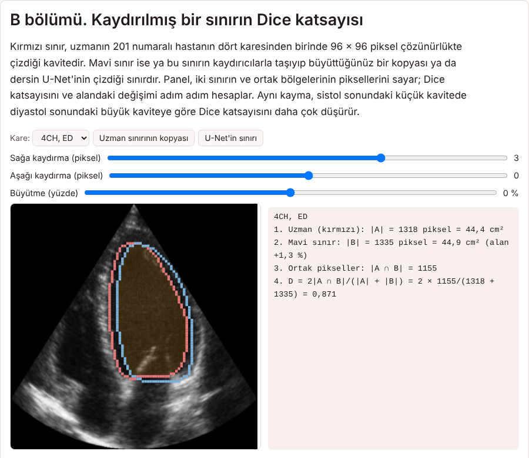
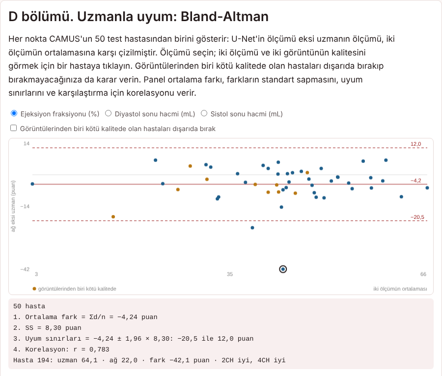

# Hafta 4: Transfer learning: Hazır gücü kardiyolojiye uyarla

**Python ile Yapay Zekâ Eğitimi: Kardiyologlar için Uygulamalı Eğitim Programı** 
Türk Kardiyoloji Derneği

*Milyonlarca görüntüyle öğrenilmiş bilgiyi kliniğinize taşıyın*

[Eğitimin ana sayfası](../../README.tr.md) · [İzlence](../../SYLLABUS.tr.md) · [Kurulum](../../SETUP.tr.md) · [English](../../en/week-04/README.md)

## Hafta hakkında

İlk iki saatte milyonlarca fotoğrafla eğitilmiş ağlar kalp görüntülerine uyarlanır: ImageNet üzerinde önceden eğitilmiş EfficientNet ve DenseNet modelleri, öznitelik çıkarımı ile ince ayar arasındaki seçim, son katmanların kardiyak hedefler için değiştirilmesi ve az veriyle yüksek başarıya ulaşmanın yolları ele alınır. Mini proje, EfficientNet-B0 ile az sayıda etiketli görüntüden kardiyomiyopati sınıflandırması yapar; bunu ACDC'nin sine kardiyak manyetik rezonans görüntülerinde ve CAMUS ekokardiyogramlarında uygular. Son iki saatte görüntüler ölçümlere dönüştürülür: Kardiyak segmentasyon için U-Net mimarisi, Dice katsayısıyla piksel düzeyinde segmentasyon eğitimi, sol ventrikül ejeksiyon fraksiyonunun Simpson disk yöntemiyle otomatik ölçümü ve Bland-Altman analiziyle klinik validasyon metodolojisi işlenir. Sanal klinik otomatik bir ejeksiyon fraksiyonu ölçümü kazanır.

Oturum 4 saat sürer. Haftalık proje için yaklaşık 3 saat ayrılmalıdır.

## Haftanın vakası

**CAMUS test kümesindeki 201 numaralı hasta** 56 yaşında bir kadındır ve ekokardiyografisi Saint-Étienne Üniversite Hastanesinde yapılmıştır. İki apikal görüntünün kalitesi de iyidir. Uzmanın çizdiği sınırlardan biplan disk yöntemiyle hesaplanan diyastol sonu hacmi 159 mL, sistol sonu hacmi 92 mL ve ejeksiyon fraksiyonu yüzde 42'dir. Bu hastayı hiç görmemiş bir ağın dört karede sol ventrikülün sınırlarını çizmesi ve aynı değerleri ölçmesi gerekmektedir. [Ders sayfası](https://utkukose.github.io/ai-cardiology-tkd-NB-lecture/tr/hafta-04/ders.html) bu vakayla açılır; sanal kliniğin eko ölçümü ise soruyu son bölümde cevaplar.

## Malzemeler

| Malzeme | Aç | Ne işe yarar? |
|---|---|---|
| **Ders sayfası** | [Ders sayfasını aç](https://utkukose.github.io/ai-cardiology-tkd-NB-lecture/tr/hafta-04/ders.html) | Haftanın anlatımıdır. Yukarıdan aşağıya okunur, uygulama duraklarına götürür ve kod ya da prompt (istem) içermez. |
| **Etkileşimli lab** | [Etkileşimli labı aç](https://utkukose.github.io/ai-cardiology-tkd-NB-lecture/tr/hafta-04/lab.html) | Kod gerektirmeyen A-F bölümleri, ders sayfasında yeri geldiğinde açılır. F bölümü prompt atölyesidir. Öz değerlendirme ve öğrenme günlüğü de labdadır. |
| **Jupyter defteri** |  [Jupyter için indir](NB04_transfer_ogrenme.ipynb) | Uygulama durakları burada çalışılır: Kısım 1 prompt yolu, Kısım 2 Python yoludur. Defter Google Colab'da kurulum gerektirmeden ya da kendi bilgisayarınızdaki Jupyter'de çalışır. |
| **Prompt kütüphanesi** | [PROMPTLAR.md](PROMPTLAR.md) | Prompt yolunun ve haftalık projenin bütün promptlarını, kodu onarmak, açıklatmak ve denetlemek için promptlarla birlikte içerir. GitHub'da her promptun yanında bir kopyalama düğmesi bulunur. |
| **PDF ders notu** | [Hafta04_Ders_Notlari.pdf](Hafta04_Ders_Notlari.pdf) | Ders sayfasının yazdırılabilir biçimidir. |

## Çalışma yolu

Ders sayfası yukarıdan aşağıya okunur ve etkileşimli labın bölümlerini yeri geldikçe açar. Her uygulama durağında çalışma Jupyter defterinde, iki yoldan biriyle sürer. **Prompt yolunda** (defterin 1. kısmı) kodu hazır promptlarla bir yapay zekâ (YZ) asistanı yazar; katılımcı kodu çalıştırır ve sonucu denetler. **Python yolunda** (2. kısım) kodu katılımcı kendisi yazar. İki yol da aynı sonuçlara varır. Oturuma katılanlar adımları oturumda tamamlar. Süreler, haftayı kendi başına izleyenler, örneğin bir oturumu kaçıranlar içindir.

| Adım | Ne yapılır? | Prompt yolu (Kısım 1) | Python yolu (Kısım 2) |
|---|---|---|---|
| 1 | Haftanın vakasını ve ders sayfasının ilk iki saatini 1. uygulama durağına kadar [okuyun](https://utkukose.github.io/ai-cardiology-tkd-NB-lecture/tr/hafta-04/ders.html) (ImageNet ön eğitimli modeller, öznitelik çıkarımı ya da ince ayar, yeni son katmanlar, az veri ve mini proje); etkileşimli labın A bölümünü yapın ve bilgi kontrolü sorularını cevaplayın | 1 saat | 1 saat |
| 2 | **[1. uygulama durağı: Mini proje: EfficientNet-B0 ile az sayıda etiketli görüntüden KMP sınıflandırma](https://utkukose.github.io/ai-cardiology-tkd-NB-lecture/tr/hafta-04/ders.html#stop-1)** | Kısım 1, Durak 1 ([promptlar](PROMPTLAR.md#durak-1-mini-proje-efficientnet-b0-ile-az-say%C4%B1da-etiketli-g%C3%B6r%C3%BCnt%C3%BCden-kmp-s%C4%B1n%C4%B1fland%C4%B1rma)) 30 dakika | Python adımı 4, 1-4. bölümler (4. bölümün ekokardiyografi kısmıyla birlikte) 1 saat 30 dakika |
| 3 | 2. uygulama durağına kadar [okumayı sürdürün](https://utkukose.github.io/ai-cardiology-tkd-NB-lecture/tr/hafta-04/ders.html#last-two-hours-segmentation-and-measurement-automation) (U-Net mimarisi ve CAMUS'ta piksel düzeyinde segmentasyon eğitimi); etkileşimli labın B bölümünü yapın | 40 dakika | 40 dakika |
| 4 | **[2. uygulama durağı: Pixel-wise segmentasyon eğitimi: CAMUS'ta bir U-Net](https://utkukose.github.io/ai-cardiology-tkd-NB-lecture/tr/hafta-04/ders.html#stop-2)** | Kısım 1, Durak 2 ([promptlar](PROMPTLAR.md#durak-2-pixel-wise-segmentasyon-e%C4%9Fitimi-camusta-bir-u-net)) 30 dakika | 5-7. bölümler 1 saat |
| 5 | 3. uygulama durağına kadar [okumayı sürdürün](https://utkukose.github.io/ai-cardiology-tkd-NB-lecture/tr/hafta-04/ders.html#the-ejection-fraction-by-the-method-of-discs) (3B sahneyle Simpson yöntemiyle otomatik EF ve uzmanla uyum); etkileşimli labın C ve D bölümlerini yapın | 45 dakika | 45 dakika |
| 6 | **[3. uygulama durağı: Simpson yöntemiyle otomatik EF ve uzmanla uyum](https://utkukose.github.io/ai-cardiology-tkd-NB-lecture/tr/hafta-04/ders.html#stop-3)** | Kısım 1, Durak 3 ([promptlar](PROMPTLAR.md#durak-3-simpson-y%C3%B6ntemiyle-otomatik-ef-ve-uzmanla-uyum)) 25 dakika | 8. ve 9. bölümler 50 dakika |
| 7 | Klinik validasyon planını, ölçüm hattı denetimini, haftanın makalesini, sanal kliniğin bu haftaki aşamasını ve "Kendi verinizle" bölümünü [okuyun](https://utkukose.github.io/ai-cardiology-tkd-NB-lecture/tr/hafta-04/ders.html#planning-the-clinical-validation-of-an-automatic-measurement); etkileşimli labın E ve F bölümlerini yapın. Python yolunu izliyorsanız 10. bölümü de çalışın | 45 dakika | 1 saat |
| 8 | [Etkileşimli labın](https://utkukose.github.io/ai-cardiology-tkd-NB-lecture/tr/hafta-04/lab.html) "Kendini sına" sekmesindeki öz değerlendirmeyi yapın, yansıtma yazınızı yazın ve öğrenme günlüğünü dışa aktarın | 20 dakika | 20 dakika |
| | **Haftalık proje dışında toplam** | **4 saat 55 dakika** | **7 saat 5 dakika** |
| 9 | [Haftalık projeyi](#haftal%C4%B1k-proje) iki yoldan biriyle tamamlayın | [Promptlar](PROMPTLAR.md#haftal%C4%B1k-projenin-prompt-yolu) 3 saat | 3 saat |

<table>
<tr><td width="50%"></td><td width="50%"></td></tr>
<tr><td>Etkileşimli lab, B bölümü: 201 numaralı hastanın dört boşluk diyastol sonu karesinde U-Net'in sınırı kaydırılır; panel Dice katsayısını ve alandaki değişimi adım adım hesaplar.</td><td>Jupyter defteri, 7. bölüm: 201 numaralı hastanın dört karesinde uzmanın ve U-Net'in çizdiği sınırlar karşılaştırılır.</td></tr>
<tr><td width="50%"></td><td width="50%"></td></tr>
<tr><td>Etkileşimli lab, C bölümü: Disk yöntemi adım adım uygulanır; tabloda her diskin çapları, alanı ve hacmi görülür.</td><td>Etkileşimli lab, D bölümü: 50 test hastasının ejeksiyon fraksiyonu için Bland-Altman grafiği çizilir; panel ortalama farkı ve uyum sınırlarını verir.</td></tr>
</table>

## Haftalık proje

**Proje.** CAMUS veri seti ile sol ventrikül segmentasyonu + EF otomatik hesaplama.

**Ne yapılacak?** CAMUS ekokardiyogramlarında sol ventrikülün sınırlarını çizin, ejeksiyon fraksiyonunu otomatik olarak ölçün ve bu ölçümü bir ekokardiyografi laboratuvarının yapacağı gibi değerlendirin. Önce dersin U-Net'ini 200 eğitim hastasıyla eğitin; en iyi epoch'u seçmek için 50 doğrulama hastasını kullanın. Ardından 200 test karesinin Dice katsayısını görüntüye, faza ve görüntü kalitesine göre bildirin. İkinci adımda 50 test hastasının diyastol sonu hacmini (EDV), sistol sonu hacmini (ESV) ve ejeksiyon fraksiyonunu (EF) ağın sınırlarından biplan disk yöntemiyle hesaplayın; üç ölçümün her birini Bland-Altman analiziyle uzmanın ölçümüyle karşılaştırın. Üçüncü adımda ağın ve uzmanın EF değerlerini üç aralığa ayırarak bir çapraz tabloda karşılaştırın; bu aralıklar yüzde 40 ve altı, yüzde 41-49 ile yüzde 50 ve üzeridir. Son olarak EF hatası en büyük üç hastayı uzmanın ve ağın dört sınırıyla birlikte gösterin. Bu ölçüm bir laboratuvarda kullanılmadan önce dış doğrulamasının nasıl planlanması gerektiğini de yarım sayfada yazın.

**Nereye bakılacak?** Ders: "U-Net mimarisi: Kardiyak segmentasyon", "Pixel-wise segmentasyon eğitimi", "Sol ventrikül EF otomatik ölçümü (Simpson)" ve "Klinik validasyon metodolojisi" bölümleri. Etkileşimli lab: B, C ve D bölümleri. Jupyter defteri: Kısım 1, 2. ve 3. duraklar ya da Kısım 2, 5-9. bölümler.

**Prompt yolu.** Proje, [prompt kütüphanesindeki](https://github.com/utkukose/ai-cardiology-tkd-NB-lecture/blob/main/tr/hafta-04/PROMPTLAR.md#haftal%C4%B1k-projenin-prompt-yolu) dört promptla da tamamlanabilir; her adım için bir prompt vardır. Jupyter defterinin 1. kısmının sonundaki "Prompt yolunda haftalık proje" bölümü her promptun tablosunu hazırlar. Bir promptun testi sağlanmadan sonraki prompta geçilmez.

**Örnek.** Beş hastada EF farklarının (ağ eksi uzman) −3, 5, −7, 1 ve −1 puan olduğunu varsayın. Ortalama fark (bias) bu farkların ortalamasıdır: $-5/5 = -1{,}0$ puan. Ortalamadan sapmaların kareleri 4, 36, 36, 4 ve 0'dır ve toplamları 80'dir. Bu yüzden farkların standart sapması (SS) $\sqrt{80/4} = 4{,}47$ puandır. Uyum sınırları $-1{,}0 \pm 1{,}96 \times 4{,}47$ ile hesaplanır ve −9,8 ile 7,8 puan arasında yer alır.

**Ne teslim edilecek?** [Rapor şablonuyla](../sablonlar/Rapor_Sablonu.docx) yazılmış, bir ya da iki sayfalık bir rapor teslim edilir. Raporda Dice katsayılarının tablosu, üç Bland-Altman grafiği, EF aralıklarının çapraz tablosu, üç hastanın şekli ve doğrulama planı yer almalıdır. Rapora YZ kullanım günlüğünü (kullanılan araç, prompt, neyin denetlendiği ve neyin değiştirildiği) ve çıktılarıyla birlikte Jupyter defterini ekleyin. CAMUS görüntüleri içeren şekiller, kullanım koşullarının gerektirdiği gibi "CAMUS, CC BY-NC-SA 4.0" kaynak bilgisini taşımalı ve yalnızca ticari olmayan amaçlarla kullanılmalıdır.

**Teslim.** Haftalık proje, 5. haftanın oturumundan önce utkukose@sdu.edu.tr ya da utkukose@gmail.com adresine e-postayla gönderilir. E-postaya "Ne teslim edilecek?" başlığında sayılan öğeler ve etkileşimli labdan dışa aktarılan öğrenme günlüğü eklenir. Haftalık projeler değerlendirmenin yüzde 40'ını oluşturur; değerlendirme ölçütleri izlencede yer almaktadır.

## Öğrenme çıktıları

Haftanın sonunda katılımcıların, bir ağın büyük bir fotoğraf koleksiyonundan neler öğrendiğini açıklayabilmeleri, ImageNet üzerinde önceden eğitilmiş EfficientNet, DenseNet ve ResNet modellerini karşılaştırabilmeleri ve belirli bir hasta sayısı için öznitelik çıkarımı ile ince ayar arasında seçim yapabilmeleri beklenmektedir. Önceden eğitilmiş bir ağın son katmanlarını kardiyak bir hedef için değiştirebilmeli, girdisini gri tonlu görüntülere uyarlayabilmeli ve yöntemleri az sayıda etiketli hastadan yapılan birkaç çekilişle adil biçimde karşılaştırabilmelidirler. U-Net mimarisini açıklayabilmeli, bir segmentasyon ağını çapraz entropi ve Dice kaybıyla piksel düzeyinde eğitebilmeli ve ağın çizdiği sınırları Dice katsayısıyla ölçebilmelidirler. Son olarak hacimleri ve ejeksiyon fraksiyonunu Simpson disk yöntemiyle hesaplayabilmeli, otomatik bir ölçümü Bland-Altman analiziyle değerlendirebilmeli ve klinik validasyonunu planlayabilmelidirler.

## Oturumun eğitim akışı

Haftanın dört saatlik oturumu aşağıdaki plana göre işlenir. Plan, malzemelerin canlı bir oturumda nasıl bir araya geldiğini göstermek için paylaşılmaktadır.

| Süre | Etkinlik |
|---|---|
| 0:00-0:15 | Haftanın vakası olan CAMUS'un 201 numaralı hastası tanıtılır ve haftanın rotası anlatılır. Her katılımcı defteri Google Colab'da ya da Jupyter'de açar ve 0. bölümü çalıştırır. Bu bölüm, eksikse 3. haftanın ACDC dosyalarını, Human Heart Project'in açık veri tabanından CAMUS'un 300 hastasını (yaklaşık 227 MB) ve EfficientNet-B0'ın ImageNet ağırlıklarını (yaklaşık 21 MB) indirir. |
| 0:15-0:55 | İlk iki saat, transfer learning prensipleri: ImageNet ön eğitimli EfficientNet ve DenseNet modelleri, öznitelik çıkarımı ya da ince ayar, son katmanların kardiyak hedefler için değiştirilmesi ve etkileşimli labın A bölümüyle az veriyle yüksek başarıya ulaşmanın yolları çalışılır. |
| 0:55-1:50 | Oturumun mini projesi olan 1. uygulama durağında katılımcılar prompt yolu ve Python yolu olmak üzere iki gruba ayrılır ve EfficientNet-B0 ile az sayıda etiketli görüntüden kardiyomiyopati sınıflandırması yapar. ACDC'nin grupları her gruptan 15 etiketli hastayla öznitelik çıkarımı ve ince ayarla, ardından yalnızca beş hastayla öğrenilir; Python yolunda 4. bölüm yöntemi CAMUS ekokardiyogramlarında tekrarlar. |
| 1:50-2:00 | Ara. |
| 2:00-2:35 | Son iki saat, segmentasyon ve ölçüm otomasyonu: Kardiyak segmentasyon için U-Net mimarisi anlatılır; B bölümüyle Dice katsayısı kullanılarak piksel düzeyinde segmentasyon eğitimi çalışılır. |
| 2:35-3:05 | 2. uygulama durağı: U-Net yaklaşık üç dakikada eğitilir ve ağın çizdiği sınırlar 50 test hastasında görüntüye ve faza göre değerlendirilir. |
| 3:05-3:40 | Simpson yöntemiyle sol ventrikül EF'sinin otomatik ölçümü 3B sahneyle ve C bölümüyle, klinik validasyon metodolojisi ise D bölümündeki uzmanla uyum üzerinden çalışılır. Ardından 3. uygulama durağında 201 numaralı hastanın ve 50 test hastasının EF'si ölçülür. |
| 3:40-4:00 | Klinik validasyon planı anlatılır; etkileşimli labın E ve F bölümleriyle bir ölçüm hattının denetimi çalışılır. Ardından haftanın makalesi, sanal kliniğin eko ölçümü, "Kendi verinizle" bölümü ve haftalık proje ele alınır. |

## Kendi verinizle

Ders sayfası, haftanın yöntemlerini kendi verinize nasıl uygulayacağınızı anlatan bir bölümle biter. Bu bölümde hangi sorunun hangi yönteme uyduğu, önce neyin denetleneceği, etik kurul onayı, Kişisel Verilerin Korunması Kanunu (KVKK) ve analizin nerede yapılacağı ele alınır. [Bölümü ders sayfasında okuyun](https://utkukose.github.io/ai-cardiology-tkd-NB-lecture/tr/hafta-04/ders.html#with-your-own-data).

## İsteğe bağlı araştırma ödevi

PubMed'de, 2020 ya da sonrasında yayımlanmış ve sol ventrikül ejeksiyon fraksiyonunu ekokardiyogramlarda otomatik olarak ölçüp uzman ölçümleriyle karşılaştıran bir çalışma bulun. Çalışmayı yarım sayfada özetleyin. Özette hastalar, hastaneler ve cihazlar, referans ölçümün nasıl ve kaç okuyucu tarafından yapıldığı, ortalama fark ve uyum sınırları, düşük kalite nedeniyle dışlanan görüntüler ve testin başka bir hastanede yapılıp yapılmadığı yer almalıdır. [Haftanın makalesindeki](https://utkukose.github.io/ai-cardiology-tkd-NB-lecture/tr/hafta-04/ders.html#the-paper-of-the-week) üç soru özete yol gösterebilir. Ödev notlandırılmaz; haftalık projenin doğrulama planına hazırlık niteliğindedir.

## Bu haftadan sonra sanal klinik

Sanal kliniğin görüntüleme laboratuvarı 4. haftada ölçüm yapmaya başlar. Her katılımcının açık kaynağından indirdiği CAMUS'un apikal ekokardiyogramlarında bir U-Net sol ventrikülün sınırlarını çizer; ejeksiyon fraksiyonu bu sınırlardan biplan disk yöntemiyle hesaplanır. ImageNet üzerinde önceden eğitilmiş bir ağ ise ACDC'nin kardiyomiyopati gruplarını az sayıda etiketli hastadan öğrenir. Sonuçlar ders sayfasının [Sanal klinik, 4. aşama](https://utkukose.github.io/ai-cardiology-tkd-NB-lecture/tr/hafta-04/ders.html#the-virtual-clinic-stage-4-automatic-ejection-fraction) bölümünde yer almaktadır.

## Gelecek hafta

**Hafta 5: Zaman serisi analizi ve EKG yapay zekâsı.** Elektrokardiyogram bu kez bir zaman serisi olarak ele alınır: Tek boyutlu evrişimli ağlar ve tekrarlayan ağlar 12 derivasyonlu kayıtlarda ritimleri sınıflar. Sanal kliniğin ritim ve STEMI alarmı ise ST yükselmesini ve ST çökmesini tespit eder. Ayrıntılar için [eğitimin planına](../../README.tr.md#on-bir-hafta) bakabilirsiniz.

---

**Prof. Dr. Utku Köse**

Profesör, Bilgisayar Mühendisliği Bölümü, Süleyman Demirel Üniversitesi, Isparta, Türkiye 
Kurucu Müdür, Yapay Zekâ Uygulama ve Araştırma Merkezi (YAZEM), Süleyman Demirel Üniversitesi 
Bilgisayar Bilimleri Anabilim Dalı Başkanı, Bilgisayar Mühendisliği Bölümü, Süleyman Demirel Üniversitesi 
Diğer kurumlar: University of North Dakota (ABD), Universidad Panamericana (Meksiko, Meksika), Vel Tech University (Chennai, Hindistan) 
IEEE Kıdemli Üyesi, ACM Profesyonel Üyesi

[ORCID 0000-0002-9652-6415](https://orcid.org/0000-0002-9652-6415) | [utkukose.com](https://www.utkukose.com) | [github.com/utkukose](https://github.com/utkukose)

[utkukose@sdu.edu.tr](mailto:utkukose@sdu.edu.tr) | [utku.kose@und.edu](mailto:utku.kose@und.edu) | [ukose@up.edu.mx](mailto:ukose@up.edu.mx) | [utkukose@gmail.com](mailto:utkukose@gmail.com)

*İlk sürüm: Kasım 2026. İçerik CC BY 4.0, kod MIT.*

