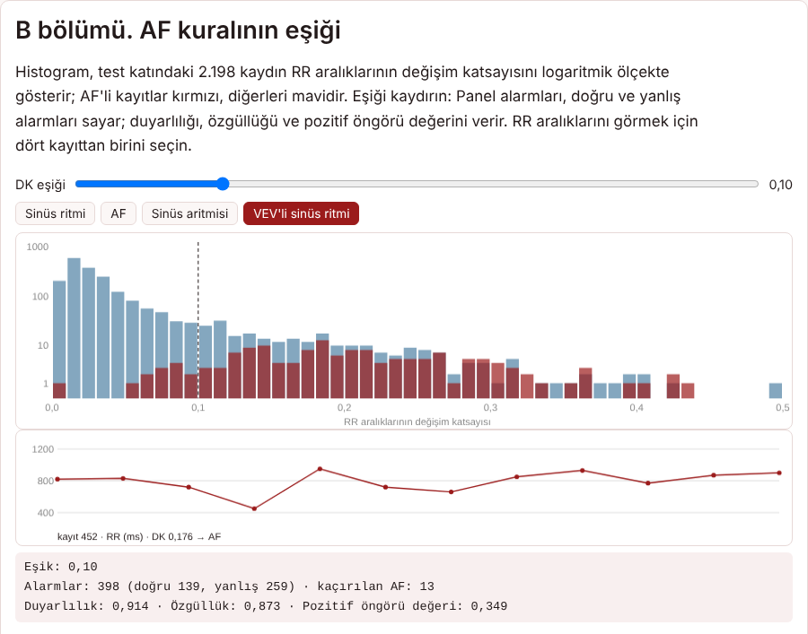
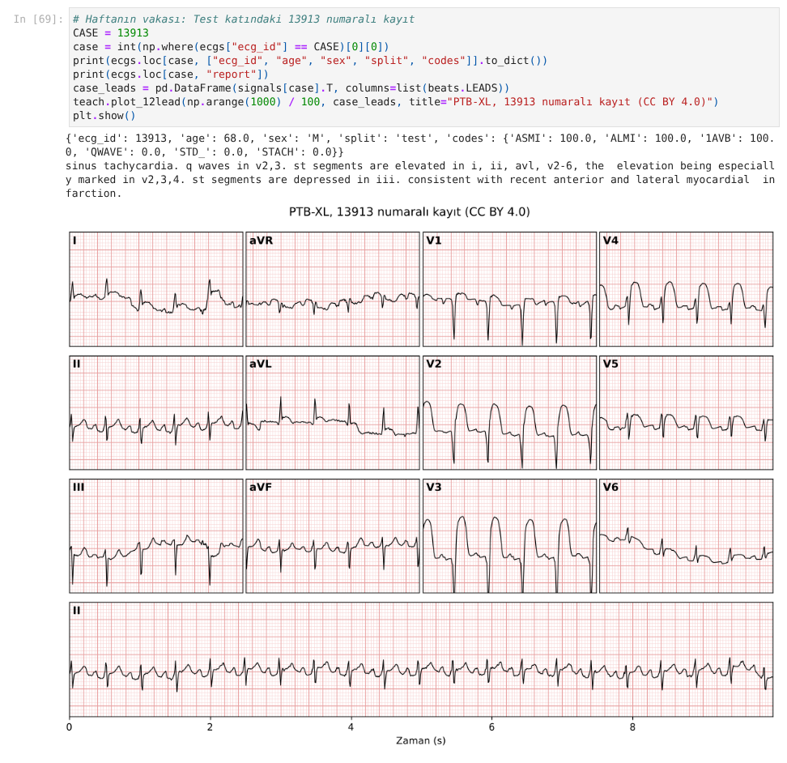
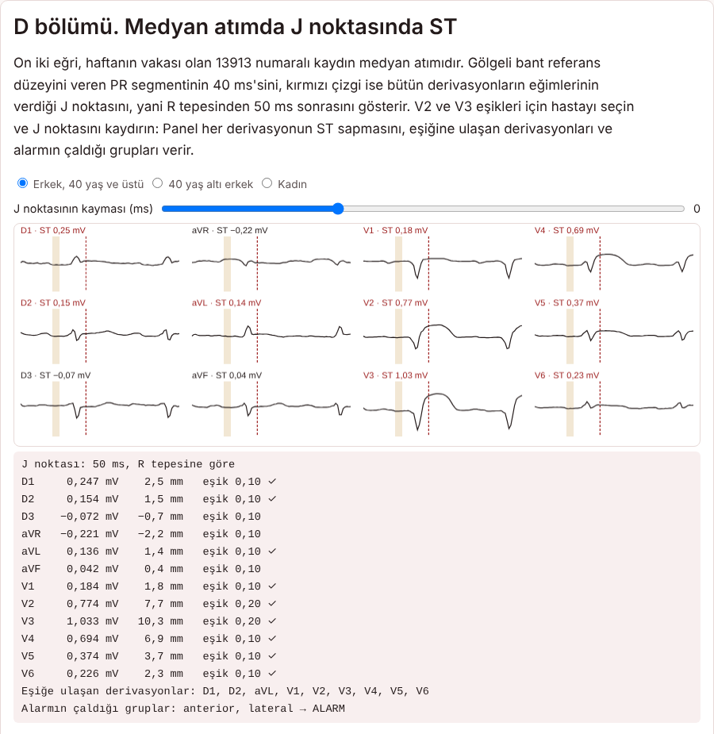
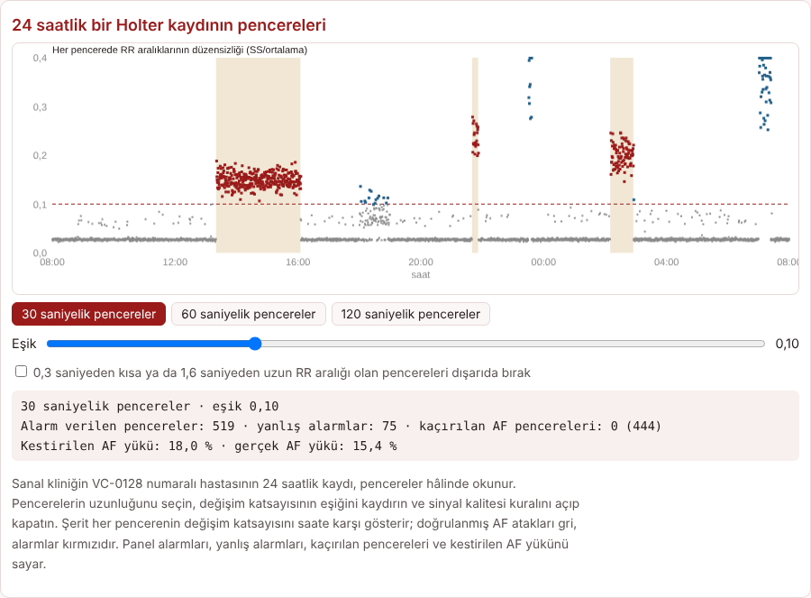

# Hafta 5: Zaman serisi analizi ve EKG yapay zekâsı

**Python ile Yapay Zekâ Eğitimi: Kardiyologlar için Uygulamalı Eğitim Programı** 
Türk Kardiyoloji Derneği

*On saniyelik ritimden bir STEMI alarmına ve bir günlük izleme geçilir.*

[Eğitimin ana sayfası](../../README.tr.md) · [İzlence](../../SYLLABUS.tr.md) · [Kurulum](../../SETUP.tr.md) · [English](../../en/week-05/README.md)

## Hafta hakkında

Elektrokardiyogram (EKG) bu hafta bir zaman serisi olarak ele alınır: Sıralarıyla saklanan sayılardan oluşan on iki derivasyon, 21.799 klinik kaydı içeren herkese açık PTB-XL veri setinin 12 derivasyonlu EKG'lerinden gelir. RR aralıklarına dayanan bir kural atriyal fibrilasyonu bir kardiyoloğun yapacağı gibi tespit eder; tek boyutlu evrişimli bir ağ ise birkaç ritim etiketini aynı anda öğrenir. Tekrarlayan bir ağ RR aralıklarını bir dizi olarak okur. İkinci yarıda ST segmenti medyan atımlar üzerinde otomatik olarak ölçülür, miyokard enfarktüsünün evrensel tanımındaki ölçütler bir STEMI alarmı olarak uygulanır ve QTc kestirilir. Ardından sanal kliniğin 24 saatlik sentetik Holter kaydı, uzun süreli izlemdeki yanlış alarmları pencerelerin, eşiklerin ve gürültünün nasıl belirlediğini göstermektedir. Hafta, düzenleyici onay almış EKG algoritmaları ve bir YZ asistanının yazdığı bir zaman serisi işlem hattının denetlenmesiyle kapanır.

Oturum 4 saat sürer. Haftalık proje için yaklaşık 3 saat ayrılmalıdır.

## Haftanın rotası

Ders sayfası haftanın ana rotasıdır. Sayfada kod ya da prompt (istem) bulunmaz; sayfa etkileşimli labla birlikte yukarıdan aşağıya okunur. Her uygulama durağında katılımcılar Jupyter defterindeki iki yoldan birini seçer. **Prompt yolunda** (Kısım 1) kodu, hazır promptlara göre bir yapay zekâ (YZ) asistanı yazar; katılımcı bu kodu çalıştırır ve sonucu denetler. **Python yolunda** (Kısım 2) ise kodu katılımcı kendisi yazar. İki yol da aynı sonuçlara varır. Defter hem kurulum gerektirmeyen Google Colab'da hem de kendi bilgisayarınızdaki Jupyter'de çalışır ([kurulum](../../SETUP.tr.md)).

| Ana rota: Ders sayfası ve etkileşimli lab | Uygulama durağı | Prompt yolu (Kısım 1) | Python yolu (Kısım 2) |
|---|---|---|---|
| [Zaman serisi olarak EKG](https://utkukose.github.io/ai-cardiology-tkd-NB-lecture/tr/hafta-05/ders.html#the-ecg-as-a-time-series) [Önce bir kural: RR aralıkları ve atriyal fibrilasyon](https://utkukose.github.io/ai-cardiology-tkd-NB-lecture/tr/hafta-05/ders.html#a-rule-first-rr-intervals-and-atrial-fibrillation) [Tek boyutlu evrişim: Zaman boyunca kayan bir çekirdek](https://utkukose.github.io/ai-cardiology-tkd-NB-lecture/tr/hafta-05/ders.html#one-dimensional-convolution-a-kernel-that-slides-along-time) [Tekrarlayan ağlar: Sinyal boyunca ilerleyen bir durum](https://utkukose.github.io/ai-cardiology-tkd-NB-lecture/tr/hafta-05/ders.html#recurrent-networks-a-state-that-moves-along-the-signal) [Aynı anda birçok etiket: Çok etiketli sınıflandırma](https://utkukose.github.io/ai-cardiology-tkd-NB-lecture/tr/hafta-05/ders.html#many-labels-at-once-multi-label-classification) | **[Durak 1: Ritim: Altı etiket için bir kural ve bir ağ](https://utkukose.github.io/ai-cardiology-tkd-NB-lecture/tr/hafta-05/ders.html#stop-1)** | Durak 1 | Python adımı 5 ve 1-5. bölümler |
| [ST yükselmesi ve çökmesi: Evrensel tanımın ölçütleri](https://utkukose.github.io/ai-cardiology-tkd-NB-lecture/tr/hafta-05/ders.html#st-elevation-and-depression-the-criteria-of-the-universal-definition) [ST segmentini otomatik ölçmek: Medyan atım ve J noktası](https://utkukose.github.io/ai-cardiology-tkd-NB-lecture/tr/hafta-05/ders.html#measuring-the-st-segment-automatically-the-median-beat-and-the-j-point) | **[Durak 2: ST yükselmesi: Medyan atım, J noktası ve alarm](https://utkukose.github.io/ai-cardiology-tkd-NB-lecture/tr/hafta-05/ders.html#stop-2)** | Durak 2 | 6. ve 7. bölümler |
| [QT uzaması ve riski](https://utkukose.github.io/ai-cardiology-tkd-NB-lecture/tr/hafta-05/ders.html#qt-prolongation-and-its-risk) [Uzun süreli izlem: On saniyeden yirmi dört saate](https://utkukose.github.io/ai-cardiology-tkd-NB-lecture/tr/hafta-05/ders.html#long-term-monitoring-from-ten-seconds-to-twenty-four-hours) | **[Durak 3: Uzun süreli izlem: Pencereler, AF yükü ve yanlış alarmlar](https://utkukose.github.io/ai-cardiology-tkd-NB-lecture/tr/hafta-05/ders.html#stop-3)** | Durak 3 | 8. ve 9. bölümler |
| [Düzenleyici onay almış EKG algoritmaları](https://utkukose.github.io/ai-cardiology-tkd-NB-lecture/tr/hafta-05/ders.html#ecg-algorithms-with-regulatory-approval) [YZ asistanıyla çalışmak, 5. bölüm: Bir zaman serisi işlem hattını denetlemek](https://utkukose.github.io/ai-cardiology-tkd-NB-lecture/tr/hafta-05/ders.html#ai-pair-programming-part-5-reviewing-a-time-series-pipeline) [Haftanın makalesi](https://utkukose.github.io/ai-cardiology-tkd-NB-lecture/tr/hafta-05/ders.html#the-paper-of-the-week) [Sanal klinik, 5. aşama: Ritim ve STEMI alarmı](https://utkukose.github.io/ai-cardiology-tkd-NB-lecture/tr/hafta-05/ders.html#the-virtual-clinic-stage-5-rhythm-and-stemi-alarm) | "Kendi verinizle" bölümü, haftanın makalesi ve sanal klinik | – | – |

## Malzemeler

| Malzeme | Aç | İçeriği |
|---|---|---|
| **Ders sayfası (ana rota)** | [Ders sayfasını aç](https://utkukose.github.io/ai-cardiology-tkd-NB-lecture/tr/hafta-05/ders.html) | Vakayı, kavramları çözümlü örnekleriyle, ST hasar vektörünün üç boyutlu (3B) bir sahnesini, iki animasyonu, bilgi kontrolü sorularını, üç uygulama durağını, "Kendi verinizle" bölümünü, tekrar kartlarını ve kaynakları içerir. Sayfada kod ve prompt yer almaz. |
| **Etkileşimli lab** | [Etkileşimli labı aç](https://utkukose.github.io/ai-cardiology-tkd-NB-lecture/tr/hafta-05/lab.html) | Kod gerektirmeyen A'dan F'ye kadar altı bölümü (F bölümü prompt atölyesidir), öz değerlendirmeyi, yansıtma yazısını ve dışa aktarılabilen öğrenme günlüğünü içerir |
| **Jupyter defteri** |  [Jupyter için indir](NB05_zaman_serisi_ve_ekg_yapay_zekasi.ipynb) | Kısım 1 prompt yoludur: Üç durakta toplam on adım vardır ve her adımda hazır bir prompt, adımın tablosunu hazırlayan bir veri hücresi, YZ asistanının kodu için bir hücre, otomatik bir kontrol ve hazır kod bulunur. Kısmın sonunda haftalık proje dört promptla yer alır. Kısım 2 Python yoludur: Python adımı 5'i, A-J alıştırmalarıyla birlikte 1-10. bölümleri ve yedi alan için uygulama görevlerini içerir. |
| **Prompt kütüphanesi** | [PROMPTLAR.md](PROMPTLAR.md) | Prompt yolunun bütün promptlarını, kodu onarmaya yarayan promptları ve haftalık projenin prompt yolunu içerir. GitHub'da her promptun yanında bir kopyalama düğmesi bulunur. |
| **PDF ders notu** | [Hafta05_Ders_Notlari.pdf](Hafta05_Ders_Notlari.pdf) | Ders sayfasının yazdırılabilir biçimidir; uygulama duraklarını ve "Kendi verinizle" bölümünü de içerir. |

<table>
<tr><td width="50%"></td><td width="50%"></td></tr>
<tr><td>Etkileşimli lab, B bölümü: Test katındaki değişim katsayıları, AF kuralının eşiği, alarmlar, duyarlılık, özgüllük ve pozitif öngörü değeri; altta ventriküler erken vurulu bir kaydın RR aralıkları görülmektedir.</td><td>Jupyter defteri, 1. bölüm: PTB-XL'den haftanın vakasının 12 derivasyonlu EKG'si.</td></tr>
<tr><td width="50%"></td><td width="50%"></td></tr>
<tr><td>Etkileşimli lab, D bölümü: Vakanın on iki derivasyonunun medyan atımları PR düzeyi ve J noktasıyla birlikte çizilir; panel STEMI alarmının kararını verir.</td><td>Ders sayfası: Sanal kliniğin 24 saatlik Holter kaydının pencereleri, alarmın eşiği ve yanlış alarmları.</td></tr>
</table>

## Haftanın vakası

PTB-XL'in 13913 numaralı kaydı, sinüs taşikardisi ve akut anterior ve lateral enfarktüsü olan 68 yaşında bir erkeğe aittir. Bir program kaydın 12.000 sayısından hangi ritmi bildirir, bir STEMI alarmı verir mi ve böyle bir alarm ne sıklıkla doğru çıkar?

## Öğrenme çıktıları

Haftanın sonunda katılımcıların bir EKG'yi zaman serisi olarak tanımlayabilmeleri, örnekleme frekansını ve etiketlerini açıklayabilmeleri ve bir hastanın kayıtlarını tek bir kümede tutabilmeleri beklenmektedir. Atriyal fibrilasyonu RR aralıklarına dayanan bir kuralla tespit edebilmeli, ritimler için çok etiketli bir ağı da eşikleri bir doğrulama kümesinde seçilmiş olarak etiket etiket değerlendirebilmelidirler. Tek boyutlu evrişimi, alıcı alanı ve tekrarlayan bir ağın durumunu açıklayabilmelidirler. Son olarak ST segmentini bir medyan atım üzerinde ölçebilmeli, evrensel tanımın ST yükselmesi ölçütlerini bir alarm olarak uygulayabilmeli ve bu alarmın duyarlılığını, özgüllüğünü ve yanlış alarmlarını hem 10 saniyelik bir EKG'de hem de 24 saatlik bir kayıtta değerlendirebilmelidirler.

## Çalışma yolu

Oturuma katılanlar ana rotayı ve uygulama duraklarını oturumda tamamlar. Haftayı kendi başına izleyenler, örneğin bir oturumu kaçıranlar, aşağıdaki sürelerle plan yapabilir.

| Adım | Etkinlik | Prompt yolu | Python yolu |
|---|---|---|---|
| 1 | Haftanın vakasını ve ders sayfasını 1. uygulama durağına kadar okuyun; etkileşimli labın A, B ve C bölümlerini yapın ve bilgi kontrolü sorularını cevaplayın | 1 saat | 1 saat |
| 2 | 1. uygulama durağı (oturumun mini projesi): Prompt yolunda Kısım 1'deki Durak 1'i, Python yolunda Python adımı 5'i ve 1-6. bölümleri çalışın | 35 dakika | 1 saat 40 dakika |
| 3 | 2. uygulama durağına kadar okumayı sürdürün (3B sahneyle ST yükselmesi ve çökmesi, otomatik ST ölçümü); etkileşimli labın D bölümünü yapın | 40 dakika | 40 dakika |
| 4 | 2. uygulama durağı: Prompt yolunda Kısım 1'deki Durak 2'yi, Python yolunda 7. ve 8. bölümleri çalışın | 25 dakika | 50 dakika |
| 5 | 3. uygulama durağına kadar okumayı sürdürün (QT uzaması ve uzun süreli izlem); Holter kaydının animasyonunu inceleyin | 30 dakika | 30 dakika |
| 6 | 3. uygulama durağı: Prompt yolunda Kısım 1'deki Durak 3'ü, Python yolunda 9. bölümü çalışın | 20 dakika | 35 dakika |
| 7 | Düzenleyici onay bölümünü, zaman serisi işlem hattı denetimini, haftanın makalesini, sanal kliniğin bu haftaki aşamasını ve "Kendi verinizle" bölümünü okuyun; etkileşimli labın E ve F bölümlerini yapın. Python yolunu izliyorsanız 10. bölümü de çalışın | 40 dakika | 55 dakika |
| 8 | Etkileşimli labın "Kendini sına" sekmesindeki öz değerlendirmeyi yapın, yansıtma yazınızı yazın ve öğrenme günlüğünü dışa aktarın | 20 dakika | 20 dakika |
| | **Haftalık proje dışında toplam** | **4 saat 30 dakika** | **6 saat 30 dakika** |
| 9 | Haftalık projeyi iki yoldan biriyle tamamlayın | 3 saat | 3 saat |

## Oturumun eğitim akışı

Haftanın dört saatlik oturumu aşağıdaki plana göre işlenir. Plan, malzemelerin canlı bir oturumda nasıl bir araya geldiğini göstermek için paylaşılmaktadır.

| Süre | Etkinlik |
|---|---|
| 0:00-0:15 | Haftanın vakası tanıtılır ve haftanın rotası anlatılır. Her katılımcı defteri Google Colab'da ya da Jupyter'de açar ve 0. bölümü çalıştırır. Bu bölüm, PTB-XL'in dört katındaki 100 Hz'lik 12 derivasyonlu EKG'leri (yaklaşık 216 MB) PhysioNet'ten indirir. |
| 0:15-0:55 | Ana rotada EKG bir zaman serisi olarak ele alınır. B bölümüyle RR aralıklarına dayanan bir atriyal fibrilasyon kuralı, A bölümüyle tek boyutlu evrişim çalışılır; ardından tekrarlayan ağlar ve etkileşimli labın C bölümüyle çok etiketli sınıflandırma anlatılır. |
| 0:55-1:35 | Oturumun mini projesi olan 1. uygulama durağında katılımcılar iki gruba ayrılır: Prompt yolunu izleyenler ve Python yolunu izleyenler. Tek boyutlu bir ağ PTB-XL'in ritim etiketlerini yaklaşık iki dakikada öğrenir; eşikleri 9. katta seçilir ve ağ, 10. katta kuralla karşılaştırılır. |
| 1:35-1:50 | Ara. |
| 1:50-2:30 | Ana rotada 3B sahneyle ST yükselmesi ve çökmesi, evrensel tanımın ölçütleri ve D bölümüyle medyan atım ve J noktası çalışılır. Ardından 2. uygulama durağında vakanın ST sapması ve test katındaki alarm hesaplanır. |
| 2:30-3:20 | Ana rotada QT uzaması ve riski ile sanal kliniğin 24 saatlik kaydıyla uzun süreli izlem anlatılır. 3. uygulama durağında pencereler, AF yükü ve bir günün yanlış alarmları çalışılır. |
| 3:20-4:00 | Düzenleyici onay almış EKG algoritmaları anlatılır; etkileşimli labın E ve F bölümleriyle bir zaman serisi işlem hattının denetimi çalışılır. Ardından haftanın makalesi, sanal kliniğin ritim ve STEMI alarmı, "Kendi verinizle" bölümü ve haftalık proje ele alınır. |

## Haftalık proje

**Ne yapılacak?** PTB-XL'in 12 derivasyonlu EKG'lerinde otomatik bir STEMI alarmı kurun ve bu alarmı bir göğüs ağrısı biriminin yapacağı gibi değerlendirin. Önce 9. ve 10. katlardaki her kaydın medyan atımında on iki derivasyonun J noktasındaki ST sapmasını ölçün. İkinci adımda evrensel tanımın ölçütlerini uygulayın: V2 ve V3 için cinsiyete ve yaşa göre eşikleri, öteki derivasyonlar için 1 mm'yi ve üç derivasyon grubunu kullanın; bir gruptaki iki derivasyon eşiğine ulaştığında alarm çalar. Üçüncü adımda alarmı iki kattaki akut miyokard enfarktüsleriyle, yani enfarktüs evresi Stadium I ya da Stadium I-II olan kayıtlarla karşılaştırın. Duyarlılığı, özgüllüğü ve pozitif öngörü değerini bildirin; yanlış alarmları da kayıtların ifadelerine göre, örneğin sol dal bloğu, sol ventrikül hipertrofisi ve normal EKG olarak sayın. Son olarak gözden kaçan üç enfarktüsü ve ST yükselmesi en büyük üç yanlış alarmı medyan atımlarıyla gösterin. Alarmın bir acil serviste çalışabilmesi için nelere ihtiyaç duyacağını da yarım sayfada yazın.

**Nereye bakılacak?** Ders: "ST yükselmesi ve çökmesi: Evrensel tanımın ölçütleri" ve "ST segmentini otomatik ölçmek: Medyan atım ve J noktası" bölümleri. Etkileşimli lab: D bölümü. Jupyter defteri: Kısım 1, 2. durak ya da Kısım 2, 7. ve 8. bölümler.

**Prompt yolu.** Proje, [prompt kütüphanesindeki](https://github.com/utkukose/ai-cardiology-tkd-NB-lecture/blob/main/tr/hafta-05/PROMPTLAR.md#haftal%C4%B1k-projenin-prompt-yolu) dört promptla da tamamlanabilir; her adım için bir prompt vardır. Jupyter defterinin 1. kısmının sonundaki "Prompt yolunda haftalık proje" bölümü her promptun tablosunu hazırlar. Bir promptun testi sağlanmadan sonraki prompta geçilmez.

**Örnek.** Alarmın 40 akut enfarktüsün 30'unda ve öteki 4.000 kaydın 60'ında çaldığını varsayın. Duyarlılık $30/40 = 0{,}75$, özgüllük $(4000 - 60)/4000 = 3940/4000 = 0{,}985$, pozitif öngörü değeri ise $30/(30 + 60) = 0{,}333$ olur. Alarm enfarktüsü olmayan kayıtların yüzde 98,5'inde doğru karar verdiği hâlde her üç alarmdan ikisi yanlıştır.

**Ne teslim edilecek?** [Rapor şablonuyla](../sablonlar/Rapor_Sablonu.docx) yazılmış, bir ya da iki sayfalık bir rapor teslim edilir. Raporda duyarlılık, özgüllük ve pozitif öngörü değeri tablosu, yanlış alarmların ifadelere göre sayımı, altı medyan atımın şekli ve alarmın neye ihtiyaç duyacağını anlatan yarım sayfa yer almalıdır. Rapora YZ kullanım günlüğünü (kullanılan araç, prompt, neyin denetlendiği ve neyin değiştirildiği) ve çıktılarıyla birlikte Jupyter defterini ekleyin. PTB-XL EKG'leri içeren şekiller "PTB-XL, CC BY 4.0" kaynak bilgisini taşımalıdır.

**Teslim.** Haftalık proje, 6. haftanın oturumundan önce utkukose@sdu.edu.tr ya da utkukose@gmail.com adresine e-postayla gönderilir. E-postaya "Ne teslim edilecek?" başlığında sayılan öğeler ve etkileşimli labdan dışa aktarılan öğrenme günlüğü eklenir. Haftalık projeler değerlendirmenin yüzde 40'ını oluşturur; değerlendirme ölçütleri izlencede yer almaktadır.

## Kendi verinizle

Ders sayfası, haftanın yöntemlerini kendi verinize nasıl uygulayacağınızı anlatan bir bölümle biter. Bu bölümde hangi sorunun hangi yönteme uyduğu, önce neyin denetleneceği, etik kurul onayı, Kişisel Verilerin Korunması Kanunu (KVKK) ve analizin nerede yapılacağı ele alınır. [Bölümü ders sayfasında okuyun](https://utkukose.github.io/ai-cardiology-tkd-NB-lecture/tr/hafta-05/ders.html#with-your-own-data).

## İsteğe bağlı araştırma ödevi

PubMed'de, 2020 ya da sonrasında yayımlanmış ve atriyal fibrilasyonu ya da akut miyokard enfarktüsünü EKG'lerde otomatik olarak tespit edip algoritmayı kardiyologlarla karşılaştıran bir çalışma bulun. Çalışmayı yarım sayfada özetleyin. Özette hastalar, hastaneler ve cihazlar, referansın nasıl ve kaç okuyucu tarafından verildiği, duyarlılık, özgüllük ve pozitif öngörü değeri, test kümesindeki prevalans ve testin başka bir hastanede yapılıp yapılmadığı yer almalıdır. [Haftanın makalesindeki](https://utkukose.github.io/ai-cardiology-tkd-NB-lecture/tr/hafta-05/ders.html#the-paper-of-the-week) üç soru özete yol gösterebilir. Ödev notlandırılmaz; haftalık projedeki yarım sayfalık metne hazırlık niteliğindedir.

## Bu haftadan sonra sanal klinik

Sanal klinik 5. haftada bir ritim ve STEMI alarmı kazanır. PTB-XL ile eğitilmiş tek boyutlu bir ağ ve ST yükselmesi ölçütleri, kliniğin 500 hastasının istirahat EKG'lerini okur; bir hastanın 24 saatlik sentetik Holter kaydı ise uzun süreli izlemdeki pencereleri ve yanlış alarmları gösterir. Sonuçlar ders sayfasının [Sanal klinik, 5. aşama](https://utkukose.github.io/ai-cardiology-tkd-NB-lecture/tr/hafta-05/ders.html#the-virtual-clinic-stage-5-rhythm-and-stemi-alarm) bölümünde yer almaktadır.

## Gelecek hafta

**Hafta 6: Doğal dil işleme ve klinik metin madenciliği.** Kliniğin raporları veriye dönüşür: Token'lar, kelime temsilleri ve önceden eğitilmiş dil modelleri, Türkçe ve İngilizce metinlerden tanıları, ilaçları ve darlık derecesini çıkarır. Ayrıntılar için [eğitimin planına](../../README.tr.md#on-bir-hafta) bakabilirsiniz.

---

**Prof. Dr. Utku Köse**

Profesör, Bilgisayar Mühendisliği Bölümü, Süleyman Demirel Üniversitesi, Isparta, Türkiye 
Kurucu Müdür, Yapay Zekâ Uygulama ve Araştırma Merkezi (YAZEM), Süleyman Demirel Üniversitesi 
Bilgisayar Bilimleri Anabilim Dalı Başkanı, Bilgisayar Mühendisliği Bölümü, Süleyman Demirel Üniversitesi 
Diğer kurumlar: University of North Dakota (ABD), Universidad Panamericana (Meksiko, Meksika), Vel Tech University (Chennai, Hindistan) 
IEEE Kıdemli Üyesi, ACM Profesyonel Üyesi

[ORCID 0000-0002-9652-6415](https://orcid.org/0000-0002-9652-6415) | [utkukose.com](https://www.utkukose.com) | [github.com/utkukose](https://github.com/utkukose)

[utkukose@sdu.edu.tr](mailto:utkukose@sdu.edu.tr) | [utku.kose@und.edu](mailto:utku.kose@und.edu) | [ukose@up.edu.mx](mailto:ukose@up.edu.mx) | [utkukose@gmail.com](mailto:utkukose@gmail.com)

*İlk sürüm: Kasım 2026. İçerik CC BY 4.0, kod MIT.*

