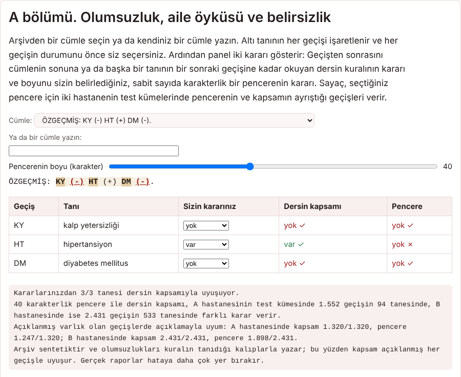
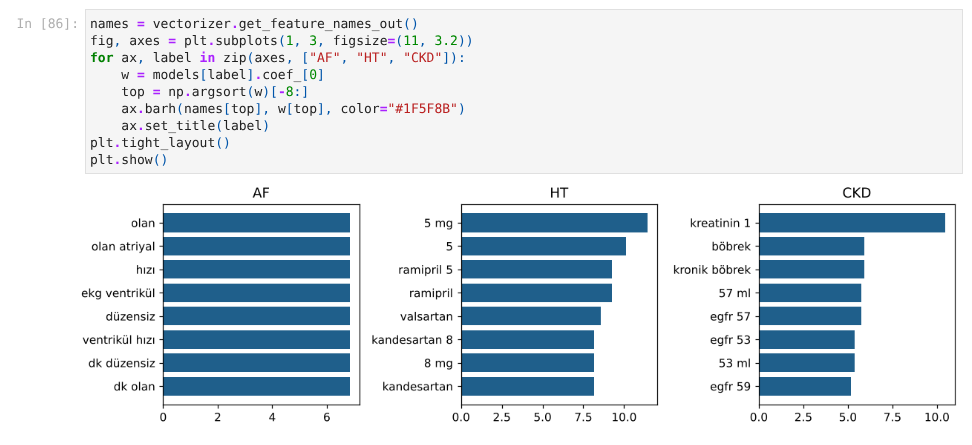
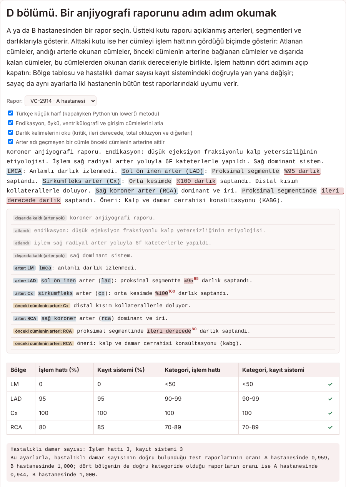
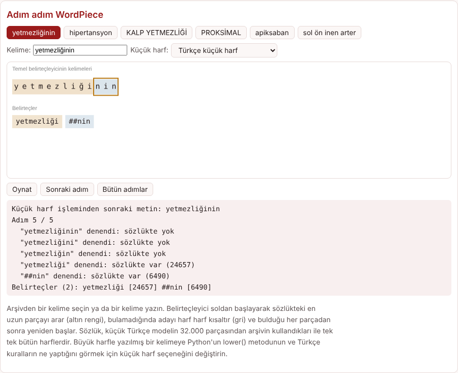

# Hafta 6: NLP ve klinik metin madenciliği

**Python ile Yapay Zekâ Eğitimi: Kardiyologlar için Uygulamalı Eğitim Programı** 
Türk Kardiyoloji Derneği

*Rapordan, epikrizden, nottan otomatik bilgi çıkarma*

[Eğitimin ana sayfası](../../README.tr.md) · [İzlence](../../SYLLABUS.tr.md) · [Kurulum](../../SETUP.tr.md) · [English](../../en/week-06/README.md)

Hafta hakkında daha ayrıntılı bilgi için bu sayfayı okumaya devam ediniz. Haftaya doğrudan ders sayfasından devam etmek isterseniz bu bağlantıyı kullanınız: **[Haftanın ders sayfasını açınız](https://utkukose.github.io/ai-cardiology-tkd-NB-lecture/tr/hafta-06/ders.html)**. Ders sayfası haftanın ana rotasıdır; sayfadaki kutular etkileşimli labı ve Jupyter Notebook'u ilgili yerde açmaktadır.

## Hafta hakkında

Sanal kliniğin raporları bu hafta veriye dönüşür. Rapor arşivi 3.600 hastanın her biri için bir epikriz tutar; epikrizleri A hastanesi tam cümlelerle, B hastanesi ise (+) ve (-) işaretli kısa bir üslupla yazmıştır. Anjiyografi yapılan her hastanın ayrıca bir koroner anjiyografi raporu vardır. Önce bir anahtar kelime kuralı kurulur ve bu kuralın tuzakları görülür: olumsuzluk, aile öyküsü, belirsizlik ve metnin hiç adını anmadığı tanılar. Ardından bir tetikleyicinin kapsamını, ilaçları ve iki laboratuvar değerini kullanan bir kural altı tanıyı iki hastanede de okur. TF-IDF ve lojistik regresyon ise öğrendiği hastanede çok iyi, öteki hastanede zayıf kalır (makro F1 değerleri 0,990 ve 0,708; kuralda 0,980 ve 0,985). Sonra tokenizasyon ve lemmatizasyon, TF-IDF ve word embedding, Hugging Face Hub'dan yüklenen BERT ve BioBERT ile önceden eğitilmiş küçük bir Türkçe BERT modeli ele alınır. Adlandırılmış varlıklar için ince ayar yapılan bu model A hastanesindeki varlıkları neredeyse hatasız bulur. B hastanesinde ise ilaçların çoğunu bulur, tanıların ancak az bir kısmını bulabilir ve işlemlerin hiçbirini bulamaz (varlık F1 değerleri A hastanesinde 0,981, B hastanesinde 0,556). Modelin bulduğu varlıklar da kurallar yardımıyla tanılara dönüştürülür; mini projede ise bu adlandırılmış varlık işlem hattıyla STEMI, AF ve kalp yetersizliği okunmaktadır. İkinci yarıda ayrıca radyoloji raporları özetlenir ve dil modellerinin yazdığı özetler raporlarına karşı denetlenir; arşiv bir klinik çalışma için taranır, büyük dil modelleri üzerine kurulan klinik asistanlar tartışılır ve anjiyografi raporlarından darlık derecesini ve damarı okuyan bir işlem hattı kurulmaktadır. Hafta, bir yapay zekâ (YZ) asistanının yazdığı bir metin işlem hattının denetlenmesiyle kapanır.

Oturum 4 saat sürer. Haftalık proje için yaklaşık 3 saat ayrılmalıdır.

## Haftanın vakası

VC-2444 numaralı hasta kalp yetersizliği olan 83 yaşında bir kadındır. Epikrizi bir tanıyı adıyla anar, ikisini dışlar, iki tanıyı ise ilaçlarında ve eGFR değerinde saklar. Hastada altı kronik tanıdan hangileri vardır ve bir program bunları 3.600 epikrizde bulabilir mi?

## Malzemeler

| Malzeme | Aç | Ne işe yarar? |
|---|---|---|
| **Ders sayfası** | [Ders sayfasını aç](https://utkukose.github.io/ai-cardiology-tkd-NB-lecture/tr/hafta-06/ders.html) | Haftanın konu anlatımını içeren bu sayfa yukarıdan aşağıya doğru okunmak üzere hazırlanmıştır. Sayfadaki kutular sizi uygulama duraklarına yönlendirir; sayfada kod ya da prompt (istem) bulunmamaktadır. |
| **Etkileşimli lab** | [Etkileşimli labı aç](https://utkukose.github.io/ai-cardiology-tkd-NB-lecture/tr/hafta-06/lab.html) | Kod gerektirmeyen A-F bölümleri, ders sayfasında yeri geldiğinde açılmaktadır. F bölümü bir prompt atölyesidir. Öz değerlendirme ve öğrenme günlüğü de bu labda yer alır. |
| **Python Notebook** |  [Jupyter Notebook için indir (zip)](https://github.com/utkukose/ai-cardiology-tkd-NB-lecture/raw/main/tr/hafta-06/NB06_klinik_metin_madenciligi.zip) | Uygulama durakları burada çalışılır; her durakta Python temelleri, promptlar ve hazır bir uygulama bulunmaktadır. Python Notebook, Google Colab'da kurulum gerektirmeden ya da kendi bilgisayarınızdaki Jupyter Notebook'ta çalışabilir. Jupyter için zip dosyasını indiriniz, içindeki .ipynb dosyasını bir klasöre çıkarınız ve dosyayı Jupyter'de açınız. Her bölüm, bölümün kullandığı kurulumu ve veri çağrılarını yineleyen bir başlangıç hücresiyle açılır. |
| **Prompt kütüphanesi** | [PROMPTLAR.md](PROMPTLAR.md) | Uygulama duraklarının ve haftalık projenin bütün promptları, kodu onarmaya, açıklatmaya ve denetlemeye yönelik promptlarla birlikte burada toplanmıştır. GitHub'da her promptun yanında bir kopyalama düğmesi bulunur. |
| **PDF ders notu** | [Hafta06_Ders_Notlari.pdf](Hafta06_Ders_Notlari.pdf) | Ders sayfasının yazdırılabilir biçimidir. |

## Çalışma yolu

Ders sayfası yukarıdan aşağıya doğru okunur; etkileşimli labın bölümleri de sayfada yeri geldikçe açılır. Uygulama duraklarında çalışma Jupyter Notebook'ta sürmektedir ve oradaki her durak üç bölümden oluşur. **Python temelleri** bölümünde durağın gerektirdiği Python bilgisi öğretilir. **Prompt ile uygulama** bölümünde kodu hazır promptlarla bir YZ asistanı yazar; katılımcının görevi bu kodu çalıştırmak ve sonucu denetlemektir. **Hazır uygulama** bölümünde ise durağın baştan sona çalışan programı yer almaktadır. Bölümleri bu sırayla izlemeniz önerilir; Python biliyorsanız promptlarla, yalnızca sonucu görmek istiyorsanız hazır uygulamayla başlayabilirsiniz. Her bölüm, bölümün kullandığı kurulumu ve veri çağrılarını yineleyen bir başlangıç hücresiyle açılır; bu sayede bölüm doğrudan açıldığında da çalışabilmektedir. Lab bölümlerinin ve Jupyter Notebook'taki durakların sonunda, sizi ders sayfasında okumanın devam ettiği yere geri götüren bir bağlantı bulunmaktadır. Nerede kaldığınızı bulamazsanız bu tabloya dönünüz. Oturuma katılanlar bu adımları oturum sırasında yapar. Tablodaki süreler, haftayı kendi başına izleyenler, örneğin bir oturumu kaçıranlar için verilmiştir.

| Adım | Ne yapılır? | Süre |
|---|---|---|
| 1 | Haftanın vakasını ve ders sayfasının ilk iki saatini 1. uygulama durağına kadar [okuyunuz](https://utkukose.github.io/ai-cardiology-tkd-NB-lecture/tr/hafta-06/ders.html) (veri olarak metin, kurallar, tokenizasyon ve lemmatizasyon, TF-IDF ve word embedding, BERT ve BioBERT, Türkçe tıbbi dil modelleri); etkileşimli labın A, B ve C bölümlerini yapınız, kelime vektörlerinin 3B sahnesini inceleyiniz ve bilgi kontrolü sorularını cevaplayınız | 1 saat 15 dakika |
| 2 | **[1. uygulama durağı: Epikrizlerden altı tanı: Kurallar ve bir model](https://utkukose.github.io/ai-cardiology-tkd-NB-lecture/tr/hafta-06/ders.html#stop-1)** [Python temelleri](https://colab.research.google.com/github/utkukose/ai-cardiology-tkd-NB-lecture/blob/main/tr/hafta-06/NB06_klinik_metin_madenciligi.ipynb#scrollTo=stop-1-basics) · [Prompt ile uygulama](https://colab.research.google.com/github/utkukose/ai-cardiology-tkd-NB-lecture/blob/main/tr/hafta-06/NB06_klinik_metin_madenciligi.ipynb#scrollTo=stop-1-prompt) ([promptlar](PROMPTLAR.md#durak-1-epikrizlerden-alt%C4%B1-tan%C4%B1-kurallar-ve-bir-model)) · [Hazır uygulama](https://colab.research.google.com/github/utkukose/ai-cardiology-tkd-NB-lecture/blob/main/tr/hafta-06/NB06_klinik_metin_madenciligi.ipynb#scrollTo=stop-1-app) | 1 saat 40 dakika |
| 3 | 2. uygulama durağına kadar [okumayı sürdürün](https://utkukose.github.io/ai-cardiology-tkd-NB-lecture/tr/hafta-06/ders.html#last-two-hours-advanced-clinical-nlp-applications) (adlandırılmış varlık tanıma, önceden eğitilmiş bir modele ince ayar ve NER pipeline ile mini proje) | 30 dakika |
| 4 | **[2. uygulama durağı: Mini proje: NER pipeline ile STEMI, AF ve kalp yetersizliği](https://utkukose.github.io/ai-cardiology-tkd-NB-lecture/tr/hafta-06/ders.html#stop-2)** [Python temelleri](https://colab.research.google.com/github/utkukose/ai-cardiology-tkd-NB-lecture/blob/main/tr/hafta-06/NB06_klinik_metin_madenciligi.ipynb#scrollTo=stop-2-basics) · [Prompt ile uygulama](https://colab.research.google.com/github/utkukose/ai-cardiology-tkd-NB-lecture/blob/main/tr/hafta-06/NB06_klinik_metin_madenciligi.ipynb#scrollTo=stop-2-prompt) ([promptlar](PROMPTLAR.md#durak-2-mini-proje-ner-pipeline-ile-stemi-af-ve-kalp-yetersizli%C4%9Fi)) · [Hazır uygulama](https://colab.research.google.com/github/utkukose/ai-cardiology-tkd-NB-lecture/blob/main/tr/hafta-06/NB06_klinik_metin_madenciligi.ipynb#scrollTo=stop-2-app) | 1 saat 5 dakika |
| 5 | 3. uygulama durağına kadar [okumayı sürdürün](https://utkukose.github.io/ai-cardiology-tkd-NB-lecture/tr/hafta-06/ders.html#summaries-and-large-language-models-as-clinical-assistants) (radyoloji raporlarının özetleri, klinik çalışma uygunluğu, büyük dil modelleriyle klinik asistan ve anjiyografi raporları); etkileşimli labın D bölümünü yapınız | 40 dakika |
| 6 | **[3. uygulama durağı: Anjiyografi raporları: Darlık derecesi ve damar](https://utkukose.github.io/ai-cardiology-tkd-NB-lecture/tr/hafta-06/ders.html#stop-3)** [Python temelleri](https://colab.research.google.com/github/utkukose/ai-cardiology-tkd-NB-lecture/blob/main/tr/hafta-06/NB06_klinik_metin_madenciligi.ipynb#scrollTo=stop-3-basics) · [Prompt ile uygulama](https://colab.research.google.com/github/utkukose/ai-cardiology-tkd-NB-lecture/blob/main/tr/hafta-06/NB06_klinik_metin_madenciligi.ipynb#scrollTo=stop-3-prompt) ([promptlar](PROMPTLAR.md#durak-3-anjiyografi-raporlar%C4%B1-darl%C4%B1k-derecesi-ve-damar)) · [Hazır uygulama](https://colab.research.google.com/github/utkukose/ai-cardiology-tkd-NB-lecture/blob/main/tr/hafta-06/NB06_klinik_metin_madenciligi.ipynb#scrollTo=stop-3-app) | 35 dakika |
| 7 | Metin işlem hattı denetimini, haftanın makalesini, sanal kliniğin bu haftaki aşamasını ve "Kendi verinizle" bölümünü [okuyunuz](https://utkukose.github.io/ai-cardiology-tkd-NB-lecture/tr/hafta-06/ders.html#ai-pair-programming-part-6-reviewing-a-text-pipeline); etkileşimli labın E ve F bölümlerini yapınız ve Jupyter Notebook'ta uygulama duraklarından sonra gelen bölümü, anjiyografi raporlarının sonuçları ve klinik çalışma taramasıyla birlikte çalışınız | 1 saat |
| 8 | [Etkileşimli labın](https://utkukose.github.io/ai-cardiology-tkd-NB-lecture/tr/hafta-06/lab.html) "Kendini sına" sekmesindeki öz değerlendirmeyi yapınız, yansıtma yazınızı yazınız ve öğrenme günlüğünü dışa aktarınız | 20 dakika |
| | **Haftalık proje dışında toplam** | **7 saat 5 dakika** |
| 9 | [Haftalık projeyi](#haftal%C4%B1k-proje) tamamlayınız [Promptlar](PROMPTLAR.md#haftal%C4%B1k-projenin-promptlar%C4%B1) · [Jupyter Notebook'ta haftalık proje](https://colab.research.google.com/github/utkukose/ai-cardiology-tkd-NB-lecture/blob/main/tr/hafta-06/NB06_klinik_metin_madenciligi.ipynb#scrollTo=project) | 3 saat |

<table>
<tr><td width="50%"></td><td width="50%"></td></tr>
<tr><td>Etkileşimli lab, A bölümü: B hastanesinden bir cümlenin geçişleri dersin kapsamıyla gösterilir; panel 40 karakterlik bir pencerenin kararını ve iki hastanenin test kümelerindeki ayrışmaları verir.</td><td>Jupyter Notebook, «Durak 1 · Hazır uygulama»: A hastanesinin epikrizlerinden öğrenilmiş TF-IDF modellerinde atriyal fibrilasyonun, hipertansiyonun ve kronik böbrek hastalığının en ağır terimleri.</td></tr>
<tr><td width="50%"></td><td width="50%"></td></tr>
<tr><td>Etkileşimli lab, D bölümü: Arterleri, segmentleri ve darlıklarıyla bir anjiyografi raporu; cümleler işlem hattının okuduğu biçimde ve bölgeler kayıt sistemiyle yan yana gösterilir.</td><td>Ders sayfası: WordPiece tokenizer'ı bir kelimeyi küçük Türkçe modelin sözlüğündeki parçalara adım adım böler.</td></tr>
</table>

## Haftalık proje

**Proje.** Kardiyak anjiyo raporu NLP pipeline: Stenoz derecesi + etkilenen damar otomatik çıkarımı.

**Ne yapılacak?** İki hastanenin koroner anjiyografi raporlarından darlık derecesini ve damarı, bir kayıt sisteminin ihtiyaç duyacağı biçimde okuyan bir işlem hattı kurunuz. Önce A hastanesinin her test raporundan ve B hastanesinin her raporundan dört bölgenin (LM, LAD, CX ve RCA) en büyük darlığını okuyunuz, bu değeri dersin beş kategorisinden birine koyunuz ve kayıt sistemiyle bölge bölge karşılaştırınız. İkinci adımda işlem hattının sol ana koroner arter hastalığındaki duyarlılığını ve pozitif öngörü değerini veriniz; kayıt sistemindeki hastalıklı damar sayısını işlem hattınınkine karşı gösteren bir tablo da kurunuz. Üçüncü adımda işlem hattının yanlış okuduğu test raporlarını, her birinde işlem hattını yanıltan cümleyle birlikte listeleyiniz. Dördüncü adımda her anjiyografiyi aynı hastanın epikriziyle birleştiriniz ve anlamlı darlığı olduğu hâlde epikrizinde koroner arter hastalığı bulunmayan hastaları sayınız. Son olarak bir koroner arter hastalığı kayıt sisteminin bu işlem hattını kullanmadan önce nelere ihtiyaç duyacağını yarım sayfada yazınız.

**Nereye bakılacak?** Ders: "Anjiyografi raporları: Darlık derecesi ve damar" bölümü. Etkileşimli lab: D bölümü. Jupyter Notebook: 3. uygulama durağının hazır uygulaması.

**Promptlarla.** Proje, [prompt kütüphanesindeki](https://github.com/utkukose/ai-cardiology-tkd-NB-lecture/blob/main/tr/hafta-06/PROMPTLAR.md#haftal%C4%B1k-projenin-promptlar%C4%B1) dört promptla da yapılabilir; kütüphanede her adım için bir prompt bulunmaktadır. Her promptun tablosu, Jupyter Notebook'un sonundaki "Haftalık proje" bölümünde hazırlanır ve bu bölüm tek başına da açılabilir. Bir promptun testi sağlanmadan sonraki prompta geçilmemeli ve her prompt YZ kullanım günlüğüne kaydedilmelidir.

**Örnek.** İşlem hattının 22 raporda sol ana koroner arter hastalığı bulduğunu, kayıt sisteminin bunlardan 20 tanesini doğruladığını ve kayıt sisteminde sol ana koroner arter hastalığı olan bir hasta daha bulunduğunu varsayınız. Pozitif öngörü değeri $20/22 = 0{,}909$, duyarlılık ise $20/21 = 0{,}952$ olur. 22 kararın ikisi yanlıştır ve bir hasta gözden kaçmaktadır; cerrahiyi stentten ayıran bir kayıt sisteminde bu raporların her birinin bir kardiyolog tarafından okunması gerekir.

**Ne teslim edilecek?** [Rapor şablonuyla](../sablonlar/Rapor_Sablonu.docx) yazılmış, bir ya da iki sayfalık bir rapor teslim edilir. Raporda bölgeye ve hastaneye göre uyum tablosu, sol ana koroner arter hastalığı için duyarlılık ve pozitif öngörü değeri, hastalıklı damar sayısı tablosu, yanlış raporlar ve nedenleri, dördüncü adımın sayısı ve kayıt sisteminin neye ihtiyaç duyacağını anlatan yarım sayfa yer almalıdır. Rapora YZ kullanım günlüğünü (kullanılan araç, prompt, neyin denetlendiği ve neyin değiştirildiği) ve çıktılarıyla birlikte Jupyter Notebook'u ekleyiniz.

**Teslim.** Haftalık proje, 7. haftanın oturumundan önce utkukose@sdu.edu.tr ya da utkukose@gmail.com adresine e-postayla gönderilir. E-postaya "Ne teslim edilecek?" başlığında sayılan öğeler ve etkileşimli labdan dışa aktarılan öğrenme günlüğü eklenir. Haftalık projeler değerlendirmenin yüzde 40'ını oluşturur; değerlendirme ölçütleri izlencede yer almaktadır.

## Öğrenme çıktıları

Haftanın sonunda katılımcıların klinik metni referansı, kümeleri ve başka bir hastaneden gelen dış testiyle birlikte bir veri olarak tanımlayabilmeleri ve Türkçe metni karakterlerinin konumlarını kaybetmeden küçük harfe çevirebilmeleri beklenmektedir. Her tanı geçişinin durumuna karar veren, ilaçları ve laboratuvar değerlerini kullanan bir tanı kuralı kurabilmeli ve bu kuralı duyarlılık, pozitif öngörü değeri ve F1 ile tanı tanı değerlendirebilmelidirler. Tokenizasyonu ve lemmatizasyonu, TF-IDF'yi, word embedding'i, BERT ve BioBERT modellerini, Türkçe tıbbi dil modellerini ve adlandırılmış varlıklar için ince ayar yapılmış önceden eğitilmiş bir modeli açıklayabilmeli, bir hastaneden öğrenen bir modelin başka bir hastanede neden başarısız olabileceğini söyleyebilmelidirler. Son olarak STEMI, AF ve kalp yetersizliği gibi tanıları adlandırılmış varlıklardan oluşan bir işlem hattıyla çıkarabilmeli, anjiyografi raporlarından darlık derecesini ve damarı okuyabilmeli, raporları bir klinik çalışmanın ölçütlerine göre tarayabilmeli ve bir dil modelinin yazdığı bir özeti raporuna karşı denetleyebilmelidirler.

## Oturumun eğitim akışı

Haftanın dört saatlik oturumu aşağıdaki plana göre işlenir. Plan, malzemelerin canlı bir oturumda nasıl bir araya geldiğini göstermek için paylaşılmaktadır.

| Süre | Etkinlik |
|---|---|
| 0:00-0:15 | Haftanın vakası tanıtılır ve haftanın rotası anlatılır. Her katılımcı Jupyter Notebook'u Google Colab'da ya da Jupyter'de açarak 0. bölümü çalıştırır. Rapor arşivi katılımcının bilgisayarında üretilir; Hugging Face Hub'dan yalnızca küçük Türkçe modelin tokenizer'ı ve ağırlıkları (yaklaşık 19 MB) indirilir. |
| 0:15-1:05 | İlk iki saat, NLP temelleri ve klinik metin işleme: Metin bir veri olarak ele alınır; anahtar kelime kuralı ve tuzakları, A bölümüyle olumsuzluk, aile öyküsü ve belirsizlik, ardından ilaçlar ve laboratuvar değerleri çalışılır. B bölümüyle tokenizasyon, Türkçe küçük harf ve lemmatizasyon, C bölümüyle TF-IDF ele alınır; 3B sahneyle kelime vektörleri, Hugging Face Hub'dan BERT ve BioBERT ve Türkçe tıbbi dil modelleri anlatılır. |
| 1:05-1:40 | 1. uygulama durağında katılımcılar Jupyter Notebook'ta, promptlarla ya da Python ile çalışır. Anahtar kelime kuralı, durum kuralı, ilaçlar ve laboratuvar değerleri ve TF-IDF iki hastanenin epikrizlerinde sınanır. |
| 1:40-1:50 | Ara. |
| 1:50-2:40 | Son iki saat, gelişmiş klinik NLP uygulamaları: İlaç, tanı ve işlem varlıklarının tanınması ve küçük Türkçe modele ince ayar anlatılır. Oturumun mini projesi olan 2. uygulama durağında B hastanesinin token'ları sayılır, model sıradan bir bilgisayarda birkaç dakikada varlıklar için eğitilir, modelin varlıklarından altı tanı elde edilir ve NER pipeline ile STEMI, AF ve kalp yetersizliği okunur. |
| 2:40-3:20 | Radyoloji raporlarının otomatik özetlenmesi bir özetin denetimiyle birlikte ele alınır; ardından klinik çalışma uygunluğu, kavramsal olarak büyük dil modelleriyle klinik asistan ve D bölümüyle anjiyografi raporları çalışılır. 3. uygulama durağında anjiyografi işlem hattı iki hastanenin test raporlarında sınanır. |
| 3:20-4:00 | Etkileşimli labın E ve F bölümleriyle bir metin işlem hattının denetimi çalışılır. Ardından haftanın makalesi, sanal kliniğin rapor arşivi, "Kendi verinizle" bölümü ve haftalık proje ele alınır. |

## Kendi verinizle

Ders sayfası, haftanın yöntemlerini kendi verilerinize nasıl uygulayabileceğinizi anlatan bir bölümle sona ermektedir. Bu bölümde hangi sorunun hangi yönteme uyduğu, önce neyin denetlenmesi gerektiği, etik kurul onayı, Kişisel Verilerin Korunması Kanunu (KVKK) ve analizin nerede yapılacağı ele alınmaktadır. [Bölümü ders sayfasında okuyunuz](https://utkukose.github.io/ai-cardiology-tkd-NB-lecture/tr/hafta-06/ders.html#with-your-own-data).

## İsteğe bağlı araştırma ödevi

PubMed'de, 2020 ya da sonrasında yayımlanmış ve ekokardiyografi, anjiyografi ya da epikriz gibi kardiyoloji raporlarından kurallarla, bir dil modeliyle ya da büyük bir dil modeliyle bilgi çıkaran bir çalışma bulunuz. Çalışmayı yarım sayfada özetleyiniz. Özette raporlar, dilleri ve hastaneleri, referansın nasıl ve kaç okuyucu tarafından verildiği, varlık ya da tanı başına sonuçlar, testin başka bir hastanede yapılıp yapılmadığı ve yöntemin nerede başarısız olduğu yer almalıdır. [Haftanın makalesindeki](https://utkukose.github.io/ai-cardiology-tkd-NB-lecture/tr/hafta-06/ders.html#the-paper-of-the-week) üç soru özete yol gösterebilir. Ödev notlandırılmaz; haftalık projedeki yarım sayfalık metne hazırlık niteliğindedir.

## Bu haftadan sonra sanal klinik

6. haftada sanal klinikte bir rapor arşivi açılır. Kliniğin 3.600 hastasının her birinin A ya da B hastanesinden bir epikrizi vardır; anjiyografi yapılan her hastanın da bir koroner anjiyografi raporu bulunur. Altı tanı, dersin kuralıyla bütün epikrizlerden okunmaktadır; anjiyografi işlem hattı da her hastaya hastalıklı damar sayısını ekler. Sonuçlar ders sayfasının [Sanal klinik, 6. aşama](https://utkukose.github.io/ai-cardiology-tkd-NB-lecture/tr/hafta-06/ders.html#the-virtual-clinic-stage-6-report-archive) bölümünde yer almaktadır.

## Gelecek hafta

**Hafta 7: Vision Transformer (ViT): Görüntü işlemede yeni nesil.** Kateter laboratuvarında koroner anjiyogramlardaki darlıklar evrişimli bir ağ, bir Vision Transformer ve ikisini birleştiren hibrit bir modelle aranmaktadır. Ayrıntılar için [eğitimin planına](../../README.tr.md#on-bir-hafta) bakabilirsiniz.

---

**Prof. Dr. Utku Köse**

Profesör, Bilgisayar Mühendisliği Bölümü, Süleyman Demirel Üniversitesi, Isparta, Türkiye 
Kurucu Müdür, Yapay Zekâ Uygulama ve Araştırma Merkezi (YAZEM), Süleyman Demirel Üniversitesi 
Bilgisayar Bilimleri Anabilim Dalı Başkanı, Bilgisayar Mühendisliği Bölümü, Süleyman Demirel Üniversitesi 
Diğer kurumlar: University of North Dakota (ABD), Universidad Panamericana (Meksiko, Meksika), Vel Tech University (Chennai, Hindistan) 
IEEE Kıdemli Üyesi, ACM Profesyonel Üyesi

[ORCID 0000-0002-9652-6415](https://orcid.org/0000-0002-9652-6415) | [utkukose.com](https://www.utkukose.com) | [github.com/utkukose](https://github.com/utkukose)

[utkukose@sdu.edu.tr](mailto:utkukose@sdu.edu.tr) | [utku.kose@und.edu](mailto:utku.kose@und.edu) | [ukose@up.edu.mx](mailto:ukose@up.edu.mx) | [utkukose@gmail.com](mailto:utkukose@gmail.com)

*İlk sürüm: Kasım 2026. İçerik CC BY 4.0, kod MIT.*

