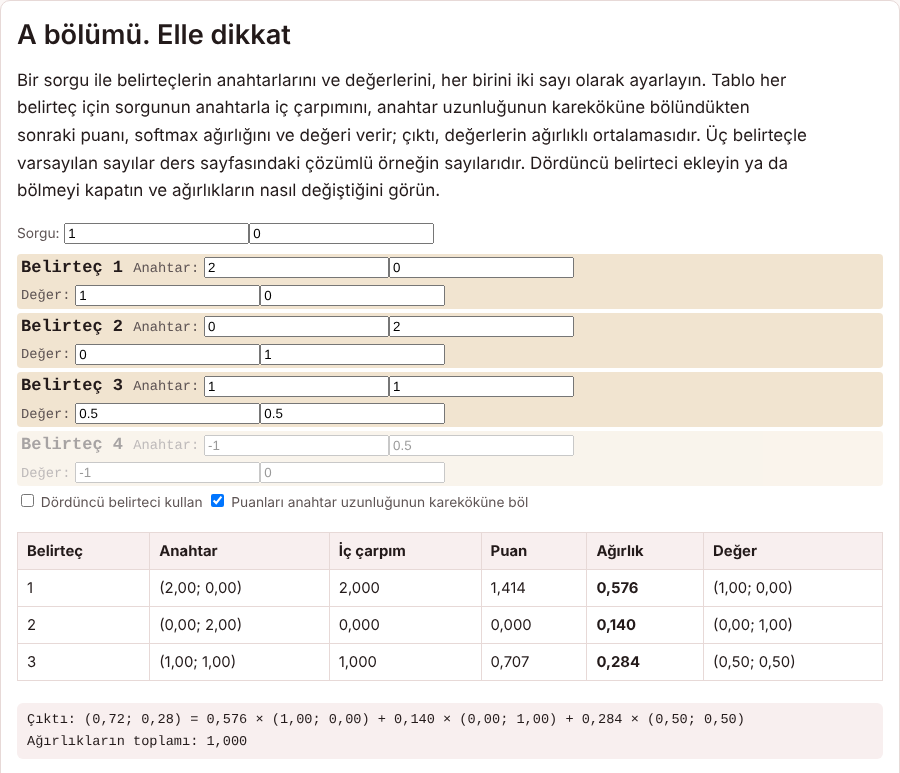
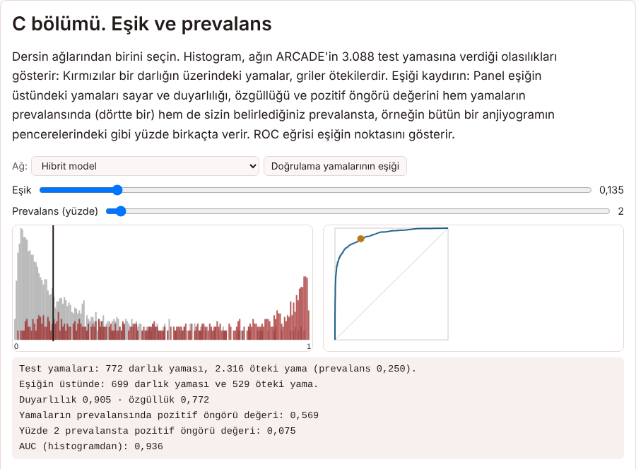

# Hafta 7: Vision Transformer (ViT): Görüntü işlemede yeni nesil

**Python ile Yapay Zekâ Eğitimi: Kardiyologlar için Uygulamalı Eğitim Programı** 
Türk Kardiyoloji Derneği

*Attention mekanizmasıyla kardiyak görüntülerde global analiz*

[Eğitimin ana sayfası](../../README.tr.md) · [İzlence](../../SYLLABUS.tr.md) · [Kurulum](../../SETUP.tr.md) · [English](../../en/week-07/README.md)

Hafta hakkında daha ayrıntılı bilgi için bu sayfayı okumaya devam ediniz. Haftaya doğrudan ders sayfasından devam etmek isterseniz bu bağlantıyı kullanınız: **[Haftanın ders sayfasını açınız](https://utkukose.github.io/ai-cardiology-tkd-NB-lecture/tr/hafta-07/ders.html)**. Ders sayfası haftanın ana rotasıdır; sayfadaki kutular etkileşimli labı ve Jupyter Notebook'u ilgili yerde açmaktadır.

## Hafta hakkında

Sanal kliniğin kateter laboratuvarı bu hafta açılır. Alıcı alanı yavaş büyüyen evrişimli ağların sınırları, dikkat mekanizmasının ortaya çıkmasına yol açmıştır; dikkat, bir görüntünün her parçasının öteki her parçaya bakmasını sağlamaktadır. Vision Transformer da bir görüntüyü 16 × 16 piksellik yamalara böler ve bu yamaları 6. haftanın token'ları gibi ele alır. PyTorch ile bir Vision Transformer kurulur ve Hugging Face'ten hazır bir model yüklenir; mini proje küçük bir Vision Transformer'ı CIFAR-10 ile eğitir ve EchoNet-Dynamic ya da CAMUS ekokardiyogramlarına aktarır. Fotoğraflarla önceden eğitilmiş bir Vision Transformer olan ViT-B/16, hiç ekokardiyogram görmeden CAMUS ekokardiyogramları için bir kalite kapısına dönüşür (kötü karelerde AUC 0,862; EfficientNet-B0'da 0,782, dört görüntü istatistiğinde 0,704). İkinci yarıda Swin Transformer'ın kaydırılmış pencere dikkati ile bir CNN backbone ve bir Transformer head'den oluşan hibrit mimari anlatılır ve koroner anjiyogramlarda darlık aranır. Sanal kliniğin sentetik anjiyogramlarında öğrenen küçük bir evrişimli ağ orada 0,965 AUC değerine ulaşır, ARCADE'in gerçek anjiyogramlarında ise 0,538 düzeyine düşer. ARCADE ile eğitilen evrişimli ağ, Vision Transformer ve ikisini birleştiren hibrit model sırasıyla 0,810, 0,930 ve 0,936 değerlerine ulaşır. Dikkat haritaları sınırlarıyla birlikte okunur; bütün anjiyogramların taranması bir yama sınıflandırıcısının neden henüz bir tespit modeli olmadığını gösterir. Hafta, bir yapay zekâ (YZ) asistanının yazdığı bir görüntü işlem hattının denetlenmesiyle kapanır.

Oturum 4 saat sürer. Haftalık proje için yaklaşık 3 saat ayrılmalıdır.

## Haftanın vakası

VC-2427 numaralı hasta, 6. haftanın raporuna göre iki koroner damarı hastalıklı olan, kalp yetersizliği tanılı 80 yaşında bir erkektir. Darlıkları anjiyogramların neresindedir ve evrişimli bir ağ, bir Vision Transformer ya da hibrit bir model bunları gerçek anjiyogramlarda bulabilir mi?

## Malzemeler

| Malzeme | Aç | Ne işe yarar? |
|---|---|---|
| **Ders sayfası** | [Ders sayfasını aç](https://utkukose.github.io/ai-cardiology-tkd-NB-lecture/tr/hafta-07/ders.html) | Haftanın konu anlatımını içeren bu sayfa yukarıdan aşağıya doğru okunmak üzere hazırlanmıştır. Sayfadaki kutular sizi uygulama duraklarına yönlendirir; sayfada kod ya da prompt (istem) bulunmamaktadır. |
| **Etkileşimli lab** | [Etkileşimli labı aç](https://utkukose.github.io/ai-cardiology-tkd-NB-lecture/tr/hafta-07/lab.html) | Kod gerektirmeyen A-F bölümleri, ders sayfasında yeri geldiğinde açılmaktadır. F bölümü bir prompt atölyesidir. Öz değerlendirme ve öğrenme günlüğü de bu labda yer alır. |
| **Python Notebook** |  [Jupyter Notebook için indir (zip)](https://github.com/utkukose/ai-cardiology-tkd-NB-lecture/raw/main/tr/hafta-07/NB07_vision_transformer.zip) | Uygulama durakları burada çalışılır; her durakta Python temelleri, promptlar ve hazır bir uygulama bulunmaktadır. Python Notebook, Google Colab'da kurulum gerektirmeden ya da kendi bilgisayarınızdaki Jupyter Notebook'ta çalışabilir. Jupyter için zip dosyasını indiriniz, içindeki .ipynb dosyasını bir klasöre çıkarınız ve dosyayı Jupyter'de açınız. Her bölüm, bölümün kullandığı kurulumu ve veri çağrılarını yineleyen bir başlangıç hücresiyle açılır. |
| **Prompt kütüphanesi** | [PROMPTLAR.md](PROMPTLAR.md) | Uygulama duraklarının ve haftalık projenin bütün promptları, kodu onarmaya, açıklatmaya ve denetlemeye yönelik promptlarla birlikte burada toplanmıştır. GitHub'da her promptun yanında bir kopyalama düğmesi bulunur. |
| **PDF ders notu** | [Hafta07_Ders_Notlari.pdf](Hafta07_Ders_Notlari.pdf) | Ders sayfasının yazdırılabilir biçimidir. |

## Çalışma yolu

Ders sayfası yukarıdan aşağıya doğru okunur; etkileşimli labın bölümleri de sayfada yeri geldikçe açılır. Uygulama duraklarında çalışma Jupyter Notebook'ta sürmektedir ve oradaki her durak üç bölümden oluşur. **Python temelleri** bölümünde durağın gerektirdiği Python bilgisi öğretilir. **Prompt ile uygulama** bölümünde kodu hazır promptlarla bir YZ asistanı yazar; katılımcının görevi bu kodu çalıştırmak ve sonucu denetlemektir. **Hazır uygulama** bölümünde ise durağın baştan sona çalışan programı yer almaktadır. Bölümleri bu sırayla izlemeniz önerilir; Python biliyorsanız promptlarla, yalnızca sonucu görmek istiyorsanız hazır uygulamayla başlayabilirsiniz. Her bölüm, bölümün kullandığı kurulumu ve veri çağrılarını yineleyen bir başlangıç hücresiyle açılır; bu sayede bölüm doğrudan açıldığında da çalışabilmektedir. Lab bölümlerinin ve Jupyter Notebook'taki durakların sonunda, sizi ders sayfasında okumanın devam ettiği yere geri götüren bir bağlantı bulunmaktadır. Nerede kaldığınızı bulamazsanız bu tabloya dönünüz. Oturuma katılanlar bu adımları oturum sırasında yapar. Tablodaki süreler, haftayı kendi başına izleyenler, örneğin bir oturumu kaçıranlar için verilmiştir.

| Adım | Ne yapılır? | Süre |
|---|---|---|
| 1 | Haftanın vakasını ve ders sayfasının ilk iki saatini 1. uygulama durağına kadar [okuyunuz](https://utkukose.github.io/ai-cardiology-tkd-NB-lecture/tr/hafta-07/ders.html) (CNN'in sınırları, self-attention, patch embedding, PyTorch ile kurulan ve Hugging Face'ten yüklenen Vision Transformer, mini proje); etkileşimli labın A ve B bölümlerini yapınız, bir yamanın dikkatini gösteren 3B sahneyi ve iki animasyonu inceleyiniz ve bilgi kontrolü sorularını cevaplayınız | 1 saat 20 dakika |
| 2 | **[1. uygulama durağı: Ekokardiyografiye aktarım: Kalite kapısı ve mini proje](https://utkukose.github.io/ai-cardiology-tkd-NB-lecture/tr/hafta-07/ders.html#stop-1)** [Python temelleri](https://colab.research.google.com/github/utkukose/ai-cardiology-tkd-NB-lecture/blob/main/tr/hafta-07/NB07_vision_transformer.ipynb#scrollTo=stop-1-basics) · [Prompt ile uygulama](https://colab.research.google.com/github/utkukose/ai-cardiology-tkd-NB-lecture/blob/main/tr/hafta-07/NB07_vision_transformer.ipynb#scrollTo=stop-1-prompt) ([promptlar](PROMPTLAR.md#durak-1-ekokardiyografiye-aktar%C4%B1m-kalite-kap%C4%B1s%C4%B1-ve-mini-proje)) · [Hazır uygulama](https://colab.research.google.com/github/utkukose/ai-cardiology-tkd-NB-lecture/blob/main/tr/hafta-07/NB07_vision_transformer.ipynb#scrollTo=stop-1-app) | 1 saat 45 dakika |
| 3 | 2. uygulama durağına kadar [okumayı sürdürün](https://utkukose.github.io/ai-cardiology-tkd-NB-lecture/tr/hafta-07/ders.html#last-two-hours-hybrid-cnn-vit-and-medical-imaging) (Swin Transformer, CNN backbone ve Transformer head'den oluşan hibrit mimari, koroner anjiyogramlarda darlık analizi, sentetik ve gerçek anjiyogramlar); etkileşimli labın C bölümünü yapınız | 40 dakika |
| 4 | **[2. uygulama durağı: Sentetik ve gerçek anjiyogramlarda darlıklar](https://utkukose.github.io/ai-cardiology-tkd-NB-lecture/tr/hafta-07/ders.html#stop-2)** [Python temelleri](https://colab.research.google.com/github/utkukose/ai-cardiology-tkd-NB-lecture/blob/main/tr/hafta-07/NB07_vision_transformer.ipynb#scrollTo=stop-2-basics) · [Prompt ile uygulama](https://colab.research.google.com/github/utkukose/ai-cardiology-tkd-NB-lecture/blob/main/tr/hafta-07/NB07_vision_transformer.ipynb#scrollTo=stop-2-prompt) ([promptlar](PROMPTLAR.md#durak-2-sentetik-ve-ger%C3%A7ek-anjiyogramlarda-darl%C4%B1klar)) · [Hazır uygulama](https://colab.research.google.com/github/utkukose/ai-cardiology-tkd-NB-lecture/blob/main/tr/hafta-07/NB07_vision_transformer.ipynb#scrollTo=stop-2-app) | 50 dakika |
| 5 | 3. uygulama durağına kadar [okumayı sürdürün](https://utkukose.github.io/ai-cardiology-tkd-NB-lecture/tr/hafta-07/ders.html#a-convolutional-network-a-vision-transformer-and-a-hybrid-compared) (üç ağın karşılaştırması, attention haritalarının görselleştirilmesi ve klinik yorumu, bütün anjiyogramlar); etkileşimli labın D bölümünü yapınız | 30 dakika |
| 6 | **[3. uygulama durağı: Evrişimli ağ, Vision Transformer ve hibrit model](https://utkukose.github.io/ai-cardiology-tkd-NB-lecture/tr/hafta-07/ders.html#stop-3)** [Python temelleri](https://colab.research.google.com/github/utkukose/ai-cardiology-tkd-NB-lecture/blob/main/tr/hafta-07/NB07_vision_transformer.ipynb#scrollTo=stop-3-basics) · [Prompt ile uygulama](https://colab.research.google.com/github/utkukose/ai-cardiology-tkd-NB-lecture/blob/main/tr/hafta-07/NB07_vision_transformer.ipynb#scrollTo=stop-3-prompt) ([promptlar](PROMPTLAR.md#durak-3-evri%C5%9Fimli-a%C4%9F-vision-transformer-ve-hibrit-model)) · [Hazır uygulama](https://colab.research.google.com/github/utkukose/ai-cardiology-tkd-NB-lecture/blob/main/tr/hafta-07/NB07_vision_transformer.ipynb#scrollTo=stop-3-app) | 55 dakika |
| 7 | Görüntü işlem hattı denetimini, haftanın makalesini, sanal kliniğin bu haftaki aşamasını ve "Kendi verinizle" bölümünü [okuyunuz](https://utkukose.github.io/ai-cardiology-tkd-NB-lecture/tr/hafta-07/ders.html#ai-pair-programming-part-7-reviewing-an-image-pipeline); etkileşimli labın E ve F bölümlerini yapınız ve Jupyter Notebook'ta uygulama duraklarından sonra gelen bölümü çalışınız | 55 dakika |
| 8 | [Etkileşimli labın](https://utkukose.github.io/ai-cardiology-tkd-NB-lecture/tr/hafta-07/lab.html) "Kendini sına" sekmesindeki öz değerlendirmeyi yapınız, yansıtma yazınızı yazınız ve öğrenme günlüğünü dışa aktarınız | 20 dakika |
| | **Haftalık proje dışında toplam** | **7 saat 15 dakika** |
| 9 | [Haftalık projeyi](#haftal%C4%B1k-proje) tamamlayınız [Promptlar](PROMPTLAR.md#haftal%C4%B1k-projenin-promptlar%C4%B1) · [Jupyter Notebook'ta haftalık proje](https://colab.research.google.com/github/utkukose/ai-cardiology-tkd-NB-lecture/blob/main/tr/hafta-07/NB07_vision_transformer.ipynb#scrollTo=project) | 3 saat |

<table>
<tr><td width="50%"></td><td width="50%"></td></tr>
<tr><td>Etkileşimli lab, A bölümü: Bir sorgunun dört token üzerindeki dikkati; puanlar, softmax ağırlıkları, çıktı ve anahtar uzunluğunun kareköküne bölmenin etkisi.</td><td>Jupyter Notebook, «Durak 1 · Hazır uygulama»: Kötü ekokardiyografi kareleri için dört görüntü istatistiğinden, EfficientNet-B0'dan ve ViT-B/16'dan kurulan kalite kapısının ROC eğrileri.</td></tr>
<tr><td width="50%"></td><td width="50%"></td></tr>
<tr><td>Etkileşimli lab, C bölümü: Dersin bir ağının ARCADE test yamalarındaki olasılıkları üzerinde eşik; duyarlılık, özgüllük ve iki prevalansta pozitif öngörü değeri.</td><td>Ders sayfası: Bir sorgunun bir anjiyogramın dört token'ı üzerindeki dikkati, adım adım.</td></tr>
</table>

## Haftalık proje

**Proje.** Koroner anjiyografi: Stenoz tespiti CNN vs ViT vs Hibrit karşılaştırması + attention haritaları.

**Ne yapılacak?** ARCADE'in gerçek koroner anjiyogramlarında darlık bulmak için evrişimli bir ağı, bir Vision Transformer'ı ve hibrit bir modeli karşılaştırınız ve en iyisini yamalardan bütün anjiyogramlara taşıyınız. Önce dersin üç küçük ağını eğitim anjiyogramlarının yamalarıyla aynı biçimde eğitiniz; test AUC değerlerini, test anjiyogramlarından yapılan bir bootstrap ile hesaplanan yüzde 95 aralıklarıyla ve her ağın evrişimli ağa göre farkıyla birlikte veriniz. İkinci adımda her ağ için doğrulama yamalarında 0,90 duyarlılık veren eşiği seçiniz ve test yamalarındaki duyarlılığı, özgüllüğü ve pozitif öngörü değerini hem yamaların prevalansında hem de yüzde 2 prevalansta bildiriniz. Üçüncü adımda en iyi ağı, en fazla 16 piksel kaydırılmış pozitif yamalarla ve damarlardan ve arka plandan kesilmiş negatiflerle yeniden eğitiniz. Doğrulama ve test anjiyogramlarını her 16 pikselde bir pencereyle tarayınız, olasılığı komşuluğunda en büyük olan pencereleri tutunuz, eşiği doğrulama anjiyogramlarında anjiyogram başına en fazla bir yanlış tespit verecek biçimde seçiniz ve test anjiyogramlarında bulunan darlıkların oranını ve anjiyogram başına yanlış tespit sayısını bu eşikte ve 0,5, 0,7 ve 0,9 eşiklerinde veriniz. Dördüncü adımda ısı haritasıyla birlikte beş kaçırılmış darlığı ve beş yanlış tespiti gösteriniz; böyle bir aracın kateter laboratuvarında neler yapabileceğini ve yapamayacağını bir kalp ekibi için yarım sayfada yazınız.

**Nereye bakılacak?** Ders: "Koroner anjiyografi analizi: Stenoz tespiti", "Evrişimli ağ, Vision Transformer ve hibrit model karşılaştırması", "Attention haritası görselleştirme (klinik yorumlama)" ve "Yamalardan bütün anjiyograma" bölümleri. Etkileşimli lab: C ve D bölümleri. Jupyter Notebook: 2. ve 3. uygulama duraklarının hazır uygulamaları.

**Promptlarla.** Proje, [prompt kütüphanesindeki](https://github.com/utkukose/ai-cardiology-tkd-NB-lecture/blob/main/tr/hafta-07/PROMPTLAR.md#haftal%C4%B1k-projenin-promptlar%C4%B1) dört promptla da yapılabilir; kütüphanede her adım için bir prompt bulunmaktadır. Her promptun tablosu, Jupyter Notebook'un sonundaki "Haftalık proje" bölümünde hazırlanır ve bu bölüm tek başına da açılabilir. Bir promptun testi sağlanmadan sonraki prompta geçilmemeli ve her prompt YZ kullanım günlüğüne kaydedilmelidir.

**Örnek.** Dersin tespit modeli test anjiyogramlarındaki 386 darlığın 30 tanesini 300 anjiyogram boyunca 124 yanlış tespitle bulmuştur; tespitlerinin 30 tanesi bir darlığın üzerindedir. Lezyon duyarlılığı, anjiyogram başına 0,41 yanlış tespitle $30/386 = 0{,}078$ olarak bulunur; bir tespitin pozitif öngörü değeri ise $30/(30 + 124) = 0{,}195$ düzeyindedir. Aynı türden bir ağ özenle seçilmiş yamaları 0,936 AUC değeriyle ayırır; bütün anjiyogramlarda ise doğrulama anjiyogramlarında anjiyogram başına en fazla bir yanlış tespit için seçilen eşikte darlıkların çoğunu kaçırır.

**Ne teslim edilecek?** [Rapor şablonuyla](../sablonlar/Rapor_Sablonu.docx) yazılmış, bir ya da iki sayfalık bir rapor teslim edilir. Raporda üç ağın aralıklarıyla birlikte tablosu, iki prevalanstaki eşiklerin tablosu, tespit modelinin lezyon duyarlılığı ve anjiyogram başına yanlış tespit sayısı, dördüncü adımın on olgusu ve kalp ekibi için yazılan yarım sayfa yer almalıdır. Rapora YZ kullanım günlüğünü (araç, prompt, neyin denetlendiği, neyin değiştirildiği) ve çıktılarıyla birlikte Jupyter Notebook'u ekleyiniz.

**Teslim.** Haftalık proje, 8. haftanın oturumundan önce utkukose@sdu.edu.tr ya da utkukose@gmail.com adresine e-postayla gönderilir. E-postaya "Ne teslim edilecek?" başlığında sayılan öğeler ve etkileşimli labdan dışa aktarılan öğrenme günlüğü eklenir. Haftalık projeler değerlendirmenin yüzde 40'ını oluşturur; değerlendirme ölçütleri izlencede yer almaktadır.

## Öğrenme çıktıları

Haftanın sonunda katılımcıların dikkati sorguları, anahtarları ve değerleriyle açıklayabilmeleri, birkaç token için elle hesaplayabilmeleri ve bir Vision Transformer'ın bir görüntüyü sınıf token'ı ve konumlarla birlikte bir yama dizisine nasıl dönüştürdüğünü anlatabilmeleri beklenmektedir. Evrişimli bir ağın sınırlarını, alıcı alanını ve tümevarımsal yanlılığını, bir Vision Transformer'ın neden çok veriye ya da önceden eğitime ihtiyaç duyduğunu, Swin Transformer'ın dikkati kaydırılmış pencerelerde nasıl hesapladığını ve bir CNN backbone ile bir Transformer head'den oluşan hibrit modelin ikisini nasıl birleştirdiğini açıklayabilmelidirler. PyTorch ile küçük bir Vision Transformer kurabilmeli, Hugging Face'ten hazır bir model yükleyebilmeli ve CIFAR-10 ile eğitilen küçük bir Vision Transformer'ı ekokardiyogramlara aktarabilmelidirler. Önceden eğitilmiş bir Vision Transformer'ı, ekokardiyografi için bir kalite kapısı gibi klinik bir görevde öznitelik kaynağı olarak kullanabilmeli ve sonucunu hastaya göre yapılan bir bootstrap aralığıyla bildirebilmelidirler. Son olarak koroner anjiyogramlardaki darlıklar için evrişimli bir ağı, bir Vision Transformer'ı ve hibrit bir modeli karşılaştırabilmeli, sentetik ve gerçek görüntüler arasındaki alan kaymasını tanıyabilmeli, dikkat haritalarını sınırlarıyla birlikte okuyabilmeli ve bir görüntü işlem hattını denetleyebilmelidirler.

## Oturumun eğitim akışı

Haftanın dört saatlik oturumu aşağıdaki plana göre işlenir. Plan, malzemelerin canlı bir oturumda nasıl bir araya geldiğini göstermek için paylaşılmaktadır.

| Süre | Etkinlik |
|---|---|
| 0:00-0:15 | Haftanın vakası tanıtılır ve haftanın rotası anlatılır. Her katılımcı Jupyter Notebook'u Google Colab'da ya da Jupyter'de açarak 0. bölümü çalıştırır. İlk çalıştırma CAMUS karelerini (4. haftada indirilmediyse yaklaşık 227 MB), ViT-B/16'nın (yaklaşık 330 MB) ve EfficientNet-B0'ın (yaklaşık 21 MB) ImageNet ağırlıklarını ve ARCADE'i (451,6 MB) indirir; sentetik anjiyogramlar katılımcının bilgisayarında çizilir. |
| 0:15-1:00 | İlk iki saat, attention mekanizması ve ViT mimarisi: Sanal kliniğin anjiyogramları, CNN'in sınırları ve alıcı alanı, A bölümüyle self-attention, Transformer bloğu, 3B sahne ve B bölümüyle patch embedding, PyTorch ile kurulan ve Hugging Face'ten yüklenen Vision Transformer, tümevarımsal yanlılık ve önceden eğitim ile ekokardiyografi için kalite kapısı anlatılır. |
| 1:00-1:40 | 1. uygulama durağında katılımcılar Jupyter Notebook'ta, promptlarla ya da Python ile çalışır. Kalite kapısı dört görüntü istatistiğiyle, ViT-B/16 ile ve EfficientNet-B0 ile kurulur ve farkın bootstrap aralığı hesaplanır. Ardından oturumun mini projesi yapılır: Küçük bir Vision Transformer CIFAR-10 ile eğitilir ve EchoNet-Dynamic ya da CAMUS ekokardiyogramlarına aktarılır. Eğitim yaklaşık beş dakika sürmektedir; grup bu sırada kalite kapısını tartışır. |
| 1:40-1:50 | Ara. |
| 1:50-2:35 | Son iki saat, hibrit CNN-ViT ve medikal görüntüleme: Kaydırılmış pencereleriyle Swin Transformer, CNN backbone ve Transformer head'den oluşan hibrit mimari, darlık için koroner anjiyografi analizi ve C bölümüyle sentetik ve gerçek anjiyogramlar anlatılır. 2. uygulama durağında küçük bir evrişimli ağ sentetik anjiyogramlarda eğitilir, ARCADE'de değiştirilmeden sınanır ve ARCADE ile yeniden eğitilir. |
| 2:35-3:20 | Ana rotada üç ağın karşılaştırması, D bölümüyle attention haritalarının görselleştirilmesi ve klinik yorumu ve bütün anjiyogramlar ele alınır. 3. uygulama durağında küçük Vision Transformer ve hibrit model ARCADE ile eğitilir ve sınıf token'ının dikkati ölçülür. |
| 3:20-4:00 | Etkileşimli labın E ve F bölümleriyle bir görüntü işlem hattının denetimi çalışılır. Ardından haftanın makalesi, sanal kliniğin kateter laboratuvarı, "Kendi verinizle" bölümü ve haftalık proje ele alınır. |

## Kendi verinizle

Ders sayfası, haftanın yöntemlerini kendi verilerinize nasıl uygulayabileceğinizi anlatan bir bölümle sona ermektedir. Bu bölümde hangi sorunun hangi yönteme uyduğu, önce neyin denetlenmesi gerektiği, etik kurul onayı, Kişisel Verilerin Korunması Kanunu (KVKK) ve analizin nerede yapılacağı ele alınmaktadır. [Bölümü ders sayfasında okuyunuz](https://utkukose.github.io/ai-cardiology-tkd-NB-lecture/tr/hafta-07/ders.html#with-your-own-data).

## İsteğe bağlı araştırma ödevi

PubMed'de, 2020 ya da sonrasında yayımlanmış ve kalp görüntülerinde (anjiyogram, ekokardiyogram, kardiyak manyetik rezonans ya da bilgisayarlı tomografi) bir Vision Transformer ya da evrişim ve dikkati birleştiren hibrit bir model kullanmış bir çalışma bulunuz. Çalışmayı yarım sayfada özetleyiniz. Özette görüntüler, sayıları ve merkezleri, görev ve referans, ağın önceden eğitilip eğitilmediği ve neyle eğitildiği, evrişimli bir ağla karşılaştırma, testin başka bir merkezde yapılıp yapılmadığı ve dikkat haritalarının nasıl kullanıldığı yer almalıdır. [Haftanın makalesindeki](https://utkukose.github.io/ai-cardiology-tkd-NB-lecture/tr/hafta-07/ders.html#the-paper-of-the-week) üç soru özete yol gösterebilir. Bu ödev notlandırılmaz; haftalık projenin yarım sayfasına hazırlık niteliğindedir.

## Bu haftadan sonra sanal klinik

7. haftada sanal klinikte bir kateter laboratuvarı açılır. Anjiyografisi olan 2.311 hastanın her birinin, 6. haftanın raporlarının anlattığı kayıt sistemi darlıklarını taşıyan iki sentetik anjiyogramı vardır. Bu görüntülerde ve ARCADE'in gerçek anjiyogramlarında darlıklar dersin ağlarıyla aranmaktadır; önceden eğitilmiş bir Vision Transformer ise CAMUS ekokardiyogramları için kalite kapısı görevi görür. Sonuçlar ders sayfasının [Sanal klinik, 7. aşama](https://utkukose.github.io/ai-cardiology-tkd-NB-lecture/tr/hafta-07/ders.html#the-virtual-clinic-stage-7-catheterisation-laboratory) bölümünde yer almaktadır.

## Gelecek hafta

**Hafta 8: Çok modlu yapay zekâ ve veri füzyonu.** Kalp ekibinde sanal kliniğin EKG'leri, görüntüleri, raporları ve laboratuvar değerleri, majör olumsuz kardiyovasküler olaylar için tek bir modelde bir araya getirilmektedir. Ayrıntılar için [eğitimin planına](../../README.tr.md#on-bir-hafta) bakabilirsiniz.

---

**Prof. Dr. Utku Köse**

Profesör, Bilgisayar Mühendisliği Bölümü, Süleyman Demirel Üniversitesi, Isparta, Türkiye 
Kurucu Müdür, Yapay Zekâ Uygulama ve Araştırma Merkezi (YAZEM), Süleyman Demirel Üniversitesi 
Bilgisayar Bilimleri Anabilim Dalı Başkanı, Bilgisayar Mühendisliği Bölümü, Süleyman Demirel Üniversitesi 
Diğer kurumlar: University of North Dakota (ABD), Universidad Panamericana (Meksiko, Meksika), Vel Tech University (Chennai, Hindistan) 
IEEE Kıdemli Üyesi, ACM Profesyonel Üyesi

[ORCID 0000-0002-9652-6415](https://orcid.org/0000-0002-9652-6415) | [utkukose.com](https://www.utkukose.com) | [github.com/utkukose](https://github.com/utkukose)

[utkukose@sdu.edu.tr](mailto:utkukose@sdu.edu.tr) | [utku.kose@und.edu](mailto:utku.kose@und.edu) | [ukose@up.edu.mx](mailto:ukose@up.edu.mx) | [utkukose@gmail.com](mailto:utkukose@gmail.com)

*İlk sürüm: Kasım 2026. İçerik CC BY 4.0, kod MIT.*

