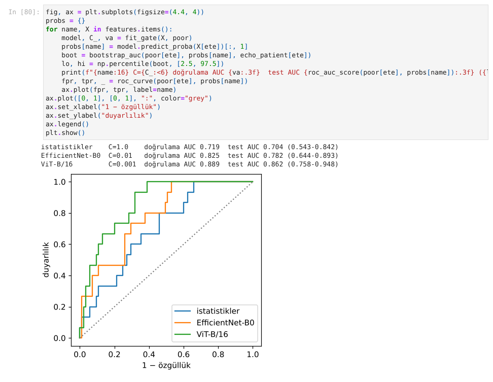
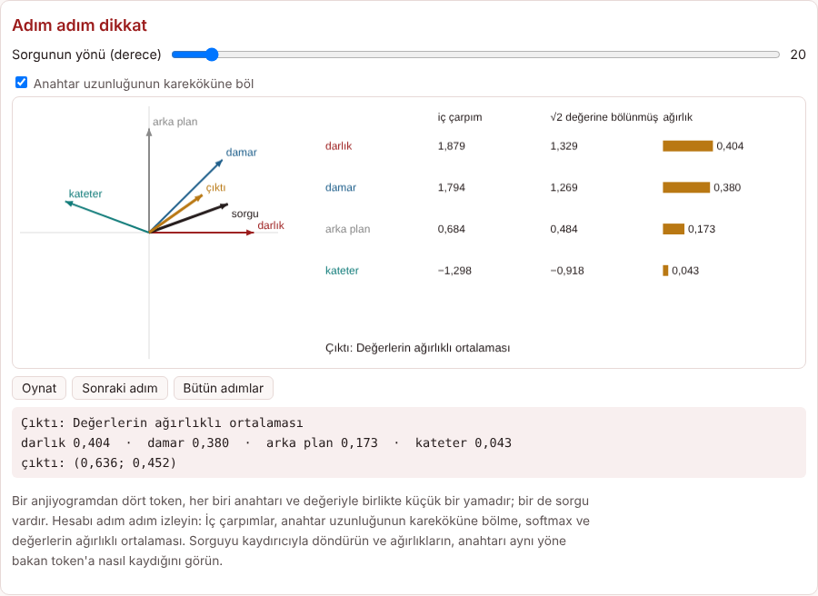

# Hafta 7: Vision Transformer modelleri

**Python ile Yapay Zekâ Eğitimi: Kardiyologlar için Uygulamalı Eğitim Programı** 
Türk Kardiyoloji Derneği

*Dikkat ve yamalardan koroner anjiyogramlardaki darlıklara ve ekokardiyografi için bir kalite kapısına geçilir.*

[Eğitimin ana sayfası](../../README.tr.md) · [İzlence](../../SYLLABUS.tr.md) · [Kurulum](../../SETUP.tr.md) · [English](../../en/week-07/README.md)

## Hafta hakkında

Sanal kliniğin kateter laboratuvarı bu hafta açılır. Dikkat mekanizması bir görüntünün her parçasının öteki her parçaya bakmasını sağlar; Vision Transformer da bir görüntüyü yamalara böler ve bu yamaları 6. haftanın token'ları gibi ele alır. Fotoğraflarla önceden eğitilmiş bir Vision Transformer olan ViT-B/16, hiç ekokardiyogram görmeden CAMUS ekokardiyogramları için bir kalite kapısına dönüşür (kötü karelerde AUC 0,862; EfficientNet-B0'da 0,782, dört görüntü istatistiğinde 0,704). İkinci yarıda koroner anjiyogramlarda darlık aranır. Sanal kliniğin sentetik anjiyogramlarında öğrenen küçük bir evrişimli ağ orada 0,965 AUC değerine ulaşır, ARCADE'in gerçek anjiyogramlarında ise 0,538 düzeyine düşer. ARCADE ile eğitilen evrişimli ağ, Vision Transformer ve ikisini birleştiren hibrit model sırasıyla 0,810, 0,930 ve 0,936 değerlerine ulaşır. Dikkat haritaları sınırlarıyla birlikte okunur; bütün anjiyogramların taranması bir yama sınıflandırıcısının neden henüz bir tespit modeli olmadığını gösterir. Hafta, bir YZ asistanının yazdığı bir görüntü işlem hattının denetlenmesiyle kapanır.

Oturum 4 saat sürer. Haftalık proje için yaklaşık 3 saat ayrılmalıdır.

## Haftanın rotası

Ders sayfası haftanın ana rotasıdır. Sayfada kod ya da prompt (istem) bulunmaz; sayfa etkileşimli labla birlikte yukarıdan aşağıya okunur. Her uygulama durağında katılımcılar Jupyter defterindeki iki yoldan birini seçer. **Prompt yolunda** (Kısım 1) kodu, hazır promptlara göre bir yapay zekâ (YZ) asistanı yazar; katılımcı bu kodu çalıştırır ve sonucu denetler. **Python yolunda** (Kısım 2) ise kodu katılımcı kendisi yazar. İki yol da aynı sonuçlara varır. Defter hem kurulum gerektirmeyen Google Colab'da hem de kendi bilgisayarınızdaki Jupyter'de çalışır ([kurulum](../../SETUP.tr.md)).

| Ana rota: Ders sayfası ve etkileşimli lab | Uygulama durağı | Prompt yolu (Kısım 1) | Python yolu (Kısım 2) |
|---|---|---|---|
| [Kateter laboratuvarının görüntüleri: Sanal kliniğin anjiyogramları](https://utkukose.github.io/ai-cardiology-tkd-NB-lecture/tr/hafta-07/ders.html#images-of-the-catheterisation-laboratory-the-angiograms-of-the-virtual-clinic) [Evrişimden dikkate](https://utkukose.github.io/ai-cardiology-tkd-NB-lecture/tr/hafta-07/ders.html#from-convolution-to-attention) [Çok başlı öz dikkat ve Transformer bloğu](https://utkukose.github.io/ai-cardiology-tkd-NB-lecture/tr/hafta-07/ders.html#self-attention-with-several-heads-and-the-transformer-block) [Vision Transformer: Bir yama dizisi olarak görüntü](https://utkukose.github.io/ai-cardiology-tkd-NB-lecture/tr/hafta-07/ders.html#the-vision-transformer-an-image-as-a-sequence-of-patches) [Tümevarımsal yanlılık, veri ve önceden eğitim](https://utkukose.github.io/ai-cardiology-tkd-NB-lecture/tr/hafta-07/ders.html#inductive-bias-data-and-pretraining) [Ekokardiyografiye aktarım: Otomatik EF'den önce bir kalite kapısı](https://utkukose.github.io/ai-cardiology-tkd-NB-lecture/tr/hafta-07/ders.html#transfer-to-echocardiography-a-quality-gate) | **[Durak 1: Önceden eğitilmiş bir Vision Transformer ile ekokardiyografi için bir kalite kapısı](https://utkukose.github.io/ai-cardiology-tkd-NB-lecture/tr/hafta-07/ders.html#stop-1)** | Durak 1 | Python adımı 7 ve 1-4. bölümler |
| [Hibrit modeller: Önce evrişim, sonra dikkat](https://utkukose.github.io/ai-cardiology-tkd-NB-lecture/tr/hafta-07/ders.html#hybrid-models-convolutions-first-attention-after) [Anjiyogramlarda darlık bulmak: Görevler ve ölçütler](https://utkukose.github.io/ai-cardiology-tkd-NB-lecture/tr/hafta-07/ders.html#finding-stenoses-on-angiograms-tasks-and-metrics) [Sentetik ve gerçek anjiyogramlar: Başka bir dünyada bir model](https://utkukose.github.io/ai-cardiology-tkd-NB-lecture/tr/hafta-07/ders.html#synthetic-and-real-angiograms-a-model-in-another-world) | **[Durak 2: Sentetik ve gerçek anjiyogramlarda darlıklar](https://utkukose.github.io/ai-cardiology-tkd-NB-lecture/tr/hafta-07/ders.html#stop-2)** | Durak 2 | 5. ve 6. bölümler |
| [Evrişimli ağ, Vision Transformer ve hibrit model karşılaştırması](https://utkukose.github.io/ai-cardiology-tkd-NB-lecture/tr/hafta-07/ders.html#a-convolutional-network-a-vision-transformer-and-a-hybrid-compared) [Dikkat haritalarını klinik gözle okumak ve sınırları](https://utkukose.github.io/ai-cardiology-tkd-NB-lecture/tr/hafta-07/ders.html#attention-maps-read-clinically-with-their-limits) [Yamalardan bütün anjiyograma](https://utkukose.github.io/ai-cardiology-tkd-NB-lecture/tr/hafta-07/ders.html#from-patches-to-the-whole-angiogram) | **[Durak 3: Evrişimli ağ, Vision Transformer ve hibrit model](https://utkukose.github.io/ai-cardiology-tkd-NB-lecture/tr/hafta-07/ders.html#stop-3)** | Durak 3 | 7-9. bölümler |
| [YZ asistanıyla çalışmak, 7. bölüm: Bir görüntü işlem hattını denetlemek](https://utkukose.github.io/ai-cardiology-tkd-NB-lecture/tr/hafta-07/ders.html#ai-pair-programming-part-7-reviewing-an-image-pipeline) [Haftanın makalesi](https://utkukose.github.io/ai-cardiology-tkd-NB-lecture/tr/hafta-07/ders.html#the-paper-of-the-week) [Sanal klinik, 7. aşama: Kateter laboratuvarı](https://utkukose.github.io/ai-cardiology-tkd-NB-lecture/tr/hafta-07/ders.html#the-virtual-clinic-stage-7-catheterisation-laboratory) | "Kendi verinizle" bölümü, haftanın makalesi ve sanal klinik | – | – |

## Malzemeler

| Malzeme | Aç | İçeriği |
|---|---|---|
| **Ders sayfası (ana rota)** | [Ders sayfasını aç](https://utkukose.github.io/ai-cardiology-tkd-NB-lecture/tr/hafta-07/ders.html) | Vakayı, kavramları çözümlü örnekleriyle, bir yamanın dikkatini gösteren üç boyutlu (3B) bir sahneyi, iki animasyonu, bilgi kontrolü sorularını, üç uygulama durağını, "Kendi verinizle" bölümünü, tekrar kartlarını ve kaynakları içerir. Sayfada kod ve prompt yer almaz. |
| **Etkileşimli lab** | [Etkileşimli labı aç](https://utkukose.github.io/ai-cardiology-tkd-NB-lecture/tr/hafta-07/lab.html) | Kod gerektirmeyen A'dan F'ye kadar altı bölümü (F bölümü prompt atölyesidir), öz değerlendirmeyi, yansıtma yazısını ve dışa aktarılabilen öğrenme günlüğünü içerir |
| **Jupyter defteri** |  [Jupyter için indir](NB07_goru_donusturuculeri.ipynb) | Kısım 1 prompt yoludur: Üç durakta toplam on adım vardır ve her adımda hazır bir prompt, adımın tablosunu hazırlayan bir veri hücresi, YZ asistanının kodu için bir hücre, otomatik bir kontrol ve hazır kod bulunur. Kısmın sonunda haftalık proje dört promptla yer alır. Kısım 2 Python yoludur: Python adımı 7'yi, A-J alıştırmalarıyla birlikte 1-10. bölümleri ve yedi alan için uygulama görevlerini içerir. |
| **Prompt kütüphanesi** | [PROMPTLAR.md](PROMPTLAR.md) | Prompt yolunun bütün promptlarını, kodu onarmaya ve denetlemeye yarayan promptları ve haftalık projenin prompt yolunu içerir. GitHub'da her promptun yanında bir kopyalama düğmesi bulunur. |
| **PDF ders notu** | [Hafta07_Ders_Notlari.pdf](Hafta07_Ders_Notlari.pdf) | Ders sayfasının yazdırılabilir biçimidir; uygulama duraklarını ve "Kendi verinizle" bölümünü de içerir. |

<table>
<tr><td width="50%"></td><td width="50%"></td></tr>
<tr><td>Etkileşimli lab, A bölümü: Bir sorgunun dört token üzerindeki dikkati; puanlar, softmax ağırlıkları, çıktı ve anahtar uzunluğunun kareköküne bölmenin etkisi.</td><td>Jupyter defteri, 4. bölüm: Kötü ekokardiyografi kareleri için dört görüntü istatistiğinden, EfficientNet-B0'dan ve ViT-B/16'dan kurulan kalite kapısının ROC eğrileri.</td></tr>
<tr><td width="50%"></td><td width="50%"></td></tr>
<tr><td>Etkileşimli lab, C bölümü: Dersin bir ağının ARCADE test yamalarındaki olasılıkları üzerinde eşik; duyarlılık, özgüllük ve iki prevalansta pozitif öngörü değeri.</td><td>Ders sayfası: Bir sorgunun bir anjiyogramın dört token'ı üzerindeki dikkati, adım adım.</td></tr>
</table>

## Haftanın vakası

VC-2427 numaralı hasta, 6. haftanın raporuna göre iki koroner damarı hastalıklı olan, kalp yetersizliği tanılı 80 yaşında bir erkektir. Darlıkları anjiyogramların neresindedir ve evrişimli bir ağ, bir Vision Transformer ya da hibrit bir model bunları gerçek anjiyogramlarda bulabilir mi?

## Öğrenme çıktıları

Haftanın sonunda katılımcıların dikkati sorguları, anahtarları ve değerleriyle açıklayabilmeleri, birkaç token için elle hesaplayabilmeleri ve bir Vision Transformer'ın bir görüntüyü sınıf token'ı ve konumlarla birlikte bir yama dizisine nasıl dönüştürdüğünü anlatabilmeleri beklenmektedir. Evrişimli bir ağın tümevarımsal yanlılığını, bir Vision Transformer'ın neden çok veriye ya da önceden eğitime ihtiyaç duyduğunu ve hibrit bir modelin ikisini nasıl birleştirdiğini açıklayabilmelidirler. Önceden eğitilmiş bir Vision Transformer'ı, ekokardiyografi için bir kalite kapısı gibi klinik bir görevde öznitelik kaynağı olarak kullanabilmeli ve sonucunu hastaya göre yapılan bir bootstrap aralığıyla bildirebilmelidirler. Son olarak koroner anjiyogramlardaki darlıklar için evrişimli bir ağı, bir Vision Transformer'ı ve hibrit bir modeli karşılaştırabilmeli, sentetik ve gerçek görüntüler arasındaki alan kaymasını tanıyabilmeli, dikkat haritalarını sınırlarıyla birlikte okuyabilmeli ve bir görüntü işlem hattını denetleyebilmelidirler.

## Çalışma yolu

Oturuma katılanlar ana rotayı ve uygulama duraklarını oturumda tamamlar. Haftayı kendi başına izleyenler, örneğin bir oturumu kaçıranlar, aşağıdaki sürelerle plan yapabilir.

| Adım | Etkinlik | Prompt yolu | Python yolu |
|---|---|---|---|
| 1 | Haftanın vakasını ve ders sayfasını 1. uygulama durağına kadar okuyun; etkileşimli labın A ve B bölümlerini yapın, bir yamanın dikkatini gösteren 3B sahneyi ve iki animasyonu inceleyin ve bilgi kontrolü sorularını cevaplayın | 1 saat 15 dakika | 1 saat 15 dakika |
| 2 | 1. uygulama durağı (oturumun mini projesi): Prompt yolunda Kısım 1'deki Durak 1'i, Python yolunda Python adımı 7'yi ve 1-4. bölümleri çalışın | 35 dakika | 1 saat 35 dakika |
| 3 | 2. uygulama durağına kadar okumayı sürdürün (hibrit modeller, darlık tespitinin görevleri ve ölçütleri, sentetik ve gerçek anjiyogramlar); etkileşimli labın C bölümünü yapın | 35 dakika | 35 dakika |
| 4 | 2. uygulama durağı: Prompt yolunda Kısım 1'deki Durak 2'yi, Python yolunda 5. ve 6. bölümleri çalışın | 35 dakika | 50 dakika |
| 5 | 3. uygulama durağına kadar okumayı sürdürün (üç ağın karşılaştırması, dikkat haritaları ve bütün anjiyogramlar); etkileşimli labın D bölümünü yapın | 30 dakika | 30 dakika |
| 6 | 3. uygulama durağı: Prompt yolunda Kısım 1'deki Durak 3'ü, Python yolunda 7-9. bölümleri çalışın | 35 dakika | 50 dakika |
| 7 | Görüntü işlem hattı denetimini, haftanın makalesini, sanal kliniğin bu haftaki aşamasını ve "Kendi verinizle" bölümünü okuyun; etkileşimli labın E ve F bölümlerini yapın. Python yolunu izliyorsanız 10. bölümü de çalışın | 40 dakika | 55 dakika |
| 8 | Etkileşimli labın "Kendini sına" sekmesindeki öz değerlendirmeyi yapın, yansıtma yazınızı yazın ve öğrenme günlüğünü dışa aktarın | 20 dakika | 20 dakika |
| | **Haftalık proje dışında toplam** | **5 saat 5 dakika** | **6 saat 50 dakika** |
| 9 | Haftalık projeyi iki yoldan biriyle tamamlayın | 3 saat | 3 saat |

## Oturumun eğitim akışı

Haftanın dört saatlik oturumu aşağıdaki plana göre işlenir. Plan, malzemelerin canlı bir oturumda nasıl bir araya geldiğini göstermek için paylaşılmaktadır.

| Süre | Etkinlik |
|---|---|
| 0:00-0:15 | Haftanın vakası tanıtılır ve haftanın rotası anlatılır. Her katılımcı defteri Google Colab'da ya da Jupyter'de açar ve 0. bölümü çalıştırır. İlk çalıştırma CAMUS karelerini (4. haftada indirilmediyse yaklaşık 227 MB), ViT-B/16'nın (yaklaşık 330 MB) ve EfficientNet-B0'ın (yaklaşık 21 MB) ImageNet ağırlıklarını ve ARCADE'i (451,6 MB) indirir; sentetik anjiyogramlar katılımcının bilgisayarında çizilir. |
| 0:15-1:00 | Ana rotada sanal kliniğin anjiyogramları, A bölümüyle dikkat, Transformer bloğu, 3B sahne ve B bölümüyle Vision Transformer, tümevarımsal yanlılık ve önceden eğitim ile ekokardiyografi için kalite kapısı anlatılır. |
| 1:00-1:35 | Oturumun mini projesi olan 1. uygulama durağında katılımcılar iki gruba ayrılır: Prompt yolunu izleyenler ve Python yolunu izleyenler. Kalite kapısı dört görüntü istatistiğiyle, ViT-B/16 ile ve EfficientNet-B0 ile kurulur ve farkın bootstrap aralığı hesaplanır. |
| 1:35-1:50 | Ara. |
| 1:50-2:35 | Ana rotada hibrit modeller, darlık tespitinin görevleri ve ölçütleri ile C bölümüyle birlikte sentetik ve gerçek anjiyogramlar anlatılır. 2. uygulama durağında küçük bir evrişimli ağ sentetik anjiyogramlarda eğitilir, ARCADE'de değiştirilmeden sınanır ve ARCADE ile yeniden eğitilir. |
| 2:35-3:20 | Ana rotada üç ağın karşılaştırması, D bölümüyle dikkat haritaları ve bütün anjiyogramlar ele alınır. 3. uygulama durağında küçük Vision Transformer ve hibrit model ARCADE ile eğitilir ve sınıf token'ının dikkati ölçülür. |
| 3:20-4:00 | Etkileşimli labın E ve F bölümleriyle bir görüntü işlem hattının denetimi çalışılır. Ardından haftanın makalesi, sanal kliniğin kateter laboratuvarı, "Kendi verinizle" bölümü ve haftalık proje ele alınır. |

## Haftalık proje

**Ne yapılacak?** ARCADE'in gerçek koroner anjiyogramlarında darlık bulmak için evrişimli bir ağı, bir Vision Transformer'ı ve hibrit bir modeli karşılaştırın ve en iyisini yamalardan bütün anjiyogramlara taşıyın. Önce dersin üç küçük ağını eğitim anjiyogramlarının yamalarıyla aynı biçimde eğitin; test AUC değerlerini, test anjiyogramlarından yapılan bir bootstrap ile hesaplanan yüzde 95 aralıklarıyla ve her ağın evrişimli ağa göre farkıyla birlikte verin. İkinci adımda her ağ için doğrulama yamalarında 0,90 duyarlılık veren eşiği seçin ve test yamalarındaki duyarlılığı, özgüllüğü ve pozitif öngörü değerini hem yamaların prevalansında hem de yüzde 2 prevalansta bildirin. Üçüncü adımda en iyi ağı, en fazla 16 piksel kaydırılmış pozitif yamalarla ve damarlardan ve arka plandan kesilmiş negatiflerle yeniden eğitin. Doğrulama ve test anjiyogramlarını her 16 pikselde bir pencereyle tarayın, olasılığı komşuluğunda en büyük olan pencereleri tutun, eşiği doğrulama anjiyogramlarında anjiyogram başına en fazla bir yanlış tespit verecek biçimde seçin ve test anjiyogramlarında bulunan darlıkların oranını ve anjiyogram başına yanlış tespit sayısını bu eşikte ve 0,5, 0,7 ve 0,9 eşiklerinde verin. Dördüncü adımda ısı haritasıyla birlikte beş kaçırılmış darlığı ve beş yanlış tespiti gösterin; böyle bir aracın kateter laboratuvarında neler yapabileceğini ve yapamayacağını bir kalp ekibi için yarım sayfada yazın.

**Nereye bakılacak?** Ders: "Evrişimli ağ, Vision Transformer ve hibrit model karşılaştırması" ve "Yamalardan bütün anjiyograma" bölümleri. Etkileşimli lab: C ve D bölümleri. Jupyter defteri: Kısım 1, 2. ve 3. duraklar ya da Kısım 2, 6-9. bölümler.

**Prompt yolu.** Proje, [prompt kütüphanesindeki](https://github.com/utkukose/ai-cardiology-tkd-NB-lecture/blob/main/tr/hafta-07/PROMPTLAR.md#haftal%C4%B1k-projenin-prompt-yolu) dört promptla da tamamlanabilir; her adım için bir prompt vardır. Jupyter defterinin 1. kısmının sonundaki "Prompt yolunda haftalık proje" bölümü her promptun tablosunu hazırlar. Bir promptun testi sağlanmadan sonraki prompta geçilmez.

**Örnek.** Dersin tespit modeli test anjiyogramlarındaki 386 darlığın 30 tanesini 300 anjiyogram boyunca 124 yanlış tespitle bulmuştur; tespitlerinin 30 tanesi bir darlığın üzerindedir. Lezyon duyarlılığı, anjiyogram başına 0,41 yanlış tespitle $30/386 = 0{,}078$ olarak bulunur; bir tespitin pozitif öngörü değeri ise $30/(30 + 124) = 0{,}195$ düzeyindedir. Aynı türden bir ağ özenle seçilmiş yamaları 0,936 AUC değeriyle ayırır; bütün anjiyogramlarda ise doğrulama anjiyogramlarında anjiyogram başına en fazla bir yanlış tespit için seçilen eşikte darlıkların çoğunu kaçırır.

**Ne teslim edilecek?** [Rapor şablonuyla](../sablonlar/Rapor_Sablonu.docx) yazılmış, bir ya da iki sayfalık bir rapor teslim edilir. Raporda üç ağın aralıklarıyla birlikte tablosu, iki prevalanstaki eşiklerin tablosu, tespit modelinin lezyon duyarlılığı ve anjiyogram başına yanlış tespit sayısı, dördüncü adımın on olgusu ve kalp ekibi için yazılan yarım sayfa yer almalıdır. Rapora YZ kullanım günlüğünü (araç, prompt, neyin denetlendiği, neyin değiştirildiği) ve çıktılarıyla birlikte Jupyter defterini ekleyin.

**Teslim.** Haftalık proje, 8. haftanın oturumundan önce utkukose@sdu.edu.tr ya da utkukose@gmail.com adresine e-postayla gönderilir. E-postaya "Ne teslim edilecek?" başlığında sayılan öğeler ve etkileşimli labdan dışa aktarılan öğrenme günlüğü eklenir. Haftalık projeler değerlendirmenin yüzde 40'ını oluşturur; değerlendirme ölçütleri izlencede yer almaktadır.

## Kendi verinizle

Ders sayfası, haftanın yöntemlerini kendi verinize nasıl uygulayacağınızı anlatan bir bölümle biter. Bu bölümde hangi sorunun hangi yönteme uyduğu, önce neyin denetleneceği, etik kurul onayı, Kişisel Verilerin Korunması Kanunu (KVKK) ve analizin nerede yapılacağı ele alınır. [Bölümü ders sayfasında okuyun](https://utkukose.github.io/ai-cardiology-tkd-NB-lecture/tr/hafta-07/ders.html#with-your-own-data).

## İsteğe bağlı araştırma ödevi

PubMed'de, 2020 ya da sonrasında yayımlanmış ve kalp görüntülerinde (anjiyogram, ekokardiyogram, kardiyak manyetik rezonans ya da bilgisayarlı tomografi) bir Vision Transformer ya da evrişim ve dikkati birleştiren hibrit bir model kullanmış bir çalışma bulun. Çalışmayı yarım sayfada özetleyin. Özette görüntüler, sayıları ve merkezleri, görev ve referans, ağın önceden eğitilip eğitilmediği ve neyle eğitildiği, evrişimli bir ağla karşılaştırma, testin başka bir merkezde yapılıp yapılmadığı ve dikkat haritalarının nasıl kullanıldığı yer almalıdır. [Haftanın makalesindeki](https://utkukose.github.io/ai-cardiology-tkd-NB-lecture/tr/hafta-07/ders.html#the-paper-of-the-week) üç soru özete yol gösterebilir. Bu ödev notlandırılmaz; haftalık projenin yarım sayfasına hazırlık niteliğindedir.

## Bu haftadan sonra sanal klinik

Sanal klinik 7. haftada kateter laboratuvarını açar. Anjiyografisi olan 2.311 hastanın her birinin, 6. haftanın raporlarının anlattığı kayıt sistemi darlıklarını taşıyan iki sentetik anjiyogramı vardır. Dersin ağları bu görüntülerde ve ARCADE'in gerçek anjiyogramlarında darlık arar; önceden eğitilmiş bir Vision Transformer da CAMUS ekokardiyogramları için kalite kapısı görevi görür. Sonuçlar ders sayfasının [Sanal klinik, 7. aşama](https://utkukose.github.io/ai-cardiology-tkd-NB-lecture/tr/hafta-07/ders.html#the-virtual-clinic-stage-7-catheterisation-laboratory) bölümünde yer almaktadır.

## Gelecek hafta

**Hafta 8: Çok modlu yapay zekâ ve veri füzyonu.** Kalp ekibinde sanal kliniğin EKG'leri, görüntüleri, raporları ve laboratuvar değerleri majör olumsuz kardiyovasküler olaylar için bir modelde bir araya gelir. Ayrıntılar için [eğitimin planına](../../README.tr.md#on-bir-hafta) bakabilirsiniz.

---

**Prof. Dr. Utku Köse**

Profesör, Bilgisayar Mühendisliği Bölümü, Süleyman Demirel Üniversitesi, Isparta, Türkiye 
Kurucu Müdür, Yapay Zekâ Uygulama ve Araştırma Merkezi (YAZEM), Süleyman Demirel Üniversitesi 
Bilgisayar Bilimleri Anabilim Dalı Başkanı, Bilgisayar Mühendisliği Bölümü, Süleyman Demirel Üniversitesi 
Diğer kurumlar: University of North Dakota (ABD), Universidad Panamericana (Meksiko, Meksika), Vel Tech University (Chennai, Hindistan) 
IEEE Kıdemli Üyesi, ACM Profesyonel Üyesi

[ORCID 0000-0002-9652-6415](https://orcid.org/0000-0002-9652-6415) | [utkukose.com](https://www.utkukose.com) | [github.com/utkukose](https://github.com/utkukose)

[utkukose@sdu.edu.tr](mailto:utkukose@sdu.edu.tr) | [utku.kose@und.edu](mailto:utku.kose@und.edu) | [ukose@up.edu.mx](mailto:ukose@up.edu.mx) | [utkukose@gmail.com](mailto:utkukose@gmail.com)

*İlk sürüm: Kasım 2026. İçerik CC BY 4.0, kod MIT.*

