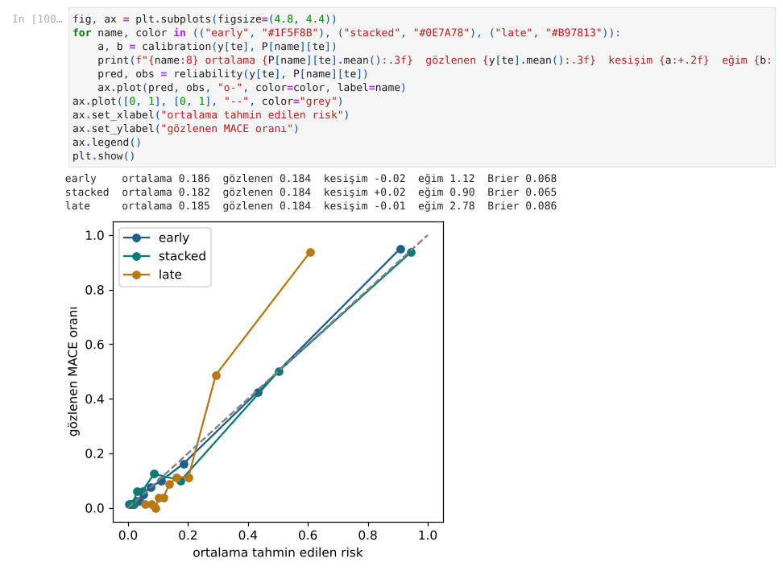

# Hafta 8: Çok modlu yapay zekâ ve veri füzyonu

**Python ile Yapay Zekâ Eğitimi: Kardiyologlar için Uygulamalı Eğitim Programı** 
Türk Kardiyoloji Derneği

*Bir göğüs ağrısı ünitesindeki beş tür veriden, yatak başında ve başka bir hastanede kalibre edilmiş bir majör olumsuz kardiyak olay riskine geçilir.*

[Eğitimin ana sayfası](../../README.tr.md) · [İzlence](../../SYLLABUS.tr.md) · [Kurulum](../../SETUP.tr.md) · [English](../../en/week-08/README.md)

## Hafta hakkında

Sanal klinik bir göğüs ağrısı ünitesi açar; kalp ekibi de beş tür veriyi bir araya getirir: Klinik tablo, triyaj notu, 12 derivasyonlu EKG, iki troponin değeri ve yatak başı ekokardiyogram. Erken füzyon bütün öznitelikleri yan yana koyar, geç füzyon tek modaliteli modellerin olasılıklarını birleştirir; hibrit ve dikkat tabanlı füzyon ise eksik modaliteler için maskeler kullanarak ortak bir temsil öğrenir. Mini projede EKG, ekokardiyogram ve laboratuvar değerlerinin birleştirilmesi, kalp yetersizliği olayları için tek başına laboratuvarın üzerine ölçülebilir bir katkı yapmaz (AUC 0,830; laboratuvarda 0,849). Göğüs ağrısı ünitesinde ise füzyon, 30 gün içindeki majör olumsuz kardiyak olaylar için 0,914 AUC değerine ulaşır; bu değer tek başına troponinin değerinden (0,883) yüksektir ve HEART skorunun değerine (0,903) yakındır. İkinci yarı olasılıklara güvenilip güvenilemeyeceğini sorar: Test kümesinde ve ikinci bir hastanede kalibrasyon incelenir. İkinci hastanede model hastaları yine iyi sıralar; ancak yerel hastalarla güncellenene kadar risklerini olduğundan düşük tahmin eder. Her fark için aralıklar hesaplanır ve taburculuk eşikleri HEART 0-3 ile karşılaştırılır. Hafta, bir YZ asistanının yazdığı bir füzyon işlem hattının denetlenmesiyle kapanır.

Oturum 4 saat sürer. Haftalık proje için yaklaşık 3 saat ayrılmalıdır.

## Haftanın rotası

Ders sayfası haftanın ana rotasıdır. Sayfada kod ya da prompt (istem) bulunmaz; sayfa etkileşimli labla birlikte yukarıdan aşağıya okunur. Her uygulama durağında katılımcılar Jupyter defterindeki iki yoldan birini seçer. **Prompt yolunda** (Kısım 1) kodu, hazır promptlara göre bir yapay zekâ (YZ) asistanı yazar; katılımcı bu kodu çalıştırır ve sonucu denetler. **Python yolunda** (Kısım 2) ise kodu katılımcı kendisi yazar. İki yol da aynı sonuçlara varır. Defter hem kurulum gerektirmeyen Google Colab'da hem de kendi bilgisayarınızdaki Jupyter'de çalışır ([kurulum](../../SETUP.tr.md)).

| Ana rota: Ders sayfası ve etkileşimli lab | Uygulama durağı | Prompt yolu (Kısım 1) | Python yolu (Kısım 2) |
|---|---|---|---|
| [Bir kalp ekibinin verileri: Sanal kliniğin göğüs ağrısı ünitesi](https://utkukose.github.io/ai-cardiology-tkd-NB-lecture/tr/hafta-08/ders.html#the-data-of-a-heart-team-the-chest-pain-unit-of-the-virtual-clinic) [Erken, geç ve hibrit füzyon](https://utkukose.github.io/ai-cardiology-tkd-NB-lecture/tr/hafta-08/ders.html#early-late-and-hybrid-fusion) [Dikkat tabanlı füzyon: Token olarak modaliteler](https://utkukose.github.io/ai-cardiology-tkd-NB-lecture/tr/hafta-08/ders.html#attention-based-fusion-modalities-as-tokens) [Eksik modaliteler](https://utkukose.github.io/ai-cardiology-tkd-NB-lecture/tr/hafta-08/ders.html#missing-modalities) | **[Durak 1: EKG, ekokardiyogram ve laboratuvarla kalp yetersizliği olayları](https://utkukose.github.io/ai-cardiology-tkd-NB-lecture/tr/hafta-08/ders.html#stop-1)** | Durak 1 | Python adımı 8 ve 1-3. bölümler |
| [Triyaj için bir risk modeli: HEART ve birleştirilmiş modeller](https://utkukose.github.io/ai-cardiology-tkd-NB-lecture/tr/hafta-08/ders.html#a-risk-model-for-triage-heart-and-the-fused-models) [Kalibrasyon: Olasılıklar söylediklerini ifade ediyor mu?](https://utkukose.github.io/ai-cardiology-tkd-NB-lecture/tr/hafta-08/ders.html#calibration-do-the-probabilities-mean-what-they-say) [Aralıklar: Bir farktan ne kadar emin olunabilir?](https://utkukose.github.io/ai-cardiology-tkd-NB-lecture/tr/hafta-08/ders.html#intervals-how-sure-is-a-difference) | **[Durak 2: Göğüs ağrısı ünitesinde majör olumsuz kardiyak olaylar: HEART, tek modaliteler ve füzyon](https://utkukose.github.io/ai-cardiology-tkd-NB-lecture/tr/hafta-08/ders.html#stop-2)** | Durak 2 | 4-8. bölümler |
| [Başka bir hastane: Kayma ve yeniden kalibrasyon](https://utkukose.github.io/ai-cardiology-tkd-NB-lecture/tr/hafta-08/ders.html#another-hospital-drift-and-recalibration) [Taburculuk eşikleri ve net yarar](https://utkukose.github.io/ai-cardiology-tkd-NB-lecture/tr/hafta-08/ders.html#thresholds-for-discharge-and-net-benefit) | **[Durak 3: Triyaj: Başka bir hastane, bir taburculuk eşiği ve net yarar](https://utkukose.github.io/ai-cardiology-tkd-NB-lecture/tr/hafta-08/ders.html#stop-3)** | Durak 3 | 9. ve 10. bölümler |
| [YZ asistanıyla çalışmak, 8. bölüm: Bir füzyon işlem hattını denetlemek](https://utkukose.github.io/ai-cardiology-tkd-NB-lecture/tr/hafta-08/ders.html#ai-pair-programming-part-8-reviewing-a-fusion-pipeline) [Haftanın makalesi](https://utkukose.github.io/ai-cardiology-tkd-NB-lecture/tr/hafta-08/ders.html#the-paper-of-the-week) [Sanal klinik, 8. aşama: Kalp ekibi](https://utkukose.github.io/ai-cardiology-tkd-NB-lecture/tr/hafta-08/ders.html#the-virtual-clinic-stage-8-heart-team) | "Kendi verinizle" bölümü, haftanın makalesi ve sanal klinik | – | – |

## Malzemeler

| Malzeme | Aç | İçeriği |
|---|---|---|
| **Ders sayfası (ana rota)** | [Ders sayfasını aç](https://utkukose.github.io/ai-cardiology-tkd-NB-lecture/tr/hafta-08/ders.html) | Vakayı, kavramları çözümlü örnekleriyle, hastaları üç modalitenin puanlarının oluşturduğu uzayda gösteren üç boyutlu (3B) bir sahneyi, iki animasyonu, bilgi kontrolü sorularını, üç uygulama durağını, "Kendi verinizle" bölümünü, tekrar kartlarını ve kaynakları içerir. Sayfada kod ve prompt yer almaz. |
| **Etkileşimli lab** | [Etkileşimli labı aç](https://utkukose.github.io/ai-cardiology-tkd-NB-lecture/tr/hafta-08/lab.html) | Kod gerektirmeyen A'dan F'ye kadar altı bölümü (F bölümü prompt atölyesidir), öz değerlendirmeyi, yansıtma yazısını ve dışa aktarılabilen öğrenme günlüğünü içerir |
| **Jupyter defteri** |  [Jupyter için indir](NB08_cok_modlu_yapay_zeka_ve_veri_fuzyonu.ipynb) | Kısım 1 prompt yoludur: Üç durakta toplam on bir adım vardır ve her adımda hazır bir prompt, adımın tablosunu hazırlayan bir veri hücresi, YZ asistanının kodu için bir hücre, otomatik bir kontrol ve hazır kod bulunur. Kısmın sonunda haftalık proje dört promptla yer alır. Kısım 2 Python yoludur: Python adımı 8'i, A-J alıştırmalarıyla birlikte 1-10. bölümleri ve yedi alan için uygulama görevlerini içerir. |
| **Prompt kütüphanesi** | [PROMPTLAR.md](PROMPTLAR.md) | Prompt yolunun bütün promptlarını, kodu onarmaya ve denetlemeye yarayan promptları ve haftalık projenin prompt yolunu içerir. GitHub'da her promptun yanında bir kopyalama düğmesi bulunur. |
| **PDF ders notu** | [Hafta08_Ders_Notlari.pdf](Hafta08_Ders_Notlari.pdf) | Ders sayfasının yazdırılabilir biçimidir; uygulama duraklarını ve "Kendi verinizle" bölümünü de içerir. |

<table>
<tr><td width="50%"></td><td width="50%"></td></tr>
<tr><td>Etkileşimli lab, A bölümü: Bir hastanın beş modalite olasılığı logitlerin ortalamasıyla ve istiflemeyle adım adım birleştirilir.</td><td>Jupyter defteri, 9. bölüm: A hastanesinin test kümesinde erken füzyonun, istiflemenin ve logit ortalamasının kalibrasyon ölçütleri ve güvenilirlik eğrileri.</td></tr>
<tr><td width="50%"></td><td width="50%"></td></tr>
<tr><td>Etkileşimli lab, D bölümü: Test hastalarının tahmin edilen riskleri üzerinde bir taburculuk eşiği; taburcu edilenlerin oranı ve kaçırılan olaylar HEART 0-3 ile birlikte gösterilir.</td><td>Ders sayfası: Bir hastanın verilerini birleştirmenin dört yolu, adım adım.</td></tr>
</table>

## Haftanın vakası

CP-3304 numaralı hasta, baskı tarzında göğüs ağrısı, normal bir EKG'si, yükselen bir troponini ve 5 puanlık bir HEART skoru olan, 58 yaşında bir kadındır. Ekibin onun hakkında bildikleri bir programda nasıl birleştirilmeli ve bu programın verdiği olasılıklara yatak başında ve başka bir hastanede güvenilebilir mi?

## Öğrenme çıktıları

Haftanın sonunda katılımcıların erken, geç, hibrit ve dikkat tabanlı füzyonu formülleriyle açıklayabilmeleri, birkaç modalitenin puanlarını elle birleştirebilmeleri ve eksik modaliteler için bir yöntem seçebilmeleri beklenmektedir. Çok modlu bir risk modeli kurabilmeli ve bu modeli her tek modaliteyle ve HEART gibi bir klinik skorla, hastalardan yapılan bootstrap aralıklarıyla birlikte karşılaştırabilmelidirler. Bir modelin kalibrasyonunu sabiti, eğimi, Brier skoru ve güvenilirlik eğrisiyle değerlendirebilmeli ve bir modeli başka bir hastane için güncelleyebilmelidirler. Son olarak klinik bir karar için doğrulama kümesinde bir eşik seçebilmeli, sonucunu aralıklar ve net yararla birlikte bildirebilmeli ve bir YZ asistanının yazdığı bir füzyon işlem hattını denetleyebilmelidirler.

## Çalışma yolu

Oturuma katılanlar ana rotayı ve uygulama duraklarını oturumda tamamlar. Haftayı kendi başına izleyenler, örneğin bir oturumu kaçıranlar, aşağıdaki sürelerle plan yapabilir.

| Adım | Etkinlik | Prompt yolu | Python yolu |
|---|---|---|---|
| 1 | Haftanın vakasını ve ders sayfasını 1. uygulama durağına kadar okuyun; etkileşimli labın A ve B bölümlerini yapın, hastaları üç modalitenin puanlarının oluşturduğu uzayda gösteren 3B sahneyi ve dört füzyon yolunu gösteren animasyonu inceleyin ve bilgi kontrolü sorularını cevaplayın | 1 saat 15 dakika | 1 saat 15 dakika |
| 2 | 1. uygulama durağı (oturumun mini projesi): Prompt yolunda Kısım 1'deki Durak 1'i, Python yolunda Python adımı 8'i ve 1-3. bölümleri çalışın | 35 dakika | 1 saat 30 dakika |
| 3 | 2. uygulama durağına kadar okumayı sürdürün (HEART skoru, animasyonuyla birlikte kalibrasyon ve aralıklar); etkileşimli labın C bölümünü yapın | 35 dakika | 35 dakika |
| 4 | 2. uygulama durağı: Prompt yolunda Kısım 1'deki Durak 2'yi, Python yolunda 4-8. bölümleri çalışın | 40 dakika | 1 saat 30 dakika |
| 5 | 3. uygulama durağına kadar okumayı sürdürün (başka bir hastane ve yeniden kalibrasyon, eşikler ve net yarar); etkileşimli labın D bölümünü yapın | 30 dakika | 30 dakika |
| 6 | 3. uygulama durağı: Prompt yolunda Kısım 1'deki Durak 3'ü, Python yolunda 9. ve 10. bölümleri çalışın | 35 dakika | 45 dakika |
| 7 | Füzyon işlem hattı denetimini, haftanın makalesini, sanal kliniğin bu haftaki aşamasını ve "Kendi verinizle" bölümünü okuyun; etkileşimli labın E ve F bölümlerini yapın | 40 dakika | 40 dakika |
| 8 | Etkileşimli labın "Kendini sına" sekmesindeki öz değerlendirmeyi yapın, yansıtma yazınızı yazın ve öğrenme günlüğünü dışa aktarın | 20 dakika | 20 dakika |
| | **Haftalık proje dışında toplam** | **5 saat 10 dakika** | **7 saat 5 dakika** |
| 9 | Haftalık projeyi iki yoldan biriyle tamamlayın | 3 saat | 3 saat |

## Oturumun eğitim akışı

Haftanın dört saatlik oturumu aşağıdaki plana göre işlenir. Plan, malzemelerin canlı bir oturumda nasıl bir araya geldiğini göstermek için paylaşılmaktadır.

| Süre | Etkinlik |
|---|---|
| 0:00-0:15 | Haftanın vakası tanıtılır ve haftanın rotası anlatılır. Her katılımcı defteri Google Colab'da ya da Jupyter'de açar ve 0. bölümü çalıştırır. Hiçbir şey indirilmez: Göğüs ağrısı ünitesi, EKG'leri ve kayıt sistemi katılımcının bilgisayarında bir dakikadan kısa sürede çizilir. |
| 0:15-1:00 | Ana rotada bir kalp ekibinin verileri, 3B sahne, animasyon ve A bölümüyle erken, geç ve hibrit füzyon, B bölümüyle dikkat tabanlı füzyon ve eksik modaliteler anlatılır. |
| 1:00-1:35 | Oturumun mini projesi olan 1. uygulama durağında katılımcılar iki gruba ayrılır: Prompt yolunu izleyenler ve Python yolunu izleyenler. Kalp yetersizliği olayları EKG, ekokardiyogram ve laboratuvar değerleriyle önce tek tek, sonra birlikte öngörülür ve farkın bootstrap aralığı hesaplanır. |
| 1:35-1:50 | Ara. |
| 1:50-2:35 | Ana rotada HEART skoru, animasyonu ve C bölümüyle kalibrasyon ve aralıklar anlatılır. 2. uygulama durağında göğüs ağrısı ünitesindeki MACE için HEART, tek modaliteler ve füzyon karşılaştırılır; iki tür geç füzyonun kalibrasyonu incelenir. |
| 2:35-3:20 | Ana rotada başka bir hastane ve yeniden kalibrasyon, D bölümüyle eşikler ve net yarar ele alınır. 3. uygulama durağında B hastanesindeki güncelleme, HEART 0-3 ile karşılaştırılan bir taburculuk eşiği ve net yarar çalışılır. |
| 3:20-4:00 | Etkileşimli labın E ve F bölümleriyle bir füzyon işlem hattının denetimi çalışılır. Ardından haftanın makalesi, sanal kliniğin göğüs ağrısı ünitesi, "Kendi verinizle" bölümü ve haftalık proje ele alınır. |

## Haftalık proje

**Ne yapılacak?** Göğüs ağrısı ünitesinin beş modalitesiyle 30 gün içindeki majör olumsuz kardiyak olaylar (MACE) için bir model kurun ve bu modeli, bir kalp ekibinin kullanmadan önce yapacağı gibi değerlendirin. Önce her modalite için ayrı ayrı ve bütün modaliteler için birlikte (erken füzyon) birer lojistik regresyon kurun; düzenlileştirme doğrulama kümesinde seçilsin. Test AUC değerlerini, test hastalarından çekilen 2.000 bootstrap örneğinden hesaplanan yüzde 95 aralıklarıyla ve her modelin aynı örneklerde HEART skoruna göre farkıyla birlikte verin. İkinci adımda erken füzyonun test kümesindeki kalibrasyonunu sabiti, eğimi, Brier skoru ve on gruplu bir güvenilirlik eğrisiyle değerlendirin. Ardından aynı değerlendirmeyi B hastanesinin ilk 300 hastasından sonraki 700 hasta için, ilk 300 hastada öğrenilen sabit terim güncellemesinden önce ve sonra yapın. Üçüncü adımda doğrulama kümesinde iki taburculuk eşiği seçin: Biri HEART 0-3 kadar hastayı eve göndersin, öteki duyarlılığı yüzde 98 düzeyinde tutsun. Her eşik için test kümesinde ve B hastanesinde taburcu edilenlerin oranını ve taburcu edilenlerdeki MACE sayısını Wilson aralıklarıyla, HEART 0-3'ün sonuçlarının yanında bildirin. Dördüncü adımda modelin ve "HEART skoru 4 ya da üstü olan her hastayı yatır" kuralının karar eğrisini yüzde 1 ile 30 arasındaki eşik olasılıkları için çizin; modelin kullanılıp kullanılmaması gerektiğini, hangi karar için ve hangi yerel denetimle kullanılabileceğini bir kalp ekibi için yarım sayfada yazın.

**Nereye bakılacak?** Ders: "Kalibrasyon: Olasılıklar söylediklerini ifade ediyor mu?", "Başka bir hastane: Kayma ve yeniden kalibrasyon" ve "Taburculuk eşikleri ve net yarar" bölümleri. Etkileşimli lab: C ve D bölümleri. Jupyter defteri: Kısım 1, 2. ve 3. duraklar ya da Kısım 2, 4-10. bölümler.

**Prompt yolu.** Proje, [prompt kütüphanesindeki](https://github.com/utkukose/ai-cardiology-tkd-NB-lecture/blob/main/tr/hafta-08/PROMPTLAR.md#haftal%C4%B1k-projenin-prompt-yolu) dört promptla da tamamlanabilir; her adım için bir prompt vardır. Jupyter defterinin 1. kısmının sonundaki "Prompt yolunda haftalık proje" bölümü her promptun tablosunu hazırlar. Bir promptun testi sağlanmadan sonraki prompta geçilmez.

**Örnek.** Dersin erken füzyon modeli, doğrulama hastalarından HEART 0-3 kadar hastayı eve gönderen eşikle 800 test hastasının 388 tanesini eve göndermiştir; bunların 9 tanesinde MACE görülmüştür: $9/388 = 0{,}023$. HEART 0-3 ise 380 hastayı eve göndermiş ve bunlardan 8 hastada olay görülmüştür: $8/380 = 0{,}021$. 800 test hastasıyla iki kural taburculuk kararı açısından birbirinden ayırt edilemez.

**Ne teslim edilecek?** [Rapor şablonuyla](../sablonlar/Rapor_Sablonu.docx) yazılmış, bir ya da iki sayfalık bir rapor teslim edilir. Raporda modellerin aralıklarıyla birlikte tablosu, iki hastanedeki kalibrasyon ölçütleri ve güvenilirlik eğrileri, HEART 0-3 ile birlikte iki eşiğin tablosu, karar eğrisi ve kalp ekibi için yazılan yarım sayfa yer almalıdır. Rapora YZ kullanım günlüğünü (araç, prompt, neyin denetlendiği, neyin değiştirildiği) ve çıktılarıyla birlikte Jupyter defterini ekleyin.

**Teslim.** Haftalık proje, 9. haftanın oturumundan önce utkukose@sdu.edu.tr ya da utkukose@gmail.com adresine e-postayla gönderilir. E-postaya "Ne teslim edilecek?" başlığında sayılan öğeler ve etkileşimli labdan dışa aktarılan öğrenme günlüğü eklenir. Haftalık projeler değerlendirmenin yüzde 40'ını oluşturur; değerlendirme ölçütleri izlencede yer almaktadır.

## Kendi verinizle

Ders sayfası, haftanın yöntemlerini kendi verinize nasıl uygulayacağınızı anlatan bir bölümle biter. Bu bölümde hangi sorunun hangi yönteme uyduğu, önce neyin denetleneceği, etik kurul onayı, Kişisel Verilerin Korunması Kanunu (KVKK) ve analizin nerede yapılacağı ele alınır. [Bölümü ders sayfasında okuyun](https://utkukose.github.io/ai-cardiology-tkd-NB-lecture/tr/hafta-08/ders.html#with-your-own-data).

## İsteğe bağlı araştırma ödevi

PubMed'de, 2020 ya da sonrasında yayımlanmış ve iki ya da daha fazla kardiyak veri türünü (EKG, görüntüler, laboratuvar değerleri ya da klinik notlar gibi) tek bir modelde birleştirmiş bir çalışma bulun. Çalışmayı yarım sayfada özetleyin. Özette modaliteler, nasıl birleştirildikleri (erken, geç, hibrit ya da dikkat tabanlı), eksik modalitelerin nasıl ele alındığı, sonuç değişkeni ve referans, her modaliteyle tek başına ve bir klinik skorla yapılan karşılaştırma, kalibrasyonun bildirilip bildirilmediği ve testin başka bir hastanede yapılıp yapılmadığı yer almalıdır. [Haftanın makalesindeki](https://utkukose.github.io/ai-cardiology-tkd-NB-lecture/tr/hafta-08/ders.html#the-paper-of-the-week) üç soru özete yol gösterebilir. Bu ödev notlandırılmaz; haftalık projenin yarım sayfasına hazırlık niteliğindedir.

## Bu haftadan sonra sanal klinik

Sanal klinik 8. haftada bir göğüs ağrısı ünitesi ve bir kalp ekibi kurar: A hastanesinde 4.000, B hastanesinde 1.000 başvuru vardır. Her başvuruda bir klinik tablo, Türkçe bir triyaj notu, 12 derivasyonlu bir EKG, iki troponin değeri ve hastaların yaklaşık yarısında bir yatak başı ekokardiyogram bulunur. Sonuçlar ders sayfasının [Sanal klinik, 8. aşama](https://utkukose.github.io/ai-cardiology-tkd-NB-lecture/tr/hafta-08/ders.html#the-virtual-clinic-stage-8-heart-team) bölümünde yer almaktadır.

## Gelecek hafta

**Hafta 9: Model güvenilirliği ve açıklanabilir yapay zekâ.** Kalite ve güvenlik kurulu bir modelin neden o sonucu verdiğini sorar: Eko modelinin Grad-CAM haritaları bir uzmanın değerlendirmesiyle karşılaştırılır. Ayrıntılar için [eğitimin planına](../../README.tr.md#on-bir-hafta) bakabilirsiniz.

---

**Prof. Dr. Utku Köse**

Profesör, Bilgisayar Mühendisliği Bölümü, Süleyman Demirel Üniversitesi, Isparta, Türkiye 
Kurucu Müdür, Yapay Zekâ Uygulama ve Araştırma Merkezi (YAZEM), Süleyman Demirel Üniversitesi 
Bilgisayar Bilimleri Anabilim Dalı Başkanı, Bilgisayar Mühendisliği Bölümü, Süleyman Demirel Üniversitesi 
Diğer kurumlar: University of North Dakota (ABD), Universidad Panamericana (Meksiko, Meksika), Vel Tech University (Chennai, Hindistan) 
IEEE Kıdemli Üyesi, ACM Profesyonel Üyesi

[ORCID 0000-0002-9652-6415](https://orcid.org/0000-0002-9652-6415) | [utkukose.com](https://www.utkukose.com) | [github.com/utkukose](https://github.com/utkukose)

[utkukose@sdu.edu.tr](mailto:utkukose@sdu.edu.tr) | [utku.kose@und.edu](mailto:utku.kose@und.edu) | [ukose@up.edu.mx](mailto:ukose@up.edu.mx) | [utkukose@gmail.com](mailto:utkukose@gmail.com)

*İlk sürüm: Kasım 2026. İçerik CC BY 4.0, kod MIT.*

