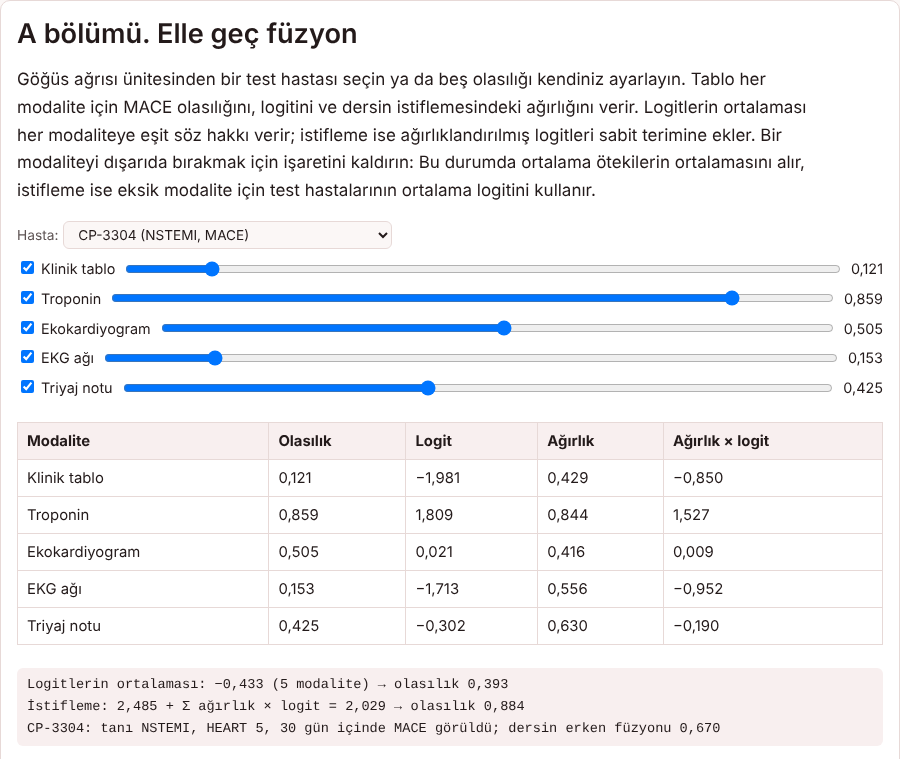
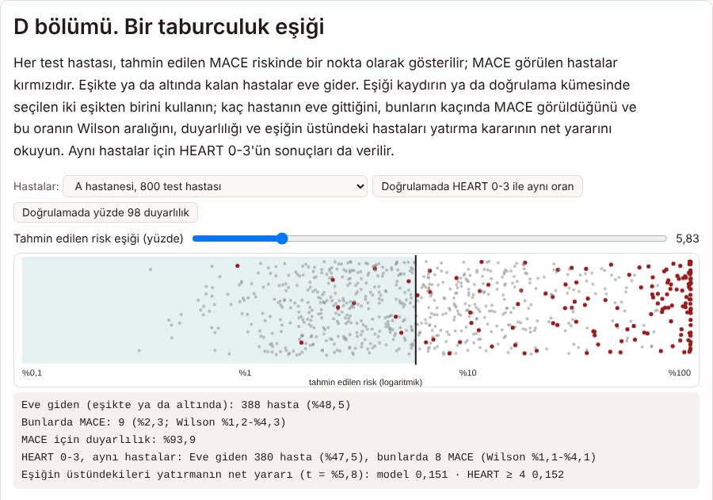
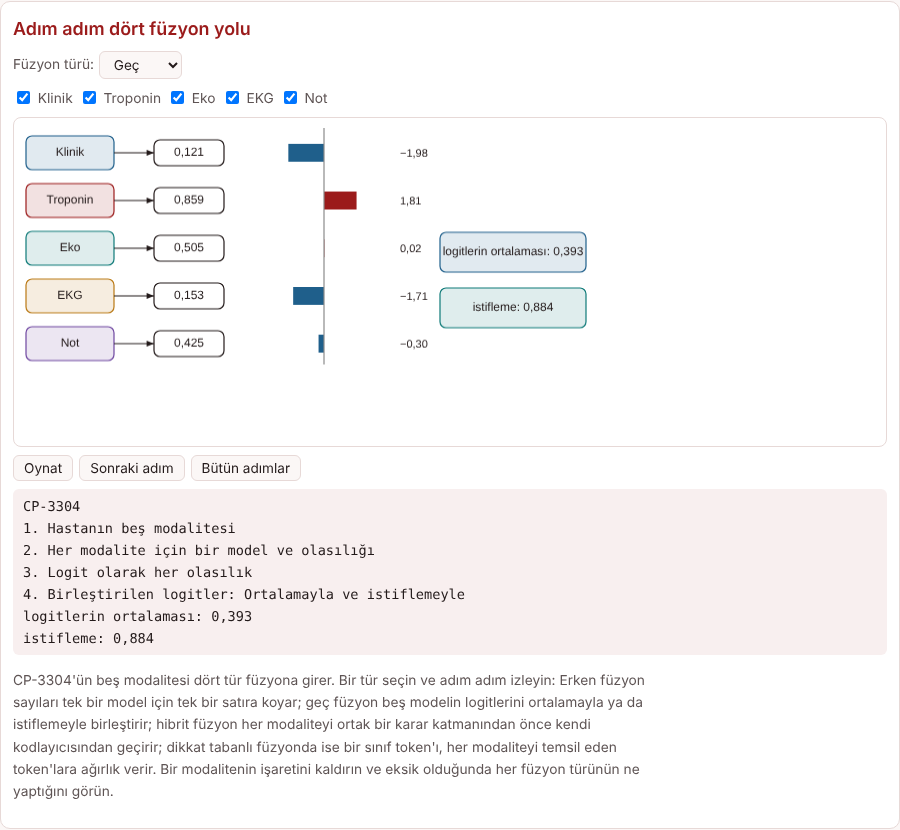

# Hafta 8: Çok modlu yapay zekâ ve veri füzyonu

**Python ile Yapay Zekâ Eğitimi: Kardiyologlar için Uygulamalı Eğitim Programı** 
Türk Kardiyoloji Derneği

*EKG + görüntü + klinik veriyi birleştiren entegre modeller*

[Eğitimin ana sayfası](../../README.tr.md) · [İzlence](../../SYLLABUS.tr.md) · [Kurulum](../../SETUP.tr.md) · [English](../../en/week-08/README.md)

Hafta hakkında daha ayrıntılı bilgi için bu sayfayı okumaya devam ediniz. Haftaya doğrudan ders sayfasından devam etmek isterseniz bu bağlantıyı kullanınız: **[Haftanın ders sayfasını açınız](https://utkukose.github.io/ai-cardiology-tkd-NB-lecture/tr/hafta-08/ders.html)**. Ders sayfası haftanın ana rotasıdır; sayfadaki kutular etkileşimli labı ve Jupyter Notebook'u ilgili yerde açmaktadır.

## Hafta hakkında

Sanal klinikte bir göğüs ağrısı ünitesi açılır ve kalp ekibi beş tür veriyi bir araya getirir: Klinik tablo, triyaj notu, 12 derivasyonlu EKG, iki troponin değeri ve yatak başı ekokardiyogram. Erken füzyonda bütün öznitelikler yan yana konur; geç füzyonda ise tek modaliteli modellerin olasılıkları birleştirilmektedir. Hibrit ve dikkat tabanlı füzyonda da eksik veriler için maskeler kullanılarak tek bir modelde ortak bir temsil öğrenilir. Mini projede EKG, ekokardiyogram ve laboratuvar değerlerinin birleştirilmesi, kalp yetersizliği olayları için tek başına laboratuvarın üzerine ölçülebilir bir katkı yapmaz (AUC 0,830; laboratuvarda 0,849). Göğüs ağrısı ünitesinde ise füzyon, 30 gün içindeki majör olumsuz kardiyak olaylar için 0,914 AUC değerine ulaşır; bu değer tek başına troponinin değerinden (0,883) yüksektir ve HEART skorunun değerine (0,903) yakındır. İkinci yarıda bir kardiyovasküler risk skorlama sistemi kurulmaktadır: SCORE2 ve Framingham'a alternatif bir yapay zekâ (YZ) modelinin tasarımı ve biyobelirteçleri, klinik değişkenleri ve görüntülemeyi birleştiren, şüpheli akut koroner sendrom için bir erken uyarı modeli ele alınır; ardından olasılıklara güvenilip güvenilemeyeceği sorulur. Test kümesinde ve ikinci bir hastanede kalibrasyon incelenir. İkinci hastanede model hastaları yine iyi sıralar; ancak yerel hastalarla güncellenene kadar risklerini olduğundan düşük tahmin eder. Her fark için aralıklar hesaplanır ve taburculuk eşikleri HEART 0-3 ile karşılaştırılır. Hafta, bir YZ asistanının yazdığı bir füzyon işlem hattının denetlenmesiyle kapanır.

Oturum 4 saat sürer. Haftalık proje için yaklaşık 3 saat ayrılmalıdır.

## Haftanın vakası

CP-3304 numaralı hasta, baskı tarzında göğüs ağrısı, normal bir EKG'si, yükselen bir troponini ve 5 puanlık bir HEART skoru olan, 58 yaşında bir kadındır. Ekibin onun hakkında bildikleri bir programda nasıl birleştirilmeli ve bu programın verdiği olasılıklara yatak başında ve başka bir hastanede güvenilebilir mi?

## Malzemeler

| Malzeme | Aç | Ne işe yarar? |
|---|---|---|
| **Ders sayfası** | [Ders sayfasını aç](https://utkukose.github.io/ai-cardiology-tkd-NB-lecture/tr/hafta-08/ders.html) | Haftanın konu anlatımını içeren bu sayfa yukarıdan aşağıya doğru okunmak üzere hazırlanmıştır. Sayfadaki kutular sizi uygulama duraklarına yönlendirir; sayfada kod ya da prompt (istem) bulunmamaktadır. |
| **Etkileşimli lab** | [Etkileşimli labı aç](https://utkukose.github.io/ai-cardiology-tkd-NB-lecture/tr/hafta-08/lab.html) | Kod gerektirmeyen A-F bölümleri, ders sayfasında yeri geldiğinde açılmaktadır. F bölümü bir prompt atölyesidir. Öz değerlendirme ve öğrenme günlüğü de bu labda yer alır. |
| **Python Notebook** |  [Jupyter Notebook için indir (zip)](https://github.com/utkukose/ai-cardiology-tkd-NB-lecture/raw/main/tr/hafta-08/NB08_cok_modlu_yapay_zeka_ve_veri_fuzyonu.zip) | Uygulama durakları burada çalışılır; her durakta Python temelleri, promptlar ve hazır bir uygulama bulunmaktadır. Python Notebook, Google Colab'da kurulum gerektirmeden ya da kendi bilgisayarınızdaki Jupyter Notebook'ta çalışabilir. Jupyter için zip dosyasını indiriniz, içindeki .ipynb dosyasını bir klasöre çıkarınız ve dosyayı Jupyter'de açınız. Her bölüm, bölümün kullandığı kurulumu ve veri çağrılarını yineleyen bir başlangıç hücresiyle açılır. |
| **Prompt kütüphanesi** | [PROMPTLAR.md](PROMPTLAR.md) | Uygulama duraklarının ve haftalık projenin bütün promptları, kodu onarmaya, açıklatmaya ve denetlemeye yönelik promptlarla birlikte burada toplanmıştır. GitHub'da her promptun yanında bir kopyalama düğmesi bulunur. |
| **PDF ders notu** | [Hafta08_Ders_Notlari.pdf](Hafta08_Ders_Notlari.pdf) | Ders sayfasının yazdırılabilir biçimidir. |

## Çalışma yolu

Ders sayfası yukarıdan aşağıya doğru okunur; etkileşimli labın bölümleri de sayfada yeri geldikçe açılır. Uygulama duraklarında çalışma Jupyter Notebook'ta sürmektedir ve oradaki her durak üç bölümden oluşur. **Python temelleri** bölümünde durağın gerektirdiği Python bilgisi öğretilir. **Prompt ile uygulama** bölümünde kodu hazır promptlarla bir YZ asistanı yazar; katılımcının görevi bu kodu çalıştırmak ve sonucu denetlemektir. **Hazır uygulama** bölümünde ise durağın baştan sona çalışan programı yer almaktadır. Bölümleri bu sırayla izlemeniz önerilir; Python biliyorsanız promptlarla, yalnızca sonucu görmek istiyorsanız hazır uygulamayla başlayabilirsiniz. Her bölüm, bölümün kullandığı kurulumu ve veri çağrılarını yineleyen bir başlangıç hücresiyle açılır; bu sayede bölüm doğrudan açıldığında da çalışabilmektedir. Lab bölümlerinin ve Jupyter Notebook'taki durakların sonunda, sizi ders sayfasında okumanın devam ettiği yere geri götüren bir bağlantı bulunmaktadır. Nerede kaldığınızı bulamazsanız bu tabloya dönünüz. Oturuma katılanlar bu adımları oturum sırasında yapar. Tablodaki süreler, haftayı kendi başına izleyenler, örneğin bir oturumu kaçıranlar için verilmiştir.

| Adım | Ne yapılır? | Süre |
|---|---|---|
| 1 | Haftanın vakasını ve ders sayfasının ilk iki saatini 1. uygulama durağına kadar [okuyunuz](https://utkukose.github.io/ai-cardiology-tkd-NB-lecture/tr/hafta-08/ders.html) (erken, geç ve hibrit füzyon, veri tiplerinin tek modelde birleştirilmesi, attention tabanlı füzyon, eksik veri ve mini proje); etkileşimli labın A ve B bölümlerini yapınız, hastaları üç modalite puanının uzayında gösteren 3B sahneyi ve dört füzyon türünün animasyonunu inceleyiniz ve bilgi kontrolü sorularını cevaplayınız | 1 saat 20 dakika |
| 2 | **[1. uygulama durağı: EKG, ekokardiyogram ve laboratuvarla kalp yetersizliği olayları](https://utkukose.github.io/ai-cardiology-tkd-NB-lecture/tr/hafta-08/ders.html#stop-1)** Oturumun mini projesi. [Python temelleri](https://colab.research.google.com/github/utkukose/ai-cardiology-tkd-NB-lecture/blob/main/tr/hafta-08/NB08_cok_modlu_yapay_zeka_ve_veri_fuzyonu.ipynb#scrollTo=stop-1-basics) · [Prompt ile uygulama](https://colab.research.google.com/github/utkukose/ai-cardiology-tkd-NB-lecture/blob/main/tr/hafta-08/NB08_cok_modlu_yapay_zeka_ve_veri_fuzyonu.ipynb#scrollTo=stop-1-prompt) ([promptlar](PROMPTLAR.md#durak-1-ekg-ekokardiyogram-ve-laboratuvarla-kalp-yetersizli%C4%9Fi-olaylar%C4%B1)) · [Hazır uygulama](https://colab.research.google.com/github/utkukose/ai-cardiology-tkd-NB-lecture/blob/main/tr/hafta-08/NB08_cok_modlu_yapay_zeka_ve_veri_fuzyonu.ipynb#scrollTo=stop-1-app) | 1 saat 30 dakika |
| 3 | 2. uygulama durağına kadar [okumayı sürdürün](https://utkukose.github.io/ai-cardiology-tkd-NB-lecture/tr/hafta-08/ders.html#last-two-hours-cardiovascular-risk-scoring-system) (SCORE2 ve Framingham'a alternatif bir yapay zekâ modelinin tasarımı, HEART skoruyla şüpheli AKS erken uyarı modeli, biyobelirteçlerin, klinik değişkenlerin ve görüntülemenin füzyonu, kalibrasyon ve aralıklar); etkileşimli labın C bölümünü yapınız | 45 dakika |
| 4 | **[2. uygulama durağı: Göğüs ağrısı ünitesinde majör olumsuz kardiyak olaylar: HEART, tek modaliteler ve füzyon](https://utkukose.github.io/ai-cardiology-tkd-NB-lecture/tr/hafta-08/ders.html#stop-2)** [Python temelleri](https://colab.research.google.com/github/utkukose/ai-cardiology-tkd-NB-lecture/blob/main/tr/hafta-08/NB08_cok_modlu_yapay_zeka_ve_veri_fuzyonu.ipynb#scrollTo=stop-2-basics) · [Prompt ile uygulama](https://colab.research.google.com/github/utkukose/ai-cardiology-tkd-NB-lecture/blob/main/tr/hafta-08/NB08_cok_modlu_yapay_zeka_ve_veri_fuzyonu.ipynb#scrollTo=stop-2-prompt) ([promptlar](PROMPTLAR.md#durak-2-g%C3%B6%C4%9F%C3%BCs-a%C4%9Fr%C4%B1s%C4%B1-%C3%BCnitesinde-maj%C3%B6r-olumsuz-kardiyak-olaylar-heart-tek-modaliteler-ve-f%C3%BCzyon)) · [Hazır uygulama](https://colab.research.google.com/github/utkukose/ai-cardiology-tkd-NB-lecture/blob/main/tr/hafta-08/NB08_cok_modlu_yapay_zeka_ve_veri_fuzyonu.ipynb#scrollTo=stop-2-app) | 1 saat 30 dakika |
| 5 | 3. uygulama durağına kadar [okumayı sürdürün](https://utkukose.github.io/ai-cardiology-tkd-NB-lecture/tr/hafta-08/ders.html#another-hospital-drift-and-recalibration) (başka bir hastane ve yeniden kalibrasyon, eşikler ve net yarar); etkileşimli labın D bölümünü yapınız | 30 dakika |
| 6 | **[3. uygulama durağı: Triyaj: Başka bir hastane, bir taburculuk eşiği ve net yarar](https://utkukose.github.io/ai-cardiology-tkd-NB-lecture/tr/hafta-08/ders.html#stop-3)** [Python temelleri](https://colab.research.google.com/github/utkukose/ai-cardiology-tkd-NB-lecture/blob/main/tr/hafta-08/NB08_cok_modlu_yapay_zeka_ve_veri_fuzyonu.ipynb#scrollTo=stop-3-basics) · [Prompt ile uygulama](https://colab.research.google.com/github/utkukose/ai-cardiology-tkd-NB-lecture/blob/main/tr/hafta-08/NB08_cok_modlu_yapay_zeka_ve_veri_fuzyonu.ipynb#scrollTo=stop-3-prompt) ([promptlar](PROMPTLAR.md#durak-3-triyaj-ba%C5%9Fka-bir-hastane-bir-taburculuk-e%C5%9Fi%C4%9Fi-ve-net-yarar)) · [Hazır uygulama](https://colab.research.google.com/github/utkukose/ai-cardiology-tkd-NB-lecture/blob/main/tr/hafta-08/NB08_cok_modlu_yapay_zeka_ve_veri_fuzyonu.ipynb#scrollTo=stop-3-app) | 45 dakika |
| 7 | Füzyon işlem hattının denetimini, haftanın makalesini, sanal kliniğin bu haftaki aşamasını ve "Kendi verinizle" bölümünü [okuyunuz](https://utkukose.github.io/ai-cardiology-tkd-NB-lecture/tr/hafta-08/ders.html#ai-pair-programming-part-8-reviewing-a-fusion-pipeline); etkileşimli labın E ve F bölümlerini yapınız | 40 dakika |
| 8 | [Etkileşimli labın](https://utkukose.github.io/ai-cardiology-tkd-NB-lecture/tr/hafta-08/lab.html) "Kendini sına" sekmesindeki öz değerlendirmeyi yapınız, yansıtma yazınızı yazınız ve öğrenme günlüğünü dışa aktarınız | 20 dakika |
| | **Haftalık proje dışında toplam** | **7 saat 20 dakika** |
| 9 | [Haftalık projeyi](#haftal%C4%B1k-proje) tamamlayınız [Promptlar](PROMPTLAR.md#haftal%C4%B1k-projenin-promptlar%C4%B1) · [Jupyter Notebook'ta haftalık proje](https://colab.research.google.com/github/utkukose/ai-cardiology-tkd-NB-lecture/blob/main/tr/hafta-08/NB08_cok_modlu_yapay_zeka_ve_veri_fuzyonu.ipynb#scrollTo=project) | 3 saat |

<table>
<tr><td width="50%"></td><td width="50%"></td></tr>
<tr><td>Etkileşimli lab, A bölümü: Bir hastanın beş modalite olasılığı logitlerin ortalamasıyla ve istiflemeyle adım adım birleştirilir.</td><td>Jupyter Notebook, «Durak 3 · Hazır uygulama»: A hastanesinin test kümesinde erken füzyonun, istiflemenin ve logit ortalamasının kalibrasyon ölçütleri ve güvenilirlik eğrileri.</td></tr>
<tr><td width="50%"></td><td width="50%"></td></tr>
<tr><td>Etkileşimli lab, D bölümü: Test hastalarının tahmin edilen riskleri üzerinde bir taburculuk eşiği; taburcu edilenlerin oranı ve kaçırılan olaylar HEART 0-3 ile birlikte gösterilir.</td><td>Ders sayfası: Bir hastanın verilerini birleştirmenin dört yolu, adım adım.</td></tr>
</table>

## Haftalık proje

**Proje.** Gerçek zamanlı MACE tahmin modeli: Triyaj senaryosu simülasyonu (MIMIC-IV sentetik).

**Veri.** Beth Israel Deaconess Medical Center'ın 2008-2019 yılları arasındaki yatışlarının kaydı olan MIMIC-IV'e yalnızca PhysioNet üzerinden yetkilendirilmiş araştırmacılar erişebilmektedir. Bu yüzden proje triyajı, her katılımcının kendi bilgisayarında çizdiği sanal kliniğin sentetik göğüs ağrısı ünitesinde simüle eder; yetkilendirilmiş erişimi olan bir katılımcı adımları MIMIC-IV üzerinde tekrarlayabilir.

**Ne yapılacak?** Göğüs ağrısı ünitesinin beş modalitesiyle 30 gün içindeki majör olumsuz kardiyak olaylar (MACE) için bir model kurunuz ve bu modeli, bir kalp ekibinin kullanmadan önce yapacağı gibi değerlendiriniz. Önce her modalite için ayrı ayrı ve bütün modaliteler için birlikte (erken füzyon) birer lojistik regresyon kurunuz; düzenlileştirme doğrulama kümesinde seçilsin. Test AUC değerlerini, test hastalarından çekilen 2.000 bootstrap örneğinden hesaplanan yüzde 95 aralıklarıyla ve her modelin aynı örneklerde HEART skoruna göre farkıyla birlikte veriniz. İkinci adımda erken füzyonun test kümesindeki kalibrasyonunu sabiti, eğimi, Brier skoru ve on gruplu bir güvenilirlik eğrisiyle değerlendiriniz. Ardından aynı değerlendirmeyi B hastanesinin ilk 300 hastasından sonraki 700 hasta için, ilk 300 hastada öğrenilen sabit terim güncellemesinden önce ve sonra yapınız. Üçüncü adımda doğrulama kümesinde iki taburculuk eşiği seçiniz: Biri HEART 0-3 kadar hastayı eve göndersin, öteki duyarlılığı yüzde 98 düzeyinde tutsun. Her eşik için test kümesinde ve B hastanesinde taburcu edilenlerin oranını ve taburcu edilenlerdeki MACE sayısını Wilson aralıklarıyla, HEART 0-3'ün sonuçlarının yanında bildiriniz. Dördüncü adımda modelin ve "HEART skoru 4 ya da üstü olan her hastayı yatır" kuralının karar eğrisini yüzde 1 ile 30 arasındaki eşik olasılıkları için çiziniz; modelin kullanılıp kullanılmaması gerektiğini, hangi karar için ve hangi yerel denetimle kullanılabileceğini bir kalp ekibi için yarım sayfada yazınız.

**Nereye bakılacak?** Ders: "Şüpheli AKS erken uyarı modeli", "Biyobelirteçler + klinik değişkenler + görüntüleme füzyonu", "Kalibrasyon ve güven aralıklarının önemi", "Kalibrasyon: Olasılıklar söylediklerini ifade ediyor mu?", "Başka bir hastane: Kayma ve yeniden kalibrasyon" ve "Taburculuk eşikleri ve net yarar" bölümleri. Etkileşimli lab: C ve D bölümleri. Jupyter Notebook: 2. ve 3. uygulama duraklarının hazır uygulamaları.

**Promptlarla.** Proje, [prompt kütüphanesindeki](https://github.com/utkukose/ai-cardiology-tkd-NB-lecture/blob/main/tr/hafta-08/PROMPTLAR.md#haftal%C4%B1k-projenin-promptlar%C4%B1) dört promptla da yapılabilir; kütüphanede her adım için bir prompt bulunmaktadır. Her promptun tablosu, Jupyter Notebook'un sonundaki "Haftalık proje" bölümünde hazırlanır ve bu bölüm tek başına da açılabilir. Bir promptun testi sağlanmadan sonraki prompta geçilmemeli ve her prompt YZ kullanım günlüğüne kaydedilmelidir.

**Örnek.** Dersin erken füzyon modeli, doğrulama hastalarından HEART 0-3 kadar hastayı eve gönderen eşikle 800 test hastasının 388 tanesini eve göndermiştir; bunların 9 tanesinde MACE görülmüştür: $9/388 = 0{,}023$. HEART 0-3 ise 380 hastayı eve göndermiş ve bunlardan 8 hastada olay görülmüştür: $8/380 = 0{,}021$. 800 test hastasıyla iki kural taburculuk kararı açısından birbirinden ayırt edilemez.

**Ne teslim edilecek?** [Rapor şablonuyla](../sablonlar/Rapor_Sablonu.docx) yazılmış, bir ya da iki sayfalık bir rapor teslim edilir. Raporda modellerin aralıklarıyla birlikte tablosu, iki hastanedeki kalibrasyon ölçütleri ve güvenilirlik eğrileri, HEART 0-3 ile birlikte iki eşiğin tablosu, karar eğrisi ve kalp ekibi için yazılan yarım sayfa yer almalıdır. Rapora YZ kullanım günlüğünü (araç, prompt, neyin denetlendiği, neyin değiştirildiği) ve çıktılarıyla birlikte Jupyter Notebook'u ekleyiniz.

**Teslim.** Haftalık proje, 9. haftanın oturumundan önce utkukose@sdu.edu.tr ya da utkukose@gmail.com adresine e-postayla gönderilir. E-postaya "Ne teslim edilecek?" başlığında sayılan öğeler ve etkileşimli labdan dışa aktarılan öğrenme günlüğü eklenir. Haftalık projeler değerlendirmenin yüzde 40'ını oluşturur; değerlendirme ölçütleri izlencede yer almaktadır.

## Öğrenme çıktıları

Haftanın sonunda katılımcıların erken, geç, hibrit ve dikkat tabanlı füzyonu formülleriyle açıklayabilmeleri, birkaç modalitenin puanlarını elle birleştirebilmeleri ve eksik modaliteler için bir yöntem seçebilmeleri beklenmektedir. Farklı veri tiplerini tek bir modelde birleştirebilmeli, çok modlu bir risk modeli kurabilmeli ve bu modeli her tek modaliteyle ve HEART gibi bir klinik skorla, hastalardan yapılan bootstrap aralıklarıyla birlikte karşılaştırabilmeli, SCORE2 ya da Framingham gibi bir skorun yerini alacak bir yapay zekâ modelinin tasarımını ortaya koyabilmelidirler. Bir modelin kalibrasyonunu sabiti, eğimi, Brier skoru ve güvenilirlik eğrisiyle değerlendirebilmeli ve bir modeli başka bir hastane için güncelleyebilmelidirler. Son olarak klinik bir karar için doğrulama kümesinde bir eşik seçebilmeli, sonucunu aralıklar ve net yararla birlikte bildirebilmeli ve bir YZ asistanının yazdığı bir füzyon işlem hattını denetleyebilmelidirler.

## Oturumun eğitim akışı

Haftanın dört saatlik oturumu aşağıdaki plana göre işlenir. Plan, malzemelerin canlı bir oturumda nasıl bir araya geldiğini göstermek için paylaşılmaktadır.

| Süre | Etkinlik |
|---|---|
| 0:00-0:15 | Haftanın vakası tanıtılır ve haftanın rotası anlatılır. Her katılımcı Jupyter Notebook'u Google Colab'da ya da Jupyter'de açarak 0. bölümü çalıştırır. Hiçbir şey indirilmez: Göğüs ağrısı ünitesi, EKG'leri ve kayıt sistemi katılımcının bilgisayarında bir dakikadan kısa sürede çizilir. |
| 0:15-1:00 | İlk iki saat, multimodal AI prensipleri: Bir kalp ekibinin verileri, 3B sahne, animasyon ve A bölümüyle erken, geç ve hibrit füzyon, veri tiplerinin tek modelde birleştirilmesi, B bölümüyle attention tabanlı füzyon ve eksik verinin yönetimi anlatılır. |
| 1:00-1:35 | Oturumun mini projesi olan 1. uygulama durağında katılımcılar Jupyter Notebook'ta, promptlarla ya da Python ile çalışır. Kalp yetersizliği riski EKG sinyali, ekokardiyogram ve laboratuvar değerleriyle önce tek tek, sonra birlikte sınıflandırılır ve farkın bootstrap aralığı hesaplanır. |
| 1:35-1:50 | Ara. |
| 1:50-2:35 | Son iki saat, kardiyovasküler risk skorlama sistemi: SCORE2 ve Framingham'a alternatif bir yapay zekâ modelinin tasarımı, HEART skoruyla şüpheli AKS erken uyarı modeli, biyobelirteçlerin, klinik değişkenlerin ve görüntülemenin füzyonu ile animasyonu ve C bölümüyle kalibrasyonun ve aralıkların önemi anlatılır. 2. uygulama durağında göğüs ağrısı ünitesindeki MACE için HEART, tek modaliteler ve füzyon karşılaştırılır; iki tür geç füzyonun kalibrasyonu incelenir. |
| 2:35-3:20 | Ana rotada başka bir hastane ve yeniden kalibrasyon, D bölümüyle eşikler ve net yarar ele alınır. 3. uygulama durağında B hastanesindeki güncelleme, HEART 0-3 ile karşılaştırılan bir taburculuk eşiği ve net yarar çalışılır. |
| 3:20-4:00 | Etkileşimli labın E ve F bölümleriyle bir füzyon işlem hattının denetimi çalışılır. Ardından haftanın makalesi, sanal kliniğin göğüs ağrısı ünitesi, "Kendi verinizle" bölümü ve haftalık proje ele alınır. |

## Kendi verinizle

Ders sayfası, haftanın yöntemlerini kendi verilerinize nasıl uygulayabileceğinizi anlatan bir bölümle sona ermektedir. Bu bölümde hangi sorunun hangi yönteme uyduğu, önce neyin denetlenmesi gerektiği, etik kurul onayı, Kişisel Verilerin Korunması Kanunu (KVKK) ve analizin nerede yapılacağı ele alınmaktadır. [Bölümü ders sayfasında okuyunuz](https://utkukose.github.io/ai-cardiology-tkd-NB-lecture/tr/hafta-08/ders.html#with-your-own-data).

## İsteğe bağlı araştırma ödevi

PubMed'de, 2020 ya da sonrasında yayımlanmış ve iki ya da daha fazla kardiyak veri türünü (EKG, görüntüler, laboratuvar değerleri ya da klinik notlar gibi) tek bir modelde birleştirmiş bir çalışma bulunuz. Çalışmayı yarım sayfada özetleyiniz. Özette modaliteler, nasıl birleştirildikleri (erken, geç, hibrit ya da dikkat tabanlı), eksik modalitelerin nasıl ele alındığı, sonuç değişkeni ve referans, her modaliteyle tek başına ve bir klinik skorla yapılan karşılaştırma, kalibrasyonun bildirilip bildirilmediği ve testin başka bir hastanede yapılıp yapılmadığı yer almalıdır. [Haftanın makalesindeki](https://utkukose.github.io/ai-cardiology-tkd-NB-lecture/tr/hafta-08/ders.html#the-paper-of-the-week) üç soru özete yol gösterebilir. Bu ödev notlandırılmaz; haftalık projenin yarım sayfasına hazırlık niteliğindedir.

## Bu haftadan sonra sanal klinik

8. haftada sanal klinikte bir göğüs ağrısı ünitesi ve bir kalp ekibi kurulur: A hastanesinde 4.000, B hastanesinde 1.000 başvuru vardır. Her başvuruda bir klinik tablo, Türkçe bir triyaj notu, 12 derivasyonlu bir EKG, iki troponin değeri ve hastaların yaklaşık yarısında bir yatak başı ekokardiyogram bulunur. Sonuçlar ders sayfasının [Sanal klinik, 8. aşama](https://utkukose.github.io/ai-cardiology-tkd-NB-lecture/tr/hafta-08/ders.html#the-virtual-clinic-stage-8-heart-team) bölümünde yer almaktadır.

## Gelecek hafta

**Hafta 9: Model güvenilirliği ve açıklanabilir yapay zekâ (XAI).** Kalite ve güvenlik kurulunda bir modelin neden o sonucu verdiği sorgulanmaktadır: Eko modelinin Grad-CAM haritaları bir uzmanın değerlendirmesiyle karşılaştırılır. Ayrıntılar için [eğitimin planına](../../README.tr.md#on-bir-hafta) bakabilirsiniz.

---

**Prof. Dr. Utku Köse**

Profesör, Bilgisayar Mühendisliği Bölümü, Süleyman Demirel Üniversitesi, Isparta, Türkiye 
Kurucu Müdür, Yapay Zekâ Uygulama ve Araştırma Merkezi (YAZEM), Süleyman Demirel Üniversitesi 
Bilgisayar Bilimleri Anabilim Dalı Başkanı, Bilgisayar Mühendisliği Bölümü, Süleyman Demirel Üniversitesi 
Diğer kurumlar: University of North Dakota (ABD), Universidad Panamericana (Meksiko, Meksika), Vel Tech University (Chennai, Hindistan) 
IEEE Kıdemli Üyesi, ACM Profesyonel Üyesi

[ORCID 0000-0002-9652-6415](https://orcid.org/0000-0002-9652-6415) | [utkukose.com](https://www.utkukose.com) | [github.com/utkukose](https://github.com/utkukose)

[utkukose@sdu.edu.tr](mailto:utkukose@sdu.edu.tr) | [utku.kose@und.edu](mailto:utku.kose@und.edu) | [ukose@up.edu.mx](mailto:ukose@up.edu.mx) | [utkukose@gmail.com](mailto:utkukose@gmail.com)

*İlk sürüm: Kasım 2026. İçerik CC BY 4.0, kod MIT.*

