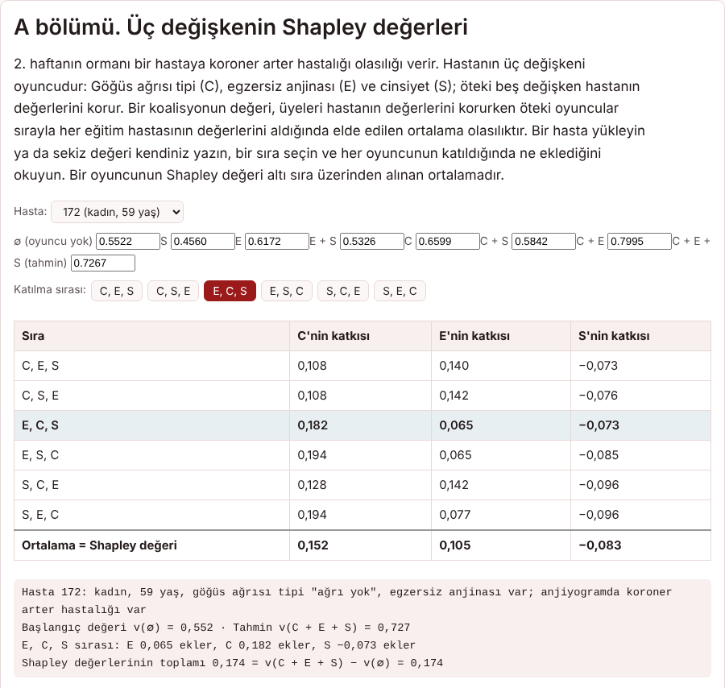
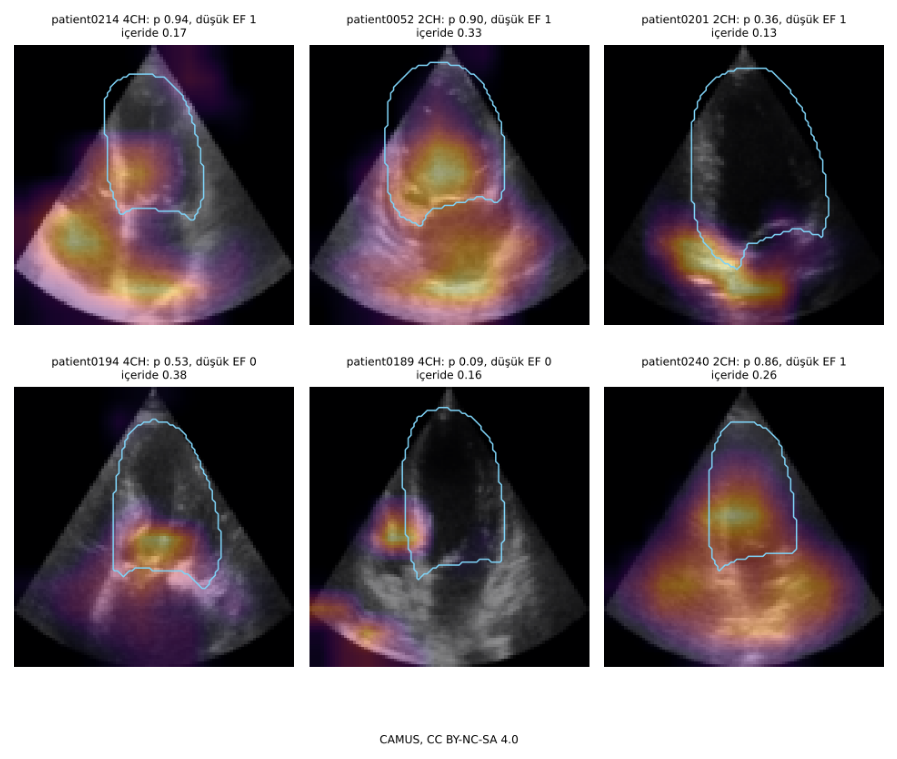
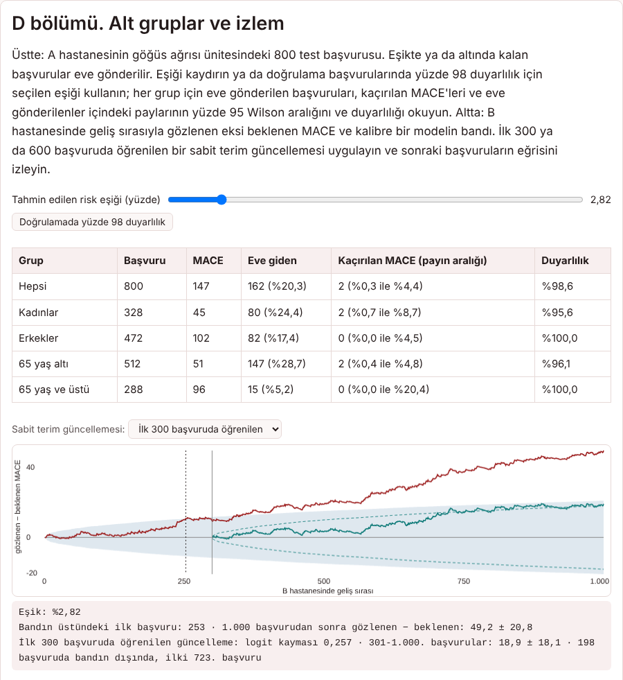

# Hafta 9: Model güvenilirliği ve açıklanabilir yapay zekâ (XAI)

**Python ile Yapay Zekâ Eğitimi: Kardiyologlar için Uygulamalı Eğitim Programı** 
Türk Kardiyoloji Derneği

*Klinisyen güveni için şeffaflık ve açıklanabilirlik*

[Eğitimin ana sayfası](../../README.tr.md) · [İzlence](../../SYLLABUS.tr.md) · [Kurulum](../../SETUP.tr.md) · [English](../../en/week-09/README.md)

Hafta hakkında daha ayrıntılı bilgi için bu sayfayı okumaya devam ediniz. Haftaya doğrudan ders sayfasından devam etmek isterseniz bu bağlantıyı kullanınız: **[Haftanın ders sayfasını açınız](https://utkukose.github.io/ai-cardiology-tkd-NB-lecture/tr/hafta-09/ders.html)**. Ders sayfası haftanın ana rotasıdır; sayfadaki kutular etkileşimli labı ve Jupyter Notebook'u ilgili yerde açmaktadır.

## Hafta hakkında

Sanal klinikte bir kalite ve güvenlik kurulu kurulur. Kurul, her modelin neden o sonucu verdiğini ve modele güvenilip güvenilemeyeceğini sorgulamaktadır. İlk yarı kara kutu probleminden, yani klinisyenin gerekçelerini göremediği bir modele neden güvenmediğinden başlar ve tahminlerin nasıl açıklanabileceğini ele alır. SHAP değerleri bir tahmini hastanın değişkenleri arasında adil biçimde paylaştırır; LIME ise tek bir hastanın çevresinde basit bir model kurmaktadır. Grad-CAM de evrişimli bir ağın görüntüde nereye baktığını gösterir. Cleveland verisindeki 172 numaralı hastaya 2. haftanın rastgele ormanı 0,73, lojistik regresyon ise 0,55 olasılık verir; iki modelin farklı gerekçelerini Shapley değerleri görünür kılar. Mini projede sanal kliniğin kayıt sistemi üzerindeki bir koroner arter hastalığı ormanını, klinik hastalığı çizerken hiç kullanmamış olmasına rağmen, LDL'den ve yaştan daha çok ejeksiyon fraksiyonu etkiler. CAMUS'ta bir eko ağının haritaları ağırlıklarının yüzde 32 kadarını, karenin yüzde 21 kadarını kaplayan sınırı çizilmiş kalbe koyar; ancak 20 rastgele çekilişin 9 tanesinde son bloğu rastgele olan bir kopya da aynı sonuca ulaşır. İkinci yarıda bir modelin güvenilir kalıp kalmadığı sorgulanmaktadır: Sonuçlar beklenmeden, iki hastaneyi birbirinden ayıran bir sınıflandırıcıyla bulunan veri kayması, kullanıma alındıktan sonra gözlenen ve beklenen olayların izlenmesi, kalibrasyon ve emin olunmayan hastaları kardiyoloğa gönderen bir güven skoru, cinsiyete, yaşa ve etnik kökene göre önyargı, bir değişkeni dışarıda bırakmanın sınırları ve GDPR, KVKK, tıbbi cihaz mevzuatı ve AB Yapay Zekâ Tüzüğü ile çizilen hukuki ve etik çerçeve ele alınır. Hafta, bir yapay zekâ (YZ) asistanının yazdığı bir açıklamanın denetlenmesiyle kapanır.

Oturum 4 saat sürer. Haftalık proje için yaklaşık 3 saat ayrılmalıdır.

## Haftanın vakası

Cleveland verisindeki 172 numaralı hasta, istirahatte göğüs ağrısı olmayan ve egzersiz testinde anjinası ortaya çıkan 59 yaşında bir kadındır. 2. haftanın rastgele ormanı bu hastaya koroner arter hastalığı için 0,73, lojistik regresyon ise 0,55 olasılık verir. Modeller neden böyle söylüyor ve her hasta için, başka bir hastanede ve gelecek yıl bu modellere güvenilebilir mi?

## Malzemeler

| Malzeme | Aç | Ne işe yarar? |
|---|---|---|
| **Ders sayfası** | [Ders sayfasını aç](https://utkukose.github.io/ai-cardiology-tkd-NB-lecture/tr/hafta-09/ders.html) | Haftanın konu anlatımını içeren bu sayfa yukarıdan aşağıya doğru okunmak üzere hazırlanmıştır. Sayfadaki kutular sizi uygulama duraklarına yönlendirir; sayfada kod ya da prompt (istem) bulunmamaktadır. |
| **Etkileşimli lab** | [Etkileşimli labı aç](https://utkukose.github.io/ai-cardiology-tkd-NB-lecture/tr/hafta-09/lab.html) | Kod gerektirmeyen A-F bölümleri, ders sayfasında yeri geldiğinde açılmaktadır. F bölümü bir prompt atölyesidir. Öz değerlendirme ve öğrenme günlüğü de bu labda yer alır. |
| **Python Notebook** |  [Jupyter Notebook için indir (zip)](https://github.com/utkukose/ai-cardiology-tkd-NB-lecture/raw/main/tr/hafta-09/NB09_guvenilirlik_ve_aciklanabilir_yapay_zeka.zip) | Uygulama durakları burada çalışılır; her durakta Python temelleri, promptlar ve hazır bir uygulama bulunmaktadır. Python Notebook, Google Colab'da kurulum gerektirmeden ya da kendi bilgisayarınızdaki Jupyter Notebook'ta çalışabilir. Jupyter için zip dosyasını indiriniz, içindeki .ipynb dosyasını bir klasöre çıkarınız ve dosyayı Jupyter'de açınız. Her bölüm, bölümün kullandığı kurulumu ve veri çağrılarını yineleyen bir başlangıç hücresiyle açılır. |
| **Prompt kütüphanesi** | [PROMPTLAR.md](PROMPTLAR.md) | Uygulama duraklarının ve haftalık projenin bütün promptları, kodu onarmaya, açıklatmaya ve denetlemeye yönelik promptlarla birlikte burada toplanmıştır. GitHub'da her promptun yanında bir kopyalama düğmesi bulunur. |
| **PDF ders notu** | [Hafta09_Ders_Notlari.pdf](Hafta09_Ders_Notlari.pdf) | Ders sayfasının yazdırılabilir biçimidir. |

## Çalışma yolu

Ders sayfası yukarıdan aşağıya doğru okunur; etkileşimli labın bölümleri de sayfada yeri geldikçe açılır. Uygulama duraklarında çalışma Jupyter Notebook'ta sürmektedir ve oradaki her durak üç bölümden oluşur. **Python temelleri** bölümünde durağın gerektirdiği Python bilgisi öğretilir. **Prompt ile uygulama** bölümünde kodu hazır promptlarla bir YZ asistanı yazar; katılımcının görevi bu kodu çalıştırmak ve sonucu denetlemektir. **Hazır uygulama** bölümünde ise durağın baştan sona çalışan programı yer almaktadır. Bölümleri bu sırayla izlemeniz önerilir; Python biliyorsanız promptlarla, yalnızca sonucu görmek istiyorsanız hazır uygulamayla başlayabilirsiniz. Her bölüm, bölümün kullandığı kurulumu ve veri çağrılarını yineleyen bir başlangıç hücresiyle açılır; bu sayede bölüm doğrudan açıldığında da çalışabilmektedir. Lab bölümlerinin ve Jupyter Notebook'taki durakların sonunda, sizi ders sayfasında okumanın devam ettiği yere geri götüren bir bağlantı bulunmaktadır. Nerede kaldığınızı bulamazsanız bu tabloya dönünüz. Oturuma katılanlar bu adımları oturum sırasında yapar. Tablodaki süreler, haftayı kendi başına izleyenler, örneğin bir oturumu kaçıranlar için verilmiştir.

| Adım | Ne yapılır? | Süre |
|---|---|---|
| 1 | Haftanın vakasını ve ders sayfasını 1. uygulama durağına kadar [okuyunuz](https://utkukose.github.io/ai-cardiology-tkd-NB-lecture/tr/hafta-09/ders.html) (kara kutu problemi, 3B koalisyon sahnesi ve etkileşimli labın A bölümüyle SHAP değerleri, tek bir hastadan bütün hastalara ve mini proje); bilgi kontrolü sorularını cevaplayınız | 1 saat 5 dakika |
| 2 | **[1. uygulama durağı: Koroner arter hastalığı modelinin ardındaki klinik etkenler](https://utkukose.github.io/ai-cardiology-tkd-NB-lecture/tr/hafta-09/ders.html#stop-1)** Oturumun mini projesi. [Python temelleri](https://colab.research.google.com/github/utkukose/ai-cardiology-tkd-NB-lecture/blob/main/tr/hafta-09/NB09_guvenilirlik_ve_aciklanabilir_yapay_zeka.ipynb#scrollTo=stop-1-basics) · [Prompt ile uygulama](https://colab.research.google.com/github/utkukose/ai-cardiology-tkd-NB-lecture/blob/main/tr/hafta-09/NB09_guvenilirlik_ve_aciklanabilir_yapay_zeka.ipynb#scrollTo=stop-1-prompt) ([promptlar](PROMPTLAR.md#durak-1-koroner-arter-hastal%C4%B1%C4%9F%C4%B1-modelinin-ard%C4%B1ndaki-klinik-etkenler)) · [Hazır uygulama](https://colab.research.google.com/github/utkukose/ai-cardiology-tkd-NB-lecture/blob/main/tr/hafta-09/NB09_guvenilirlik_ve_aciklanabilir_yapay_zeka.ipynb#scrollTo=stop-1-app) | 1 saat 35 dakika |
| 3 | 2. uygulama durağına kadar [okumayı sürdürün](https://utkukose.github.io/ai-cardiology-tkd-NB-lecture/tr/hafta-09/ders.html#lime-a-simple-model-around-one-patient) (animasyonu ve B bölümüyle LIME ve yerel açıklamalar, animasyonu ve C bölümüyle Grad-CAM, sağlamlık testleri) | 50 dakika |
| 4 | **[2. uygulama durağı: Tek bir hasta için LIME ve eko ağının baktığı yer](https://utkukose.github.io/ai-cardiology-tkd-NB-lecture/tr/hafta-09/ders.html#stop-2)** [Python temelleri](https://colab.research.google.com/github/utkukose/ai-cardiology-tkd-NB-lecture/blob/main/tr/hafta-09/NB09_guvenilirlik_ve_aciklanabilir_yapay_zeka.ipynb#scrollTo=stop-2-basics) · [Prompt ile uygulama](https://colab.research.google.com/github/utkukose/ai-cardiology-tkd-NB-lecture/blob/main/tr/hafta-09/NB09_guvenilirlik_ve_aciklanabilir_yapay_zeka.ipynb#scrollTo=stop-2-prompt) ([promptlar](PROMPTLAR.md#durak-2-tek-bir-hasta-i%C3%A7in-lime-ve-eko-a%C4%9F%C4%B1n%C4%B1n-bakt%C4%B1%C4%9F%C4%B1-yer)) · [Hazır uygulama](https://colab.research.google.com/github/utkukose/ai-cardiology-tkd-NB-lecture/blob/main/tr/hafta-09/NB09_guvenilirlik_ve_aciklanabilir_yapay_zeka.ipynb#scrollTo=stop-2-app) | 1 saat 30 dakika |
| 5 | 3. uygulama durağına kadar [okumayı sürdürün](https://utkukose.github.io/ai-cardiology-tkd-NB-lecture/tr/hafta-09/ders.html#last-two-hours-ai-reliability-and-clinical-validation) (data drift ve izlem, kalibrasyon ve güven skoru, cinsiyet, yaş ve etnik kökene göre önyargı, GDPR ve KVKK ile hukuki ve etik çerçeve); etkileşimli labın D bölümünü yapınız | 45 dakika |
| 6 | **[3. uygulama durağı: Kayma, izlem ve alt gruplar](https://utkukose.github.io/ai-cardiology-tkd-NB-lecture/tr/hafta-09/ders.html#stop-3)** [Python temelleri](https://colab.research.google.com/github/utkukose/ai-cardiology-tkd-NB-lecture/blob/main/tr/hafta-09/NB09_guvenilirlik_ve_aciklanabilir_yapay_zeka.ipynb#scrollTo=stop-3-basics) · [Prompt ile uygulama](https://colab.research.google.com/github/utkukose/ai-cardiology-tkd-NB-lecture/blob/main/tr/hafta-09/NB09_guvenilirlik_ve_aciklanabilir_yapay_zeka.ipynb#scrollTo=stop-3-prompt) ([promptlar](PROMPTLAR.md#durak-3-kayma-izlem-ve-alt-gruplar)) · [Hazır uygulama](https://colab.research.google.com/github/utkukose/ai-cardiology-tkd-NB-lecture/blob/main/tr/hafta-09/NB09_guvenilirlik_ve_aciklanabilir_yapay_zeka.ipynb#scrollTo=stop-3-app) | 50 dakika |
| 7 | Bir açıklamanın denetimini, haftanın makalesini, sanal kliniğin bu haftaki aşamasını ve "Kendi verinizle" bölümünü [okuyunuz](https://utkukose.github.io/ai-cardiology-tkd-NB-lecture/tr/hafta-09/ders.html#ai-pair-programming-part-9-reviewing-an-explanation); etkileşimli labın E ve F bölümlerini yapınız | 35 dakika |
| 8 | [Etkileşimli labın](https://utkukose.github.io/ai-cardiology-tkd-NB-lecture/tr/hafta-09/lab.html) "Kendini sına" sekmesindeki öz değerlendirmeyi yapınız, yansıtma yazınızı yazınız ve öğrenme günlüğünü dışa aktarınız | 20 dakika |
| | **Haftalık proje dışında toplam** | **7 saat 30 dakika** |
| 9 | [Haftalık projeyi](#haftal%C4%B1k-proje) tamamlayınız [Promptlar](PROMPTLAR.md#haftal%C4%B1k-projenin-promptlar%C4%B1) · [Jupyter Notebook'ta haftalık proje](https://colab.research.google.com/github/utkukose/ai-cardiology-tkd-NB-lecture/blob/main/tr/hafta-09/NB09_guvenilirlik_ve_aciklanabilir_yapay_zeka.ipynb#scrollTo=project) | 3 saat |

<table>
<tr><td width="50%"></td><td width="50%"></td></tr>
<tr><td>Etkileşimli lab, A bölümü: 172 numaralı hastanın üç değişkeninin, katılabilecekleri altı sıradan hesaplanan Shapley değerleri ve toplamlarının tahmine eşit olduğunun kontrolü.</td><td>Jupyter Notebook, «Durak 2 · Hazır uygulama»: Eko ağının CAMUS test görüntülerindeki Grad-CAM haritaları ve sol ventrikülün uzman sınırı. Veri: CAMUS, CC BY-NC-SA 4.0.</td></tr>
<tr><td width="50%"></td><td width="50%"></td></tr>
<tr><td>Etkileşimli lab, D bölümü: B hastanesinde geliş sırasıyla gözlenen eksi beklenen olaylar; kalibre bir modelin bandı ve sabit terim güncellemeleri.</td><td>Ders sayfası: 172 numaralı hastanın çevresinde, ormanın yaşa ve en yüksek kalp hızına göre riski üzerinde adım adım LIME.</td></tr>
</table>

## Haftalık proje

**Proje.** Grad-CAM ile ekokardiyografi modelinin 'nereye baktığını' görselleştirme ve uzman yorumuyla karşılaştırma.

**Ne yapılacak?** Bir eko ağının Grad-CAM haritalarını uzmanların sınırlarıyla karşılaştırarak, bir kalite ve güvenlik kurulunun bu haritaları kabul etmeden önce yapacağı gibi değerlendiriniz. Önce dersin küçük ağını, bir görüntünün diyastol sonu ve sistol sonu karelerinden yüzde 45'in altındaki bir ejeksiyon fraksiyonunu işaretleyecek biçimde dersin 300 CAMUS hastasıyla eğitiniz. Ağın test AUC değerini tek tek görüntüler ve hastalar için, 2.000 bootstrap örneğinden hesaplanan yüzde 95 aralığıyla birlikte veriniz. İkinci adımda 100 test görüntüsünün her biri için son bloğun Grad-CAM haritasını hesaplayınız. Haritanın ağırlığının sol ventrikül kavitesi ve miyokardın uzman sınırı içine düşen payını, en güçlü pikselinin yerini ve sınırın alanını ölçünüz. Bu ölçütleri ejeksiyon fraksiyonu düşük ve normal olan görüntüler, doğru ve yanlış tahminler ve üç görüntü kalitesi derecesi için karşılaştırınız. Üçüncü adımda haritaları, önce son bloğa ve çıktı katmanına, ardından bütün ağırlıklara 20 farklı seed değeriyle yeni değerler verdikten sonra yeniden hesaplayınız; eğitilmiş ağın haritalarıyla sıra korelasyonunun ve sınırın içindeki payın medyanını ve aralığını bildiriniz. Dördüncü adımda doğru ve yanlış tahminleri de içeren altı görüntüyü haritaları ve sınırlarıyla gösteriniz ve haritaların neyi destekleyip neyi destekleyemeyeceğini kurul için yarım sayfada yazınız.

**Nereye bakılacak?** Ders: "Grad-CAM: CNN'in nereye baktığını görmek" ve "Sağlamlık testleri: Harita modelle mi ilgili?" bölümleri. Etkileşimli lab: C bölümü. Jupyter Notebook: 2. uygulama durağının hazır uygulaması.

**Promptlarla.** Proje, [prompt kütüphanesindeki](https://github.com/utkukose/ai-cardiology-tkd-NB-lecture/blob/main/tr/hafta-09/PROMPTLAR.md#haftal%C4%B1k-projenin-promptlar%C4%B1) dört promptla da yapılabilir; kütüphanede her adım için bir prompt bulunmaktadır. Her promptun tablosu, Jupyter Notebook'un sonundaki "Haftalık proje" bölümünde hazırlanır ve bu bölüm tek başına da açılabilir. Bir promptun testi sağlanmadan sonraki prompta geçilmemeli ve her prompt YZ kullanım günlüğüne kaydedilmelidir.

**Örnek.** Dersin çalıştırmasında haritaların ağırlığının yüzde 31,7 kadarı, karenin yüzde 21,3 kadarını kaplayan sınırların içine düşmüştür: $0{,}317/0{,}213 = 1{,}49$. 20 rastgele çekilişte bütün ağırlıkları rastgele olan kopyalarda sınır içindeki payın medyanı yüzde 23,4 düzeyine ulaşmış, 9 çekilişte de son bloğu rastgele olan bir kopya haritalarının en az eğitilmiş ağınki kadar büyük bir payını sınırın içine koymuştur. Eğitilmiş haritalar ile son bloğu rastgele olan kopyaların haritaları arasındaki sıra korelasyonunun medyanı 0,14 olmuş, değerler −0,34 ile 0,68 arasında değişmiştir. Sınırın içindeki pay, eğitilmiş bir ağı rastgele bir ağdan tek başına ayıramaz; ayıran, seed değerleriyle tekrarlanan rastgeleleştirmedir.

**Ne teslim edilecek?** [Rapor şablonuyla](../sablonlar/Rapor_Sablonu.docx) yazılmış, bir ya da iki sayfalık bir rapor teslim edilir. Raporda ölçütlerin tablosu, altı görüntünün şekli ve kurul için yazılan yarım sayfa yer almalıdır. Rapora YZ kullanım günlüğünü (araç, prompt, neyin denetlendiği, neyin değiştirildiği) ve çıktılarıyla birlikte Jupyter Notebook'u ekleyiniz. CAMUS ekokardiyogramları raporda "CAMUS, CC BY-NC-SA 4.0" atfıyla yer alabilir; başka biçimde paylaşılmaz.

**Teslim.** Haftalık proje, 10. haftanın oturumundan önce utkukose@sdu.edu.tr ya da utkukose@gmail.com adresine e-postayla gönderilir. E-postaya "Ne teslim edilecek?" başlığında sayılan öğeler ve etkileşimli labdan dışa aktarılan öğrenme günlüğü eklenir. Haftalık projeler değerlendirmenin yüzde 40'ını oluşturur; değerlendirme ölçütleri izlencede yer almaktadır.

## Öğrenme çıktıları

Haftanın sonunda katılımcıların yorumlanabilir bir modeli sonradan yapılan bir açıklamadan, yerel bir açıklamayı da genel bir açıklamadan ayırabilmeleri beklenmektedir. Klinisyenin bir kara kutuya neden güvenmediğini açıklayabilmeli, üç değişken için Shapley değerlerini elle hesaplayabilmeli, bir hastanın ve bir hasta grubunun SHAP değerlerini okuyabilmeli, arka plan hastalarının seçimini açıklayabilmeli ve bir modeli etkileyen klinik faktörü hastalığa neden olan faktörden ayırabilmelidirler. Tek bir hastanın çevresinde LIME kurabilmeli ve kararlılığını değerlendirebilmeli; bir Grad-CAM haritasını hesaplayıp rastgeleleştirmeyle yapılan bir sağlamlık testiyle birlikte okuyabilmelidirler. Son olarak veri kaymasını sonuçlarla ve sonuçlar olmadan saptayabilmeli, bir modelin kalibrasyonunu değerlendirip seçici tahmin için bir güven skoru kullanabilmeli, bir modelin kalibrasyonunu ve hatalarını cinsiyet, yaş ve etnik köken grupları arasında karşılaştırabilmeli, klinik bir modeli GDPR, KVKK, tıbbi cihaz mevzuatı ve AB Yapay Zekâ Tüzüğü çerçevesine yerleştirebilmeli ve bir YZ asistanının yazdığı bir açıklamayı denetleyebilmelidirler.

## Oturumun eğitim akışı

Haftanın dört saatlik oturumu aşağıdaki plana göre işlenir. Plan, malzemelerin canlı bir oturumda nasıl bir araya geldiğini göstermek için paylaşılmaktadır.

| Süre | Etkinlik |
|---|---|
| 0:00-0:15 | Haftanın vakası tanıtılır ve haftanın rotası anlatılır. Her katılımcı Jupyter Notebook'u Google Colab'da ya da Jupyter'de açarak 0. bölümü çalıştırır. Bu bölüm 4. haftada kullanılan 300 CAMUS hastasını bir ile üç dakikada yeniden indirir; Cleveland verisi ve göğüs ağrısı ünitesi için indirme gerekmez. |
| 0:15-1:00 | İlk iki saat, açıklanabilir AI yöntemleri: Kara kutu problemi ve klinisyenin neden güvenmediği, 3B koalisyon sahnesi ve A bölümüyle SHAP değerleri, tek bir hastadan bütün hastalara. |
| 1:00-1:35 | Oturumun mini projesi olan 1. uygulama durağında katılımcılar Jupyter Notebook'ta, promptlarla ya da Python ile çalışır: Cleveland verisinde ve LDL, yaş ve ejeksiyon fraksiyonunu içeren kayıt sisteminde bir koroner arter hastalığı modelinde SHAP. |
| 1:35-1:50 | Ara. |
| 1:50-2:35 | İlk iki saatin devamı: Animasyonu ve B bölümüyle LIME ve yerel açıklamalar, CNN'in nereye baktığını gösteren Grad-CAM, animasyonu ve C bölümüyle, ve sağlamlık testleri. 2. uygulama durağında 172 numaralı hasta için LIME ve kararlılığı, eko ağı ve uzman sınırlarına karşı Grad-CAM haritaları çalışılır. |
| 2:35-3:20 | Son iki saat, AI güvenilirliği ve klinik validasyon: Data drift ve tuzakları, kullanıma alındıktan sonra izlem, kalibrasyon ve güven skoru, D bölümüyle cinsiyet, yaş ve etnik kökene göre önyargı ve GDPR ile KVKK'nın çizdiği hukuki ve etik çerçeve. 3. uygulama durağında hastaneleri birbirinden ayıran sınıflandırıcı, B hastanesinde gözlenen ve beklenen olaylar, göğüs ağrısı ünitesinin alt grupları ve cinsiyetsiz bir model çalışılır. |
| 3:20-4:00 | Etkileşimli labın E ve F bölümleriyle bir açıklamanın denetimi çalışılır. Ardından haftanın makalesi, sanal kliniğin kalite ve güvenlik kurulu, "Kendi verinizle" bölümü ve haftalık proje ele alınır. |

## Kendi verinizle

Ders sayfası, haftanın yöntemlerini kendi verilerinize nasıl uygulayabileceğinizi anlatan bir bölümle sona ermektedir. Bu bölümde hangi sorunun hangi yönteme uyduğu, önce neyin denetlenmesi gerektiği, etik kurul onayı, Kişisel Verilerin Korunması Kanunu (KVKK) ve analizin nerede yapılacağı ele alınmaktadır. [Bölümü ders sayfasında okuyunuz](https://utkukose.github.io/ai-cardiology-tkd-NB-lecture/tr/hafta-09/ders.html#with-your-own-data).

## İsteğe bağlı araştırma ödevi

PubMed'de, 2020 ya da sonrasında yayımlanmış ve kardiyovasküler bir modeli SHAP, LIME, Grad-CAM ya da dikkat haritalarıyla açıklamış bir çalışma bulunuz. Çalışmayı yarım sayfada özetleyiniz. Özette model ve veriler, açıklama yöntemi ve ayarları (arka plan hastaları, çekirdek genişliği, katman), açıklamanın bir rastgeleleştirmeyle ya da uzmanlarca denetlenip denetlenmediği, yazarların açıklamadan ne sonuç çıkardığı ve başarımı cinsiyete ve yaşa göre bildirip bildirmedikleri yer almalıdır. [Haftanın makalesindeki](https://utkukose.github.io/ai-cardiology-tkd-NB-lecture/tr/hafta-09/ders.html#the-paper-of-the-week) üç soru özete yol gösterebilir. Bu ödev notlandırılmaz; haftalık projenin yarım sayfasına hazırlık niteliğindedir.

## Bu haftadan sonra sanal klinik

9. haftada sanal klinikte bir kalite ve güvenlik kurulu kurulur. Kurul, 2. haftanın koroner arter hastalığı modelini, CAMUS üzerinde eğitilen bir eko ağını ve 8. haftanın göğüs ağrısı ünitesi için kurulan risk modelini iki hastanede incelemektedir. Sonuçlar ders sayfasının [Sanal klinik, 9. aşama](https://utkukose.github.io/ai-cardiology-tkd-NB-lecture/tr/hafta-09/ders.html#the-virtual-clinic-stage-9-quality-and-safety-committee) bölümünde yer almaktadır.

## Gelecek hafta

**Hafta 10: Klinik karar destek sistemleri (CDSS).** Model yatak başına taşınır: Web arayüzü olan bir karar destek prototipi geliştirilir, kullanıcı testiyle sınanır ve iyileştirilir. Ayrıntılar için [eğitimin planına](../../README.tr.md#on-bir-hafta) bakabilirsiniz.

---

**Prof. Dr. Utku Köse**

Profesör, Bilgisayar Mühendisliği Bölümü, Süleyman Demirel Üniversitesi, Isparta, Türkiye 
Kurucu Müdür, Yapay Zekâ Uygulama ve Araştırma Merkezi (YAZEM), Süleyman Demirel Üniversitesi 
Bilgisayar Bilimleri Anabilim Dalı Başkanı, Bilgisayar Mühendisliği Bölümü, Süleyman Demirel Üniversitesi 
Diğer kurumlar: University of North Dakota (ABD), Universidad Panamericana (Meksiko, Meksika), Vel Tech University (Chennai, Hindistan) 
IEEE Kıdemli Üyesi, ACM Profesyonel Üyesi

[ORCID 0000-0002-9652-6415](https://orcid.org/0000-0002-9652-6415) | [utkukose.com](https://www.utkukose.com) | [github.com/utkukose](https://github.com/utkukose)

[utkukose@sdu.edu.tr](mailto:utkukose@sdu.edu.tr) | [utku.kose@und.edu](mailto:utku.kose@und.edu) | [ukose@up.edu.mx](mailto:ukose@up.edu.mx) | [utkukose@gmail.com](mailto:utkukose@gmail.com)

*İlk sürüm: Kasım 2026. İçerik CC BY 4.0, kod MIT.*

