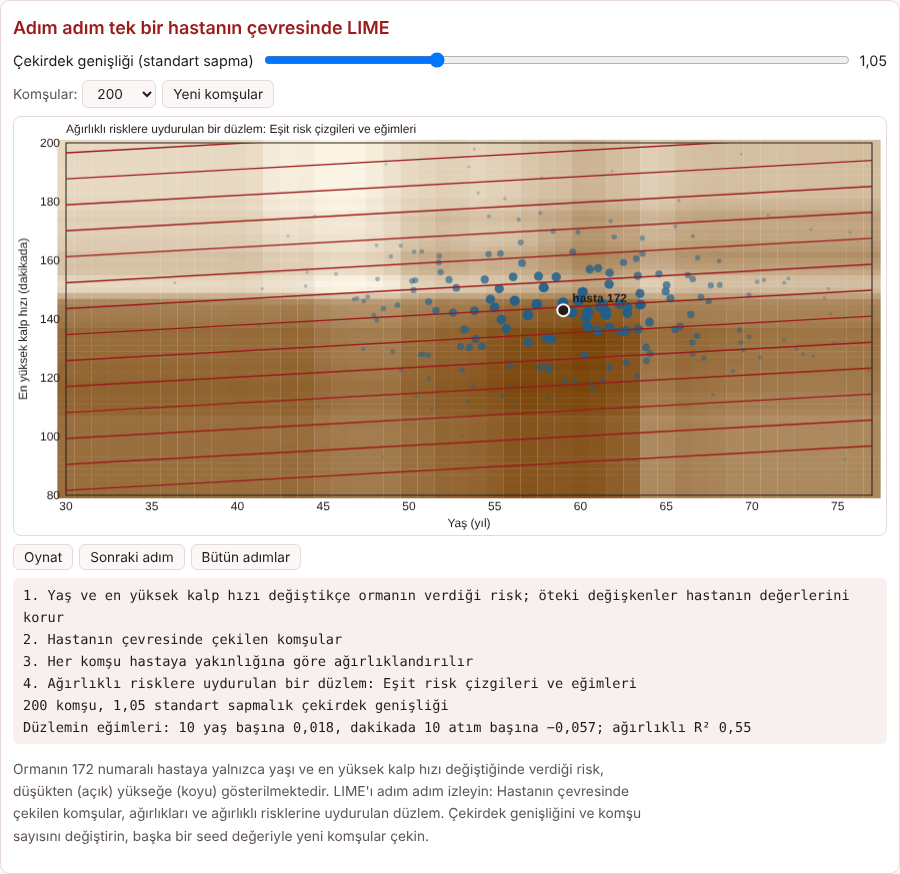

# Hafta 9: Model güvenilirliği ve açıklanabilir yapay zekâ

**Python ile Yapay Zekâ Eğitimi: Kardiyologlar için Uygulamalı Eğitim Programı** 
Türk Kardiyoloji Derneği

*Bir model neden o sonucu verir ve her hasta için, başka bir hastanede ve zaman içinde ona güvenilebilir mi?*

[Eğitimin ana sayfası](../../README.tr.md) · [İzlence](../../SYLLABUS.tr.md) · [Kurulum](../../SETUP.tr.md) · [English](../../en/week-09/README.md)

## Hafta hakkında

Sanal klinik bir kalite ve güvenlik kurulu kurar. Kurul her modele neden o sonucu verdiğini ve ona güvenilip güvenilemeyeceğini sorar. İlk yarıda tahminler açıklanır: Shapley değerleri bir tahmini hastanın değişkenleri arasında adil biçimde paylaştırır, LIME tek bir hastanın çevresine basit bir model kurar, Grad-CAM ise evrişimli bir ağın görüntüde nereye baktığını gösterir. Cleveland verisindeki 172 numaralı hastaya 2. haftanın rastgele ormanı 0,73, lojistik regresyon ise 0,55 olasılık verir; iki modelin farklı gerekçelerini Shapley değerleri görünür kılar. CAMUS'ta bir eko ağının haritaları ağırlıklarının yüzde 32 kadarını, karenin yüzde 21 kadarını kaplayan sınırı çizilmiş kalbe koyar; ancak 20 rastgele çekilişin 9 tanesinde son bloğu rastgele olan bir kopya da aynı sonuca ulaşır. İkinci yarı bir modelin güvenilir kalıp kalmadığını sorar: Sonuçlar beklenmeden, iki hastaneyi birbirinden ayıran bir sınıflandırıcıyla bulunan veri kayması, kullanıma alındıktan sonra gözlenen ve beklenen olayların izlenmesi, cinsiyete ve yaşa göre alt gruplar, bir değişkeni dışarıda bırakmanın sınırları ve KVKK, tıbbi cihaz mevzuatı ve AB Yapay Zekâ Tüzüğü ile çizilen hukuki ve etik çerçeve ele alınır. Hafta, bir YZ asistanının yazdığı bir açıklamanın denetlenmesiyle kapanır.

Oturum 4 saat sürer. Haftalık proje için yaklaşık 3 saat ayrılmalıdır.

## Haftanın rotası

Ders sayfası haftanın ana rotasıdır. Sayfada kod ya da prompt (istem) bulunmaz; sayfa etkileşimli labla birlikte yukarıdan aşağıya okunur. Her uygulama durağında katılımcılar Jupyter defterindeki iki yoldan birini seçer. **Prompt yolunda** (Kısım 1) kodu, hazır promptlara göre bir yapay zekâ (YZ) asistanı yazar; katılımcı bu kodu çalıştırır ve sonucu denetler. **Python yolunda** (Kısım 2) ise kodu katılımcı kendisi yazar. İki yol da aynı sonuçlara varır. Defter hem kurulum gerektirmeyen Google Colab'da hem de kendi bilgisayarınızdaki Jupyter'de çalışır ([kurulum](../../SETUP.tr.md)).

| Ana rota: Ders sayfası ve etkileşimli lab | Uygulama durağı | Prompt yolu (Kısım 1) | Python yolu (Kısım 2) |
|---|---|---|---|
| [Neden açıklamalı? Yorumlanabilir modeller ve sonradan yapılan açıklamalar](https://utkukose.github.io/ai-cardiology-tkd-NB-lecture/tr/hafta-09/ders.html#why-explain-interpretable-models-and-explanations-after-the-fact) [Shapley değerleri: Bir tahmini değişkenler arasında paylaştırmak](https://utkukose.github.io/ai-cardiology-tkd-NB-lecture/tr/hafta-09/ders.html#shapley-values-sharing-a-prediction-among-the-variables) [Tek bir hastadan bütün hastalara](https://utkukose.github.io/ai-cardiology-tkd-NB-lecture/tr/hafta-09/ders.html#from-one-patient-to-all-patients) | **[Durak 1: Koroner arter hastalığı modelinin ardındaki klinik etkenler](https://utkukose.github.io/ai-cardiology-tkd-NB-lecture/tr/hafta-09/ders.html#stop-1)** | Durak 1 | Python adımı 9 ve 1-3. bölümler |
| [LIME: Tek bir hastanın çevresinde basit bir model](https://utkukose.github.io/ai-cardiology-tkd-NB-lecture/tr/hafta-09/ders.html#lime-a-simple-model-around-one-patient) [Grad-CAM: Bir ağ nereye bakıyor?](https://utkukose.github.io/ai-cardiology-tkd-NB-lecture/tr/hafta-09/ders.html#grad-cam-where-does-a-network-look) [Sağlamlık testleri: Harita modelle mi ilgili?](https://utkukose.github.io/ai-cardiology-tkd-NB-lecture/tr/hafta-09/ders.html#sanity-checks-is-the-map-about-the-model) | **[Durak 2: Tek bir hasta için LIME ve eko ağının baktığı yer](https://utkukose.github.io/ai-cardiology-tkd-NB-lecture/tr/hafta-09/ders.html#stop-2)** | Durak 2 | 4-7. bölümler |
| [Veri kayması: Ne değişti ve bu önemli mi?](https://utkukose.github.io/ai-cardiology-tkd-NB-lecture/tr/hafta-09/ders.html#dataset-shift-what-changed-and-does-it-matter) [Kullanıma alındıktan sonra izlem: Gözlenen ve beklenen olaylar](https://utkukose.github.io/ai-cardiology-tkd-NB-lecture/tr/hafta-09/ders.html#monitoring-after-deployment-observed-against-expected-events) [Adalet: Model her hasta için çalışıyor mu?](https://utkukose.github.io/ai-cardiology-tkd-NB-lecture/tr/hafta-09/ders.html#fairness-does-the-model-work-for-every-patient) [Hukuk ve etik: Bir modelden kim sorumludur?](https://utkukose.github.io/ai-cardiology-tkd-NB-lecture/tr/hafta-09/ders.html#law-and-ethics-who-answers-for-a-model) | **[Durak 3: Kayma, izlem ve alt gruplar](https://utkukose.github.io/ai-cardiology-tkd-NB-lecture/tr/hafta-09/ders.html#stop-3)** | Durak 3 | 8-10. bölümler |
| [YZ asistanıyla çalışmak, 9. bölüm: Bir açıklamayı denetlemek](https://utkukose.github.io/ai-cardiology-tkd-NB-lecture/tr/hafta-09/ders.html#ai-pair-programming-part-9-reviewing-an-explanation) [Haftanın makalesi](https://utkukose.github.io/ai-cardiology-tkd-NB-lecture/tr/hafta-09/ders.html#the-paper-of-the-week) [Sanal klinik, 9. aşama: Kalite ve güvenlik kurulu](https://utkukose.github.io/ai-cardiology-tkd-NB-lecture/tr/hafta-09/ders.html#the-virtual-clinic-stage-9-quality-and-safety-committee) | "Kendi verinizle" bölümü, haftanın makalesi ve sanal klinik | – | – |

## Malzemeler

| Malzeme | Aç | İçeriği |
|---|---|---|
| **Ders sayfası (ana rota)** | [Ders sayfasını aç](https://utkukose.github.io/ai-cardiology-tkd-NB-lecture/tr/hafta-09/ders.html) | Vakayı, kavramları çözümlü örnekleriyle, üç değişkenin koalisyonlarını gösteren üç boyutlu (3B) bir sahneyi, iki animasyonu, bilgi kontrolü sorularını, üç uygulama durağını, "Kendi verinizle" bölümünü, tekrar kartlarını ve kaynakları içerir. Sayfada kod ve prompt yer almaz. |
| **Etkileşimli lab** | [Etkileşimli labı aç](https://utkukose.github.io/ai-cardiology-tkd-NB-lecture/tr/hafta-09/lab.html) | Kod gerektirmeyen A'dan F'ye kadar altı bölümü (F bölümü prompt atölyesidir), öz değerlendirmeyi, yansıtma yazısını ve dışa aktarılabilen öğrenme günlüğünü içerir |
| **Jupyter defteri** |  [Jupyter için indir](NB09_guvenilirlik_ve_aciklanabilir_yapay_zeka.ipynb) | Kısım 1 prompt yoludur: Üç durakta toplam on iki adım vardır ve her adımda hazır bir prompt, adımın tablosunu hazırlayan bir veri hücresi, YZ asistanının kodu için bir hücre, otomatik bir kontrol ve hazır kod bulunur. Kısmın sonunda haftalık proje dört promptla yer alır. Kısım 2 Python yoludur: Python adımı 9'u, A-J alıştırmalarıyla birlikte 1-10. bölümleri ve yedi alan için uygulama görevlerini içerir. |
| **Prompt kütüphanesi** | [PROMPTLAR.md](PROMPTLAR.md) | Prompt yolunun bütün promptlarını, kodu onarmaya ve denetlemeye yarayan promptları ve haftalık projenin prompt yolunu içerir. GitHub'da her promptun yanında bir kopyalama düğmesi bulunur. |
| **PDF ders notu** | [Hafta09_Ders_Notlari.pdf](Hafta09_Ders_Notlari.pdf) | Ders sayfasının yazdırılabilir biçimidir; uygulama duraklarını ve "Kendi verinizle" bölümünü de içerir. |

<table>
<tr><td width="50%"></td><td width="50%"></td></tr>
<tr><td>Etkileşimli lab, A bölümü: 172 numaralı hastanın üç değişkeninin, katılabilecekleri altı sıradan hesaplanan Shapley değerleri ve toplamlarının tahmine eşit olduğunun kontrolü.</td><td>Jupyter defteri, 6. bölüm: Eko ağının CAMUS test görüntülerindeki Grad-CAM haritaları ve sol ventrikülün uzman sınırı. Veri: CAMUS, CC BY-NC-SA 4.0.</td></tr>
<tr><td width="50%"></td><td width="50%"></td></tr>
<tr><td>Etkileşimli lab, D bölümü: B hastanesinde geliş sırasıyla gözlenen eksi beklenen olaylar; kalibre bir modelin bandı ve sabit terim güncellemeleri.</td><td>Ders sayfası: 172 numaralı hastanın çevresinde, ormanın yaşa ve en yüksek kalp hızına göre riski üzerinde adım adım LIME.</td></tr>
</table>

## Haftanın vakası

Cleveland verisindeki 172 numaralı hasta, istirahatte göğüs ağrısı olmayan ve egzersiz testinde anjinası ortaya çıkan 59 yaşında bir kadındır. 2. haftanın rastgele ormanı bu hastaya koroner arter hastalığı için 0,73, lojistik regresyon ise 0,55 olasılık verir. Modeller neden böyle söylüyor ve her hasta için, başka bir hastanede ve gelecek yıl bu modellere güvenilebilir mi?

## Öğrenme çıktıları

Haftanın sonunda katılımcıların yorumlanabilir bir modeli sonradan yapılan bir açıklamadan, yerel bir açıklamayı da genel bir açıklamadan ayırabilmeleri beklenmektedir. Üç değişken için Shapley değerlerini elle hesaplayabilmeli, bir hastanın ve bir hasta grubunun Shapley değerlerini okuyabilmeli ve arka plan hastalarının seçimini açıklayabilmelidirler. Tek bir hastanın çevresinde LIME kurabilmeli ve kararlılığını değerlendirebilmeli; bir Grad-CAM haritasını hesaplayıp rastgeleleştirmeyle yapılan bir sağlamlık testiyle birlikte okuyabilmelidirler. Son olarak veri kaymasını sonuçlarla ve sonuçlar olmadan saptayabilmeli, bir modelin kalibrasyonunu ve hatalarını cinsiyet ve yaş grupları arasında karşılaştırabilmeli, klinik bir modeli KVKK, tıbbi cihaz mevzuatı ve AB Yapay Zekâ Tüzüğü çerçevesine yerleştirebilmeli ve bir YZ asistanının yazdığı bir açıklamayı denetleyebilmelidirler.

## Çalışma yolu

Oturuma katılanlar ana rotayı ve uygulama duraklarını oturumda tamamlar. Haftayı kendi başına izleyenler, örneğin bir oturumu kaçıranlar, aşağıdaki sürelerle plan yapabilir.

| Adım | Etkinlik | Prompt yolu | Python yolu |
|---|---|---|---|
| 1 | Haftanın vakasını ve ders sayfasını 1. uygulama durağına kadar okuyun; koalisyonları gösteren 3B sahneyi inceleyin, etkileşimli labın A bölümünü yapın ve bilgi kontrolü sorularını cevaplayın | 1 saat | 1 saat |
| 2 | 1. uygulama durağı (oturumun mini projesi): Prompt yolunda Kısım 1'deki Durak 1'i, Python yolunda Python adımı 9'u ve 1-3. bölümleri çalışın | 35 dakika | 1 saat 30 dakika |
| 3 | 2. uygulama durağına kadar okumayı sürdürün (animasyonuyla LIME, animasyonuyla Grad-CAM ve sağlamlık testleri); etkileşimli labın B ve C bölümlerini yapın | 50 dakika | 50 dakika |
| 4 | 2. uygulama durağı: Prompt yolunda Kısım 1'deki Durak 2'yi, Python yolunda 4-7. bölümleri çalışın | 40 dakika | 1 saat 30 dakika |
| 5 | 3. uygulama durağına kadar okumayı sürdürün (veri kayması, izlem, adalet ve hukuki ve etik çerçeve); etkileşimli labın D bölümünü yapın | 40 dakika | 40 dakika |
| 6 | 3. uygulama durağı: Prompt yolunda Kısım 1'deki Durak 3'ü, Python yolunda 8-10. bölümleri çalışın | 30 dakika | 45 dakika |
| 7 | Bir açıklamanın denetimini, haftanın makalesini, sanal kliniğin bu haftaki aşamasını ve "Kendi verinizle" bölümünü okuyun; etkileşimli labın E ve F bölümlerini yapın | 35 dakika | 35 dakika |
| 8 | Etkileşimli labın "Kendini sına" sekmesindeki öz değerlendirmeyi yapın, yansıtma yazınızı yazın ve öğrenme günlüğünü dışa aktarın | 20 dakika | 20 dakika |
| | **Haftalık proje dışında toplam** | **5 saat 10 dakika** | **7 saat 10 dakika** |
| 9 | Haftalık projeyi iki yoldan biriyle tamamlayın | 3 saat | 3 saat |

## Oturumun eğitim akışı

Haftanın dört saatlik oturumu aşağıdaki plana göre işlenir. Plan, malzemelerin canlı bir oturumda nasıl bir araya geldiğini göstermek için paylaşılmaktadır.

| Süre | Etkinlik |
|---|---|
| 0:00-0:15 | Haftanın vakası tanıtılır ve haftanın rotası anlatılır. Her katılımcı defteri Google Colab'da ya da Jupyter'de açar ve 0. bölümü çalıştırır. Bu bölüm 4. haftada kullanılan 300 CAMUS hastasını bir ile üç dakikada yeniden indirir; Cleveland verisi ve göğüs ağrısı ünitesi için indirme gerekmez. |
| 0:15-1:00 | Ana rotada açıklamanın neden gerektiği, koalisyonları gösteren 3B sahne ve A bölümüyle Shapley değerleri ve tek bir hastadan bütün hastalara geçiş anlatılır. |
| 1:00-1:35 | Oturumun mini projesi olan 1. uygulama durağında katılımcılar iki gruba ayrılır: Prompt yolunu izleyenler ve Python yolunu izleyenler. Koroner arter hastalığı modelinde en çok ağırlık taşıyan klinik etkenler Shapley değerleriyle açıklanır. |
| 1:35-1:50 | Ara. |
| 1:50-2:35 | Ana rotada animasyonu ve B bölümüyle LIME, animasyonu ve C bölümüyle Grad-CAM ve sağlamlık testleri anlatılır. 2. uygulama durağında 172 numaralı hasta için LIME ve kararlılığı, eko ağı ve Grad-CAM haritalarının uzman sınırlarıyla karşılaştırılması çalışılır. |
| 2:35-3:20 | Ana rotada veri kayması, kullanıma alındıktan sonra izlem, D bölümüyle adalet ve hukuki ve etik çerçeve ele alınır. 3. uygulama durağında hastaneleri birbirinden ayıran sınıflandırıcı, B hastanesinde gözlenen ve beklenen olaylar, göğüs ağrısı ünitesinin alt grupları ve cinsiyet içermeyen bir model çalışılır. |
| 3:20-4:00 | Etkileşimli labın E ve F bölümleriyle bir açıklamanın denetimi çalışılır. Ardından haftanın makalesi, sanal kliniğin kalite ve güvenlik kurulu, "Kendi verinizle" bölümü ve haftalık proje ele alınır. |

## Haftalık proje

**Ne yapılacak?** Bir eko ağının Grad-CAM haritalarını uzmanların sınırlarıyla karşılaştırarak, bir kalite ve güvenlik kurulunun bu haritaları kabul etmeden önce yapacağı gibi değerlendirin. Önce dersin küçük ağını, bir görüntünün diyastol sonu ve sistol sonu karelerinden yüzde 45'in altındaki bir ejeksiyon fraksiyonunu işaretleyecek biçimde dersin 300 CAMUS hastasıyla eğitin. Ağın test AUC değerini tek tek görüntüler ve hastalar için, 2.000 bootstrap örneğinden hesaplanan yüzde 95 aralığıyla birlikte verin. İkinci adımda 100 test görüntüsünün her biri için son bloğun Grad-CAM haritasını hesaplayın. Haritanın ağırlığının sol ventrikül kavitesi ve miyokardın uzman sınırı içine düşen payını, en güçlü pikselinin yerini ve sınırın alanını ölçün. Bu ölçütleri ejeksiyon fraksiyonu düşük ve normal olan görüntüler, doğru ve yanlış tahminler ve üç görüntü kalitesi derecesi için karşılaştırın. Üçüncü adımda haritaları, önce son bloğa ve çıktı katmanına, ardından bütün ağırlıklara 20 farklı seed değeriyle yeni değerler verdikten sonra yeniden hesaplayın; eğitilmiş ağın haritalarıyla sıra korelasyonunun ve sınırın içindeki payın medyanını ve aralığını bildirin. Dördüncü adımda doğru ve yanlış tahminleri de içeren altı görüntüyü haritaları ve sınırlarıyla gösterin ve haritaların neyi destekleyip neyi destekleyemeyeceğini kurul için yarım sayfada yazın.

**Nereye bakılacak?** Ders: "Grad-CAM: Bir ağ nereye bakıyor?" ve "Sağlamlık testleri: Harita modelle mi ilgili?" bölümleri. Etkileşimli lab: C bölümü. Jupyter defteri: Kısım 1, 2. durak ya da Kısım 2, 5-7. bölümler.

**Prompt yolu.** Proje, [prompt kütüphanesindeki](https://github.com/utkukose/ai-cardiology-tkd-NB-lecture/blob/main/tr/hafta-09/PROMPTLAR.md#haftal%C4%B1k-projenin-prompt-yolu) dört promptla da tamamlanabilir; her adım için bir prompt vardır. Jupyter defterinin 1. kısmının sonundaki "Prompt yolunda haftalık proje" bölümü her promptun tablosunu hazırlar. Bir promptun testi sağlanmadan sonraki prompta geçilmez.

**Örnek.** Dersin çalıştırmasında haritaların ağırlığının yüzde 31,7 kadarı, karenin yüzde 21,3 kadarını kaplayan sınırların içine düşmüştür: $0{,}317/0{,}213 = 1{,}49$. 20 rastgele çekilişte bütün ağırlıkları rastgele olan kopyalarda sınır içindeki payın medyanı yüzde 23,4 düzeyine ulaşmış, 9 çekilişte de son bloğu rastgele olan bir kopya haritalarının en az eğitilmiş ağınki kadar büyük bir payını sınırın içine koymuştur. Eğitilmiş haritalar ile son bloğu rastgele olan kopyaların haritaları arasındaki sıra korelasyonunun medyanı 0,14 olmuş, değerler −0,34 ile 0,68 arasında değişmiştir. Sınırın içindeki pay, eğitilmiş bir ağı rastgele bir ağdan tek başına ayıramaz; ayıran, seed değerleriyle tekrarlanan rastgeleleştirmedir.

**Ne teslim edilecek?** [Rapor şablonuyla](../sablonlar/Rapor_Sablonu.docx) yazılmış, bir ya da iki sayfalık bir rapor teslim edilir. Raporda ölçütlerin tablosu, altı görüntünün şekli ve kurul için yazılan yarım sayfa yer almalıdır. Rapora YZ kullanım günlüğünü (araç, prompt, neyin denetlendiği, neyin değiştirildiği) ve çıktılarıyla birlikte Jupyter defterini ekleyin. CAMUS ekokardiyogramları raporda "CAMUS, CC BY-NC-SA 4.0" atfıyla yer alabilir; başka biçimde paylaşılmaz.

**Teslim.** Haftalık proje, 10. haftanın oturumundan önce utkukose@sdu.edu.tr ya da utkukose@gmail.com adresine e-postayla gönderilir. E-postaya "Ne teslim edilecek?" başlığında sayılan öğeler ve etkileşimli labdan dışa aktarılan öğrenme günlüğü eklenir. Haftalık projeler değerlendirmenin yüzde 40'ını oluşturur; değerlendirme ölçütleri izlencede yer almaktadır.

## Kendi verinizle

Ders sayfası, haftanın yöntemlerini kendi verinize nasıl uygulayacağınızı anlatan bir bölümle biter. Bu bölümde hangi sorunun hangi yönteme uyduğu, önce neyin denetleneceği, etik kurul onayı, Kişisel Verilerin Korunması Kanunu (KVKK) ve analizin nerede yapılacağı ele alınır. [Bölümü ders sayfasında okuyun](https://utkukose.github.io/ai-cardiology-tkd-NB-lecture/tr/hafta-09/ders.html#with-your-own-data).

## İsteğe bağlı araştırma ödevi

PubMed'de, 2020 ya da sonrasında yayımlanmış ve kardiyovasküler bir modeli SHAP, LIME, Grad-CAM ya da dikkat haritalarıyla açıklamış bir çalışma bulun. Çalışmayı yarım sayfada özetleyin. Özette model ve veriler, açıklama yöntemi ve ayarları (arka plan hastaları, çekirdek genişliği, katman), açıklamanın bir rastgeleleştirmeyle ya da uzmanlarca denetlenip denetlenmediği, yazarların açıklamadan ne sonuç çıkardığı ve başarımı cinsiyete ve yaşa göre bildirip bildirmedikleri yer almalıdır. [Haftanın makalesindeki](https://utkukose.github.io/ai-cardiology-tkd-NB-lecture/tr/hafta-09/ders.html#the-paper-of-the-week) üç soru özete yol gösterebilir. Bu ödev notlandırılmaz; haftalık projenin yarım sayfasına hazırlık niteliğindedir.

## Bu haftadan sonra sanal klinik

Sanal klinik 9. haftada bir kalite ve güvenlik kurulu kurar. Kurul 2. haftanın koroner arter hastalığı modelini, CAMUS üzerinde eğitilen bir eko ağını ve 8. haftanın göğüs ağrısı ünitesi için kurulan risk modelini iki hastanede inceler. Sonuçlar ders sayfasının [Sanal klinik, 9. aşama](https://utkukose.github.io/ai-cardiology-tkd-NB-lecture/tr/hafta-09/ders.html#the-virtual-clinic-stage-9-quality-and-safety-committee) bölümünde yer almaktadır.

## Gelecek hafta

**Hafta 10: Klinik karar destek sistemleri.** Model yatak başına gider: Web arayüzü olan bir karar destek prototipi, kullanıcı testi ve iyileştirilmesi. Ayrıntılar için [eğitimin planına](../../README.tr.md#on-bir-hafta) bakabilirsiniz.

---

**Prof. Dr. Utku Köse**

Profesör, Bilgisayar Mühendisliği Bölümü, Süleyman Demirel Üniversitesi, Isparta, Türkiye 
Kurucu Müdür, Yapay Zekâ Uygulama ve Araştırma Merkezi (YAZEM), Süleyman Demirel Üniversitesi 
Bilgisayar Bilimleri Anabilim Dalı Başkanı, Bilgisayar Mühendisliği Bölümü, Süleyman Demirel Üniversitesi 
Diğer kurumlar: University of North Dakota (ABD), Universidad Panamericana (Meksiko, Meksika), Vel Tech University (Chennai, Hindistan) 
IEEE Kıdemli Üyesi, ACM Profesyonel Üyesi

[ORCID 0000-0002-9652-6415](https://orcid.org/0000-0002-9652-6415) | [utkukose.com](https://www.utkukose.com) | [github.com/utkukose](https://github.com/utkukose)

[utkukose@sdu.edu.tr](mailto:utkukose@sdu.edu.tr) | [utku.kose@und.edu](mailto:utku.kose@und.edu) | [ukose@up.edu.mx](mailto:ukose@up.edu.mx) | [utkukose@gmail.com](mailto:utkukose@gmail.com)

*İlk sürüm: Kasım 2026. İçerik CC BY 4.0, kod MIT.*

