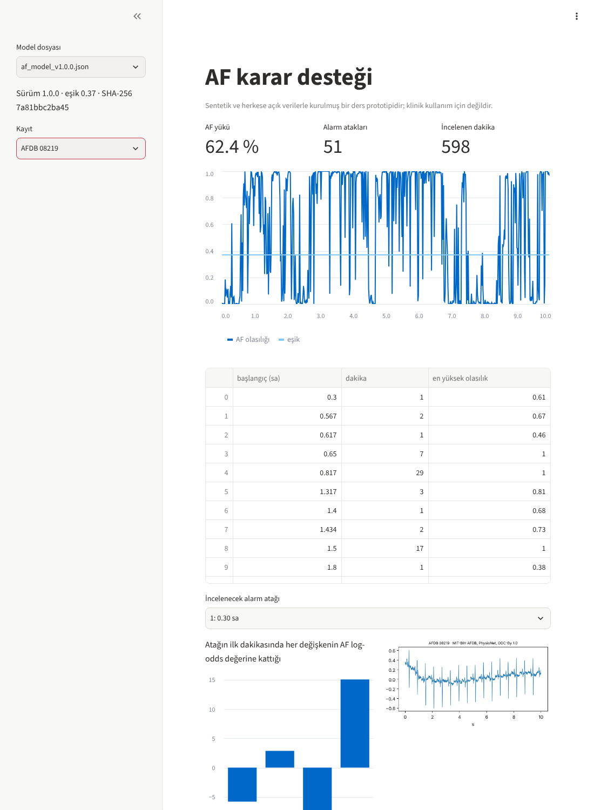
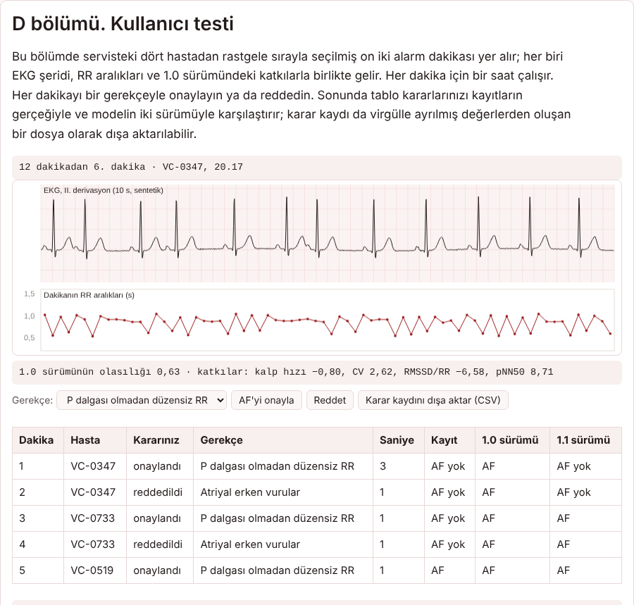

# Hafta 10: Klinik karar destek sistemleri

**Python ile Yapay Zekâ Eğitimi: Kardiyologlar için Uygulamalı Eğitim Programı** 
Türk Kardiyoloji Derneği

*Defterdeki bir modelden yatak başındaki bir prototipe: Arayüz, rapor, sürümler, gözetim ve piyasaya giden yol*

[Eğitimin ana sayfası](../../README.tr.md) · [İzlence](../../SYLLABUS.tr.md) · [Kurulum](../../SETUP.tr.md) · [English](../../en/week-10/README.md)

## Hafta hakkında

Dersin AF modeli bu hafta yatak başına gider. Bir klinik karar destek sistemi (KKDS) bir modelden fazlasıdır: Kullanıcıları, iş akışında bir yeri, bir arayüzü, başka sistemlerin okuyabileceği bir raporu, sürümleri ve karar veren bir hekimi vardır. İlk yarıda sanal kliniğin telemetri servisi için atriyal fibrilasyona (AF) yönelik bir prototip kurulur. Her dakikanın RR aralıklarını beş sayı tarif eder. Bunlardan dördünü kullanan ve kayıt düzeyinde ayrılmış MIT-BIH Atriyal Fibrilasyon Veri Tabanı Holter kayıtlarıyla eğitilen bir lojistik regresyon, testte 0,979 AUC değerine ulaşır. Dakika dakika hesaplanan olasılıklar alarm ataklarına ve AF yüküne dönüşür; her alarm da açıklaması ve EKG şeridiyle birlikte gelir. Model bir sürüm numarası, bir parmak izi ve bir model kartıyla birlikte bir dosyada tutulur. Rapor HL7 FHIR kaynakları olarak yazılır ve küçük bir tahmin servisiyle sunulur; Streamlit ile de bir web arayüzü kurulur. İkinci yarı modelin çevresindeki insanlara döner ve insan gözetimini, otomasyon yanlılığını ve bir kullanıcı testini ele alır. Kullanıcı testi doğrulama kayıtlarının 50 saatinde, çoğu erken vurulardan kaynaklanan 99 yanlış alarm atağı bulur. 1.1 sürümü örneklem entropisini ekler ve bu sayıyı 69 atağa indirir; bunun bedeli testte daha düşük bir duyarlılıktır. Hafta, karar destek yazılımları için Avrupa Birliği'ndeki, Türkiye'deki ve Amerika Birleşik Devletleri'ndeki düzenleyici yollar, hastanın bilgilendirilmesi ve onamı ile bir YZ asistanının yazdığı bir prototipin denetlenmesiyle kapanır.

Oturum 4 saat sürer. Haftalık proje için yaklaşık 3 saat ayrılmalıdır.

## Haftanın rotası

Ders sayfası haftanın ana rotasıdır. Sayfada kod ya da prompt (istem) bulunmaz; sayfa etkileşimli labla birlikte yukarıdan aşağıya okunur. Her uygulama durağında katılımcılar Jupyter defterindeki iki yoldan birini seçer. **Prompt yolunda** (Kısım 1) kodu, hazır promptlara göre bir yapay zekâ (YZ) asistanı yazar; katılımcı bu kodu çalıştırır ve sonucu denetler. **Python yolunda** (Kısım 2) ise kodu katılımcı kendisi yazar. İki yol da aynı sonuçlara varır. Defter hem kurulum gerektirmeyen Google Colab'da hem de kendi bilgisayarınızdaki Jupyter'de çalışır ([kurulum](../../SETUP.tr.md)).

|  | Ana rota: Ders sayfası ve etkileşimli lab | Uygulama durağı: Yolunuzu seçin |
|---|---|---|
| 1 | [Klinik karar destek sistemi nedir?](https://utkukose.github.io/ai-cardiology-tkd-NB-lecture/tr/hafta-10/ders.html#what-a-clinical-decision-support-system-is), [İş akışı: Kim neyi ne zaman görüyor?](https://utkukose.github.io/ai-cardiology-tkd-NB-lecture/tr/hafta-10/ders.html#the-workflow-who-sees-what-and-when), [RR aralıklarından AF: Bir dakikanın beş sayısı](https://utkukose.github.io/ai-cardiology-tkd-NB-lecture/tr/hafta-10/ders.html#af-from-rr-intervals-five-numbers-of-a-minute), [Olasılıklardan alarmlara ve AF yüküne](https://utkukose.github.io/ai-cardiology-tkd-NB-lecture/tr/hafta-10/ders.html#from-probabilities-to-alarms-and-the-af-burden) | **[Durak 1: Prototipin AF modeli](https://utkukose.github.io/ai-cardiology-tkd-NB-lecture/tr/hafta-10/ders.html#stop-1)** Prompt yolu: Kısım 1, Durak 1 Python yolu: Kısım 2, Python adımı 10, 1-4. bölümler |
| 2 | [Neden alarm verdi? Açıklama ve EKG şeridi](https://utkukose.github.io/ai-cardiology-tkd-NB-lecture/tr/hafta-10/ders.html#why-did-it-alarm-the-explanation-and-the-strip), [Sürümler, parmak izleri ve model kartı](https://utkukose.github.io/ai-cardiology-tkd-NB-lecture/tr/hafta-10/ders.html#versions-fingerprints-and-the-model-card), [HL7 FHIR: Başka sistemlerin okuyabileceği bir rapor](https://utkukose.github.io/ai-cardiology-tkd-NB-lecture/tr/hafta-10/ders.html#hl7-fhir-a-report-that-other-systems-can-read), [Tahmin servisleri: Bir adresin arkasındaki model](https://utkukose.github.io/ai-cardiology-tkd-NB-lecture/tr/hafta-10/ders.html#prediction-services-the-model-behind-an-address), [Defterden uygulamaya: Streamlit](https://utkukose.github.io/ai-cardiology-tkd-NB-lecture/tr/hafta-10/ders.html#from-notebook-to-application-streamlit) | **[Durak 2: Açıklama, rapor ve servis](https://utkukose.github.io/ai-cardiology-tkd-NB-lecture/tr/hafta-10/ders.html#stop-2)** Prompt yolu: Kısım 1, Durak 2 Python yolu: Kısım 2, 5-8. bölümler |
| 3 | [İnsan gözetimi: Kararı hekim verir](https://utkukose.github.io/ai-cardiology-tkd-NB-lecture/tr/hafta-10/ders.html#human-oversight-the-physician-decides), [Kullanıcı testi: Kullanıcıları iş başında izlemek](https://utkukose.github.io/ai-cardiology-tkd-NB-lecture/tr/hafta-10/ders.html#the-user-test-watching-users-at-work), [Prototipi iyileştirmek: 1.1 sürümü](https://utkukose.github.io/ai-cardiology-tkd-NB-lecture/tr/hafta-10/ders.html#improving-the-prototype-version-1-1), [Piyasaya giden yol: Karar destek yazılımlarının düzenlenmesi](https://utkukose.github.io/ai-cardiology-tkd-NB-lecture/tr/hafta-10/ders.html#the-route-to-the-market-regulation-of-decision-support-software), [Hastanın onamı ve bilgilendirilmesi](https://utkukose.github.io/ai-cardiology-tkd-NB-lecture/tr/hafta-10/ders.html#patient-consent-and-information) | **[Durak 3: Kullanıcı testi ve 1.1 sürümü](https://utkukose.github.io/ai-cardiology-tkd-NB-lecture/tr/hafta-10/ders.html#stop-3)** Prompt yolu: Kısım 1, Durak 3 Python yolu: Kısım 2, 9. ve 10. bölümler |
|  | [YZ asistanıyla çalışmak, 10. bölüm: Bir prototipi denetlemek](https://utkukose.github.io/ai-cardiology-tkd-NB-lecture/tr/hafta-10/ders.html#ai-pair-programming-part-10-reviewing-a-prototype), [Haftanın makalesi](https://utkukose.github.io/ai-cardiology-tkd-NB-lecture/tr/hafta-10/ders.html#the-paper-of-the-week), [Sanal klinik, 10. aşama: Yatak başında karar desteği](https://utkukose.github.io/ai-cardiology-tkd-NB-lecture/tr/hafta-10/ders.html#the-virtual-clinic-stage-10-decision-support-at-the-bedside) | "Kendi verinizle" bölümü, haftanın makalesi ve sanal klinik |

## Malzemeler

| Malzeme | Aç | İçeriği |
|---|---|---|
| **Ders sayfası (ana rota)** | [Ders sayfasını aç](https://utkukose.github.io/ai-cardiology-tkd-NB-lecture/tr/hafta-10/ders.html) | Vakayı, kavramları çözümlü örnekleriyle, servisin RR aralıklarının geri dönüş haritalarını gösteren üç boyutlu (3B) bir sahneyi, iki animasyonu, bilgi kontrolü sorularını, üç uygulama durağını, "Kendi verinizle" bölümünü, tekrar kartlarını ve kaynakları içerir. Sayfada kod ve prompt yer almaz. |
| **Etkileşimli lab** | [Etkileşimli labı aç](https://utkukose.github.io/ai-cardiology-tkd-NB-lecture/tr/hafta-10/lab.html) | Kod gerektirmeyen A'dan F'ye kadar altı bölümü (F bölümü prompt atölyesidir), öz değerlendirmeyi, yansıtma yazısını ve dışa aktarılabilen öğrenme günlüğünü içerir |
| **Jupyter defteri** |  [Jupyter için indir](NB10_klinik_karar_destegi.ipynb) | Kısım 1 prompt yoludur: Üç durakta toplam dokuz adım vardır ve her adımda hazır bir prompt, adımın tablosunu hazırlayan bir veri hücresi, YZ asistanının kodu için bir hücre, otomatik bir kontrol ve hazır kod bulunur. Kısmın sonunda haftalık proje dört promptla yer alır. Kısım 2 Python yoludur: Python adımı 10'u, A-J alıştırmalarıyla birlikte 1-10. bölümleri ve yedi alan için uygulama görevlerini içerir. Defter prototipin iki dosyasını, af_cdss.py ve app_af.py dosyalarını yazar. |
| **Prompt kütüphanesi** | [PROMPTLAR.md](PROMPTLAR.md) | Prompt yolunun bütün promptlarını, kodu onarmaya ve denetlemeye yarayan promptları ve haftalık projenin prompt yolunu içerir. GitHub'da her promptun yanında bir kopyalama düğmesi bulunur. |
| **PDF ders notu** | [Hafta10_Ders_Notlari.pdf](Hafta10_Ders_Notlari.pdf) | Ders sayfasının yazdırılabilir biçimidir; uygulama duraklarını ve "Kendi verinizle" bölümünü de içerir. |

<table>
<tr><td width="50%"></td><td width="50%"></td></tr>
<tr><td>Etkileşimli lab, A bölümü: Telemetri servisinin yatak başı ekranı; dakika dakika AF olasılığı, alarm atakları ve bir alarm dakikasının EKG şeridi, RR aralıkları ve sayıların katkıları. Sanal kliniğin sentetik verileri.</td><td>Prototipin Jupyter defterinin yazdığı ve streamlit run app_af.py komutuyla başlatılan web arayüzü: AFDB'nin 08219 kaydı, 1.0 sürümüyle. Veri: MIT-BIH AFDB, PhysioNet, ODC-By 1.0.</td></tr>
<tr><td width="50%"></td><td width="50%"></td></tr>
<tr><td>Etkileşimli lab, D bölümü: Servisin alarm dakikalarının EKG şeritlerine bakılarak onaylandığı ya da reddedildiği kullanıcı testi ve kararların kaydı.</td><td>Ders sayfası: Sinüs ritmindeki, erken vurulu ve AF'deki bir dakikada birbirine benzeyen aralık dizileriyle adım adım örneklem entropisi.</td></tr>
</table>

## Haftanın vakası

**VC-0128**, sanal kliniğin 71 yaşındaki bir kadın hastasıdır. Çarpıntı yakınmasıyla kardiyoloji servisine yatırılmış ve 24 saat telemetriyle izlenmektedir. Yatıştaki EKG'si sinüs ritmindedir. Saat 13.20'de servisin monitörü düzensiz ve hızlı bir ritim kaydeder; bu ritim 165 dakika sürer. Saat 21.40'ta kısa bir atak, 02.10'da da üçüncü bir atak gelir. Bir karar destek prototipi telemetrinin RR aralıklarını dakika dakika okur ve en uzunu 165 dakika süren 3 atakta yüzde 15,5 AF yükü bildirir. Nöbetçi kardiyolog bu mesajla ne yapacağına karar vermelidir: Bu bir AF mi? Mesajı kim, ne zaman görür? Kayda ne girer ve yazılımın hangi sürümüyle girer? Karardan kim sorumludur? Aynı prototip servisteki üç hasta için daha alarm verir; bu alarmların hepsi AF değildir.

## Öğrenme çıktıları

Haftanın sonunda katılımcıların bir klinik karar destek sistemini kullanıcıları, iş akışındaki yeri, alarmları ve bu alarmları izleyen kararla birlikte tarif edebilmeleri beklenmektedir. Bir dakikalık RR aralıklarından kalp hızını, değişim katsayısını, RMSSD değerini, pNN50 değerini ve örneklem entropisini hesaplayabilmeli; kayıt düzeyinde ayrılmış verilerle bir AF modeli eğitip doğrulayabilmeli, eşiğini doğrulama verilerinde seçebilmeli ve modelin olasılıklarını alarm ataklarına ve AF yüküne dönüştürebilmelidirler. Bir alarmı sayıların katkılarıyla ve EKG şeridiyle açıklayabilmeli, Streamlit ile küçük bir web arayüzü kurabilmeli, bir raporu HL7 FHIR kaynakları olarak yazabilmeli ve bir tahmin servisini çağırabilmelidirler. Son olarak sürümleri bir model kartı ve bir parmak iziyle tutabilmeli, bir kullanıcı testi planlayıp analiz edebilmeli, otomasyon yanlılığını tanıyabilmeli ve bir karar destek yazılımını hastanın bilgilendirilmesi ve onamıyla birlikte Avrupa Birliği'nin, Türkiye'nin ve Amerika Birleşik Devletleri'nin düzenleyici yollarına yerleştirebilmelidirler.

## Çalışma yolu

Oturuma katılanlar ana rotayı ve uygulama duraklarını oturumda tamamlar. Haftayı kendi başına izleyenler, örneğin bir oturumu kaçıranlar, aşağıdaki sürelerle plan yapabilir.

| Adım | Etkinlik | Prompt yolu | Python yolu |
|---|---|---|---|
| 1 | Haftanın vakasını ve ders sayfasını 1. uygulama durağına kadar okuyun; geri dönüş haritalarını gösteren 3B sahneyi inceleyin, etkileşimli labın A bölümünü yapın ve bilgi kontrolü sorularını cevaplayın | 55 dakika | 55 dakika |
| 2 | 1. uygulama durağı (oturumun mini projesi): Prompt yolunda Kısım 1'deki Durak 1'i, Python yolunda Python adımı 10'u ve 1-4. bölümleri çalışın | 35 dakika | 1 saat 30 dakika |
| 3 | 2. uygulama durağına kadar okumayı sürdürün (açıklama ve EKG şeridi, sürümler ve model kartı, HL7 FHIR, tahmin servisleri ve Streamlit); etkileşimli labın B bölümünü yapın | 45 dakika | 45 dakika |
| 4 | 2. uygulama durağı: Prompt yolunda Kısım 1'deki Durak 2'yi, Python yolunda 5-8. bölümleri çalışın; web arayüzünü Anaconda Prompt'tan başlatın | 40 dakika | 1 saat 30 dakika |
| 5 | 3. uygulama durağına kadar okumayı sürdürün (insan gözetimi, kullanıcı testi, 1.1 sürümü, piyasaya giden yol ve hastanın onamı); etkileşimli labın C ve D bölümlerini yapın | 50 dakika | 50 dakika |
| 6 | 3. uygulama durağı: Prompt yolunda Kısım 1'deki Durak 3'ü, Python yolunda 9. ve 10. bölümleri çalışın | 30 dakika | 50 dakika |
| 7 | Bir prototipin denetimini, haftanın makalesini, sanal kliniğin bu haftaki aşamasını ve "Kendi verinizle" bölümünü okuyun; etkileşimli labın E ve F bölümlerini yapın | 35 dakika | 35 dakika |
| 8 | Etkileşimli labın "Kendini sına" sekmesindeki öz değerlendirmeyi yapın, yansıtma yazınızı yazın ve öğrenme günlüğünü dışa aktarın | 20 dakika | 20 dakika |
| | **Haftalık proje dışında toplam** | **5 saat 10 dakika** | **7 saat 15 dakika** |
| 9 | Haftalık projeyi iki yoldan biriyle tamamlayın | 3 saat | 3 saat |

## Oturumun eğitim akışı

Haftanın dört saatlik oturumu aşağıdaki plana göre işlenir. Plan, malzemelerin canlı bir oturumda nasıl bir araya geldiğini göstermek için paylaşılmaktadır.

| Süre | Etkinlik |
|---|---|
| 0:00-0:15 | Haftanın vakası tanıtılır ve haftanın rotası anlatılır. Her katılımcı defteri Jupyter'de (Anaconda) açar ve 0. bölümü çalıştırır. Bu bölüm AFDB'nin 25 kaydının işaretleme dosyalarını ve üç sinyal dosyasını, toplam yaklaşık 86 MB'ı, bir ile üç dakikada PhysioNet'ten indirir ve her dosyayı denetler. |
| 0:15-1:00 | Ana rotada KKDS'nin ne olduğu, iş akışı ve alarmları, A bölümüyle birlikte bir dakikanın beş sayısıyla RR aralıklarından AF ve olasılıklardan alarmlara ve AF yüküne geçiş anlatılır. |
| 1:00-1:35 | Oturumun mini projesi olan 1. uygulama durağında katılımcılar iki gruba ayrılır: Prompt yolunu izleyenler ve Python yolunu izleyenler. Prototipin AF modeli kurulur, eşiği doğrulama kayıtlarında seçilir ve test kayıtlarının AF yükü hesaplanır. |
| 1:35-1:50 | Ara. |
| 1:50-2:35 | Ana rotada bir alarmın açıklaması ve EKG şeridi, sürümler ve model kartı, B bölümüyle HL7 FHIR, tahmin servisleri ve Streamlit ele alınır. 2. uygulama durağında 08219 kaydındaki bir yanlış alarmın açıklaması, model dosyası ve parmak izi, VC-0128'in FHIR raporu ve tahmin servisi çalışılır; web arayüzü Anaconda Prompt'ta başlatılır. |
| 2:35-3:20 | Ana rotada C bölümüyle insan gözetimi, D bölümüyle kullanıcı testi, 1.1 sürümü, piyasaya giden yol ve hastanın onamı ele alınır. 3. uygulama durağında kullanıcı testinin karar kaydı, doğrulama kayıtlarında 1.1 sürümü ve iki sürümün testi çalışılır. |
| 3:20-4:00 | Etkileşimli labın E ve F bölümleriyle bir prototipin denetimi çalışılır. Ardından haftanın makalesi, sanal kliniğin yatak başı aşaması, "Kendi verinizle" bölümü ve haftalık proje ele alınır. |

## Haftalık proje

**Ne yapılacak?** Dersin prototipini kullanıcılarının yapacağı gibi sınayın ve iyileştirin. Önce telemetri servisindeki bir kardiyolog için üç görev yazın; örneğin bir hastanın AF yükünü bulmak, ilk beş alarm atağını EKG şeritleriyle incelemek ve karar kaydında onaylamak ya da reddetmek. İkinci adımda bu görevleri 1.0 sürümüyle, doğrulama kayıtlarındaki 08219 kaydında ve servisin dört hastasında, web arayüzünde ya da etkileşimli labda yapın. Her alarm atağı için kararı, gerekçesini ve kararın kaç saniye sürdüğünü kaydedin. Üçüncü adımda hekimin 24 saatte incelemesi gereken atakları, yanlış alarm ataklarının oranını ve nedenlerini sayın. Dördüncü adımda prototipi iyileştirin: Dersin örneklem entropisini ekleyen 1.1 sürümünü ya da kendi önerdiğiniz bir iyileştirmeyi kullanın; eşiği yalnızca doğrulama kayıtlarında seçin. Beşinci adımda test kayıtlarını her sürüm için bir kez açın ve AUC değerini, duyarlılığı, özgüllüğü, yanlış alarm ataklarını ve AF yükündeki hatayı verin. Yeni sürüm için bir değişiklik kaydı ve model kartı yazın. Ayrıca serviste hangi sürümü kullanacağınızı ve hekimin hâlâ neyi denetlemesi gerektiğini yarım sayfada anlatın.

**Nereye bakılacak?** Ders: "İnsan gözetimi: Kararı hekim verir", "Kullanıcı testi: Kullanıcıları iş başında izlemek" ve "Prototipi iyileştirmek: 1.1 sürümü" bölümleri. Etkileşimli lab: C ve D bölümleri. Jupyter defteri: Kısım 1, 2. ve 3. duraklar ya da Kısım 2, 8-10. bölümler.

**Prompt yolu.** Proje, [prompt kütüphanesindeki](https://github.com/utkukose/ai-cardiology-tkd-NB-lecture/blob/main/tr/hafta-10/PROMPTLAR.md#haftal%C4%B1k-projenin-prompt-yolu) dört promptla da tamamlanabilir; her adım için bir prompt vardır. Jupyter defterinin 1. kısmının sonundaki "Prompt yolunda haftalık proje" bölümü her promptun tablosunu hazırlar. Bir promptun testi sağlanmadan sonraki prompta geçilmez.

**Örnek.** Dersin çalıştırmasında 1.0 sürümü doğrulama kayıtlarının 50 saatinde 99 yanlış alarm atağı vermiştir; yalnızca 08219 kaydında 240 yanlış alarm dakikası vardır. Servisin hekimi 24 saatte 80 alarm atağını incelemek zorunda kalırdı ve bunların 76 tanesi yanlıştı. 1.1 sürümü doğrulama kayıtlarındaki yanlış alarm ataklarını 69 atağa, servistekileri ise 15 atağın 11 tanesine indirmiştir. Test kayıtlarında duyarlılık 0,949 değerinden 0,924 değerine düşmüş, AF yükündeki hata ise 2,0 yüzde puandan 2,7 yüzde puana çıkmıştır: Değişiklik kaydı ikisini de bildirmelidir.

**Ne teslim edilecek?** [Rapor şablonuyla](../sablonlar/Rapor_Sablonu.docx) yazılmış, bir ya da iki sayfalık bir rapor teslim edilir. Raporda üç görev, kararların tablosu, iki sürümün doğrulama ve testteki karşılaştırması, değişiklik kaydı, model kartı ve sürüm seçimini anlatan yarım sayfa yer almalıdır. Rapora karar kaydını (CSV), YZ kullanım günlüğünü (araç, prompt, neyin denetlendiği, neyin değiştirildiği) ve çıktılarıyla birlikte Jupyter defterini ekleyin. AFDB'nin EKG şeritleri raporda "MIT-BIH AFDB, PhysioNet, ODC-By 1.0" atfıyla yer alabilir.

**Teslim.** Haftalık proje, 11. haftanın oturumundan önce utkukose@sdu.edu.tr ya da utkukose@gmail.com adresine e-postayla gönderilir. E-postaya "Ne teslim edilecek?" başlığında sayılan öğeler ve etkileşimli labdan dışa aktarılan öğrenme günlüğü eklenir. Haftalık projeler değerlendirmenin yüzde 40'ını oluşturur; değerlendirme ölçütleri izlencede yer almaktadır.

## Kendi verinizle

Ders sayfası, haftanın yöntemlerini kendi verinize nasıl uygulayacağınızı anlatan bir bölümle biter. Bu bölümde hangi sorunun hangi yönteme uyduğu, önce neyin denetleneceği, etik kurul onayı, Kişisel Verilerin Korunması Kanunu (KVKK) ve analizin nerede yapılacağı ele alınır. [Bölümü ders sayfasında okuyun](https://utkukose.github.io/ai-cardiology-tkd-NB-lecture/tr/hafta-10/ders.html#with-your-own-data).

## İsteğe bağlı araştırma ödevi

PubMed'de, 2018 ya da sonrasında yayımlanmış ve kardiyovasküler bir soru için bir yapay zekâ modelini klinik kullanıma almış, klinisyenlerin modeli nasıl kullandığını da bildirmiş bir çalışma bulun: Bir uyarı, bir rapor, bir gösterge paneli ya da bir uygulama olabilir. Çalışmayı yarım sayfada özetleyin. Özette çalışmadan önceki model ve başarımı, çıktısının iş akışındaki yeri, kullanıcılar ve aldıkları eğitim, önerinin ne sıklıkla izlendiği ya da geçersiz kılındığı ve hem hastalar hem de klinisyenlerin işi için sonuçlar yer almalıdır. [Haftanın makalesindeki](https://utkukose.github.io/ai-cardiology-tkd-NB-lecture/tr/hafta-10/ders.html#the-paper-of-the-week) üç soru özete yol gösterebilir. Ödev notlandırılmaz ve 11. haftanın final projesine hazırlık niteliğindedir.

## Bu haftadan sonra sanal klinik

Dersin AF modeli 10. haftada yatak başına ulaşır. Sanal kliniğin telemetri servisi artık her alarmın açıklamasını ve EKG şeridini gösteren, bir HL7 FHIR raporu yazan, sürümleri ve karar kaydı tutulan ve kullanıcı testinden geçmiş bir prototip kullanmaktadır. Sonuçlar ders sayfasının [Sanal klinik, 10. aşama](https://utkukose.github.io/ai-cardiology-tkd-NB-lecture/tr/hafta-10/ders.html#the-virtual-clinic-stage-10-decision-support-at-the-bedside) bölümünde yer almaktadır.

## Gelecek hafta

**Hafta 11: Final projesi ve sertifika.** Katılımcılar kendi kliniklerinden bir soru için veriden modele, modelin açıklamasına ve klinik değerlendirmesinin tasarımına uzanan bir çalışma hazırlar. Ayrıntılar için [eğitimin planına](../../README.tr.md#on-bir-hafta) bakabilirsiniz.

---

**Prof. Dr. Utku Köse**

Profesör, Bilgisayar Mühendisliği Bölümü, Süleyman Demirel Üniversitesi, Isparta, Türkiye 
Kurucu Müdür, Yapay Zekâ Uygulama ve Araştırma Merkezi (YAZEM), Süleyman Demirel Üniversitesi 
Bilgisayar Bilimleri Anabilim Dalı Başkanı, Bilgisayar Mühendisliği Bölümü, Süleyman Demirel Üniversitesi 
Diğer kurumlar: University of North Dakota (ABD), Universidad Panamericana (Meksiko, Meksika), Vel Tech University (Chennai, Hindistan) 
IEEE Kıdemli Üyesi, ACM Profesyonel Üyesi

[ORCID 0000-0002-9652-6415](https://orcid.org/0000-0002-9652-6415) | [utkukose.com](https://www.utkukose.com) | [github.com/utkukose](https://github.com/utkukose)

[utkukose@sdu.edu.tr](mailto:utkukose@sdu.edu.tr) | [utku.kose@und.edu](mailto:utku.kose@und.edu) | [ukose@up.edu.mx](mailto:ukose@up.edu.mx) | [utkukose@gmail.com](mailto:utkukose@gmail.com)

*İlk sürüm: Kasım 2026. İçerik CC BY 4.0, kod MIT.*

