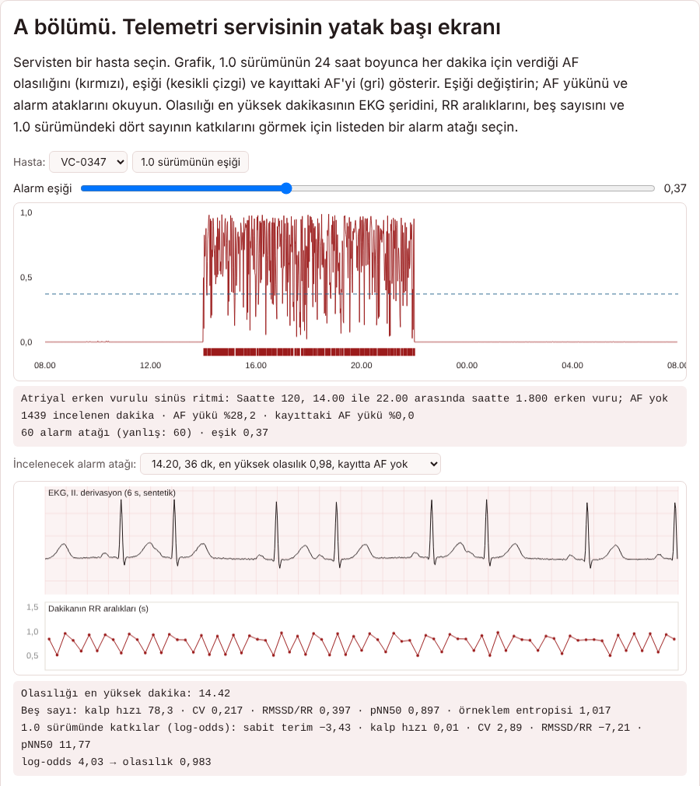
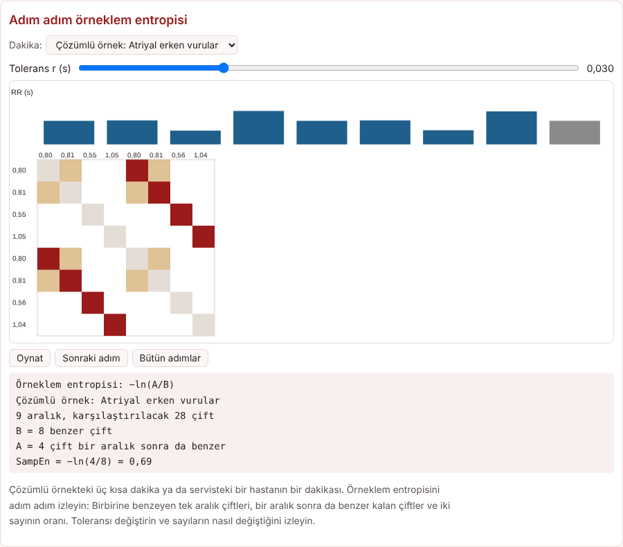

# Hafta 10: Klinik karar destek sistemleri (CDSS)

**Python ile Yapay Zekâ Eğitimi: Kardiyologlar için Uygulamalı Eğitim Programı** 
Türk Kardiyoloji Derneği

*AI modelini klinisyen araçlarına entegre etmek*

[Eğitimin ana sayfası](../../README.tr.md) · [İzlence](../../SYLLABUS.tr.md) · [Kurulum](../../SETUP.tr.md) · [English](../../en/week-10/README.md)

## Hafta hakkında

Dersin AF modeli bu hafta yatak başına gider. Bir klinik karar destek sistemi (CDSS) bir modelden fazlasıdır: Kullanıcıları, iş akışında bir yeri, bir arayüzü, başka sistemlerin okuyabileceği bir raporu, sürümleri ve karar veren bir hekimi vardır. İlk iki saat bir CDSS'in tasarım prensiplerini kapsar: CDSS'in ne olduğu ve klinik iş akışına nasıl entegre edildiği, Streamlit ile geliştirilen bir web arayüzü, HL7 FHIR standardı ve Flask ile FastAPI'yle gerçek zamanlı bir tahmin API'si (uygulama programlama arayüzü). Mini proje, sanal kliniğin telemetri servisi için bir AF tespit CDSS'i kurar: Bir EKG yüklenir, model tahmin eder, SHAP açıklamayı gösterir ve bir rapor üretilir. Her dakikanın RR aralıklarını beş sayı tarif eder. Bunlardan dördünü kullanan ve kayıt düzeyinde ayrılmış MIT-BIH Atriyal Fibrilasyon Veri Tabanı Holter kayıtlarıyla eğitilen bir lojistik regresyon, testte 0,979 AUC değerine ulaşır. Dakika dakika hesaplanan olasılıklar alarm ataklarına ve AF yüküne dönüşür, her alarm SHAP değerleri ve EKG şeridiyle birlikte gelir ve rapor HL7 FHIR kaynakları olarak yazılır. Son iki saat kullanıma alma (deployment) ve yayımlamaya döner: Model versiyonlama ve bir güncelleme stratejisi, hekimin döngüde kaldığı insan gözetimi ve otomasyon yanlılığı, FDA De Novo ve CE MDR süreçleri ile hastaların rızası ve verilerinin KVKK kapsamındaki gizliliği ele alınmaktadır. Haftalık proje bir kullanıcı test oturumudur. Kullanıcı testi doğrulama kayıtlarının 50 saatinde, çoğu erken vurulardan kaynaklanan 99 yanlış alarm atağı bulur. 1.1 sürümü örneklem entropisini ekler ve bu sayıyı 69 atağa indirir; bunun bedeli testte daha düşük bir duyarlılıktır. Hafta, bir yapay zekâ (YZ) asistanının yazdığı bir prototipin denetlenmesiyle kapanır.

Oturum 4 saat sürer. Haftalık proje için yaklaşık 3 saat ayrılmalıdır.

## Haftanın vakası

**VC-0128**, sanal kliniğin 71 yaşındaki bir kadın hastasıdır. Çarpıntı yakınmasıyla kardiyoloji servisine yatırılmış ve 24 saat telemetriyle izlenmektedir. Yatıştaki EKG'si sinüs ritmindedir. Saat 13.20'de servisin monitörü düzensiz ve hızlı bir ritim kaydeder; bu ritim 165 dakika sürer. Saat 21.40'ta kısa bir atak, 02.10'da da üçüncü bir atak gelir. Bir karar destek prototipi telemetrinin RR aralıklarını dakika dakika okur ve en uzunu 165 dakika süren 3 atakta yüzde 15,5 AF yükü bildirir. Nöbetçi kardiyolog bu mesajla ne yapacağına karar vermelidir: Bu bir AF mi? Mesajı kim, ne zaman görür? Kayda ne girer ve yazılımın hangi sürümüyle girer? Karardan kim sorumludur? Aynı prototip servisteki üç hasta için daha alarm verir; bu alarmların hepsi AF değildir.

## Malzemeler

| Malzeme | Aç | Ne işe yarar? |
|---|---|---|
| **Ders sayfası** | [Ders sayfasını aç](https://utkukose.github.io/ai-cardiology-tkd-NB-lecture/tr/hafta-10/ders.html) | Haftanın anlatımıdır. Yukarıdan aşağıya okunur, uygulama duraklarına götürür ve kod ya da prompt (istem) içermez. |
| **Etkileşimli lab** | [Etkileşimli labı aç](https://utkukose.github.io/ai-cardiology-tkd-NB-lecture/tr/hafta-10/lab.html) | Kod gerektirmeyen A-F bölümleri, ders sayfasında yeri geldiğinde açılır. F bölümü prompt atölyesidir. Öz değerlendirme ve öğrenme günlüğü de labdadır. |
| **Jupyter defteri** |  [Jupyter için indir](NB10_klinik_karar_destegi.ipynb) | Uygulama durakları burada çalışılır: Kısım 1 prompt yolu, Kısım 2 Python yoludur. Defter Google Colab'da kurulum gerektirmeden ya da kendi bilgisayarınızdaki Jupyter'de çalışır. |
| **Prompt kütüphanesi** | [PROMPTLAR.md](PROMPTLAR.md) | Prompt yolunun ve haftalık projenin bütün promptlarını, kodu onarmak, açıklatmak ve denetlemek için promptlarla birlikte içerir. GitHub'da her promptun yanında bir kopyalama düğmesi bulunur. |
| **PDF ders notu** | [Hafta10_Ders_Notlari.pdf](Hafta10_Ders_Notlari.pdf) | Ders sayfasının yazdırılabilir biçimidir. |

## Çalışma yolu

Ders sayfası yukarıdan aşağıya okunur ve etkileşimli labın bölümlerini yeri geldikçe açar. Her uygulama durağında çalışma Jupyter defterinde, iki yoldan biriyle sürer. **Prompt yolunda** (defterin 1. kısmı) kodu hazır promptlarla bir YZ asistanı yazar; katılımcı kodu çalıştırır ve sonucu denetler. **Python yolunda** (2. kısım) kodu katılımcı kendisi yazar. İki yol da aynı sonuçlara varır. Oturuma katılanlar adımları oturumda tamamlar. Süreler, haftayı kendi başına izleyenler, örneğin bir oturumu kaçıranlar içindir.

| Adım | Ne yapılır? | Prompt yolu (Kısım 1) | Python yolu (Kısım 2) |
|---|---|---|---|
| 1 | Haftanın vakasını ve ders sayfasını 1. uygulama durağına kadar [okuyun](https://utkukose.github.io/ai-cardiology-tkd-NB-lecture/tr/hafta-10/ders.html) (CDSS'in ne olduğu ve klinik iş akışına entegrasyonu, ardından bir dakikanın beş sayısıyla mini proje, geri dönüş haritalarının 3B sahnesi ve olasılıklardan alarmlara geçiş); etkileşimli labın A bölümünü yapın ve bilgi kontrolü sorularını cevaplayın | 1 saat | 1 saat |
| 2 | **[1. uygulama durağı: Prototipin AF modeli](https://utkukose.github.io/ai-cardiology-tkd-NB-lecture/tr/hafta-10/ders.html#stop-1)** Oturumun mini projesinin ilk kısmı. | Kısım 1, Durak 1 ([promptlar](PROMPTLAR.md#durak-1-prototipin-af-modeli)) 35 dakika | Python adımı 10, 1-4. bölümler 1 saat 30 dakika |
| 3 | 2. uygulama durağına kadar [okumayı sürdürün](https://utkukose.github.io/ai-cardiology-tkd-NB-lecture/tr/hafta-10/ders.html#why-did-it-alarm-the-explanation-and-the-strip) (bir alarmın SHAP açıklaması ve EKG şeridi, model dosyası ve kartı, Streamlit ile web arayüzü, HL7 FHIR standardı ve Flask ile FastAPI'yle gerçek zamanlı tahmin API'si); etkileşimli labın B bölümünü yapın | 50 dakika | 50 dakika |
| 4 | **[2. uygulama durağı: Açıklama, rapor ve servis](https://utkukose.github.io/ai-cardiology-tkd-NB-lecture/tr/hafta-10/ders.html#stop-2)** Uçtan uca mini proje: Web arayüzü Anaconda Prompt'tan başlatılır ve arayüze bir EKG yüklenir. | Kısım 1, Durak 2 ([promptlar](PROMPTLAR.md#durak-2-a%C3%A7%C4%B1klama-rapor-ve-servis)) 45 dakika | 5-8. bölümler 1 saat 35 dakika |
| 5 | 3. uygulama durağına kadar [okumayı sürdürün](https://utkukose.github.io/ai-cardiology-tkd-NB-lecture/tr/hafta-10/ders.html#last-two-hours-deployment-and-publishing) (model versiyonlama ve güncelleme stratejisi, insan gözetimi, FDA De Novo ve CE MDR süreçleri, KVKK kapsamında hasta rızası ve veri gizliliği, kullanıcı test oturumu ve 1.1 sürümü); etkileşimli labın C ve D bölümlerini yapın | 55 dakika | 55 dakika |
| 6 | **[3. uygulama durağı: Kullanıcı testi ve 1.1 sürümü](https://utkukose.github.io/ai-cardiology-tkd-NB-lecture/tr/hafta-10/ders.html#stop-3)** | Kısım 1, Durak 3 ([promptlar](PROMPTLAR.md#durak-3-kullan%C4%B1c%C4%B1-testi-ve-11-s%C3%BCr%C3%BCm%C3%BC)) 30 dakika | 9. ve 10. bölümler 50 dakika |
| 7 | Bir prototipin denetimini, haftanın makalesini, sanal kliniğin bu haftaki aşamasını ve "Kendi verinizle" bölümünü [okuyun](https://utkukose.github.io/ai-cardiology-tkd-NB-lecture/tr/hafta-10/ders.html#ai-pair-programming-part-10-reviewing-a-prototype); etkileşimli labın E ve F bölümlerini yapın | 35 dakika | 35 dakika |
| 8 | [Etkileşimli labın](https://utkukose.github.io/ai-cardiology-tkd-NB-lecture/tr/hafta-10/lab.html) "Kendini sına" sekmesindeki öz değerlendirmeyi yapın, yansıtma yazınızı yazın ve öğrenme günlüğünü dışa aktarın | 20 dakika | 20 dakika |
| | **Haftalık proje dışında toplam** | **5 saat 30 dakika** | **7 saat 35 dakika** |
| 9 | [Haftalık projeyi](#haftal%C4%B1k-proje) iki yoldan biriyle tamamlayın | [Promptlar](PROMPTLAR.md#haftal%C4%B1k-projenin-prompt-yolu) 3 saat | 3 saat |

<table>
<tr><td width="50%"></td><td width="50%"></td></tr>
<tr><td>Etkileşimli lab, A bölümü: Telemetri servisinin yatak başı ekranı; dakika dakika AF olasılığı, alarm atakları ve bir alarm dakikasının EKG şeridi, RR aralıkları ve sayıların katkıları. Sanal kliniğin sentetik verileri.</td><td>Prototipin Jupyter defterinin yazdığı ve streamlit run app_af.py komutuyla başlatılan web arayüzü: AFDB'nin 08219 kaydı, 1.0 sürümüyle. Veri: MIT-BIH AFDB, PhysioNet, ODC-By 1.0.</td></tr>
<tr><td width="50%"></td><td width="50%"></td></tr>
<tr><td>Etkileşimli lab, D bölümü: Servisin alarm dakikalarının EKG şeritlerine bakılarak onaylandığı ya da reddedildiği kullanıcı testi ve kararların kaydı.</td><td>Ders sayfası: Sinüs ritmindeki, erken vurulu ve AF'deki bir dakikada birbirine benzeyen aralık dizileriyle adım adım örneklem entropisi.</td></tr>
</table>

## Haftalık proje

**Proje.** Kullanıcı test oturumu: Geri bildirimlerle CDSS prototipini iyileştirme.

**Ne yapılacak?** Dersin prototipini kullanıcılarının yapacağı gibi sınayın ve iyileştirin. Önce telemetri servisindeki bir kardiyolog için üç görev yazın; örneğin bir hastanın AF yükünü bulmak, ilk beş alarm atağını EKG şeritleriyle incelemek ve karar kaydında onaylamak ya da reddetmek. İkinci adımda bu görevleri 1.0 sürümüyle, doğrulama kayıtlarındaki 08219 kaydında ve servisin dört hastasında, web arayüzünde ya da etkileşimli labda yapın. Her alarm atağı için kararı, gerekçesini ve kararın kaç saniye sürdüğünü kaydedin. Üçüncü adımda hekimin 24 saatte incelemesi gereken atakları, yanlış alarm ataklarının oranını ve nedenlerini sayın. Dördüncü adımda prototipi iyileştirin: Dersin örneklem entropisini ekleyen 1.1 sürümünü ya da kendi önerdiğiniz bir iyileştirmeyi kullanın; eşiği yalnızca doğrulama kayıtlarında seçin. Beşinci adımda test kayıtlarını her sürüm için bir kez açın ve AUC değerini, duyarlılığı, özgüllüğü, yanlış alarm ataklarını ve AF yükündeki hatayı verin. Yeni sürüm için bir değişiklik kaydı ve model kartı yazın. Ayrıca serviste hangi sürümü kullanacağınızı ve hekimin hâlâ neyi denetlemesi gerektiğini yarım sayfada anlatın.

**Nereye bakılacak?** Ders: "Model versiyonlama ve güncelleme stratejisi", "Klinik AI'da insan gözetimi (human-in-the-loop)" ve "Kullanıcı test oturumu: Geri bildirimlerle CDSS prototipini iyileştirme" bölümleri ile bu son bölümün kullanıcı testi ve 1.1 sürümü alt bölümleri. Etkileşimli lab: C ve D bölümleri. Jupyter defteri: Kısım 1, 2. ve 3. duraklar ya da Kısım 2, 8-10. bölümler.

**Prompt yolu.** Proje, [prompt kütüphanesindeki](https://github.com/utkukose/ai-cardiology-tkd-NB-lecture/blob/main/tr/hafta-10/PROMPTLAR.md#haftal%C4%B1k-projenin-prompt-yolu) dört promptla da tamamlanabilir; her adım için bir prompt vardır. Jupyter defterinin 1. kısmının sonundaki "Prompt yolunda haftalık proje" bölümü her promptun tablosunu hazırlar. Bir promptun testi sağlanmadan sonraki prompta geçilmez.

**Örnek.** Dersin çalıştırmasında 1.0 sürümü doğrulama kayıtlarının 50 saatinde 99 yanlış alarm atağı vermiştir; yalnızca 08219 kaydında 240 yanlış alarm dakikası vardır. Servisin hekimi 24 saatte 80 alarm atağını incelemek zorunda kalırdı ve bunların 76 tanesi yanlıştı. 1.1 sürümü doğrulama kayıtlarındaki yanlış alarm ataklarını 69 atağa, servistekileri ise 15 atağın 11 tanesine indirmiştir. Test kayıtlarında duyarlılık 0,949 değerinden 0,924 değerine düşmüş, AF yükündeki hata ise 2,0 yüzde puandan 2,7 yüzde puana çıkmıştır: Değişiklik kaydı ikisini de bildirmelidir.

**Ne teslim edilecek?** [Rapor şablonuyla](../sablonlar/Rapor_Sablonu.docx) yazılmış, bir ya da iki sayfalık bir rapor teslim edilir. Raporda üç görev, kararların tablosu, iki sürümün doğrulama ve testteki karşılaştırması, değişiklik kaydı, model kartı ve sürüm seçimini anlatan yarım sayfa yer almalıdır. Rapora karar kaydını (CSV), YZ kullanım günlüğünü (araç, prompt, neyin denetlendiği, neyin değiştirildiği) ve çıktılarıyla birlikte Jupyter defterini ekleyin. AFDB'nin EKG şeritleri raporda "MIT-BIH AFDB, PhysioNet, ODC-By 1.0" atfıyla yer alabilir.

**Teslim.** Haftalık proje, 11. haftanın oturumundan önce utkukose@sdu.edu.tr ya da utkukose@gmail.com adresine e-postayla gönderilir. E-postaya "Ne teslim edilecek?" başlığında sayılan öğeler ve etkileşimli labdan dışa aktarılan öğrenme günlüğü eklenir. Haftalık projeler değerlendirmenin yüzde 40'ını oluşturur; değerlendirme ölçütleri izlencede yer almaktadır.

## Öğrenme çıktıları

Haftanın sonunda katılımcıların bir klinik karar destek sistemini (CDSS) kullanıcıları, klinik iş akışındaki yeri, alarmları ve bu alarmları izleyen kararla birlikte tarif edebilmeleri beklenmektedir. Bir dakikalık RR aralıklarından kalp hızını, değişim katsayısını, RMSSD değerini, pNN50 değerini ve örneklem entropisini hesaplayabilmeli; kayıt düzeyinde ayrılmış verilerle bir AF modeli eğitip doğrulayabilmeli, eşiğini doğrulama verilerinde seçebilmeli ve modelin olasılıklarını alarm ataklarına ve AF yüküne dönüştürebilmelidirler. Yüklenen bir EKG'den tahmine, bir alarmın SHAP açıklamasına ve bir rapora uzanan AF tespit CDSS zincirini kurabilmeli, Streamlit ile bir web arayüzü geliştirebilmeli, bir raporu HL7 FHIR kaynakları olarak yazabilmeli, bir modeli Flask ile gerçek zamanlı bir tahmin API'si üzerinden sunabilmeli ve FastAPI'nin neler kattığını açıklayabilmelidirler. Son olarak sürümleri bir model kartı ve bir parmak iziyle numaralandırıp güncelleyebilmeli, hekimi döngüde tutabilmeli ve otomasyon yanlılığını tanıyabilmeli, bir kullanıcı testi planlayıp analiz edebilmeli, FDA De Novo ve CE MDR süreçlerini anlatabilmeli ve hastaların rızasını ve verilerinin gizliliğini KVKK kapsamında koruyabilmelidirler.

## Oturumun eğitim akışı

Haftanın dört saatlik oturumu aşağıdaki plana göre işlenir. Plan, malzemelerin canlı bir oturumda nasıl bir araya geldiğini göstermek için paylaşılmaktadır.

| Süre | Etkinlik |
|---|---|
| 0:00-0:15 | Haftanın vakası tanıtılır ve haftanın rotası anlatılır. Her katılımcı defteri Jupyter'de (Anaconda) açar ve 0. bölümü çalıştırır. Bu bölüm AFDB'nin 25 kaydının işaretleme dosyalarını ve üç sinyal dosyasını, toplam yaklaşık 86 MB'ı, bir ile üç dakikada PhysioNet'ten indirir ve her dosyayı denetler. |
| 0:15-1:00 | İlk iki saat, CDSS tasarım prensipleri: CDSS'in ne olduğu ve klinik iş akışına entegrasyonu, ardından oturumun mini projesi olan AF tespit CDSS'i kapsamında A bölümüyle birlikte RR aralıklarından AF ve bir dakikanın beş sayısı, olasılıklardan alarmlara ve AF yüküne geçiş. |
| 1:00-1:35 | Oturumun mini projesi olan 1. uygulama durağında katılımcılar iki gruba ayrılır: Prompt yolunu izleyenler ve Python yolunu izleyenler. Prototipin AF modeli kurulur, eşiği doğrulama kayıtlarında seçilir ve test kayıtlarının AF yükü hesaplanır. |
| 1:35-1:50 | Ara. |
| 1:50-2:35 | İlk iki saatin devamı: Bir alarmın SHAP açıklaması ve EKG şeridi, model dosyası, Streamlit ile geliştirilen web arayüzü, B bölümüyle HL7 FHIR standardı ve Flask ile FastAPI'yle gerçek zamanlı tahmin API'si. 2. uygulama durağı mini projeyi tamamlar: 08219 kaydındaki bir yanlış alarmın SHAP değerleri, model dosyası ve parmak izi, VC-0128'in FHIR raporu, tahmin servisi ve yüklenen bir EKG'den rapora uzanan bütün zincir çalışılır; zincir Anaconda Prompt'ta başlatılan web arayüzünde de denenir. |
| 2:35-3:20 | Son iki saat, kullanıma alma (deployment) ve yayımlama: Model versiyonlama ve güncelleme stratejisi, C bölümüyle hekimi döngüde tutan insan gözetimi, FDA De Novo ve CE MDR süreçleri, KVKK kapsamında hasta rızası ve veri gizliliği, D bölümüyle kullanıcı test oturumu ve 1.1 sürümü. 3. uygulama durağında kullanıcı testinin karar kaydı, doğrulama kayıtlarında 1.1 sürümü ve iki sürümün testi çalışılır. |
| 3:20-4:00 | Etkileşimli labın E ve F bölümleriyle bir prototipin denetimi çalışılır. Ardından haftanın makalesi, sanal kliniğin yatak başı aşaması, "Kendi verinizle" bölümü ve haftalık proje ele alınır. |

## Kendi verinizle

Ders sayfası, haftanın yöntemlerini kendi verinize nasıl uygulayacağınızı anlatan bir bölümle biter. Bu bölümde hangi sorunun hangi yönteme uyduğu, önce neyin denetleneceği, etik kurul onayı, Kişisel Verilerin Korunması Kanunu (KVKK) ve analizin nerede yapılacağı ele alınır. [Bölümü ders sayfasında okuyun](https://utkukose.github.io/ai-cardiology-tkd-NB-lecture/tr/hafta-10/ders.html#with-your-own-data).

## İsteğe bağlı araştırma ödevi

PubMed'de, 2018 ya da sonrasında yayımlanmış ve kardiyovasküler bir soru için bir yapay zekâ modelini klinik kullanıma almış, klinisyenlerin modeli nasıl kullandığını da bildirmiş bir çalışma bulun: Bir uyarı, bir rapor, bir gösterge paneli ya da bir uygulama olabilir. Çalışmayı yarım sayfada özetleyin. Özette çalışmadan önceki model ve başarımı, çıktısının iş akışındaki yeri, kullanıcılar ve aldıkları eğitim, önerinin ne sıklıkla izlendiği ya da geçersiz kılındığı ve hem hastalar hem de klinisyenlerin işi için sonuçlar yer almalıdır. [Haftanın makalesindeki](https://utkukose.github.io/ai-cardiology-tkd-NB-lecture/tr/hafta-10/ders.html#the-paper-of-the-week) üç soru özete yol gösterebilir. Ödev notlandırılmaz ve 11. haftanın final projesine hazırlık niteliğindedir.

## Bu haftadan sonra sanal klinik

Dersin AF modeli 10. haftada yatak başına ulaşır. Sanal kliniğin telemetri servisi artık her alarmın açıklamasını ve EKG şeridini gösteren, bir HL7 FHIR raporu yazan, sürümleri ve karar kaydı tutulan ve kullanıcı testinden geçmiş bir prototip kullanmaktadır. Sonuçlar ders sayfasının [Sanal klinik, 10. aşama](https://utkukose.github.io/ai-cardiology-tkd-NB-lecture/tr/hafta-10/ders.html#the-virtual-clinic-stage-10-decision-support-at-the-bedside) bölümünde yer almaktadır.

## Gelecek hafta

**Hafta 11: Final projesi ve mezuniyet.** Katılımcılar kendi kliniklerinden bir soru için veriden modele, modelin açıklamasına ve klinik değerlendirmesinin tasarımına uzanan bir çalışma hazırlar. Ayrıntılar için [eğitimin planına](../../README.tr.md#on-bir-hafta) bakabilirsiniz.

---

**Prof. Dr. Utku Köse**

Profesör, Bilgisayar Mühendisliği Bölümü, Süleyman Demirel Üniversitesi, Isparta, Türkiye 
Kurucu Müdür, Yapay Zekâ Uygulama ve Araştırma Merkezi (YAZEM), Süleyman Demirel Üniversitesi 
Bilgisayar Bilimleri Anabilim Dalı Başkanı, Bilgisayar Mühendisliği Bölümü, Süleyman Demirel Üniversitesi 
Diğer kurumlar: University of North Dakota (ABD), Universidad Panamericana (Meksiko, Meksika), Vel Tech University (Chennai, Hindistan) 
IEEE Kıdemli Üyesi, ACM Profesyonel Üyesi

[ORCID 0000-0002-9652-6415](https://orcid.org/0000-0002-9652-6415) | [utkukose.com](https://www.utkukose.com) | [github.com/utkukose](https://github.com/utkukose)

[utkukose@sdu.edu.tr](mailto:utkukose@sdu.edu.tr) | [utku.kose@und.edu](mailto:utku.kose@und.edu) | [ukose@up.edu.mx](mailto:ukose@up.edu.mx) | [utkukose@gmail.com](mailto:utkukose@gmail.com)

*İlk sürüm: Kasım 2026. İçerik CC BY 4.0, kod MIT.*

