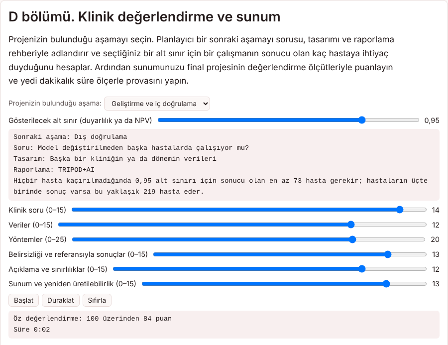
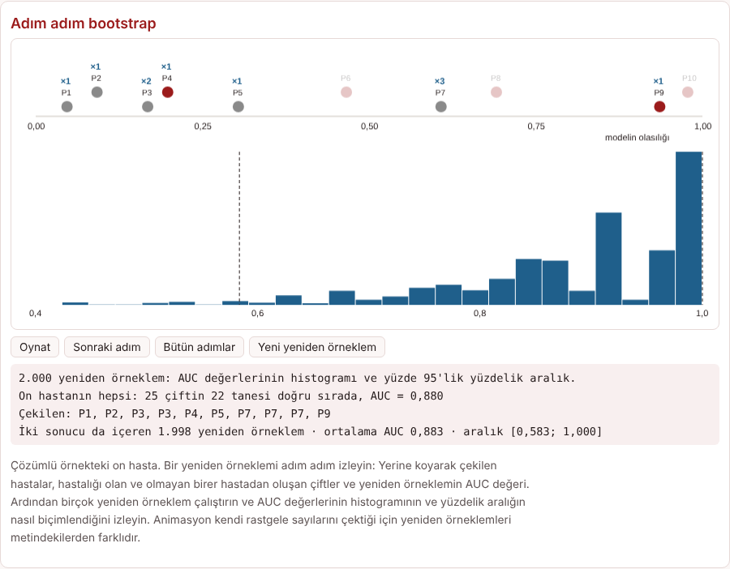

# Hafta 11: Final projesi ve sertifika

**Python ile Yapay Zekâ Eğitimi: Kardiyologlar için Uygulamalı Eğitim Programı** 
Türk Kardiyoloji Derneği

*Kendi kliniğinizin bir sorusundan başkalarının denetleyebileceği bir projeye: Veri, model, belirsizlik, değerlendirme ve sunum*

[Eğitimin ana sayfası](../../README.tr.md) · [İzlence](../../SYLLABUS.tr.md) · [Kurulum](../../SETUP.tr.md) · [English](../../en/week-11/README.md)

## Hafta hakkında

Son hafta dersin yöntemlerini katılımcıların final projelerine dönüştürür. Bir proje, kendi kliniğinizden verilerle cevaplanabilecek biçimde sorulmuş bir soruyla başlar. Ardından verilere ve denetimlerine, bir modelin ihtiyaç duyduğu veri büyüklüğüne, geçilmesi gereken bir referansa, modelin kendisine, belirsizliğine ve kalibrasyonuna, bir karar eşiğine, modelin neyi kullandığına ve nerede yanılabileceğine ve klinik değerlendirmesinin planına uzanır. Hafta boyunca, eğitimin 1. haftadan beri kullandığı Cleveland verisi üzerinde çözümlü bir proje ilerler. Projenin sorusu şudur: Egzersiz testinden sonra rutin değişkenler koroner arter hastalığını dışlayıp koroner anjiyografiye sevki önleyebilir mi? Sekiz değişkenli model testte 0,931 AUC değerine ulaşmaktadır; ancak yaş, cinsiyet ve göğüs ağrısı tipinden oluşan referansa göre kazancının aralığı [−0,020; 0,094] olarak bulunur ve sıfırı içerir. Veriler de Riley ve arkadaşlarının üç ölçütünden ikisinin istediğinden küçüktür. Dışlama eşiğinde model, hastalığı olan hiçbir hastayı kaçırmadan 76 test hastasının 27 tanesinde anjiyografiyi gereksiz kılardı. Oturumun ikinci yarısında final projeleri sunulur, bir jüri ve katılımcılar tarafından değerlendirilir; kişisel eylem planları paylaşılır ve sertifikalar verilir. Hafta, TRIPOD+AI raporlama rehberiyle, DECIDE-AI'dan randomize bir çalışmaya uzanan klinik değerlendirme aşamalarıyla ve bir YZ asistanıyla yazılmış bir final projesinin denetlenmesiyle kapanır.

Oturum 4 saat sürer ve bunun yarısı sunumlara ayrılır; buna final projesinin süresi eklenir.

## Haftanın rotası

Ders sayfası haftanın ana rotasıdır. Sayfada kod ya da prompt (istem) bulunmaz; sayfa etkileşimli labla birlikte yukarıdan aşağıya okunur. Her uygulama durağında katılımcılar Jupyter defterindeki iki yoldan birini seçer. **Prompt yolunda** (Kısım 1) kodu, hazır promptlara göre bir yapay zekâ (YZ) asistanı yazar; katılımcı bu kodu çalıştırır ve sonucu denetler. **Python yolunda** (Kısım 2) ise kodu katılımcı kendisi yazar. İki yol da aynı sonuçlara varır. Defter hem kurulum gerektirmeyen Google Colab'da hem de kendi bilgisayarınızdaki Jupyter'de çalışır ([kurulum](../../SETUP.tr.md)).

| Ana rota: Ders sayfası ve etkileşimli lab | Uygulama durağı | Prompt yolu (Kısım 1) | Python yolu (Kısım 2) |
|---|---|---|---|
| [Sorudan projeye](https://utkukose.github.io/ai-cardiology-tkd-NB-lecture/tr/hafta-11/ders.html#from-a-question-to-a-project) [Veriler: Kaynak, izin ve denetim](https://utkukose.github.io/ai-cardiology-tkd-NB-lecture/tr/hafta-11/ders.html#the-data-source-permission-and-audit) [Ne kadar veri: Riley ve arkadaşlarının ölçütleri](https://utkukose.github.io/ai-cardiology-tkd-NB-lecture/tr/hafta-11/ders.html#how-much-data-the-criteria-of-riley-and-colleagues) [Önce bir referans](https://utkukose.github.io/ai-cardiology-tkd-NB-lecture/tr/hafta-11/ders.html#a-reference-first) | **[Durak 1: Soru, veriler ve bir referans](https://utkukose.github.io/ai-cardiology-tkd-NB-lecture/tr/hafta-11/ders.html#stop-1)** | Durak 1 | Python adımı 11 ve 1-4. bölümler |
| [Belirsizlik: Bootstrap](https://utkukose.github.io/ai-cardiology-tkd-NB-lecture/tr/hafta-11/ders.html#uncertainty-the-bootstrap) [Kalibrasyon: Olasılıklar tutuyor mu?](https://utkukose.github.io/ai-cardiology-tkd-NB-lecture/tr/hafta-11/ders.html#calibration-do-the-probabilities-hold) | **[Durak 2: Belirsizlik ve kalibrasyon](https://utkukose.github.io/ai-cardiology-tkd-NB-lecture/tr/hafta-11/ders.html#stop-2)** | Durak 2 | 5. ve 6. bölümler |
| [Bir karar eşiği: Dışlama](https://utkukose.github.io/ai-cardiology-tkd-NB-lecture/tr/hafta-11/ders.html#a-decision-threshold-ruling-out) [Model neyi kullanıyor ve nerede yanılabilir?](https://utkukose.github.io/ai-cardiology-tkd-NB-lecture/tr/hafta-11/ders.html#what-the-model-uses-and-where-it-may-fail) | **[Durak 3: Dışlama ve sınırları](https://utkukose.github.io/ai-cardiology-tkd-NB-lecture/tr/hafta-11/ders.html#stop-3)** | Durak 3 | 7-10. bölümler |
| [TRIPOD+AI ile raporlama](https://utkukose.github.io/ai-cardiology-tkd-NB-lecture/tr/hafta-11/ders.html#reporting-with-tripod-ai) [Klinik değerlendirmeyi tasarlamak](https://utkukose.github.io/ai-cardiology-tkd-NB-lecture/tr/hafta-11/ders.html#designing-the-clinical-evaluation) [Sunum ve kişisel eylem planı](https://utkukose.github.io/ai-cardiology-tkd-NB-lecture/tr/hafta-11/ders.html#the-presentation-and-the-personal-action-plan) [Sertifika](https://utkukose.github.io/ai-cardiology-tkd-NB-lecture/tr/hafta-11/ders.html#the-certificate) [YZ asistanıyla çalışmak, 11. bölüm: Bir final projesini denetlemek](https://utkukose.github.io/ai-cardiology-tkd-NB-lecture/tr/hafta-11/ders.html#ai-pair-programming-part-11-reviewing-a-final-project) [Haftanın makalesi](https://utkukose.github.io/ai-cardiology-tkd-NB-lecture/tr/hafta-11/ders.html#the-paper-of-the-week) [Sanal klinik, 11. aşama: Katılımcıların klinikleri](https://utkukose.github.io/ai-cardiology-tkd-NB-lecture/tr/hafta-11/ders.html#the-virtual-clinic-stage-11-the-clinics-of-the-participants) | "Kendi verinizle" bölümü, haftanın makalesi ve sanal klinik | – | – |

## Malzemeler

| Malzeme | Aç | İçeriği |
|---|---|---|
| **Ders sayfası (ana rota)** | [Ders sayfasını aç](https://utkukose.github.io/ai-cardiology-tkd-NB-lecture/tr/hafta-11/ders.html) | Vakayı, bir final projesinin adımlarını çözümlü örnekleriyle, test hastalarını ve dışlama eşiğini gösteren üç boyutlu (3B) bir sahneyi, bootstrap animasyonunu, bilgi kontrolü sorularını, üç uygulama durağını, "Kendi verinizle" bölümünü, tekrar kartlarını ve kaynakları içerir. Sayfada kod ve prompt yer almaz. |
| **Etkileşimli lab** | [Etkileşimli labı aç](https://utkukose.github.io/ai-cardiology-tkd-NB-lecture/tr/hafta-11/lab.html) | Kod gerektirmeyen A'dan F'ye kadar altı bölümü (F bölümü prompt atölyesidir), öz değerlendirmeyi, yansıtma yazısını ve dışa aktarılabilen öğrenme günlüğünü içerir |
| **Jupyter defteri** |  [Jupyter için indir](NB11_final_projesi_atolyesi.ipynb) | Kısım 1 prompt yoludur: Üç durakta toplam dokuz adım vardır ve her adımda hazır bir prompt, adımın tablosunu hazırlayan bir veri hücresi, YZ asistanının kodu için bir hücre, otomatik bir kontrol ve hazır kod bulunur; kısmın sonunda final projesi dört promptla yer alır. Kısım 2 Python yoludur: Python adımı 11'i, A-J alıştırmalarıyla birlikte 1-10. bölümleri, yedi alan için uygulama görevlerini ve final projesinin yedi seçeneği için başlangıç noktalarını içerir. |
| **Prompt kütüphanesi** | [PROMPTLAR.md](PROMPTLAR.md) | Prompt yolunun bütün promptlarını, kodu onarmaya ve denetlemeye yarayan promptları ve final projesinin prompt yolunu içerir. GitHub'da her promptun yanında bir kopyalama düğmesi bulunur. |
| **PDF ders notu** | [Hafta11_Ders_Notlari.pdf](Hafta11_Ders_Notlari.pdf) | Ders sayfasının yazdırılabilir biçimidir; uygulama duraklarını ve "Kendi verinizle" bölümünü de içerir. |

<table>
<tr><td width="50%"></td><td width="50%"></td></tr>
<tr><td>Etkileşimli lab, A bölümü: Bir final projesinin yapılandırılmış sorusu ve denetimleriyle proje formu.</td><td>Etkileşimli lab, C bölümü: 76 test hastasında elle bootstrap; yeniden örneklemler, model ile referans arasındaki farkın histogramı ve aralığı. Veri: UCI Heart Disease, Cleveland, CC BY 4.0.</td></tr>
<tr><td width="50%"></td><td width="50%"></td></tr>
<tr><td>Etkileşimli lab, D bölümü: Klinik değerlendirme planlayıcısı ve süre ölçeriyle birlikte sunumun değerlendirme ölçütleri.</td><td>Ders sayfası: On hastada adım adım bootstrap; tek bir yeniden örneklemden yüzdelik aralığa.</td></tr>
</table>

## Haftanın vakası

**Cleveland verisindeki 260 numaralı hasta**, göğüs ağrısı hekimi tarafından anjina dışı ağrı olarak sınıflandırılmış 44 yaşında bir kadındır. İstirahat kan basıncı 118 mmHg, kolesterolü 242 mg/dL olarak ölçülmüştür. Egzersiz testinde kalp hızı dakikada 149 atıma ulaşır, anjina ortaya çıkmaz ve ST çökmesi neredeyse yoktur (0,3 mm). Verideki bütün hastalar gibi bu hasta da ardından koroner anjiyografiye gönderilmiştir; anjiyografide hiçbir ana koroner arterde çapın yüzde 50'sinden fazla daralma görülmemiştir. Bu haftanın final projesi böyle bir sevkin önlenip önlenemeyeceğini sormaktadır. Egzersiz testinden sonra rutin değişkenlerle kurulan bir model koroner arter hastalığını güvenle dışlayabilir mi? Model, kardiyoloğun testten önce bildiklerinden, yani yaştan, cinsiyetten ve göğüs ağrısının tipinden daha iyisini yapabilir mi? Çözümlü projenin modeli bu hastaya 0,03, üç değişkenli referans ise 0,05 olasılık verir. Soru, ilk cümlesinden sunumuna kadar hafta boyunca çözümlü bir final projesi olarak ilerler; her katılımcı da aynı adımları kendi sorusuyla atar.

## Öğrenme çıktıları

Haftanın sonunda katılımcıların klinik bir soruyu hasta grubu, girdisi, çıktısı, desteklediği karar ve zamanıyla birlikte, verilerin cevaplayabileceği bir biçimde sorabilmeleri beklenmektedir. Bir veri setini eksik değerler, sonucun tanımı ve sızıntı açısından denetleyebilmeli, Riley ve arkadaşlarının ölçütleriyle bir tahmin modeli için yeterince büyük olup olmadığına karar verebilmeli ve bir modeli basit bir referansla karşılaştırabilmelidirler. Sonuçlarının belirsizliğini bootstrap ve Wilson aralıklarıyla verebilmeli, bir modelin kalibrasyonunu denetleyebilmeli, eğitim verilerinde bir karar eşiği seçebilmeli ve modelin neyi kullandığını ve nerede yanılabileceğini bildirebilmelidirler. Son olarak bir tahmin modelini TRIPOD+AI ile raporlayabilmeli, klinik değerlendirmesinin bir sonraki aşamasını planlayabilmeli, bir projeyi yedi dakikada sunabilmeli ve yapay zekânın kendi uygulamalarında kullanımı için kişisel bir plan yazabilmelidirler.

## Çalışma yolu

Oturuma katılanlar ana rotayı ve uygulama duraklarını oturumda tamamlar. Haftayı kendi başına izleyenler, örneğin bir oturumu kaçıranlar, aşağıdaki sürelerle plan yapabilir.

| Adım | Etkinlik | Prompt yolu | Python yolu |
|---|---|---|---|
| 1 | Haftanın vakasını ve ders sayfasını 1. uygulama durağına kadar okuyun; etkileşimli labın A ve B bölümlerini yapın ve bilgi kontrolü sorularını cevaplayın | 45 dakika | 45 dakika |
| 2 | 1. uygulama durağı: Prompt yolunda Kısım 1'deki Durak 1'i, Python yolunda Python adımı 11'i ve 1-4. bölümleri önce çözümlü projede, ardından kendi projenizde çalışın | 40 dakika | 1 saat 20 dakika |
| 3 | 2. uygulama durağına kadar okumayı sürdürün (animasyonla ve C bölümüyle bootstrap, kalibrasyon) | 30 dakika | 30 dakika |
| 4 | 2. uygulama durağı: Prompt yolunda Kısım 1'deki Durak 2'yi, Python yolunda 5. ve 6. bölümleri çalışın | 30 dakika | 50 dakika |
| 5 | 3. uygulama durağına kadar okumayı sürdürün (3B sahneyle dışlama eşiği, modelin neyi kullandığı ve nerede yanılabileceği) | 25 dakika | 25 dakika |
| 6 | 3. uygulama durağı: Prompt yolunda Kısım 1'deki Durak 3'ü, Python yolunda 7-10. bölümleri çalışın | 30 dakika | 50 dakika |
| 7 | TRIPOD+AI ile raporlamayı, D bölümüyle klinik değerlendirmenin tasarımını, sunumu, sertifikayı, E ve F bölümleriyle bir final projesinin denetimini ve haftanın makalesini okuyun | 45 dakika | 45 dakika |
| 8 | Etkileşimli labın "Kendini sına" sekmesindeki öz değerlendirmeyi yapın, yansıtma yazınızı yazın ve öğrenme günlüğünü dışa aktarın | 20 dakika | 20 dakika |
| | **Haftalık proje dışında toplam** | **4 saat 25 dakika** | **5 saat 45 dakika** |
| 9 | Final projesinin slaytlarını tamamlayın ve sunumun provasını D bölümündeki değerlendirme ölçütleri ve süre ölçerle yapın; rapor ve kod oturumdan sonraki bir hafta içinde gönderilir | 1 saat | 1 saat |

## Oturumun eğitim akışı

Haftanın dört saatlik oturumu aşağıdaki plana göre işlenir. Plan, malzemelerin canlı bir oturumda nasıl bir araya geldiğini göstermek için paylaşılmaktadır.

| Süre | Etkinlik |
|---|---|
| 0:00-0:15 | Haftanın vakası ve oturumun planı tanıtılır. Her katılımcı defteri Jupyter'de (Anaconda) açar ve 0. bölümü çalıştırır; Cleveland verisi eğitimle birlikte geldiği için hiçbir şey indirilmez. |
| 0:15-0:55 | Ana rotada A bölümüyle sorudan projeye geçiş, veriler ve denetimleri, B bölümüyle veri büyüklüğü, önce bir referans ve C bölümüyle bootstrap ele alınır. |
| 0:55-1:35 | Final projeleri atölyesi, 1. ve 2. uygulama durakları: Katılımcılar kendi projelerini çözümlü projenin adımlarıyla tek başlarına ya da gruplarıyla denetler; eğitmen her grubu ziyaret eder. |
| 1:35-1:55 | Ana rotada kalibrasyon, dışlama eşiği, sınırlar, TRIPOD+AI, D bölümüyle klinik değerlendirmenin tasarımı ve değerlendirme ölçütleriyle birlikte sunum ele alınır. |
| 1:55-2:05 | Ara. |
| 2:05-3:35 | Final projeleri sunulur: Her proje için yedi dakika sunum ve üç dakika soru ayrılır. Jüri ve katılımcılar her sunumu final projesi sayfasındaki ölçütlerle puanlar. |
| 3:35-3:50 | Kişisel eylem planları: Her katılımcı kliniğinde başlatacağı bir yapay zekâ kullanımını ve onun ilk adımını söyler. |
| 3:50-4:00 | Program kapanır ve sertifikalar verilir. |

## Haftalık proje

**Ne yapılacak?** [Final projesi sayfasında](../final-projesi/README.md) anlatılan final projesini bu haftanın çözümlü projesindeki adımlarla tamamlayın. Soruyu hasta grubu, girdisi, çıktısı, desteklediği karar ve zamanıyla birlikte yazın; verileri denetleyin; büyüklüklerini Riley ve arkadaşlarının ölçütleriyle sınayın; modeli basit bir referansla karşılaştırın; her sonucu bir aralıkla verin; kalibrasyonu denetleyin; model bir karara destek oluyorsa eşiğini yalnızca eğitim verilerinde seçin; modelin neyi kullandığını ve nerede yanılabileceğini bildirin ve klinik değerlendirmenin bir sonraki aşaması için bir plan yazın. Projeyi oturumda beş ile yedi dakika arasında sunun.

**Nereye bakılacak?** Ders sayfasının tamamına, özellikle "Önce bir referans", "Belirsizlik: Bootstrap", "TRIPOD+AI ile raporlama" ve "Klinik değerlendirmeyi tasarlamak" bölümlerine bakın. Etkileşimli labda A-D bölümleri yardımcı olur. Jupyter defterinde Kısım 1'in 1-3. duraklarını ya da Kısım 2'nin 1-10. bölümlerini ve Kısım 2'nin sonundaki seçeneklerin başlangıç noktalarını kullanın.

**Prompt yolu.** Final projesi [prompt kütüphanesindeki](https://github.com/utkukose/ai-cardiology-tkd-NB-lecture/blob/main/tr/hafta-11/PROMPTLAR.md#haftal%C4%B1k-projenin-prompt-yolu) promptlarla da kurulabilir: Her adım için bir prompt olmak üzere dört prompt vardır ve promptların veri alanları kendi projenizin verileri için yeniden yazılır. Bir promptun testi sağlanmadan sonraki prompta geçilmez; hiçbir prompt gerçek hastaların verilerini içermez.

**Örnek.** 76 test hastasında yaş, cinsiyet ve göğüs ağrısı tipinden oluşan referans 0,900 [0,824; 0,959], sekiz değişkenli model ise 0,931 [0,872; 0,977] AUC değerine ulaşmaktadır. Fark 0,031 [−0,020; 0,094] olarak bulunur ve aralık sıfırı içerir: Bu verilerde model referanstan açıkça daha iyi değildir. Eğitim hastalarında seçilen 0,18 dışlama eşiğinde model, hastalığı olan 35 hastanın hiçbirini kaçırmadan 76 test hastasının 27 tanesini dışlar. 1 olarak ölçülen duyarlılığın aralığı [0,901; 1,000], yine 1 olarak ölçülen negatif öngörü değerinin aralığı ise [0,875; 1,000] olarak bulunur.

**Ne teslim edilecek?** Oturumdan önce sunumun slaytları teslim edilir. Oturumdan sonraki bir hafta içinde [rapor şablonuyla](../sablonlar/Rapor_Sablonu.docx) yazılmış dört ile altı sayfalık rapor, her sonucu yeniden üreten Jupyter defteri ya da betikler ve YZ kullanım günlüğü (araç, prompt, neyin denetlendiği, neyin değiştirildiği) gönderilir. Rapor yarım sayfalık kişisel eylem planıyla biter. Gerçek hastaların verileri hiçbir zaman katılımcının bilgisayarından çıkmaz; raporda yalnızca toplu sonuçlar yer alır.

**Teslim.** Slaytlar oturumdan önce; rapor, kod ve YZ kullanım günlüğü ise oturumdan sonraki bir hafta içinde utkukose@sdu.edu.tr ya da utkukose@gmail.com adresine e-postayla gönderilir. Final projesi değerlendirmenin yüzde 40'ını oluşturur; değerlendirme ölçütleri final projesi sayfasında yer almaktadır.

## Kendi verinizle

Ders sayfası, haftanın yöntemlerini kendi verinize nasıl uygulayacağınızı anlatan bir bölümle biter. Bu bölümde hangi sorunun hangi yönteme uyduğu, önce neyin denetleneceği, etik kurul onayı, Kişisel Verilerin Korunması Kanunu (KVKK) ve analizin nerede yapılacağı ele alınır. [Bölümü ders sayfasında okuyun](https://utkukose.github.io/ai-cardiology-tkd-NB-lecture/tr/hafta-11/ders.html#with-your-own-data).

## İsteğe bağlı araştırma ödevi

PubMed'de, 2020 ya da sonrasında yayımlanmış, kardiyovasküler bir tahmin modelini bildiren ve TRIPOD ya da TRIPOD+AI rehberine atıf yapan bir çalışma bulun. Çalışmayı TRIPOD+AI'ın beş maddesiyle karşılaştırın; bu maddeler verilerin kaynağı, çalışmanın büyüklüğü, eksik değerlerin ele alınışı, aralıklarıyla birlikte başarım ölçütleri ve kalibrasyondur. Çalışmanın neyi iyi bildirdiğini ve neyin eksik kaldığını yarım sayfada özetleyin. Ödev notlandırılmaz ve final projesinin raporunu yazmaya yardımcı olur.

## Bu haftadan sonra sanal klinik

11. haftada sanal klinik yerini katılımcıların kliniklerine bırakır. Her final projesi kendi başına yeni bir birimdir ve gerçek bir kliniğin sorusunu, verisini, referansıyla birlikte bir modeli, sonuçlarının belirsizliğini, bir açıklamayı, sınırlarını ve klinik değerlendirmesinin planını içerir. Bu haftanın çözümlü projesi böyle bir birimin biçimini açık veriler üzerinde göstermektedir. Projenin dışlama modelinin testteki duyarlılığı 1, bu değerin alt sınırı ise 0,901 düzeyindedir. Modelin referansa göre kazancı belirsizdir; sonraki adımı da klinikte kullanım değil, bir dış doğrulama ve tek bir klinikte yapılacak sessiz bir çalıştırmadır.

## Eğitimden sonra

Malzemeler eğitimden sonra da açık kalır. Her hafta çalışma yoluyla yeniden izlenebilir; eğitim de alandaki güncel gelişmelere göre güncellenmektedir. Ayrıntılar için [eğitimin planına](../../README.tr.md#on-bir-hafta) bakabilirsiniz.

---

**Prof. Dr. Utku Köse**

Profesör, Bilgisayar Mühendisliği Bölümü, Süleyman Demirel Üniversitesi, Isparta, Türkiye 
Kurucu Müdür, Yapay Zekâ Uygulama ve Araştırma Merkezi (YAZEM), Süleyman Demirel Üniversitesi 
Bilgisayar Bilimleri Anabilim Dalı Başkanı, Bilgisayar Mühendisliği Bölümü, Süleyman Demirel Üniversitesi 
Diğer kurumlar: University of North Dakota (ABD), Universidad Panamericana (Meksiko, Meksika), Vel Tech University (Chennai, Hindistan) 
IEEE Kıdemli Üyesi, ACM Profesyonel Üyesi

[ORCID 0000-0002-9652-6415](https://orcid.org/0000-0002-9652-6415) | [utkukose.com](https://www.utkukose.com) | [github.com/utkukose](https://github.com/utkukose)

[utkukose@sdu.edu.tr](mailto:utkukose@sdu.edu.tr) | [utku.kose@und.edu](mailto:utku.kose@und.edu) | [ukose@up.edu.mx](mailto:ukose@up.edu.mx) | [utkukose@gmail.com](mailto:utkukose@gmail.com)

*İlk sürüm: Kasım 2026. İçerik CC BY 4.0, kod MIT.*

