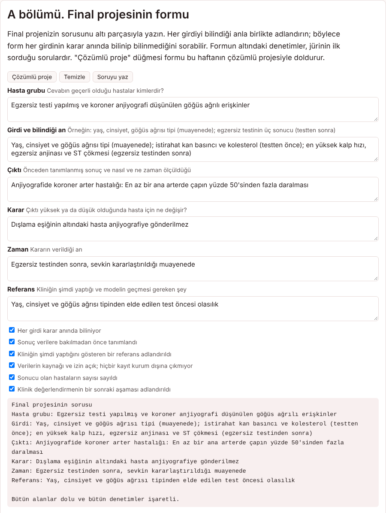
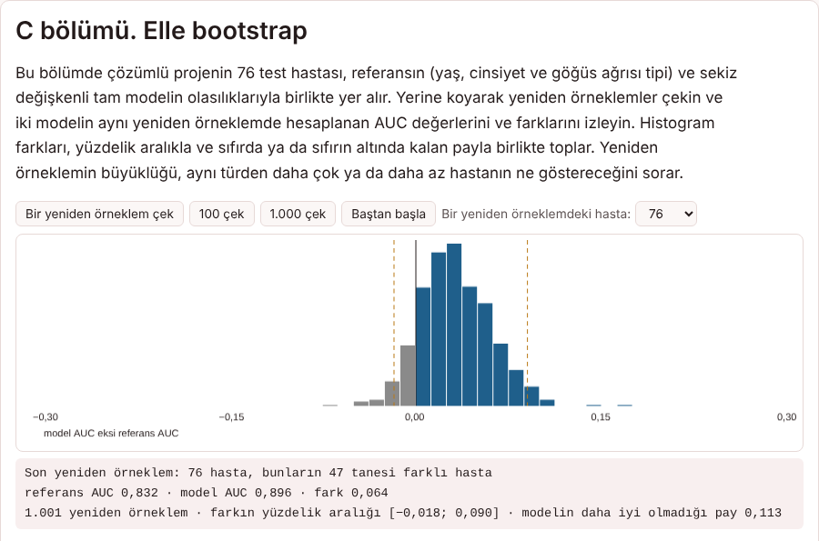

# Hafta 11: Final projesi ve mezuniyet

**Python ile Yapay Zekâ Eğitimi: Kardiyologlar için Uygulamalı Eğitim Programı** 
Türk Kardiyoloji Derneği

*Öğrendiklerinizi gerçek bir klinik problem üzerinde birleştirin*

[Eğitimin ana sayfası](../../README.tr.md) · [İzlence](../../SYLLABUS.tr.md) · [Kurulum](../../SETUP.tr.md) · [English](../../en/week-11/README.md)

## Hafta hakkında

Son hafta dersin yöntemlerini katılımcıların final projelerine dönüştürür. İlk iki saat final projesini geliştirir: Problemin, yani kendi kliniğinizden gerçek bir sorunun seçimi; verilerin hazırlanması ve modelin seçimi; modelin eğitimi, optimizasyonu ve açıklamasının (XAI) entegrasyonu; klinik geçerliliğinin değerlendirilmesinin tasarımı. Mini proje, tek başına ya da grupla yapılan final projesinin kendisidir: Gerçek bir kardiyoloji problemi üzerinde uçtan uca bir AI işlem hattı (pipeline). Hafta boyunca, eğitimin 1. haftadan beri kullandığı Cleveland verisi üzerinde çözümlü bir proje ilerler. Projenin sorusu şudur: Egzersiz testinden sonra rutin değişkenler koroner arter hastalığını dışlayıp koroner anjiyografiye sevki önleyebilir mi? Sekiz değişkenli model testte 0,931 AUC değerine ulaşmaktadır; ancak yaş, cinsiyet ve göğüs ağrısı tipinden oluşan referansa göre kazancının aralığı [−0,020; 0,094] olarak bulunur ve sıfırı içerir. Veriler de Riley ve arkadaşlarının üç ölçütünden ikisinin istediğinden küçüktür. Dışlama eşiğinde model, hastalığı olan hiçbir hastayı kaçırmadan 76 test hastasının 27 tanesinde anjiyografiyi gereksiz kılardı. Son iki saatte final projeleri beşer ile yedişer dakikada sunulur, jüri ve katılımcılar tarafından değerlendirilir; ardından sertifika töreni yapılır ve kardiyoloji AI alanındaki kariyer yolları ve kaynaklarla birlikte gelecek tartışılır. Haftalık proje, sunumu "Klinik Pratiğimde AI Nasıl Kullanacağım?" kişisel eylem planıyla birleştirir. Hafta ayrıca TRIPOD+AI raporlama rehberini, DECIDE-AI'dan randomize bir çalışmaya uzanan klinik değerlendirme aşamalarını ve bir yapay zekâ (YZ) asistanıyla yazılmış bir final projesinin denetlenmesini kapsamaktadır.

Oturum 4 saat sürer ve bunun yarısı sunumlara ayrılır; buna final projesinin süresi eklenir.

## Haftanın vakası

**Cleveland verisindeki 260 numaralı hasta**, göğüs ağrısı hekimi tarafından anjina dışı ağrı olarak sınıflandırılmış 44 yaşında bir kadındır. İstirahat kan basıncı 118 mmHg, kolesterolü 242 mg/dL olarak ölçülmüştür. Egzersiz testinde kalp hızı dakikada 149 atıma ulaşır, anjina ortaya çıkmaz ve ST çökmesi neredeyse yoktur (0,3 mm). Verideki bütün hastalar gibi bu hasta da ardından koroner anjiyografiye gönderilmiştir; anjiyografide hiçbir ana koroner arterde çapın yüzde 50'sinden fazla daralma görülmemiştir. Bu haftanın final projesi böyle bir sevkin önlenip önlenemeyeceğini sormaktadır. Egzersiz testinden sonra rutin değişkenlerle kurulan bir model koroner arter hastalığını güvenle dışlayabilir mi? Model, kardiyoloğun testten önce bildiklerinden, yani yaştan, cinsiyetten ve göğüs ağrısının tipinden daha iyisini yapabilir mi? Çözümlü projenin modeli bu hastaya 0,03, üç değişkenli referans ise 0,05 olasılık verir. Soru, ilk cümlesinden sunumuna kadar hafta boyunca çözümlü bir final projesi olarak ilerler; her katılımcı da aynı adımları kendi sorusuyla atar.

## Malzemeler

| Malzeme | Aç | Ne işe yarar? |
|---|---|---|
| **Ders sayfası** | [Ders sayfasını aç](https://utkukose.github.io/ai-cardiology-tkd-NB-lecture/tr/hafta-11/ders.html) | Haftanın anlatımıdır. Yukarıdan aşağıya okunur, uygulama duraklarına götürür ve kod ya da prompt (istem) içermez. |
| **Etkileşimli lab** | [Etkileşimli labı aç](https://utkukose.github.io/ai-cardiology-tkd-NB-lecture/tr/hafta-11/lab.html) | Kod gerektirmeyen A-F bölümleri, ders sayfasında yeri geldiğinde açılır. F bölümü prompt atölyesidir. Öz değerlendirme ve öğrenme günlüğü de labdadır. |
| **Jupyter Notebook** |  [Jupyter için indir](NB11_final_projesi_atolyesi.ipynb) | Uygulama durakları burada çalışılır: Kısım 1 prompt yolu, Kısım 2 Python yoludur. Jupyter Notebook Google Colab'da kurulum gerektirmeden ya da kendi bilgisayarınızdaki Jupyter'de çalışır. |
| **Prompt kütüphanesi** | [PROMPTLAR.md](PROMPTLAR.md) | Prompt yolunun ve final projesinin bütün promptlarını, kodu onarmak, açıklatmak ve denetlemek için promptlarla birlikte içerir. GitHub'da her promptun yanında bir kopyalama düğmesi bulunur. |
| **PDF ders notu** | [Hafta11_Ders_Notlari.pdf](Hafta11_Ders_Notlari.pdf) | Ders sayfasının yazdırılabilir biçimidir. |

## Çalışma yolu

Ders sayfası yukarıdan aşağıya okunur ve etkileşimli labın bölümlerini yeri geldikçe açar. Her uygulama durağında çalışma Jupyter Notebook'ta, iki yoldan biriyle sürer. **Prompt yolunda** (Jupyter Notebook'un 1. kısmı) kodu hazır promptlarla bir YZ asistanı yazar; katılımcı kodu çalıştırır ve sonucu denetler. **Python yolunda** (2. kısım) kodu katılımcı kendisi yazar. İki yol da aynı sonuçlara varır. Lab bölümlerinin ve Jupyter Notebook'taki durakların sonunda sizi ders sayfasına, okumanın devam ettiği yere geri götüren bir bağlantı vardır. Nerede kaldığınızı bulamazsanız bu tabloya dönün. Oturuma katılanlar adımları oturumda tamamlar. Süreler, haftayı kendi başına izleyenler, örneğin bir oturumu kaçıranlar içindir.

| Adım | Ne yapılır? | Prompt yolu (Kısım 1) | Python yolu (Kısım 2) |
|---|---|---|---|
| 1 | Haftanın vakasını ve ders sayfasını 1. uygulama durağına kadar [okuyun](https://utkukose.github.io/ai-cardiology-tkd-NB-lecture/tr/hafta-11/ders.html) (A bölümüyle problem seçimi, ardından veri hazırlığı ve model seçimi; B bölümüyle veri büyüklüğü ve önce bir referans); bilgi kontrolü sorularını cevaplayın | 45 dakika | 45 dakika |
| 2 | **[1. uygulama durağı: Soru, veriler ve bir referans](https://utkukose.github.io/ai-cardiology-tkd-NB-lecture/tr/hafta-11/ders.html#stop-1)** Model çapraz doğrulamayla seçilir: Önce çözümlü projede, ardından kendi projenizde. | Kısım 1, Durak 1 ([promptlar](PROMPTLAR.md#durak-1-soru-veriler-ve-bir-referans)) 40 dakika | Python adımı 11, 1-4. bölümler 1 saat 25 dakika |
| 3 | 2. uygulama durağına kadar [okumayı sürdürün](https://utkukose.github.io/ai-cardiology-tkd-NB-lecture/tr/hafta-11/ders.html#model-training-optimisation-and-xai-integration) (model eğitimi, optimizasyonu ve XAI entegrasyonu, animasyonla ve C bölümüyle bootstrap, kalibrasyon) | 30 dakika | 30 dakika |
| 4 | **[2. uygulama durağı: Belirsizlik ve kalibrasyon](https://utkukose.github.io/ai-cardiology-tkd-NB-lecture/tr/hafta-11/ders.html#stop-2)** | Kısım 1, Durak 2 ([promptlar](PROMPTLAR.md#durak-2-belirsizlik-ve-kalibrasyon)) 30 dakika | 5. ve 6. bölümler 50 dakika |
| 5 | 3. uygulama durağına kadar [okumayı sürdürün](https://utkukose.github.io/ai-cardiology-tkd-NB-lecture/tr/hafta-11/ders.html#a-decision-threshold-ruling-out) (3B sahneyle dışlama eşiği, modelin neyi kullandığı ve nerede yanılabileceği) | 25 dakika | 25 dakika |
| 6 | **[3. uygulama durağı: Dışlama ve sınırları](https://utkukose.github.io/ai-cardiology-tkd-NB-lecture/tr/hafta-11/ders.html#stop-3)** | Kısım 1, Durak 3 ([promptlar](PROMPTLAR.md#durak-3-d%C4%B1%C5%9Flama-ve-s%C4%B1n%C4%B1rlar%C4%B1)) 30 dakika | 7-10. bölümler 50 dakika |
| 7 | D bölümüyle klinik geçerlilik değerlendirme tasarımını, TRIPOD+AI ile raporlamayı içeren mini projeyi, sunumları, jüri ve katılımcı değerlendirmesini, sertifika törenini, kariyer yollarını ve kaynakları, kişisel eylem planını, E ve F bölümleriyle bir final projesinin denetimini ve haftanın makalesini [okuyun](https://utkukose.github.io/ai-cardiology-tkd-NB-lecture/tr/hafta-11/ders.html#designing-the-clinical-evaluation) | 50 dakika | 50 dakika |
| 8 | [Etkileşimli labın](https://utkukose.github.io/ai-cardiology-tkd-NB-lecture/tr/hafta-11/lab.html) "Kendini sına" sekmesindeki öz değerlendirmeyi yapın, yansıtma yazınızı yazın ve öğrenme günlüğünü dışa aktarın | 20 dakika | 20 dakika |
| | **Haftalık proje dışında toplam** | **4 saat 30 dakika** | **5 saat 55 dakika** |
| 9 | [Final projesinin](#haftal%C4%B1k-proje) slaytlarını tamamlayın ve sunumun provasını D bölümündeki değerlendirme ölçütleri ve süre ölçerle yapın; rapor ve kod oturumdan sonraki bir hafta içinde gönderilir | [Promptlar](PROMPTLAR.md#haftal%C4%B1k-projenin-prompt-yolu) 1 saat | 1 saat |

<table>
<tr><td width="50%"></td><td width="50%"></td></tr>
<tr><td>Etkileşimli lab, A bölümü: Bir final projesinin yapılandırılmış sorusu ve denetimleriyle proje formu.</td><td>Etkileşimli lab, C bölümü: 76 test hastasında elle bootstrap; yeniden örneklemler, model ile referans arasındaki farkın histogramı ve aralığı. Veri: UCI Heart Disease, Cleveland, CC BY 4.0.</td></tr>
<tr><td width="50%"></td><td width="50%"></td></tr>
<tr><td>Etkileşimli lab, D bölümü: Klinik değerlendirme planlayıcısı ve süre ölçeriyle birlikte sunumun değerlendirme ölçütleri.</td><td>Ders sayfası: On hastada adım adım bootstrap; tek bir yeniden örneklemden yüzdelik aralığa.</td></tr>
</table>

## Haftalık proje

**Proje.** Final proje sunumu + "Klinik Pratiğimde AI Nasıl Kullanacağım?" kişisel eylem planı.

**Ne yapılacak?** [Final projesi sayfasında](../final-projesi/README.md) anlatılan final projesini bu haftanın çözümlü projesindeki adımlarla tamamlayın. Soruyu hasta grubu, girdisi, çıktısı, desteklediği karar ve zamanıyla birlikte yazın; verileri denetleyin; büyüklüklerini Riley ve arkadaşlarının ölçütleriyle sınayın; modeli basit bir referansla karşılaştırın; her sonucu bir aralıkla verin; kalibrasyonu denetleyin; model bir karara destek oluyorsa eşiğini yalnızca eğitim verilerinde seçin; modelin neyi kullandığını ve nerede yanılabileceğini bildirin ve klinik değerlendirmenin bir sonraki aşaması için bir plan yazın. Projeyi oturumda beş ile yedi dakika arasında sunun.

**Nereye bakılacak?** Ders sayfasının tamamına, özellikle "Veri hazırlığı ve model seçimi", "Model eğitimi, optimizasyonu ve XAI entegrasyonu", "Klinik geçerlilik değerlendirme tasarımı", "TRIPOD+AI ile raporlama" alt bölümüyle mini proje, "Final proje sunumları (5–7 dakika/kişi)" ve "Final proje sunumu ve kişisel eylem planı" bölümlerine bakın. Etkileşimli labda A-D bölümleri yardımcı olur. Jupyter Notebook'ta Kısım 1'in 1-3. duraklarını ya da Kısım 2'nin 1-10. bölümlerini ve Kısım 2'nin sonundaki seçeneklerin başlangıç noktalarını kullanın.

**Prompt yolu.** Final projesi [prompt kütüphanesindeki](https://github.com/utkukose/ai-cardiology-tkd-NB-lecture/blob/main/tr/hafta-11/PROMPTLAR.md#haftal%C4%B1k-projenin-prompt-yolu) promptlarla da kurulabilir: Her adım için bir prompt olmak üzere dört prompt vardır ve promptların veri alanları kendi projenizin verileri için yeniden yazılır. Bir promptun testi sağlanmadan sonraki prompta geçilmez; hiçbir prompt gerçek hastaların verilerini içermez.

**Örnek.** 76 test hastasında yaş, cinsiyet ve göğüs ağrısı tipinden oluşan referans 0,900 [0,824; 0,959], sekiz değişkenli model ise 0,931 [0,872; 0,977] AUC değerine ulaşmaktadır. Fark 0,031 [−0,020; 0,094] olarak bulunur ve aralık sıfırı içerir: Bu verilerde model referanstan açıkça daha iyi değildir. Eğitim hastalarında seçilen 0,18 dışlama eşiğinde model, hastalığı olan 35 hastanın hiçbirini kaçırmadan 76 test hastasının 27 tanesini dışlar. 1 olarak ölçülen duyarlılığın aralığı [0,901; 1,000], yine 1 olarak ölçülen negatif öngörü değerinin aralığı ise [0,875; 1,000] olarak bulunur.

**Ne teslim edilecek?** Oturumdan önce sunumun slaytları teslim edilir. Oturumdan sonraki bir hafta içinde [rapor şablonuyla](../sablonlar/Rapor_Sablonu.docx) yazılmış dört ile altı sayfalık rapor, her sonucu yeniden üreten Jupyter Notebook ya da betikler ve YZ kullanım günlüğü (araç, prompt, neyin denetlendiği, neyin değiştirildiği) gönderilir. Rapor yarım sayfalık kişisel eylem planıyla biter. Gerçek hastaların verileri hiçbir zaman katılımcının bilgisayarından çıkmaz; raporda yalnızca toplu sonuçlar yer alır.

**Teslim.** Slaytlar oturumdan önce; rapor, kod ve YZ kullanım günlüğü ise oturumdan sonraki bir hafta içinde utkukose@sdu.edu.tr ya da utkukose@gmail.com adresine e-postayla gönderilir. Final projesi değerlendirmenin yüzde 40'ını oluşturur; değerlendirme ölçütleri final projesi sayfasında yer almaktadır.

## Öğrenme çıktıları

Haftanın sonunda katılımcıların klinik bir soruyu hasta grubu, girdisi, çıktısı, desteklediği karar ve zamanıyla birlikte, verilerin cevaplayabileceği bir biçimde sorabilmeleri beklenmektedir. Bir veri setini eksik değerler, sonucun tanımı ve sızıntı açısından denetleyebilmeli, Riley ve arkadaşlarının ölçütleriyle bir tahmin modeli için yeterince büyük olup olmadığına karar verebilmeli, bir modeli eğitim verilerinde çapraz doğrulamayla seçip optimize edebilmeli ve basit bir referansla karşılaştırabilmelidirler. Sonuçlarının belirsizliğini bootstrap ve Wilson aralıklarıyla verebilmeli, bir modelin kalibrasyonunu denetleyebilmeli, eğitim verilerinde bir karar eşiği seçebilmeli, her tahminin açıklamasını projeye entegre edebilmeli ve modelin neyi kullandığını ve nerede yanılabileceğini bildirebilmelidirler. Son olarak bir tahmin modelini TRIPOD+AI ile raporlayabilmeli, klinik geçerliliğinin değerlendirilmesini tasarlayabilmeli, bir projeyi beş ile yedi dakikada sunabilmeli, başkalarının projelerini değerlendirebilmeli, kardiyoloji AI alanındaki kariyer yollarını ve kaynakları sayabilmeli ve yapay zekânın kendi uygulamalarında kullanımı için kişisel bir eylem planı yazabilmelidirler.

## Oturumun eğitim akışı

Haftanın dört saatlik oturumu aşağıdaki plana göre işlenir. Plan, malzemelerin canlı bir oturumda nasıl bir araya geldiğini göstermek için paylaşılmaktadır.

| Süre | Etkinlik |
|---|---|
| 0:00-0:15 | Haftanın vakası ve oturumun planı tanıtılır. Her katılımcı Jupyter Notebook'u Jupyter'de (Anaconda) açar ve 0. bölümü çalıştırır; Cleveland verisi eğitimle birlikte geldiği için hiçbir şey indirilmez. |
| 0:15-0:55 | İlk iki saat, final proje geliştirme: A bölümüyle problem seçimi, yani kendi kliniğinizden gerçek bir soru; veri denetimi, B bölümüyle veri büyüklüğü, önce bir referans ve modelin çapraz doğrulamayla seçimiyle veri hazırlığı ve model seçimi; ardından C bölümüyle eğitim, optimizasyon ve bootstrap. |
| 0:55-1:35 | Mini proje, uçtan uca bir AI işlem hattı olarak final projesi, 1. ve 2. uygulama durakları: Katılımcılar kendi projelerini çözümlü projenin adımlarıyla tek başlarına ya da gruplarıyla denetler; eğitmen her grubu ziyaret eder. |
| 1:35-1:55 | İlk iki saatin devamı: Kalibrasyon, dışlama eşiği, modelin neyi kullandığı ve nerede yanılabileceğiyle XAI entegrasyonu, D bölümüyle klinik geçerlilik değerlendirme tasarımı ve TRIPOD+AI ile rapor. |
| 1:55-2:05 | Ara. |
| 2:05-3:30 | Son iki saat, sunum, kapanış ve gelecek tartışmaları: Final proje sunumları, kişi başına beş ile yedi dakika sunum ve üç dakika soru; jüri ve katılımcılar her sunumu final projesi sayfasındaki ölçütlerle değerlendirir. |
| 3:30-3:45 | Kardiyoloji AI alanında kariyer yolları ve kaynaklar ile "Klinik Pratiğimde AI Nasıl Kullanacağım?" kişisel eylem planları: Her katılımcı kliniğinde başlatacağı bir yapay zekâ kullanımını ve onun ilk adımını söyler. |
| 3:45-4:00 | Sertifika töreni: Program kapanır ve sertifikalar verilir. |

## Kendi verinizle

Ders sayfası, haftanın yöntemlerini kendi verinize nasıl uygulayacağınızı anlatan bir bölümle biter. Bu bölümde hangi sorunun hangi yönteme uyduğu, önce neyin denetleneceği, etik kurul onayı, Kişisel Verilerin Korunması Kanunu (KVKK) ve analizin nerede yapılacağı ele alınır. [Bölümü ders sayfasında okuyun](https://utkukose.github.io/ai-cardiology-tkd-NB-lecture/tr/hafta-11/ders.html#with-your-own-data).

## İsteğe bağlı araştırma ödevi

PubMed'de, 2020 ya da sonrasında yayımlanmış, kardiyovasküler bir tahmin modelini bildiren ve TRIPOD ya da TRIPOD+AI rehberine atıf yapan bir çalışma bulun. Çalışmayı TRIPOD+AI'ın beş maddesiyle karşılaştırın; bu maddeler verilerin kaynağı, çalışmanın büyüklüğü, eksik değerlerin ele alınışı, aralıklarıyla birlikte başarım ölçütleri ve kalibrasyondur. Çalışmanın neyi iyi bildirdiğini ve neyin eksik kaldığını yarım sayfada özetleyin. Ödev notlandırılmaz ve final projesinin raporunu yazmaya yardımcı olur.

## Bu haftadan sonra sanal klinik

11. haftada sanal klinik yerini katılımcıların kliniklerine bırakır. Her final projesi kendi başına yeni bir birimdir ve gerçek bir kliniğin sorusunu, verisini, referansıyla birlikte bir modeli, sonuçlarının belirsizliğini, bir açıklamayı, sınırlarını ve klinik değerlendirmesinin planını içerir. Bu haftanın çözümlü projesi böyle bir birimin biçimini açık veriler üzerinde göstermektedir. Projenin dışlama modelinin testteki duyarlılığı 1, bu değerin alt sınırı ise 0,901 düzeyindedir. Modelin referansa göre kazancı belirsizdir; sonraki adımı da klinikte kullanım değil, bir dış doğrulama ve tek bir klinikte yapılacak sessiz bir çalıştırmadır.

## Eğitimden sonra

Malzemeler eğitimden sonra da açık kalır. Her hafta çalışma yoluyla yeniden izlenebilir; eğitim de alandaki güncel gelişmelere göre güncellenmektedir. Ayrıntılar için [eğitimin planına](../../README.tr.md#on-bir-hafta) bakabilirsiniz.

---

**Prof. Dr. Utku Köse**

Profesör, Bilgisayar Mühendisliği Bölümü, Süleyman Demirel Üniversitesi, Isparta, Türkiye 
Kurucu Müdür, Yapay Zekâ Uygulama ve Araştırma Merkezi (YAZEM), Süleyman Demirel Üniversitesi 
Bilgisayar Bilimleri Anabilim Dalı Başkanı, Bilgisayar Mühendisliği Bölümü, Süleyman Demirel Üniversitesi 
Diğer kurumlar: University of North Dakota (ABD), Universidad Panamericana (Meksiko, Meksika), Vel Tech University (Chennai, Hindistan) 
IEEE Kıdemli Üyesi, ACM Profesyonel Üyesi

[ORCID 0000-0002-9652-6415](https://orcid.org/0000-0002-9652-6415) | [utkukose.com](https://www.utkukose.com) | [github.com/utkukose](https://github.com/utkukose)

[utkukose@sdu.edu.tr](mailto:utkukose@sdu.edu.tr) | [utku.kose@und.edu](mailto:utku.kose@und.edu) | [ukose@up.edu.mx](mailto:ukose@up.edu.mx) | [utkukose@gmail.com](mailto:utkukose@gmail.com)

*İlk sürüm: Kasım 2026. İçerik CC BY 4.0, kod MIT.*

